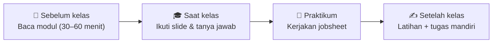

# 🧭 Cara Belajar dengan Repositori Ini

[🏠 Beranda](../README.md)

Halaman ini menjelaskan cara memakai repositori materi kuliah ini secara efektif, terutama jika Anda **baru pertama kali memakai GitHub** atau **baru pertama kali belajar pemrograman mobile**.

---

## 1. Isi Setiap Folder Pertemuan

Setiap pertemuan memiliki folder sendiri, misalnya `pertemuan_01_pengenalan_flutter/`. Isinya selalu sama:

| Ikon | Berkas / folder | Isi | Kapan dipakai |
| :---: | :--- | :--- | :--- |
| 📖 | `README.md` | **Modul bacaan**: penjelasan konsep dari nol, lengkap dengan analogi, diagram, dan contoh | **Sebelum** kelas |
| 📊 | `slide/` | **Slide presentasi** (.pptx) yang ditayangkan dosen | **Saat** kelas |
| 💻 | `kode/` | **Contoh kode siap jalan**: satu konsep = satu berkas utuh | Saat kelas dan saat belajar mandiri |
| 🧪 | `JOBSHEET.md` | **Panduan praktikum** langkah demi langkah, ditambah tugas mandiri | **Saat** praktikum |
| ✍️ | `LATIHAN.md` | **Soal latihan** untuk mengukur pemahaman | **Setelah** kelas |

> [!TIP]
> Di GitHub, berkas `README.md` di dalam sebuah folder **langsung tampil** saat folder itu dibuka. Jadi, cukup klik folder pertemuan dan modulnya akan langsung terbaca.

## 2. Rutinitas Belajar yang Disarankan



1. **Sebelum kelas**: baca modul sekilas. Tidak harus paham semuanya; tandai bagian yang membingungkan.
2. **Saat kelas**: fokus pada bagian yang tadi Anda tandai, lalu tanyakan.
3. **Saat praktikum**: ikuti jobsheet **berurutan** dan cocokkan setiap *checkpoint*.
4. **Setelah kelas**: kerjakan latihan **tanpa melihat modul**, lalu periksa kembali bagian yang masih salah.

## 3. Cara Menyalin Kode dari GitHub

1. Buka berkas kode yang diinginkan, misalnya `kode/02_materialapp_dan_scaffold.dart`.
2. Di pojok kanan atas tampilan kode, klik tombol **Copy raw file** (ikon dua kotak bertumpuk).
3. Tempelkan (`Ctrl` + `V`) ke tempat yang dituju: `lib/main.dart` di proyek Flutter Anda, atau editor DartPad.

Langkah menjalankannya dijelaskan di **[Panduan Menjalankan Kode Contoh](03_menjalankan_kode_contoh.md)**.

> [!IMPORTANT]
> **Salin untuk menjalankan, ketik untuk belajar.** Menyalin kode memang praktis untuk melihat hasilnya. Namun, saat mengerjakan jobsheet, **ketik ulang** kodenya. Kebiasaan ini membuat Anda jauh lebih cepat mengenali sintaks dan kesalahan.

## 4. Cara Mengunduh Slide

Di [Beranda](../README.md), setiap pertemuan memiliki dua tautan slide:

- **⚡ Unduh**: berkas `.pptx` langsung terunduh ke komputer atau HP Anda.
- **👁️ Lihat**: slide dibuka di browser lewat penampil Microsoft Office *online*, tanpa perlu memasang PowerPoint.

## 5. Cara Mengunduh Seluruh Materi

- **Tanpa Git:** di halaman utama repositori, klik tombol hijau **Code → Download ZIP**, lalu ekstrak.
- **Dengan Git** (disarankan, agar mudah mendapat pembaruan):

```bash
git clone https://github.com/antonprafanto/mobile2026.git
```

Setiap ada materi baru, cukup jalankan `git pull` di dalam folder tersebut.

## 6. Tips Belajar Pemrograman untuk Pemula

1. **Error itu normal.** Programmer berpengalaman pun melihat error setiap hari. Bedanya, mereka **membaca** pesan error-nya.
2. **Ubah satu hal, lalu amati.** Ganti satu angka, satu warna, atau satu teks, lalu jalankan. Eksperimen kecil adalah guru terbaik.
3. **Jangan menunggu paham 100%** sebelum mencoba. Pemahaman sering datang setelah mencoba.
4. **Catat** istilah baru di buku catatan Anda sendiri. Glosarium di setiap modul bisa membantu.
5. **Belajar bersama.** Menjelaskan konsep kepada teman adalah cara paling ampuh untuk memastikan Anda sendiri paham.

## 7. Memakai Asisten AI dengan Bijak

Asisten AI (seperti ChatGPT, Gemini, atau Claude) bisa menjadi **tutor** yang sabar, tetapi jangan dijadikan **joki**. Selalu ikuti aturan dosen tentang penggunaan AI dalam tugas.

| ✅ Pemakaian yang membangun | ❌ Pemakaian yang merugikan diri sendiri |
| :--- | :--- |
| "Jelaskan arti error ini dengan bahasa sederhana." | Menyalin seluruh jawaban tugas tanpa memahaminya |
| "Apa beda `final` dan `const`? Beri analogi." | Menempelkan kode dari AI yang tidak bisa Anda jelaskan sendiri |
| "Periksa kode saya, di mana kemungkinan salahnya?" | Percaya begitu saja tanpa menguji jawabannya |

**Ujian sebenarnya:** jika dosen meminta Anda menjelaskan setiap baris kode Anda, apakah Anda bisa?

## 8. Cara Bertanya yang Baik

Pertanyaan yang jelas akan dijawab lebih cepat dan tepat. Gunakan format berikut saat bertanya ke dosen, asisten, atau forum:

```text
Pertemuan / bagian : Jobsheet 1, Langkah D3
Yang saya lakukan  : Menambahkan Card berisi ListTile
Yang saya harapkan : Muncul kartu berisi 3 baris informasi
Yang terjadi       : Garis merah di baris 45
Pesan error        : (salin-tempel pesan error LENGKAP, jangan hanya "error")
Yang sudah dicoba  : Format Document, cek pasangan kurung
Screenshot         : (lampirkan)
```

---

## Daftar Panduan

1. 🧭 **Cara Belajar dengan Repositori Ini** (halaman ini)
2. 🛠️ [Panduan Instalasi Flutter di Windows](02_instalasi_flutter_windows.md)
3. ▶️ [Panduan Menjalankan Kode Contoh](03_menjalankan_kode_contoh.md)
4. 🩺 [Panduan Troubleshooting (Mengatasi Masalah)](04_troubleshooting.md)

[🏠 Beranda](../README.md)
