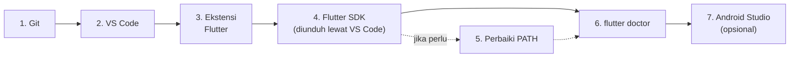

# 🛠️ Panduan Instalasi Flutter di Windows

> Versi acuan: **Flutter 3.47 (stable)** dan **Dart 3.13**, mengikuti cara resmi di [docs.flutter.dev](https://docs.flutter.dev/install/quick).
> Memakai macOS atau Linux? Lihat [bagian 9](#9-pengguna-macos-dan-linux).

[🏠 Beranda](../README.md) · [📚 Daftar Panduan](01_cara_belajar.md#daftar-panduan)

---

## Gambaran Umum



- Langkah **1–4 dan 6 wajib**, dan sudah cukup untuk menjalankan aplikasi di Google Chrome.
- Langkah **5** hanya dikerjakan jika perintah `flutter` tidak dikenali oleh terminal.
- Langkah **7 opsional**, hanya jika Anda ingin menjalankan aplikasi di HP Android atau emulator.
- Langkah **8** baru diperlukan nanti, jika muncul pesan tentang *symlink* saat proyek mulai memakai *plugin*.

---

## 0. Persiapan

| Kebutuhan | Keterangan |
| :--- | :--- |
| Sistem operasi | Windows 10 atau 11, 64-bit |
| Ruang kosong | Sekitar 10 GB (sekitar 25 GB jika juga memasang Android Studio dan emulator) |
| Internet | Stabil. Proses unduh bisa mencapai beberapa GB. |
| Browser | Google Chrome versi terbaru |

> [!TIP]
> Siapkan satu folder khusus untuk alat-alat pemrograman, misalnya `C:\Users\NamaAnda\develop`. **Hindari** folder yang namanya mengandung spasi atau karakter khusus, dan **jangan** memakai `C:\Program Files\`.

---

## 1. Pasang Git for Windows

1. Unduh dari <https://git-scm.com/downloads/win>.
2. Jalankan pemasang. Untuk pemula, **pilihan bawaan (*default*) sudah tepat**: cukup klik **Next** sampai selesai.
3. Buka **PowerShell** (tekan tombol Windows, ketik `PowerShell`), lalu periksa:

```powershell
git --version
```

✅ Berhasil jika muncul tulisan seperti `git version 2.xx.x.windows.x`.

---

## 2. Pasang Visual Studio Code

1. Unduh dari <https://code.visualstudio.com> (pilih **Windows**).
2. Jalankan pemasang. Pastikan opsi **Add to PATH** tercentang (biasanya sudah tercentang otomatis).
3. Buka VS Code setelah selesai.

> [!NOTE]
> **Visual Studio Code** berbeda dengan **Visual Studio**. Yang kita butuhkan adalah Visual Studio *Code* (editor ringan berwarna biru). Visual Studio (IDE besar berwarna ungu) hanya diperlukan jika Anda ingin membuat aplikasi desktop Windows.

---

## 3. Pasang Ekstensi Flutter

1. Di VS Code, buka panel **Extensions**: klik ikon kotak-kotak di sisi kiri, atau tekan `Ctrl` + `Shift` + `X`.
2. Ketik `Flutter` di kotak pencarian.
3. Pilih ekstensi **Flutter** dengan penerbit **Dart Code**, lalu klik **Install**.

Ekstensi **Dart** akan ikut terpasang secara otomatis.

---

## 4. Unduh Flutter SDK Lewat VS Code

Ini cara resmi yang paling mudah karena VS Code mengurus unduhan **dan** pengaturan PATH.

1. Buka **Command Palette**: menu **View → Command Palette**, atau tekan `Ctrl` + `Shift` + `P`.
2. Ketik `flutter`, lalu pilih **Flutter: New Project**.
3. Muncul pemberitahuan bahwa Flutter SDK belum ditemukan. Klik **Download SDK**.
4. Pada jendela **Select Folder for Flutter SDK**, pilih folder yang sudah disiapkan (misalnya `C:\Users\NamaAnda\develop`).
5. Klik **Clone Flutter**. Muncul pesan *"Downloading the Flutter SDK. This may take a few minutes."* Tunggu sampai selesai.
6. Saat ditawari, klik **Add SDK to PATH**. Jika berhasil, muncul pesan *"The Flutter SDK was added to your PATH"*.
7. Jika muncul pemberitahuan Google Analytics, klik **OK** bila Anda setuju.
8. **Tutup semua jendela terminal, lalu tutup dan buka kembali VS Code.** Langkah ini penting agar pengaturan PATH yang baru terbaca.

> [!TIP]
> Jika unduhan terasa macet terlalu lama, klik **Cancel**, lalu ulangi dari langkah 1.

<details>
<summary>🔧 <b>Alternatif:</b> memasang Flutter SDK secara manual (tanpa bantuan VS Code)</summary>

1. Buka halaman <https://docs.flutter.dev/install/manual>, lalu unduh berkas `.zip` Flutter SDK versi stable untuk Windows.
2. Ekstrak ke folder `C:\Users\NamaAnda\develop`, misalnya lewat PowerShell (sesuaikan nama berkasnya):

   ```powershell
   Expand-Archive `
     -Path "$env:USERPROFILE\Downloads\flutter_windows_3.47.7-stable.zip" `
     -DestinationPath "$env:USERPROFILE\develop"
   ```

3. Tambahkan folder `C:\Users\NamaAnda\develop\flutter\bin` ke PATH (lihat [bagian 5](#5-jika-perintah-flutter-tidak-dikenali)).
4. Jika berkas `flutter.bat` tidak ada di folder `bin` setelah diekstrak, kemungkinan **antivirus** mengkarantinanya. Izinkan folder Flutter di pengaturan antivirus, lalu ekstrak ulang.
</details>

---

## 5. Jika Perintah `flutter` Tidak Dikenali

Gejalanya, terminal menampilkan:

```text
'flutter' is not recognized as an internal or external command,
operable program or batch file.
```

Lakukan pengecekan berurutan:

1. **Sudah menutup dan membuka ulang** semua terminal dan VS Code? Ini penyebab paling umum.
2. Jika masih gagal, tambahkan PATH secara manual:
   1. Tekan `Windows` + `Pause` (atau `Windows` + `Fn` + `B`), lalu pilih **Advanced system settings → Advanced → Environment Variables...**. Cara lain: tekan tombol Windows, ketik `environment`, lalu pilih **Edit the system environment variables**.
   2. Di bagian **User variables**, pilih **Path**, lalu klik **Edit**.
   3. Klik **New**, lalu isi dengan lokasi folder `bin` Flutter, misalnya `C:\Users\NamaAnda\develop\flutter\bin`.
   4. Klik **Move Up** sampai entri tersebut berada di urutan paling atas, lalu klik **OK** tiga kali.
   5. Tutup dan buka ulang semua terminal dan VS Code.
3. Periksa kembali:

```powershell
flutter --version
dart --version
```

> [!TIP]
> Jika VS Code menampilkan pemberitahuan bahwa Flutter SDK tidak ditemukan, klik tombol **Locate SDK** pada pemberitahuan tersebut, lalu tunjukkan folder `flutter` yang sudah terunduh.

---

## 6. Verifikasi dengan `flutter doctor`

Buka terminal (di VS Code: menu **Terminal → New Terminal**), lalu jalankan:

```powershell
flutter doctor
```

Contoh hasil pada laptop yang **belum** memasang Android Studio dan Visual Studio:

```text
Doctor summary (to see all details, run flutter doctor -v):
[✓] Flutter (Channel stable, 3.47.7, on Microsoft Windows ..., locale id-ID)
[✓] Windows Version (...)
[✗] Android toolchain - develop for Android devices
    ✗ Unable to locate Android SDK.
      ...
[✓] Chrome - develop for the web
[✗] Visual Studio - develop Windows apps
    ✗ Visual Studio not installed; this is necessary to develop Windows apps.
      ...
[✓] Connected device (3 available)
[✓] Network resources

! Doctor found issues in 2 categories.
```

**Cara membacanya:**

| Baris | Wajib `[✓]`? | Keterangan |
| :--- | :---: | :--- |
| Flutter | ✅ Ya | Inti dari semuanya. |
| Chrome - develop for the web | ✅ Ya | Untuk menjalankan aplikasi di browser selama kuliah. |
| Android toolchain | Opsional | Hanya jika ingin menjalankan di HP Android atau emulator ([bagian 7](#7-opsional-menyiapkan-android)). |
| Visual Studio - develop Windows apps | Tidak | Hanya untuk membuat aplikasi desktop Windows. **Abaikan.** |

Jika baris **Flutter** dan **Chrome** sudah `[✓]`, **selamat, alat Anda siap dipakai!** 🎉

Butuh detail lebih lengkap? Jalankan `flutter doctor -v`.

---

## 7. (Opsional) Menyiapkan Android

Lakukan bagian ini jika Anda ingin menjalankan aplikasi di **HP Android asli** (disarankan) atau di **emulator**.

### 7.1 Pasang Android Studio dan komponen SDK

1. Unduh dan pasang **Android Studio** versi stabil terbaru dari <https://developer.android.com/studio>.
2. Buka Android Studio. Di layar *Welcome*, klik **More Actions → SDK Manager**.
3. Tab **SDK Platforms**: pastikan versi Android dengan **API Level 36** tercentang dan terpasang.
4. Tab **SDK Tools**: pastikan item berikut tercentang:
   - Android SDK Build-Tools
   - Android SDK Command-line Tools
   - Android Emulator
   - Android SDK Platform-Tools
   - CMake
   - NDK (Side by side)
5. Klik **Apply**, lalu **OK**, tunggu unduhan selesai, dan klik **Finish**.

### 7.2 Setujui lisensi Android

```powershell
flutter doctor --android-licenses
```

Ketik `y` lalu `Enter` untuk setiap lisensi sampai muncul pesan `All SDK package licenses accepted.`

### 7.3 Menyambungkan HP Android lewat kabel USB

1. Di HP, buka **Setelan → Tentang ponsel**, lalu ketuk **Nomor bentukan** (*Build number*) 7 kali sampai muncul pesan bahwa Anda sudah menjadi pengembang. (Letak menu berbeda-beda di tiap merek; cari dengan kata kunci "build number" atau "nomor versi".)
2. Buka **Opsi pengembang** (*Developer options*), lalu aktifkan **Debugging USB**.
3. Sambungkan HP ke komputer dengan **kabel data** (bukan kabel yang hanya untuk mengisi daya).
4. Di HP muncul dialog *"Izinkan debugging USB?"*. Ketuk **Izinkan**.
5. Di terminal komputer, jalankan `flutter devices`. HP Anda harus muncul di daftar.

> [!NOTE]
> Beberapa merek HP membutuhkan *driver* USB khusus di Windows (*OEM USB driver*). Jika HP tidak terdeteksi, cari *driver* resmi dari produsen HP Anda.

### 7.4 Emulator (hanya untuk komputer yang kuat)

Emulator membutuhkan RAM yang besar (disarankan 16 GB). Jika komputer Anda memenuhi syarat:

1. Di Android Studio, buka **More Actions → Virtual Device Manager**.
2. Klik **+** (**Create Virtual Device**), pilih model HP, lalu pilih *system image* (klik ikon unduh jika perlu).
3. Di **Additional settings**, atur **Graphics acceleration** ke opsi yang mengandung kata **Hardware**.
4. Klik **Finish**, lalu jalankan emulator dengan tombol ▶️.

---

## 8. (Opsional) Aktifkan Developer Mode Windows

Saat proyek mulai memakai *plugin* (paket yang mengakses fitur perangkat, dibahas di pertemuan-pertemuan berikutnya), Flutter di Windows membutuhkan dukungan *symlink*. Jika muncul pesan:

```text
Building with plugins requires symlink support.

Please enable Developer Mode in your system settings. Run
  start ms-settings:developers
to open settings.
```

Jalankan perintah berikut, lalu aktifkan **Developer Mode** di jendela yang terbuka:

```powershell
start ms-settings:developers
```

---

## 9. Pengguna macOS dan Linux

Langkah besarnya sama: pasang Git, VS Code, ekstensi Flutter, lalu unduh SDK lewat VS Code. Ikuti panduan resmi yang sesuai:

- Panduan cepat (semua sistem operasi): <https://docs.flutter.dev/install/quick>
- Pengaturan tambahan Android: <https://docs.flutter.dev/platform-integration/android/setup>

---

## ✅ Checklist Akhir

- [ ] `git --version` menampilkan versi Git.
- [ ] VS Code dan ekstensi Flutter terpasang.
- [ ] `flutter --version` menampilkan Flutter 3.47.x (atau lebih baru) dan Dart 3.13.x.
- [ ] `flutter doctor` menunjukkan `[✓]` pada baris **Flutter** dan **Chrome**.
- [ ] (Opsional) HP Android terdeteksi oleh `flutter devices`.

Masih menemui kendala? Buka **[Panduan Troubleshooting](04_troubleshooting.md)**.

---

[🏠 Beranda](../README.md) · [➡️ Menjalankan Kode Contoh](03_menjalankan_kode_contoh.md)
