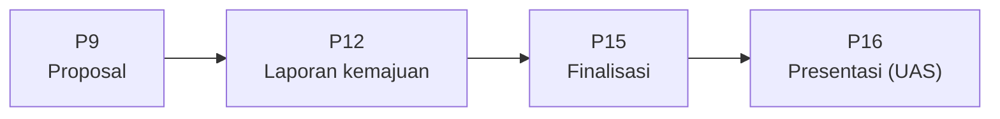

# 🚀 Panduan Proyek Akhir

[🏠 Beranda](../README.md) · [📚 Daftar Panduan](01_cara_belajar.md#daftar-panduan) · [📋 Silabus](../SILABUS.md#5-proyek-akhir)

Mulai [Pertemuan 9](../pertemuan_09_state_dan_mvvm/README.md), Anda mengerjakan **satu aplikasi Flutter utuh** untuk sebuah masalah nyata. Aplikasi ini dikerjakan bertahap sampai Ujian Akhir Semester (Pertemuan 16) dan menjadi bagian terbesar nilai Anda. Halaman ini menjelaskan apa yang dibuat, kapan dikumpulkan, cara menulis proposal, dan cara proyek dinilai.

> [!IMPORTANT]
> Hal teknis seperti **individu atau kelompok**, **jumlah anggota**, **tempat pengumpulan**, dan **tenggat** mengikuti arahan dosen di kelas. Jika ada perbedaan antara halaman ini dan arahan dosen, **arahan dosen yang berlaku**.

---

## Daftar Isi

1. [Gambaran Singkat](#1-gambaran-singkat)
2. [Syarat Minimal Aplikasi](#2-syarat-minimal-aplikasi)
3. [Jadwal dan Tahapan](#3-jadwal-dan-tahapan)
4. [Memilih Tema](#4-memilih-tema)
5. [Memilih Sumber Data (REST API)](#5-memilih-sumber-data-rest-api)
6. [Menulis Proposal](#6-menulis-proposal)
7. [Struktur Repositori Proyek](#7-struktur-repositori-proyek)
8. [Bekerja dengan Git](#8-bekerja-dengan-git)
9. [Penilaian](#9-penilaian)
10. [Memakai AI dengan Jujur](#10-memakai-ai-dengan-jujur)
11. [Pertanyaan yang Sering Diajukan](#11-pertanyaan-yang-sering-diajukan)
12. [Daftar Periksa Setiap Tahap](#12-daftar-periksa-setiap-tahap)

---

## 1. Gambaran Singkat

| | Keterangan |
| :--- | :--- |
| **Apa** | Satu aplikasi Flutter utuh yang menyelesaikan masalah nyata, misalnya katalog produk UMKM, presensi kegiatan organisasi, pencatat keuangan mahasiswa, atau informasi jadwal kuliah |
| **Siapa** | Individu atau kelompok kecil (misalnya 2–3 orang), sesuai arahan dosen |
| **Kapan** | Proposal di Pertemuan 9, presentasi di Pertemuan 16 |
| **Bobot** | **40%** dari nilai akhir (proyek akhir + UAS) |
| **Hasil akhir** | Repositori Git berisi kode, *unit test*, `README.md`, berkas rilis, dan demo langsung saat UAS |

Bayangkan proyek akhir seperti **membangun rumah**:

| Tahap proyek | Analogi rumah | Pertemuan |
| :--- | :--- | :---: |
| Proposal | **Denah**: berapa kamar, untuk siapa, bahan dari mana | 9 |
| Laporan kemajuan | **Rangka berdiri**: dinding dan atap sudah ada, walaupun belum dicat | 12 |
| Finalisasi | **Rumah siap huni**: lengkap, rapi, dan sudah diperiksa | 15 |
| Presentasi | **Serah terima kunci**: Anda menunjukkan dan menjelaskan setiap bagiannya | 16 |

Rumah yang denahnya jelas jauh lebih mudah dibangun. Karena itu, proposal ditulis dengan sungguh-sungguh walaupun belum ada satu baris kode pun.

---

## 2. Syarat Minimal Aplikasi

Aplikasi Anda **wajib** memenuhi enam syarat berikut ([Silabus Bagian 5](../SILABUS.md#5-proyek-akhir)):

| No | Syarat | Dipelajari di | Cara membuktikannya saat demo |
| :---: | :--- | :--- | :--- |
| 1 | Minimal **tiga halaman** dengan navigasi yang jelas | Pertemuan 6 | Berpindah antarhalaman sambil membawa data, lalu kembali |
| 2 | Tampilan mengikuti **Material Design 3** dan nyaman di **ukuran layar berbeda** | Pertemuan 7 | Tampilan di lebar 360 dan ≥ 840, dalam mode terang dan gelap |
| 3 | Mengambil data dari **REST API** dan menyimpan sebagian data **di perangkat** | Pertemuan 10 dan 11 | Data dari internet tampil; data yang disimpan tetap ada setelah aplikasi ditutup lalu dibuka lagi |
| 4 | Kode tertata dengan pola **MVVM** atau ***Clean Architecture*** | Pertemuan 9 dan 12 | Struktur folder; View, ViewModel, dan *repository* terpisah |
| 5 | Minimal **tiga *unit test*** yang lulus | Pertemuan 9 (pola siapkan–lakukan–periksa) dan 14 (`flutter test`; daftar periksanya di [Bagian 16](../pertemuan_14_pengujian_dan_debugging/README.md#16-pengujian-untuk-proyek-akhir)) | Menjalankan `flutter test` dan semua uji lulus |
| 6 | Disimpan di **repositori Git** dengan riwayat *commit* yang rapi dan `README.md` yang menjelaskan cara menjalankannya | Panduan instalasi (Git) dan sepanjang semester | Riwayat *commit* bertahap dari setiap anggota; `README.md` bisa diikuti orang lain |

> [!NOTE]
> Sebagian syarat baru dipelajari setelah Pertemuan 9. **Itu tidak masalah.** Di proposal, Anda cukup **merencanakan**: API apa yang dipakai, data apa yang disimpan di perangkat, dan halaman apa saja yang dibuat. Cara membuatnya akan dipelajari tepat waktu sebelum dibutuhkan.

**Nilai tambah (tidak wajib):** fitur perangkat seperti kamera atau lokasi ([Pertemuan 13, Bagian 15](../pertemuan_13_fitur_perangkat_dan_izin/README.md#15-fitur-perangkat-untuk-proyek-akhir)), navigasi dengan `go_router`, data tetap bisa dilihat saat tidak ada internet ([Pertemuan 11, Bagian 10](../pertemuan_11_penyimpanan_lokal/README.md#10-cache-data-internet-yang-tetap-terbaca-saat-luring)), atau perhatian khusus pada aksesibilitas (ukuran huruf besar, label untuk pembaca layar).

### 2.1 Merencanakan data yang disimpan di perangkat

Syarat 3 meminta sebagian data **tetap ada** setelah aplikasi ditutup lalu dibuka lagi. Rencanakan sejak proposal (bagian "Disimpan di perangkat" pada [templat](#62-templat-proposalmd)), dengan bantuan tabel ini ([Pertemuan 11 Bagian 1.2](../pertemuan_11_penyimpanan_lokal/README.md#12-memilih-tempat-penyimpanan)):

| Jenis data di aplikasi Anda | Contoh | Alat |
| :--- | :--- | :--- |
| Pengaturan kecil | Mode gelap, kota atau kategori terakhir yang dipilih | `shared_preferences` |
| Data yang ditambah atau diubah pengguna | Resep favorit, catatan, keranjang, daftar anggota | SQLite (`sqflite`) |
| Salinan data dari API | Daftar resep atau gempa terakhir yang pernah dimuat, agar tetap terbaca saat luring | *Cache* (`shared_preferences` untuk yang kecil, SQLite untuk yang banyak) |
| Data rahasia | Token masuk (*login*) | `flutter_secure_storage`, **bukan** dua alat di atas |

---

## 3. Jadwal dan Tahapan



| Pertemuan | Tahap | Fokus pekerjaan | Yang dikumpulkan |
| :---: | :--- | :--- | :--- |
| **9** | **Proposal** | Membentuk tim, memilih tema dan API, membuat sketsa | `PROPOSAL.md` di repositori proyek + tautan repositorinya |
| 10–11 | Membangun | Lapisan data: mengambil data dari API, menyimpan data di perangkat | — (tetap *commit* rutin) |
| **12** | **Laporan kemajuan** | Fitur utama sudah berjalan dari ujung ke ujung | Demo singkat di kelas + *commit* terbaru di repositori |
| 13–14 | Melengkapi | Fitur tambahan, *unit test*, perbaikan *bug* | — (tetap *commit* rutin) |
| **15** | **Finalisasi** | Aplikasi lengkap, *test* lulus, berkas rilis (versi web di GitHub Pages dan/atau APK di GitHub Releases), dokumen rilis ([Pertemuan 15, Bagian 17](../pertemuan_15_build_rilis_dan_finalisasi/README.md#17-finalisasi-proyek-akhir)) | Repositori final dengan *tag* `v1.0.0`, tautan versi web dan/atau halaman rilis APK, `README.md`, `CHANGELOG.md`, `KEBIJAKAN_PRIVASI.md` |
| **16** | **Presentasi (UAS)** | Presentasi dan demo langsung, uji langsung oleh penguji, lalu tanya jawab ([Panduan UAS](../pertemuan_16_uas/README.md)) | Paling lambat dua hari sebelumnya: tautan repositori dan rilis, slide PDF, tautan video demo cadangan, `KONTRIBUSI_TIM.md` ([Panduan UAS Bagian 12](../pertemuan_16_uas/README.md#12-yang-dikumpulkan-sebelum-uas)) |

> [!TIP]
> Jangan menumpuk pekerjaan di minggu terakhir. Setiap selesai satu pertemuan, terapkan materinya ke proyek Anda. Misalnya, setelah Pertemuan 10, langsung coba ambil data dari API pilihan Anda.

---

## 4. Memilih Tema

### 4.1 Ciri tema yang baik

1. **Ada masalah nyata dan pengguna yang jelas.** "Mahasiswa kos yang bingung memasak dengan bahan seadanya" lebih jelas daripada "semua orang".
2. **Datanya tersedia lewat REST API**, atau bisa Anda sediakan sendiri dengan cara sederhana ([Bagian 5](#5-memilih-sumber-data-rest-api)).
3. **Ukurannya pas** untuk dikerjakan sekitar tujuh minggu. Tiga sampai lima halaman sudah cukup.
4. **Bisa didemokan dalam 5–7 menit**: ada alur utama yang jelas dari awal sampai akhir.

### 4.2 Contoh tema

| Tema | Contoh fitur | Contoh sumber data |
| :--- | :--- | :--- |
| Info cuaca untuk kegiatan lapangan UKM | Prakiraan per lokasi kegiatan, simpan lokasi favorit | Open-Meteo |
| Info gempa terkini | Gempa terbaru, daftar gempa yang dirasakan, simpan riwayat yang pernah dibuka | Data terbuka BMKG |
| Resep hemat anak kos | Daftar dan pencarian resep, detail bahan dan langkah, resep favorit | DummyJSON (resep) |
| Pendaftaran anggota organisasi | Formulir dengan pilihan provinsi sampai kelurahan, daftar anggota tersimpan di perangkat | API Wilayah Indonesia |
| Katalog produk UMKM sekitar kampus | Katalog, saringan kategori, detail, keranjang | Berkas JSON buatan sendiri, atau DummyJSON (produk) untuk latihan |
| Informasi jadwal kuliah | Jadwal per hari, pengingat, mata kuliah favorit | Berkas JSON buatan sendiri |

### 4.3 Tema yang sebaiknya dihindari

| Hindari | Alasannya |
| :--- | :--- |
| Meniru aplikasi raksasa secara lengkap (ojek daring, *marketplace*, media sosial) | Terlalu besar untuk tujuh minggu; pilih **satu** bagian kecilnya saja |
| Fitur pembayaran sungguhan | Melibatkan uang dan data keuangan orang lain |
| Menyimpan data pribadi sensitif (nomor KTP, data kesehatan, alamat lengkap orang lain) | Risiko kebocoran data; gunakan data contoh |
| Harus membangun server sendiri dari nol | Di luar cakupan mata kuliah ini, kecuali sudah dikonsultasikan dengan dosen |
| Gim (*game*) | Fokus mata kuliah ini adalah aplikasi berbasis data dan arsitekturnya |

---

## 5. Memilih Sumber Data (REST API)

**REST API** adalah alamat internet yang, saat dibuka, mengirimkan **data** (biasanya berformat JSON), bukan halaman web. Cara memakainya di Flutter dipelajari di Pertemuan 10. Untuk proposal, Anda cukup **membuka alamatnya di *browser*** dan memastikan datanya tampil.

### 5.1 Beberapa API yang bisa dipakai

Semua API di bawah ini bisa dicoba tanpa mendaftar dan tanpa kunci API (diperiksa pada Oktober 2026). Layanan internet bisa berubah sewaktu-waktu, jadi **buka sendiri alamatnya** dan baca syarat pemakaiannya sebelum memilih.

| API | Isi data | Coba buka alamat ini | Catatan |
| :--- | :--- | :--- | :--- |
| [DummyJSON](https://dummyjson.com) | Data contoh: produk, resep, tugas, pengguna, dan lainnya | `https://dummyjson.com/recipes` | Pengubahan data (tambah, ubah, hapus) hanya **disimulasikan**, tidak benar-benar tersimpan |
| [JSONPlaceholder](https://jsonplaceholder.typicode.com) | Data contoh: *posts*, *comments*, *albums*, *photos*, *todos*, *users* | `https://jsonplaceholder.typicode.com/posts` | Sama: pengubahan data hanya pura-pura |
| [Open-Meteo](https://open-meteo.com) | Cuaca dan prakiraan cuaca untuk satu koordinat | `https://api.open-meteo.com/v1/forecast?latitude=-6.2&longitude=106.8&hourly=temperature_2m` | Gratis untuk keperluan **nonkomersial**, di bawah 10.000 panggilan per hari; data berlisensi CC BY 4.0 |
| [Data Terbuka BMKG](https://data.bmkg.go.id/gempabumi/) | Gempa terbaru, 15 gempa M 5,0+ terakhir, 15 gempa dirasakan terakhir | `https://data.bmkg.go.id/DataMKG/TEWS/autogempa.json` | **Wajib mencantumkan BMKG** sebagai sumber data di aplikasi; maksimal 60 permintaan per menit |
| [API Wilayah Indonesia](https://www.emsifa.com/api-wilayah-indonesia/) | Provinsi, kabupaten/kota, kecamatan, kelurahan/desa | `https://www.emsifa.com/api-wilayah-indonesia/v2/provinces.json` | Berupa berkas JSON statis |
| [EQuran.id](https://equran.id/apidev) | Daftar surah, ayat, dan tafsir | `https://equran.id/api/v2/surat` | — |

### 5.2 Menyediakan data sendiri

Jika tema Anda tidak punya API yang cocok (misalnya katalog UMKM tertentu atau jadwal kuliah), tulis datanya sendiri sebagai **berkas JSON**, simpan di repositori GitHub, lalu ambil lewat alamat `raw.githubusercontent.com` milik berkas itu. Cara ini hanya bisa **membaca** data, tetapi sudah memenuhi syarat "mengambil data dari REST API". Data yang perlu **ditambah atau diubah** oleh pengguna disimpan di perangkat (Pertemuan 11).

> [!CAUTION]
> Jangan menaruh data pribadi sungguhan (nomor HP, alamat rumah, NIK) di berkas JSON publik. Gunakan data contoh.

### 5.3 Tips memilih API

1. **Buka alamatnya di *browser*.** Jika yang tampil berupa teks JSON (diawali `{` atau `[`), API itu bisa dipakai.
2. **Pilih yang tanpa kunci** jika memungkinkan. Jika API Anda membutuhkan kunci (*API key*), **jangan pernah** menaruh kunci itu di repositori GitHub. Caranya dibahas di [Pertemuan 10, Bagian 14.4](../pertemuan_10_async_dan_rest_api/README.md#144-kunci-api-jangan-disimpan-di-repositori).
3. **Baca syarat pemakaiannya**: ada batas jumlah permintaan? wajib mencantumkan sumber? hanya untuk keperluan nonkomersial?
4. **Uji sejak awal di perangkat yang akan dipakai saat demo.** Ada API yang lancar di HP Android, tetapi ditolak saat aplikasinya dijalankan sebagai web di Chrome (masalah ini disebut **CORS**, dibahas di [Pertemuan 10, Bagian 14.1](../pertemuan_10_async_dan_rest_api/README.md#141-di-web-chrome-dan-dartpad-cors)). Jika itu terjadi, lakukan demo di HP Android, atau pilih API lain.
5. **Siapkan cadangan.** Buat *repository* palsu yang mengembalikan data contoh, persis seperti `RepositoriPengumumanPalsu` di [Pertemuan 9](../pertemuan_09_state_dan_mvvm/README.md#10-repository-dan-status-memuat). Jika API sedang bermasalah saat demo, cukup ganti satu baris `create` di `main`. Lebih baik lagi, simpan salinan data terakhir di perangkat (*cache*, [Pertemuan 11 Bagian 10](../pertemuan_11_penyimpanan_lokal/README.md#10-cache-data-internet-yang-tetap-terbaca-saat-luring)), agar aplikasi tetap menampilkan data walaupun internet di ruang demo sedang lambat.

---

## 6. Menulis Proposal

### 6.1 Langkah-langkah

1. **Bentuk tim dan pilih tema.** Diskusikan tema dengan dosen jika ragu.
2. **Buat repositori GitHub** untuk proyek, misalnya `ppb-resep-anak-kos`. Jika repositorinya privat, undang dosen sebagai *collaborator* sesuai arahan dosen.
3. **Buka API pilihan Anda di *browser*.** Salin potongan kecil JSON-nya untuk proposal.
4. **Buat sketsa tampilan** setiap halaman. Boleh digambar di kertas lalu difoto, dibuat di Figma, atau berupa sketsa teks seperti di [Jobsheet Pertemuan 9](../pertemuan_09_state_dan_mvvm/JOBSHEET.md#-tugas-mandiri--lapor-fasilitas-kampus). Simpan gambarnya di folder `docs/sketsa/`.
5. **Tulis `PROPOSAL.md`** di folder utama repositori dengan templat di bawah.
6. ***Commit* dan *push***, lalu kumpulkan tautan repositorinya di tempat yang ditentukan dosen.

### 6.2 Templat `PROPOSAL.md`

Salin templat berikut, lalu ganti semua tulisan di dalam `< >`.

```markdown
# Proposal Proyek Akhir: <Nama Aplikasi>

## 1. Identitas Tim

| Nama | NIM | Peran utama |
| :--- | :--- | :--- |
| <nama> | <nim> | <misalnya: View dan tema> |
| <nama> | <nim> | <misalnya: ViewModel dan test> |
| <nama> | <nim> | <misalnya: repository dan API> |

## 2. Masalah dan Pengguna

- **Masalah:** <masalah nyata yang ingin diselesaikan, 2–3 kalimat>
- **Pengguna sasaran:** <siapa yang memakai aplikasi ini>
- **Manfaat:** <apa yang menjadi lebih mudah setelah ada aplikasi ini>

## 3. Fitur

| No | Fitur | Prioritas |
| :---: | :--- | :--- |
| 1 | <fitur> | Wajib |
| 2 | <fitur> | Wajib |
| 3 | <fitur> | Tambahan |

## 4. Halaman dan Alur Navigasi

| Halaman | Isi | Menuju ke |
| :--- | :--- | :--- |
| <Beranda> | <isi halaman> | <halaman lain> |

## 5. Sumber Data

- **REST API:** <nama API>, alamat dasar `<https://...>`
- **Alamat yang dipakai:** `<GET /...>` untuk <kegunaan>
- **Contoh potongan JSON:** <tempel 5–15 baris>
- **Syarat pemakaian:** <atribusi, batas permintaan, dan sebagainya>
- **Disimpan di perangkat:** <data apa dan mengapa harus tetap ada setelah aplikasi ditutup>

## 6. Rancangan Arsitektur (MVVM)

| Halaman (View) | ViewModel | Data yang dipakai |
| :--- | :--- | :--- |
| <HalamanBeranda> | <BerandaViewModel> | <...> |

- **Model:** <daftar class model>
- **Repository:** <kontrak dan implementasinya>
- **State aplikasi** (dipakai banyak halaman): <...>

## 7. Sketsa Tampilan

<tautan atau gambar dari folder docs/sketsa/>

## 8. Rencana Kerja

| Pertemuan | Target | Penanggung jawab |
| :---: | :--- | :--- |
| 10 | <...> | <...> |
| 11 | <...> | <...> |
| 12 | Laporan kemajuan: <...> | Semua |

## 9. Risiko dan Cadangan

| Risiko | Rencana cadangan |
| :--- | :--- |
| <API sedang tidak bisa diakses> | <repository palsu berisi data contoh> |
```

### 6.3 Contoh proposal yang sudah diisi

<details>
<summary>📄 Lihat contoh singkat: "Resep Hemat Anak Kos"</summary>

> **Masalah:** Mahasiswa kos sering bingung memasak apa dengan waktu dan bahan terbatas, sehingga sering membeli makanan jadi yang lebih mahal.
> **Pengguna sasaran:** mahasiswa yang tinggal di kos.
> **Manfaat:** menemukan resep yang sesuai waktu luang dan tingkat kesulitan, lalu menyimpan resep favorit.

| No | Fitur | Prioritas |
| :---: | :--- | :--- |
| 1 | Daftar resep beserta waktu memasak dan tingkat kesulitan | Wajib |
| 2 | Pencarian resep berdasarkan nama | Wajib |
| 3 | Detail resep: bahan, langkah, porsi, kalori | Wajib |
| 4 | Menyimpan resep favorit (tetap ada setelah aplikasi ditutup) | Wajib |
| 5 | Pengaturan mode gelap (tersimpan di perangkat) | Tambahan |
| 6 | Saringan berdasarkan waktu makan (sarapan, makan siang, makan malam) | Tambahan |

| Halaman | Isi | Menuju ke |
| :--- | :--- | :--- |
| Beranda | Kotak pencarian, *chip* saringan, daftar resep | Detail, Favorit, Pengaturan |
| Detail | Gambar, bahan, langkah, tombol favorit | Kembali ke Beranda |
| Favorit | Resep yang disimpan | Detail |
| Pengaturan | Mode tema | Kembali |

- **REST API:** DummyJSON, alamat dasar `https://dummyjson.com`
- **Alamat yang dipakai:** `GET /recipes` (daftar), `GET /recipes/{id}` (detail), `GET /recipes/search?q=...` (pencarian)
- **Disimpan di perangkat:** daftar `id` resep favorit dan pilihan mode tema, karena keduanya harus tetap ada walaupun aplikasi ditutup.
- **Catatan:** isi resep dari API berbahasa Inggris; tulisan antarmuka aplikasi tetap berbahasa Indonesia.

| Halaman (View) | ViewModel | Data yang dipakai |
| :--- | :--- | :--- |
| `HalamanBeranda` | `BerandaViewModel` (status memuat, kata kunci, saringan) | `RepositoriResep` |
| `HalamanDetail` | `DetailResepViewModel` (satu resep) | `RepositoriResep`, `Favorit` |
| `HalamanFavorit` | `FavoritViewModel` | `Favorit`, `RepositoriResep` |
| `HalamanPengaturan` | — (memakai *state* aplikasi `Pengaturan`) | `Pengaturan` |

| Risiko | Rencana cadangan |
| :--- | :--- |
| DummyJSON sedang tidak bisa diakses saat demo | `RepositoriResepPalsu` berisi lima resep contoh, diganti lewat satu baris di `main` |
| Gambar resep lambat dimuat | Tampilkan ikon pengganti selama gambar dimuat |

</details>

---

## 7. Struktur Repositori Proyek

Gunakan struktur folder yang sama dengan [Pertemuan 9 Bagian 13](../pertemuan_09_state_dan_mvvm/README.md#13-menata-folder-proyek-mvvm), ditambah berkas dokumentasi:

```text
ppb-resep-anak-kos/
├── README.md              ← cara menjalankan, fitur, tangkapan layar, sumber data
├── PROPOSAL.md            ← proposal (Pertemuan 9)
├── pubspec.yaml
├── docs/
│   ├── sketsa/            ← sketsa tampilan
│   └── tangkapan_layar/   ← screenshot untuk README
├── lib/
│   ├── main.dart
│   ├── domain/models/
│   ├── data/
│   │   ├── repositories/  ← kontrak + implementasi (API dan palsu)
│   │   └── services/      ← pemanggil API (P10) dan database (P11)
│   └── ui/
│       ├── core/          ← tema dan widget bersama
│       └── <nama_fitur>/
│           ├── view_models/
│           └── widgets/
└── test/                  ← unit test (minimal tiga)
```

> [!NOTE]
> Setelah [Pertemuan 12](../pertemuan_12_clean_architecture/README.md#10-menata-folder-proyek), proyek boleh ditata lebih jauh: kontrak *repository* di `lib/domain/repositories/`, akar komposisi di `lib/config/dependensi.dart`, dan `lib/main_pengembangan.dart` agar anggota tim bisa mengerjakan tampilan dengan data palsu. Ambil secukupnya ([Pertemuan 12, Bagian 12](../pertemuan_12_clean_architecture/README.md#12-kapan-cukup-kapan-berlebihan)): struktur MVVM + *repository* di atas sudah memenuhi syarat.

**Isi minimal `README.md` proyek:**

1. Nama aplikasi dan deskripsi singkat (2–3 kalimat).
2. Anggota tim beserta NIM dan peran.
3. Daftar fitur dan 3–5 tangkapan layar.
4. Sumber data, termasuk atribusi jika diwajibkan (misalnya "Data gempa: BMKG").
5. Cara menjalankan: perintah `flutter pub get` dan `flutter run -d chrome` (atau di Android). Jika aplikasi memakai `sqflite` di Chrome, tuliskan juga langkah `dart run sqflite_common_ffi_web:setup` dan opsi `--web-port=8080`.
6. Cara menjalankan pengujian: `flutter test`.
7. Struktur folder singkat.

---

## 8. Bekerja dengan Git

| Kebiasaan baik | Mengapa |
| :--- | :--- |
| *Commit* **kecil dan sering**, setiap satu bagian selesai | Mudah melacak kapan sebuah *bug* muncul; riwayat menunjukkan proses kerja |
| Setiap anggota *commit* dengan **akun GitHub sendiri** | Kontribusi setiap anggota terlihat dan ikut dinilai |
| Pesan *commit* menjelaskan **apa yang berubah** | Riwayat bisa dibaca seperti catatan kerja |
| Jalankan `dart format .` dan `flutter analyze` sebelum *commit* | Kode yang masuk ke repositori selalu rapi dan bebas peringatan |
| Pertahankan `.gitignore` bawaan `flutter create` | Folder hasil *build* seperti `build/` dan `.dart_tool/` tidak ikut tersimpan |
| **Jangan pernah** meng-*commit* kunci API atau kata sandi | Repositori bisa dibaca orang lain; kunci yang bocor bisa disalahgunakan |

Contoh pesan *commit*:

| ❌ Kurang jelas | ✅ Jelas |
| :--- | :--- |
| `update` | `Tambah halaman detail resep` |
| `fix` | `Perbaiki jumlah favorit yang tidak berkurang saat dihapus` |
| `asdf` | `Pindahkan logika pencarian ke BerandaViewModel` |

---

## 9. Penilaian

Bobot proyek akhir + UAS adalah **40%** dari nilai akhir. Komponennya (dosen dapat menyesuaikan):

| Komponen | Bobot | Yang dinilai |
| :--- | :---: | :--- |
| Proposal (P9) | 5 | Lengkap sesuai templat, masalah jelas, sumber data sudah dicoba, rencana realistis |
| Laporan kemajuan (P12) | 10 | Fitur utama berjalan dari ujung ke ujung, sesuai rencana proposal |
| Fungsionalitas | 25 | Enam syarat minimal terpenuhi, fitur berjalan tanpa *crash*, tampilan memuat dan gagal ditangani |
| Arsitektur dan kualitas kode | 15 | MVVM atau *Clean Architecture* yang konsisten, *repository*, `flutter analyze` bersih, kode terformat, penamaan jelas |
| UI/UX | 10 | Material 3 dari tema, mode gelap, nyaman di lebar 360 dan ≥ 840, teks terbaca |
| Pengujian | 10 | Minimal tiga *unit test* bermakna yang lulus, termasuk menguji nilai batas |
| Repositori, rilis, dan dokumentasi | 10 | Riwayat *commit* bertahap dari setiap anggota, *tag* versi dan berkas rilis yang bisa dipakai, `README.md` lengkap, tanpa kunci API |
| Presentasi dan tanya jawab (UAS) | 15 | Demo lancar, setiap anggota mampu menjelaskan kode bagiannya |
| **Total** | **100** | |

**Patokan skor untuk komponen produk:**

| Komponen | Skor penuh | Skor sebagian | Skor rendah |
| :--- | :--- | :--- | :--- |
| Fungsionalitas | Semua syarat terpenuhi; status memuat, kosong, dan gagal ditangani | Satu syarat belum lengkap, atau ada *bug* kecil | Dua syarat atau lebih tidak terpenuhi, atau aplikasi sering *crash* |
| Arsitektur | View hanya menampilkan; logika di ViewModel; data lewat *repository* | Sebagian logika masih di widget | Semua bercampur di satu berkas atau satu *class* |
| UI/UX | Konsisten dari tema; tanpa *overflow* di 360; mode gelap terbaca | Ada sedikit warna yang ditulis langsung atau *overflow* kecil | Tampilan tidak konsisten, banyak *overflow* |
| Pengujian | Tiga uji atau lebih yang memeriksa logika penting dan nilai batas | Uji ada dan lulus, tetapi hanya memeriksa hal sepele | Kurang dari tiga uji, atau uji gagal |

> [!IMPORTANT]
> - Untuk proyek kelompok, **nilai setiap anggota bisa berbeda**, dilihat dari riwayat *commit* dan jawaban saat tanya jawab. Rumusnya (nilai tim × faktor individu + presentasi) dijelaskan di [Panduan UAS Bagian 9](../pertemuan_16_uas/README.md#9-nilai-setiap-anggota-tim), dan patokan skor setiap komponen yang dinilai saat UAS ada di [Bagian 8](../pertemuan_16_uas/README.md#8-rubrik-penilaian).
> - Bagian kode yang **tidak bisa Anda jelaskan** saat tanya jawab tidak dinilai.
> - Siapkan **video demo cadangan** berdurasi 1–3 menit. Jika jaringan atau perangkat bermasalah saat presentasi, video itu bisa diputar.

---

## 10. Memakai AI dengan Jujur

Aturan umum memakai asisten AI ada di [Cara Belajar Bagian 7](01_cara_belajar.md#7-memakai-asisten-ai-dengan-bijak). Untuk proyek akhir:

1. **AI sebagai tutor, bukan joki.** Bertanya "mengapa *error* ini muncul?" itu baik. Menempelkan seluruh kode dari AI tanpa memahaminya merugikan Anda sendiri saat tanya jawab.
2. **Setiap anggota harus bisa menjelaskan setiap baris kode di bagiannya.**
3. **Sebutkan sumber**: API, gambar, ikon, paket, dan potongan kode dari internet. Jika dosen meminta, catat juga bagian yang dibantu AI di `README.md`.

---

## 11. Pertanyaan yang Sering Diajukan

<details>
<summary><b>Bolehkah memakai Firebase, Supabase, atau layanan sejenis?</b></summary>

Diskusikan dulu dengan dosen. Syarat "mengambil data dari REST API" tetap harus terpenuhi, dan arsitektur MVVM tetap berlaku: layanan apa pun diakses lewat *repository*.
</details>

<details>
<summary><b>Bolehkah memakai paket manajemen <i>state</i> selain <code>provider</code>?</b></summary>

Materi kuliah memakai `ChangeNotifier` dan `provider`, dan itu pula yang dibahas saat tanya jawab. Paket lain hanya boleh setelah disetujui dosen, dan Anda harus mampu menjelaskan cara kerjanya.
</details>

<details>
<summary><b>Bagaimana jika API yang saya pilih berhenti bekerja di tengah semester?</b></summary>

Inilah gunanya *repository*. Buat implementasi baru (misalnya *repository* palsu atau API lain), lalu ganti satu baris `create` di `main`. ViewModel dan View tidak perlu diubah. Laporkan perubahan itu kepada dosen.
</details>

<details>
<summary><b>Apakah aplikasi harus bisa berjalan di iPhone?</b></summary>

Tidak. Cukup berjalan di Chrome dan/atau HP Android. Pertemuan 15 membahas cara membuat berkas rilis web dan APK ([Bagian 1.3](../pertemuan_15_build_rilis_dan_finalisasi/README.md#13-ke-mana-aplikasi-dirilis)). Aplikasi iPhone hanya bisa di-*build* di Mac ([Bagian 15.2](../pertemuan_15_build_rilis_dan_finalisasi/README.md#152-app-store-iphone)).
</details>

<details>
<summary><b>Apakah tampilannya harus sangat indah?</b></summary>

Tidak harus mewah. Yang dinilai adalah **konsistensi** (semua warna dan huruf dari tema), **keterbacaan**, dan **kenyamanan** di berbagai ukuran layar. Tampilan sederhana yang rapi lebih baik daripada tampilan ramai yang sering *overflow*.
</details>

<details>
<summary><b>Bolehkah memakai kode dari internet atau dari contoh di repositori ini?</b></summary>

Boleh untuk potongan kecil yang Anda pahami, dengan menyebutkan sumbernya. Menyalin proyek utuh milik orang lain termasuk pelanggaran akademik.
</details>

---

## 12. Daftar Periksa Setiap Tahap

**Proposal (Pertemuan 9)**

- [ ] Tim terbentuk dan tema sudah dikonsultasikan (jika diminta dosen).
- [ ] Repositori GitHub sudah dibuat dan bisa dibuka dosen.
- [ ] Alamat API sudah dibuka di *browser* dan datanya tampil.
- [ ] `PROPOSAL.md` lengkap: masalah, fitur, halaman, sumber data, arsitektur, sketsa, rencana kerja, risiko.

**Laporan kemajuan (Pertemuan 12)**

- [ ] Minimal tiga halaman sudah bisa dibuka dan berpindah dengan benar.
- [ ] Data dari API sudah tampil, lengkap dengan tampilan memuat dan gagal.
- [ ] Minimal satu data sudah tersimpan di perangkat.
- [ ] Struktur folder MVVM sudah dipakai; `flutter analyze` tanpa masalah.
- [ ] Setiap anggota sudah punya *commit* sendiri.
- [ ] Demo 3–5 menit sudah dilatih: alur utama, struktur `lib/`, satu aturan bisnis beserta cara memeriksanya, dan rencana sampai Pertemuan 15 ([Pertemuan 12, Bagian 14](../pertemuan_12_clean_architecture/README.md#14-laporan-kemajuan-proyek-akhir)).

**Finalisasi (Pertemuan 15)** — daftar lengkapnya di [Pertemuan 15, Bagian 17.1](../pertemuan_15_build_rilis_dan_finalisasi/README.md#171-daftar-periksa-rilis)

- [ ] Semua fitur wajib berjalan; diuji di lebar 360 dan ≥ 840, mode terang dan gelap.
- [ ] Minimal tiga *unit test* lulus dengan `flutter test`.
- [ ] Identitas aplikasi: nama tampilan rapi, `applicationId` bukan `com.example`, `version: 1.0.0+1`, ikon dan layar pembuka sendiri.
- [ ] Halaman Tentang: versi, atribusi sumber data, kebijakan privasi, dan lisensi.
- [ ] Berkas rilis sudah dibuat dan diuji: versi web di GitHub Pages dan/atau APK di GitHub Releases (*tag* `v1.0.0`).
- [ ] `README.md` lengkap (tautan web dan unduhan APK, tangkapan layar, atribusi), `CHANGELOG.md`, dan `KEBIJAKAN_PRIVASI.md`.
- [ ] Tidak ada kunci API, kata sandi, `key.properties`, atau berkas `.jks` di repositori.

**Presentasi (Pertemuan 16)** — persiapan lengkapnya di [Panduan UAS](../pertemuan_16_uas/README.md) dan [Gladi Resik](../pertemuan_16_uas/GLADI_RESIK.md)

- [ ] APK sudah terpasang di HP demo, dan tautan versi web sudah dicoba dari HP lain.
- [ ] Naskah demo ditulis; presentasi dan demo selesai dalam 7 menit.
- [ ] Gladi resik dengan tim lain sudah dilakukan.
- [ ] Video demo cadangan sudah diunggah dan tautannya dicoba dari perangkat lain.
- [ ] `KONTRIBUSI_TIM.md` sudah diisi, dan setiap anggota siap menjelaskan bagian kodenya.
- [ ] Semua berkas sudah dikumpulkan paling lambat dua hari sebelum UAS ([Panduan UAS Bagian 12](../pertemuan_16_uas/README.md#12-yang-dikumpulkan-sebelum-uas)).

---

## Daftar Panduan

1. 🧭 [Cara Belajar dengan Repositori Ini](01_cara_belajar.md)
2. 🛠️ [Panduan Instalasi Flutter di Windows](02_instalasi_flutter_windows.md)
3. ▶️ [Panduan Menjalankan Kode Contoh](03_menjalankan_kode_contoh.md)
4. 🩺 [Panduan Troubleshooting (Mengatasi Masalah)](04_troubleshooting.md)
5. 🚀 **Panduan Proyek Akhir** (halaman ini)

[🏠 Beranda](../README.md) · [📋 Silabus](../SILABUS.md)
