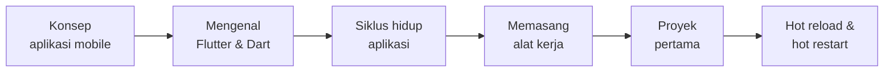
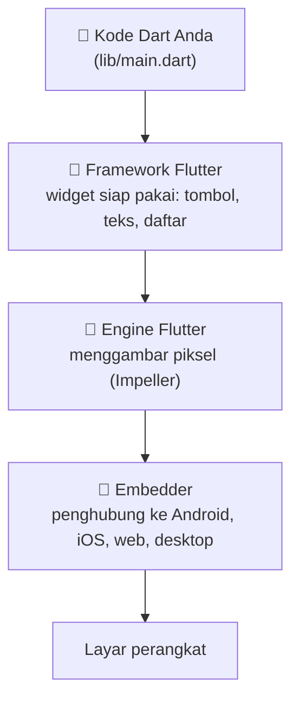
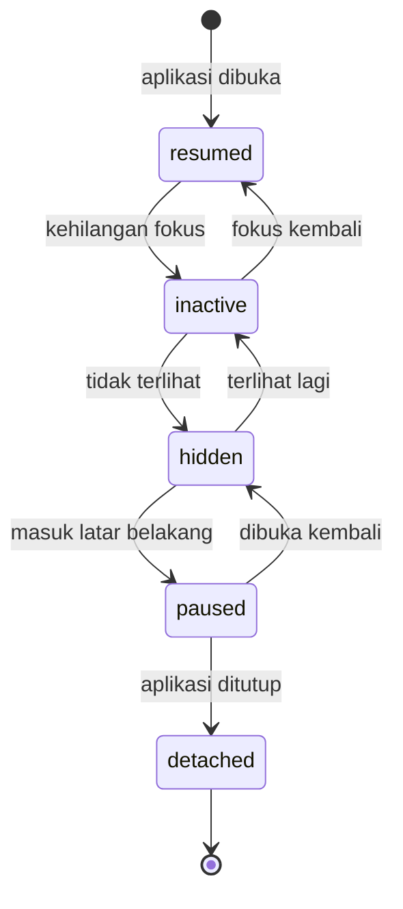
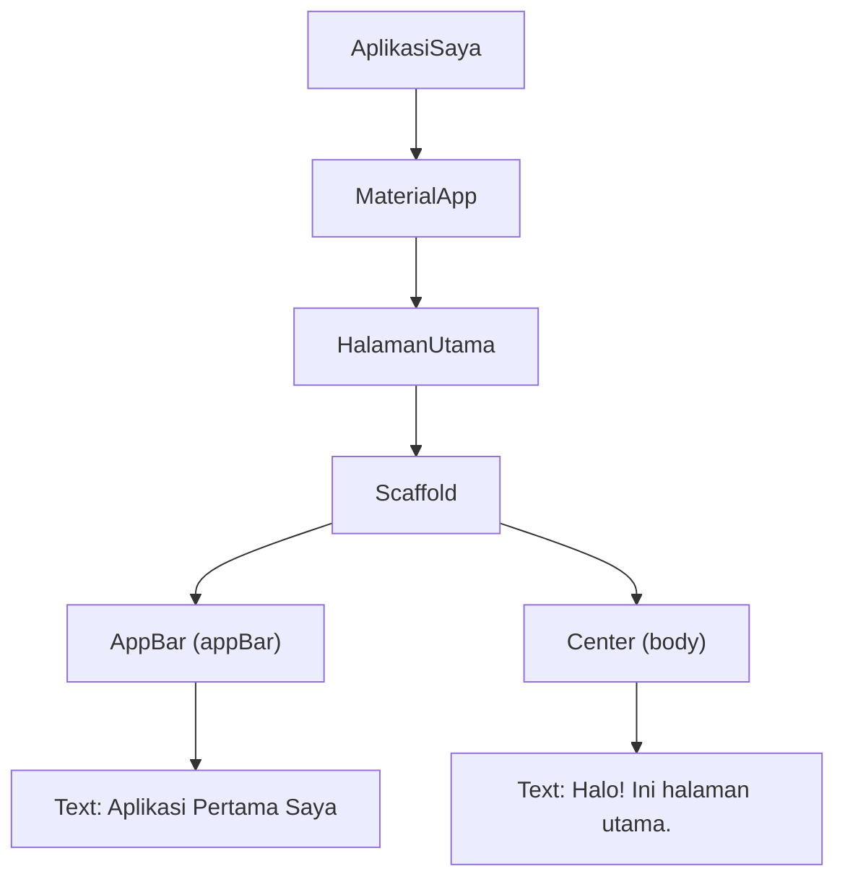
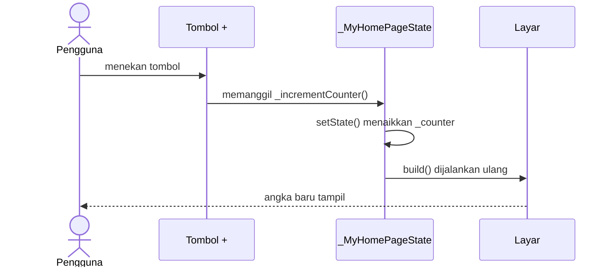

# Pertemuan 1 — Pengenalan Pemrograman Piranti Bergerak & Flutter

> 📖 **Modul bacaan** · ⏱️ ± 60 menit · 🎯 Untuk pemula total
>
> **Bekal yang dibutuhkan:** bisa mengoperasikan komputer dan internet. Itu saja.
> **Hasil akhir hari ini:** aplikasi Flutter pertama Anda berjalan di Google Chrome dan sudah Anda ubah sendiri.

[🏠 Beranda](../README.md) · [📋 Silabus](../SILABUS.md) · [🧪 Jobsheet](JOBSHEET.md) · [✍️ Latihan](LATIHAN.md) · [💻 Kode Contoh](kode/) · [📊 Unduh Slide](https://raw.githubusercontent.com/antonprafanto/mobile2026/main/pertemuan_01_pengenalan_flutter/slide/PERTEMUAN_01_Pengenalan_Flutter.pptx)

---

## Daftar Isi

1. [Apa Itu Piranti Bergerak?](#1-apa-itu-piranti-bergerak)
2. [Dua Penguasa Pasar: Android dan iOS](#2-dua-penguasa-pasar-android-dan-ios)
3. [Tiga Cara Membuat Aplikasi Mobile](#3-tiga-cara-membuat-aplikasi-mobile)
4. [Berkenalan dengan Flutter dan Dart](#4-berkenalan-dengan-flutter-dan-dart)
5. [Bagaimana Flutter Bekerja?](#5-bagaimana-flutter-bekerja)
6. [Siklus Hidup (Lifecycle) Aplikasi](#6-siklus-hidup-lifecycle-aplikasi)
7. [Menyiapkan Alat Kerja](#7-menyiapkan-alat-kerja)
8. [Membuat Proyek Pertama](#8-membuat-proyek-pertama)
9. [Menjalankan Aplikasi](#9-menjalankan-aplikasi)
10. [Membedah Kode Pertama Anda](#10-membedah-kode-pertama-anda)
11. [Hot Reload vs Hot Restart](#11-hot-reload-vs-hot-restart)
12. [Membaca Aplikasi Counter Bawaan](#12-membaca-aplikasi-counter-bawaan)
13. [Kesalahan Umum Pemula](#13-kesalahan-umum-pemula-dan-solusinya)
14. [Ringkasan](#14-ringkasan) · [Glosarium](#15-glosarium) · [Referensi](#16-referensi)

---

## 🎯 Tujuan Pembelajaran

Setelah mempelajari modul ini, Anda mampu:

1. Menjelaskan pengertian aplikasi piranti bergerak beserta ciri khasnya.
2. Membandingkan tiga pendekatan pembuatan aplikasi mobile: *native*, web/hibrida, dan lintas platform.
3. Menjelaskan apa itu Flutter dan Dart, serta gambaran sederhana cara kerja Flutter.
4. Menyebutkan status-status siklus hidup (*lifecycle*) aplikasi dan contoh kegunaannya.
5. Menyiapkan lingkungan kerja Flutter, lalu membuat dan menjalankan proyek pertama.
6. Membedakan *hot reload* dan *hot restart*, serta tahu kapan memakai masing-masing.
7. Membaca struktur dasar berkas `lib/main.dart`.

## 🗺️ Peta Materi Hari Ini



Bagian 1–6 adalah **konsep** (dibaca dan dipahami). Bagian 7–12 adalah **praktik** yang langkah lengkapnya ada di [Jobsheet Pertemuan 1](JOBSHEET.md).

---

## 1. Apa Itu Piranti Bergerak?

**Piranti bergerak** (*mobile device*) adalah perangkat komputasi yang mudah dibawa ke mana saja dan tetap bisa dipakai sambil berpindah tempat. Contoh paling umum adalah *smartphone* dan tablet. Jam tangan pintar (*smartwatch*) juga termasuk.

**Aplikasi piranti bergerak** (aplikasi *mobile*) adalah perangkat lunak yang dirancang khusus untuk berjalan di perangkat tersebut. Anda memakainya setiap hari: memesan ojek *online*, membuka *mobile banking*, berbelanja di *e-commerce*, atau mengecek jadwal kuliah.

### Mengapa membuat aplikasi mobile berbeda dari membuat program biasa?

Coba bandingkan HP Anda dengan komputer di laboratorium. HP punya banyak keterbatasan sekaligus kelebihan yang tidak dimiliki komputer meja:

| Ciri khas | Artinya bagi pembuat aplikasi |
| :--- | :--- |
| 📏 **Layar kecil dan beragam ukuran** | Tampilan harus ringkas dan menyesuaikan berbagai ukuran layar. |
| 👆 **Dioperasikan dengan sentuhan** | Tombol harus cukup besar untuk jari, bukan untuk kursor *mouse*. |
| 🔋 **Baterai terbatas** | Aplikasi harus hemat daya, misalnya tidak terus-menerus memakai GPS. |
| 📶 **Koneksi internet naik-turun** | Aplikasi harus tetap sopan saat sinyal hilang (menampilkan pesan, menyimpan data sementara). |
| 📷 **Kaya sensor** | Ada kamera, GPS, sidik jari, akselerometer, dan lain-lain yang bisa dimanfaatkan. |
| 🔄 **Sering berpindah-pindah aplikasi** | Aplikasi bisa "ditinggal" kapan saja, jadi data harus aman (dibahas di [Bagian 6](#6-siklus-hidup-lifecycle-aplikasi)). |

> [!NOTE]
> Semua ciri di atas akan kita temui lagi sepanjang semester. Misalnya, "koneksi naik-turun" akan kita tangani di Pertemuan 10–11, dan "sensor" di Pertemuan 13.

---

## 2. Dua Penguasa Pasar: Android dan iOS

Hampir semua *smartphone* di dunia menjalankan salah satu dari dua **sistem operasi** (OS) berikut:

| | **Android** | **iOS** |
| :--- | :--- | :--- |
| Pembuat | Google (sumber terbuka / *open source*) | Apple |
| Perangkat | Banyak merek: Samsung, Xiaomi, Oppo, Vivo, dan lain-lain | Hanya iPhone |
| Toko aplikasi | Google Play Store | Apple App Store |
| Bahasa resmi | Kotlin (dan Java) | Swift |
| Pangsa pasar di Indonesia (September 2026) | **79,16%** | **20,79%** |

<sub>Sumber data: [StatCounter Global Stats — Mobile OS Market Share Indonesia](https://gs.statcounter.com/os-market-share/mobile/indonesia).</sub>

**Pelajaran pentingnya:** jika sebuah perusahaan di Indonesia ingin aplikasinya dipakai semua orang, ia harus hadir di **Android dan iOS sekaligus**. Masalahnya, Android dan iOS "berbicara bahasa yang berbeda". Di sinilah pilihan cara membuat aplikasi menjadi penting.

---

## 3. Tiga Cara Membuat Aplikasi Mobile

Bayangkan Anda pemilik usaha katering yang harus mengirim makanan ke dua kota dengan selera berbeda. Ada tiga strategi:

1. **Buka dapur sendiri di setiap kota** dengan koki lokal → rasanya paling pas, tetapi biayanya dua kali lipat.
2. **Kirim makanan beku dari satu dapur pusat**, lalu dipanaskan di tujuan → murah, tetapi rasanya kurang segar.
3. **Satu dapur pusat dengan resep yang dirancang untuk kedua kota** dan peralatan masak modern → hemat dan rasanya tetap enak.

Ketiga strategi itu mirip dengan tiga pendekatan membuat aplikasi:

| Pendekatan | Cara kerja | Contoh teknologi | Kelebihan | Kekurangan |
| :--- | :--- | :--- | :--- | :--- |
| **1. Native** | Membuat dua aplikasi terpisah, masing-masing dengan bahasa resmi platformnya. | Kotlin + Jetpack Compose (Android), Swift + SwiftUI (iOS) | Performa dan akses fitur paling maksimal | Dua kode, dua tim, biaya dan waktu dua kali lipat |
| **2. Web / Hibrida** | Membuat situs web, lalu dibungkus agar terlihat seperti aplikasi. | *Progressive Web App* (PWA), Ionic/Capacitor | Cepat dibuat oleh pengembang web | Terasa kurang mulus; akses fitur perangkat terbatas |
| **3. Lintas platform** (*cross-platform*) | Satu kode sumber menghasilkan aplikasi untuk banyak platform. | **Flutter**, React Native, Kotlin Multiplatform | Satu kode, hemat waktu, tampilan konsisten | Ukuran aplikasi sedikit lebih besar; fitur yang sangat baru kadang perlu kode *native* tambahan |

Mata kuliah ini memakai pendekatan ketiga dengan **Flutter**.

> [!TIP]
> Tidak ada pendekatan yang "paling benar". Perusahaan memilih berdasarkan kebutuhan, anggaran, dan keahlian tim. Yang penting, Anda paham **alasan** di balik setiap pilihan.

---

## 4. Berkenalan dengan Flutter dan Dart

### 4.1 Apa itu Flutter?

**Flutter** adalah *framework* (kerangka kerja) sumber terbuka buatan Google untuk membangun aplikasi dari **satu kode sumber** yang dapat dijalankan di **enam platform**: Android, iOS, web, Windows, macOS, dan Linux. Versi stabil pertamanya (Flutter 1.0) dirilis pada Desember 2018. Saat modul ini ditulis, versi stabil terbarunya adalah **Flutter 3.47**.

### 4.2 Apa itu Dart?

**Dart** adalah **bahasa pemrograman** yang dipakai untuk menulis aplikasi Flutter, juga buatan Google. Jika diibaratkan mobil:

- **Dart adalah mesinnya**: aturan menulis perintah, variabel, perhitungan, dan logika.
- **Flutter adalah bodi, kemudi, dan dasbornya**: komponen siap pakai untuk membentuk tampilan.

Karena itu, Pertemuan 2 dan 3 khusus membahas Dart. Mesinnya harus dikenal dulu sebelum mobilnya dikendarai jauh.

### 4.3 Mengapa kita memakai Flutter di mata kuliah ini?

1. **Satu kode untuk Android dan iOS** sehingga waktu belajar efisien.
2. **Bisa dijalankan di Google Chrome.** Komputer lab dengan RAM 8 GB tidak perlu menjalankan emulator yang berat.
3. ***Hot reload*:** perubahan kode terlihat dalam hitungan detik tanpa mengulang aplikasi dari awal.
4. **Komponen tampilan lengkap** mengikuti pedoman desain modern Material Design 3.
5. **Dipakai industri.** Contoh aplikasi yang dibangun dengan Flutter antara lain Google Pay, Google Classroom, NotebookLM, aplikasi BMW, sistem infotainmen Toyota, Alibaba, dan Nubank (lihat [Flutter Showcase](https://flutter.dev/showcase)).

---

## 5. Bagaimana Flutter Bekerja?

Ada dua cara sebuah aplikasi menampilkan tombol di layar:

- **Cara "menyewa perabot":** aplikasi meminjam tombol bawaan sistem operasi. Akibatnya, tombol yang sama bisa terlihat berbeda di Android dan iOS.
- **Cara "melukis sendiri":** aplikasi menggambar tombolnya sendiri, piksel demi piksel, di atas kanvas kosong.

**Flutter memakai cara kedua.** Flutter membawa mesin gambarnya sendiri (namanya **Impeller** di Android dan iOS), sehingga tampilan aplikasi Anda **sama persis** di semua perangkat dan bisa digambar sangat cepat (umumnya 60 bingkai per detik atau lebih).

Secara sederhana, perjalanan kode Anda menjadi tampilan di layar seperti ini:



Anda cukup fokus di lapisan paling atas: **menulis kode Dart dan menyusun widget**. Lapisan di bawahnya diurus oleh Flutter.

---

## 6. Siklus Hidup (Lifecycle) Aplikasi

### 6.1 Kenapa perlu dipahami?

Pernahkah Anda menonton video di HP, lalu menekan tombol *Home*, dan videonya otomatis berhenti? Atau membuka aplikasi *mobile banking* dari daftar aplikasi terbaru, dan saldonya tersembunyi? Itu terjadi karena aplikasi tersebut **memperhatikan siklus hidupnya**.

Di HP, pengguna bisa meninggalkan aplikasi kapan saja: ada telepon masuk, pindah ke WhatsApp, atau layar terkunci. Sistem operasi juga bisa menutup aplikasi yang terlalu lama di latar belakang demi menghemat memori. Aplikasi yang baik harus tahu "sedang dalam kondisi apa" agar bisa bersikap tepat, misalnya **menyimpan data sebelum ditinggal** atau **mematikan kamera** saat tidak dipakai.

### 6.2 Lima status aplikasi di Flutter

Flutter menyebut status-status ini sebagai `AppLifecycleState`:

| Status | Artinya | Contoh situasi |
| :--- | :--- | :--- |
| `resumed` | Aplikasi terlihat dan sedang dipakai (menerima sentuhan). | Anda sedang menggulir beranda aplikasi. |
| `inactive` | Aplikasi masih terlihat, tetapi tidak menerima input. | Panel notifikasi ditarik ke bawah, atau di web Anda mengeklik jendela lain. |
| `hidden` | Semua tampilan aplikasi tersembunyi. | Aplikasi diminimalkan, atau tab browser-nya Anda tinggalkan. |
| `paused` | Aplikasi tidak terlihat dan berjalan di latar belakang. | Anda menekan tombol *Home* dan membuka aplikasi lain. |
| `detached` | Mesin Flutter masih ada, tetapi sudah tidak terhubung ke tampilan mana pun. | Aplikasi sedang ditutup. |

Di Android dan iOS, perpindahannya biasanya berurutan seperti diagram berikut:



> [!WARNING]
> Jika aplikasi "dibunuh" mendadak oleh sistem (misalnya memori HP penuh), beberapa status bisa terlewati. Jadi, **jangan menunda penyimpanan data penting** sampai status `detached`. Simpanlah selagi aplikasi masuk `paused` atau `hidden`.

### 6.3 Melihatnya secara langsung

Contoh [`contoh_06_siklus_hidup_aplikasi.dart`](kode/contoh_06_siklus_hidup_aplikasi.dart) mencatat setiap perubahan status ke layar. Bagian terpentingnya:

```dart
// "Pendengar" yang dikabari setiap kali status aplikasi berubah.
_pendengar = AppLifecycleListener(onStateChange: _catatStatus);
```

Jalankan contoh tersebut di Chrome, lalu pindah ke tab lain dan kembali lagi. Anda akan melihat catatan seperti `inactive`, `hidden`, lalu `resumed` muncul satu per satu. Untuk sekarang, cukup pahami **idenya**. Detail kode `StatefulWidget`, `initState()`, dan `dispose()` akan dibahas tuntas di Pertemuan 5.

---

## 7. Menyiapkan Alat Kerja

Seperti tukang kayu yang perlu gergaji dan palu, Anda membutuhkan beberapa alat berikut:

| No | Alat | Fungsi (analogi) | Wajib? |
| :---: | :--- | :--- | :---: |
| 1 | **Git** | "Mesin waktu" kode: mencatat riwayat perubahan. Flutter juga memakainya saat diunduh. | ✅ |
| 2 | **Visual Studio Code** | "Meja kerja" tempat menulis kode. | ✅ |
| 3 | **Ekstensi Flutter** (untuk VS Code) | "Asisten" yang memberi warna kode, saran otomatis, dan tombol *Run*. Ekstensi Dart ikut terpasang otomatis. | ✅ |
| 4 | **Flutter SDK** | "Kotak perkakas" berisi Flutter, Dart, dan perintah `flutter`. | ✅ |
| 5 | **Google Chrome** | "Panggung" tercepat untuk menjalankan aplikasi selama belajar. | ✅ |
| 6 | **Android Studio** | Menyediakan Android SDK agar aplikasi bisa dipasang ke HP Android atau emulator. | Opsional |

### Gambaran langkah instalasi (cara resmi yang direkomendasikan)

1. Pasang **Git for Windows** dari <https://git-scm.com/downloads/win>.
2. Pasang **Visual Studio Code** dari <https://code.visualstudio.com>.
3. Di VS Code, pasang ekstensi **Flutter** (penerbit: Dart Code).
4. Tekan `Ctrl` + `Shift` + `P`, ketik `flutter`, pilih **Flutter: New Project**. Saat diminta lokasi SDK, pilih **Download SDK**, tentukan folder (misalnya `C:\Users\NamaAnda\develop`), lalu klik **Clone Flutter**. Setelah selesai, klik **Add SDK to PATH**.
5. Tutup semua terminal, mulai ulang VS Code, lalu periksa dengan perintah:

```bash
flutter doctor
```

Langkah lengkap beserta penanganan masalahnya ada di **[Panduan Instalasi Flutter di Windows](../panduan/02_instalasi_flutter_windows.md)**.

### Membaca hasil `flutter doctor`

`flutter doctor` adalah "dokter" yang memeriksa kesehatan alat-alat Anda. Setiap baris diberi tanda:

| Tanda | Arti | Yang perlu dilakukan |
| :---: | :--- | :--- |
| `[✓]` | Sehat | Tidak ada. |
| `[!]` | Ada peringatan | Baca pesannya. Sering kali boleh diabaikan dulu. |
| `[✗]` | Ada masalah | Perbaiki jika Anda membutuhkan bagian tersebut. |

> [!TIP]
> **Boleh diabaikan untuk sementara:** tanda `[✗]` atau `[!]` pada *Android toolchain* (jika Anda belum memasang Android Studio) dan *Visual Studio - develop Windows apps* (hanya untuk membuat aplikasi desktop Windows). Yang **wajib hijau** untuk minggu ini adalah baris **Flutter** dan **Chrome**.

---

## 8. Membuat Proyek Pertama

Ada dua cara yang hasilnya sama persis. Pilih salah satu.

**Cara A — lewat VS Code (ramah pemula):**
`Ctrl` + `Shift` + `P` → **Flutter: New Project** → **Application** → pilih folder → ketik nama proyek `halo_flutter` → `Enter`.

**Cara B — lewat terminal:**

```bash
flutter create halo_flutter
cd halo_flutter
code .
```

Perintah terakhir (`code .`) membuka folder proyek di VS Code.

### Aturan memberi nama proyek

Nama proyek harus berupa **nama paket Dart yang sah**:

| ✅ Benar | ❌ Salah | Alasan salah |
| :--- | :--- | :--- |
| `halo_flutter` | `Halo Flutter` | Mengandung spasi dan huruf kapital |
| `tugas_ppb_01` | `tugas-ppb-01` | Tanda hubung (`-`) tidak diizinkan |
| `aplikasi_kasir` | `1aplikasi` | Tidak boleh diawali angka |

Gaya penulisan huruf kecil yang dihubungkan garis bawah ini disebut ***snake_case***.

### Mengenal isi folder proyek

Setelah proyek dibuat, Anda akan melihat banyak folder. **Jangan panik.** Untuk saat ini, Anda hanya perlu akrab dengan dua item bertanda ⭐.

| Item | Fungsi |
| :--- | :--- |
| ⭐ `lib/` | Tempat **semua kode Dart Anda**. Berkas `lib/main.dart` adalah titik awal aplikasi. |
| ⭐ `pubspec.yaml` | "Kartu identitas" proyek: nama, versi, daftar paket tambahan (*dependencies*), gambar, dan *font*. |
| `test/` | Tempat kode pengujian (Pertemuan 14). |
| `android/`, `ios/`, `web/`, `windows/`, `macos/`, `linux/` | Pengaturan khusus tiap platform. Jarang disentuh di awal. |
| `analysis_options.yaml` | Aturan "polisi kode" (*linter*) yang memberi saran penulisan kode yang baik. |
| `pubspec.lock` | Catatan versi paket yang benar-benar terpasang. Dibuat otomatis. |
| `.dart_tool/`, `build/` | Folder hasil kerja otomatis. Jangan diubah. Aman dihapus karena akan dibuat ulang. |

Berikut cuplikan penting `pubspec.yaml` hasil `flutter create` (komentar bawaannya dihilangkan agar ringkas):

```yaml
name: halo_flutter          # nama proyek (snake_case)
description: "A new Flutter project."
publish_to: 'none'          # proyek ini tidak diterbitkan ke pub.dev
version: 1.0.0+1            # versi aplikasi + nomor build

environment:
  sdk: ^3.13.5              # versi Dart minimal (angkanya mengikuti Dart di komputer Anda)

dependencies:               # paket yang dipakai aplikasi
  flutter:
    sdk: flutter
  cupertino_icons: ^1.0.8

dev_dependencies:           # paket yang hanya dipakai saat pengembangan
  flutter_test:
    sdk: flutter
  flutter_lints: ^6.0.0

flutter:
  uses-material-design: true
```

> [!CAUTION]
> Berkas `.yaml` **sangat peka terhadap spasi**. Indentasi wajib memakai **spasi** (umumnya 2 spasi), **bukan tombol Tab**. Satu spasi yang salah bisa membuat proyek gagal dijalankan.

---

## 9. Menjalankan Aplikasi

### 9.1 Di Google Chrome (rekomendasi untuk lab)

**Lewat VS Code:** klik nama perangkat di pojok kanan bawah (atau `Ctrl` + `Shift` + `P` → **Flutter: Select Device**) → pilih **Chrome** → tekan `F5`.

**Lewat terminal** (pastikan posisi terminal ada di dalam folder proyek):

```bash
flutter devices          # melihat daftar perangkat yang terdeteksi
flutter run -d chrome    # menjalankan aplikasi di Chrome
```

Jendela Chrome baru akan terbuka dan menampilkan aplikasi penghitung (*counter*) bawaan.

### 9.2 Di HP Android asli (opsional, butuh Android Studio)

1. Di HP, buka **Setelan → Tentang ponsel**, lalu ketuk **Nomor bentukan** (*Build number*) 7 kali sampai muncul pesan "Anda sekarang adalah pengembang". Nama menu bisa sedikit berbeda di tiap merek HP.
2. Buka **Opsi pengembang** (*Developer options*), lalu aktifkan **Debugging USB**.
3. Hubungkan HP ke komputer dengan kabel data, lalu ketuk **Izinkan** di HP.
4. Pastikan HP muncul saat menjalankan `flutter devices`, lalu jalankan `flutter run`.

> [!TIP]
> Ingin menampilkan layar HP ke proyektor atau monitor? Pakai aplikasi gratis [scrcpy](https://github.com/Genymobile/scrcpy). Ukurannya kecil dan jauh lebih ringan daripada emulator.

### 9.3 Di emulator Android (tidak disarankan untuk RAM 8 GB)

Emulator adalah "HP palsu" di dalam komputer. Praktis, tetapi bisa memakan beberapa GB RAM. Pakai hanya jika komputer Anda cukup kuat (disarankan RAM 16 GB).

### 9.4 Perintah keyboard saat `flutter run` berjalan di terminal

| Tombol | Fungsi |
| :---: | :--- |
| `r` | ***Hot reload*** 🔥: terapkan perubahan kode, data tetap |
| `R` | ***Hot restart***: mulai ulang aplikasi dari awal |
| `h` | Tampilkan semua perintah yang tersedia |
| `c` | Bersihkan layar terminal |
| `q` | Hentikan aplikasi |

---

## 10. Membedah Kode Pertama Anda

### 10.1 Aplikasi paling sederhana di dunia Flutter

Buka [`kode/contoh_01_aplikasi_pertama.dart`](kode/contoh_01_aplikasi_pertama.dart). Inilah intinya:

```dart
import 'package:flutter/material.dart';

void main() {
  runApp(
    const Center(
      child: Text(
        'Halo, Dunia Flutter!',
        textDirection: TextDirection.ltr,
        style: TextStyle(fontSize: 32),
      ),
    ),
  );
}
```

Mari baca baris demi baris:

| Kode | Penjelasan |
| :--- | :--- |
| `import 'package:flutter/material.dart';` | Mengambil "kotak perkakas" Flutter yang berisi ratusan widget siap pakai. |
| `void main() { ... }` | **Pintu masuk program.** Setiap aplikasi Dart selalu mulai berjalan dari fungsi `main()`. |
| `runApp( ... )` | Perintah "pasang widget ini sebagai seluruh tampilan aplikasi". |
| `Center( child: ... )` | Widget yang menaruh **anaknya** (`child`) tepat di tengah. |
| `Text('Halo, Dunia Flutter!')` | Widget untuk menampilkan tulisan. |
| `textDirection: TextDirection.ltr` | Memberi tahu arah tulisan: kiri ke kanan (*left-to-right*). |
| `const` | Tanda bahwa widget ini tidak akan pernah berubah, sehingga Flutter bisa menghemat kerja. |

Hasilnya adalah layar hitam polos dengan tulisan putih. Fungsional, tetapi belum terlihat seperti aplikasi.

> [!NOTE]
> Di beberapa tutorial yang sangat baru, Anda mungkin menjumpai `import 'package:material_ui/material_ui.dart';`. Itu pustaka Material yang **sama**, yang mulai diterbitkan tim Flutter sebagai paket terpisah. Mata kuliah ini memakai `package:flutter/material.dart` karena itulah yang masih ditulis oleh `flutter create` pada Flutter 3.47. Jika suatu saat VS Code menandai baris import tersebut sebagai usang (*deprecated*), tanyakan dulu kepada dosen sebelum mengubahnya.

### 10.2 "Semua adalah widget"

Di Flutter, **hampir semua yang tampil di layar adalah widget**: teks, tombol, ikon, bahkan jarak kosong dan posisi tengah. Widget disusun bertingkat seperti **balok Lego**: satu widget bisa berisi widget lain, yang berisi widget lain lagi. Susunan bertingkat ini disebut **pohon widget** (*widget tree*).

### 10.3 Agar terlihat seperti aplikasi sungguhan: `MaterialApp` dan `Scaffold`

Sekarang buka [`kode/contoh_02_materialapp_dan_scaffold.dart`](kode/contoh_02_materialapp_dan_scaffold.dart):

```dart
class AplikasiSaya extends StatelessWidget {
  const AplikasiSaya({super.key});

  @override
  Widget build(BuildContext context) {
    return const MaterialApp(
      title: 'Aplikasi Pertama',
      debugShowCheckedModeBanner: false,
      home: HalamanUtama(),
    );
  }
}

class HalamanUtama extends StatelessWidget {
  const HalamanUtama({super.key});

  @override
  Widget build(BuildContext context) {
    return Scaffold(
      appBar: AppBar(title: const Text('Aplikasi Pertama Saya')),
      body: const Center(child: Text('Halo! Ini halaman utama.')),
    );
  }
}
```

Konsep baru di sini:

- **`class AplikasiSaya extends StatelessWidget`** — Kita membuat widget **buatan sendiri**. *Stateless* berarti widget ini tidak menyimpan data yang berubah-ubah; ia hanya menyusun widget lain.
- **`build(BuildContext context)`** — "Resep" tampilan. Flutter memanggil fungsi ini setiap kali perlu menggambar widget tersebut. `context` bisa dibayangkan sebagai "alamat" widget di dalam pohon widget.
- **`const AplikasiSaya({super.key});`** — *Constructor* (cara membuat widget). Untuk sekarang, cukup ikuti polanya; detailnya dibahas di Pertemuan 3.
- **`MaterialApp`** — Fondasi aplikasi bergaya Material Design: menyediakan tema, arah teks, dan navigasi. Karena itu, `textDirection` tidak perlu ditulis lagi.
- **`Scaffold`** — "Kerangka rumah" untuk satu halaman: ada **atap** (`appBar`) dan **isi** (`body`). Nanti Anda juga akan memakai bagian lainnya, seperti tombol melayang (`floatingActionButton`).

Pohon widget dari kode di atas terlihat seperti ini:



### 10.4 Memberi warna dengan tema

Contoh [`contoh_03_tema_warna_dan_teks.dart`](kode/contoh_03_tema_warna_dan_teks.dart) menunjukkan cara memberi warna **tanpa menulis kode warna satu per satu**:

```dart
theme: ThemeData(
  colorScheme: ColorScheme.fromSeed(seedColor: Colors.indigo),
),
```

Anda cukup memberikan satu **warna benih** (*seed color*). Flutter lalu meracik satu palet warna lengkap yang serasi, sesuai aturan Material Design 3. Warna dan gaya teks dari tema itu kemudian dipakai seperti ini:

```dart
final ColorScheme warna = Theme.of(context).colorScheme;
final TextTheme gayaTeks = Theme.of(context).textTheme;
// ...
Text('Aplikasi Pertamaku', style: gayaTeks.headlineMedium),
```

> [!IMPORTANT]
> **Kebiasaan baik sejak hari pertama:** ambil warna dan gaya teks dari tema (`Theme.of(context)`), jangan menuliskan kode warna di mana-mana. Jika suatu hari warna aplikasi ingin diganti, Anda cukup mengubah **satu baris** `seedColor`.

---

## 11. Hot Reload vs Hot Restart

Ini fitur favorit pengembang Flutter. Perhatikan perbedaannya:

| | 🔥 **Hot Reload** | 🔄 **Hot Restart** |
| :--- | :--- | :--- |
| Apa yang terjadi | Kode baru "disuntikkan" ke aplikasi yang sedang berjalan | Aplikasi dimulai ulang dari `main()` |
| Data/*state* di layar | **Tetap** (misalnya angka penghitung tidak kembali ke 0) | **Hilang**, kembali ke nilai awal |
| Kecepatan | Sangat cepat (umumnya di bawah 1 detik) | Beberapa detik |
| Cara di VS Code | Simpan berkas (`Ctrl` + `S`) atau klik ikon petir ⚡ | Klik ikon panah melingkar 🔄 (`Ctrl` + `Shift` + `F5`) |
| Cara di terminal | Tekan `r` | Tekan `R` |
| Cocok untuk | Mengubah tampilan: warna, teks, tata letak | Mengubah logika awal, misalnya isi `main()` atau nilai awal variabel |

**Analogi:** *hot reload* seperti **mengganti baju** seseorang tanpa membangunkannya dari tidur. Ia tetap di posisi yang sama. *Hot restart* seperti **membangunkannya lalu menyuruhnya mulai hari dari awal**.

Buktikan sendiri dengan [`contoh_04_hot_reload_vs_hot_restart.dart`](kode/contoh_04_hot_reload_vs_hot_restart.dart): tekan tombol `+` lima kali, ganti warna `AppBar`, lalu simpan. Warna berubah, angka tetap 5. Setelah itu tekan `R`; angka kembali ke 0.

> [!NOTE]
> **Kapan keduanya tidak cukup?** Jika Anda menambah paket baru di `pubspec.yaml` atau mengubah pengaturan platform, **hentikan aplikasi** (tekan `q` atau tombol stop ⏹️), lalu jalankan ulang dari awal.

---

## 12. Membaca Aplikasi Counter Bawaan

Saat membuat proyek baru, Flutter langsung memberi contoh aplikasi penghitung. Versi yang sudah diberi komentar berbahasa Indonesia ada di [`contoh_05_aplikasi_counter_bawaan.dart`](kode/contoh_05_aplikasi_counter_bawaan.dart). Inilah alur kerjanya ketika tombol `+` ditekan:



Kunci yang perlu diingat:

1. Halaman ini memakai **`StatefulWidget`** karena memiliki data yang berubah (`_counter`).
2. Data hanya boleh diubah di dalam **`setState()`**. Fungsi ini memberi tahu Flutter bahwa data berubah dan layar perlu digambar ulang.
3. Setelah `setState()`, Flutter **menjalankan ulang `build()`** sehingga angka terbaru tampil.

> [!NOTE]
> **Kenapa di template asli tertulis `.center` dan `.fromSeed(...)`?**
> Itu fitur baru Dart 3.10 bernama ***dot shorthand*** (singkatan titik). Jika Dart sudah tahu jenis nilai yang diharapkan, nama jenisnya boleh tidak ditulis. Jadi, `mainAxisAlignment: .center` sama artinya dengan `mainAxisAlignment: MainAxisAlignment.center`. Di modul ini kita memakai **bentuk lengkap** agar Anda tahu asal setiap nilai. Setelah terbiasa, Anda bebas memakai bentuk singkatnya.

### ✅ Cek Cepat

Sebelum lanjut, coba jawab dalam hati, lalu buka jawabannya.

<details>
<summary>1. Fungsi apa yang pertama kali dijalankan saat aplikasi Dart dimulai?</summary>

Fungsi `main()`.
</details>

<details>
<summary>2. Anda mengubah warna AppBar dan ingin melihat hasilnya tanpa kehilangan angka penghitung. Pakai hot reload atau hot restart?</summary>

*Hot reload*, karena *state* (angka) tetap terjaga.
</details>

<details>
<summary>3. Apa yang terjadi jika <code>_counter++</code> ditulis tanpa <code>setState()</code>?</summary>

Nilai di memori bertambah, tetapi layar **tidak** digambar ulang, sehingga pengguna tidak melihat perubahan apa pun.
</details>

---

## 13. Kesalahan Umum Pemula dan Solusinya

| Gejala / pesan error | Penyebab | Solusi |
| :--- | :--- | :--- |
| `'flutter' is not recognized as an internal or external command` | Folder `flutter\bin` belum masuk PATH, atau terminal belum dibuka ulang | Tutup semua terminal dan VS Code lalu buka lagi. Jika masih gagal, ulangi langkah **Add SDK to PATH** ([panduan](../panduan/02_instalasi_flutter_windows.md)). |
| `The Flutter SDK is installed in a protected folder` | SDK dipasang di `C:\Program Files\` | Pindahkan SDK ke folder tanpa spasi dan tanpa hak admin, misalnya `C:\Users\NamaAnda\develop\flutter`. |
| `Building with plugins requires symlink support` | *Developer Mode* Windows belum aktif | Jalankan `start ms-settings:developers` di terminal, lalu aktifkan **Developer Mode**. |
| `"Halo-Flutter" is not a valid Dart package name` | Nama proyek tidak mengikuti *snake_case* | Pakai huruf kecil dan garis bawah, misalnya `halo_flutter`. |
| Chrome tidak muncul di `flutter devices` | Chrome belum terpasang | Pasang Google Chrome, lalu jalankan ulang `flutter devices`. |
| Perubahan kode tidak terlihat | Aplikasi dijalankan dari terminal tetapi `r` belum ditekan, atau yang diubah adalah isi `main()` | Tekan `r`. Jika tetap tidak berubah, tekan `R`. |
| Layar merah: `No Directionality widget found` | Widget teks dipakai tanpa `MaterialApp` dan tanpa `textDirection` | Bungkus dengan `MaterialApp`, atau tambahkan `textDirection: TextDirection.ltr`. |
| Error saat membaca `pubspec.yaml` | Ada karakter Tab atau indentasi tidak rata | Ganti Tab dengan spasi dan samakan indentasinya. |

Daftar yang lebih lengkap ada di **[Panduan Troubleshooting](../panduan/04_troubleshooting.md)**.

---

## 14. Ringkasan

- **Aplikasi mobile** harus memperhatikan layar kecil, sentuhan, baterai, koneksi, sensor, dan kebiasaan pengguna yang sering berpindah aplikasi.
- Di Indonesia, **Android** menguasai sekitar 79% pasar dan **iOS** sekitar 21%, sehingga aplikasi idealnya hadir di keduanya.
- Ada tiga pendekatan: **native**, **web/hibrida**, dan **lintas platform**. Flutter termasuk lintas platform.
- **Flutter** adalah *framework* UI dari Google. **Dart** adalah bahasanya. Flutter **menggambar tampilannya sendiri** sehingga tampilan konsisten di semua perangkat.
- Aplikasi memiliki **siklus hidup**: `resumed`, `inactive`, `hidden`, `paused`, `detached`. Simpan data penting sebelum aplikasi ditinggalkan.
- Alat wajib: **Git, VS Code + ekstensi Flutter, Flutter SDK, Chrome**. Periksa dengan `flutter doctor`.
- Kode kita berada di **`lib/main.dart`**. Program dimulai dari **`main()`** → **`runApp()`**.
- **Semua adalah widget**, disusun bertingkat menjadi **pohon widget**. `MaterialApp` adalah fondasi, `Scaffold` adalah kerangka halaman.
- ***Hot reload*** (`r`) menjaga data. ***Hot restart*** (`R`) memulai ulang dari awal.

---

## 15. Glosarium

| Istilah | Arti sederhana |
| :--- | :--- |
| **Framework** | Kerangka kerja berisi komponen dan aturan siap pakai untuk membangun aplikasi. |
| **SDK** (*Software Development Kit*) | Paket alat lengkap untuk membuat perangkat lunak di platform tertentu. |
| **IDE / editor kode** | Aplikasi untuk menulis kode, misalnya VS Code. |
| **Widget** | Komponen penyusun tampilan di Flutter: teks, tombol, tata letak, dan lainnya. |
| **Pohon widget** | Susunan widget yang bertingkat, induk berisi anak. |
| **State** | Data yang dapat berubah saat aplikasi berjalan dan memengaruhi tampilan. |
| **Hot reload** | Menerapkan perubahan kode tanpa menghapus *state*. |
| **Hot restart** | Memulai ulang aplikasi dari awal; *state* hilang. |
| **Lifecycle** | Siklus hidup aplikasi: rangkaian status dari dibuka hingga ditutup. |
| **Emulator** | Perangkat tiruan (HP palsu) yang berjalan di dalam komputer. |
| **USB debugging** | Mode di HP Android yang mengizinkan komputer memasang dan menjalankan aplikasi uji. |
| **snake_case** | Gaya penulisan nama dengan huruf kecil dan garis bawah, misalnya `halo_flutter`. |
| **Dependency** | Paket atau pustaka tambahan yang dibutuhkan proyek, dicatat di `pubspec.yaml`. |

---

## 16. Referensi

1. Flutter. *Get started: Quick start*. <https://docs.flutter.dev/install/quick>
2. Flutter. *Set up Android development*. <https://docs.flutter.dev/platform-integration/android/setup>
3. Flutter. *Flutter architectural overview*. <https://docs.flutter.dev/resources/architectural-overview>
4. Flutter API. *AppLifecycleState*. <https://api.flutter.dev/flutter/dart-ui/AppLifecycleState.html>
5. Dart. *Dot shorthands*. <https://dart.dev/language/dot-shorthands>
6. StatCounter. *Mobile Operating System Market Share Indonesia*. <https://gs.statcounter.com/os-market-share/mobile/indonesia>

---

## ➡️ Langkah Berikutnya

1. Kerjakan **[🧪 Jobsheet Pertemuan 1](JOBSHEET.md)**: memasang alat, membuat proyek, dan membuat kartu perkenalan.
2. Uji pemahaman Anda di **[✍️ Latihan Pertemuan 1](LATIHAN.md)**.
3. Lanjutkan ke **[Pertemuan 2 — Dasar Pemrograman Dart](../pertemuan_02_dasar_dart/README.md)**.

[🏠 Beranda](../README.md) · [⬆️ Kembali ke atas](#pertemuan-1--pengenalan-pemrograman-piranti-bergerak--flutter)
