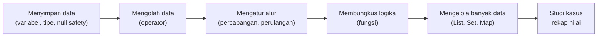
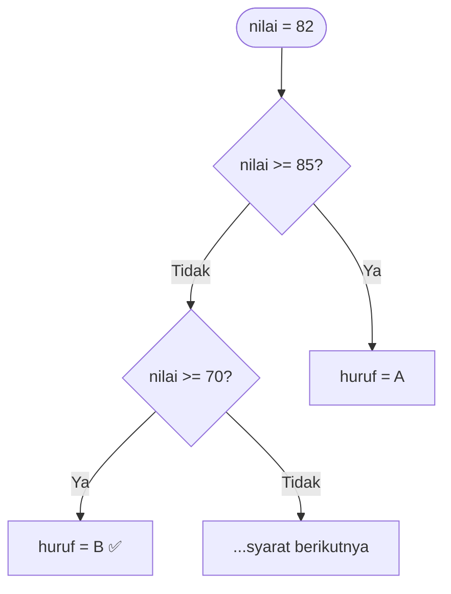

# Pertemuan 2 — Dasar Pemrograman Dart

> 📖 **Modul bacaan** · ⏱️ ± 75 menit · 🎯 Untuk pemula
>
> **Bekal yang dibutuhkan:** sudah mengikuti [Pertemuan 1](../pertemuan_01_pengenalan_flutter/README.md) dan bisa membuka [DartPad](https://dartpad.dev).
> **Hasil akhir hari ini:** Anda bisa menulis program Dart kecil yang mengolah data nilai mahasiswa.

[🏠 Beranda](../README.md) · [📋 Silabus](../SILABUS.md) · [🧪 Jobsheet](JOBSHEET.md) · [✍️ Latihan](LATIHAN.md) · [💻 Kode Contoh](kode/) · [📊 Unduh Slide](https://raw.githubusercontent.com/antonprafanto/mobile2026/main/pertemuan_02_dasar_dart/slide/PERTEMUAN_02_Dasar_Dart.pptx)

---

## Daftar Isi

1. [Mengapa Belajar Dart Dulu?](#1-mengapa-belajar-dart-dulu)
2. [Cara Menjalankan Kode Dart](#2-cara-menjalankan-kode-dart)
3. [Anatomi Program Dart](#3-anatomi-program-dart)
4. [Variabel dan Tipe Data](#4-variabel-dan-tipe-data)
5. [String dan Interpolasi](#5-string-dan-interpolasi)
6. [final dan const](#6-final-dan-const)
7. [Null Safety](#7-null-safety)
8. [Operator](#8-operator)
9. [Percabangan](#9-percabangan)
10. [Perulangan](#10-perulangan)
11. [Fungsi](#11-fungsi)
12. [Koleksi: List, Set, dan Map](#12-koleksi-list-set-dan-map)
13. [Studi Kasus: Rekap Nilai Satu Kelas](#13-studi-kasus-rekap-nilai-satu-kelas)
14. [Menulis Kode yang Rapi](#14-menulis-kode-yang-rapi-clean-code-dasar)
15. [Kesalahan Umum Pemula](#15-kesalahan-umum-pemula-dan-solusinya)
16. [Ringkasan](#16-ringkasan) · [Glosarium](#17-glosarium) · [Referensi](#18-referensi)

---

## 🎯 Tujuan Pembelajaran

Setelah mempelajari modul ini, Anda mampu:

1. Menjalankan program Dart di DartPad maupun di terminal.
2. Mendeklarasikan variabel dengan tipe data yang tepat, termasuk `final` dan `const`.
3. Menjelaskan konsep *null safety* dan memakai operator `?`, `??`, `?.`, `??=`, serta `!` dengan benar.
4. Memakai operator aritmatika, perbandingan, dan logika.
5. Membuat alur program dengan percabangan (`if`, `switch`) dan perulangan (`for`, `while`).
6. Membuat fungsi dengan parameter posisi maupun parameter bernama.
7. Mengolah kumpulan data memakai `List`, `Set`, dan `Map`.
8. Menulis kode dengan gaya penamaan dan format yang rapi.

## 🗺️ Peta Materi Hari Ini



Urutannya sengaja dibuat seperti tangga: setiap anak tangga memakai anak tangga sebelumnya.

---

## 1. Mengapa Belajar Dart Dulu?

Bayangkan Anda ingin menulis surat lamaran kerja dalam bahasa Jepang. Sebelum menyusun surat yang rapi, Anda harus menguasai kosakata dan tata bahasanya terlebih dahulu. **Flutter adalah "suratnya", Dart adalah "bahasanya".** Setiap tombol, halaman, dan logika aplikasi Flutter ditulis dalam Dart.

Beberapa fakta singkat tentang Dart:

- Dibuat oleh Google dan diperkenalkan pertama kali pada tahun 2011.
- Bertipe **statis**: setiap variabel punya tipe yang jelas, sehingga banyak kesalahan sudah terdeteksi **sebelum** program dijalankan.
- Memiliki **null safety**: Dart melindungi Anda dari kesalahan "data kosong" yang sering membuat aplikasi *crash* (dibahas di [Bagian 7](#7-null-safety)).
- Bisa diterjemahkan menjadi kode mesin untuk HP dan komputer, juga menjadi JavaScript/WebAssembly untuk browser.

> [!TIP]
> Jika Anda pernah belajar Java, C#, atau JavaScript, sintaks Dart akan terasa akrab. Jika belum pernah, tidak apa-apa: modul ini dimulai dari nol.

---

## 2. Cara Menjalankan Kode Dart

Semua contoh di pertemuan ini adalah **program Dart murni** (tanpa tampilan aplikasi). Hasilnya berupa tulisan di **konsol** (layar *output*). Ada dua cara menjalankannya:

### Cara A — DartPad (paling mudah, disarankan)

1. Buka <https://dartpad.dev> di browser.
2. Hapus kode yang ada di editor, lalu tempelkan kode contoh.
3. Klik tombol **Run**. Hasilnya muncul di panel *Output*.

DartPad tidak perlu instalasi apa pun, sehingga cocok untuk berlatih di mana saja, termasuk dari HP.

### Cara B — Terminal di komputer sendiri

Dart sudah ikut terpasang bersama Flutter SDK. Periksa dengan:

```bash
dart --version
```

Lalu simpan kode ke sebuah berkas, misalnya `halo.dart`, dan jalankan:

```bash
dart run halo.dart
```

Di VS Code, Anda juga bisa mengeklik tulisan kecil **Run** yang muncul tepat di atas baris `void main()`.

> [!NOTE]
> **Satu perbedaan kecil yang perlu diketahui:** DartPad berjalan di browser, sehingga bilangan desimal yang nilainya bulat, misalnya `100.0`, ditampilkan sebagai `100`. Di terminal, nilai yang sama tampil sebagai `100.0`. Nilainya sama persis; hanya cara menampilkannya yang berbeda.

---

## 3. Anatomi Program Dart

Mari bedah [`kode/01_halo_dart.dart`](kode/01_halo_dart.dart):

```dart
// Ini komentar satu baris.

/* Ini komentar
   beberapa baris. */

void main() {
  print('Halo, Dart!');
  print(10 + 5); // Dart langsung menghitung: hasilnya 15
}
```

| Bagian | Penjelasan |
| :--- | :--- |
| `// ...` dan `/* ... */` | **Komentar**: catatan untuk manusia, diabaikan komputer. |
| `void main() { ... }` | **Fungsi utama**, pintu masuk program. Program selalu mulai berjalan dari sini. |
| `{ ... }` | **Blok**: kumpulan perintah yang menjadi satu kesatuan. |
| `print( ... );` | Perintah untuk menampilkan sesuatu ke konsol. |
| `;` | **Titik koma**, tanda akhir setiap perintah. Lupa menulisnya adalah kesalahan paling umum pemula! |

> [!IMPORTANT]
> Dart **membedakan huruf besar dan kecil** (*case-sensitive*). `main`, `Main`, dan `MAIN` adalah tiga nama yang berbeda. Program hanya akan berjalan jika fungsi utamanya bernama `main` dengan huruf kecil semua.

---

## 4. Variabel dan Tipe Data

### 4.1 Variabel itu "toples berlabel"

Bayangkan dapur dengan banyak toples berlabel: toples **gula**, toples **garam**, toples **kopi**. Setiap toples punya **nama** (label) dan hanya boleh diisi **jenis** isi tertentu. Anda tidak akan menuang kopi ke toples garam.

Variabel bekerja persis seperti itu:

```dart
String nama = 'Siti Aminah';
int umur = 19;
```

```text
TipeData   namaVariabel = nilai;
   │            │           │
   │            │           └── isi toples
   │            └── label toples
   └── jenis isi yang boleh masuk
```

### 4.2 Tipe data dasar

| Tipe | Isi | Contoh |
| :--- | :--- | :--- |
| `int` | Bilangan bulat | `19`, `-5`, `2026` |
| `double` | Bilangan desimal (memakai **titik**, bukan koma) | `3.75`, `165.5` |
| `num` | Boleh `int` atau `double` | `30`, `30.5` |
| `String` | Teks, diapit tanda kutip | `'Samarinda'`, `"Halo"` |
| `bool` | Hanya dua kemungkinan | `true`, `false` |

Contoh lengkapnya ada di [`kode/02_variabel_dan_tipe_data.dart`](kode/02_variabel_dan_tipe_data.dart).

### 4.3 `var`: biarkan Dart menebak tipenya

```dart
var kota = 'Samarinda'; // Dart menyimpulkan: String
var semester = 3;       // Dart menyimpulkan: int
```

Ini disebut ***type inference***. Perlu diingat: setelah ditebak, **tipenya terkunci**.

```dart
umur = 20;            // ✅ boleh, isinya tetap int
umur = 'dua puluh';   // ❌ ERROR: teks tidak bisa masuk ke toples int
```

Kesalahan seperti ini langsung ditandai garis merah di editor, **sebelum** program dijalankan. Itulah keuntungan bahasa bertipe statis.

> [!WARNING]
> Dart juga punya tipe `dynamic` yang boleh berganti isi sesuka hati. **Hindari** memakainya, karena perlindungan dari pemeriksa tipe jadi hilang dan kesalahan baru ketahuan saat aplikasi sudah berjalan.

### 4.4 Aturan memberi nama variabel

| ✅ Baik | ❌ Hindari | Alasan |
| :--- | :--- | :--- |
| `jumlahMahasiswa` | `jumlah mahasiswa` | Tidak boleh ada spasi |
| `nilaiAkhir` | `2nilai` | Tidak boleh diawali angka |
| `hargaSetelahDiskon` | `h` | Nama harus menjelaskan isinya |
| `sudahLulus` | `SudahLulus` | Variabel memakai gaya ***lowerCamelCase*** (huruf pertama kecil) |

### 4.5 Mengubah tipe data (konversi)

Data dari formulir atau internet sering berupa teks. Untuk dihitung, teks harus diubah menjadi angka:

```dart
int tahun = int.parse('2026');           // teks -> int
double tinggi = double.parse('165.5');   // teks -> double
String teksIpk = ipk.toString();         // angka -> teks
print(ipk.toStringAsFixed(1));           // 3.75 -> '3.8' (1 angka di belakang koma)
```

> [!CAUTION]
> `int.parse('dua puluh')` akan membuat program **berhenti dengan error** karena teks tersebut bukan angka. Cara amannya memakai `int.tryParse(...)`, yang dibahas di bagian *null safety*.

---

## 5. String dan Interpolasi

Teks (`String`) boleh diapit kutip tunggal `'...'` atau kutip ganda `"..."`. Gaya yang dianjurkan di Dart adalah **kutip tunggal**, kecuali teksnya sendiri berisi kutip tunggal:

```dart
print("Jum'at berkah");          // berisi kutip tunggal -> pakai kutip ganda
print('Ia berkata, "Siap!"');    // berisi kutip ganda -> pakai kutip tunggal
```

### 5.1 Interpolasi: menyisipkan nilai ke dalam teks

```dart
String namaDepan = 'Budi';
print('Halo, $namaDepan!');                          // Halo, Budi!
print('Panjang nama: ${namaDepan.length} huruf');    // Panjang nama: 4 huruf
print('5 x 4 = ${5 * 4}');                           // 5 x 4 = 20
```

Aturannya sederhana:

- **`$nama`** untuk menyisipkan isi variabel.
- **`${...}`** untuk menyisipkan **ekspresi**: perhitungan, atau variabel yang diikuti titik (`.length`, `.toUpperCase()`).

> [!TIP]
> Mungkin Anda pernah menggabungkan teks dengan tanda `+`, misalnya `'Halo, ' + nama`. Di Dart cara itu memang bisa, tetapi **interpolasi lebih dianjurkan** karena lebih mudah dibaca. *Linter* Dart bahkan akan menyarankan Anda menggantinya.

### 5.2 Method String yang sering dipakai

| Method | Fungsi | Contoh hasil |
| :--- | :--- | :--- |
| `.length` | Jumlah karakter | `'Budi'.length` → `4` |
| `.toUpperCase()` / `.toLowerCase()` | Huruf besar / kecil semua | `'Budi'.toUpperCase()` → `BUDI` |
| `.trim()` | Hapus spasi di awal dan akhir | `'  Hai  '.trim()` → `Hai` |
| `.contains(x)` | Apakah mengandung `x`? | `'Flutter'.contains('lut')` → `true` |
| `.replaceAll(a, b)` | Ganti semua `a` menjadi `b` | `'seru'.replaceAll('u', 'i')` → `seri` |
| `.substring(awal, akhir)` | Ambil sebagian teks | `'Flutter'.substring(0, 3)` → `Flu` |
| `.split(pemisah)` | Pecah menjadi daftar | `'a,b'.split(',')` → `[a, b]` |
| `.isEmpty` | Apakah teks kosong? | `''.isEmpty` → `true` |

Lihat semuanya beraksi di [`kode/03_string_dan_interpolasi.dart`](kode/03_string_dan_interpolasi.dart).

---

## 6. `final` dan `const`

Ada data yang **tidak boleh berubah** setelah diisi, misalnya jumlah hari dalam seminggu atau waktu pengguna mulai membuka aplikasi. Untuk itu Dart menyediakan `final` dan `const`.

**Analogi:**

- **`const`** seperti **tanggal Proklamasi Kemerdekaan**: nilainya sudah pasti sejak awal, bahkan sebelum Anda lahir.
- **`final`** seperti **nomor antrean di bank**: Anda baru tahu nomornya saat mengambil tiket, tetapi setelah dicetak, nomornya tidak berubah.

```dart
const int jumlahHariSeminggu = 7;                 // pasti sejak awal
final DateTime waktuMulai = DateTime.now();       // baru diketahui saat program berjalan
```

| | `var` / tipe biasa | `final` | `const` |
| :--- | :---: | :---: | :---: |
| Nilai boleh diubah? | ✅ | ❌ | ❌ |
| Nilai boleh baru diketahui saat program berjalan? | ✅ | ✅ | ❌ |
| Contoh | skor permainan | waktu login, data dari server | batas nilai, daftar hari |

**Kebiasaan baik:** jika sebuah variabel tidak akan pernah diubah lagi, jadikan `final` atau `const`. Kode jadi lebih aman dan mudah dipahami. Ingat juga Pertemuan 1: widget yang diberi `const` membuat Flutter bisa menghemat kerja saat menggambar ulang layar.

Contoh lengkap: [`kode/04_final_dan_const.dart`](kode/04_final_dan_const.dart).

---

## 7. Null Safety

### 7.1 Apa itu null dan mengapa berbahaya?

`null` berarti **"tidak ada isinya"**, seperti kotak kado yang ternyata kosong. Masalah muncul ketika program mencoba memakai isi kotak yang kosong itu, misalnya menghitung panjang teks yang ternyata tidak ada. Pada banyak bahasa pemrograman, kejadian ini membuat aplikasi **langsung *crash***. Penemu konsep referensi null, Tony Hoare, bahkan menyebutnya sebagai "kesalahan miliaran dolar".

Dart mengatasinya dengan ***sound null safety***: **secara bawaan, variabel tidak boleh null.** Jika sebuah variabel memang boleh kosong, Anda wajib menandainya dengan `?`.

```dart
String nama = 'Dewi';      // tidak boleh null
// nama = null;            // ❌ ERROR, langsung ketahuan di editor

String? namaPanggilan;     // ✅ boleh null, dan saat ini memang null
```

### 7.2 Perkakas untuk menangani nilai yang mungkin null

| Operator | Dibaca | Contoh | Hasil jika `x` null |
| :---: | :--- | :--- | :--- |
| `?` | "boleh kosong" | `String? x;` | — |
| `??` | "jika kosong, pakai cadangan" | `x ?? 'Tamu'` | `'Tamu'` |
| `?.` | "akses hanya jika ada isinya" | `x?.length` | `null` (bukan *crash*) |
| `??=` | "isi hanya jika masih kosong" | `x ??= 'Tamu';` | `x` menjadi `'Tamu'` |
| `!` | "saya **jamin** tidak kosong" | `x!.length` | 💥 *crash* |

Semuanya dipraktikkan di [`kode/05_null_safety.dart`](kode/05_null_safety.dart). Contoh paling sering di dunia nyata adalah `int.tryParse`, yang menghasilkan `null` jika teks gagal diubah menjadi angka:

```dart
int? umur = int.tryParse('dua puluh');   // gagal -> null
print('Umur: ${umur ?? 0}');             // Umur: 0  (tidak crash!)
```

### 7.3 Dart cukup pintar: pemeriksaan `if` membuat nilai "aman"

```dart
String? email = cariEmail('Andi');   // bisa null
if (email != null) {
  print(email.length);   // ✅ aman, karena di dalam blok ini email pasti ada isinya
}
```

Fitur ini disebut ***type promotion***. Inilah cara paling aman menangani nilai *nullable*, dan **lebih baik daripada memakai `!`**.

### 7.4 Tentang `late`

Kata kunci `late` berarti "variabel ini **pasti** diisi, tetapi **nanti**, sebelum dipakai". Anda sudah melihatnya di Pertemuan 1, [Contoh 06](../pertemuan_01_pengenalan_flutter/kode/06_siklus_hidup_aplikasi.dart):

```dart
late final AppLifecycleListener _pendengar;   // diisi nanti di initState()
```

> [!WARNING]
> **Gunakan `!` dan `late` dengan hemat.** Keduanya adalah janji kepada Dart. Jika janji itu dilanggar (nilainya ternyata kosong), aplikasi akan *crash* saat berjalan. Utamakan `??` atau pemeriksaan `if (x != null)`.

---

## 8. Operator

Contoh lengkap: [`kode/06_operator.dart`](kode/06_operator.dart).

### 8.1 Aritmatika

| Operator | Arti | `17` dan `5` | Hasil |
| :---: | :--- | :--- | :---: |
| `+` | Tambah | `17 + 5` | `22` |
| `-` | Kurang | `17 - 5` | `12` |
| `*` | Kali | `17 * 5` | `85` |
| `/` | Bagi (hasil **selalu** `double`) | `17 / 5` | `3.4` |
| `~/` | Bagi bulat (desimal dibuang) | `17 ~/ 5` | `3` |
| `%` | Sisa bagi (*modulo*) | `17 % 5` | `2` |

> [!TIP]
> Operator `%` sangat berguna untuk mengecek bilangan genap: `angka % 2 == 0` bernilai `true` jika `angka` genap.

### 8.2 Penugasan gabungan

| Penulisan singkat | Sama dengan |
| :--- | :--- |
| `skor += 5;` | `skor = skor + 5;` |
| `skor -= 5;` | `skor = skor - 5;` |
| `skor *= 2;` | `skor = skor * 2;` |
| `skor++;` | `skor = skor + 1;` |
| `skor--;` | `skor = skor - 1;` |

### 8.3 Perbandingan dan logika

Hasil perbandingan selalu berupa `bool` (`true`/`false`): `==` (sama dengan), `!=` (tidak sama), `>`, `<`, `>=`, `<=`.

Untuk menggabungkan beberapa syarat, gunakan operator logika:

| Operator | Arti | Bernilai `true` jika ... |
| :---: | :--- | :--- |
| `&&` | DAN | **semua** syarat benar |
| <code>&#124;&#124;</code> | ATAU | **minimal satu** syarat benar |
| `!` | BUKAN | membalik nilai (`true` ↔ `false`) |

```dart
bool sksCukup = sksLulus >= 100;      // true
bool sudahLunas = tunggakanUkt == 0;  // false
print(sksCukup && sudahLunas);        // false -> belum boleh daftar sidang
```

> [!CAUTION]
> Jangan tertukar antara **`=`** (mengisi nilai) dan **`==`** (membandingkan). `if (nilai = 100)` adalah kesalahan; yang benar `if (nilai == 100)`.

### 8.4 Operator kondisional (ternary)

Untuk memilih satu dari dua nilai secara ringkas:

```dart
String status = nilai >= 60 ? 'LULUS' : 'TIDAK LULUS';
//              ^ syarat      ^ jika benar  ^ jika salah
```

---

## 9. Percabangan

Percabangan membuat program bisa **mengambil keputusan**, seperti persimpangan jalan. Contoh lengkap: [`kode/07_percabangan.dart`](kode/07_percabangan.dart).

### 9.1 `if` – `else if` – `else`

```dart
if (nilai >= 85) {
  huruf = 'A';
} else if (nilai >= 70) {
  huruf = 'B';
} else if (nilai >= 55) {
  huruf = 'C';
} else {
  huruf = 'D';
}
```

Syarat diperiksa **dari atas ke bawah**, dan Dart berhenti pada syarat **pertama** yang bernilai `true`. Untuk nilai 82, alurnya:



> [!TIP]
> Biasakan **selalu memakai kurung kurawal `{ }`** pada `if`, meskipun isinya hanya satu baris. Kode jadi lebih jelas dan terhindar dari kesalahan saat menambah baris baru.

### 9.2 `switch` sebagai pernyataan

Cocok untuk memilih berdasarkan **nilai pasti**, misalnya nama hari:

```dart
switch (hari) {
  case 'Sabtu':
  case 'Minggu':
    print('$hari: libur kuliah');
  case 'Jumat':
    print('$hari: kuliah selesai sebelum salat Jumat');
  default:
    print('$hari: kuliah seperti biasa');
}
```

- `case 'Sabtu':` yang dibiarkan kosong akan **ikut memakai isi** `case` di bawahnya (`'Minggu'`).
- `default` dijalankan jika tidak ada `case` yang cocok.
- Di Dart 3, Anda **tidak perlu** menulis `break` di akhir setiap `case`.

### 9.3 `switch` sebagai ekspresi (gaya Dart 3)

Jika tujuannya hanya **menghasilkan sebuah nilai**, bentuk ekspresi jauh lebih ringkas:

```dart
String keterangan = switch (huruf) {
  'A' => 'Sangat baik',
  'B' => 'Baik',
  'C' => 'Cukup',
  _ => 'Perlu perbaikan',   // _ = selain semua pilihan di atas
};
```

---

## 10. Perulangan

Perulangan membuat komputer **mengerjakan hal yang sama berkali-kali** tanpa kita menulis ulang perintahnya. Contoh lengkap: [`kode/08_perulangan.dart`](kode/08_perulangan.dart).

| Jenis | Kapan dipakai | Contoh situasi |
| :--- | :--- | :--- |
| `for` | Jumlah putaran sudah diketahui | Menampilkan angka 1 sampai 10 |
| `for-in` | Mengolah setiap isi sebuah daftar | Menampilkan semua nama mahasiswa |
| `while` | Ulangi **selama** syarat benar (bisa 0 kali) | Jajan selama uang masih cukup |
| `do-while` | Jalankan dulu, baru periksa (minimal 1 kali) | Mencoba login, minimal sekali |

```dart
for (int i = 1; i <= 3; i++) {
  print('Perulangan ke-$i');
}
//   int i = 1  -> mulai dari 1
//   i <= 3     -> lanjut selama i paling besar 3
//   i++        -> setiap putaran, i bertambah 1
```

```dart
List<String> buah = ['Apel', 'Mangga', 'Durian'];
for (String namaBuah in buah) {
  print('Saya suka $namaBuah');
}
```

Dua perintah pengendali perulangan:

- **`continue`**: lewati sisa putaran **ini**, langsung ke putaran berikutnya.
- **`break`**: hentikan perulangan **sepenuhnya**.

> [!WARNING]
> **Awas perulangan tanpa akhir (*infinite loop*).** Jika syarat `while` tidak pernah menjadi `false`, program akan berputar selamanya. Di terminal, hentikan dengan `Ctrl` + `C`. Di DartPad, muat ulang halaman browser.

---

## 11. Fungsi

### 11.1 Fungsi itu seperti mesin jus

Masukkan buah (**input**), mesin memprosesnya, lalu keluarlah jus (**output**). Fungsi adalah sekumpulan perintah yang **diberi nama** agar bisa dipakai berulang kali.

```dart
int tambah(int a, int b) {
  return a + b;
}
```

```text
int        tambah  (int a, int b)  { return a + b; }
 │           │           │                 │
 │           │           │                 └── badan fungsi; return menyerahkan hasil
 │           │           └── parameter (bahan masukan)
 │           └── nama fungsi
 └── tipe hasil (output)
```

- Jika fungsi **tidak menghasilkan nilai**, tipe hasilnya ditulis `void`.
- Jika isinya **hanya satu ekspresi**, gunakan bentuk panah: `bool apakahLulus(int nilai) => nilai >= 60;`

Contoh lengkap: [`kode/09_fungsi_dasar.dart`](kode/09_fungsi_dasar.dart).

### 11.2 Jenis-jenis parameter

| Jenis | Penulisan | Cara memanggil |
| :--- | :--- | :--- |
| Posisi (wajib) | `String perkenalan(String nama)` | `perkenalan('Andi')` |
| Posisi opsional | `String perkenalan(String nama, [String? asal])` | `perkenalan('Andi')` atau `perkenalan('Andi', 'Balikpapan')` |
| Bernama | `int hitungTotal({required int harga, int jumlah = 1})` | `hitungTotal(harga: 15000, jumlah: 3)` |

Parameter bernama memiliki dua keuntungan besar: **urutannya bebas** dan **maknanya langsung terbaca** saat fungsi dipanggil. Kata `required` berarti wajib diisi, sedangkan `= 1` adalah nilai bawaan (*default*) jika tidak diisi.

> [!IMPORTANT]
> **Inilah kunci membaca kode Flutter!** Coba lihat lagi kode Pertemuan 1:
> ```dart
> AppBar(title: const Text('Aplikasi Pertama Saya'))
> Text('Aplikasi Pertamaku', style: gayaTeks.headlineMedium)
> ```
> `title:` dan `style:` adalah **parameter bernama**. Widget Flutter hampir selalu memakai parameter bernama.

### 11.3 Fungsi sebagai parameter

Fungsi juga bisa dikirim ke fungsi lain, seperti **menitipkan pesan**: "nanti, jika saatnya tiba, jalankan ini ya".

```dart
ulangi(3, (int ke) {
  print('Push-up ke-$ke');
});
```

Fungsi tanpa nama seperti `(int ke) { ... }` disebut **fungsi anonim**. Di Flutter, Anda akan menulisnya terus-menerus, misalnya `onPressed: () { ... }` pada tombol. Contoh lengkap: [`kode/10_parameter_fungsi.dart`](kode/10_parameter_fungsi.dart).

---

## 12. Koleksi: List, Set, dan Map

Bagaimana jika datanya banyak, misalnya nilai seluruh mahasiswa di kelas? Kita butuh **koleksi**.

| Koleksi | Analogi | Ciri | Contoh |
| :--- | :--- | :--- | :--- |
| `List` | Antrean bernomor | Berurutan, punya **indeks mulai dari 0**, boleh ada isi kembar | `['Apel', 'Mangga']` |
| `Set` | Daftar hadir unik | **Tidak ada isi kembar**, tidak memakai indeks | `{'Andi', 'Budi'}` |
| `Map` | Kamus | Pasangan **kunci → nilai** | `{'Apel': 12, 'Mangga': 5}` |

Tanda `<...>` seperti pada `List<String>` menyatakan **jenis isi** koleksi. `List<int>` hanya boleh berisi bilangan bulat.

### 12.1 List

```dart
List<String> mataKuliah = ['Basis Data', 'Jaringan', 'Mobile'];
print(mataKuliah[0]);           // Basis Data   <- indeks pertama adalah 0!
mataKuliah.add('Kecerdasan Buatan');
mataKuliah[1] = 'Jaringan Komputer';
mataKuliah.remove('Basis Data');
```

Dua method yang **sangat sering** dipakai di Flutter:

```dart
List<int> nilai = [80, 65, 92, 47, 75];
List<int> nilaiLulus = nilai.where((int n) => n >= 60).toList();   // menyaring
List<String> label = nilai.map((int n) => 'Nilai $n').toList();    // mengubah
```

- `where` = **saring**: ambil isi yang memenuhi syarat.
- `map` = **ubah**: ubah setiap isi menjadi bentuk lain.
- `toList()` = jadikan hasilnya `List` kembali.

Contoh lengkap: [`kode/11_list.dart`](kode/11_list.dart).

### 12.2 Map dan Set

```dart
Map<String, int> stokBuah = {'Apel': 12, 'Mangga': 5};
print(stokBuah['Mangga']);          // 5
stokBuah['Jeruk'] = 20;             // menambah pasangan baru
print(stokBuah['Salak'] ?? 0);      // kunci tidak ada -> null -> pakai 0
```

Perhatikan baris terakhir: membaca kunci yang tidak ada menghasilkan `null`. Di sinilah *null safety* dari Bagian 7 berperan.

`Set` cocok untuk membuang data kembar secara otomatis:

```dart
List<String> daftarIsian = ['Andi', 'Budi', 'Andi', 'Citra'];
Set<String> peminat = daftarIsian.toSet();   // {Andi, Budi, Citra}
```

Contoh lengkap: [`kode/12_map_dan_set.dart`](kode/12_map_dan_set.dart).

<details>
<summary>🔍 <b>Pengayaan:</b> <code>if</code> dan <code>for</code> di dalam List (sering dipakai di Flutter)</summary>

Dart mengizinkan `if` dan `for` ditulis **langsung di dalam** sebuah List. Fitur ini nanti sering dipakai untuk menyusun daftar widget.

```dart
List<String> buatMenu(bool sudahLogin, int jumlahNotifikasi) {
  return [
    'Beranda',
    if (sudahLogin) 'Profil',
    for (int i = 1; i <= jumlahNotifikasi; i++) 'Notifikasi $i',
  ];
}

void main() {
  print(buatMenu(true, 2));   // [Beranda, Profil, Notifikasi 1, Notifikasi 2]
  print(buatMenu(false, 0));  // [Beranda]
}
```
</details>

---

## 13. Studi Kasus: Rekap Nilai Satu Kelas

Saatnya menggabungkan semuanya. **Masalah:** seorang dosen ingin merekap nilai akhir kelasnya dengan bobot 30% tugas, 30% UTS, dan 40% UAS, lalu mengetahui huruf mutu, status kelulusan, rata-rata kelas, dan mahasiswa dengan nilai tertinggi.

**Cara berpikir (pecah masalah besar menjadi kecil):**

1. Satu fungsi menghitung nilai akhir dari tiga komponen → `hitungNilaiAkhir(...)`.
2. Satu fungsi mengubah angka menjadi huruf mutu → `nilaiHuruf(...)`.
3. Data kelas disimpan dalam `Map`: kunci = nama, nilai = `List` berisi tiga nilai.
4. Perulangan `for-in` memproses setiap mahasiswa, sambil menghitung jumlah lulus, total nilai, dan nilai tertinggi.

Kode lengkapnya ada di [`kode/13_studi_kasus_rekap_nilai.dart`](kode/13_studi_kasus_rekap_nilai.dart). Bagian intinya:

```dart
for (MapEntry<String, List<int>> data in kelas.entries) {
  List<int> n = data.value;
  double akhir = hitungNilaiAkhir(tugas: n[0], uts: n[1], uas: n[2]);
  String huruf = nilaiHuruf(akhir);
  bool lulus = huruf == 'A' || huruf == 'B' || huruf == 'C';
  // ... hitung jumlah lulus, total, dan nilai tertinggi
}
```

Hasil saat dijalankan:

```text
NAMA     AKHIR  HURUF  STATUS
Andi      84.9  B      Lulus
Budi      53.7  D      Mengulang
Citra     91.7  A      Lulus
Dewi      56.5  C      Lulus
--------------------------------
Rata-rata kelas : 71.70
Jumlah lulus    : 3 dari 4 mahasiswa
Nilai tertinggi : Citra
```

> [!NOTE]
> Perhatikan Andi: nilainya 84.9, **nyaris** A. Program tidak membulatkan ke atas karena syaratnya `>= 85`. Dalam pemrograman, batas seperti ini harus ditentukan dengan sangat jelas sejak awal.

---

## 14. Menulis Kode yang Rapi (*Clean Code* Dasar)

Kode dibaca jauh lebih sering daripada ditulis, termasuk oleh Anda sendiri beberapa minggu kemudian. Biasakan aturan berikut sejak sekarang:

| Aturan | Contoh |
| :--- | :--- |
| Nama variabel dan fungsi memakai ***lowerCamelCase*** | `nilaiAkhir`, `hitungTotal()` |
| Nama kelas (dibahas Pertemuan 3) memakai ***UpperCamelCase*** | `Mahasiswa`, `HalamanUtama` |
| Nama berkas memakai ***snake_case*** | `rekap_nilai.dart` |
| Nama harus **bermakna** | `jumlahLulus`, bukan `x` atau `jml2` |
| Satu fungsi, satu tugas | `nilaiHuruf()` hanya mengubah angka menjadi huruf |
| Komentar menjelaskan **mengapa**, bukan mengulang kode | ✅ `// bobot UAS lebih besar sesuai RPS` ❌ `// tambah a dan b` |
| Selalu rapikan format | `Shift` + `Alt` + `F` di VS Code, tombol **Format** di DartPad, atau `dart format .` di terminal |
| Pilih `final`/`const` jika nilainya tidak berubah | `final String nama = 'Rina';` |

---

## 15. Kesalahan Umum Pemula dan Solusinya

| Pesan error / gejala | Penyebab | Solusi |
| :--- | :--- | :--- |
| `Expected to find ';'.` | Lupa titik koma | Tambahkan `;` di akhir perintah. |
| `A value of type 'double' can't be assigned to a variable of type 'int'.` | Hasil `/` selalu `double` | Pakai `~/` untuk bagi bulat, atau ubah tipe variabelnya menjadi `double`. |
| `The argument type 'int' can't be assigned to the parameter type 'String'.` | Menggabungkan teks dan angka dengan `+` | Pakai interpolasi: `'Umur: $umur'`. |
| `The non-nullable local variable 'x' must be assigned before it can be used.` | Variabel dipakai sebelum diisi | Beri nilai awal, atau pastikan semua cabang `if` mengisinya. |
| `Null check operator used on a null value` (di terminal) atau `Unexpected null value.` (di DartPad), muncul saat berjalan | Memakai `!` pada nilai yang ternyata null | Ganti dengan `??` atau pemeriksaan `if (x != null)`. |
| `RangeError (index): Index out of range` (saat berjalan) | Mengakses indeks yang tidak ada | Ingat: indeks mulai dari 0, indeks terakhir = `length - 1`. |
| `The body might complete normally, causing 'null' to be returned ...` | Ada jalur di dalam fungsi yang tidak memiliki `return` | Pastikan setiap kemungkinan jalur diakhiri `return`. |
| Program tidak berhenti | Perulangan tanpa akhir | Pastikan syarat perulangan suatu saat menjadi `false`. |

---

## 16. Ringkasan

- Program Dart berjalan dari fungsi **`main()`**; setiap perintah diakhiri **`;`**; Dart membedakan huruf besar dan kecil.
- **Variabel** adalah toples berlabel dengan tipe tetap: `int`, `double`, `num`, `String`, `bool`. `var` menebak tipe otomatis; hindari `dynamic`.
- **Interpolasi** (`$nama`, `${ekspresi}`) adalah cara terbaik menyusun teks.
- **`final`** = diisi sekali saat berjalan. **`const`** = pasti sejak sebelum berjalan.
- **Null safety:** variabel tidak boleh null kecuali ditandai `?`. Gunakan `??`, `?.`, `??=`, dan pemeriksaan `if`. Hemat memakai `!` dan `late`.
- **Operator** `/` selalu menghasilkan `double`; `~/` membagi bulat; `%` memberi sisa bagi; bedakan `=` dan `==`.
- **Percabangan:** `if`–`else if`–`else`, `switch` pernyataan, dan `switch` ekspresi.
- **Perulangan:** `for`, `for-in`, `while`, `do-while`, plus `break` dan `continue`.
- **Fungsi** bisa memakai parameter posisi, opsional `[ ]`, atau bernama `{ }`. Parameter bernama adalah dasar membaca kode Flutter.
- **Koleksi:** `List` (berurutan, indeks dari 0), `Set` (unik), `Map` (kunci → nilai). `where` menyaring, `map` mengubah.

---

## 17. Glosarium

| Istilah | Arti sederhana |
| :--- | :--- |
| **Variabel** | Tempat menyimpan data yang diberi nama. |
| **Tipe data** | Jenis data yang boleh disimpan: bilangan, teks, *boolean*, dan lainnya. |
| **Type inference** | Kemampuan Dart menebak tipe dari nilai awal (`var`). |
| **Interpolasi** | Menyisipkan nilai ke dalam teks dengan `$` atau `${}`. |
| **Null** | Nilai yang berarti "tidak ada isinya". |
| **Nullable** | Variabel yang boleh berisi null, ditandai `?`. |
| **Type promotion** | Dart otomatis menganggap nilai aman setelah dicek `!= null`. |
| **Ekspresi** | Potongan kode yang menghasilkan nilai, misalnya `5 * 4`. |
| **Fungsi** | Kumpulan perintah bernama yang bisa dipanggil berulang kali. |
| **Parameter** | Nilai masukan sebuah fungsi. |
| **Return** | Perintah menyerahkan hasil fungsi kepada pemanggilnya. |
| **Fungsi anonim** | Fungsi tanpa nama, biasanya langsung dikirim sebagai argumen. |
| **Indeks** | Nomor posisi isi List, dimulai dari 0. |
| **Generic `<T>`** | Penanda jenis isi koleksi, misalnya `List<int>`. |

---

## 18. Referensi

1. Dart. *Introduction to Dart*. <https://dart.dev/language>
2. Dart. *Variables*. <https://dart.dev/language/variables>
3. Dart. *Sound null safety*. <https://dart.dev/null-safety>
4. Dart. *Operators*. <https://dart.dev/language/operators>
5. Dart. *Branches* dan *Loops*. <https://dart.dev/language/branches> · <https://dart.dev/language/loops>
6. Dart. *Functions*. <https://dart.dev/language/functions>
7. Dart. *Collections*. <https://dart.dev/language/collections>
8. Dart. *Effective Dart: Style*. <https://dart.dev/effective-dart/style>

---

## ➡️ Langkah Berikutnya

1. Kerjakan **[🧪 Jobsheet Pertemuan 2](JOBSHEET.md)**: lima praktikum kecil dan satu tantangan "Kasir Kantin".
2. Uji pemahaman Anda di **[✍️ Latihan Pertemuan 2](LATIHAN.md)**.
3. Pertemuan 3 akan membahas **OOP (kelas dan objek) serta pemrograman asinkron** di Dart.

[🏠 Beranda](../README.md) · [⬆️ Kembali ke atas](#pertemuan-2--dasar-pemrograman-dart)
