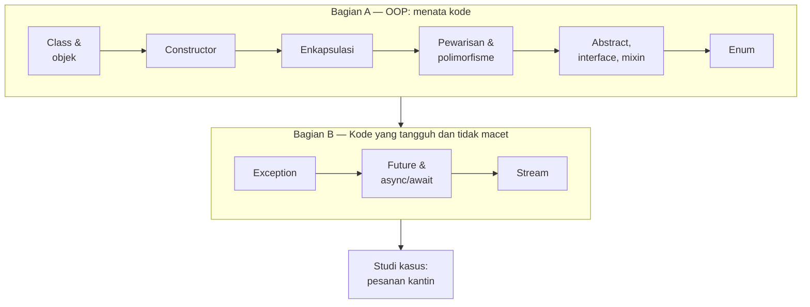
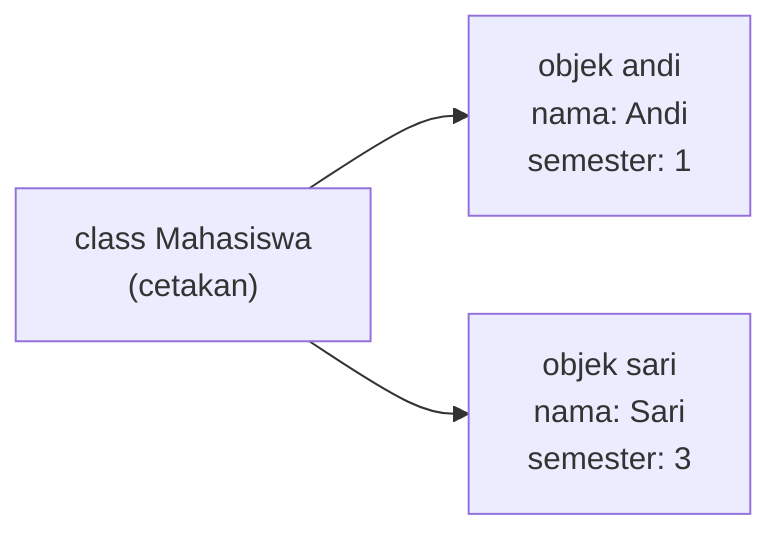
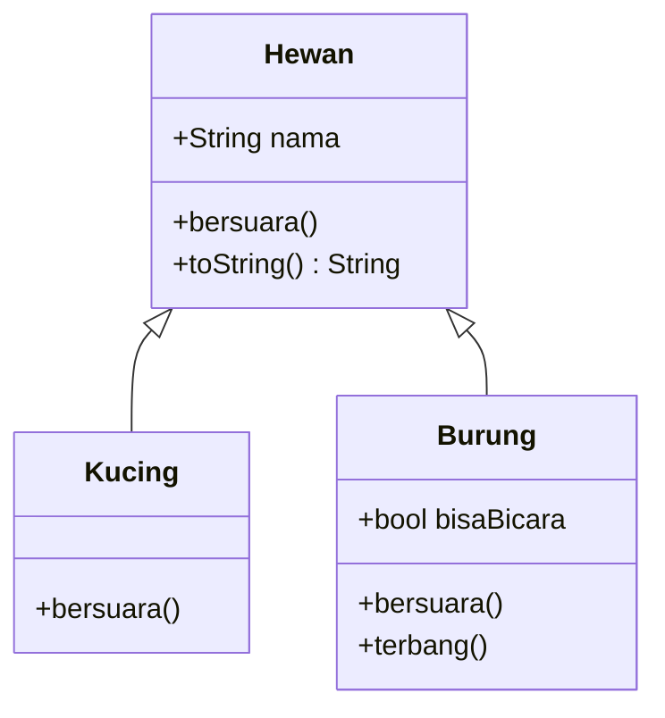
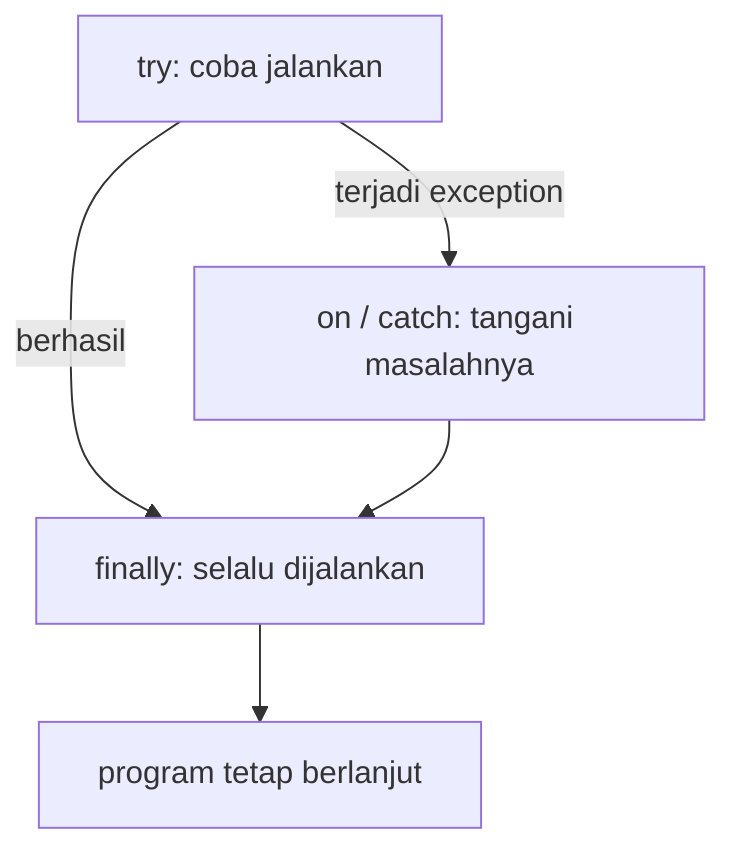
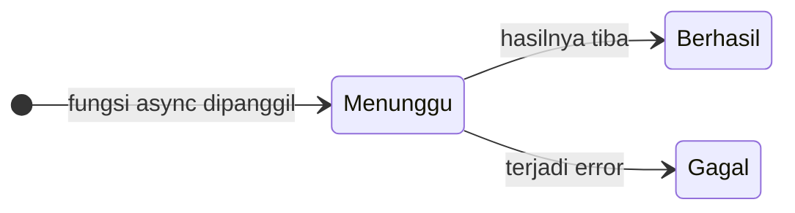

# Pertemuan 3 — Dart Lanjutan: OOP & Pemrograman Asinkron

> 📖 **Modul bacaan** · ⏱️ ± 90 menit · 🎯 Untuk pemula
>
> **Bekal yang dibutuhkan:** sudah mengikuti [Pertemuan 2](../pertemuan_02_dasar_dart/README.md), terutama fungsi, parameter bernama, `List`, dan `Map`.
> **Hasil akhir hari ini:** Anda bisa membuat program "Sistem Pesanan Kantin" yang memakai *class*, *enum*, *exception*, `Future`, dan `Stream`.

[🏠 Beranda](../README.md) · [📋 Silabus](../SILABUS.md) · [🧪 Jobsheet](JOBSHEET.md) · [✍️ Latihan](LATIHAN.md) · [💻 Kode Contoh](kode/) · [📊 Unduh Slide](https://raw.githubusercontent.com/antonprafanto/mobile2026/main/pertemuan_03_dart_lanjutan/slide/PERTEMUAN_03_Dart_Lanjutan.pptx)

---

## Daftar Isi

1. [Mengapa Perlu OOP dan Asinkron?](#1-mengapa-perlu-oop-dan-asinkron)
2. [Class dan Objek](#2-class-dan-objek)
3. [Constructor: Cara Membuat Objek](#3-constructor-cara-membuat-objek)
4. [Enkapsulasi: Menjaga Data Tetap Aman](#4-enkapsulasi-menjaga-data-tetap-aman)
5. [Pewarisan dan Polimorfisme](#5-pewarisan-dan-polimorfisme)
6. [Abstract Class dan Interface](#6-abstract-class-dan-interface)
7. [Mixin: Menempelkan Kemampuan](#7-mixin-menempelkan-kemampuan)
8. [Enum: Pilihan yang Pasti](#8-enum-pilihan-yang-pasti)
9. [Menangani Error dengan Exception](#9-menangani-error-dengan-exception)
10. [Pemrograman Asinkron dengan Future](#10-pemrograman-asinkron-dengan-future)
11. [Stream: Data yang Datang Berkali-kali](#11-stream-data-yang-datang-berkali-kali)
12. [Studi Kasus: Sistem Pesanan Kantin](#12-studi-kasus-sistem-pesanan-kantin)
13. [Menulis Kode yang Rapi](#13-menulis-kode-yang-rapi)
14. [Kesalahan Umum Pemula](#14-kesalahan-umum-pemula-dan-solusinya)
15. [Ringkasan](#15-ringkasan) · [Glosarium](#16-glosarium) · [Referensi](#17-referensi)

---

## 🎯 Tujuan Pembelajaran

Setelah mempelajari modul ini, Anda mampu:

1. Menjelaskan perbedaan *class* dan objek, lalu membuat *class* yang memiliki properti dan *method*.
2. Membuat objek dengan berbagai jenis *constructor*: biasa, parameter bernama, *named constructor*, `const`, dan `factory`.
3. Melindungi data dengan anggota privat, *getter*, dan *setter* (enkapsulasi).
4. Menerapkan pewarisan (`extends`), *override*, dan polimorfisme.
5. Memilih dengan tepat antara *abstract class*, *interface* (`implements`), dan *mixin* (`with`).
6. Memakai `enum`, termasuk *enum* yang memiliki properti, bersama `switch`.
7. Menangani error dengan `try`, `on`, `catch`, `finally`, `throw`, dan *exception* buatan sendiri.
8. Menulis kode asinkron dengan `Future`, `async`/`await`, `Future.wait`, dan `Stream`.

## 🗺️ Peta Materi Hari Ini



Bagian A mengajarkan cara **menata** kode agar rapi dan mudah dikembangkan. Bagian B mengajarkan cara membuat program yang **tidak mudah *crash*** dan **tidak membeku** saat menunggu. Keduanya dipakai di setiap aplikasi Flutter.

> [!NOTE]
> Semua contoh di pertemuan ini adalah **program Dart murni**, sama seperti Pertemuan 2. Jalankan di [DartPad](https://dartpad.dev) atau dengan `dart run nama_berkas.dart`. Lihat kembali [cara menjalankannya](../pertemuan_02_dasar_dart/README.md#2-cara-menjalankan-kode-dart) jika lupa.

---

## 1. Mengapa Perlu OOP dan Asinkron?

### 1.1 Masalah: data yang tercecer

Di Pertemuan 2, data beberapa mahasiswa bisa kita simpan seperti ini:

```dart
List<String> nama = ['Andi', 'Sari'];
List<String> nim = ['2609106001', '2609106002'];
List<int> semester = [1, 3];
```

Sekarang bayangkan Anda menghapus `'Andi'` dari daftar `nama`, tetapi lupa menghapus NIM dan semesternya. Data langsung **tidak sinkron**: Sari tiba-tiba "memiliki" NIM milik Andi. Semakin banyak data, semakin mudah kekacauan seperti ini terjadi.

**Pemrograman Berorientasi Objek** (*Object-Oriented Programming*, **OOP**) menyelesaikannya dengan ide sederhana: **satukan data dan perilaku yang saling berkaitan ke dalam satu "paket" bernama objek.** Satu objek mahasiswa menyimpan nama, NIM, dan semesternya sendiri, sekaligus tahu cara memperkenalkan diri.

### 1.2 Flutter dibangun dengan OOP

Masih ingat kode ini dari [Pertemuan 1, Contoh 02](../pertemuan_01_pengenalan_flutter/kode/contoh_02_materialapp_dan_scaffold.dart)?

```dart
class HalamanUtama extends StatelessWidget {
  const HalamanUtama({super.key});

  @override
  Widget build(BuildContext context) {
    return Scaffold(
      appBar: AppBar(title: const Text('Aplikasi Pertama Saya')),
      body: const Center(child: Text('Halo! Ini halaman utama.')),
    );
  }
}
```

Hampir setiap kata di dalamnya adalah konsep OOP:

| Potongan kode | Konsep | Dibahas di |
| :--- | :--- | :---: |
| `class HalamanUtama` | Membuat **class** | [Bagian 2](#2-class-dan-objek) |
| `extends StatelessWidget` | **Pewarisan**: mewarisi kemampuan widget | [Bagian 5](#5-pewarisan-dan-polimorfisme) |
| `const HalamanUtama({super.key});` | ***Constructor* `const`** dengan parameter bernama dan `super` | [Bagian 3](#3-constructor-cara-membuat-objek) dan [5](#5-pewarisan-dan-polimorfisme) |
| `@override` | **Mengganti *method*** milik induk | [Bagian 5](#5-pewarisan-dan-polimorfisme) |
| `Scaffold(appBar: ..., body: ...)` | **Membuat objek** memakai parameter bernama | [Bagian 2](#2-class-dan-objek) dan [3](#3-constructor-cara-membuat-objek) |

Artinya, **memahami OOP sama dengan bisa membaca kode Flutter.** Setelah modul ini, potongan kode di atas tidak akan terasa seperti "mantra" lagi.

### 1.3 Mengapa asinkron?

Aplikasi mobile **sering menunggu**: menunggu data dari internet, membaca *database*, atau mencari lokasi GPS. Jika aplikasi "diam terpaku" selama menunggu, layar **membeku** (*freeze*): tombol tidak bisa ditekan dan animasi berhenti. Pengguna akan mengira aplikasinya rusak.

Bayangkan seorang **pelayan restoran**. Pelayan yang baik tidak berdiri mematung di depan dapur menunggu satu pesanan matang. Ia mencatat pesanan, lalu melayani meja lain, dan kembali ketika makanan sudah siap. Itulah **pemrograman asinkron**: memulai pekerjaan yang lama, lalu tetap melayani hal lain sambil menunggu hasilnya ([Bagian 10](#10-pemrograman-asinkron-dengan-future) dan [11](#11-stream-data-yang-datang-berkali-kali)).

---

## 2. Class dan Objek

### 2.1 Cetakan kue dan kuenya

Bayangkan sebuah **cetakan kue** berbentuk ikan. Cetakan itu sendiri bukan kue; ia hanya menentukan **bentuk**. Dari satu cetakan, Anda bisa membuat puluhan kue dengan rasa dan warna yang berbeda-beda.

- ***Class*** (kelas) = **cetakan**: rancangan yang menentukan data apa yang dimiliki dan apa yang bisa dilakukan.
- **Objek** = **kue hasil cetakan**: benda nyata yang menyimpan datanya sendiri. Objek juga sering disebut *instance*.



### 2.2 Anatomi sebuah class

Mari bedah [`kode/contoh_01_class_dan_objek.dart`](kode/contoh_01_class_dan_objek.dart):

```dart
class Mahasiswa {
  // Properti: data yang dimiliki SETIAP objek mahasiswa
  String nama;
  String nim;
  int semester;

  // Constructor: "mesin pencetak" yang mengisi properti saat objek dibuat
  Mahasiswa(this.nama, this.nim, this.semester);

  // Method: aksi yang bisa dilakukan objek
  void perkenalan() {
    print('Halo, saya $nama (NIM $nim), semester $semester.');
  }

  void naikSemester() {
    semester++;
  }
}
```

| Bagian | Nama | Penjelasan |
| :--- | :--- | :--- |
| `class Mahasiswa { ... }` | ***Class*** | Cetakannya. Nama *class* memakai gaya ***UpperCamelCase***: setiap kata diawali huruf kapital. |
| `String nama;` | **Properti** (*field*) | Data yang dimiliki setiap objek. |
| `Mahasiswa(this.nama, ...);` | ***Constructor*** | "Mesin pencetak" yang mengisi properti saat objek dibuat. Namanya sama dengan nama *class*. |
| `void perkenalan() { ... }` | ***Method*** | Aksi yang bisa dilakukan objek. *Method* adalah fungsi yang "tinggal" di dalam *class*. |

### 2.3 Membuat dan memakai objek

```dart
Mahasiswa andi = Mahasiswa('Andi', '2609106001', 1);   // membuat objek
Mahasiswa sari = Mahasiswa('Sari', '2609106002', 3);

andi.perkenalan();        // memanggil method
andi.naikSemester();      // semester Andi menjadi 2
print(sari.semester);     // 3: semester Sari tidak ikut berubah
sari.nama = 'Sari Wulandari';   // properti juga bisa diubah
```

- Membuat objek sama seperti memanggil fungsi: tulis nama *class*, lalu isi tanda kurungnya. Tidak perlu kata `new` (kata itu boleh dihilangkan di Dart modern, dan memang dianjurkan untuk tidak ditulis).
- **Tanda titik (`.`)** dipakai untuk mengakses isi objek: `andi.nama`, `andi.perkenalan()`.
- Setiap objek menyimpan datanya **sendiri-sendiri**. Menaikkan semester Andi tidak mengubah semester Sari.

Hasil saat dijalankan:

```text
Halo, saya Andi (NIM 2609106001), semester 1.
Halo, saya Sari (NIM 2609106002), semester 3.
Setelah naik semester, Andi di semester 2.
Sari tetap di semester 3.
Halo, saya Sari Wulandari (NIM 2609106002), semester 3.
```

> [!TIP]
> Satu berkas `.dart` boleh berisi beberapa *class*. Di proyek Flutter sungguhan, biasanya **satu *class* utama disimpan dalam satu berkas**, misalnya `lib/models/mahasiswa.dart`. Agar mudah dijalankan di DartPad, contoh-contoh di pertemuan ini menaruh semuanya dalam satu berkas.

**🧠 Cek Cepat:** Jika `Mahasiswa budi = Mahasiswa('Budi', '2609106003', 5);` lalu `budi.naikSemester();` dipanggil dua kali, berapa nilai `budi.semester`?

<details>
<summary>Lihat jawaban</summary>

`7`. Setiap pemanggilan `naikSemester()` menambah semester objek `budi` sebanyak 1.
</details>

---

## 3. Constructor: Cara Membuat Objek

*Constructor* adalah "mesin pencetak" objek. Dart menyediakan beberapa jenis *constructor*, dan **semuanya akan Anda temui di kode Flutter**.

### 3.1 Constructor biasa dan jalan pintas `this.`

```dart
Mahasiswa(this.nama, this.nim, this.semester);
```

`this.nama` artinya: "terima sebuah nilai, lalu masukkan langsung ke properti `nama` milik objek ini". Kata `this` berarti **objek ini sendiri**. Nilai-nilainya diisi **berurutan**: nilai pertama untuk `nama`, kedua untuk `nim`, ketiga untuk `semester`.

### 3.2 Parameter bernama: gaya khas Flutter

Masih ingat parameter bernama `{ }` dari [Pertemuan 2](../pertemuan_02_dasar_dart/README.md#112-jenis-jenis-parameter)? *Constructor* juga bisa memakainya. Lihat [`kode/contoh_02_constructor.dart`](kode/contoh_02_constructor.dart):

```dart
class Buku {
  final String judul;
  final String penulis;
  final int halaman;

  // required = wajib diisi. halaman punya nilai bawaan 100.
  Buku({required this.judul, required this.penulis, this.halaman = 100});
}

Buku buku1 = Buku(
  judul: 'Belajar Flutter Itu Mudah',
  penulis: 'Rina Amelia',
  halaman: 320,
);
Buku buku2 = Buku(penulis: 'Budi Santoso', judul: 'Dasar Dart'); // halaman = 100
```

Inilah cara kita menulis widget: `Text('Halo', style: ...)`, `Padding(padding: ..., child: ...)`. Parameter bernama membuat kode **mudah dibaca**, dan urutannya **bebas**.

Perhatikan juga kata `final` pada properti `Buku`. Properti `final` hanya bisa diisi **sekali**, yaitu saat objek dibuat. Mencoba mengubahnya, misalnya `buku1.judul = 'Judul Lain';`, langsung ditolak editor.

### 3.3 Named constructor: lebih dari satu cara membuat objek

```dart
// Di dalam class Buku:
Buku.anonim(String judul) : this(judul: judul, penulis: 'Anonim');

// Pemakaian:
Buku buku3 = Buku.anonim('Hikayat Negeri Awan');
```

Satu *class* boleh punya beberapa *constructor* dengan nama berbeda, ditulis `NamaClass.namaLain`. Bagian `: this(...)` berarti "teruskan pekerjaannya ke *constructor* utama".

Di Flutter, Anda akan sering menjumpainya: `EdgeInsets.all(16)`, `EdgeInsets.symmetric(horizontal: 8)`, `ColorScheme.fromSeed(...)` (sudah Anda pakai di Pertemuan 1), dan `ListView.builder(...)`.

Hasil Contoh 02:

```text
"Belajar Flutter Itu Mudah" karya Rina Amelia, 320 halaman
"Dasar Dart" karya Budi Santoso, 100 halaman
"Hikayat Negeri Awan" karya Anonim, 100 halaman
```

### 3.4 Const constructor: objek "beku" yang hemat

Di Pertemuan 1 Anda disarankan memberi `const` pada widget yang tidak berubah, seperti `const Text('Halo')`. Inilah alasannya. Lihat [`kode/contoh_03_constructor_lainnya.dart`](kode/contoh_03_constructor_lainnya.dart):

```dart
class Warna {
  final int merah;
  final int hijau;
  final int biru;

  const Warna(this.merah, this.hijau, this.biru);
}

const Warna merah1 = Warna(255, 0, 0);
const Warna merah2 = Warna(255, 0, 0);
print(identical(merah1, merah2)); // true: keduanya objek yang SAMA

Warna biru1 = Warna(0, 0, 255); // tanpa const: objek baru
Warna biru2 = Warna(0, 0, 255);
print(identical(biru1, biru2)); // false: dua objek berbeda
```

`identical(a, b)` menjawab pertanyaan: "Apakah `a` dan `b` menunjuk **objek yang sama persis** di memori?" Objek `const` dengan isi yang sama hanya dibuat **satu kali**, lalu dipakai bersama. Bagi Flutter, ini berarti memori lebih hemat dan widget `const` tidak perlu dibuat ulang saat layar digambar ulang.

Syarat *constructor* `const`: **semua properti harus `final`**. Jika ada properti yang bisa diubah, editor menolak dengan pesan `Can't define a const constructor for a class with non-final fields.`

### 3.5 Factory constructor: berpikir dulu sebelum membuat

```dart
class Produk {
  final String nama;
  final int harga;

  Produk(this.nama, this.harga);

  factory Produk.dariTeks(String teks) {
    List<String> bagian = teks.split(';'); // 'Kopi Susu;12000' -> ['Kopi Susu', '12000']
    return Produk(bagian[0], int.parse(bagian[1]));
  }
}

Produk kopi = Produk.dariTeks('Kopi Susu;12000');
print('${kopi.nama}: Rp${kopi.harga}'); // Kopi Susu: Rp12000
```

*Constructor* `factory` boleh **mengolah data dulu**, baru membuat objek dengan `return`. Pola ini sangat penting: di [Pertemuan 10](../SILABUS.md) Anda akan memakainya untuk mengubah data JSON dari internet menjadi objek, dengan nama yang lazim dipakai: `fromJson`.

### 3.6 Primary constructor (fitur baru Dart 3.13)

Mulai Dart 3.13, properti dan *constructor* boleh ditulis sekaligus di "kepala" *class*:

```dart
class Titik(final int x, final int y);

Titik t = Titik(3, 4);
print('Titik berada di (${t.x}, ${t.y})'); // Titik berada di (3, 4)
```

Satu baris tersebut setara dengan cara klasik berikut:

```dart
class Titik {
  final int x;
  final int y;

  Titik(this.x, this.y);
}
```

Kata `final` di depan parameter berarti "jadikan juga properti `final`". Fitur ini masih sangat baru, sehingga belum banyak muncul di tutorial dan proyek yang sudah ada. **Di mata kuliah ini kita tetap memakai gaya klasik** (Bagian 3.1–3.5), karena gaya itulah yang paling banyak Anda jumpai di dokumentasi Flutter. Cukup kenali bentuknya agar tidak bingung saat bertemu.

> [!NOTE]
> Jika contoh `class Titik(...)` menghasilkan error di komputer Anda, kemungkinan versi Flutter Anda masih lama. Perbarui dengan perintah `flutter upgrade`. DartPad selalu memakai versi terbaru.

### 3.7 Rangkuman jenis constructor

| Jenis | Contoh penulisan | Kapan dipakai | Ditemui di Flutter |
| :--- | :--- | :--- | :--- |
| Biasa | `Mahasiswa(this.nama, this.nim)` | Cara standar, parameternya sedikit | — |
| Parameter bernama | `Buku({required this.judul})` | Parameternya banyak; agar mudah dibaca | Hampir semua widget |
| *Named* | `Buku.anonim('...')` | Menyediakan cara lain membuat objek | `EdgeInsets.all()`, `ListView.builder()` |
| `const` | `const Warna(255, 0, 0)` | Objek tetap yang tidak pernah berubah | `const Text('Halo')` |
| `factory` | `Produk.dariTeks('...')` | Perlu mengolah data sebelum membuat objek | `fromJson(...)` (Pertemuan 10) |

**🧠 Cek Cepat:** Apa yang salah dari pemanggilan `Buku('Dasar Dart')` untuk *class* `Buku` di Bagian 3.2?

<details>
<summary>Lihat jawaban</summary>

*Constructor* `Buku` memakai **parameter bernama**, sehingga nilainya harus ditulis beserta namanya. Selain itu, `penulis` wajib diisi. Pemanggilan yang benar: `Buku(judul: 'Dasar Dart', penulis: 'Budi Santoso')`.
</details>

---

## 4. Enkapsulasi: Menjaga Data Tetap Aman

### 4.1 Analogi ATM

Saldo tabungan Anda disimpan di brankas bank. Anda **tidak bisa** membuka brankas lalu menulis saldo sesuka hati. Satu-satunya cara mengubah saldo adalah lewat **mesin ATM** atau *teller*, yang memeriksa aturan: setoran harus lebih dari nol, penarikan tidak boleh melebihi saldo.

Enkapsulasi bekerja persis seperti itu: **data penting disembunyikan, dan perubahannya hanya boleh lewat "pintu resmi" yang memeriksa aturan.**

### 4.2 Anggota privat: diawali garis bawah `_`

Lihat [`kode/contoh_04_enkapsulasi.dart`](kode/contoh_04_enkapsulasi.dart):

```dart
class RekeningTabungan {
  final String pemilik;
  int _saldo = 0; // privat: diawali garis bawah
  final List<String> _riwayat = [];

  RekeningTabungan(this.pemilik);

  int get saldo => _saldo; // getter: hanya untuk MELIHAT
  bool get kosong => _saldo == 0; // getter yang nilainya dihitung
  List<String> get riwayat => List.unmodifiable(_riwayat);

  void setor(int jumlah) {
    if (jumlah <= 0) {
      print('Setoran Rp$jumlah ditolak: jumlah harus lebih dari 0.');
      return;
    }
    _saldo += jumlah;
    _riwayat.add('setor $jumlah');
  }

  // tarik() serupa: menolak penarikan yang melebihi saldo.
}
```

Nama yang diawali **garis bawah `_`** bersifat **privat**. Dari berkas lain, `_saldo` sama sekali tidak terlihat, sehingga satu-satunya cara mengubah saldo adalah lewat *method* resmi `setor()` dan `tarik()`.

> [!IMPORTANT]
> **Privat di Dart berlaku per berkas** (disebut *library*), bukan per *class*. Kode yang berada di berkas yang **sama**, misalnya `main()` di Contoh 04, sebenarnya masih bisa menyentuh `_saldo`. Perlindungan benar-benar terasa ketika *class* disimpan di berkas tersendiri, seperti kebiasaan di proyek Flutter. Karena itu, biasakan **selalu memakai *method* resmi**, walaupun masih dalam satu berkas.

### 4.3 Getter: jendela untuk melihat

```dart
RekeningTabungan rekening = RekeningTabungan('Dewi');
rekening.setor(150000);
rekening.setor(-5000); // ditolak oleh "penjaga" di dalam setor()
rekening.tarik(200000); // ditolak: saldo tidak cukup
rekening.tarik(50000);
print(rekening.saldo); // 100000  <- getter dibaca TANPA tanda kurung
// rekening.saldo = 1000000; // ERROR: tidak ada setter bernama saldo
```

- ***Getter*** (`get`) adalah "jendela": orang luar boleh **melihat** saldo, tetapi tidak bisa mengubahnya. Membaca *getter* tidak memakai tanda kurung: `rekening.saldo`, bukan `rekening.saldo()`.
- *Getter* juga bisa **menghitung** nilainya setiap kali diminta, seperti `kosong`.
- `riwayat` mengembalikan **salinan yang tidak bisa diubah** (`List.unmodifiable`), sehingga orang luar tidak bisa menambahkan catatan palsu.
- Mencoba menulis `rekening.saldo = 1000000;` langsung ditolak editor: `There isn't a setter named 'saldo' in class 'RekeningTabungan'.`

### 4.4 Setter: pintu masuk yang dijaga

Kadang data **boleh** diubah dari luar, asalkan nilainya masuk akal. Untuk itu ada ***setter*** (`set`):

```dart
class ProfilMahasiswa {
  final String nama;
  double _ipk = 0;

  ProfilMahasiswa(this.nama);

  double get ipk => _ipk;

  // Setter: dipanggil saat kita menulis profil.ipk = ...
  set ipk(double nilai) {
    if (nilai < 0 || nilai > 4) {
      print('IPK $nilai tidak valid. Harus di antara 0 dan 4.');
      return;
    }
    _ipk = nilai;
  }
}

ProfilMahasiswa profil = ProfilMahasiswa('Dewi');
profil.ipk = 3.65; // diterima
profil.ipk = 4.5; // ditolak oleh validasi di setter
```

Dari luar, `profil.ipk = 3.65;` terlihat seperti mengisi properti biasa, padahal di baliknya ada "satpam" yang memeriksa nilainya.

Hasil lengkap Contoh 04:

```text
Rekening kosong? true
Setoran Rp-5000 ditolak: jumlah harus lebih dari 0.
Penarikan Rp200000 ditolak: saldo tidak cukup.
Saldo Dewi: Rp100000
Riwayat: [setor 150000, tarik 50000]
IPK 4.5 tidak valid. Harus di antara 0 dan 4.
IPK Dewi: 3.65
```

**🧠 Cek Cepat:** Mengapa *getter* `riwayat` mengembalikan `List.unmodifiable(_riwayat)`, bukan langsung `_riwayat`?

<details>
<summary>Lihat jawaban</summary>

Jika `_riwayat` dikembalikan langsung, kode di luar bisa menulis `rekening.riwayat.add('setor 999999')` dan merusak catatan transaksi. Dengan salinan yang tidak bisa diubah, upaya seperti itu akan gagal.
</details>

---

## 5. Pewarisan dan Polimorfisme

### 5.1 "Kucing adalah hewan"

Bayangkan sebuah keluarga yang punya **buku resep turun-temurun**. Seorang anak mewarisi semua resep orang tuanya. Ia boleh langsung memakainya, **menambah** resep baru, atau **memodifikasi** resep lama sesuai seleranya.

**Pewarisan** (*inheritance*) bekerja seperti itu: sebuah *class* **mewarisi** semua properti dan *method* *class* lain, lalu boleh **menambah** atau **mengganti** sebagian perilakunya. Pewarisan cocok dipakai jika hubungan keduanya bisa dibaca "**X adalah Y**": kucing **adalah** hewan, burung **adalah** hewan.



*Class* yang diwarisi disebut **induk** (*superclass*), sedangkan yang mewarisi disebut **anak** (*subclass*).

### 5.2 extends, super, dan @override

Lihat [`kode/contoh_05_pewarisan.dart`](kode/contoh_05_pewarisan.dart):

```dart
class Hewan {
  final String nama;

  Hewan(this.nama);

  void bersuara() {
    print('$nama mengeluarkan suara.');
  }

  @override
  String toString() => 'Hewan bernama $nama';
}

class Kucing extends Hewan {
  Kucing(super.nama);

  @override
  void bersuara() {
    print('$nama: Meong!');
  }
}

class Burung extends Hewan {
  final bool bisaBicara;

  Burung(super.nama, {this.bisaBicara = false});

  @override
  void bersuara() {
    super.bersuara(); // jalankan dulu versi milik induk
    if (bisaBicara) {
      print('$nama: Halo, apa kabar?');
    }
  }

  void terbang() {
    print('$nama terbang tinggi.');
  }
}
```

| Kata kunci | Arti |
| :--- | :--- |
| `extends Hewan` | "Mewarisi semua isi *class* `Hewan`." |
| `super.nama` (di *constructor*) | "Teruskan nilai `nama` ke *constructor* induk." |
| `@override` | Penanda bahwa *method* ini **sengaja mengganti** *method* milik induk. |
| `super.bersuara()` | "Jalankan dulu versi milik induk", lalu lanjutkan dengan tambahan milik anak. |

> [!NOTE]
> Satu *class* hanya boleh punya **satu** induk. Semua *class* di Dart otomatis merupakan keturunan *class* `Object`, dan dari sanalah setiap objek mewarisi *method* `toString()`. *Method* ini menentukan tulisan yang muncul saat objek di-`print`. Tanpa *override*, `print(oyen)` hanya menampilkan `Instance of 'Kucing'`.

Sekarang Anda bisa membaca `class HalamanUtama extends StatelessWidget` di Pertemuan 1: `HalamanUtama` **adalah** sebuah `StatelessWidget`, mewarisi semua kemampuannya, lalu meng-*override* `build()` untuk menentukan tampilannya sendiri.

### 5.3 Polimorfisme: satu perintah, banyak bentuk

```dart
List<Hewan> kebunBinatang = [oyen, kiki, Hewan('Sapi')];
for (Hewan hewan in kebunBinatang) {
  hewan.bersuara(); // perintahnya sama, hasilnya menyesuaikan jenis hewan
}
```

Seorang dosen berkata, "Silakan perkenalkan diri masing-masing!" Setiap mahasiswa memperkenalkan diri **dengan caranya sendiri**, dan dosen tidak perlu tahu detail setiap orang. Itulah **polimorfisme** (*polymorphism*, "banyak bentuk"): satu perintah yang sama, tetapi setiap objek menjalankannya sesuai jenisnya.

Flutter memakainya di mana-mana. `Column(children: [...])` menerima daftar bertipe `List<Widget>` yang isinya bisa `Text`, `Icon`, atau tombol. Flutter cukup memperlakukan semuanya sebagai `Widget`, dan setiap widget menggambar dirinya dengan caranya sendiri.

### 5.4 Memeriksa jenis objek dengan `is`

```dart
for (Hewan hewan in kebunBinatang) {
  if (hewan is Burung) {
    hewan.terbang(); // aman: di dalam blok ini hewan pasti Burung
  } else {
    print('${hewan.nama} tidak bisa terbang.');
  }
}
```

Operator `is` memeriksa jenis sebuah objek. Setelah diperiksa, Dart mengizinkan Anda memanggil *method* khusus jenis tersebut. Ini adalah *type promotion*, sama seperti pemeriksaan `!= null` di Pertemuan 2.

Hasil lengkap Contoh 05:

```text
Oyen: Meong!
Kiki mengeluarkan suara.
Kiki: Halo, apa kabar?
Kiki terbang tinggi.
Hewan bernama Oyen
--- Semua hewan bersuara ---
Oyen: Meong!
Kiki mengeluarkan suara.
Kiki: Halo, apa kabar?
Sapi mengeluarkan suara.
--- Siapa yang bisa terbang? ---
Oyen tidak bisa terbang.
Kiki terbang tinggi.
Sapi tidak bisa terbang.
```

**🧠 Cek Cepat:** Pada kode `Hewan h = Burung('Kiki');`, mengapa `h.terbang();` ditolak editor, padahal objeknya memang burung?

<details>
<summary>Lihat jawaban</summary>

Karena tipe variabel `h` adalah `Hewan`, dan Dart hanya mengizinkan *method* yang **pasti** dimiliki semua `Hewan`. Pesan errornya: `The method 'terbang' isn't defined for the type 'Hewan'.` Solusinya, periksa dulu dengan `if (h is Burung) { h.terbang(); }`.
</details>

---

## 6. Abstract Class dan Interface

### 6.1 Abstract class: kontrak sekaligus kerangka

Bayangkan sebuah toko *online* yang bekerja sama dengan beberapa jasa pengiriman. Toko mewajibkan: **setiap jasa pengiriman harus punya nama layanan dan cara menghitung ongkos kirim.** Cara menghitungnya boleh berbeda-beda, asalkan ada.

***Abstract class*** adalah "kontrak" seperti itu: ia menentukan **apa yang wajib ada**, tanpa harus menentukan **bagaimana caranya**. Lihat [`kode/contoh_06_abstract_dan_interface.dart`](kode/contoh_06_abstract_dan_interface.dart):

```dart
abstract class Pengiriman {
  String get nama; // abstrak: tanpa isi, wajib diisi class anak
  int hitungOngkir(int beratKg); // abstrak

  // Method biasa (punya isi) boleh ada dan langsung diwarisi.
  void tampilkanOngkir(int beratKg) {
    print('$nama, $beratKg kg: Rp${hitungOngkir(beratKg)}');
  }
}

class Reguler extends Pengiriman {
  @override
  String get nama => 'Reguler (3-5 hari)';

  @override
  int hitungOngkir(int beratKg) => beratKg * 9000;
}
```

Aturan *abstract class*:

1. **Tidak bisa dibuat objeknya** secara langsung. `Pengiriman()` ditolak dengan pesan `Abstract classes can't be instantiated.` Yang dibuat adalah objek dari *class* anaknya, misalnya `Reguler()`.
2. Anggota tanpa isi, seperti `int hitungOngkir(int beratKg);`, disebut **anggota abstrak**. Setiap *class* anak **wajib** mengisinya. Jika lupa, muncul pesan `Missing concrete implementation of 'Pengiriman.hitungOngkir'.`
3. *Abstract class* boleh juga berisi *method* biasa, seperti `tampilkanOngkir()`, yang langsung diwarisi oleh semua anaknya.

### 6.2 Interface dengan `implements`

Sebagian jasa pengiriman punya kemampuan tambahan: paketnya bisa **dilacak**. Kemampuan ini kita tulis sebagai ***interface***, yaitu daftar kemampuan yang dijanjikan:

```dart
abstract class BisaDilacak {
  String lacak(String nomorResi);
}

class Kilat extends Pengiriman implements BisaDilacak {
  @override
  String get nama => 'Kilat (1 hari)';

  @override
  int hitungOngkir(int beratKg) {
    int ongkir = beratKg * 15000;
    return ongkir < 20000 ? 20000 : ongkir; // ongkir minimal Rp20.000
  }

  @override
  String lacak(String nomorResi) => 'Paket $nomorResi sedang diantar kurir.';
}
```

- `implements` artinya "saya **berjanji** memiliki semua kemampuan dalam daftar ini, dan **saya tulis sendiri** semua isinya". Tidak ada isi yang ikut diwarisi.
- Satu *class* boleh `implements` **banyak** *interface* sekaligus, dipisahkan koma.
- Di Dart, *class* biasa pun bisa dipakai sebagai *interface*. Kita memakai `abstract class` agar jelas bahwa isinya memang hanya daftar janji.

Hasil Contoh 06:

```text
Reguler (3-5 hari), 1 kg: Rp9000
Kilat (1 hari), 1 kg: Rp20000
Ambil di toko, 1 kg: Rp0
Kilat (1 hari), 3 kg: Rp45000
Paket KLT-001 sedang diantar kurir.
```

---

## 7. Mixin: Menempelkan Kemampuan

### 7.1 Masalah: satu induk saja tidak cukup

Bebek bisa berjalan, berenang, **dan** terbang. Ikan hanya bisa berenang. Elang bisa terbang. Jika hanya memakai pewarisan, kita harus membuat *class* induk untuk setiap kombinasi kemampuan, padahal satu *class* hanya boleh punya **satu** induk. Kombinasinya akan cepat menjadi kacau.

Bayangkan **lencana keahlian** di kegiatan pramuka. Seorang anggota bisa mengumpulkan banyak lencana: berenang, P3K, memasak. Setiap lencana menambah kemampuan baru tanpa mengubah siapa dirinya.

***Mixin*** adalah "lencana" itu: **paket kemampuan yang bisa ditempelkan ke *class* mana pun dengan kata kunci `with`.** Lihat [`kode/contoh_07_mixin.dart`](kode/contoh_07_mixin.dart):

```dart
class Hewan {
  final String nama;

  Hewan(this.nama);
}

mixin BisaBerenang on Hewan {
  void berenang() {
    print('$nama berenang di kolam.');
  }
}

// mixin BisaBerjalan ditulis dengan pola yang sama (lihat kode lengkap).

mixin BisaTerbang on Hewan {
  int ketinggianMaks = 100; // mixin juga boleh membawa properti

  void terbang() {
    print('$nama terbang hingga $ketinggianMaks meter.');
  }
}

class Bebek extends Hewan with BisaBerjalan, BisaBerenang, BisaTerbang {
  Bebek(super.nama);
}

class Ikan extends Hewan with BisaBerenang {
  Ikan(super.nama);
}
```

- `on Hewan` berarti *mixin* ini **khusus untuk keluarga `Hewan`**. Karena itu, di dalam *mixin* kita boleh memakai properti milik `Hewan`, yaitu `nama`.
- `Bebek` memakai tiga *mixin* sekaligus, sedangkan `Ikan` hanya satu. Memanggil `koki.terbang()` pada objek `Ikan` ditolak editor, karena `Ikan` tidak memakai `BisaTerbang`.
- Di Flutter, Anda akan menjumpai `with SingleTickerProviderStateMixin` ketika membuat animasi.

Hasil Contoh 07:

```text
Kwek si bebek berjalan dengan kakinya.
Kwek si bebek berenang di kolam.
Kwek si bebek terbang hingga 100 meter.
Koki si ikan berenang di kolam.
Elang Jawa terbang hingga 3000 meter.
Jumlah hewan yang bisa berenang: 2
```

### 7.2 Kapan memakai extends, implements, atau with?

| | `extends` | `implements` | `with` |
| :--- | :--- | :--- | :--- |
| Dibaca | "**adalah** sebuah ..." | "**berjanji** bisa ..." | "**punya kemampuan** tambahan ..." |
| Jumlah per *class* | Hanya 1 | Boleh banyak | Boleh banyak |
| Isi *method* ikut diwarisi? | ✅ Ya | ❌ Tidak, wajib ditulis ulang semua | ✅ Ya |
| Contoh | `Kucing extends Hewan` | `Kilat implements BisaDilacak` | `Bebek with BisaTerbang` |
| Di Flutter | `extends StatelessWidget` | Jarang ditulis sendiri oleh pemula | `with SingleTickerProviderStateMixin` |

**🧠 Cek Cepat:** Sebuah *class* `class Pesawat with BisaTerbang {}` ditolak editor. Mengapa?

<details>
<summary>Lihat jawaban</summary>

Karena `BisaTerbang` ditulis `on Hewan`, sehingga hanya boleh ditempelkan ke keturunan `Hewan`. Pesan errornya: `'BisaTerbang' can't be mixed onto 'Object' because 'Object' doesn't implement 'Hewan'.` Jika kemampuan terbang memang perlu dipakai benda selain hewan, buat *mixin* tanpa `on Hewan` (dan jangan memakai `nama` di dalamnya).
</details>

---

## 8. Enum: Pilihan yang Pasti

### 8.1 Masalah: "teks ajaib"

```dart
String status = 'diproses';
if (status == 'diprosess') {
  // salah ketik! TIDAK ada error, tetapi syarat ini tidak akan pernah benar
}
```

Bandingkan **kolom isian bebas** dengan **pilihan ganda** pada formulir. Jika pilihannya sudah pasti dan terbatas, misalnya nama hari, ukuran baju S/M/L/XL, atau status pesanan, pilihan ganda jauh lebih aman: tidak mungkin ada yang mengisi "Seninn".

***Enum*** (*enumerated type*) adalah "pilihan ganda" versi Dart. Salah ketik langsung ketahuan oleh editor.

### 8.2 Enum sederhana

Lihat [`kode/contoh_08_enum.dart`](kode/contoh_08_enum.dart):

```dart
enum Hari { senin, selasa, rabu, kamis, jumat, sabtu, minggu }

Hari hariIni = Hari.jumat;
print(hariIni); // Hari.jumat
print(hariIni.name); // jumat  (namanya saja)
print(hariIni.index); // 4  (urutan, dimulai dari 0)
print(Hari.values.length); // 7  (values = daftar semua nilai)
```

### 8.3 Enum dengan properti

*Enum* juga boleh membawa data dan *getter*. Bentuk ini disebut *enhanced enum*:

```dart
enum StatusPesanan {
  menunggu('Menunggu konfirmasi'),
  diproses('Sedang dimasak'),
  siap('Siap diambil'),
  selesai('Pesanan selesai');

  const StatusPesanan(this.label); // constructor enum selalu const
  final String label;

  bool get bisaDibatalkan => this == StatusPesanan.menunggu;
}

print(StatusPesanan.siap.label); // Siap diambil
```

### 8.4 Enum + switch: aman dari lupa

```dart
String saranUntukPembeli(StatusPesanan status) {
  return switch (status) {
    StatusPesanan.menunggu => 'Mohon tunggu sebentar.',
    StatusPesanan.diproses => 'Pesanan sedang dibuat.',
    StatusPesanan.siap => 'Silakan ambil di loket.',
    StatusPesanan.selesai => 'Terima kasih sudah memesan!',
  };
}
```

Dart memeriksa apakah **semua** nilai *enum* sudah punya cabang. Misalnya suatu hari Anda menambah status `dibatalkan`, tetapi lupa menambah cabangnya. Editor langsung mengingatkan:

```text
The type 'StatusPesanan' isn't exhaustively matched by the switch cases since it doesn't match the pattern 'StatusPesanan.dibatalkan'.
```

Kesalahan seperti ini tertangkap **sebelum** aplikasi sampai ke tangan pengguna. Perhatikan juga bahwa di sini kita **tidak** memakai cabang `_` (selain itu), agar pemeriksaan tersebut tetap bekerja.

Di Flutter, *enum* ada di mana-mana: `MainAxisAlignment.center`, `TextAlign.center`, dan `Brightness.dark` semuanya adalah nilai *enum*.

Hasil Contoh 08:

```text
Hari ini: Hari.jumat
Nama: jumat, urutan ke-4
Libur? false
Jumlah status pesanan: 4
- Menunggu konfirmasi (bisa dibatalkan: true)
- Sedang dimasak (bisa dibatalkan: false)
- Siap diambil (bisa dibatalkan: false)
- Pesanan selesai (bisa dibatalkan: false)
Silakan ambil di loket.
```

<details>
<summary>🔍 <b>Pengayaan:</b> <code>sealed class</code>, "kerabat dekat" enum (akan dipakai lagi di Pertemuan 9–10)</summary>

Nilai *enum* tidak bisa membawa data yang berbeda-beda untuk setiap kejadian. Bagaimana jika kondisi "berhasil" perlu membawa daftar data, sedangkan kondisi "gagal" perlu membawa pesan error? Untuk itu Dart menyediakan `sealed class`: semua turunannya sudah diketahui, sehingga `switch` tetap bisa memeriksa kelengkapannya.

```dart
sealed class HasilMuat {}

class Memuat extends HasilMuat {}

class Berhasil extends HasilMuat {
  final List<String> data;

  Berhasil(this.data);
}

class Gagal extends HasilMuat {
  final String pesan;

  Gagal(this.pesan);
}

String tampilkan(HasilMuat hasil) {
  return switch (hasil) {
    Memuat() => 'Sedang memuat...',
    Berhasil b => 'Berhasil memuat ${b.data.length} data',
    Gagal g => 'Gagal: ${g.pesan}',
  };
}

void main() {
  print(tampilkan(Memuat())); // Sedang memuat...
  print(tampilkan(Berhasil(['Nasi Goreng', 'Es Teh']))); // Berhasil memuat 2 data
  print(tampilkan(Gagal('Tidak ada koneksi internet'))); // Gagal: Tidak ada koneksi internet
}
```

`Berhasil b => ...` dibaca: "jika `hasil` bertipe `Berhasil`, sebut ia `b`, lalu ...". Pola tiga kondisi ini (memuat, berhasil, gagal) akan Anda pakai saat mengambil data dari internet.
</details>

---

## 9. Menangani Error dengan Exception

### 9.1 Dua jenis kesalahan

| | Kesalahan saat menulis kode | Kesalahan saat program berjalan |
| :--- | :--- | :--- |
| Kapan ketahuan | **Sebelum** program dijalankan (garis merah di editor) | **Ketika** program sedang berjalan |
| Contoh | Salah tipe, lupa titik koma | Teks bukan angka di-`parse`, server mati, saldo kurang |
| Cara menangani | Perbaiki kodenya | **Tangani dengan *exception*** |

Kesalahan jenis kedua sering **tidak bisa dicegah** oleh pemrogram: pengguna salah mengetik, sinyal internet hilang, atau stok tiba-tiba habis. Kita tidak bisa mencegah hujan, tetapi kita bisa **menyiapkan payung**. Payung itulah penanganan *exception*.

### 9.2 throw, try, on, catch, dan finally



Lihat [`kode/contoh_09_exception.dart`](kode/contoh_09_exception.dart):

```dart
int tarikTunai(int saldo, int jumlah) {
  if (jumlah > saldo) {
    throw SaldoTidakCukupException(jumlah - saldo); // "lempar" masalahnya
  }
  return saldo - jumlah;
}

void main() {
  try {
    int sisa = tarikTunai(50000, 20000);
    print('Penarikan berhasil, sisa saldo Rp$sisa');
    sisa = tarikTunai(sisa, 80000); // gagal -> langsung lompat ke on/catch
    print('Baris ini tidak akan pernah dicetak.');
  } on SaldoTidakCukupException catch (e) {
    print('Penarikan gagal: $e');
  } finally {
    print('Struk transaksi dicetak.');
  }
}
```

| Kata kunci | Arti |
| :--- | :--- |
| `throw` | "Melempar" masalah kepada pemanggil fungsi. Fungsi langsung berhenti di baris itu. |
| `try { }` | Blok kode yang **dicoba** dijalankan. |
| `on JenisError` | Tangkap **hanya** jenis error tertentu. |
| `catch (e)` | Simpan objek error ke variabel `e` agar bisa dibaca. Tanpa `on`, `catch` menangkap **semua** jenis error. |
| `finally { }` | **Selalu** dijalankan, baik berhasil maupun gagal. Cocok untuk "beres-beres", misalnya menutup koneksi atau menyembunyikan indikator *loading*. |

Contoh lain, `int.parse` melempar `FormatException` jika teksnya bukan angka:

```dart
int bacaUmur(String teks) {
  try {
    return int.parse(teks);
  } on FormatException {
    print('"$teks" bukan angka. Umur dianggap 0.');
    return 0;
  }
}
```

### 9.3 Exception buatan sendiri

```dart
class SaldoTidakCukupException implements Exception {
  final int kekurangan;

  SaldoTidakCukupException(this.kekurangan);

  @override
  String toString() => 'Saldo kurang Rp$kekurangan';
}
```

Nama yang jelas membuat penanganannya mudah dibaca (`on SaldoTidakCukupException`), dan objeknya bisa membawa informasi tambahan, seperti besarnya kekurangan saldo.

Hasil lengkap Contoh 09:

```text
Umur: 19
"sembilan belas" bukan angka. Umur dianggap 0.
Umur: 0
Penarikan berhasil, sisa saldo Rp30000
Penarikan gagal: Saldo kurang Rp50000
Struk transaksi dicetak.
Terjadi kesalahan saat membaca antrean.
Program tetap berjalan sampai selesai.
```

> [!WARNING]
> Dart membedakan **Exception** dan **Error**. *Exception* adalah masalah wajar yang memang perlu ditangani, misalnya input salah atau koneksi putus. *Error* adalah tanda ada ***bug*** di kode, misalnya `RangeError` karena indeks di luar batas. Bagian terakhir Contoh 09 sengaja menangkap `RangeError` hanya untuk menunjukkan cara kerja `catch` tanpa `on`. **Di kode sungguhan, jangan menangkap *Error*: perbaiki kodenya.** Ingat juga cara aman dari Pertemuan 2: `int.tryParse()` menghindari *exception* sama sekali.

> [!CAUTION]
> Jangan pernah membiarkan blok `catch` kosong, misalnya `catch (e) {}`. Error-nya "tertelan" diam-diam: program terlihat baik-baik saja, padahal ada yang salah, dan penyebabnya akan sangat sulit dilacak.

**🧠 Cek Cepat:** Apa yang tercetak oleh kode berikut?

```dart
try {
  print('A');
  throw Exception('x');
  print('B');
} catch (e) {
  print('C');
} finally {
  print('D');
}
```

<details>
<summary>Lihat jawaban</summary>

`A`, `C`, lalu `D`. Begitu `throw` dijalankan, sisa blok `try` dilewati (`B` tidak dicetak), program melompat ke `catch`, lalu `finally` tetap dijalankan. Editor juga akan menandai `print('B')` sebagai *dead code* (kode yang tidak mungkin dijalankan).
</details>

---

## 10. Pemrograman Asinkron dengan Future

### 10.1 Pager di food court

Saat memesan makanan di *food court*, Anda sering diberi **alat getar** (*pager*). Anda tidak perlu berdiri di depan kios; Anda bebas duduk, mengobrol, atau membeli minum. Ketika makanan siap, *pager* bergetar dan Anda mengambil pesanan.

`Future` adalah *pager* itu: **janji bahwa sebuah hasil akan tersedia nanti.** `Future<String>` berarti "janji akan ada sebuah `String`".

Sebuah `Future` bisa berakhir dengan dua cara:



Seperti makanan yang bisa saja ternyata habis, sebuah `Future` juga bisa **gagal**. Karena itu, penanganan error tetap diperlukan ([Bagian 10.5](#105-menangani-error-pada-future)).

### 10.2 async dan await

Lihat [`kode/contoh_10_future_async_await.dart`](kode/contoh_10_future_async_await.dart):

```dart
// Future.delayed di sini hanya PURA-PURA menunggu server selama 1 detik.
Future<String> ambilNamaPengguna() async {
  await Future.delayed(Duration(seconds: 1));
  return 'Rina';
}

Future<void> main() async {
  String nama = await ambilNamaPengguna(); // tunggu janjinya ditepati
  print('Halo, $nama!');
}
```

Tiga aturan penting:

1. Fungsi yang di dalamnya memakai `await` **wajib** ditandai `async`.
2. Fungsi `async` **selalu** mengembalikan `Future`: tulis `Future<TipeHasil>`, atau `Future<void>` jika tidak mengembalikan apa-apa.
3. `await` hanya menunda **fungsi itu sendiri**. Bagian lain aplikasi, seperti tombol dan animasi, tetap berjalan.

> [!NOTE]
> `Future.delayed(...)` di contoh-contoh ini hanya **pura-pura** menunggu, sebagai pengganti proses sungguhan seperti mengambil data dari internet. Proses sungguhannya akan Anda kerjakan di Pertemuan 10.

### 10.3 then() vs await: siapa yang duluan?

Ada dua cara mengambil hasil sebuah `Future`: `then()` dan `await`. Perhatikan urutan *output* program berikut:

```dart
Future<void> main() async {
  print('1. Aplikasi dibuka, mulai memuat data...');

  // TANPA await: program tidak menunggu, hasilnya diambil nanti lewat then()
  ambilNamaPengguna().then((String nama) {
    print('3. (then) Nama akhirnya tiba: $nama');
  });
  print('2. Baris ini dicetak lebih dulu, tanpa menunggu.');

  // DENGAN await: program "menunggu di baris ini" sampai hasilnya ada
  Stopwatch stopwatch = Stopwatch()..start();
  String nama = await ambilNamaPengguna();
  int notifikasi = await ambilJumlahNotifikasi();
  print('4. Halo, $nama! Ada $notifikasi notifikasi baru.');
  print('5. Memuat dua data berurutan: ${stopwatch.elapsed.inSeconds} detik.');
}
```

| Waktu | Yang terjadi | *Output* |
| :---: | :--- | :--- |
| 0 detik | Cetak baris 1. Mulai mengambil nama **tanpa** `await`, jadi langsung lanjut. Cetak baris 2. Mulai mengambil nama lagi **dengan** `await`, jadi `main()` menunggu. | `1.` dan `2.` |
| 1 detik | Pengambilan pertama selesai, isi `then()` dijalankan. Pengambilan kedua juga selesai, `main()` lanjut mengambil jumlah notifikasi (menunggu lagi). | `3.` |
| 2 detik | Jumlah notifikasi tiba. | `4.` dan `5.` |

```text
1. Aplikasi dibuka, mulai memuat data...
2. Baris ini dicetak lebih dulu, tanpa menunggu.
3. (then) Nama akhirnya tiba: Rina
4. Halo, Rina! Ada 3 notifikasi baru.
5. Memuat dua data berurutan: 2 detik.
```

Hasilnya sama-sama didapat, tetapi kode dengan `await` terbaca dari atas ke bawah seperti kode biasa. Karena itu, **`await` lebih dianjurkan** dan dipakai di sebagian besar kode Flutter modern.

### 10.4 Beberapa Future sekaligus: Future.wait

Dua `await` berurutan di atas memakan waktu 1 + 1 = 2 detik. Jika pekerjaan-pekerjaannya tidak saling bergantung, jalankan **bersamaan** dengan `Future.wait`. Lihat [`kode/contoh_11_future_paralel_dan_error.dart`](kode/contoh_11_future_paralel_dan_error.dart):

```dart
List<int> stok = await Future.wait([
  cekStokGudang('Samarinda'), // masing-masing butuh 1 detik
  cekStokGudang('Balikpapan'),
  cekStokGudang('Bontang'),
]);
print('Stok per gudang: $stok'); // [12, 8, 5], selesai dalam ±1 detik
```

Ibaratnya, Anda memesan makanan di tiga kios **sekaligus**, bukan mengantre di kios pertama sampai selesai baru pindah ke kios berikutnya. Total waktunya kira-kira sama dengan pekerjaan **yang paling lama**.

Hasil `Future.wait` berupa `List` yang urutannya **sama dengan urutan daftar yang diberikan**, bukan urutan selesainya. Jika salah satu pekerjaan gagal, `Future.wait` ikut gagal, sehingga tetap perlu penanganan error.

### 10.5 Menangani error pada Future

```dart
try {
  int saldo = await ambilSaldo(serverAktif: false);
  print('Saldo Anda: Rp$saldo');
} catch (e) {
  print('Gagal memuat saldo: $e');
} finally {
  print('Indikator loading disembunyikan.');
}
```

Kabar baiknya, error dari `Future` ditangkap dengan `try`–`catch` biasa, **asalkan Future-nya di-`await`**. Pola "coba ambil data, tampilkan pesan jika gagal, sembunyikan *loading* di `finally`" akan terus Anda pakai mulai Pertemuan 10.

Hasil Contoh 11:

```text
Stok per gudang: [12, 8, 5], total 25
Waktu tunggu: 1 detik
Memuat saldo (server aktif: true)...
Saldo Anda: Rp150000
Indikator loading disembunyikan.
Memuat saldo (server aktif: false)...
Gagal memuat saldo: Exception: Server sedang gangguan
Indikator loading disembunyikan.
```

> [!CAUTION]
> `try`–`catch` **tidak bisa** menangkap error dari `Future` yang tidak di-`await`. Error tersebut "lolos" dari blok `try` Anda. Jika hasil atau kegagalan sebuah `Future` penting bagi Anda, selalu tulis `await`.

**🧠 Cek Cepat:** `Future.wait` menjalankan tiga pekerjaan yang masing-masing butuh 1 detik, 3 detik, dan 2 detik. Kira-kira berapa lama totalnya?

<details>
<summary>Lihat jawaban</summary>

Sekitar **3 detik**, yaitu waktu pekerjaan yang paling lama, karena ketiganya berjalan bersamaan. Jika ditunggu satu per satu dengan `await`, totalnya 1 + 3 + 2 = 6 detik.
</details>

---

## 11. Stream: Data yang Datang Berkali-kali

### 11.1 Future vs Stream

`Future` cocok untuk hasil yang datang **sekali**, seperti **paket kiriman**. Bagaimana dengan data yang datang **berkali-kali**, seperti progres unduhan, posisi GPS saat navigasi, pesan *chat* baru, atau status pesanan ojek *online*? Untuk itu ada `Stream`: **aliran data yang datang satu per satu dari waktu ke waktu**, seperti **langganan notifikasi**.

```text
Future : ──────────────●              satu nilai, lalu selesai
Stream : ───●────●────●────●──|       banyak nilai, lalu selesai
```

| | `Future` | `Stream` |
| :--- | :--- | :--- |
| Jumlah nilai | Satu | Banyak, satu per satu |
| Analogi | Paket kiriman | Langganan notifikasi |
| Membuat fungsinya | `async` + `return` | `async*` + `yield` |
| Mengambil hasilnya | `await` | `await for` atau `listen` |
| Widget Flutter yang terkait (Pertemuan 10) | `FutureBuilder` | `StreamBuilder` |

### 11.2 Membuat Stream: async* dan yield

Lihat [`kode/contoh_12_stream.dart`](kode/contoh_12_stream.dart):

```dart
Stream<int> hitungMundur(int dari) async* {
  for (int i = dari; i >= 1; i--) {
    await Future.delayed(Duration(milliseconds: 500));
    yield i; // kirim satu nilai ke pendengar
  }
}
```

Perhatikan tanda bintang pada `async*`. Kata `yield` artinya "kirim satu nilai sekarang, lalu lanjutkan". Berbeda dengan `return` yang langsung mengakhiri fungsi, `yield` bisa dijalankan berkali-kali.

### 11.3 Mendengarkan Stream: await for dan listen

```dart
// 1) await for: ikuti aliran sampai selesai, satu nilai setiap putaran
await for (int detik in hitungMundur(3)) {
  print('$detik...');
}
print('Meluncur!');

// 2) where (saring) dan map (ubah) juga bisa dipakai pada stream
Stream<String> peringatan = bacaSensorSuhu()
    .where((int suhu) => suhu > 30)
    .map((int suhu) => 'Suhu $suhu derajat, nyalakan AC!');

// 3) listen: "berlangganan" tanpa menunggu
hitungMundur(2).listen(
  (int sisa) => print('Notifikasi: tinggal $sisa'),
  onDone: () => print('Stream selesai.'),
);
print('Baris ini muncul duluan, karena listen tidak menunggu.');
```

- `await for` membuat fungsi **menunggu** sampai aliran selesai, sama seperti `await` pada `Future`.
- `listen` hanya **mendaftarkan** apa yang harus dilakukan setiap kali data datang, lalu program langsung lanjut. Itulah sebabnya baris "Baris ini muncul duluan..." dicetak **sebelum** notifikasinya.
- `where` dan `map` bekerja persis seperti pada `List` di Pertemuan 2, hanya saja datanya datang bertahap.

Hasil Contoh 12:

```text
Peluncuran roket dimulai!
3...
2...
1...
Meluncur!
Peringatan suhu panas:
Suhu 31 derajat, nyalakan AC!
Suhu 33 derajat, nyalakan AC!
Baris ini muncul duluan, karena listen tidak menunggu.
Notifikasi: tinggal 2
Notifikasi: tinggal 1
Stream selesai.
```

**🧠 Cek Cepat:** Pilih `Future` atau `Stream` untuk setiap kebutuhan berikut: (a) mengambil data profil pengguna sekali saat aplikasi dibuka, (b) memantau lokasi GPS selama navigasi, (c) menampilkan progres unggahan foto, (d) menyimpan satu catatan ke *database*.

<details>
<summary>Lihat jawaban</summary>

(a) `Future`, (b) `Stream`, (c) `Stream`, (d) `Future`. Pertanyaan kuncinya: hasilnya datang **sekali** atau **berkali-kali**?
</details>

---

## 12. Studi Kasus: Sistem Pesanan Kantin

Saatnya menggabungkan semuanya. **Masalah:** kantin kampus ingin sistem pesanan sederhana. Pembeli memesan menu, stok bisa habis, menu yang tidak dijual harus ditolak, dan setelah memesan, pembeli bisa memantau status pesanannya: diterima, dimasak, lalu siap diambil.

**Cara berpikir: petakan setiap kebutuhan ke konsep yang tepat.**

| Kebutuhan | Konsep | Wujud di kode |
| :--- | :--- | :--- |
| Tahapan pesanan yang pasti dan terbatas | *Enum* dengan properti | `enum StatusPesanan` |
| Data menu: nama, harga, stok | *Class* | `class Menu` |
| Stok bisa habis | *Exception* buatan sendiri | `StokHabisException` |
| Daftar menu tidak boleh diubah sembarangan | Enkapsulasi | `_daftarMenu` yang privat |
| Mengirim pesanan ke dapur butuh waktu | `Future` | `Future<int> pesan(String namaMenu)` |
| Status pesanan berubah beberapa kali | `Stream` | `Stream<StatusPesanan> pantauStatus(int nomor)` |

Kode lengkapnya ada di [`kode/contoh_13_studi_kasus_pesanan_kantin.dart`](kode/contoh_13_studi_kasus_pesanan_kantin.dart). Bagian intinya:

```dart
for (String namaMenu in antreanPesanan) {
  try {
    int nomor = await kantin.pesan(namaMenu);
    print('Pesanan #$nomor: $namaMenu');
    await for (StatusPesanan status in kantin.pantauStatus(nomor)) {
      print('  #$nomor -> ${status.label}');
    }
  } on StokHabisException catch (e) {
    print('Gagal memesan: $e Silakan pilih menu lain.');
  } catch (e) {
    print('Gagal memesan: $e');
  }
}
```

Hasil saat dijalankan:

```text
Pesanan #1: Nasi Goreng
  #1 -> Pesanan diterima
  #1 -> Sedang dimasak
  #1 -> Siap diambil
Pesanan #2: Es Teh
  #2 -> Pesanan diterima
  #2 -> Sedang dimasak
  #2 -> Siap diambil
Gagal memesan: Maaf, Es Teh sudah habis. Silakan pilih menu lain.
Gagal memesan: Exception: Menu Sate tidak tersedia di kantin ini.
Kantin tutup. Terima kasih!
```

> [!NOTE]
> Perhatikan dua blok penanganan. `on StokHabisException` menangani kasus yang **sudah kita duga** dengan pesan yang ramah. `catch (e)` di bawahnya menjadi "jaring pengaman" untuk masalah lain, misalnya menu yang memang tidak dijual. Urutannya penting: tulis yang **spesifik dulu**, baru yang umum.

Bandingkan dengan Kasir Kantin di Jobsheet Pertemuan 2. Sekarang data dan perilakunya terbungkus rapi di dalam *class*, status pesanan tidak mungkin salah ketik, dan program tidak *crash* saat stok habis.

---

## 13. Menulis Kode yang Rapi

| Aturan | Contoh |
| :--- | :--- |
| Nama *class*, *enum*, *mixin*, dan *exception* memakai ***UpperCamelCase*** | `RekeningTabungan`, `StatusPesanan`, `BisaTerbang`, `StokHabisException` |
| Nilai *enum*, properti, dan *method* memakai ***lowerCamelCase*** | `StatusPesanan.siap`, `hitungOngkir()` |
| Satu *class*, satu tanggung jawab | `Menu` hanya menyimpan data menu; `Kantin` mengatur pesanan |
| Jadikan properti `final` jika tidak akan berubah | `final String judul;` |
| Sembunyikan data yang perlu dijaga, sediakan "pintu resmi" | `int _saldo` + *method* `setor()` dan `tarik()` |
| Tulis `@override` setiap kali mengganti *method* induk | `@override void bersuara()` |
| Pakai *enum*, bukan teks ajaib | `StatusPesanan.siap`, bukan `'siap'` |
| Tangkap *exception* yang spesifik dulu; jangan biarkan `catch` kosong | `on StokHabisException catch (e)` |
| Selalu `await` *Future* yang hasil atau error-nya Anda butuhkan | `int saldo = await ambilSaldo(...);` |

> [!TIP]
> Ingat "polisi kode" (*linter*) yang diatur di berkas `analysis_options.yaml` pada Pertemuan 1? Di VS Code, ia ikut mengingatkan Anda, misalnya ketika lupa menulis `@override` atau ketika blok `catch` dibiarkan kosong. Biasakan membereskan **semua** tanda peringatan di editor sebelum mengumpulkan tugas, bukan hanya garis merah.

---

## 14. Kesalahan Umum Pemula dan Solusinya

| Pesan error / gejala | Penyebab | Solusi |
| :--- | :--- | :--- |
| `Non-nullable instance field 'nama' must be initialized.` | Properti tidak diberi nilai awal dan tidak diisi *constructor* | Isi lewat *constructor* (`this.nama`), beri nilai awal, atau jadikan *nullable* (`String?`) jika memang boleh kosong. |
| `The named parameter 'penulis' is required, but there's no corresponding argument.` | Parameter `required` tidak diisi saat membuat objek | Tambahkan argumennya: `Buku(judul: ..., penulis: ...)`. |
| `Too many positional arguments: 0 expected, but 1 found.` | Mengisi parameter bernama tanpa menyebut namanya | Tulis nama parameternya: `Buku(judul: 'Dasar Dart', ...)`. |
| `'judul' can't be used as a setter because it's final.` | Mengubah properti `final` | Jangan diubah. Jika perlu nilai lain, buat objek baru. |
| `There isn't a setter named 'saldo' in class 'RekeningTabungan'.` | Mengisi nilai lewat *getter* yang tidak punya *setter* | Pakai *method* resmi, misalnya `setor()`. |
| `Abstract classes can't be instantiated.` | Membuat objek dari *abstract class* | Buat objek dari *class* anaknya, misalnya `Reguler()`. |
| `Missing concrete implementation of 'Pengiriman.hitungOngkir'.` | *Class* anak belum mengisi anggota abstrak | Tambahkan *method* tersebut beserta `@override`. |
| `The implicitly invoked unnamed constructor from 'Hewan' has required parameters.` | *Constructor* anak tidak meneruskan nilai yang dibutuhkan induk | Teruskan dengan `super`, misalnya `Kucing(super.nama);`. |
| `The method 'terbang' isn't defined for the type 'Hewan'.` | Memanggil *method* khusus anak lewat variabel bertipe induk | Periksa dulu jenisnya: `if (h is Burung) { h.terbang(); }`. |
| `The type 'StatusPesanan' isn't exhaustively matched by the switch cases ...` | Ada nilai *enum* yang belum punya cabang di `switch` | Tambahkan cabang untuk nilai yang disebut di pesan error. |
| `The await expression can only be used in an async function.` | Memakai `await` di fungsi tanpa `async` | Tambahkan `async` dan ubah tipe kembaliannya menjadi `Future<...>`. |
| `A value of type 'Future<String>' can't be assigned to a variable of type 'String'.` | Lupa menulis `await` | `String nama = await ambilNamaPengguna();` |
| Tercetak `Instance of 'Future<String>'` (di DartPad: `Instance of '_Future<String>'`) | Mencetak sebuah *Future* tanpa `await` | Tunggu dulu hasilnya: `print(await ambilNamaPengguna());` |
| `The async for-in loop can only be used in an async function.` | Memakai `await for` di fungsi tanpa `async` | Tandai fungsinya dengan `async`. |
| Program berhenti dengan pesan `Unhandled exception:` (terminal) atau `Uncaught Error` (DartPad) | *Exception* dilempar, tetapi tidak ada yang menangkapnya | Bungkus dengan `try`–`catch`, dan pastikan *Future*-nya di-`await`. |

---

## 15. Ringkasan

- ***Class*** adalah cetakan, **objek** adalah hasil cetakannya. *Class* berisi **properti** (data) dan ***method*** (aksi). Isi objek diakses dengan tanda titik.
- ***Constructor*** mengisi objek saat dibuat: biasa (`this.x`), parameter bernama (`{required ...}`), *named* (`Buku.anonim`), `const`, dan `factory`. Dart 3.13 menambah *primary constructor*.
- **Enkapsulasi:** nama berawalan `_` bersifat privat (per berkas). *Getter* untuk melihat, *setter* untuk mengubah dengan validasi.
- **Pewarisan** (`extends`, hanya satu induk), `super`, dan `@override`. **Polimorfisme:** satu perintah, perilaku menyesuaikan jenis objek. `is` memeriksa jenis objek.
- ***Abstract class*** = kontrak + kerangka. `implements` = berjanji menulis semua isinya. ***Mixin*** (`with`) = menempelkan kemampuan; boleh lebih dari satu.
- ***Enum*** = pilihan yang pasti, boleh membawa properti, dan `switch` memastikan semua nilainya ditangani.
- ***Exception***: `throw`, `try`, `on`, `catch`, `finally`. Buat *exception* sendiri dengan `implements Exception`. Jangan menangkap *Error* dan jangan biarkan `catch` kosong.
- **`Future`** = janji satu hasil. `async`/`await` membuat kode menunggu tanpa membekukan aplikasi. `Future.wait` menjalankan beberapa pekerjaan bersamaan. Error ditangkap dengan `try`–`catch` + `await`.
- **`Stream`** = banyak nilai dari waktu ke waktu: dibuat dengan `async*` + `yield`, didengarkan dengan `await for` atau `listen`.

---

## 16. Glosarium

| Istilah | Arti sederhana |
| :--- | :--- |
| **OOP** | Cara menata program dengan mengelompokkan data dan perilaku ke dalam objek. |
| ***Class*** | Cetakan atau rancangan objek. |
| **Objek** (*instance*) | "Benda" nyata hasil cetakan sebuah *class*. |
| **Properti** (*field*) | Data milik sebuah objek. |
| ***Method*** | Fungsi yang berada di dalam *class*. |
| ***Constructor*** | Bagian *class* yang bertugas membuat dan mengisi objek. |
| **`this`** | Kata untuk menyebut "objek ini sendiri". |
| **Enkapsulasi** | Menyembunyikan data dan hanya mengizinkan perubahan lewat jalur resmi. |
| ***Getter* / *Setter*** | "Jendela" untuk membaca data / "pintu berpenjaga" untuk mengubah data. |
| **Pewarisan** (*inheritance*) | *Class* anak mewarisi isi *class* induk. |
| ***Override*** | Mengganti *method* warisan induk dengan versi baru. |
| **Polimorfisme** | Satu perintah yang sama dijalankan berbeda oleh setiap jenis objek. |
| ***Abstract class*** | *Class* kontrak yang tidak bisa dibuat objeknya langsung. |
| ***Interface*** | Daftar kemampuan yang dijanjikan sebuah *class* lewat `implements`. |
| ***Mixin*** | Paket kemampuan yang bisa ditempelkan ke *class* lain dengan `with`. |
| ***Enum*** | Tipe dengan daftar nilai yang pasti dan terbatas. |
| ***Exception*** | Kejadian tidak normal saat program berjalan yang bisa ditangani. |
| **Asinkron** (*asynchronous*) | Memulai pekerjaan yang lama tanpa menghentikan pekerjaan lain. |
| **`Future`** | Janji bahwa sebuah hasil akan tersedia nanti. |
| **`Stream`** | Aliran banyak data yang datang satu per satu dari waktu ke waktu. |
| **`yield`** | Perintah mengirim satu nilai ke dalam *stream*. |

---

## 17. Referensi

1. Dart. *Classes*. <https://dart.dev/language/classes>
2. Dart. *Constructors* dan *Primary constructors*. <https://dart.dev/language/constructors> · <https://dart.dev/language/primary-constructors>
3. Dart. *Extend a class*. <https://dart.dev/language/extend>
4. Dart. *Mixins*. <https://dart.dev/language/mixins>
5. Dart. *Enumerated types*. <https://dart.dev/language/enums>
6. Dart. *Class modifiers*. <https://dart.dev/language/class-modifiers>
7. Dart. *Error handling*. <https://dart.dev/language/error-handling>
8. Dart. *Asynchronous programming: futures, async, await*. <https://dart.dev/libraries/async/async-await>
9. Dart. *Asynchronous programming: Streams*. <https://dart.dev/libraries/async/using-streams>
10. Dart. *Effective Dart: Design*. <https://dart.dev/effective-dart/design>

---

## ➡️ Langkah Berikutnya

1. Kerjakan **[🧪 Jobsheet Pertemuan 3](JOBSHEET.md)**: lima praktikum dan satu tantangan "Laundry Kampus".
2. Uji pemahaman Anda di **[✍️ Latihan Pertemuan 3](LATIHAN.md)**.
3. Pertemuan 4 kembali ke Flutter: **widget dan tata letak (*layout*)**. Semua konsep hari ini (*class*, *constructor* bernama, `const`, `extends`, dan `@override`) akan langsung terpakai.

[🏠 Beranda](../README.md) · [⬆️ Kembali ke atas](#pertemuan-3--dart-lanjutan-oop--pemrograman-asinkron)
