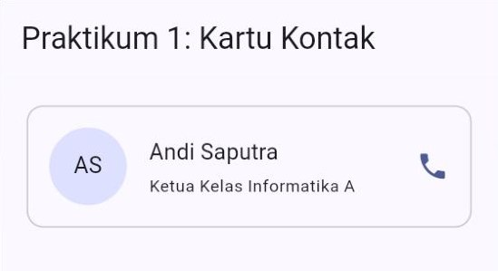
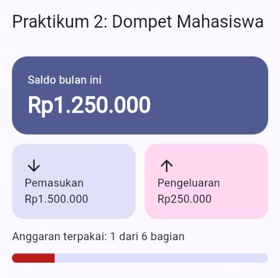
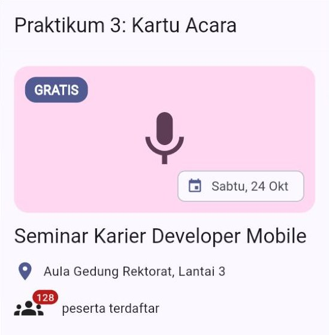
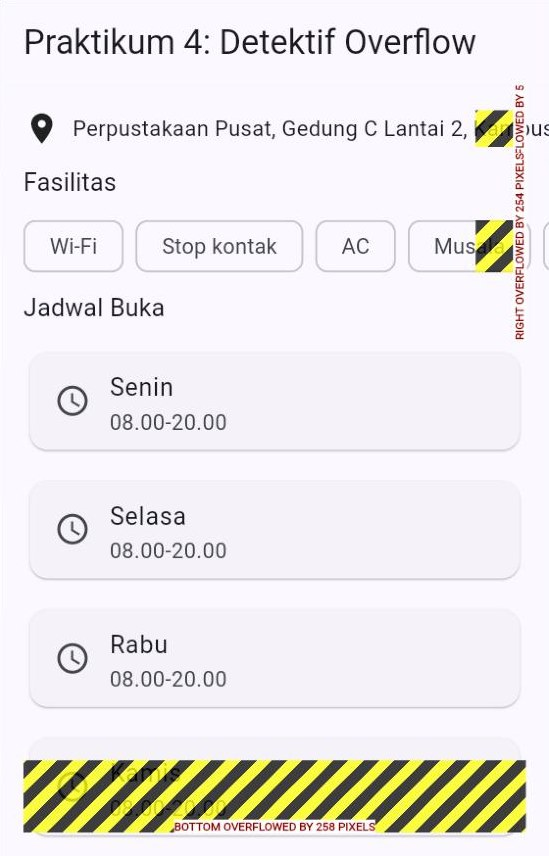
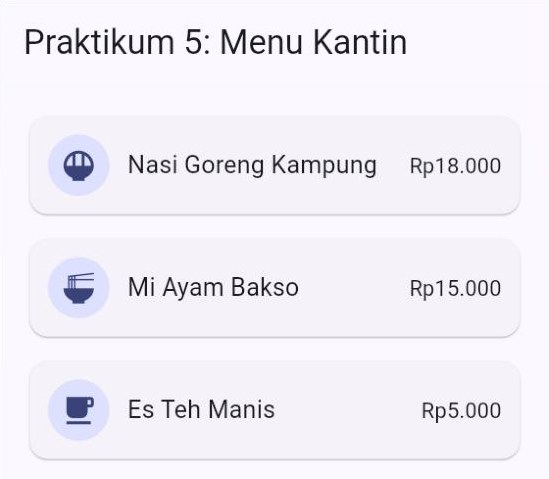

# 🧪 Jobsheet Pertemuan 4 — Widget & Tata Letak (*Layout*)

[🏠 Beranda](../README.md) · [📖 Modul](README.md) · [✍️ Latihan](LATIHAN.md) · [💻 Kode Contoh](kode/)

| Informasi | Keterangan |
| :--- | :--- |
| Mata kuliah | Pemrograman Piranti Bergerak |
| Pertemuan | 4 — Widget & Tata Letak (*Layout*) |
| Bentuk kegiatan | Praktikum individu |
| Estimasi waktu | 120–150 menit |
| Alat | DartPad **atau** proyek Flutter di VS Code yang dijalankan di Chrome |
| Hasil akhir | Halaman "Profil Kedai Kopi Kampus" yang rapi dan bebas *overflow* di layar selebar 360 dan 320 |

---

## 🎯 Tujuan Praktikum

Setelah menyelesaikan jobsheet ini, Anda mampu:

1. Menyusun tampilan dengan `Row`, `Column`, `Card`, dan `CircleAvatar`, termasuk mengatur jarak dan perataan.
2. Menghias kotak dengan `Container` dan `BoxDecoration`, serta membagi ruang dengan `Expanded` dan `flex`.
3. Menumpuk widget dengan `Stack` dan `Positioned`.
4. Menemukan penyebab *overflow* dari pesan error, lalu memperbaikinya dengan `Expanded`, `Wrap`, dan `SingleChildScrollView`.
5. Memecah tampilan yang berulang menjadi widget buatan sendiri yang menerima parameter.

## 📌 Petunjuk Umum

> [!IMPORTANT]
> 1. Setiap praktikum diawali **kode terbimbing**. **Ketik sendiri** kodenya, kecuali bagian yang ditandai *boleh disalin*. Mengetik melatih tangan dan mata Anda mengenali struktur widget.
> 2. Jalankan, lalu cocokkan hasilnya dengan gambar **✅ Hasil yang diharapkan**.
> 3. Kerjakan **🔧 Modifikasi** di setiap praktikum. Bagian inilah yang menguji pemahaman Anda. Jawaban berupa penjelasan ditulis sebagai **komentar** di dalam kode.
> 4. Simpan setiap praktikum sebagai berkas terpisah berisi kode **lengkap** (kerangka + halaman): `praktikum1.dart`, `praktikum2.dart`, dan seterusnya.
> 5. Rapikan kode sebelum menyimpan: tombol **Format** di DartPad, atau `Shift` + `Alt` + `F` di VS Code. Pastikan tidak ada garis merah maupun kuning.

> [!TIP]
> Uji tampilan Anda pada **ukuran layar ponsel**, bukan hanya di jendela laptop yang lebar. Di Chrome, tekan `F12`, lalu `Ctrl` + `Shift` + `M`, lalu atur ukurannya menjadi **360 × 800** (caranya ada di [Modul Bagian 13.3](README.md#133-meniru-layar-ponsel-di-chrome)). Gambar hasil di jobsheet ini diambil pada lebar 360.

<details>
<summary>❓ Lupa cara menjalankan aplikasi Flutter?</summary>

- **DartPad:** buka <https://dartpad.dev>, hapus kode bawaannya, tempelkan kode Anda, lalu klik **Run**. Simpan hasil pekerjaan dengan menyalin kodenya ke berkas `.dart` di komputer Anda.
- **Proyek Flutter:** buka proyek latihan dari Pertemuan 1 di VS Code, ganti seluruh isi `lib/main.dart` dengan kode Anda, lalu jalankan `flutter run -d chrome`. Setelah mengubah kode, simpan berkas untuk *hot reload*.

Penjelasan lengkap ada di [Modul Pertemuan 1, Bagian 9](../pertemuan_01_pengenalan_flutter/README.md#9-menjalankan-aplikasi).
</details>

---

## Kerangka Aplikasi (dipakai di semua praktikum)

Kelima praktikum memakai kerangka yang sama: fungsi `main()` dan widget `AplikasiPraktikum` yang menyiapkan tema. Yang berganti di setiap praktikum hanyalah *class* `HalamanPraktikum`. Kerangka ini **boleh disalin**:

```dart
import 'package:flutter/material.dart';

void main() {
  runApp(const AplikasiPraktikum());
}

class AplikasiPraktikum extends StatelessWidget {
  const AplikasiPraktikum({super.key});

  @override
  Widget build(BuildContext context) {
    return MaterialApp(
      debugShowCheckedModeBanner: false,
      theme: ThemeData(
        colorScheme: ColorScheme.fromSeed(seedColor: Colors.indigo),
      ),
      home: const HalamanPraktikum(),
    );
  }
}
```

Di **bawah** kerangka tersebut, ketik *class* `HalamanPraktikum` dari setiap praktikum. Jadi setiap berkas praktikum berisi: kerangka, lalu `HalamanPraktikum` (dan *class* lain jika ada).

---

## Praktikum 1 — Kartu Kontak

**Konsep:** `Row`, `Column`, `Expanded`, `CircleAvatar`, `Card`, dan `spacing`. ([Modul Bagian 5](README.md#5-row-dan-column) dan [Bagian 6](README.md#6-expanded-flexible-dan-spacer))

```dart
class HalamanPraktikum extends StatelessWidget {
  const HalamanPraktikum({super.key});

  @override
  Widget build(BuildContext context) {
    final ColorScheme warna = Theme.of(context).colorScheme;
    final TextTheme gayaTeks = Theme.of(context).textTheme;

    return Scaffold(
      appBar: AppBar(title: const Text('Praktikum 1: Kartu Kontak')),
      body: Padding(
        padding: const EdgeInsets.all(16),
        child: Column(
          spacing: 8,
          children: [
            Card.outlined(
              child: Padding(
                padding: const EdgeInsets.all(16),
                child: Row(
                  spacing: 16,
                  children: [
                    CircleAvatar(
                      radius: 28,
                      backgroundColor: warna.primaryContainer,
                      child: Text('AS', style: gayaTeks.titleMedium),
                    ),
                    Expanded(
                      child: Column(
                        crossAxisAlignment: CrossAxisAlignment.start,
                        spacing: 4,
                        children: [
                          Text('Andi Saputra', style: gayaTeks.titleMedium),
                          Text(
                            'Ketua Kelas Informatika A',
                            style: gayaTeks.bodySmall,
                          ),
                        ],
                      ),
                    ),
                    Icon(Icons.phone, color: warna.primary),
                  ],
                ),
              ),
            ),
          ],
        ),
      ),
    );
  }
}
```

✅ **Hasil yang diharapkan:**

<p align="center"></p>

> [!NOTE]
> Mengapa `Card` dibungkus `Column`, padahal isinya baru satu? Selain memudahkan menambah kartu berikutnya, `Column` membuat kartu cukup **setinggi isinya**. Tanpa `Column` luar itu, `Column` di dalam kartu akan memanjang sampai bawah layar (lihat [Modul Bagian 5.5](README.md#55-mainaxissize-seberapa-panjang-row-dan-column)).

🔧 **Modifikasi:**

1. Tambahkan baris ketiga di dalam `Column`: nomor HP `0812-3456-7890` dengan gaya `gayaTeks.labelMedium` berwarna `warna.primary`. (Petunjuk: `gayaTeks.labelMedium?.copyWith(color: ...)`.)
2. Ganti nama menjadi `Andi Saputra Wicaksono Pratama Nugraha`. Amati bahwa nama turun ke baris berikutnya. Lalu batasi nama menjadi **satu baris** dengan `maxLines: 1` dan `overflow: TextOverflow.ellipsis`.
3. **Eksperimen:** hapus sementara widget `Expanded` (sisakan `Column`-nya saja), lalu jalankan pada lebar 360. Salin pesan error yang muncul sebagai komentar, lalu kembalikan `Expanded`. Jelaskan dalam komentar mengapa `Expanded` memperbaikinya.
4. Tambahkan ikon kedua, `Icons.chat`, tepat sebelum ikon telepon.
5. Tambahkan **kartu kontak kedua** di bawah kartu pertama, misalnya untuk sekretaris kelas. Cukup salin satu blok `Card.outlined` ke dalam `children` milik `Column` luar, lalu ganti isinya. (Cara yang lebih rapi untuk kartu yang berulang dipelajari di Praktikum 5.)

---

## Praktikum 2 — Dompet Mahasiswa

**Konsep:** `Container` + `BoxDecoration`, `Expanded` dengan `flex`, dan `ClipRRect`. ([Modul Bagian 4](README.md#4-container-dan-card) dan [Bagian 6](README.md#6-expanded-flexible-dan-spacer))

```dart
class HalamanPraktikum extends StatelessWidget {
  const HalamanPraktikum({super.key});

  @override
  Widget build(BuildContext context) {
    final ColorScheme warna = Theme.of(context).colorScheme;
    final TextTheme gayaTeks = Theme.of(context).textTheme;

    return Scaffold(
      appBar: AppBar(title: const Text('Praktikum 2: Dompet Mahasiswa')),
      body: Padding(
        padding: const EdgeInsets.all(16),
        child: Column(
          crossAxisAlignment: CrossAxisAlignment.stretch,
          spacing: 12,
          children: [
            // 1) Kartu saldo: Container dengan dekorasi.
            Container(
              padding: const EdgeInsets.all(20),
              decoration: BoxDecoration(
                color: warna.primary,
                borderRadius: BorderRadius.circular(20),
              ),
              child: Column(
                crossAxisAlignment: CrossAxisAlignment.start,
                spacing: 4,
                children: [
                  Text(
                    'Saldo bulan ini',
                    style: TextStyle(color: warna.onPrimary),
                  ),
                  Text(
                    'Rp1.250.000',
                    style: gayaTeks.headlineMedium?.copyWith(
                      color: warna.onPrimary,
                      fontWeight: FontWeight.bold,
                    ),
                  ),
                ],
              ),
            ),

            // 2) Dua kotak berdampingan dengan lebar sama.
            Row(
              spacing: 12,
              children: [
                Expanded(
                  child: Container(
                    padding: const EdgeInsets.all(16),
                    decoration: BoxDecoration(
                      color: warna.secondaryContainer,
                      borderRadius: BorderRadius.circular(16),
                    ),
                    child: const Column(
                      crossAxisAlignment: CrossAxisAlignment.start,
                      children: [
                        Icon(Icons.arrow_downward),
                        Text('Pemasukan'),
                        Text('Rp1.500.000'),
                      ],
                    ),
                  ),
                ),
                Expanded(
                  child: Container(
                    padding: const EdgeInsets.all(16),
                    decoration: BoxDecoration(
                      color: warna.tertiaryContainer,
                      borderRadius: BorderRadius.circular(16),
                    ),
                    child: const Column(
                      crossAxisAlignment: CrossAxisAlignment.start,
                      children: [
                        Icon(Icons.arrow_upward),
                        Text('Pengeluaran'),
                        Text('Rp250.000'),
                      ],
                    ),
                  ),
                ),
              ],
            ),

            // 3) Batang anggaran: perbandingan flex 1 : 5 (terpakai : sisa).
            const Text('Anggaran terpakai: 1 dari 6 bagian'),
            ClipRRect(
              borderRadius: BorderRadius.circular(6),
              child: Row(
                children: [
                  Expanded(
                    flex: 1,
                    child: Container(height: 12, color: warna.error),
                  ),
                  Expanded(
                    flex: 5,
                    child: Container(height: 12, color: warna.primaryContainer),
                  ),
                ],
              ),
            ),
          ],
        ),
      ),
    );
  }
}
```

✅ **Hasil yang diharapkan:**

<p align="center"></p>

> [!NOTE]
> Dari mana angka `flex: 1` dan `flex: 5`? Pengeluaran Rp250.000 dari pemasukan Rp1.500.000 sama dengan 250.000 ÷ 1.500.000 = **1/6**. Jadi batang dibagi menjadi 6 bagian: 1 bagian terpakai (merah) dan 5 bagian sisa. Inilah kegunaan `flex`: membagi ruang menurut **perbandingan**.

🔧 **Modifikasi:**

1. Beri **bayangan** pada kartu saldo dengan menambahkan `boxShadow` di dalam `BoxDecoration` (lihat [Modul Bagian 4.1](README.md#41-container-kotak-serbaguna)).
2. Ubah pengeluaran menjadi **Rp500.000**. Sesuaikan saldo, teks keterangan, dan perbandingan `flex` pada batang anggaran. Tuliskan cara menghitungnya sebagai komentar.
3. Tambahkan kotak ketiga **Tabungan** (Rp200.000, ikon `Icons.savings`, warna `warna.primaryContainer`) di `Row` yang sama. Amati lebar ketiga kotak. Jika label atau angkanya terpotong di tengah kata pada layar 360, persingkat tulisannya, misalnya `Masuk`, `Keluar`, dan `Rp1,5 jt`.
4. Perkecil `padding` ketiga kotak kecil menjadi `10` dan jarak antarkotak (`spacing`) menjadi `8`, lalu beri garis tepi dengan `border: Border.all(color: warna.outlineVariant)`.

---

## Praktikum 3 — Kartu Acara

**Konsep:** `Stack`, `Positioned`, `ClipRRect`, dan `Badge`. ([Modul Bagian 7](README.md#7-stack-dan-positioned))

```dart
class HalamanPraktikum extends StatelessWidget {
  const HalamanPraktikum({super.key});

  @override
  Widget build(BuildContext context) {
    final ColorScheme warna = Theme.of(context).colorScheme;
    final TextTheme gayaTeks = Theme.of(context).textTheme;

    return Scaffold(
      appBar: AppBar(title: const Text('Praktikum 3: Kartu Acara')),
      body: SingleChildScrollView(
        padding: const EdgeInsets.all(16),
        child: Column(
          crossAxisAlignment: CrossAxisAlignment.stretch,
          spacing: 12,
          children: [
            // Poster acara: tiga lapisan bertumpuk, dipotong bersudut bulat.
            ClipRRect(
              borderRadius: BorderRadius.circular(16),
              child: Stack(
                children: [
                  // Lapisan 1 (paling bawah): latar dan ikon besar.
                  Container(
                    height: 160,
                    color: warna.tertiaryContainer,
                    alignment: Alignment.center,
                    child: Icon(
                      Icons.mic,
                      size: 72,
                      color: warna.onTertiaryContainer,
                    ),
                  ),
                  // Lapisan 2: label di pojok kiri atas.
                  Positioned(
                    top: 12,
                    left: 12,
                    child: Container(
                      padding: const EdgeInsets.symmetric(
                        horizontal: 10,
                        vertical: 4,
                      ),
                      decoration: BoxDecoration(
                        color: warna.primary,
                        borderRadius: BorderRadius.circular(12),
                      ),
                      child: Text(
                        'GRATIS',
                        style: TextStyle(
                          color: warna.onPrimary,
                          fontWeight: FontWeight.bold,
                        ),
                      ),
                    ),
                  ),
                  // Lapisan 3 (paling atas): tanggal di pojok kanan bawah.
                  const Positioned(
                    right: 12,
                    bottom: 12,
                    child: Chip(
                      avatar: Icon(Icons.event),
                      label: Text('Sabtu, 24 Okt'),
                    ),
                  ),
                ],
              ),
            ),
            Text('Seminar Karier Developer Mobile', style: gayaTeks.titleLarge),
            Row(
              spacing: 8,
              children: [
                Icon(Icons.location_on, color: warna.primary),
                const Expanded(child: Text('Aula Gedung Rektorat, Lantai 3')),
              ],
            ),
            Row(
              spacing: 20,
              children: [
                // Badge: lencana angka siap pakai di pojok ikon.
                const Badge(
                  label: Text('128'),
                  child: Icon(Icons.groups, size: 32),
                ),
                Text('peserta terdaftar', style: gayaTeks.titleSmall),
              ],
            ),
          ],
        ),
      ),
    );
  }
}
```

✅ **Hasil yang diharapkan:**

<p align="center"></p>

🔧 **Modifikasi:**

1. Pindahkan label **GRATIS** ke pojok **kanan atas** poster.
2. Tambahkan lapisan baru di pojok **kiri bawah**: lingkaran berwarna `warna.surface` berisi ikon `Icons.favorite_border` berwarna `warna.error`. (Petunjuk: `Positioned` + `Container` dengan `shape: BoxShape.circle` dan `padding` 8.)
3. **Eksperimen urutan:** pindahkan `Container` latar (lapisan 1) ke urutan **paling akhir** di dalam `children` milik `Stack`. Apa yang terjadi pada label dan tanggal? Jelaskan sebagai komentar, lalu kembalikan ke urutan semula.
4. **Eksperimen pemotongan:** hapus sementara `ClipRRect` (sisakan `Stack`-nya). Perhatikan sudut poster. Mengapa sudutnya tidak bulat lagi? Jelaskan sebagai komentar, lalu kembalikan.

---

## Praktikum 4 — Detektif Overflow

**Konsep:** membaca pesan *overflow* dan memperbaikinya dengan `Expanded`, `Wrap`, dan `SingleChildScrollView`. ([Modul Bagian 9](README.md#9-overflow-saat-isi-tidak-muat))

Kode berikut **sengaja** mengandung tiga masalah. Tugas Anda adalah menemukan dan memperbaikinya. Jalankan pada ukuran layar ponsel **360 × 640** agar ketiga masalahnya terlihat.

```dart
class HalamanPraktikum extends StatelessWidget {
  const HalamanPraktikum({super.key});

  static const List<String> fasilitas = [
    'Wi-Fi',
    'Stop kontak',
    'AC',
    'Musala',
    'Parkir motor',
    'Ruang diskusi',
  ];

  static const List<String> hari = [
    'Senin',
    'Selasa',
    'Rabu',
    'Kamis',
    'Jumat',
    'Sabtu',
    'Minggu',
  ];

  @override
  Widget build(BuildContext context) {
    final TextTheme gayaTeks = Theme.of(context).textTheme;

    return Scaffold(
      appBar: AppBar(title: const Text('Praktikum 4: Detektif Overflow')),
      body: Padding(
        padding: const EdgeInsets.all(16),
        child: Column(
          crossAxisAlignment: CrossAxisAlignment.start,
          spacing: 12,
          children: [
            // MASALAH 1: alamat yang panjang.
            const Row(
              spacing: 8,
              children: [
                Icon(Icons.location_on),
                Text('Perpustakaan Pusat, Gedung C Lantai 2, Kampus Hijau'),
              ],
            ),

            // MASALAH 2: deretan fasilitas.
            Text('Fasilitas', style: gayaTeks.titleMedium),
            Row(
              spacing: 8,
              children: [for (String f in fasilitas) Chip(label: Text(f))],
            ),

            // MASALAH 3: jadwal buka tujuh hari.
            Text('Jadwal Buka', style: gayaTeks.titleMedium),
            for (String h in hari)
              Card(
                child: ListTile(
                  leading: const Icon(Icons.schedule),
                  title: Text(h),
                  subtitle: Text(h == 'Minggu' ? 'Tutup' : '08.00-20.00'),
                ),
              ),
          ],
        ),
      ),
    );
  }
}
```

✅ **Hasil awal (masih bermasalah):**

<p align="center"></p>

🔧 **Tugas perbaikan:**

1. Catat **tiga pesan error** yang muncul di konsol (di DartPad: panel di bawah hasil; di VS Code: tab *Debug Console*) sebagai komentar di bagian atas berkas. Tuliskan juga MASALAH mana yang menyebabkan setiap pesan.
2. Perbaiki **MASALAH 1** agar alamat yang panjang turun ke baris berikutnya.
3. Perbaiki **MASALAH 2** agar fasilitas yang tidak muat pindah ke baris berikutnya, dengan jarak 8 antar-*chip* maupun antarbaris.
4. Perbaiki **MASALAH 3** agar halaman bisa digulir sampai hari Minggu. (Petunjuk: `SingleChildScrollView` juga punya parameter `padding`.)
5. Jawab sebagai komentar: mengapa `Expanded` **tidak cocok** untuk memperbaiki MASALAH 2?

✅ **Hasil setelah diperbaiki:** tidak ada lagi garis kuning-hitam, alamat tampil dalam dua baris, fasilitas tersusun dalam beberapa baris, dan halaman bisa digulir sampai kartu **Minggu — Tutup**.

---

## Praktikum 5 — Memecah Widget: Menu Kantin

**Konsep:** membuat widget sendiri yang menerima parameter. ([Modul Bagian 11](README.md#11-memecah-tampilan-menjadi-widget-kecil))

### Langkah 1 — Jalankan kode awal

Kode awal berikut **boleh disalin**. Jalankan dan perhatikan baik-baik: ketiga blok `Card` hampir identik. Bedanya hanya ikon, nama, dan harga.

```dart
class HalamanPraktikum extends StatelessWidget {
  const HalamanPraktikum({super.key});

  @override
  Widget build(BuildContext context) {
    final ColorScheme warna = Theme.of(context).colorScheme;
    final TextTheme gayaTeks = Theme.of(context).textTheme;

    return Scaffold(
      appBar: AppBar(title: const Text('Praktikum 5: Menu Kantin')),
      body: SingleChildScrollView(
        padding: const EdgeInsets.all(16),
        child: Column(
          spacing: 8,
          children: [
            Card(
              child: Padding(
                padding: const EdgeInsets.all(12),
                child: Row(
                  spacing: 12,
                  children: [
                    CircleAvatar(
                      backgroundColor: warna.primaryContainer,
                      child: const Icon(Icons.rice_bowl),
                    ),
                    Expanded(
                      child: Text(
                        'Nasi Goreng Kampung',
                        style: gayaTeks.titleMedium,
                      ),
                    ),
                    Text('Rp18.000', style: gayaTeks.titleSmall),
                  ],
                ),
              ),
            ),
            Card(
              child: Padding(
                padding: const EdgeInsets.all(12),
                child: Row(
                  spacing: 12,
                  children: [
                    CircleAvatar(
                      backgroundColor: warna.primaryContainer,
                      child: const Icon(Icons.ramen_dining),
                    ),
                    Expanded(
                      child: Text('Mi Ayam Bakso', style: gayaTeks.titleMedium),
                    ),
                    Text('Rp15.000', style: gayaTeks.titleSmall),
                  ],
                ),
              ),
            ),
            Card(
              child: Padding(
                padding: const EdgeInsets.all(12),
                child: Row(
                  spacing: 12,
                  children: [
                    CircleAvatar(
                      backgroundColor: warna.primaryContainer,
                      child: const Icon(Icons.local_cafe),
                    ),
                    Expanded(
                      child: Text('Es Teh Manis', style: gayaTeks.titleMedium),
                    ),
                    Text('Rp5.000', style: gayaTeks.titleSmall),
                  ],
                ),
              ),
            ),
          ],
        ),
      ),
    );
  }
}
```

### Langkah 2 — Buat widget `KartuMenu`

Ketik *class* berikut di bagian **paling bawah** berkas. Isinya adalah satu blok `Card` tadi, tetapi ikon, nama, dan harganya diambil dari **parameter**:

```dart
// Satu kartu menu. Tampilannya sama, isinya berbeda-beda.
class KartuMenu extends StatelessWidget {
  const KartuMenu({
    super.key,
    required this.ikon,
    required this.nama,
    required this.harga,
  });

  final IconData ikon;
  final String nama;
  final String harga;

  @override
  Widget build(BuildContext context) {
    final ColorScheme warna = Theme.of(context).colorScheme;
    final TextTheme gayaTeks = Theme.of(context).textTheme;

    return Card(
      child: Padding(
        padding: const EdgeInsets.all(12),
        child: Row(
          spacing: 12,
          children: [
            CircleAvatar(
              backgroundColor: warna.primaryContainer,
              child: Icon(ikon),
            ),
            Expanded(child: Text(nama, style: gayaTeks.titleMedium)),
            Text(harga, style: gayaTeks.titleSmall),
          ],
        ),
      ),
    );
  }
}
```

### Langkah 3 — Pakai `KartuMenu` di halaman

Ganti seluruh *class* `HalamanPraktikum` dengan versi baru berikut:

```dart
class HalamanPraktikum extends StatelessWidget {
  const HalamanPraktikum({super.key});

  @override
  Widget build(BuildContext context) {
    return Scaffold(
      appBar: AppBar(title: const Text('Praktikum 5: Menu Kantin')),
      body: const SingleChildScrollView(
        padding: EdgeInsets.all(16),
        child: Column(
          spacing: 8,
          children: [
            KartuMenu(
              ikon: Icons.rice_bowl,
              nama: 'Nasi Goreng Kampung',
              harga: 'Rp18.000',
            ),
            KartuMenu(
              ikon: Icons.ramen_dining,
              nama: 'Mi Ayam Bakso',
              harga: 'Rp15.000',
            ),
            KartuMenu(
              ikon: Icons.local_cafe,
              nama: 'Es Teh Manis',
              harga: 'Rp5.000',
            ),
          ],
        ),
      ),
    );
  }
}
```

✅ **Hasil yang diharapkan:**

<p align="center"></p>

Tampilannya **sama persis** dengan kode awal, tetapi kode halamannya jauh lebih pendek dan mudah dibaca. Itulah tujuan memecah widget.

> [!NOTE]
> Perhatikan kata `const` di depan `SingleChildScrollView`. Karena semua `KartuMenu` dibuat dengan nilai yang sudah pasti, seluruh isi `body` bisa ditandai `const`. Flutter tidak perlu membangunnya ulang, sehingga aplikasi lebih hemat kerja.

🔧 **Modifikasi:**

1. Tambahkan **dua menu baru**, misalnya Ayam Geprek (Rp17.000, ikon `Icons.set_meal`) dan Jus Alpukat (Rp10.000, ikon `Icons.local_drink`). Perhatikan: setiap menu cukup ditulis dengan satu `KartuMenu`.
2. Tambahkan parameter **opsional** `this.habis = false` (tipe `bool`, tanpa `required`). Jika `habis` bernilai `true`, tampilkan teks `Habis` berwarna `warna.error` **sebagai ganti** harga. Gunakan operator `? :`. Jadikan salah satu menu habis.
3. Ubah warna latar ikon menjadi `warna.secondaryContainer` dan tampilkan harga dengan huruf tebal berwarna `warna.primary`. Perhatikan: Anda cukup mengubah **satu tempat**, dan semua kartu ikut berubah.
4. Jawab sebagai komentar: mengapa *constructor* `KartuMenu` bisa ditandai `const`?

---

## 🏆 Tugas Mandiri — Profil Kedai Kopi Kampus

Sebuah kedai kopi di dekat kampus ingin punya halaman profil di aplikasi direktori UMKM kampus. Buat **satu aplikasi utuh** bernama `p04_nim_namapanggilan.dart` (huruf kecil semua, misalnya `p04_2609106001_rina.dart`) dengan ketentuan berikut:

1. Judul `AppBar` berisi nama kedai buatan Anda sendiri. Warna benih tema bebas.
2. **Banner** berupa `Stack` setinggi minimal 180, berisi minimal **dua** `Positioned` (misalnya label status "Buka" dan *chip* rating). Sudut banner dibulatkan dengan `ClipRRect`.
3. **Baris nama kedai dan kisaran harga** memakai `Row` + `Expanded`, sehingga nama yang panjang tidak mendorong harga keluar layar.
4. **Fasilitas**: `Wrap` berisi minimal **5** `Chip`.
5. **Informasi**: satu `Card` berisi minimal **3** `ListTile` (alamat, jam buka, kontak) yang dipisah `Divider`.
6. **Menu andalan**: widget **buatan sendiri** dengan minimal **3 parameter**, dipakai minimal **4 kali**.
7. **Tombol aksi** di `bottomNavigationBar` milik `Scaffold`, dibungkus `SafeArea`: minimal dua tombol, salah satunya dibungkus `Expanded`. Aksinya cukup `onPressed: () {}`.
8. Semua warna dan gaya teks diambil dari tema (`colorScheme` dan `textTheme`), kecuali warna benih.
9. **Lolos uji layar sempit:** pada lebar **360** dan **320** tidak ada garis kuning-hitam sama sekali, dan seluruh isi halaman bisa digulir.
10. Kode rapi: diformat, memakai `const` di tempat yang memungkinkan, dan tidak ada tanda peringatan di editor.

Contoh rancangan (susunan dan isinya boleh dikreasikan):

```text
┌────────────────────────────────────┐
│ Kedai Kopi Senja                   │ ← AppBar
├────────────────────────────────────┤
│ ┌────────────────────────────────┐ │
│ │ [Buka]                         │ │ ← Stack + Positioned
│ │          (ikon besar)          │ │
│ │                      [★ 4,7]   │ │
│ └────────────────────────────────┘ │
│ Kedai Kopi Senja Kampus   Rp8–25rb │ ← Row + Expanded
│ Fasilitas                          │
│ [Wi-Fi] [Stop kontak] [Ruang AC]   │ ← Wrap + Chip
│ [Musala] [Bayar QRIS]              │
│ ┌────────────────────────────────┐ │
│ │ (ikon) Alamat ...              │ │ ← Card + ListTile
│ │ (ikon) Jam buka ...            │ │
│ │ (ikon) Kontak ...              │ │
│ └────────────────────────────────┘ │
│ Menu Andalan                       │
│ (ikon) Es Kopi Susu Aren  Rp18.000 │ ← widget buatan sendiri
│ (ikon) Kopi Tubruk        Rp10.000 │   (dipakai 4 kali)
│ ...                                │
├────────────────────────────────────┤
│ (bagikan)  [   Petunjuk Arah    ]  │ ← bottomNavigationBar
└────────────────────────────────────┘
```

> [!TIP]
> - Kerjakan **bertahap**: kerangka halaman dulu, lalu banner, lalu bagian lain satu per satu. Jalankan setiap kali satu bagian selesai.
> - Cari ikon yang cocok di <https://fonts.google.com/icons>, misalnya `Icons.coffee`, `Icons.local_cafe`, `Icons.wifi`, dan `Icons.schedule`.
> - Untuk uji 320, pilih **Dimensions: Responsive** di *device toolbar* Chrome, lalu ketik lebar `320`.

---

## 📤 Pengumpulan

Kumpulkan melalui tempat yang ditentukan dosen:

1. Berkas `praktikum1.dart` sampai `praktikum5.dart` yang **sudah berisi modifikasi**, termasuk jawaban berupa komentar.
2. Berkas tugas mandiri `p04_nim_namapanggilan.dart`.
3. *Screenshot* tugas mandiri pada lebar **360** dan **320** (boleh beberapa *screenshot* per ukuran agar seluruh halaman terlihat).

## 📊 Kriteria Penilaian

| Aspek | Indikator | Skor maks. |
| :--- | :--- | :---: |
| Praktikum 1–5 | Semua modifikasi dikerjakan dan berjalan benar (masing-masing 8 poin) | 40 |
| Tugas mandiri: kelengkapan | Ketentuan 1–7 terpenuhi | 30 |
| Tugas mandiri: uji layar sempit | Tidak ada *overflow* di lebar 360 dan 320; seluruh isi bisa digulir | 15 |
| Kerapian | Warna dan gaya teks dari tema, `const` dipakai dengan tepat, kode terformat, tanpa peringatan | 15 |
| **Total** | | **100** |

## 💭 Refleksi

1. Jelaskan dengan kata-kata Anda sendiri aturan "batasan turun, ukuran naik, induk menentukan posisi". Berikan satu contoh dari tugas mandiri Anda.
2. Kapan Anda memakai `Expanded`, kapan `Wrap`, dan kapan `SingleChildScrollView`? Berikan satu contoh untuk masing-masing.
3. Bagian mana dari halaman Anda yang dipecah menjadi widget sendiri? Apa keuntungannya dibandingkan menulis semuanya di satu `build()`?

---

[⬅️ Kembali ke Modul](README.md) · [✍️ Lanjut ke Latihan](LATIHAN.md) · [🏠 Beranda](../README.md)
