# Pertemuan 4 — Widget & Tata Letak (*Layout*)

> 📖 **Modul bacaan** · ⏱️ ± 100 menit · 🎯 Untuk pemula
>
> **Bekal yang dibutuhkan:** sudah mengikuti [Pertemuan 1](../pertemuan_01_pengenalan_flutter/README.md) (struktur aplikasi Flutter, `StatelessWidget`, *hot reload*) dan [Pertemuan 3](../pertemuan_03_dart_lanjutan/README.md) (*class*, *constructor* dengan parameter bernama, `const`, dan `enum`).
> **Hasil akhir hari ini:** Anda bisa menyusun halaman "Detail Menu Kantin" yang rapi, bebas *overflow*, dan tetap nyaman dilihat di layar ponsel yang sempit.

[🏠 Beranda](../README.md) · [📋 Silabus](../SILABUS.md) · [🧪 Jobsheet](JOBSHEET.md) · [✍️ Latihan](LATIHAN.md) · [💻 Kode Contoh](kode/) · [📊 Unduh Slide](https://raw.githubusercontent.com/antonprafanto/mobile2026/main/pertemuan_04_widget_dan_layout/slide/PERTEMUAN_04_Widget_dan_Layout.pptx)

---

## Daftar Isi

1. [Semua Adalah Widget](#1-semua-adalah-widget)
2. [Widget Dasar: Teks, Ikon, dan Gambar](#2-widget-dasar-teks-ikon-dan-gambar)
3. [Jarak, Ukuran, dan Posisi](#3-jarak-ukuran-dan-posisi)
4. [Container dan Card](#4-container-dan-card)
5. [Row dan Column](#5-row-dan-column)
6. [Expanded, Flexible, dan Spacer](#6-expanded-flexible-dan-spacer)
7. [Stack dan Positioned](#7-stack-dan-positioned)
8. [Constraints: Aturan Main Tata Letak](#8-constraints-aturan-main-tata-letak)
9. [Overflow: Saat Isi Tidak Muat](#9-overflow-saat-isi-tidak-muat)
10. [ListTile: Baris Informasi Siap Pakai](#10-listtile-baris-informasi-siap-pakai)
11. [Memecah Tampilan Menjadi Widget Kecil](#11-memecah-tampilan-menjadi-widget-kecil)
12. [Studi Kasus: Halaman Detail Menu Kantin](#12-studi-kasus-halaman-detail-menu-kantin)
13. [Alat Bantu Melihat Tata Letak](#13-alat-bantu-melihat-tata-letak)
14. [Menulis Kode Tata Letak yang Rapi](#14-menulis-kode-tata-letak-yang-rapi)
15. [Kesalahan Umum Pemula](#15-kesalahan-umum-pemula-dan-solusinya)
16. [Ringkasan](#16-ringkasan) · [Glosarium](#17-glosarium) · [Referensi](#18-referensi)

---

## 🎯 Tujuan Pembelajaran

Setelah mempelajari modul ini, Anda mampu:

1. Menjelaskan prinsip "semua adalah widget" dan membaca pohon widget dari sebuah kode.
2. Menampilkan teks, ikon, dan gambar dengan gaya serta warna yang diambil dari tema Material 3.
3. Mengatur jarak, ukuran, dan posisi memakai `Padding`, `SizedBox`, `Center`, dan `Align`.
4. Menghias kotak dengan `Container` dan `BoxDecoration`, serta memilih jenis `Card` yang tepat.
5. Menyusun widget mendatar dan menurun dengan `Row` dan `Column`, termasuk pengaturan sumbu dan jaraknya.
6. Membagi ruang yang tersisa dengan `Expanded`, `Flexible`, dan `Spacer`.
7. Menumpuk widget dengan `Stack` dan `Positioned`.
8. Menjelaskan aturan *constraints* dan memakainya untuk menebak serta memperbaiki masalah tata letak.
9. Mengenali *overflow* dan mengatasinya dengan `Expanded`, *ellipsis*, `Wrap`, atau `SingleChildScrollView`.
10. Memecah halaman yang panjang menjadi beberapa widget kecil yang bisa dipakai ulang.

## 🗺️ Peta Materi Hari Ini

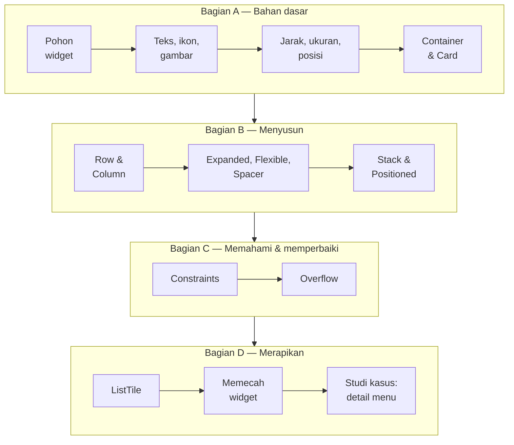

Bagian A mengenalkan **bahan-bahan** tampilan. Bagian B mengajarkan cara **menyusunnya**. Bagian C menjelaskan **mengapa** tampilan kadang berantakan dan cara memperbaikinya. Bagian D membuat kode tampilan Anda **rapi** seperti kode di aplikasi sungguhan.

### Cara menjalankan contoh hari ini

Setiap berkas di folder [`kode/`](kode/) adalah **satu aplikasi utuh**. Ada dua cara menjalankannya:

| Cara | Langkah |
| :--- | :--- |
| **DartPad** (tanpa instalasi) | Buka <https://dartpad.dev>, hapus kode bawaannya, tempelkan isi berkas contoh, lalu klik **Run**. |
| **Proyek Flutter di laptop** | Buka proyek latihan Anda dari Pertemuan 1, ganti seluruh isi `lib/main.dart` dengan isi berkas contoh, lalu jalankan `flutter run -d chrome`. Setelah mengubah kode, simpan berkas (Ctrl+S) atau tekan `r` di terminal untuk *hot reload*. |

> [!TIP]
> Gambar hasil di modul ini diambil pada layar selebar **360 piksel logis**, yaitu lebar ponsel Android yang umum. Jika Anda menjalankan contoh di jendela Chrome yang lebar, tampilannya akan sedikit berbeda (lebih lebar), dan itu normal. Cara meniru layar ponsel di Chrome dijelaskan di [Bagian 13](#13-alat-bantu-melihat-tata-letak).

---

## 1. Semua Adalah Widget

### 1.1 Analogi balok Lego

Ingat kembali Pertemuan 1: di Flutter, **hampir semua yang tampil di layar adalah widget**. Bayangkan widget sebagai **balok Lego**. Balok kecil (teks, ikon) dipasang ke balok yang lebih besar (baris, kartu), lalu disusun lagi menjadi satu halaman utuh.

Yang sering mengejutkan pemula: **jarak dan posisi pun berupa widget**. Untuk memberi jarak, kita membungkus widget dengan widget `Padding`. Untuk menaruh sesuatu di tengah, kita membungkusnya dengan widget `Center`. Tidak ada "properti margin" yang ditempel pada teks seperti di aplikasi pengolah kata.

### 1.2 Pohon widget: induk dan anak

Perhatikan potongan kode sebuah halaman profil sederhana berikut:

```dart
Scaffold(
  appBar: AppBar(title: const Text('Profil')),
  body: const Center(
    child: Column(
      children: [
        Icon(Icons.person, size: 64),
        Text('Rina Amelia'),
        Text('Informatika 2026'),
      ],
    ),
  ),
)
```

Jika digambar, susunannya bercabang seperti pohon terbalik. Itulah **pohon widget** (*widget tree*):

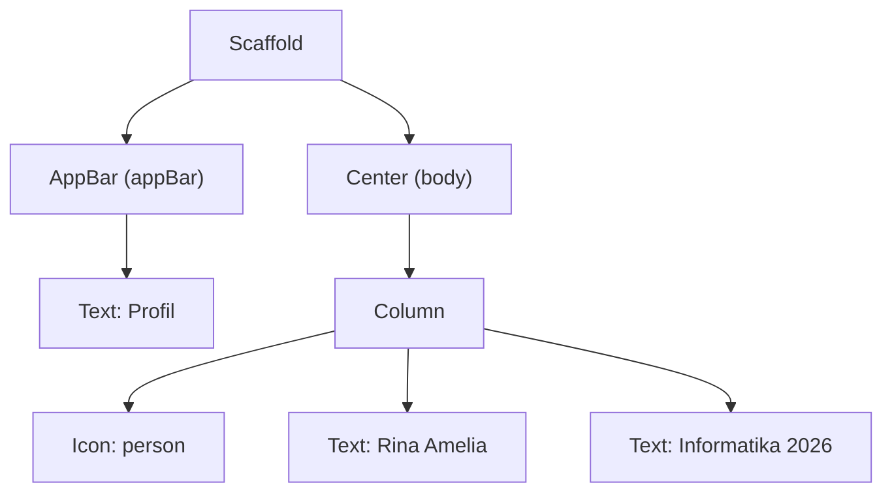

Beberapa istilah yang akan sering dipakai:

- **Induk** (*parent*): widget yang membungkus widget lain. `Center` adalah induk dari `Column`.
- **Anak** (*child*): widget yang dibungkus. `Column` adalah anak dari `Center`.
- **`child:`** dipakai oleh widget yang hanya boleh punya **satu** anak.
- **`children: [ ... ]`** dipakai oleh widget yang boleh punya **banyak** anak. Isinya berupa *List* (Pertemuan 2), jadi ditulis di dalam kurung siku.

| Jenis widget | Contoh | Cara menulis anaknya |
| :--- | :--- | :--- |
| Punya **satu** anak | `Padding`, `Center`, `Align`, `SizedBox`, `Container`, `Card`, `Expanded`, `SingleChildScrollView` | `child: ...` |
| Punya **banyak** anak | `Row`, `Column`, `Stack`, `Wrap` | `children: [ ... ]` |
| **Tidak** punya anak (ujung pohon) | `Text`, `Icon`, `Image`, `Divider`, `Spacer` | — |

> [!NOTE]
> Tertukar antara `child` dan `children` adalah salah satu kesalahan paling sering. Jika Anda menulis `Column(child: ...)`, editor akan menolak dengan pesan `The named parameter 'child' isn't defined.` Pesan itu artinya: "`Column` tidak punya parameter bernama `child`". Gantilah dengan `children: [ ... ]`.

### 1.3 Tips membaca dan mengedit kode bersarang

Kode tampilan Flutter memang bersarang (*nested*) cukup dalam. Tiga kebiasaan ini sangat membantu:

1. **Selalu beri koma di akhir** setiap argumen (*trailing comma*), lalu tekan **Shift+Alt+F** (format dokumen) di VS Code. `dart format` akan menyusun kode menjadi bertingkat rapi sehingga bentuk pohonnya terlihat.
2. **Pakai menu bantuan "Wrap with..."**. Letakkan kursor pada nama widget, tekan **Ctrl+.** (titik), lalu pilih misalnya *Wrap with Padding*, *Wrap with Center*, *Wrap with Column*, atau *Wrap with widget...*. VS Code akan membungkus widget itu lengkap dengan kurung dan komanya. Di menu yang sama ada *Remove this widget* untuk membuang pembungkus.
3. **Perhatikan garis panduan** (*guide lines*) di VS Code yang menghubungkan kurung buka dan kurung tutup. Ekstensi Flutter juga menampilkan label kecil seperti `// Column` setelah kurung tutup agar Anda tahu kurung itu milik siapa.

**🧠 Cek Cepat:** Pada pohon widget di atas, siapa induk dari `Column`? Berapa banyak anak yang dimiliki `Column`?

<details>
<summary>Lihat jawaban</summary>

Induk `Column` adalah `Center`. `Column` punya **tiga** anak: satu `Icon` dan dua `Text`.
</details>

---

## 2. Widget Dasar: Teks, Ikon, dan Gambar

Contoh lengkap bagian ini ada di [`kode/contoh_01_widget_dasar.dart`](kode/contoh_01_widget_dasar.dart).

<p align="center">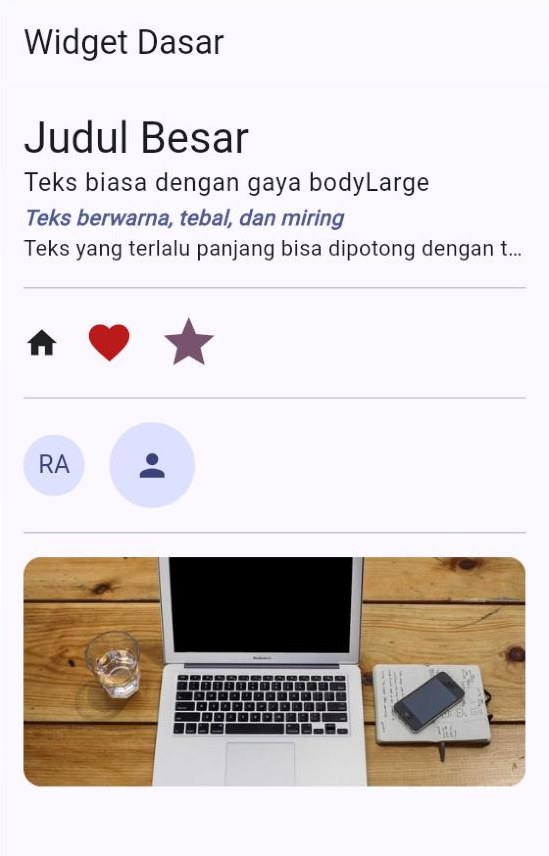</p>

### 2.1 `Text`: menampilkan tulisan

```dart
// Ambil gaya teks dan warna dari tema, bukan menulis warna sendiri.
final TextTheme gayaTeks = Theme.of(context).textTheme;
final ColorScheme warna = Theme.of(context).colorScheme;

Text('Judul Besar', style: gayaTeks.headlineMedium),
Text('Teks biasa dengan gaya bodyLarge', style: gayaTeks.bodyLarge),
```

Material 3 menyediakan **15 gaya teks siap pakai** dalam lima kelompok (`display`, `headline`, `title`, `body`, `label`), masing-masing dengan ukuran `Large`, `Medium`, dan `Small`. Yang paling sering dipakai:

| Gaya | Ukuran bawaan | Cocok untuk |
| :--- | :---: | :--- |
| `headlineMedium` / `headlineSmall` | 28 / 24 | Judul besar di dalam halaman |
| `titleLarge` / `titleMedium` | 22 / 16 | Judul bagian, judul kartu |
| `bodyLarge` / `bodyMedium` | 16 / 14 | Isi tulisan (`bodyMedium` adalah gaya bawaan `Text`) |
| `labelLarge` / `labelSmall` | 14 / 11 | Tulisan tombol, keterangan kecil |

Jika perlu gaya khusus, buat `TextStyle` sendiri:

```dart
Text(
  'Teks berwarna, tebal, dan miring',
  style: TextStyle(
    color: warna.primary,
    fontWeight: FontWeight.bold,
    fontStyle: FontStyle.italic,
  ),
),
```

Cara yang lebih rapi adalah **mengambil gaya tema lalu mengubah sebagian kecilnya** dengan `copyWith`:

```dart
Text(
  'Rp18.000',
  style: gayaTeks.titleLarge?.copyWith(
    color: warna.primary,
    fontWeight: FontWeight.bold,
  ),
),
```

Perhatikan tanda `?.` (Pertemuan 2). Gaya seperti `titleLarge` bertipe `TextStyle?` (boleh `null`), jadi `copyWith` harus dipanggil dengan `?.`. Jika Anda menulis `gayaTeks.titleLarge.copyWith(...)`, editor menolak dengan pesan `The method 'copyWith' can't be unconditionally invoked because the receiver can be 'null'.`

Teks yang terlalu panjang bisa dibatasi jumlah barisnya:

```dart
const Text(
  'Teks yang terlalu panjang bisa dipotong dengan tanda elipsis '
  'agar tetap rapi dan tidak memakan banyak tempat di layar.',
  maxLines: 1, // paling banyak satu baris
  overflow: TextOverflow.ellipsis, // sisanya diganti "..."
),
```

### 2.2 `Icon`: ikon siap pakai

Flutter menyertakan ribuan ikon Material lewat kelas `Icons`. Anda bisa mencari nama ikonnya di <https://fonts.google.com/icons>.

```dart
const Icon(Icons.home),
Icon(Icons.favorite, color: warna.error, size: 32),
Icon(Icons.star, color: warna.tertiary, size: 40),
```

Ukuran ikon bawaan adalah 24 piksel logis.

### 2.3 `CircleAvatar`: lingkaran untuk foto atau inisial

```dart
const CircleAvatar(child: Text('RA')),
CircleAvatar(
  radius: 28, // jari-jari 28, jadi diameternya 56
  backgroundColor: warna.primaryContainer,
  child: Icon(Icons.person, color: warna.onPrimaryContainer),
),
```

### 2.4 `Image`: menampilkan gambar

Ada dua sumber gambar yang paling sering dipakai:

| Sumber | Kode | Catatan |
| :--- | :--- | :--- |
| Internet | `Image.network('https://...')` | Butuh koneksi internet. Bisa langsung dicoba di DartPad. |
| Berkas di dalam proyek (*asset*) | `Image.asset('assets/images/logo.png')` | Berkasnya harus didaftarkan dulu di `pubspec.yaml`. Tidak bisa dicoba di DartPad. |

Contoh gambar dari internet yang sudah "tahan banting":

```dart
ClipRRect(
  borderRadius: BorderRadius.circular(12), // sudut gambar dibulatkan
  child: Image.network(
    'https://picsum.photos/600/300?image=9',
    height: 150,
    width: double.infinity, // selebar ruang yang tersedia
    fit: BoxFit.cover, // penuhi kotak, boleh terpotong sedikit
    errorBuilder: (BuildContext context, Object error, StackTrace? jejak) {
      // Ditampilkan jika gambar gagal dimuat, misalnya saat offline.
      return const SizedBox(
        height: 150,
        child: Center(child: Icon(Icons.broken_image, size: 48)),
      );
    },
  ),
),
```

- **`fit`** menentukan cara gambar mengisi kotaknya. `BoxFit.cover` memenuhi kotak (bagian tepi gambar bisa terpotong), `BoxFit.contain` menampilkan gambar utuh (bisa tersisa ruang kosong), dan `BoxFit.fill` menarik gambar sampai pas (gambar bisa terlihat gepeng).
- **`errorBuilder`** adalah fungsi (Pertemuan 2) yang dipanggil ketika gambar gagal dimuat. Tanpanya, pengguna akan melihat ikon error yang tidak ramah.
- **`ClipRRect`** memotong anaknya mengikuti sudut membulat (*rounded rectangle*).

Untuk memakai gambar dari dalam proyek, simpan berkasnya, misalnya di folder `assets/images/`, lalu daftarkan foldernya di `pubspec.yaml` (perhatikan indentasinya, dua spasi per tingkat):

```yaml
flutter:
  uses-material-design: true
  assets:
    - assets/images/
```

Setelah itu jalankan ulang aplikasi (bukan sekadar *hot reload*), lalu pakai `Image.asset('assets/images/logo.png')`.

### 2.5 Warna dari tema

Pada Pertemuan 1 kita membuat palet warna dari satu warna benih (`ColorScheme.fromSeed`). Palet itu berisi pasangan warna dengan aturan sederhana: **warna `onX` dipakai untuk isi yang berada di atas warna `X`**.

| Latar | Isi di atasnya | Contoh pemakaian |
| :--- | :--- | :--- |
| `primary` | `onPrimary` | Tombol utama, banner penting |
| `primaryContainer` | `onPrimaryContainer` | Kotak sorotan yang lebih lembut |
| `secondaryContainer`, `tertiaryContainer` | `onSecondaryContainer`, `onTertiaryContainer` | Variasi kotak sorotan |
| `surface` | `onSurface` | Latar halaman dan teks biasa |
| `surfaceContainerHighest` | `onSurfaceVariant` | Kotak abu-abu lembut |
| `error` | `onError` | Lencana peringatan, pesan galat |

Untuk warna transparan, pakai `withValues(alpha: ...)`, misalnya `warna.onPrimary.withValues(alpha: 0.2)` (20% terlihat). Cara lama, `withOpacity()`, sudah usang (*deprecated*).

**🧠 Cek Cepat:** Mengapa kita menulis `color: warna.primary`, bukan `color: Colors.blue`?

<details>
<summary>Lihat jawaban</summary>

Agar warna selalu **serasi dengan tema**. Jika `seedColor` diganti, atau aplikasi dibuat mendukung mode gelap (Pertemuan 7), semua warna ikut menyesuaikan tanpa perlu mengubah kode di banyak tempat.
</details>

---

## 3. Jarak, Ukuran, dan Posisi

Contoh lengkap: [`kode/contoh_02_padding_sizedbox_align.dart`](kode/contoh_02_padding_sizedbox_align.dart).

<p align="center">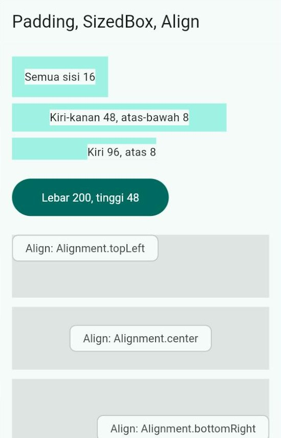</p>

### 3.1 Satuan ukuran di Flutter

Semua angka ukuran di Flutter (16, 48, 200, dan seterusnya) memakai satuan **piksel logis** (*logical pixel*), bukan piksel layar yang sebenarnya. Kira-kira ada **38 piksel logis per sentimeter**. Karena itu, kotak selebar 48 akan terlihat kurang lebih sama besar di ponsel murah maupun ponsel mahal yang layarnya jauh lebih tajam.

> [!TIP]
> Biasakan memakai angka kelipatan 4 atau 8 untuk jarak (4, 8, 12, 16, 24, 32). Panduan Material Design memakai pola ini sehingga tampilan terasa teratur. Untuk sesuatu yang bisa disentuh, misalnya tombol, usahakan ukurannya minimal **48 × 48** agar mudah ditekan jari.

### 3.2 `Padding`: jarak di sekeliling widget

`Padding` memberi ruang kosong **di sekeliling satu widget anak**. Besarnya ditulis dengan `EdgeInsets`:

| Kode | Artinya |
| :--- | :--- |
| `EdgeInsets.all(16)` | 16 di keempat sisi |
| `EdgeInsets.symmetric(horizontal: 48, vertical: 8)` | 48 di kiri dan kanan, 8 di atas dan bawah |
| `EdgeInsets.only(left: 96, top: 8)` | Hanya sisi yang disebut; sisi lain 0 |
| `EdgeInsets.fromLTRB(16, 0, 16, 12)` | Kiri, atas, kanan, bawah (*Left, Top, Right, Bottom*) |

```dart
Padding(
  padding: const EdgeInsets.all(16),
  child: Text('Semua sisi 16'),
),
```

Pada gambar di atas, **pita berwarna** adalah area *padding*, sedangkan **kotak putih** adalah widget anaknya. Perhatikan bagaimana anak "terdorong" ke dalam sesuai angka yang diberikan.

### 3.3 `SizedBox`: jarak kosong atau ukuran pasti

`SizedBox` punya dua kegunaan:

```dart
// 1) Tanpa anak: menjadi jarak kosong di antara dua widget.
const SizedBox(height: 24),

// 2) Dengan anak: memaksa anaknya berukuran tertentu.
SizedBox(
  width: 200,
  height: 48,
  child: FilledButton(
    onPressed: () {}, // aksi tombol dibahas di Pertemuan 5
    child: const Text('Lebar 200, tinggi 48'),
  ),
),
```

Gunakan `SizedBox`, bukan `Container`, untuk sekadar memberi jarak. "Polisi kode" kita (aturan `sized_box_for_whitespace`) akan mengingatkan jika Anda memakai `Container` kosong hanya untuk jarak.

### 3.4 `Center` dan `Align`: mengatur posisi

`Align` menaruh anaknya di posisi tertentu **di dalam ruang yang tersedia**. Posisinya ditulis dengan `Alignment`:

```dart
SizedBox(
  height: 80,
  child: Align(
    alignment: Alignment.bottomRight, // pojok kanan bawah
    child: Chip(label: Text('Align: Alignment.bottomRight')),
  ),
),
```

`Alignment` sebenarnya adalah titik koordinat `(x, y)` yang nilainya dari **-1** sampai **1**:

```text
(-1,-1) topLeft       (0,-1) topCenter       (1,-1) topRight
(-1, 0) centerLeft    (0, 0) center          (1, 0) centerRight
(-1, 1) bottomLeft    (0, 1) bottomCenter    (1, 1) bottomRight
```

`Center` hanyalah singkatan dari `Align(alignment: Alignment.center)`. Karena paling sering dipakai, ia dibuatkan widget sendiri.

**🧠 Cek Cepat:** Anda ingin teks berjarak 24 dari kiri dan kanan, tetapi tetap menempel di atas dan bawah. `EdgeInsets` apa yang Anda tulis?

<details>
<summary>Lihat jawaban</summary>

`EdgeInsets.symmetric(horizontal: 24)`. Nilai `vertical` yang tidak ditulis otomatis bernilai 0. Bisa juga `EdgeInsets.only(left: 24, right: 24)`.
</details>

---

## 4. Container dan Card

Contoh lengkap: [`kode/contoh_03_container_dan_dekorasi.dart`](kode/contoh_03_container_dan_dekorasi.dart).

<p align="center">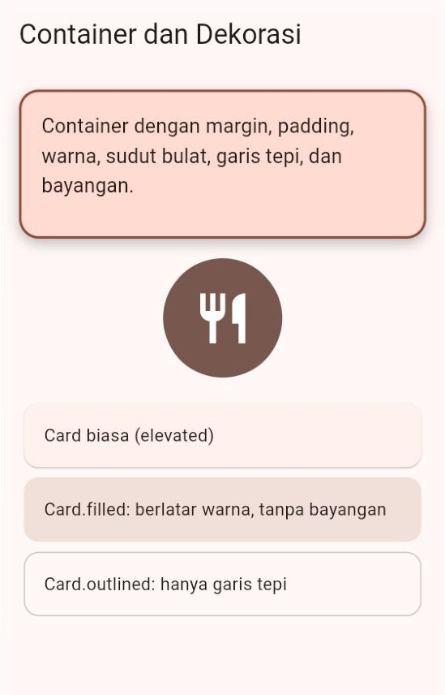</p>

### 4.1 `Container`: kotak serbaguna

`Container` adalah "kotak serbaguna" yang menggabungkan banyak kemampuan sekaligus: ukuran, jarak luar, jarak dalam, warna, dan hiasan.

```dart
Container(
  height: 120,
  margin: const EdgeInsets.only(bottom: 16), // jarak DI LUAR kotak
  padding: const EdgeInsets.all(16), // jarak DI DALAM kotak
  decoration: BoxDecoration(
    color: warna.primaryContainer,
    borderRadius: BorderRadius.circular(16), // sudut membulat
    border: Border.all(color: warna.primary, width: 2), // garis tepi
    boxShadow: [
      BoxShadow(
        color: warna.shadow.withValues(alpha: 0.25),
        blurRadius: 8,
        offset: const Offset(0, 4), // bayangan turun 4 piksel
      ),
    ],
  ),
  child: Text('Container dengan margin, padding, ...'),
),
```

Bayangkan sebuah kotak kado: **margin** adalah jarak kado dengan benda di sekitarnya, **garis tepi** adalah kardusnya, **padding** adalah busa pelindung di dalam kardus, dan **child** adalah hadiahnya.

```text
┌───────────── margin (jarak di luar) ─────────────┐
│  ╔══════════ border (garis tepi) ══════════════╗ │
│  ║  ┌──────── padding (jarak di dalam) ──────┐ ║ │
│  ║  │              child (isi)               │ ║ │
│  ║  └────────────────────────────────────────┘ ║ │
│  ╚═════════════════════════════════════════════╝ │
└──────────────────────────────────────────────────┘
```

Untuk membuat lingkaran, ganti `borderRadius` dengan `shape: BoxShape.circle`.

> [!WARNING]
> `color` dan `decoration` **tidak boleh diisi bersamaan** pada satu `Container`. Jika keduanya diisi, aplikasi berhenti dengan pesan `Cannot provide both a color and a decoration.` (di DartPad, layar hasil hanya kosong). Solusinya: pindahkan warnanya ke dalam `BoxDecoration(color: ...)`.

`Container` memang praktis, tetapi jangan dipakai untuk segala hal. Jika hanya butuh **satu** kemampuan, pakai widget khususnya karena lebih ringan dan maksudnya lebih jelas:

| Kebutuhan | Pakai |
| :--- | :--- |
| Hanya jarak di sekeliling | `Padding` |
| Hanya ukuran atau jarak kosong | `SizedBox` |
| Hanya warna latar | `ColoredBox` |
| Ukuran + warna + sudut bulat + bayangan sekaligus | `Container` |

### 4.2 `Card`: kartu siap pakai

Untuk tampilan berbentuk kartu, Material 3 sudah menyediakan `Card` dengan sudut bulat, warna, dan bayangan yang serasi dengan tema. Ada tiga variasi:

```dart
const Card(
  child: Padding(
    padding: EdgeInsets.all(16),
    child: Text('Card biasa (elevated)'),
  ),
),
// Dua variasi lain ditulis dengan cara yang sama:
// Card.filled(...)   -> berlatar warna, tanpa bayangan
// Card.outlined(...) -> hanya garis tepi
```

`Card` tidak memberi jarak di dalam kartu, jadi isinya biasanya dibungkus `Padding`. Di sisi luar, `Card` sudah punya *margin* kecil (4) secara bawaan.

**🧠 Cek Cepat:** Apa beda `margin` dan `padding` pada `Container`?

<details>
<summary>Lihat jawaban</summary>

`margin` adalah jarak **di luar** kotak (antara kotak dan widget di sekitarnya). `padding` adalah jarak **di dalam** kotak (antara tepi kotak dan isinya). Warna latar kotak mengisi area *padding*, tetapi tidak mengisi area *margin*.
</details>

---

## 5. Row dan Column

Contoh lengkap: [`kode/contoh_04_row_dan_column.dart`](kode/contoh_04_row_dan_column.dart).

### 5.1 Sumbu utama dan sumbu silang

`Row` menyusun anak-anaknya **mendatar** (kiri ke kanan), sedangkan `Column` menyusunnya **menurun** (atas ke bawah). Keduanya memakai dua sumbu:

- **Sumbu utama** (*main axis*): arah widget itu menyusun anaknya.
- **Sumbu silang** (*cross axis*): arah yang tegak lurus dengan sumbu utama.

| Widget | Sumbu utama | Sumbu silang |
| :--- | :--- | :--- |
| `Row` | mendatar ↔ | tegak ↕ |
| `Column` | tegak ↕ | mendatar ↔ |

```text
Row                                     Column
sumbu utama ─────────────────▶          ┌───┐   ◀─ sumbu silang ─▶
┌───┐ ┌───┐ ┌───┐  ▲                     │ A │
│ A │ │ B │ │ C │  │ sumbu silang        └───┘   │
└───┘ └───┘ └───┘  ▼                     ┌───┐   │ sumbu utama
                                         │ B │   ▼
                                         └───┘
```

Ingat satu kalimat ini: **"utama" = arah susunan, "silang" = arah sebaliknya.** Dua properti pengaturnya pun mengikuti nama sumbu itu: `mainAxisAlignment` dan `crossAxisAlignment`.

### 5.2 `mainAxisAlignment`: posisi di sepanjang sumbu utama

<p align="center">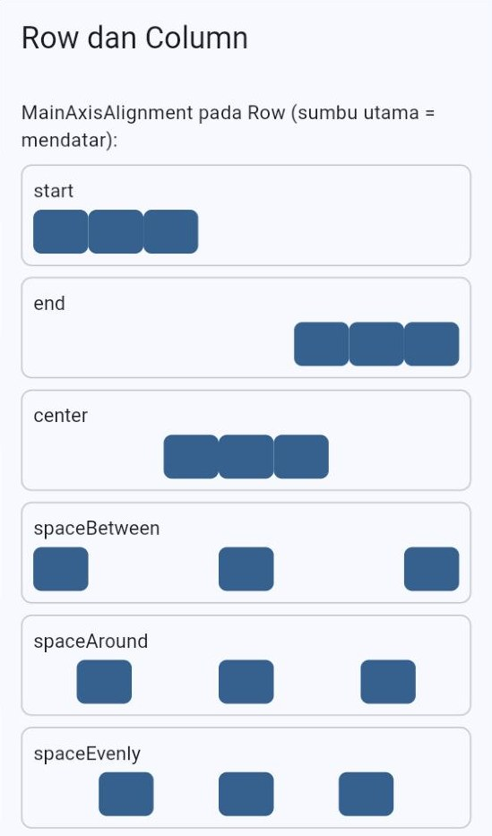</p>

```dart
Row(
  mainAxisAlignment: MainAxisAlignment.spaceBetween,
  children: const [KotakKecil(tinggi: 32), KotakKecil(tinggi: 32), KotakKecil(tinggi: 32)],
),
```

| Nilai | Gambaran | Keterangan |
| :--- | :--- | :--- |
| `start` (bawaan) | `[A][B][C]······` | Merapat ke awal |
| `end` | `······[A][B][C]` | Merapat ke akhir |
| `center` | `···[A][B][C]···` | Merapat di tengah |
| `spaceBetween` | `[A]···[B]···[C]` | Sisa ruang dibagi **di antara** anak; tepi tidak diberi jarak |
| `spaceAround` | `·[A]··[B]··[C]·` | Setiap anak diberi jarak sama di kiri-kanannya, sehingga jarak di tepi **setengah** jarak antaranak |
| `spaceEvenly` | `··[A]··[B]··[C]··` | **Semua** jarak sama, termasuk di tepi |

Contoh kode tersebut membuat keenam variasi dengan perulangan `for` terhadap `MainAxisAlignment.values`. Ingat Pertemuan 3: `values` adalah daftar semua nilai sebuah *enum*, dan `.name` berisi nama nilainya.

```dart
for (MainAxisAlignment pilihan in MainAxisAlignment.values)
  BingkaiContoh(
    label: pilihan.name, // 'start', 'end', 'center', ...
    child: Row(mainAxisAlignment: pilihan, children: ...),
  ),
```

> [!NOTE]
> **Perulangan `for` di dalam daftar (*collection for*).** Dart mengizinkan `for` ditulis **langsung di dalam kurung siku** sebuah *list*. Setiap putaran menambahkan satu elemen ke daftar itu. Jadi:
>
> ```dart
> [for (int i = 1; i <= 3; i++) Text('Baris $i')]
> // sama dengan
> [Text('Baris 1'), Text('Baris 2'), Text('Baris 3')]
> ```
>
> Perhatikan bedanya dengan `for` biasa dari Pertemuan 2: **tidak ada** kurung kurawal `{ }` dan **tidak ada** titik koma. Yang ditulis setelah `for (...)` langsung berupa elemennya. Cara ini sangat sering dipakai untuk membuat banyak widget sekaligus di dalam `children`.

### 5.3 `crossAxisAlignment`: posisi di sumbu silang

<p align="center">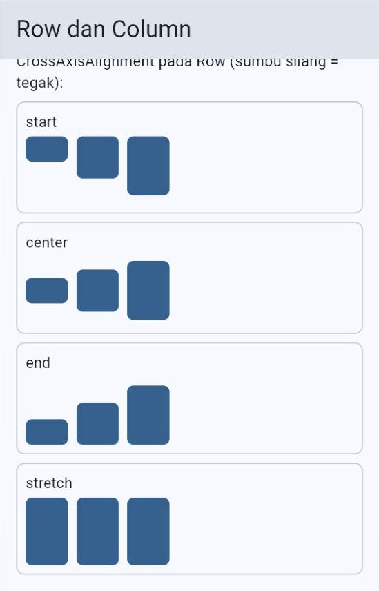</p>

Pada `Row`, sumbu silangnya tegak, sehingga `crossAxisAlignment` mengatur posisi **atas–bawah** anak-anaknya:

| Nilai | Hasil pada `Row` | Hasil pada `Column` |
| :--- | :--- | :--- |
| `start` | Rata atas | Rata kiri |
| `center` (bawaan) | Rata tengah | Rata tengah |
| `end` | Rata bawah | Rata kanan |
| `stretch` | Semua anak **ditarik** setinggi `Row` | Semua anak **ditarik** selebar `Column` |

Perhatikan baris `stretch` pada gambar: ketiga kotak yang tadinya bertinggi 24, 40, dan 56 sekarang **sama tinggi**. Tinggi yang kita tulis di kode diabaikan! Penyebabnya dibahas tuntas di [Bagian 8](#8-constraints-aturan-main-tata-letak).

> [!NOTE]
> Banyak pemula heran mengapa isi `Column` mereka berada di tengah layar secara mendatar. Penyebabnya: nilai bawaan `crossAxisAlignment` adalah `center`. Tambahkan `crossAxisAlignment: CrossAxisAlignment.start` agar isinya rata kiri.

### 5.4 Jarak antaranak dengan `spacing`

Dulu, jarak antaranak dibuat dengan menyelipkan `SizedBox` di antara setiap anak. Sejak Flutter 3.27, `Row` dan `Column` punya parameter `spacing` yang jauh lebih ringkas:

```dart
// Cara lama: mudah lupa satu SizedBox.
Column(
  children: [
    const Text('A'),
    const SizedBox(height: 8),
    const Text('B'),
    const SizedBox(height: 8),
    const Text('C'),
  ],
),

// Cara sekarang: satu baris untuk semua jarak.
Column(
  spacing: 8,
  children: [const Text('A'), const Text('B'), const Text('C')],
),
```

### 5.5 `mainAxisSize`: seberapa panjang `Row` dan `Column`?

Secara bawaan, `Row` dan `Column` **mengambil ruang sebanyak mungkin** di sumbu utamanya (`mainAxisSize: MainAxisSize.max`). Biasanya memang itu yang kita mau. Namun ada satu jebakan yang sering dialami pemula: `Card` berisi `Column` yang diletakkan langsung sebagai `body`.

```dart
Scaffold(
  body: Card.outlined(
    child: Column(children: [Text('Baris 1'), Text('Baris 2')]),
  ),
),
```

<p align="center">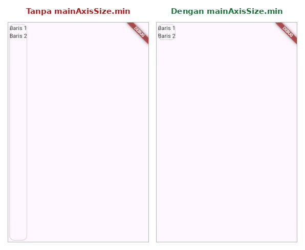</p>

`body` mengizinkan anaknya setinggi layar, dan `Column` dengan senang hati mengambil **seluruh** tinggi itu, sehingga kartunya ikut memanjang sampai bawah (gambar kiri). Solusinya, minta `Column` cukup setinggi isinya:

```dart
Column(
  mainAxisSize: MainAxisSize.min, // setinggi isinya saja
  children: [Text('Baris 1'), Text('Baris 2')],
),
```

Jebakan ini tidak muncul jika kartu tersebut berada di dalam `Column` lain atau di dalam `SingleChildScrollView`. Keduanya memberi anaknya tinggi yang **tak terbatas**, dan dalam keadaan itu `Column` otomatis menyesuaikan tingginya dengan isinya. Alasannya akan jelas setelah Anda membaca [Bagian 8](#8-constraints-aturan-main-tata-letak).

### 5.6 Menggabungkan `Row` dan `Column`

Tampilan sungguhan hampir selalu berupa gabungan keduanya. Contohnya, baris sapaan berikut berupa `Row` yang berisi foto dan sebuah `Column` berisi dua baris teks:

```dart
Row(
  spacing: 12,
  children: [
    const CircleAvatar(radius: 24, child: Text('R')),
    Column(
      crossAxisAlignment: CrossAxisAlignment.start, // teks rata kiri
      children: [
        Text('Selamat pagi,', style: gayaTeks.bodyMedium),
        Text('Rina', style: gayaTeks.titleLarge),
      ],
    ),
  ],
),
```

> [!TIP]
> Seperti dijelaskan di Pertemuan 1, Anda mungkin menjumpai kode yang ditulis `mainAxisAlignment: .spaceBetween`. Itu *dot shorthand* (fitur Dart 3.10) yang artinya sama dengan `MainAxisAlignment.spaceBetween`. Modul ini memakai bentuk lengkap agar asal setiap nilai terlihat jelas.

**🧠 Cek Cepat:** Anda punya `Column` berisi tiga teks dan ingin semuanya rata kiri. Properti apa yang harus diubah: `mainAxisAlignment` atau `crossAxisAlignment`?

<details>
<summary>Lihat jawaban</summary>

`crossAxisAlignment: CrossAxisAlignment.start`. Pada `Column`, kiri–kanan adalah arah **sumbu silang**. `mainAxisAlignment` justru mengatur posisi atas–bawah.
</details>

---

## 6. Expanded, Flexible, dan Spacer

Contoh lengkap: [`kode/contoh_05_expanded_flexible_spacer.dart`](kode/contoh_05_expanded_flexible_spacer.dart).

<p align="center">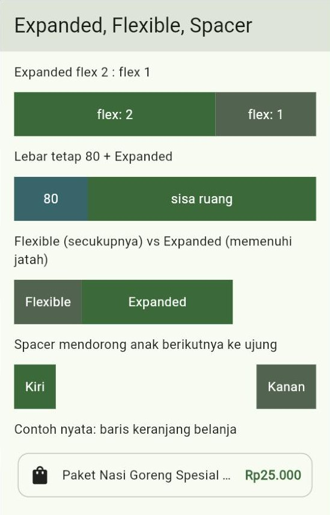</p>

### 6.1 Masalah: bagaimana membagi sisa ruang?

Secara bawaan, setiap anak `Row` hanya selebar isinya. Lalu bagaimana jika kita ingin satu anak **mengisi sisa ruang** yang ada? Atau dua anak berbagi ruang dengan perbandingan tertentu? Di sinilah `Expanded`, `Flexible`, dan `Spacer` berperan.

### 6.2 `Expanded` dan `flex`

`Expanded` berarti "**ambil sisa ruang**". Jika ada beberapa `Expanded`, sisa ruang dibagi menurut angka `flex` masing-masing (bawaannya 1):

```dart
Row(
  children: [
    Expanded(
      flex: 2, // mendapat 2 bagian
      child: KotakLabel(teks: 'flex: 2', warna: warna.primary),
    ),
    Expanded( // flex bawaan = 1 bagian
      child: KotakLabel(teks: 'flex: 1', warna: warna.secondary),
    ),
  ],
),
```

Cara menghitungnya: jumlahkan semua `flex` (2 + 1 = 3 bagian). Jika lebar yang tersedia 300, satu bagian = 300 ÷ 3 = 100. Kotak pertama mendapat 2 × 100 = **200**, kotak kedua **100**.

### 6.3 Lebar tetap + `Expanded`

Anak yang ukurannya pasti diberi tempat **lebih dulu**. Baru sisanya dibagikan ke `Expanded`:

```dart
Row(
  children: [
    SizedBox(width: 80, child: KotakLabel(teks: '80', warna: warna.tertiary)),
    Expanded(child: KotakLabel(teks: 'sisa ruang', warna: warna.primary)),
  ],
),
```

Pada layar selebar 360 dengan *padding* 16 di kiri dan kanan, lebar `Row` adalah 360 − 32 = 328. Kotak pertama mengambil 80, sehingga `Expanded` mendapat 328 − 80 = **248**.

### 6.4 `Flexible`: boleh lebih kecil dari jatahnya

`Flexible` mirip `Expanded`: ia juga mendapat **jatah** ruang menurut `flex`. Bedanya:

- **`Expanded`** *wajib* memenuhi seluruh jatahnya.
- **`Flexible`** *boleh* lebih kecil dari jatahnya, cukup selebar isinya. Sisa jatah yang tidak terpakai dibiarkan kosong.

```dart
Row(
  children: [
    Flexible(child: KotakLabel(teks: 'Flexible', warna: warna.secondary)),
    Expanded(child: KotakLabel(teks: 'Expanded', warna: warna.primary)),
  ],
),
```

Pada gambar, keduanya mendapat jatah setengah lebar (sama-sama `flex: 1`). `Expanded` memenuhi setengah bagiannya, sedangkan `Flexible` hanya selebar tulisan "Flexible". Karena itulah ada ruang kosong di ujung kanan baris tersebut. Secara teknis, `Expanded` sama dengan `Flexible(fit: FlexFit.tight)`.

### 6.5 `Spacer`: pendorong kosong

`Spacer` adalah ruang kosong yang mengisi sisa ruang. Gunanya untuk **mendorong** widget berikutnya ke ujung:

```dart
Row(
  children: [
    KotakLabel(teks: 'Kiri', warna: warna.primary),
    const Spacer(), // mengisi semua ruang di tengah
    KotakLabel(teks: 'Kanan', warna: warna.secondary),
  ],
),
```

Hasil yang sama sebenarnya bisa didapat dengan `mainAxisAlignment: MainAxisAlignment.spaceBetween`. `Spacer` lebih berguna ketika hanya **sebagian** anak yang ingin didorong, misalnya `[A][B]·······[C]`.

### 6.6 Contoh nyata: baris keranjang belanja

Pola "ikon + teks yang mengisi sisa ruang + harga" sangat sering muncul di aplikasi sungguhan:

```dart
Row(
  spacing: 12,
  children: [
    const Icon(Icons.shopping_bag),
    const Expanded( // nama barang memakai sisa ruang
      child: Text(
        'Paket Nasi Goreng Spesial Telur Dadar dan Es Teh Manis',
        maxLines: 1,
        overflow: TextOverflow.ellipsis,
      ),
    ),
    Text('Rp25.000', style: TextStyle(fontWeight: FontWeight.bold, color: warna.primary)),
  ],
),
```

Berkat `Expanded`, nama barang yang panjang **tidak pernah mendorong harga keluar layar**. Ia cukup dipotong dengan tanda "...".

> [!WARNING]
> `Expanded`, `Flexible`, dan `Spacer` hanya boleh menjadi **anak langsung** dari `Row` atau `Column`. Jika diletakkan di tempat lain, misalnya di dalam `Center` atau `Padding`, muncul pesan `Incorrect use of ParentDataWidget.` di konsol.

**🧠 Cek Cepat:** Sebuah `Row` selebar 400 berisi `Expanded(flex: 3, ...)` dan `Expanded(flex: 1, ...)`. Berapa lebar masing-masing?

<details>
<summary>Lihat jawaban</summary>

Total 3 + 1 = 4 bagian, satu bagian = 400 ÷ 4 = 100. Anak pertama **300**, anak kedua **100**.
</details>

---

## 7. Stack dan Positioned

Contoh lengkap: [`kode/contoh_06_stack_dan_positioned.dart`](kode/contoh_06_stack_dan_positioned.dart).

<p align="center">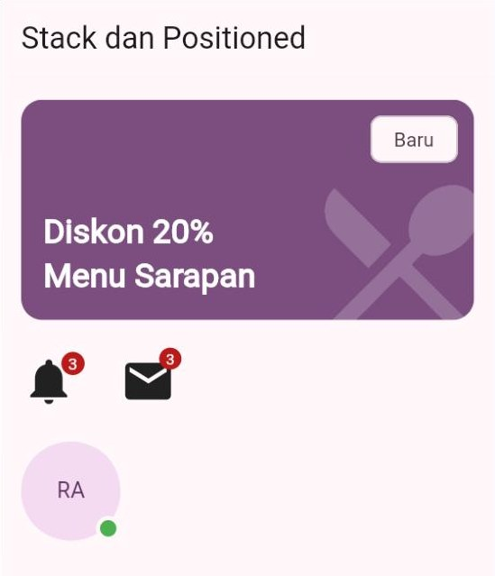</p>

### 7.1 Menumpuk seperti stiker

`Row` dan `Column` menyusun anak **bersebelahan**. `Stack` menyusunnya **bertumpuk**, seperti menempel stiker di sampul buku: stiker yang ditempel **terakhir** berada **paling atas**.

```dart
Stack(
  children: [
    Container(height: 160, color: warna.primary), // 1) paling bawah
    Positioned(left: 16, bottom: 16, child: Text('Diskon 20%')), // 2) di atasnya
    const Positioned(top: 12, right: 12, child: Chip(label: Text('Baru'))), // 3) paling atas
  ],
),
```

Ukuran `Stack` mengikuti **anak terbesar yang tidak memakai `Positioned`**. Pada contoh di atas, ukurannya mengikuti `Container` setinggi 160.

### 7.2 `Positioned`: menentukan jarak dari tepi

`Positioned` menaruh anaknya berdasarkan jarak dari tepi `Stack`: `top` (atas), `right` (kanan), `bottom` (bawah), dan `left` (kiri). Cukup isi dua di antaranya, misalnya `top` + `right` untuk pojok kanan atas.

Nilainya boleh **negatif** agar anak sedikit menonjol keluar, seperti lencana notifikasi:

```dart
Stack(
  clipBehavior: Clip.none, // izinkan anak menonjol keluar kotak Stack
  children: [
    const Icon(Icons.notifications, size: 40),
    Positioned(
      right: -6,
      top: -6,
      child: Container(
        padding: const EdgeInsets.all(5),
        decoration: BoxDecoration(color: warna.error, shape: BoxShape.circle),
        child: Text('3', style: TextStyle(color: warna.onError, fontSize: 12)),
      ),
    ),
  ],
),
```

Secara bawaan, bagian anak yang keluar dari kotak `Stack` **dipotong**. Itu sebabnya lencana di atas memakai `clipBehavior: Clip.none`. Sebaliknya, banner promo pada contoh dibungkus `ClipRRect` agar ikon besar yang menonjol justru **terpotong rapi** mengikuti sudut bulat.

Lencana seperti ini sebenarnya sudah tersedia sebagai widget siap pakai bernama `Badge`:

```dart
const Badge(label: Text('3'), child: Icon(Icons.mail, size: 40)),
```

### 7.3 `alignment`: posisi tanpa `Positioned`

Anak yang tidak dibungkus `Positioned` ditempatkan menurut `alignment` milik `Stack` (bawaannya pojok kiri atas). Contoh titik status "online" di pojok kanan bawah foto profil:

```dart
Stack(
  alignment: Alignment.bottomRight,
  children: [
    CircleAvatar(radius: 36, child: const Text('RA')),
    Container(
      width: 18,
      height: 18,
      decoration: BoxDecoration(
        color: Colors.green,
        shape: BoxShape.circle,
        border: Border.all(color: warna.surface, width: 3),
      ),
    ),
  ],
),
```

> [!WARNING]
> `Positioned` hanya boleh menjadi **anak langsung** dari `Stack`. Jika diletakkan di dalam `Column`, misalnya, muncul pesan `Incorrect use of ParentDataWidget.` yang menyebut `Positioned`.

**🧠 Cek Cepat:** Pada `Stack(children: [A, B, C])`, widget mana yang terlihat paling depan jika ketiganya bertumpuk di tempat yang sama?

<details>
<summary>Lihat jawaban</summary>

**C**, karena ditulis paling akhir. Urutan di dalam `children` adalah urutan dari paling bawah ke paling atas.
</details>

---

## 8. Constraints: Aturan Main Tata Letak

Bagian ini adalah **kunci** untuk memahami hampir semua masalah tata letak di Flutter. Contoh lengkap: [`kode/contoh_07_constraints.dart`](kode/contoh_07_constraints.dart).

### 8.1 Satu kalimat yang perlu dihafal

Dokumentasi resmi Flutter merangkum cara kerja tata letak dalam satu kalimat:

> **"Constraints go down. Sizes go up. Parent sets position."**
>
> Batasan turun ke anak. Ukuran naik ke induk. Induk yang menentukan posisi.

Bayangkan **bazar kampus**. Panitia (induk) berkata kepada pemilik stan (anak): "Lebar stanmu boleh **antara 2 dan 4 meter**." Itu **batasan** (*constraints*). Pemilik stan memilih lebar 3 meter, lalu **melaporkannya** ke panitia. Itu **ukuran** (*size*). Terakhir, **panitialah** yang menentukan di mana stan itu didirikan. Itu **posisi**.

Di Flutter, prosesnya sama persis:

1. **Induk memberi batasan** kepada anaknya: lebar minimum–maksimum dan tinggi minimum–maksimum.
2. **Anak memilih ukurannya sendiri**, tetapi **wajib** berada di dalam batasan tersebut, lalu melaporkan ukuran itu kepada induknya.
3. **Induk menentukan posisi** anaknya. Anak tidak tahu dan tidak bisa memilih posisinya sendiri.

Contohnya, `Center(child: Padding(padding: EdgeInsets.all(16), child: Text('Halo')))` di layar selebar 360 dan setinggi 640:

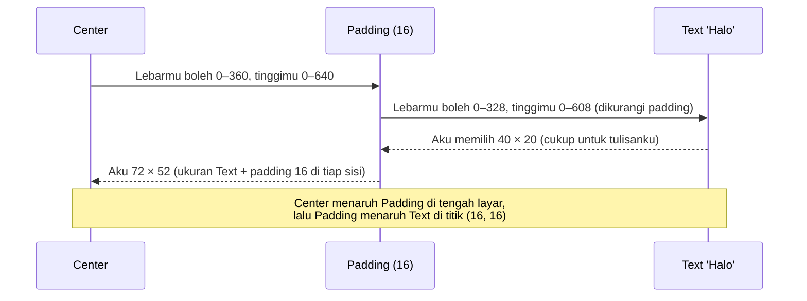

### 8.2 Batasan ketat, longgar, dan tak terbatas

<p align="center">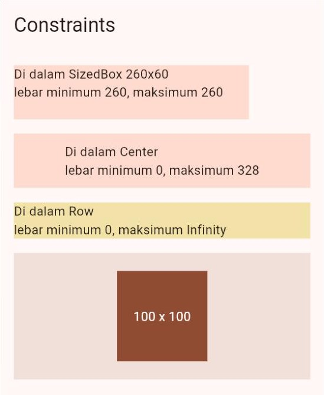</p>

Contoh 07 memakai widget `LayoutBuilder` untuk **mencetak batasan** yang diterima sebuah widget (pembahasan kodenya di [Bagian 8.4](#84-melihat-batasan-dengan-layoutbuilder)). Hasilnya pada layar selebar 360:

| Letak widget | Lebar minimum | Lebar maksimum | Jenis batasan |
| :--- | :---: | :---: | :--- |
| Di dalam `SizedBox(width: 260, height: 60)` | 260 | 260 | **Ketat** (*tight*): minimum = maksimum, anak **wajib** berukuran itu |
| Di dalam `Center` | 0 | 328 | **Longgar** (*loose*): anak boleh memilih dari 0 sampai maksimum |
| Di dalam `Row` | 0 | Infinity | **Tak terbatas** (*unbounded*): `Row` tidak memberi tahu batas lebarnya |

Angka 328 berasal dari lebar layar 360 dikurangi *padding* halaman 16 di kiri dan kanan. Di layar Anda, angkanya bisa berbeda karena bergantung pada lebar jendela.

Baris ketiga menjelaskan banyak hal. `Row` bertanya kepada setiap anak yang bukan `Expanded`: "Berapa lebar yang kamu mau?" tanpa menyebut batasnya. Sebuah `Text` akan menjawab "sepanjang tulisanku". Jika tulisannya panjang, total lebar anak-anak `Row` melebihi layar dan terjadilah ***overflow*** ([Bagian 9](#9-overflow-saat-isi-tidak-muat)). Hal serupa terjadi pada arah tegak: `Column` dan widget yang bisa digulir (*scroll*) memberi tinggi yang tak terbatas kepada anaknya.

### 8.3 "Kenapa ukuran yang saya tulis diabaikan?"

Ini pertanyaan klasik pemula. Jawabannya selalu kembali ke aturan nomor 2: **ukuran anak wajib berada di dalam batasan induknya.** Jika induk memberi batasan ketat, angka `width` atau `height` yang Anda tulis akan "dikalahkan".

Anda sudah melihat buktinya di [Bagian 5.3](#53-crossaxisalignment-posisi-di-sumbu-silang): dengan `CrossAxisAlignment.stretch`, `Row` memberi batasan tinggi yang ketat kepada anak-anaknya, sehingga tinggi 24, 40, dan 56 yang kita tulis diabaikan. Hal yang sama terjadi di sini:

```dart
Column(
  crossAxisAlignment: CrossAxisAlignment.stretch, // lebar anak dipaksa penuh
  children: [
    Container(width: 100, height: 50, color: warna.primary), // lebar 100 diabaikan
  ],
),
```

Solusinya: bungkus anak dengan widget yang **melonggarkan** batasan, misalnya `Align` atau `Center`:

```dart
Align(
  alignment: Alignment.centerLeft,
  child: Container(width: 100, height: 50, color: warna.primary), // kini benar 100
),
```

`Align` menerima batasan ketat dari induknya, tetapi meneruskan batasan **longgar** kepada anaknya. Karena itu, kotak 100 × 100 pada contoh 07 tetap berukuran 100 × 100 meskipun berada di dalam area yang jauh lebih besar.

### 8.4 Melihat batasan dengan `LayoutBuilder`

Jika bingung mengapa sebuah widget berukuran aneh, cari tahu **batasan apa yang ia terima**. `LayoutBuilder` memberikan batasan itu kepada fungsi `builder`:

```dart
class InfoBatasan extends StatelessWidget {
  const InfoBatasan({super.key, required this.judul});

  final String judul;

  @override
  Widget build(BuildContext context) {
    return LayoutBuilder(
      builder: (BuildContext context, BoxConstraints batasan) {
        String minimum = batasan.minWidth.toStringAsFixed(0);
        String maksimum = batasan.maxWidth.toStringAsFixed(0);
        return Text('$judul\nlebar minimum $minimum, maksimum $maksimum');
      },
    );
  }
}
```

Cara lain yang lebih nyaman adalah memakai Flutter Inspector ([Bagian 13](#13-alat-bantu-melihat-tata-letak)).

**🧠 Cek Cepat:** Mengapa teks yang panjang bisa meluber di dalam `Row`, padahal teks yang sama otomatis turun ke baris berikutnya ketika berada langsung di dalam `Column`?

<details>
<summary>Lihat jawaban</summary>

Di dalam `Column`, lebar maksimum teks dibatasi lebar layar, sehingga teks tahu kapan harus pindah baris. Di dalam `Row`, anak yang bukan `Expanded` menerima lebar maksimum **tak terbatas** (*Infinity*), sehingga teks merasa boleh memanjang ke samping tanpa batas dan akhirnya keluar dari layar.
</details>

---

## 9. Overflow: Saat Isi Tidak Muat

Contoh lengkap: [`kode/contoh_08_mengatasi_overflow.dart`](kode/contoh_08_mengatasi_overflow.dart).

### 9.1 Mengenali *overflow*

*Overflow* (meluber) terjadi ketika isi sebuah widget **lebih besar** daripada ruang yang tersedia. Dalam mode *debug*, Flutter menandainya dengan **garis kuning-hitam** seperti rambu jalan, lengkap dengan tulisan kecil misalnya `RIGHT OVERFLOWED BY 490 PIXELS`. Di konsol juga muncul pesan:

```text
══╡ EXCEPTION CAUGHT BY RENDERING LIBRARY ╞══════════════════════
The following assertion was thrown during layout:
A RenderFlex overflowed by 344 pixels on the right.
```

Kata `right` berarti meluber ke **kanan** (biasanya di dalam `Row`), sedangkan `bottom` berarti meluber ke **bawah** (biasanya di dalam `Column`). Angka pikselnya berbeda-beda bergantung pada lebar layar, jadi jangan heran jika angka di laptop Anda tidak sama dengan angka di modul ini.

> [!IMPORTANT]
> Garis kuning-hitam **hanya muncul saat *debug***. Pada aplikasi yang sudah dirilis, bagian yang meluber cukup **terpotong** tanpa peringatan apa pun, sehingga pengguna melihat tampilan yang rusak. Jangan pernah mengabaikan *overflow*, sekecil apa pun angkanya.

Untuk melihat masalahnya sendiri, buka contoh 08, hapus tanda `//` di depan dua baris berlabel `MASALAH`, lalu jalankan ulang. Hasilnya seperti ini:

<p align="center">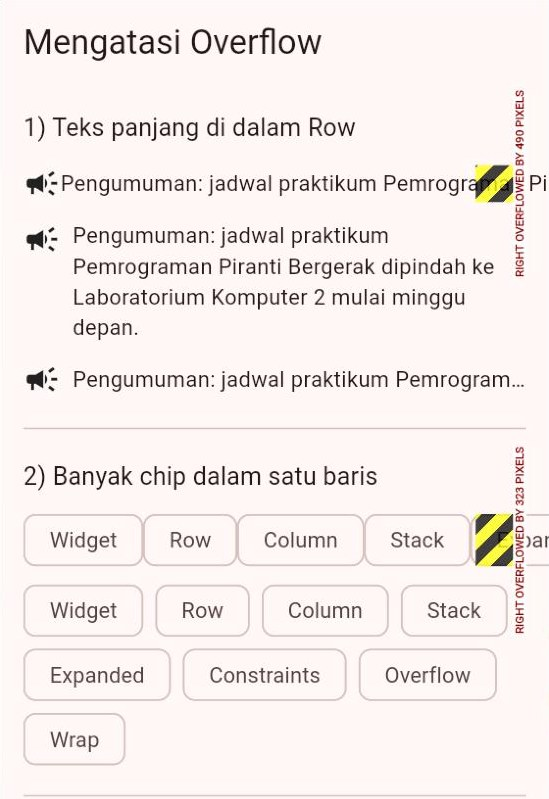</p>

Baris yang bergaris kuning-hitam adalah **masalahnya**. Baris tepat di bawahnya adalah **solusinya**.

### 9.2 Kasus 1: teks panjang di dalam `Row`

```dart
// MASALAH: teks di dalam Row tidak tahu batas lebarnya.
const Row(children: [Icon(Icons.campaign), Text(teksPanjang)]),
```

**Solusi:** bungkus teks dengan `Expanded`. Teks kini hanya boleh memakai sisa ruang, sehingga ia otomatis turun ke baris berikutnya:

```dart
const Row(
  crossAxisAlignment: CrossAxisAlignment.start, // ikon sejajar baris pertama
  spacing: 8,
  children: [
    Icon(Icons.campaign),
    Expanded(child: Text(teksPanjang)),
  ],
),
```

Jika teksnya cukup satu baris saja, tambahkan `maxLines: 1` dan `overflow: TextOverflow.ellipsis` pada `Text` agar sisanya diganti tanda "...".

### 9.3 Kasus 2: terlalu banyak item dalam satu baris

```dart
// MASALAH: Row tidak pernah pindah baris.
Row(children: [for (String t in topik) Chip(label: Text(t))]),
```

**Solusi:** ganti `Row` dengan `Wrap`. `Wrap` menyusun anak mendatar seperti `Row`, tetapi otomatis **pindah ke baris baru** jika ruangnya habis, persis seperti kata-kata dalam sebuah paragraf.

```dart
Wrap(
  spacing: 8, // jarak mendatar antar-chip
  runSpacing: 8, // jarak antarbaris
  children: [for (String t in topik) Chip(label: Text(t))],
),
```

### 9.4 Kasus 3: isi lebih tinggi daripada layar

`Column` tidak bisa digulir. Jika isinya lebih tinggi daripada layar, muncul pesan `A RenderFlex overflowed by ... pixels on the bottom.`

**Solusi:** bungkus `Column` dengan `SingleChildScrollView` agar isinya bisa **digulir**:

```dart
body: SingleChildScrollView(
  padding: const EdgeInsets.all(16),
  child: Column(
    children: [ /* isi yang panjang */ ],
  ),
),
```

`SingleChildScrollView` cocok untuk halaman yang isinya **tidak terlalu banyak**, misalnya halaman detail atau formulir. Untuk daftar data yang panjang (puluhan sampai ribuan baris), kita akan memakai `ListView` di Pertemuan 6.

### 9.5 Ringkasan: memilih obat yang tepat

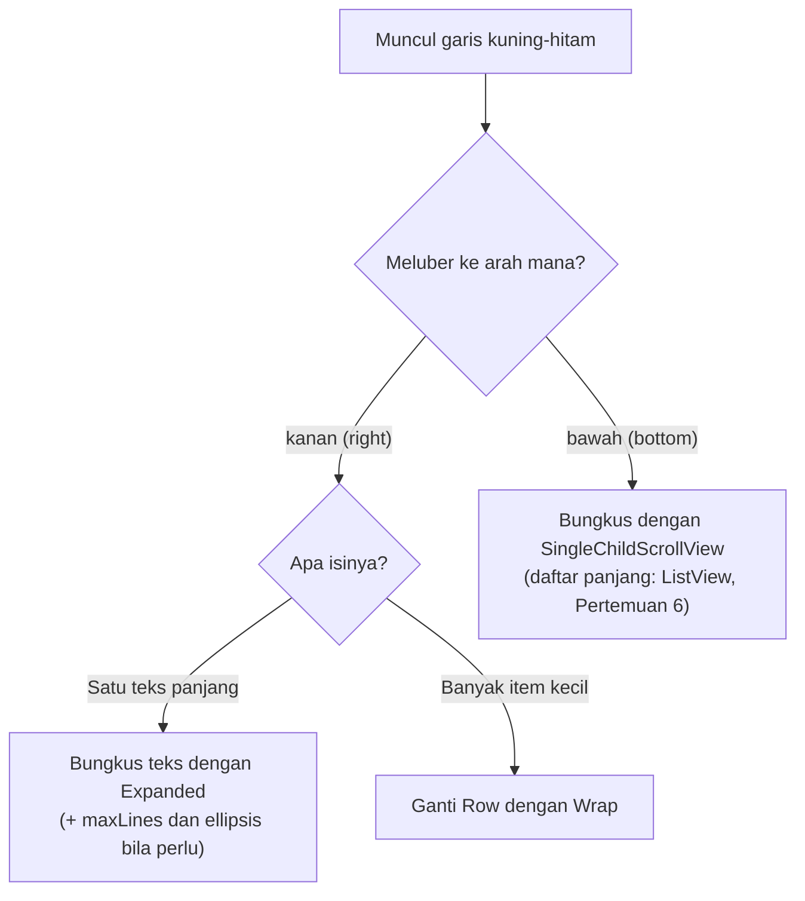

| Gejala | Penyebab | Solusi |
| :--- | :--- | :--- |
| `overflowed by ... on the right` pada baris berisi teks | Teks di `Row` menerima lebar tak terbatas | `Expanded` atau `Flexible` (+ `maxLines` dan `TextOverflow.ellipsis`) |
| `overflowed by ... on the right` pada baris berisi banyak item | `Row` tidak bisa pindah baris | `Wrap` |
| `overflowed by ... on the bottom` | `Column` lebih tinggi daripada layar | `SingleChildScrollView` |

**🧠 Cek Cepat:** Sebuah halaman berisi deretan 12 *chip* nama hobi dalam `Row`, dan di layar sempit muncul garis kuning-hitam di sebelah kanan. Apa perbaikan yang paling tepat?

<details>
<summary>Lihat jawaban</summary>

Ganti `Row` dengan `Wrap` (beri juga `spacing` dan `runSpacing`), sehingga *chip* yang tidak muat otomatis pindah ke baris berikutnya. `Expanded` tidak cocok di sini karena masalahnya adalah **jumlah item**, bukan satu teks yang panjang.
</details>

---

## 10. ListTile: Baris Informasi Siap Pakai

Contoh lengkap: [`kode/contoh_09_card_dan_listtile.dart`](kode/contoh_09_card_dan_listtile.dart).

<p align="center">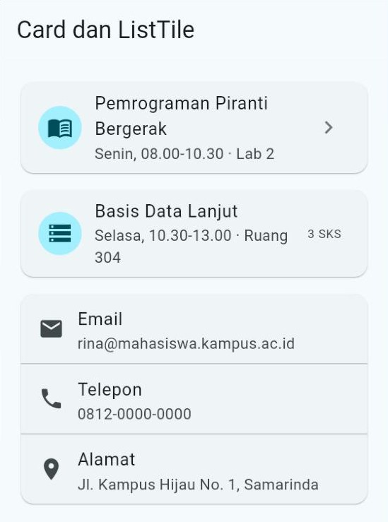</p>

Baris berpola "ikon atau foto di kiri, judul dan keterangan di tengah, sesuatu di kanan" muncul di hampir semua aplikasi: daftar kontak, pengaturan, riwayat transaksi, dan jadwal. Flutter menyediakannya sebagai `ListTile` dengan empat "slot":

```dart
Card(
  child: ListTile(
    leading: const CircleAvatar(child: Icon(Icons.menu_book)), // kiri
    title: const Text('Pemrograman Piranti Bergerak'), // judul
    subtitle: const Text('Senin, 08.00-10.30 · Lab 2'), // keterangan
    trailing: Icon(Icons.chevron_right, color: warna.outline), // kanan
  ),
),
```

| Slot | Posisi | Isi yang umum |
| :--- | :--- | :--- |
| `leading` | Kiri | `Icon`, `CircleAvatar` |
| `title` | Tengah atas | `Text` judul |
| `subtitle` | Tengah bawah | `Text` keterangan |
| `trailing` | Kanan | `Icon` panah, teks kecil, angka |

Keuntungan memakai `ListTile` dibandingkan menyusun `Row` dan `Column` sendiri: jarak, ukuran teks, dan tinggi barisnya sudah mengikuti pedoman Material 3, dan judul yang panjang **otomatis turun baris** tanpa *overflow* (perhatikan judul "Pemrograman Piranti Bergerak" pada gambar).

Beberapa `ListTile` boleh dikumpulkan dalam satu `Card` dan dipisah dengan `Divider`:

```dart
const Card(
  child: Column(
    children: [
      ListTile(leading: Icon(Icons.email), title: Text('Email'), subtitle: Text('rina@mahasiswa.kampus.ac.id')),
      Divider(height: 1), // garis pemisah setipis 1
      ListTile(leading: Icon(Icons.phone), title: Text('Telepon'), subtitle: Text('0812-0000-0000')),
    ],
  ),
),
```

> [!WARNING]
> `ListTile` selalu ingin selebar mungkin. Jika diletakkan langsung di dalam `Row`, ia menerima lebar tak terbatas dan muncul pesan `BoxConstraints forces an infinite width.` Jika memang perlu berada di dalam `Row`, bungkus dengan `Expanded`.

---

## 11. Memecah Tampilan Menjadi Widget Kecil

Contoh lengkap: [`kode/contoh_10_memecah_widget.dart`](kode/contoh_10_memecah_widget.dart).

<p align="center">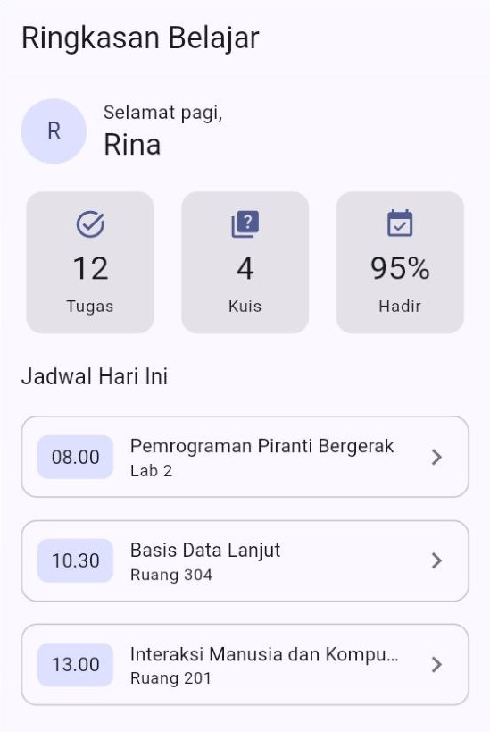</p>

### 11.1 Masalah: `build()` yang terlalu panjang

Halaman sungguhan bisa berisi ratusan baris kode tampilan. Jika semuanya ditulis di satu `build()`, kodenya menjorok sangat dalam seperti **piramida**, sulit dibaca, dan bagian yang mirip ditulis berulang-ulang. Bayangkan menulis tiga kartu statistik di atas secara manual: setiap kartu butuh sekitar 15 baris, padahal bedanya hanya ikon, angka, dan label.

### 11.2 Solusi: buat widget sendiri yang menerima parameter

Kita sudah melakukannya sejak Pertemuan 1 (`HalamanUtama`). Bedanya, sekarang widget buatan kita **menerima data** lewat *constructor* dengan parameter bernama (Pertemuan 3):

```dart
// Satu kartu angka. Dipakai tiga kali dengan isi berbeda.
class KartuStatistik extends StatelessWidget {
  const KartuStatistik({
    super.key,
    required this.ikon,
    required this.angka,
    required this.label,
  });

  final IconData ikon; // properti final: data kartu tidak berubah
  final String angka;
  final String label;

  @override
  Widget build(BuildContext context) {
    final ColorScheme warna = Theme.of(context).colorScheme;
    final TextTheme gayaTeks = Theme.of(context).textTheme;
    return Card.filled(
      child: Padding(
        padding: const EdgeInsets.all(12),
        child: Column(
          spacing: 4,
          children: [
            Icon(ikon, color: warna.primary),
            Text(angka, style: gayaTeks.headlineSmall),
            Text(label, textAlign: TextAlign.center, style: gayaTeks.labelMedium),
          ],
        ),
      ),
    );
  }
}
```

Sekarang halaman utama cukup "merangkai" widget-widget kecil:

```dart
const Row(
  spacing: 12,
  children: [
    Expanded(child: KartuStatistik(ikon: Icons.task_alt, angka: '12', label: 'Tugas')),
    Expanded(child: KartuStatistik(ikon: Icons.quiz, angka: '4', label: 'Kuis')),
    Expanded(child: KartuStatistik(ikon: Icons.event_available, angka: '95%', label: 'Hadir')),
  ],
),
```

Ada tiga hal yang perlu diperhatikan:

- Semua properti ditandai `final`, dan *constructor*-nya `const`. Widget memang dirancang **tidak berubah** (*immutable*). Aturan *linter* `prefer_const_constructors_in_immutables` akan mengingatkan jika Anda lupa.
- Parameter `super.key` selalu disertakan, sesuai aturan `use_key_in_widget_constructors`. Untuk sekarang, cukup ikuti polanya seperti pada Pertemuan 1.
- Nama widget menjelaskan **fungsinya** (`KartuStatistik`, `BarisJadwal`), bukan bentuknya (`KotakAbu`, `Baris1`).

### 11.3 Mengapa *class*, bukan fungsi pembantu?

Anda mungkin tergoda menulis fungsi seperti `Widget buatKartu(String angka) { ... }` di dalam halaman. Untuk tampilan, dokumentasi Flutter menyarankan **class widget** karena:

1. Widget bisa dibuat `const`, sehingga Flutter tidak perlu membangunnya ulang ketika induknya berubah.
2. Widget punya `context` sendiri yang tepat letaknya di pohon widget.
3. Widget muncul dengan namanya sendiri di Flutter Inspector, sehingga lebih mudah dilacak.
4. Widget mudah dipindahkan ke berkas tersendiri dan dipakai di halaman lain.

> [!TIP]
> VS Code bisa memecah widget secara otomatis. Letakkan kursor pada widget yang ingin dipisah, tekan **Ctrl+.**, pilih **Extract Widget**, lalu ketik nama widget barunya. Periksa hasilnya: jika widget tersebut memakai variabel dari luar, VS Code akan menjadikannya parameter *constructor*.

**🧠 Cek Cepat:** Mengapa properti `ikon`, `angka`, dan `label` pada `KartuStatistik` ditandai `final`?

<details>
<summary>Lihat jawaban</summary>

Karena `StatelessWidget` bersifat *immutable* (tidak berubah setelah dibuat). Jika tampilan perlu berubah, Flutter membuat objek widget **baru** dengan data baru. Properti `final` juga memungkinkan *constructor*-nya ditandai `const`.
</details>

---

## 12. Studi Kasus: Halaman Detail Menu Kantin

Sekarang kita gabungkan semuanya. Kode lengkap: [`kode/contoh_11_studi_kasus_detail_menu.dart`](kode/contoh_11_studi_kasus_detail_menu.dart).

<p align="center">
  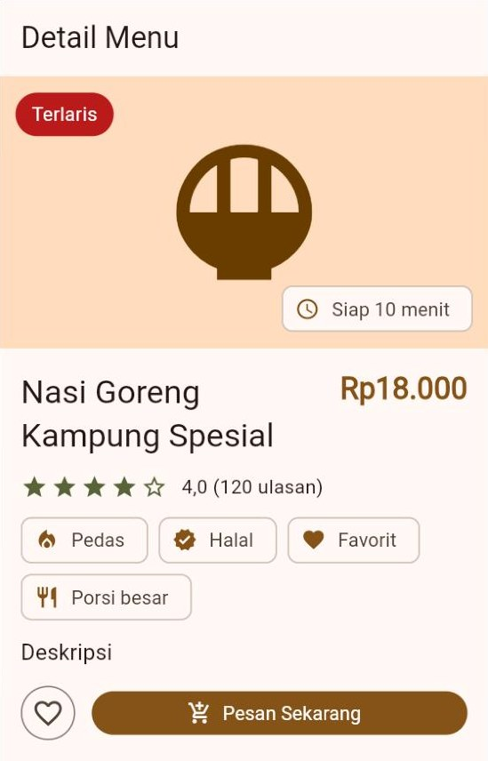
  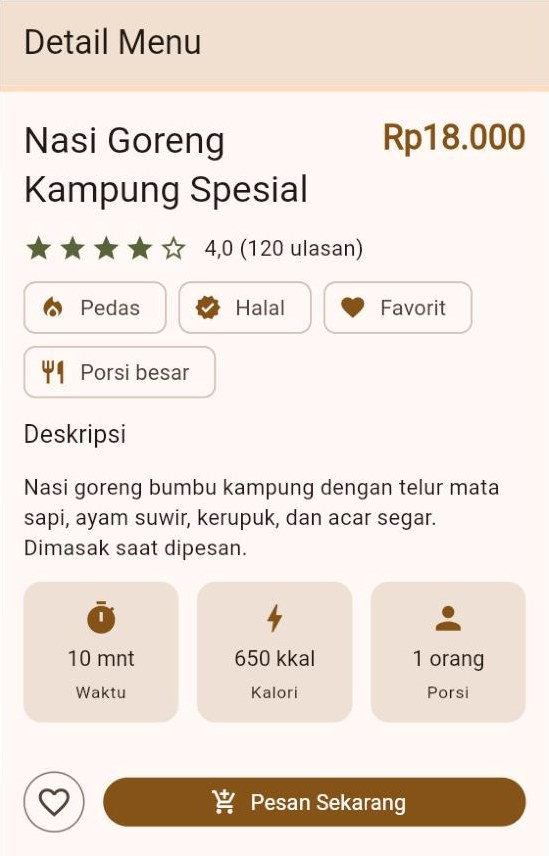
</p>

### 12.1 Dari sketsa ke pohon widget

Sebelum menulis kode, biasakan **memecah tampilan menjadi kotak-kotak** di atas kertas. Tanyakan untuk setiap bagian: apakah susunannya mendatar (`Row`), menurun (`Column`), atau bertumpuk (`Stack`)?

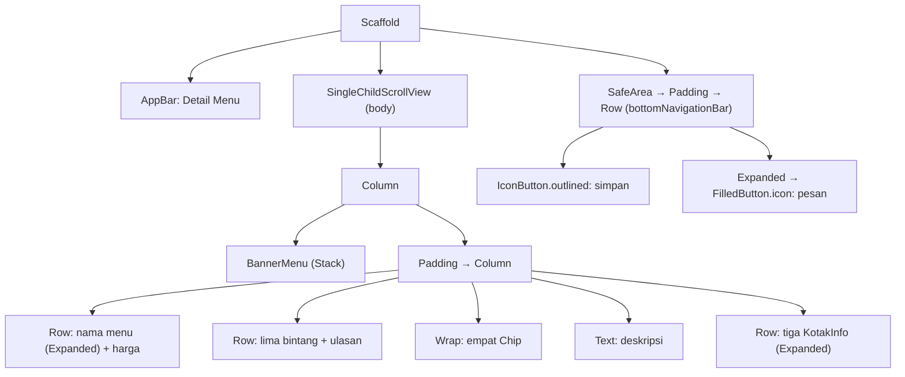

### 12.2 Langkah demi langkah

**Langkah 1 — Kerangka halaman.** `Scaffold` dengan `body` yang bisa digulir, karena isi halaman detail bisa lebih tinggi daripada layar.

```dart
return Scaffold(
  appBar: AppBar(title: const Text('Detail Menu')),
  body: SingleChildScrollView(
    child: Column(
      crossAxisAlignment: CrossAxisAlignment.stretch,
      children: [
        const BannerMenu(), // langkah 2
        Padding(
          padding: const EdgeInsets.all(16),
          child: Column(/* langkah 3–6 */),
        ),
      ],
    ),
  ),
  bottomNavigationBar: /* langkah 7 */,
);
```

**Langkah 2 — Banner bertumpuk.** `BannerMenu` adalah `Stack`: kotak berwarna berisi ikon besar di lapisan bawah, lencana "Terlaris" di pojok kiri atas, dan *chip* "Siap 10 menit" di pojok kanan bawah.

```dart
Stack(
  children: [
    Container(height: 200, color: warna.primaryContainer, child: Center(child: Icon(Icons.rice_bowl, size: 120))),
    Positioned(top: 12, left: 12, child: /* lencana "Terlaris" */),
    const Positioned(right: 12, bottom: 12, child: Chip(avatar: Icon(Icons.schedule), label: Text('Siap 10 menit'))),
  ],
),
```

**Langkah 3 — Nama dan harga.** Nama menu bisa panjang, jadi dibungkus `Expanded` agar harga tidak terdorong keluar:

```dart
Row(
  crossAxisAlignment: CrossAxisAlignment.start,
  spacing: 12,
  children: [
    Expanded(child: Text('Nasi Goreng Kampung Spesial', style: gayaTeks.headlineSmall)),
    Text('Rp18.000', style: gayaTeks.titleLarge?.copyWith(color: warna.primary, fontWeight: FontWeight.bold)),
  ],
),
```

**Langkah 4 — Rating bintang.** Lima ikon dibuat dengan perulangan `for` di dalam *list* ([Bagian 5.2](#52-mainaxisalignment-posisi-di-sepanjang-sumbu-utama)) dan operator kondisional `? :` (Pertemuan 2). Bintang ke-1 sampai ke-4 terisi, bintang ke-5 kosong:

```dart
Row(
  spacing: 2,
  children: [
    for (int i = 1; i <= 5; i++)
      Icon(i <= 4 ? Icons.star : Icons.star_border, color: warna.tertiary, size: 20),
    const SizedBox(width: 6),
    const Text('4,0 (120 ulasan)'),
  ],
),
```

**Langkah 5 — Label dengan `Wrap`.** Empat *chip* (Pedas, Halal, Favorit, Porsi besar) memakai `Wrap` agar otomatis pindah baris di layar sempit.

**Langkah 6 — Deskripsi dan kotak informasi.** Tiga `KotakInfo` (widget buatan sendiri) dibagi rata dengan tiga `Expanded`.

**Langkah 7 — Tombol aksi di bawah.** `bottomNavigationBar` milik `Scaffold` membuat tombol **selalu terlihat** walaupun halaman digulir. `SafeArea` menjaga agar tombol tidak tertutup garis navigasi sistem di ponsel yang layarnya tanpa bingkai.

```dart
bottomNavigationBar: SafeArea(
  child: Padding(
    padding: const EdgeInsets.all(16),
    child: Row(
      spacing: 12,
      children: [
        // Tombol ikon berukuran tetap: aman di layar sempit.
        IconButton.outlined(
          onPressed: () {}, // aksi tombol dibahas di Pertemuan 5
          tooltip: 'Simpan ke favorit',
          icon: const Icon(Icons.favorite_border),
        ),
        // Tombol utama mengambil seluruh sisa lebar.
        Expanded(
          child: FilledButton.icon(
            onPressed: () {},
            icon: const Icon(Icons.add_shopping_cart),
            label: const Text('Pesan Sekarang'),
          ),
        ),
      ],
    ),
  ),
),
```

### 12.3 Pelajaran dari menguji layar sempit

Versi pertama halaman ini memakai **dua tombol berteks** ("Simpan" dan "Pesan Sekarang") dan label kotak informasi "Waktu masak". Di layar selebar 360 semuanya tampak baik. Namun ketika diuji di layar **320** (ponsel kecil), tulisan "Simpan" terpotong menjadi dua baris dan kotak "Waktu masak" menjadi lebih tinggi daripada dua kotak lainnya.

Perbaikannya sederhana: tombol simpan diganti **tombol ikon** berukuran tetap (dengan `tooltip` sebagai penjelasan), dan labelnya disingkat menjadi "Waktu". Pelajarannya:

> [!IMPORTANT]
> **Selalu uji tampilan Anda di layar sempit** (320–360 piksel logis), bukan hanya di jendela laptop yang lebar. Mahasiswa dan pengguna aplikasi Anda kebanyakan memakai ponsel, bukan monitor 24 inci. Caranya ada di [Bagian 13.3](#133-meniru-layar-ponsel-di-chrome).

**🧠 Cek Cepat:** Mengapa tombol "Pesan Sekarang" dibungkus `Expanded`, sedangkan tombol simpan tidak?

<details>
<summary>Lihat jawaban</summary>

Tombol simpan berupa ikon dengan ukuran tetap, jadi cukup selebar dirinya. Tombol "Pesan Sekarang" adalah aksi utama, jadi dibuat **mengisi seluruh sisa lebar** dengan `Expanded`. Hasilnya tombol utama selalu besar dan mudah ditekan di layar selebar apa pun.
</details>

---

## 13. Alat Bantu Melihat Tata Letak

Menebak-nebak ukuran widget hanya dari kode itu melelahkan. Tiga alat berikut membuat tata letak "terlihat".

### 13.1 Flutter Inspector

Flutter DevTools punya **Widget Inspector** yang menampilkan pohon widget aplikasi yang sedang berjalan, lengkap dengan ukuran dan batasan setiap widget.

1. Jalankan aplikasi dalam mode *debug*. Cara termudah di VS Code: buka folder proyek, lalu pilih **Run → Start Debugging** (F5).
2. Setelah aplikasi berjalan, tekan **F1** (atau Ctrl+Shift+P), ketik `Open DevTools`, lalu pilih perintah yang membuka **Flutter Inspector**. Jika Anda menjalankan `flutter run` dari terminal, buka saja tautan DevTools yang biasanya ditampilkan di terminal.
3. Klik tombol **Select Widget Mode**, lalu klik sebuah widget di aplikasi. Widget itu akan disorot di pohon widget.
4. Lihat panel detailnya: ada ukuran (*size*) dan batasan (*constraints*). Jika yang dipilih adalah `Row`/`Column` atau anaknya, tab **Flex explorer** menampilkan sumbu utama dan silang, pengaturan *alignment*, serta `flex` setiap anak. Batasan yang dilanggar ditandai merah.

Inspector tidak tersedia di DartPad. Untuk DartPad, pakai garis bantu di bawah ini.

### 13.2 Garis bantu tata letak

Tambahkan dua baris berikut untuk menggambar batas setiap kotak di layar:

```dart
import 'package:flutter/material.dart';
import 'package:flutter/rendering.dart'; // 1) tambahkan import ini

void main() {
  debugPaintSizeEnabled = true; // 2) nyalakan garis bantu
  runApp(const AplikasiSaya());
}
```

<p align="center">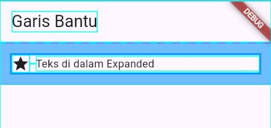</p>

Garis toska menunjukkan batas setiap widget, sedangkan area biru muda menunjukkan *padding*. Hapus kembali kedua baris tersebut setelah selesai memeriksa.

### 13.3 Meniru layar ponsel di Chrome

Saat menjalankan aplikasi di Chrome (atau memakai DartPad), Anda bisa meniru ukuran layar ponsel:

1. Tekan **F12** untuk membuka *Chrome DevTools* (alat bawaan Chrome, berbeda dengan Flutter DevTools).
2. Tekan **Ctrl+Shift+M** atau klik ikon ponsel-dan-tablet (*Toggle device toolbar*).
3. Di bagian atas halaman, pilih jenis perangkat, atau pilih **Dimensions: Responsive** lalu ketik ukurannya sendiri, misalnya **360 × 800**.
4. Coba juga lebar **320** untuk ponsel kecil. Tampilan yang baik tidak boleh menampilkan garis kuning-hitam di kedua ukuran tersebut.

---

## 14. Menulis Kode Tata Letak yang Rapi

| Aturan | Contoh |
| :--- | :--- |
| Ambil warna dan gaya teks dari tema | `warna.primary`, `gayaTeks.titleLarge`, bukan `Colors.blue` atau `fontSize: 22` di mana-mana |
| Pakai widget paling sederhana yang sudah cukup | `SizedBox` untuk jarak, `Padding` untuk *padding*. *Linter* mengingatkan lewat aturan `sized_box_for_whitespace` dan `avoid_unnecessary_containers` |
| Atur jarak antaranak dengan `spacing` | `Column(spacing: 8, children: [...])` |
| Pakai angka jarak kelipatan 4 atau 8 | 8, 12, 16, 24 |
| Tulis `const` pada widget yang isinya tetap | `const Text('Deskripsi')`, `const SizedBox(height: 16)` |
| Beri koma di akhir lalu rapikan dengan *format document* | Struktur pohon widget langsung terlihat dari indentasinya |
| Tulis `child`/`children` paling akhir | `Padding(padding: ..., child: ...)` (aturan `sort_child_properties_last`) |
| Pecah bagian yang panjang atau berulang menjadi widget sendiri | `KartuStatistik`, `BarisJadwal`, `BannerMenu` |
| Beri nama widget sesuai fungsinya | `BannerMenu`, bukan `Widget1` atau `KotakUngu` |
| Uji di layar sempit | Lebar 320 dan 360 tanpa *overflow* |

---

## 15. Kesalahan Umum Pemula dan Solusinya

> [!TIP]
> Satu kesalahan tata letak sering memicu **puluhan** pesan error berantai, misalnya `RenderBox was not laid out: ...` berulang-ulang. Jangan panik. Gulir ke **pesan error yang pertama**, perbaiki itu, lalu jalankan ulang. Biasanya semua pesan lain ikut hilang.

| Pesan error / gejala | Penyebab | Solusi |
| :--- | :--- | :--- |
| `The named parameter 'child' isn't defined.` | Menulis `child` pada widget yang punya banyak anak, misalnya `Column(child: ...)` | Ganti dengan `children: [ ... ]` |
| `The named parameter 'children' isn't defined.` | Menulis `children` pada widget yang hanya punya satu anak, misalnya `Center(children: ...)` | Ganti dengan `child: ...` |
| `The argument type 'List<Text>' can't be assigned to the parameter type 'Widget?'.` | Mengisi `child` dengan sebuah daftar `[ ... ]` | Isi dengan satu widget, atau bungkus dulu dengan `Column`/`Row` |
| `Expected to find ','.` | Lupa koma di antara anak-anak atau argumen | Tambahkan koma, lalu rapikan dengan *format document* |
| `The argument type 'int' can't be assigned to the parameter type 'EdgeInsetsGeometry'.` | Menulis `padding: 16` | `padding: const EdgeInsets.all(16)` |
| `The argument type 'String' can't be assigned to the parameter type 'double?'.` | Ukuran ditulis sebagai teks, misalnya `width: '100'` | Tulis sebagai angka: `width: 100` |
| `Invalid constant value.` | Menandai `const` pada widget yang memakai nilai tidak tetap, misalnya `const Text('a', style: TextStyle(color: warna.primary))` | Hapus `const` pada widget itu |
| `The method 'copyWith' can't be unconditionally invoked because the receiver can be 'null'.` | `gayaTeks.titleLarge.copyWith(...)` | `gayaTeks.titleLarge?.copyWith(...)` |
| Garis kuning-hitam dan `A RenderFlex overflowed by ... pixels on the right.` | Isi `Row` lebih lebar daripada ruang yang ada | `Expanded`/`Flexible` (+ `maxLines` dan *ellipsis*) atau `Wrap` |
| Garis kuning-hitam dan `A RenderFlex overflowed by ... pixels on the bottom.` | `Column` lebih tinggi daripada layar | Bungkus dengan `SingleChildScrollView` |
| `Incorrect use of ParentDataWidget.` | `Expanded`/`Flexible`/`Spacer` bukan anak langsung `Row`/`Column`, atau `Positioned` bukan anak langsung `Stack` | Pindahkan ke tempat yang benar |
| `RenderFlex children have non-zero flex but incoming height constraints are unbounded.` | `Expanded` di dalam `Column` yang dibungkus `SingleChildScrollView` | Hapus `Expanded`, atau beri tinggi pasti dengan `SizedBox` |
| `Vertical viewport was given unbounded height.` | Widget yang bisa digulir (misalnya `ListView`) diletakkan di dalam `Column` tanpa batas tinggi | Bungkus dengan `Expanded` atau `SizedBox(height: ...)`. Dibahas lagi di Pertemuan 6 |
| `BoxConstraints forces an infinite width.` | `ListTile` diletakkan langsung di dalam `Row` | Bungkus `ListTile` dengan `Expanded` |
| `Cannot provide both a color and a decoration.` (di DartPad layar hasil hanya kosong) | `Container` diisi `color` dan `decoration` sekaligus | Pindahkan warnanya ke `BoxDecoration(color: ...)` |
| Ukuran yang ditulis tidak dipatuhi | Induknya memberi batasan ketat (`stretch`, `SizedBox`, `Expanded`) | Bungkus dengan `Align`/`Center`, atau ubah pengaturan induknya |
| Kartu atau kotak memanjang sampai bawah layar | `Column` di dalamnya mengambil seluruh tinggi yang diizinkan | Tambahkan `mainAxisSize: MainAxisSize.min` pada `Column` tersebut |

---

## 16. Ringkasan

- **Semua adalah widget**, termasuk jarak (`Padding`) dan posisi (`Center`). Widget tersusun bertingkat membentuk **pohon widget**: `child` untuk satu anak, `children` untuk banyak anak.
- **Widget dasar:** `Text` (gaya dari `textTheme`, `maxLines`, *ellipsis*), `Icon`, `CircleAvatar`, dan `Image.network`/`Image.asset` (`fit`, `errorBuilder`). Warna diambil dari `colorScheme`; warna `onX` untuk isi di atas warna `X`.
- **Jarak, ukuran, posisi:** `Padding` + `EdgeInsets`, `SizedBox`, `Align` + `Alignment(x, y)`, dan `Center`. Satuannya piksel logis.
- **`Container`** = kotak serbaguna (`margin`, `padding`, `BoxDecoration`); jangan isi `color` dan `decoration` bersamaan. **`Card`** = kartu Material 3 siap pakai (biasa, `filled`, `outlined`).
- **`Row`** (mendatar) dan **`Column`** (menurun) diatur dengan `mainAxisAlignment` (sumbu utama), `crossAxisAlignment` (sumbu silang), `spacing`, dan `mainAxisSize`.
- **`Expanded`** wajib mengisi jatahnya, **`Flexible`** boleh lebih kecil, **`Spacer`** adalah pendorong kosong. Jatah dibagi menurut `flex`.
- **`Stack`** menumpuk anak (yang terakhir paling atas); **`Positioned`** mengatur jarak dari tepi `Stack`.
- **Constraints:** batasan turun, ukuran naik, induk menentukan posisi. Batasan bisa **ketat**, **longgar**, atau **tak terbatas**.
- **Overflow** diatasi dengan `Expanded`/*ellipsis* (teks panjang), `Wrap` (banyak item), atau `SingleChildScrollView` (terlalu tinggi).
- **`ListTile`** menyediakan baris informasi siap pakai. Halaman yang panjang dipecah menjadi **widget kecil** yang menerima parameter.
- Selalu uji tampilan di **layar sempit** dan manfaatkan Flutter Inspector serta garis bantu.

---

## 17. Glosarium

| Istilah | Arti sederhana |
| :--- | :--- |
| **Tata letak** (*layout*) | Cara menyusun dan menata posisi serta ukuran widget di layar. |
| **Pohon widget** (*widget tree*) | Susunan bertingkat widget: induk membungkus anak-anaknya. |
| **Induk / anak** (*parent / child*) | Widget pembungkus / widget yang dibungkus. |
| **Piksel logis** (*logical pixel*) | Satuan ukuran Flutter; kira-kira 38 per sentimeter di layar mana pun. |
| ***Padding*** | Jarak kosong di sekeliling sebuah widget, di dalam batas kotaknya. |
| ***Margin*** | Jarak kosong di luar sebuah kotak. |
| **Sumbu utama** (*main axis*) | Arah `Row`/`Column` menyusun anaknya. |
| **Sumbu silang** (*cross axis*) | Arah yang tegak lurus dengan sumbu utama. |
| ***Flex*** | Angka perbandingan pembagian sisa ruang untuk `Expanded`/`Flexible`. |
| ***Constraints*** (batasan) | Rentang ukuran minimum–maksimum yang diberikan induk kepada anaknya. |
| **Batasan ketat** (*tight*) | Batasan dengan minimum = maksimum; anak wajib berukuran itu. |
| **Batasan longgar** (*loose*) | Batasan dengan minimum 0; anak bebas memilih sampai batas maksimum. |
| **Tak terbatas** (*unbounded*) | Batas maksimum tak hingga (*Infinity*), misalnya lebar di dalam `Row`. |
| ***Overflow*** | Isi lebih besar daripada ruang yang tersedia sehingga meluber. |
| ***Ellipsis*** | Tanda "..." pengganti teks yang dipotong. |
| ***Immutable*** | Tidak bisa diubah setelah dibuat; sifat setiap widget. |
| **Mode *debug*** | Mode saat pengembangan; menampilkan peringatan seperti garis kuning-hitam. |

---

## 18. Referensi

1. Flutter. *Layouts in Flutter*. <https://docs.flutter.dev/ui/layout>
2. Flutter. *Understanding constraints*. <https://docs.flutter.dev/ui/layout/constraints>
3. Flutter. *Layout widgets* (katalog widget). <https://docs.flutter.dev/ui/widgets/layout>
4. Flutter. *Common Flutter errors*. <https://docs.flutter.dev/testing/common-errors>
5. Flutter. *Adding assets and images*. <https://docs.flutter.dev/ui/assets/assets-and-images>
6. Flutter. *Use the Flutter inspector*. <https://docs.flutter.dev/tools/devtools/inspector>
7. Flutter API. *Row*, *Column*, *Expanded*, *Stack*, *Wrap*. <https://api.flutter.dev/flutter/widgets/Row-class.html>
8. Flutter API. *StatelessWidget* (bagian *Performance considerations*). <https://api.flutter.dev/flutter/widgets/StatelessWidget-class.html>
9. Material Design 3. *Typography: type scale*. <https://m3.material.io/styles/typography/type-scale-tokens>
10. Material Design 3. *Color roles*. <https://m3.material.io/styles/color/roles>
11. Google Fonts. *Material Symbols & Icons*. <https://fonts.google.com/icons>

---

## ➡️ Langkah Berikutnya

1. Kerjakan **[🧪 Jobsheet Pertemuan 4](JOBSHEET.md)**: lima praktikum tata letak dan satu tantangan "Profil Kedai Kopi Kampus".
2. Uji pemahaman Anda di **[✍️ Latihan Pertemuan 4](LATIHAN.md)**.
3. Pertemuan 5 membahas **interaksi pengguna dan *state* lokal**: tombol-tombol yang hari ini masih `onPressed: () {}` akan benar-benar bekerja dengan `StatefulWidget` dan `setState`, termasuk formulir beserta validasinya.

[🏠 Beranda](../README.md) · [⬆️ Kembali ke atas](#pertemuan-4--widget--tata-letak-layout)
