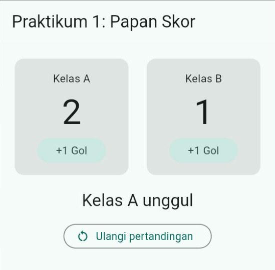
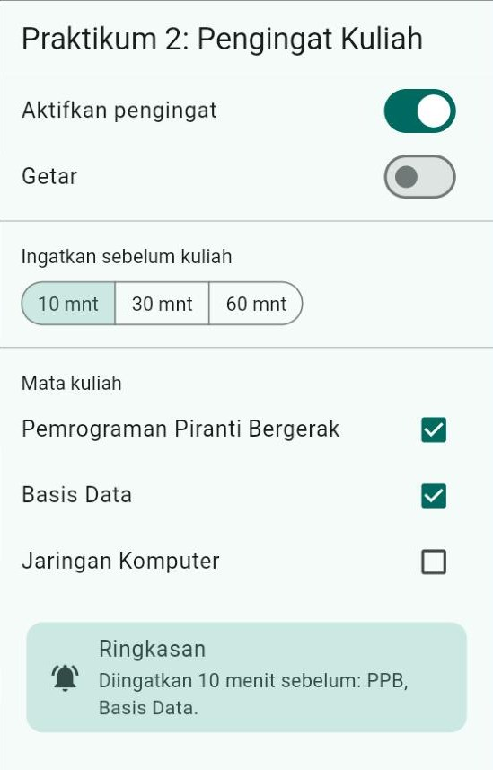
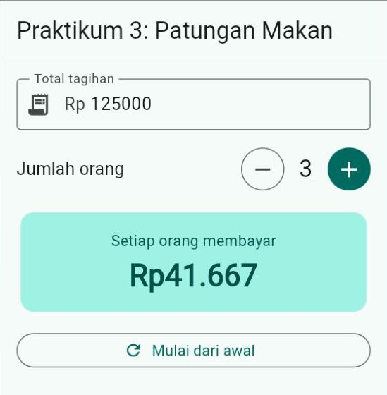
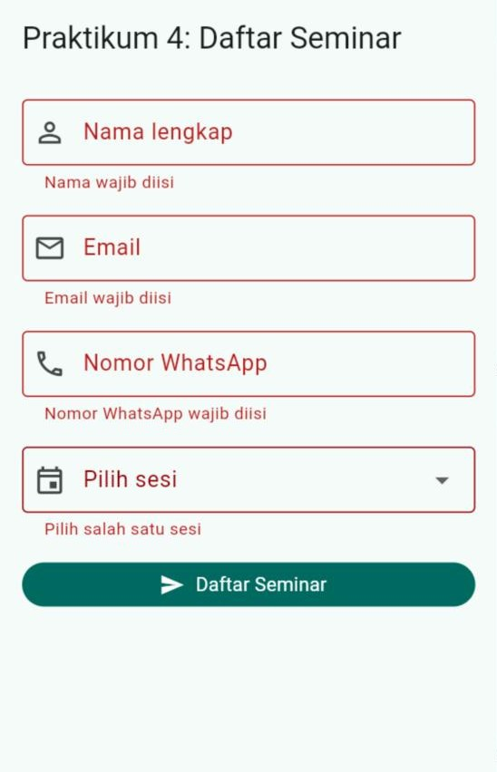
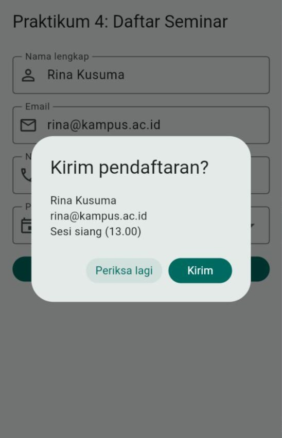
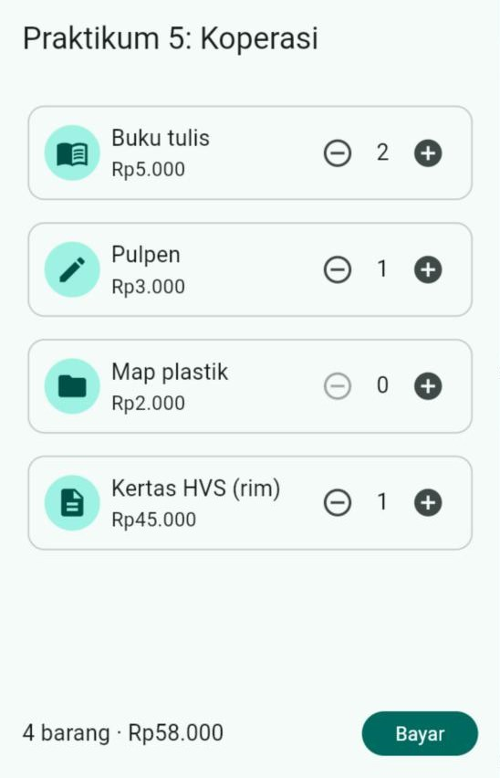

# 🧪 Jobsheet Pertemuan 5 — Interaksi Pengguna & *State* Lokal

[🏠 Beranda](../README.md) · [📖 Modul](README.md) · [✍️ Latihan](LATIHAN.md) · [💻 Kode Contoh](kode/)

| Informasi | Keterangan |
| :--- | :--- |
| Mata kuliah | Pemrograman Piranti Bergerak |
| Pertemuan | 5 — Interaksi Pengguna & *State* Lokal |
| Bentuk kegiatan | Praktikum individu |
| Estimasi waktu | 120–150 menit |
| Alat | DartPad **atau** proyek Flutter di VS Code yang dijalankan di Chrome |
| Hasil akhir | Aplikasi "Peminjaman Alat Lab" yang interaktif, memeriksa isian pengguna, dan nyaman dipakai di layar selebar 360 dan 320 |

---

## 🎯 Tujuan Praktikum

Setelah menyelesaikan jobsheet ini, Anda mampu:

1. Membuat `StatefulWidget` dan memperbarui tampilan dengan `setState()`.
2. Menonaktifkan tombol dan pemilih nilai sesuai keadaan, serta memberi umpan balik dengan `SnackBar`.
3. Mengumpulkan pilihan pengguna dengan `Switch`, `Checkbox`, `SegmentedButton`, dan `TextField`, lalu menyusun ringkasannya sebagai nilai turunan.
4. Membuat formulir dengan *validator*, *controller*, dan dialog konfirmasi yang aman dipakai bersama `await`.
5. Mengangkat *state* ke halaman induk dan menghubungkannya dengan widget anak lewat *callback*.

## 📌 Petunjuk Umum

> [!IMPORTANT]
> 1. Setiap praktikum diawali **kode terbimbing**. **Ketik sendiri** kodenya, kecuali bagian yang ditandai *boleh disalin*.
> 2. Jalankan, lalu **coba semua tombol, sakelar, dan kolomnya**. Hari ini hasil kerja Anda bisa bergerak, jadi mencocokkan gambar saja belum cukup.
> 3. Kerjakan **🔧 Modifikasi** di setiap praktikum. Jawaban berupa penjelasan ditulis sebagai **komentar** di dalam kode.
> 4. Simpan setiap praktikum sebagai berkas terpisah berisi kode **lengkap** (kerangka + halaman): `praktikum1.dart`, `praktikum2.dart`, dan seterusnya.
> 5. Rapikan kode sebelum menyimpan: tombol **Format** di DartPad, atau `Shift` + `Alt` + `F` di VS Code. Pastikan tidak ada garis merah maupun kuning.

> [!TIP]
> Gambar **✅ Hasil yang diharapkan** diambil pada layar selebar **360** setelah beberapa tombol ditekan. Keterangan di bawah setiap gambar menjelaskan tombol apa saja yang ditekan, jadi Anda bisa mengulanginya dan membandingkan hasilnya.

<details>
<summary>❓ Lupa cara menjalankan aplikasi Flutter?</summary>

- **DartPad:** buka <https://dartpad.dev>, hapus kode bawaannya, tempelkan kode Anda, lalu klik **Run**. Simpan hasil pekerjaan dengan menyalin kodenya ke berkas `.dart` di komputer Anda.
- **Proyek Flutter:** buka proyek latihan dari Pertemuan 1 di VS Code, ganti seluruh isi `lib/main.dart` dengan kode Anda, lalu jalankan dengan **F5** (atau `flutter run -d chrome` di terminal). Untuk *hot reload*, simpan berkas jika dijalankan dari VS Code, atau tekan `r` jika dijalankan dari terminal. Jika Anda mengubah **nilai awal** sebuah *state*, lakukan *hot restart* dengan menekan `R` di terminal ([Modul Bagian 2.6](README.md#26-hot-reload-tetap-menyimpan-state)).

Penjelasan lengkap ada di [Modul Pertemuan 1, Bagian 9](../pertemuan_01_pengenalan_flutter/README.md#9-menjalankan-aplikasi).
</details>

---

## Kerangka Aplikasi (dipakai di semua praktikum)

Kerangka ini sama seperti Pertemuan 4 (hanya warna benihnya diganti `Colors.teal`) dan **boleh disalin**:

```dart
import 'package:flutter/material.dart';

void main() {
  runApp(const AplikasiPraktikum());
}

class AplikasiPraktikum extends StatelessWidget {
  const AplikasiPraktikum({super.key});

  @override
  Widget build(BuildContext context) {
    return MaterialApp(
      debugShowCheckedModeBanner: false,
      theme: ThemeData(
        colorScheme: ColorScheme.fromSeed(seedColor: Colors.teal),
      ),
      home: const HalamanPraktikum(),
    );
  }
}
```

Di **bawah** kerangka tersebut, ketik halaman dari setiap praktikum. Mulai hari ini `HalamanPraktikum` berupa `StatefulWidget`, jadi terdiri atas **dua *class***: `HalamanPraktikum` dan `_HalamanPraktikumState` ([Modul Bagian 2.1](README.md#21-dua-class-yang-berpasangan)).

> [!TIP]
> Di VS Code, ketik `stful` lalu tekan Enter, kemudian ketik `HalamanPraktikum`. Kerangka kedua *class* langsung jadi, dan Anda tinggal mengisi bagian dalamnya.

---

## Praktikum 1 — Papan Skor Futsal

**Konsep:** `StatefulWidget`, `setState`, nilai turunan, dan `onPressed: null`. ([Modul Bagian 2](README.md#2-anatomi-statefulwidget))

```dart
class HalamanPraktikum extends StatefulWidget {
  const HalamanPraktikum({super.key});

  @override
  State<HalamanPraktikum> createState() => _HalamanPraktikumState();
}

class _HalamanPraktikumState extends State<HalamanPraktikum> {
  // State: skor kedua tim.
  int _skorA = 0;
  int _skorB = 0;

  void _golA() {
    setState(() {
      _skorA++;
    });
  }

  void _golB() {
    setState(() {
      _skorB++;
    });
  }

  void _ulangi() {
    setState(() {
      _skorA = 0;
      _skorB = 0;
    });
  }

  @override
  Widget build(BuildContext context) {
    final TextTheme gayaTeks = Theme.of(context).textTheme;

    // Nilai turunan: dihitung dari skor, tidak disimpan.
    final String status;
    if (_skorA == _skorB) {
      status = 'Skor sama kuat';
    } else if (_skorA > _skorB) {
      status = 'Kelas A unggul';
    } else {
      status = 'Kelas B unggul';
    }

    return Scaffold(
      appBar: AppBar(title: const Text('Praktikum 1: Papan Skor')),
      body: SingleChildScrollView(
        padding: const EdgeInsets.all(16),
        child: Column(
          spacing: 16,
          children: [
            Row(
              spacing: 16,
              children: [
                Expanded(
                  child: Card.filled(
                    child: Padding(
                      padding: const EdgeInsets.all(16),
                      child: Column(
                        spacing: 8,
                        children: [
                          const Text('Kelas A'),
                          Text('$_skorA', style: gayaTeks.displayMedium),
                          FilledButton.tonal(
                            onPressed: _golA,
                            child: const Text('+1 Gol'),
                          ),
                        ],
                      ),
                    ),
                  ),
                ),
                Expanded(
                  child: Card.filled(
                    child: Padding(
                      padding: const EdgeInsets.all(16),
                      child: Column(
                        spacing: 8,
                        children: [
                          const Text('Kelas B'),
                          Text('$_skorB', style: gayaTeks.displayMedium),
                          FilledButton.tonal(
                            onPressed: _golB,
                            child: const Text('+1 Gol'),
                          ),
                        ],
                      ),
                    ),
                  ),
                ),
              ],
            ),
            Text(status, style: gayaTeks.titleLarge),
            OutlinedButton.icon(
              // Nonaktif selama skor masih 0 - 0.
              onPressed: _skorA + _skorB > 0 ? _ulangi : null,
              icon: const Icon(Icons.restart_alt),
              label: const Text('Ulangi pertandingan'),
            ),
          ],
        ),
      ),
    );
  }
}
```

✅ **Hasil yang diharapkan** (setelah "+1 Gol" Kelas A ditekan dua kali dan Kelas B sekali):

<p align="center"></p>

Coba juga tekan **"Ulangi pertandingan"**: kedua skor kembali 0 dan tombol itu menjadi abu-abu lagi.

> [!NOTE]
> Perhatikan bahwa `status` **tidak disimpan** sebagai *state*. Kalimat itu dihitung ulang dari `_skorA` dan `_skorB` setiap kali `build()` berjalan, sehingga tidak mungkin berbeda dengan skornya ([Modul Bagian 5.5](README.md#55-nilai-turunan-ringkasan-dari-semua-pilihan)).

🔧 **Modifikasi:**

1. Tambahkan tombol **"−1"** (`OutlinedButton`) di bawah tombol "+1 Gol" pada setiap tim, untuk membatalkan gol yang salah catat. Tombol itu harus **nonaktif** jika skor timnya 0.
2. Ubah status agar menyebut selisih gol, misalnya **"Kelas A unggul 2 gol"**. (Petunjuk: `(_skorA - _skorB).abs()` menghasilkan selisih tanpa tanda minus.)
3. **Eksperimen:** hapus sementara `setState` di dalam `_golA`, sehingga isinya tinggal `_skorA++;`. Tekan "+1 Gol" Kelas A **tiga kali**, lalu tekan "+1 Gol" Kelas B **sekali**. Tulis sebagai komentar: apa yang Anda lihat setelah setiap tekanan, dan mengapa begitu. Kembalikan `setState` setelahnya.
4. Tampilkan `SnackBar` bertuliskan **"Gol untuk Kelas A!"** setiap kali Kelas A mencetak gol, begitu pula untuk Kelas B. Tutup dulu pesan yang lama dengan `hideCurrentSnackBar()` ([Modul Bagian 4.3](README.md#43-snackbar-pesan-singkat-di-bawah-layar)).
5. Jadikan nama tim sebagai **parameter**. `HalamanPraktikum` menerima `namaTimA` dan `namaTimB` (`final String`, `required`). Ubah `home:` di kerangka menjadi `const HalamanPraktikum(namaTimA: 'Informatika A', namaTimB: 'Sistem Informasi B')`, lalu tampilkan nama itu di kartu, status, dan `SnackBar` lewat `widget.namaTimA` dan `widget.namaTimB` ([Modul Bagian 2.3](README.md#23-membaca-pengaturan-dengan-widget)).

---

## Praktikum 2 — Pengingat Jadwal Kuliah

**Konsep:** `SwitchListTile`, `CheckboxListTile`, `SegmentedButton`, menonaktifkan pemilih nilai, dan ringkasan sebagai nilai turunan. ([Modul Bagian 5](README.md#5-memilih-nilai-switch-checkbox-dan-radio) dan [Bagian 6](README.md#6-memilih-nilai-segmentedbutton-slider-dan-chip))

```dart
class HalamanPraktikum extends StatefulWidget {
  const HalamanPraktikum({super.key});

  @override
  State<HalamanPraktikum> createState() => _HalamanPraktikumState();
}

class _HalamanPraktikumState extends State<HalamanPraktikum> {
  bool _pengingatAktif = true;
  bool _getar = false;
  int _menitSebelum = 30;
  bool _ppb = true;
  bool _basisData = false;
  bool _jaringan = false;

  @override
  Widget build(BuildContext context) {
    final ColorScheme warna = Theme.of(context).colorScheme;
    final TextTheme gayaTeks = Theme.of(context).textTheme;

    // Nilai turunan: daftar mata kuliah yang dicentang.
    final List<String> matkul = [
      if (_ppb) 'PPB',
      if (_basisData) 'Basis Data',
      if (_jaringan) 'Jaringan Komputer',
    ];

    final String ringkasan;
    if (!_pengingatAktif) {
      ringkasan = 'Pengingat dimatikan.';
    } else if (matkul.isEmpty) {
      ringkasan = 'Centang minimal satu mata kuliah.';
    } else {
      ringkasan =
          'Diingatkan $_menitSebelum menit sebelum: ${matkul.join(', ')}.';
    }

    return Scaffold(
      appBar: AppBar(title: const Text('Praktikum 2: Pengingat Kuliah')),
      body: SingleChildScrollView(
        child: Column(
          crossAxisAlignment: CrossAxisAlignment.start,
          children: [
            SwitchListTile(
              title: const Text('Aktifkan pengingat'),
              value: _pengingatAktif,
              onChanged: (bool nilaiBaru) {
                setState(() {
                  _pengingatAktif = nilaiBaru;
                });
              },
            ),
            SwitchListTile(
              title: const Text('Getar'),
              value: _getar,
              // Nonaktif jika pengingat dimatikan.
              onChanged: _pengingatAktif
                  ? (bool nilaiBaru) {
                      setState(() {
                        _getar = nilaiBaru;
                      });
                    }
                  : null,
            ),
            const Divider(),
            Padding(
              padding: const EdgeInsets.fromLTRB(16, 8, 16, 8),
              child: Text(
                'Ingatkan sebelum kuliah',
                style: gayaTeks.titleSmall,
              ),
            ),
            Padding(
              padding: const EdgeInsets.symmetric(horizontal: 16),
              child: SegmentedButton<int>(
                segments: const [
                  ButtonSegment<int>(value: 10, label: Text('10 mnt')),
                  ButtonSegment<int>(value: 30, label: Text('30 mnt')),
                  ButtonSegment<int>(value: 60, label: Text('60 mnt')),
                ],
                selected: {_menitSebelum},
                showSelectedIcon: false,
                // onSelectionChanged: null membuat seluruh tombol nonaktif.
                onSelectionChanged: _pengingatAktif
                    ? (Set<int> pilihan) {
                        setState(() {
                          _menitSebelum = pilihan.first;
                        });
                      }
                    : null,
              ),
            ),
            const SizedBox(height: 8),
            const Divider(),
            Padding(
              padding: const EdgeInsets.fromLTRB(16, 8, 16, 0),
              child: Text('Mata kuliah', style: gayaTeks.titleSmall),
            ),
            CheckboxListTile(
              title: const Text('Pemrograman Piranti Bergerak'),
              value: _ppb,
              onChanged: _pengingatAktif
                  ? (bool? nilaiBaru) {
                      setState(() {
                        _ppb = nilaiBaru ?? false;
                      });
                    }
                  : null,
            ),
            CheckboxListTile(
              title: const Text('Basis Data'),
              value: _basisData,
              onChanged: _pengingatAktif
                  ? (bool? nilaiBaru) {
                      setState(() {
                        _basisData = nilaiBaru ?? false;
                      });
                    }
                  : null,
            ),
            CheckboxListTile(
              title: const Text('Jaringan Komputer'),
              value: _jaringan,
              onChanged: _pengingatAktif
                  ? (bool? nilaiBaru) {
                      setState(() {
                        _jaringan = nilaiBaru ?? false;
                      });
                    }
                  : null,
            ),
            Padding(
              padding: const EdgeInsets.all(16),
              child: Card.filled(
                color: warna.secondaryContainer,
                child: ListTile(
                  // Isi di atas warna X memakai warna onX.
                  iconColor: warna.onSecondaryContainer,
                  textColor: warna.onSecondaryContainer,
                  leading: const Icon(Icons.notifications_active),
                  title: const Text('Ringkasan'),
                  subtitle: Text(ringkasan),
                ),
              ),
            ),
          ],
        ),
      ),
    );
  }
}
```

✅ **Hasil yang diharapkan** (setelah memilih "10 mnt" dan mencentang Basis Data):

<p align="center"></p>

Coba matikan sakelar **"Aktifkan pengingat"**. Sakelar getar, tombol menit, dan semua kotak centang langsung menjadi abu-abu, dan ringkasannya berubah menjadi "Pengingat dimatikan."

🔧 **Modifikasi:**

1. Tambahkan pilihan **"5 mnt"** sebagai segmen pertama.
2. Tambahkan mata kuliah keempat, **"Kalkulus"**, lengkap dengan variabel *state*-nya. Pastikan ringkasan ikut menampilkannya.
3. Beri ikon pada kedua `SwitchListTile` lewat properti `secondary`: `Icons.alarm` untuk pengingat dan `Icons.vibration` untuk getar.
4. Jika getar menyala, ringkasan diakhiri tulisan **"(dengan getar)"**, misalnya `Diingatkan 10 menit sebelum: PPB (dengan getar).`
5. **Tantangan:** ganti keempat variabel `bool` mata kuliah dengan satu `Set<String> _matkulDipilih` dan sebuah `const List<String> daftarMatkul` di luar *class*. Buat `CheckboxListTile`-nya dengan perulangan `for` di dalam *list*. Pola `Set` dengan `contains`, `add`, dan `remove` ada di [Modul Bagian 6.3](README.md#63-chip-pilihan-kecil-berbentuk-kapsul).

---

## Praktikum 3 — Kalkulator Patungan Makan

**Konsep:** `TextField` + `TextEditingController`, `onChanged`, `dispose()`, `int.tryParse`, dan nilai turunan. ([Modul Bagian 8](README.md#8-kolom-teks-textfield-dan-controller))

Fungsi `formatRupiah` di bagian atas **boleh disalin** (penjelasannya ada di [Modul Bagian 11.4](README.md#114-mengubah-angka-menjadi-format-rupiah)). Ketik sendiri sisanya.

```dart
// Mengubah 25000 menjadi "Rp25.000" (dari Modul Bagian 11.4).
String formatRupiah(int angka) {
  final String digit = angka.toString();
  String hasil = '';
  for (int i = 0; i < digit.length; i++) {
    final int sisaDiKanan = digit.length - i;
    if (i > 0 && sisaDiKanan % 3 == 0) {
      hasil += '.';
    }
    hasil += digit[i];
  }
  return 'Rp$hasil';
}

class HalamanPraktikum extends StatefulWidget {
  const HalamanPraktikum({super.key});

  @override
  State<HalamanPraktikum> createState() => _HalamanPraktikumState();
}

class _HalamanPraktikumState extends State<HalamanPraktikum> {
  final TextEditingController _kontrolTotal = TextEditingController();
  int _total = 0; // angka hasil membaca ketikan
  int _jumlahOrang = 2;

  @override
  void dispose() {
    _kontrolTotal.dispose();
    super.dispose();
  }

  // Nilai turunan: bagian setiap orang, dibulatkan ke atas.
  int get _perOrang => (_total / _jumlahOrang).ceil();

  void _mulaiLagi() {
    _kontrolTotal.clear();
    setState(() {
      _total = 0;
      _jumlahOrang = 2;
    });
  }

  @override
  Widget build(BuildContext context) {
    final ColorScheme warna = Theme.of(context).colorScheme;
    final TextTheme gayaTeks = Theme.of(context).textTheme;

    return Scaffold(
      appBar: AppBar(title: const Text('Praktikum 3: Patungan Makan')),
      body: SingleChildScrollView(
        padding: const EdgeInsets.all(16),
        child: Column(
          crossAxisAlignment: CrossAxisAlignment.stretch,
          spacing: 16,
          children: [
            TextField(
              controller: _kontrolTotal,
              keyboardType: TextInputType.number,
              decoration: const InputDecoration(
                labelText: 'Total tagihan',
                prefixText: 'Rp ',
                prefixIcon: Icon(Icons.receipt_long),
                border: OutlineInputBorder(),
              ),
              onChanged: (String teks) {
                setState(() {
                  // tryParse menghasilkan null jika teks bukan angka.
                  _total = int.tryParse(teks) ?? 0;
                });
              },
              onTapOutside: (_) =>
                  FocusManager.instance.primaryFocus?.unfocus(),
            ),
            Row(
              children: [
                Expanded(
                  child: Text('Jumlah orang', style: gayaTeks.titleMedium),
                ),
                IconButton.outlined(
                  tooltip: 'Kurangi',
                  onPressed: _jumlahOrang > 2
                      ? () {
                          setState(() {
                            _jumlahOrang--;
                          });
                        }
                      : null,
                  icon: const Icon(Icons.remove),
                ),
                SizedBox(
                  width: 40,
                  child: Text(
                    '$_jumlahOrang',
                    textAlign: TextAlign.center,
                    style: gayaTeks.titleLarge,
                  ),
                ),
                IconButton.filled(
                  tooltip: 'Tambah',
                  onPressed: () {
                    setState(() {
                      _jumlahOrang++;
                    });
                  },
                  icon: const Icon(Icons.add),
                ),
              ],
            ),
            Card.filled(
              color: warna.primaryContainer,
              child: Padding(
                padding: const EdgeInsets.all(16),
                child: Column(
                  spacing: 4,
                  children: [
                    Text(
                      'Setiap orang membayar',
                      style: TextStyle(color: warna.onPrimaryContainer),
                    ),
                    Text(
                      formatRupiah(_perOrang),
                      style: gayaTeks.headlineMedium?.copyWith(
                        color: warna.onPrimaryContainer,
                        fontWeight: FontWeight.bold,
                      ),
                    ),
                  ],
                ),
              ),
            ),
            OutlinedButton.icon(
              onPressed: _mulaiLagi,
              icon: const Icon(Icons.refresh),
              label: const Text('Mulai dari awal'),
            ),
          ],
        ),
      ),
    );
  }
}
```

✅ **Hasil yang diharapkan** (setelah mengetik `125000` dan menekan tombol + sekali):

<p align="center"></p>

Rp125.000 dibagi 3 sama dengan Rp41.666,67. Hasilnya dibulatkan **ke atas** dengan `.ceil()` menjadi Rp41.667, agar uang yang terkumpul tidak kurang dari tagihan.

Coba juga ketik huruf, misalnya `abc`. `int.tryParse` menghasilkan `null` untuk teks yang bukan angka, lalu `?? 0` mengubahnya menjadi 0, sehingga aplikasi tidak *error*.

🔧 **Modifikasi:**

1. Di laptop, kolom total masih bisa diisi huruf. Tambahkan `inputFormatters: [FilteringTextInputFormatter.digitsOnly]` pada `TextField`, beserta `import 'package:flutter/services.dart';` di baris paling atas berkas. Tulis sebagai komentar: apa bedanya sebelum dan sesudah perubahan ini?
2. Batasi jumlah orang paling banyak **10**: tombol + nonaktif saat jumlah orang sudah 10.
3. Tambahkan `SwitchListTile` **"Tambah ongkir Rp10.000"**. Jika menyala, ongkir ditambahkan ke total **sebelum** dibagi. Buat *getter* baru `_totalAkhir` agar perhitungannya tetap rapi.
4. Tambahkan tombol **"Bagikan ke grup"** (`TextButton.icon` dengan ikon `Icons.share`) yang menampilkan `SnackBar`, misalnya `Rp41.667 per orang untuk 3 orang`. Tombol ini nonaktif selama total masih 0.
5. Jawab sebagai komentar: tanpa `_kontrolTotal.dispose()`, aplikasi tetap berjalan seperti biasa. Mengapa `dispose()` tetap wajib ditulis?

---

## Praktikum 4 — Formulir Pendaftaran Seminar

**Konsep:** `Form`, `GlobalKey<FormState>`, `TextFormField` + *validator*, `DropdownButtonFormField`, dialog konfirmasi dengan `await`, dan `mounted`. ([Modul Bagian 9](README.md#9-formulir-dan-validasi) dan [Bagian 10](README.md#10-dialog-dan-bottom-sheet))

```dart
const List<String> daftarSesi = [
  'Sesi pagi (08.00)',
  'Sesi siang (13.00)',
  'Sesi daring (19.00)',
];

class HalamanPraktikum extends StatefulWidget {
  const HalamanPraktikum({super.key});

  @override
  State<HalamanPraktikum> createState() => _HalamanPraktikumState();
}

class _HalamanPraktikumState extends State<HalamanPraktikum> {
  final GlobalKey<FormState> _kunciForm = GlobalKey<FormState>();
  final TextEditingController _kontrolNama = TextEditingController();
  final TextEditingController _kontrolEmail = TextEditingController();
  final TextEditingController _kontrolWa = TextEditingController();
  String? _sesi;

  @override
  void dispose() {
    _kontrolNama.dispose();
    _kontrolEmail.dispose();
    _kontrolWa.dispose();
    super.dispose();
  }

  String? _cekNama(String? isian) {
    final String teks = isian?.trim() ?? '';
    if (teks.isEmpty) return 'Nama wajib diisi';
    if (teks.length < 3) return 'Nama minimal 3 huruf';
    return null;
  }

  String? _cekEmail(String? isian) {
    final String teks = isian?.trim() ?? '';
    if (teks.isEmpty) return 'Email wajib diisi';
    if (!teks.contains('@')) return 'Email harus mengandung @';
    return null;
  }

  String? _cekWa(String? isian) {
    final String teks = isian?.trim() ?? '';
    if (teks.isEmpty) return 'Nomor WhatsApp wajib diisi';
    if (teks.length < 10 || teks.length > 13) {
      return 'Panjang nomor 10-13 angka';
    }
    return null;
  }

  Future<void> _kirim() async {
    // 1) Periksa semua isian. Berhenti jika ada yang salah.
    if (!_kunciForm.currentState!.validate()) return;

    // 2) Minta konfirmasi, lalu TUNGGU jawabannya.
    final String nama = _kontrolNama.text.trim();
    final bool? setuju = await showDialog<bool>(
      context: context,
      builder: (BuildContext context) {
        return AlertDialog(
          title: const Text('Kirim pendaftaran?'),
          content: Text('$nama\n${_kontrolEmail.text.trim()}\n$_sesi'),
          actions: [
            TextButton(
              onPressed: () => Navigator.pop(context, false),
              child: const Text('Periksa lagi'),
            ),
            FilledButton(
              onPressed: () => Navigator.pop(context, true),
              child: const Text('Kirim'),
            ),
          ],
        );
      },
    );

    // 3) Halaman masih ada dan pengguna menekan "Kirim"?
    if (!mounted) return;
    if (setuju != true) return;

    // 4) Beri kabar, lalu kosongkan formulir.
    ScaffoldMessenger.of(context).showSnackBar(
      SnackBar(content: Text('Terima kasih, $nama. Sampai jumpa!')),
    );
    _kunciForm.currentState!.reset();
    setState(() {
      _sesi = null;
    });
  }

  @override
  Widget build(BuildContext context) {
    return Scaffold(
      appBar: AppBar(title: const Text('Praktikum 4: Daftar Seminar')),
      body: SingleChildScrollView(
        padding: const EdgeInsets.all(16),
        child: Form(
          key: _kunciForm,
          autovalidateMode: AutovalidateMode.onUserInteractionIfError,
          child: Column(
            crossAxisAlignment: CrossAxisAlignment.stretch,
            spacing: 16,
            children: [
              TextFormField(
                controller: _kontrolNama,
                textCapitalization: TextCapitalization.words,
                textInputAction: TextInputAction.next,
                decoration: const InputDecoration(
                  labelText: 'Nama lengkap',
                  prefixIcon: Icon(Icons.person_outline),
                  border: OutlineInputBorder(),
                ),
                validator: _cekNama,
              ),
              TextFormField(
                controller: _kontrolEmail,
                keyboardType: TextInputType.emailAddress,
                textInputAction: TextInputAction.next,
                decoration: const InputDecoration(
                  labelText: 'Email',
                  prefixIcon: Icon(Icons.email_outlined),
                  border: OutlineInputBorder(),
                ),
                validator: _cekEmail,
              ),
              TextFormField(
                controller: _kontrolWa,
                keyboardType: TextInputType.phone,
                decoration: const InputDecoration(
                  labelText: 'Nomor WhatsApp',
                  hintText: '08xxxxxxxxxx',
                  prefixIcon: Icon(Icons.phone_outlined),
                  border: OutlineInputBorder(),
                ),
                validator: _cekWa,
              ),
              DropdownButtonFormField<String>(
                decoration: const InputDecoration(
                  labelText: 'Pilih sesi',
                  prefixIcon: Icon(Icons.event_outlined),
                  border: OutlineInputBorder(),
                ),
                items: [
                  for (String sesi in daftarSesi)
                    DropdownMenuItem<String>(value: sesi, child: Text(sesi)),
                ],
                onChanged: (String? pilihan) {
                  setState(() {
                    _sesi = pilihan;
                  });
                },
                validator: (String? pilihan) {
                  if (pilihan == null) return 'Pilih salah satu sesi';
                  return null;
                },
              ),
              FilledButton.icon(
                onPressed: _kirim,
                icon: const Icon(Icons.send),
                label: const Text('Daftar Seminar'),
              ),
            ],
          ),
        ),
      ),
    );
  }
}
```

✅ **Hasil yang diharapkan:**

<p align="center">
  
  
</p>

Urutan uji yang disarankan:

1. Tekan **"Daftar Seminar"** saat formulir masih kosong. Semua kolom bergaris merah (gambar kiri).
2. Isi kolom satu per satu. Perhatikan bahwa pesan *error* sebuah kolom langsung hilang begitu isiannya benar.
3. Tekan lagi **"Daftar Seminar"**. Dialog konfirmasi muncul (gambar kanan). Tekan **"Periksa lagi"**: dialog tertutup dan isian tetap ada.
4. Tekan **"Daftar Seminar"** sekali lagi, lalu **"Kirim"**. Muncul `SnackBar` ucapan terima kasih, dan formulir kosong kembali.

🔧 **Modifikasi:**

1. Tambahkan kolom **"Asal kampus"** (wajib diisi, minimal 3 huruf) di antara Email dan Nomor WhatsApp, lengkap dengan *controller* dan `dispose()`-nya.
2. Perketat *validator* nomor WhatsApp: tolak nomor yang tidak diawali **08** dengan pesan `Nomor harus diawali 08`. (Petunjuk: `teks.startsWith('08')`.)
3. Tambahkan `FilteringTextInputFormatter.digitsOnly` pada kolom nomor WhatsApp, beserta `import`-nya.
4. Tampilkan juga **asal kampus** di dalam dialog konfirmasi.
5. Tambahkan tombol **"Kosongkan"** (`OutlinedButton`) di samping tombol daftar. Letakkan kedua tombol dalam `Row` dan bungkus masing-masing dengan `Expanded`. Sebelum `reset()`, tampilkan dialog **"Kosongkan semua isian?"** dengan pilihan **Batal** dan **Kosongkan**. Gunakan pola `await` + `mounted` seperti `_kirim()`.

---

## Praktikum 5 — Keranjang Koperasi Mahasiswa

**Konsep:** mengangkat *state*, `VoidCallback`, dan nilai turunan. ([Modul Bagian 11](README.md#11-mengangkat-state-lifting-state-up))

Praktikum ini terdiri atas tiga langkah. Salin Langkah 1, lalu ketik sendiri Langkah 2 dan 3 secara berurutan di bawah kerangka.

### Langkah 1 — Data produk (boleh disalin)

```dart
// ---------- Langkah 1: data produk (boleh disalin) ----------
class Produk {
  const Produk(this.nama, this.harga, this.ikon);

  final String nama;
  final int harga;
  final IconData ikon;
}

const List<Produk> daftarProduk = [
  Produk('Buku tulis', 5000, Icons.menu_book),
  Produk('Pulpen', 3000, Icons.edit),
  Produk('Map plastik', 2000, Icons.folder),
  Produk('Kertas HVS (rim)', 45000, Icons.description),
];

String formatRupiah(int angka) {
  final String digit = angka.toString();
  String hasil = '';
  for (int i = 0; i < digit.length; i++) {
    final int sisaDiKanan = digit.length - i;
    if (i > 0 && sisaDiKanan % 3 == 0) {
      hasil += '.';
    }
    hasil += digit[i];
  }
  return 'Rp$hasil';
}
```

### Langkah 2 — Widget anak tanpa *state*

`BarisProduk` hanya **menampilkan** jumlah yang diterimanya dan **melapor** lewat `onTambah` atau `onKurang` saat tombolnya ditekan:

```dart
// ---------- Langkah 2: widget ANAK, tanpa state ----------
class BarisProduk extends StatelessWidget {
  const BarisProduk({
    super.key,
    required this.produk,
    required this.jumlah,
    required this.onTambah,
    required this.onKurang,
  });

  final Produk produk;
  final int jumlah;
  final VoidCallback onTambah;
  final VoidCallback onKurang;

  @override
  Widget build(BuildContext context) {
    final TextTheme gayaTeks = Theme.of(context).textTheme;

    return Card.outlined(
      child: Padding(
        padding: const EdgeInsets.all(12),
        child: Row(
          spacing: 8,
          children: [
            CircleAvatar(child: Icon(produk.ikon)),
            Expanded(
              child: Column(
                crossAxisAlignment: CrossAxisAlignment.start,
                children: [
                  Text(produk.nama, style: gayaTeks.titleMedium),
                  Text(formatRupiah(produk.harga)),
                ],
              ),
            ),
            IconButton(
              tooltip: 'Kurangi',
              onPressed: jumlah > 0 ? onKurang : null,
              icon: const Icon(Icons.remove_circle_outline),
            ),
            Text('$jumlah', style: gayaTeks.titleMedium),
            IconButton(
              tooltip: 'Tambah',
              onPressed: onTambah,
              icon: const Icon(Icons.add_circle),
            ),
          ],
        ),
      ),
    );
  }
}
```

### Langkah 3 — Halaman induk, pemilik *state*

```dart
// ---------- Langkah 3: halaman INDUK, pemilik state ----------
class HalamanPraktikum extends StatefulWidget {
  const HalamanPraktikum({super.key});

  @override
  State<HalamanPraktikum> createState() => _HalamanPraktikumState();
}

class _HalamanPraktikumState extends State<HalamanPraktikum> {
  final List<int> _jumlah = List<int>.filled(daftarProduk.length, 0);

  int get _totalBarang {
    int hasil = 0;
    for (int n in _jumlah) {
      hasil += n;
    }
    return hasil;
  }

  int get _totalHarga {
    int hasil = 0;
    for (int i = 0; i < daftarProduk.length; i++) {
      hasil += daftarProduk[i].harga * _jumlah[i];
    }
    return hasil;
  }

  void _ubah(int indeks, int perubahan) {
    setState(() {
      _jumlah[indeks] += perubahan;
    });
  }

  @override
  Widget build(BuildContext context) {
    final TextTheme gayaTeks = Theme.of(context).textTheme;

    return Scaffold(
      appBar: AppBar(title: const Text('Praktikum 5: Koperasi')),
      body: SingleChildScrollView(
        padding: const EdgeInsets.all(16),
        child: Column(
          spacing: 8,
          children: [
            for (int i = 0; i < daftarProduk.length; i++)
              BarisProduk(
                produk: daftarProduk[i],
                jumlah: _jumlah[i],
                onTambah: () => _ubah(i, 1),
                onKurang: () => _ubah(i, -1),
              ),
          ],
        ),
      ),
      bottomNavigationBar: SafeArea(
        child: Padding(
          padding: const EdgeInsets.all(16),
          child: Row(
            children: [
              Expanded(
                child: Text(
                  '$_totalBarang barang · ${formatRupiah(_totalHarga)}',
                  style: gayaTeks.titleMedium,
                ),
              ),
              FilledButton(
                onPressed: _totalBarang > 0 ? () {} : null,
                child: const Text('Bayar'),
              ),
            ],
          ),
        ),
      ),
    );
  }
}
```

✅ **Hasil yang diharapkan** (setelah menambah 2 buku tulis, 1 pulpen, dan 1 rim kertas HVS):

<p align="center"></p>

Cek manual: 2 × Rp5.000 + 1 × Rp3.000 + 1 × Rp45.000 = **Rp58.000**.

🔧 **Modifikasi:**

1. Tambahkan produk kelima, misalnya **Stabilo** seharga Rp7.000 dengan ikon `Icons.brush`. Perhatikan bahwa Anda cukup menambah **satu baris** di `daftarProduk`. Setelah itu lakukan ***hot restart*** (bukan *hot reload*): panjang daftar `_jumlah` baru ikut menjadi 5 jika objek *State* dibuat ulang ([Modul Bagian 2.6](README.md#26-hot-reload-tetap-menyimpan-state)). Tanpa *hot restart*, layar merah `RangeError` akan muncul.
2. Di bawah harga satuan, tampilkan **subtotal** baris tersebut, misalnya `Subtotal Rp10.000`, hanya jika jumlahnya lebih dari 0. (Petunjuk: `if (jumlah > 0) Text(...)` di dalam `children` milik `Column`.)
3. Tambahkan properti **`stok`** (`int`) pada `Produk`, lalu isi stok setiap produk. Tombol + di `BarisProduk` harus nonaktif jika jumlahnya sudah sama dengan stok.
4. Buat tombol **"Bayar"** benar-benar bekerja: tampilkan `SnackBar` `Pembayaran Rp58.000 berhasil` (sesuai totalnya), lalu kosongkan keranjang dengan `fillRange` ([Modul Bagian 11.3](README.md#113-total-sebagai-nilai-turunan)).
5. Jawab sebagai komentar: mengapa `BarisProduk` cukup berupa `StatelessWidget`, padahal angka jumlah yang ditampilkannya bisa berubah?

---

## 🏆 Tugas Mandiri — Formulir Peminjaman Alat Lab

Laboratorium Rekayasa Perangkat Lunak ingin mengganti formulir kertas peminjaman alat dengan sebuah aplikasi. Buat **satu aplikasi utuh** bernama `p05_nim_namapanggilan.dart` (huruf kecil semua, misalnya `p05_2609106001_rina.dart`) dengan ketentuan berikut:

1. Judul `AppBar` **"Peminjaman Alat Lab"**. Warna benih tema bebas.
2. Formulir memakai `Form` + `GlobalKey<FormState>`, berisi kolom **Nama** (wajib, minimal 3 huruf) dan **NIM** (hanya angka, tepat 10 digit). Keduanya memakai *controller* yang dibuang di `dispose()`.
3. **Alat** dipilih dengan `DropdownButtonFormField` berisi minimal **4** pilihan, dan wajib dipilih.
4. **Jumlah unit** (1 sampai 3) memakai **widget buatan sendiri** berupa `StatelessWidget` yang menerima jumlah dan dua `VoidCallback`. *State*-nya tetap disimpan di halaman.
5. **Lama peminjaman** 1 sampai 7 hari memakai `Slider` dengan `divisions`. Angka harinya terlihat di layar.
6. **Perlengkapan tambahan** berupa minimal **3** `FilterChip` (boleh memilih lebih dari satu).
7. `SwitchListTile` **"Perlu didampingi asisten"**.
8. **Kartu ringkasan** yang berubah saat itu juga setiap kali pilihan berubah: alat, jumlah, lama, perlengkapan, dan pendampingan. Ringkasan harus berupa **nilai turunan**, tidak disimpan di variabel *state* tersendiri.
9. Tombol **"Ajukan"**: jalankan validasi → tampilkan dialog konfirmasi berisi ringkasan → jika disetujui, tampilkan `SnackBar` dan kembalikan **semua** isian ke keadaan awal. Periksa `mounted` setelah `await`.
10. **Lolos uji layar sempit dan rapi:** pada lebar **360** dan **320** tidak ada garis kuning-hitam, termasuk saat dialog tampil. Kode diformat, memakai `const` di tempat yang memungkinkan, dan tanpa tanda peringatan di editor.

Contoh rancangan (susunan dan isinya boleh dikreasikan):

```text
┌────────────────────────────────────┐
│ Peminjaman Alat Lab                │ ← AppBar
├────────────────────────────────────┤
│ ┌ Nama ──────────────────────────┐ │ ← TextFormField + validator
│ └────────────────────────────────┘ │
│ ┌ NIM ───────────────────────────┐ │ ← hanya angka, 10 digit
│ └────────────────────────────────┘ │
│ ┌ Alat ─────────────────────── ▾ ┐ │ ← DropdownButtonFormField
│ └────────────────────────────────┘ │
│ Jumlah unit          (−)  2  (+)   │ ← widget buatan sendiri
│ Lama peminjaman: 3 hari            │
│ ─────────●──────────────           │ ← Slider
│ Perlengkapan tambahan              │
│ [✓ Kabel USB] [Adaptor] [Tas]      │ ← FilterChip
│ Perlu didampingi asisten     [  ○] │ ← SwitchListTile
│ ┌────────────────────────────────┐ │
│ │ Ringkasan                      │ │ ← nilai turunan
│ │ Arduino Uno × 2 selama 3 hari  │ │
│ │ + Kabel USB, tanpa pendamping  │ │
│ └────────────────────────────────┘ │
│ [            Ajukan            ]   │ ← validasi → dialog → SnackBar
└────────────────────────────────────┘
```

> [!TIP]
> - Kerjakan **bertahap**: formulir dan validasinya dulu, lalu pemilih nilai satu per satu, lalu ringkasan, terakhir tombol "Ajukan". Jalankan setiap kali satu bagian selesai.
> - Tuliskan dulu **daftar *state*** dan **daftar nilai turunan** di kertas, seperti tabel di [Modul Bagian 12.1](README.md#121-daftar-state-dan-nilai-turunan).
> - Setelah selesai, uji seperti pengguna sungguhan: tekan "Ajukan" saat kosong, isi NIM dengan huruf, batalkan dialog, lalu ajukan sampai berhasil.

---

## 📤 Pengumpulan

Kumpulkan melalui tempat yang ditentukan dosen:

1. Berkas `praktikum1.dart` sampai `praktikum5.dart` yang **sudah berisi modifikasi**, termasuk jawaban berupa komentar.
2. Berkas tugas mandiri `p05_nim_namapanggilan.dart`.
3. *Screenshot* tugas mandiri: (a) formulir yang sudah terisi pada lebar **360** dan **320**, (b) dialog konfirmasi, dan (c) `SnackBar` setelah pengajuan berhasil.

## 📊 Kriteria Penilaian

| Aspek | Indikator | Skor maks. |
| :--- | :--- | :---: |
| Praktikum 1–5 | Semua modifikasi dikerjakan dan berjalan benar (masing-masing 8 poin) | 40 |
| Tugas mandiri: kelengkapan | Ketentuan 1–8 terpenuhi | 25 |
| Tugas mandiri: alur pengajuan | Ketentuan 9: isian salah ditolak, dialog konfirmasi, `SnackBar`, semua isian kembali ke awal, dan `mounted` diperiksa | 20 |
| Kerapian dan uji layar | Ketentuan 10: tanpa *overflow* di 360 dan 320 (termasuk dialog), kode terformat, `const` dipakai dengan tepat, tanpa peringatan | 15 |
| **Total** | | **100** |

## 💭 Refleksi

1. Dengan kata-kata Anda sendiri, apa itu *state*? Sebutkan tiga *state* dan satu nilai turunan dari tugas mandiri Anda.
2. Mengapa jumlah unit disimpan di halaman, bukan di dalam widget tombol jumlah buatan Anda?
3. Ceritakan satu masalah yang baru Anda temukan **setelah mencoba aplikasinya** (bukan saat membaca kode), lalu jelaskan cara Anda memperbaikinya.

---

[⬅️ Kembali ke Modul](README.md) · [✍️ Lanjut ke Latihan](LATIHAN.md) · [🏠 Beranda](../README.md)
