# Pertemuan 5 — Interaksi Pengguna & *State* Lokal

> 📖 **Modul bacaan** · ⏱️ ± 100 menit · 🎯 Untuk pemula
>
> **Bekal yang dibutuhkan:** sudah mengikuti [Pertemuan 3](../pertemuan_03_dart_lanjutan/README.md) (*class*, *getter*, `enum`, `async`/`await`) dan [Pertemuan 4](../pertemuan_04_widget_dan_layout/README.md) (menyusun tampilan dengan `Row`, `Column`, `Card`, serta memecah halaman menjadi widget kecil).
> **Hasil akhir hari ini:** halaman "Pesan Menu Kantin" dari Pertemuan 4 benar-benar bisa dipakai: memilih porsi dan level pedas, menambah *topping*, menulis catatan, mengubah jumlah, melihat total harga yang ikut berubah, lalu mengonfirmasi pesanan.

[🏠 Beranda](../README.md) · [📋 Silabus](../SILABUS.md) · [🧪 Jobsheet](JOBSHEET.md) · [✍️ Latihan](LATIHAN.md) · [💻 Kode Contoh](kode/) · [📊 Unduh Slide](https://raw.githubusercontent.com/antonprafanto/mobile2026/main/pertemuan_05_interaksi_dan_state/slide/PERTEMUAN_05_Interaksi_dan_State.pptx)

---

## Daftar Isi

1. [Apa Itu *State*?](#1-apa-itu-state)
2. [Anatomi `StatefulWidget`](#2-anatomi-statefulwidget)
3. [Tombol-Tombol Material 3](#3-tombol-tombol-material-3)
4. [Menangkap Sentuhan dan Memberi Umpan Balik](#4-menangkap-sentuhan-dan-memberi-umpan-balik)
5. [Memilih Nilai: `Switch`, `Checkbox`, dan `Radio`](#5-memilih-nilai-switch-checkbox-dan-radio)
6. [Memilih Nilai: `SegmentedButton`, `Slider`, dan *Chip*](#6-memilih-nilai-segmentedbutton-slider-dan-chip)
7. [Siklus Hidup *State*](#7-siklus-hidup-state)
8. [Kolom Teks: `TextField` dan *Controller*](#8-kolom-teks-textfield-dan-controller)
9. [Formulir dan Validasi](#9-formulir-dan-validasi)
10. [Dialog dan *Bottom Sheet*](#10-dialog-dan-bottom-sheet)
11. [Mengangkat *State* (*Lifting State Up*)](#11-mengangkat-state-lifting-state-up)
12. [Studi Kasus: Memesan Menu Kantin](#12-studi-kasus-memesan-menu-kantin)
13. [Menulis Kode *State* yang Rapi](#13-menulis-kode-state-yang-rapi)
14. [Kesalahan Umum Pemula](#14-kesalahan-umum-pemula-dan-solusinya)
15. [Ringkasan](#15-ringkasan) · [Glosarium](#16-glosarium) · [Referensi](#17-referensi)

---

## 🎯 Tujuan Pembelajaran

Setelah mempelajari modul ini, Anda mampu:

1. Menjelaskan arti *state* dan menentukan kapan memakai `StatelessWidget` atau `StatefulWidget`.
2. Membuat `StatefulWidget` dan memperbarui tampilannya dengan `setState()`.
3. Memilih jenis tombol Material 3 yang tepat dan menonaktifkan tombol dengan `onPressed: null`.
4. Menangkap ketukan dengan `InkWell` dan `GestureDetector`, serta memberi umpan balik dengan `SnackBar`.
5. Memakai widget pemilih nilai: `Switch`, `Checkbox`, `Radio`, `SegmentedButton`, `Slider`, dan *chip*.
6. Menjelaskan urutan siklus hidup *State* (`initState`, `build`, `didUpdateWidget`, `dispose`) beserta kegunaannya.
7. Membaca, mengisi, dan mengosongkan kolom teks memakai `TextEditingController`, lalu membuangnya di `dispose()`.
8. Membuat formulir dengan `Form`, `TextFormField`, dan *validator*.
9. Menampilkan dialog dan *bottom sheet*, lalu memakai jawabannya dengan `await` dan pemeriksaan `mounted`.
10. Mengangkat *state* ke widget induk dan menerima laporan dari widget anak lewat *callback*.

## 🗺️ Peta Materi Hari Ini

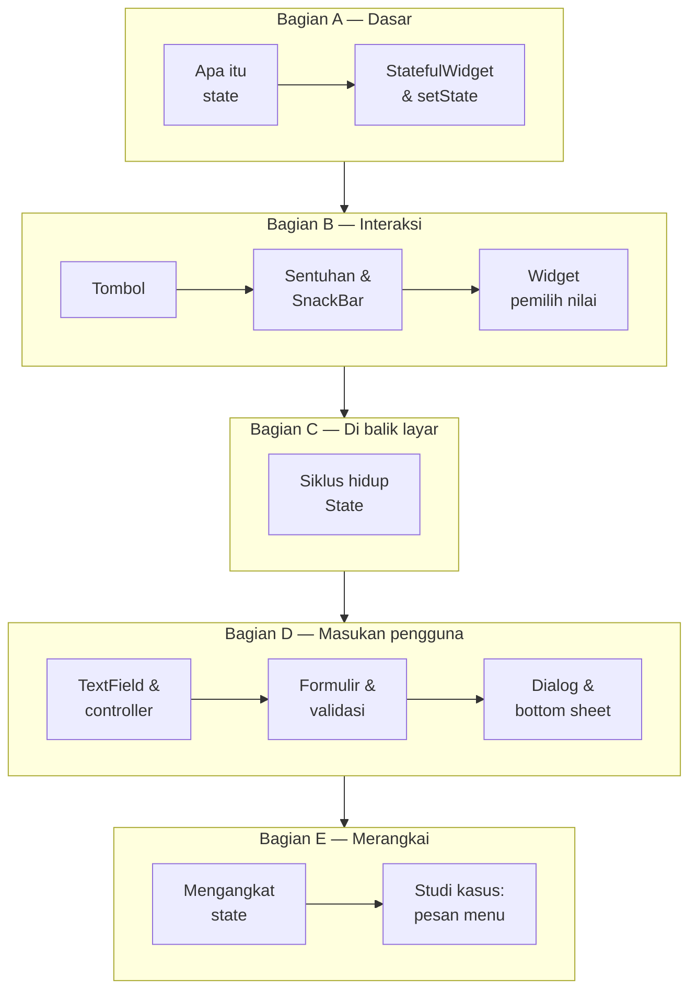

Bagian A menjelaskan **apa itu *state*** dan cara Flutter memperbarui layar. Bagian B membuat aplikasi **menanggapi sentuhan**. Bagian C mengintip **perjalanan hidup** sebuah *State*. Bagian D menerima **ketikan dan pilihan** pengguna dengan aman. Bagian E merangkai semuanya menjadi halaman yang **benar-benar bekerja**.

### Cara menjalankan contoh hari ini

Setiap berkas di folder [`kode/`](kode/) adalah **satu aplikasi utuh**. Ada dua cara menjalankannya:

| Cara | Langkah |
| :--- | :--- |
| **DartPad** (tanpa instalasi) | Buka <https://dartpad.dev>, hapus kode bawaannya, tempelkan isi berkas contoh, lalu klik **Run**. |
| **Proyek Flutter di laptop** | Buka proyek latihan Anda dari Pertemuan 1 dan ganti seluruh isi `lib/main.dart` dengan isi berkas contoh. Jalankan dari VS Code (**F5**), atau dari terminal dengan `flutter run -d chrome`. Untuk *hot reload*: jika dijalankan dari VS Code, cukup simpan berkas (Ctrl+S); jika dari terminal, tekan `r` di terminal. |

> [!TIP]
> Hari ini Anda akan **banyak menekan, menggeser, dan mengetik**. Jangan hanya membaca kodenya: jalankan setiap contoh, coba semua tombolnya, lalu ubah sedikit kodenya dan lihat apa yang terjadi. Gambar hasil di modul ini diambil pada layar selebar **360 piksel logis**, seperti pada Pertemuan 4.

---

## 1. Apa Itu *State*?

### 1.1 Analogi papan skor

Bayangkan papan skor pertandingan futsal antarkelas. Bentuk papannya (tulisan "TIM A" dan "TIM B", warna, dan ukuran angka) **tidak berubah** selama pertandingan. Yang berubah hanyalah **angka skornya**. Setiap kali terjadi gol, petugas mengganti angka itu, dan penonton langsung melihat skor terbaru.

Aplikasi juga begitu:

- **Bentuk tampilan** (judul, ikon, susunan `Row` dan `Column`) ditulis di kode dan relatif tetap.
- **Data yang bisa berubah selama aplikasi dibuka, dan perubahannya harus terlihat di layar**, disebut ***state*** (keadaan).

Contoh *state* di aplikasi sehari-hari: angka penghitung, status kotak centang, isi kolom yang sedang diketik, ukuran gelas yang dipilih, daftar tugas yang bisa dihapus, atau apakah sebuah kartu sedang ditampilkan.

### 1.2 Rumus inti Flutter: tampilan = f(*state*)

Di Flutter kita **tidak** memberi perintah "ganti tulisan angka itu menjadi 3". Kita cukup **mengubah datanya**, lalu Flutter **menggambar ulang** tampilan berdasarkan data terbaru. Tampilan adalah hasil "fungsi" dari *state*.

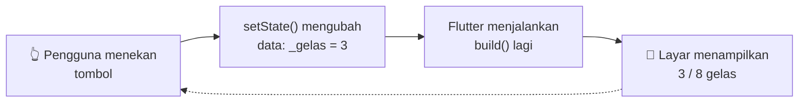

Gaya ini disebut **deklaratif**: kita *menyatakan* "jika jumlah gelas 3, tampilkan tulisan 3 / 8 gelas", bukan *memerintah* langkah demi langkah cara mengubah layar. Keuntungannya, tampilan **tidak mungkin berbeda** dengan datanya.

### 1.3 Mengapa `StatelessWidget` tidak cukup?

Pada Pertemuan 1 dan 4, semua halaman memakai `StatelessWidget`. Bagaimana kalau kita menaruh variabel penghitung di dalamnya?

```dart
// ❌ JANGAN ditiru
class Penghitung extends StatelessWidget {
  Penghitung({super.key});

  int angka = 0; // tidak final!

  @override
  Widget build(BuildContext context) {
    return TextButton(
      onPressed: () => angka++, // angka berubah, tetapi layar TIDAK
      child: Text('$angka'),
    );
  }
}
```

Ada tiga masalah:

1. Penganalisis kode langsung memberi peringatan `must_be_immutable`. Semua properti `StatelessWidget` wajib `final`, karena widget dirancang **tidak berubah** (Pertemuan 4, Bagian 11).
2. Saat `angka++` dijalankan, **tidak ada yang memberi tahu Flutter** bahwa layar perlu digambar ulang. Angka di memori berubah, tetapi tulisan di layar tetap `0`.
3. Setiap kali induknya digambar ulang, Flutter membuat objek `Penghitung` yang **baru**, sehingga `angka` kembali ke `0`.

Solusinya adalah **`StatefulWidget`**: datanya disimpan di objek terpisah yang **tetap hidup** walaupun tampilannya digambar berkali-kali, dan ada "bel pemberi tahu" bernama `setState()`.

### 1.4 *Stateless* atau *Stateful*?

| Pertanyaan | Jika **ya**, pakai | Contoh |
| :--- | :--- | :--- |
| Adakah data di widget ini yang **berubah karena sentuhan pengguna atau waktu**, dan perubahannya harus terlihat? | `StatefulWidget` | Penghitung, formulir, kotak centang, pengatur waktu |
| Apakah semua yang ditampilkan **hanya berasal dari parameter** dan tidak pernah berubah sendiri? | `StatelessWidget` | Judul, kartu informasi, `KartuStatistik` dari Pertemuan 4 |

> [!TIP]
> Mulailah dengan `StatelessWidget`. Ubah menjadi `StatefulWidget` **hanya jika** memang ada data yang perlu berubah. Widget *stateless* lebih ringan dan lebih mudah dipahami.

### 1.5 *State* lokal dan *state* aplikasi

Dokumentasi Flutter membedakan dua jenis *state*:

| | *State* lokal (*ephemeral state*) | *State* aplikasi (*app state*) |
| :--- | :--- | :--- |
| Dipakai oleh | Satu widget atau satu halaman saja | Banyak halaman sekaligus |
| Contoh | Tab yang dipilih, isi kolom teks, status centang, kartu yang sedang dibuka | Isi keranjang belanja, data pengguna yang sedang masuk, daftar favorit |
| Alat yang dipakai | `StatefulWidget` + `setState` (**hari ini**) | `ChangeNotifier` + `provider` (**Pertemuan 9**) |

Batas keduanya tidak selalu tegas. Kebiasaan yang baik: mulai dari *state* lokal, lalu "naikkan" *state* ketika ternyata dibutuhkan oleh lebih dari satu widget. Langkah pertamanya Anda pelajari di [Bagian 11](#11-mengangkat-state-lifting-state-up).

**🧠 Cek Cepat:** Mana yang termasuk *state*? (a) judul `AppBar` "Pengaturan", (b) posisi sakelar notifikasi, (c) warna dasar tema dari `seedColor`, (d) isi kolom pencarian yang sedang diketik.

<details>
<summary>Lihat jawaban</summary>

**(b) dan (d).** Keduanya berubah karena tindakan pengguna dan perubahannya harus terlihat di layar. Judul `AppBar` dan warna tema ditulis tetap di kode, jadi bukan *state*.
</details>

---

## 2. Anatomi `StatefulWidget`

Kode lengkap: [`kode/contoh_01_stateful_dasar.dart`](kode/contoh_01_stateful_dasar.dart). Aplikasi "Pengingat Minum Air" ini menghitung gelas air yang sudah diminum. Setiap kali tombol ditekan, angka bertambah dan garis progres makin penuh.

<p align="center">
  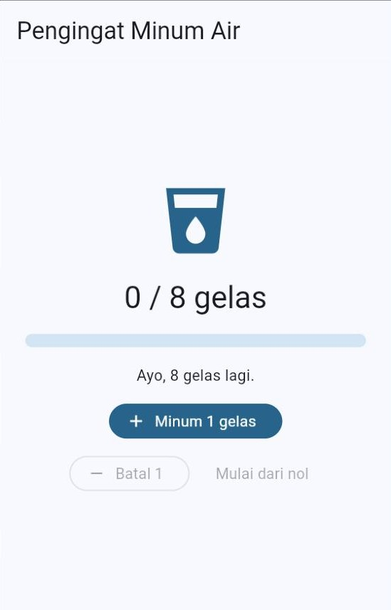
  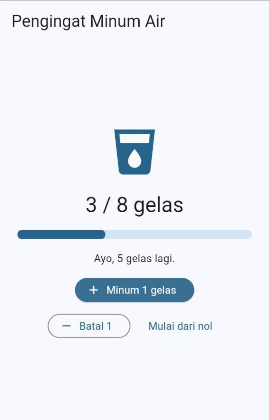
  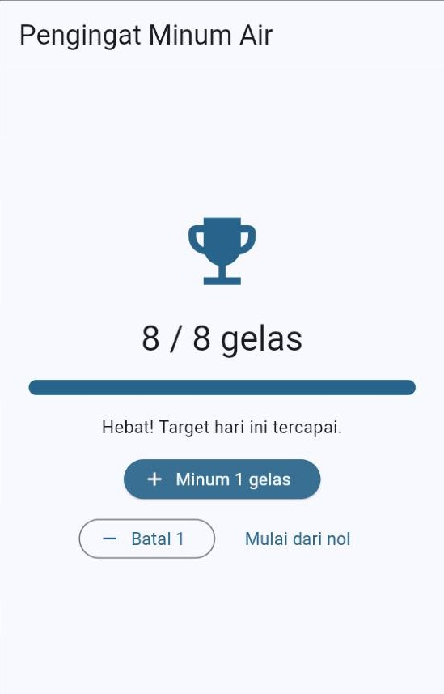
</p>

### 2.1 Dua *class* yang berpasangan

Sebuah `StatefulWidget` selalu terdiri atas **dua *class***:

```dart
// BAGIAN 1: class widget = "kartu identitas" (tidak berubah)
class HalamanMinumAir extends StatefulWidget {
  const HalamanMinumAir({super.key, required this.target});

  final int target; // pengaturan dari luar, final

  @override
  State<HalamanMinumAir> createState() => _HalamanMinumAirState();
}

// BAGIAN 2: class State = "buku catatan" (isinya boleh berubah)
class _HalamanMinumAirState extends State<HalamanMinumAir> {
  int _gelas = 0; // INILAH state-nya: tidak final

  @override
  Widget build(BuildContext context) {
    // (disingkat) ... menampilkan '$_gelas / ${widget.target} gelas'
  }
}
```

| | *Class* widget (`HalamanMinumAir`) | *Class State* (`_HalamanMinumAirState`) |
| :--- | :--- | :--- |
| Isinya | Pengaturan dari luar (`target`) | Data yang berubah (`_gelas`) dan *method* `build()` |
| Boleh berubah? | Tidak, semua properti `final` | Ya |
| Umurnya | Dibuat ulang setiap kali induknya digambar ulang | **Tetap hidup** selama widget masih ada di layar |
| Analogi | Kartu identitas | Buku catatan |

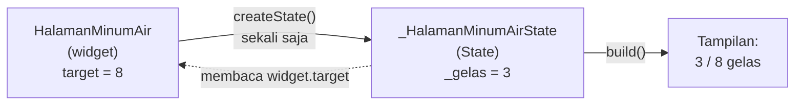

Beberapa hal yang perlu diperhatikan:

- **`createState()`** dipanggil Flutter **sekali** ketika widget pertama kali muncul. Isinya cukup mengembalikan objek *State* baru. Jangan menaruh perintah lain di sana (aturan *linter* `no_logic_in_create_state`).
- Tipe kembaliannya ditulis `State<HalamanMinumAir>`, bukan `_HalamanMinumAirState`. *Class* yang namanya diawali garis bawah bersifat **privat** (Pertemuan 3), sehingga sebaiknya tidak dipakai sebagai tipe pada bagian kode yang bisa diakses berkas lain (aturan *linter* `library_private_types_in_public_api`). Ikuti saja pola ini setiap kali.
- **`build()` pindah ke *class State***, bukan lagi di *class* widget.

> [!TIP]
> Di VS Code, ketik **`stful`** lalu tekan Enter. Kerangka dua *class* di atas dibuat otomatis. Cukup ketik nama widgetnya sekali, nama *class State* ikut menyesuaikan.

### 2.2 `setState()`: "Flutter, datanya berubah!"

```dart
void _tambahGelas() {
  setState(() {
    _gelas++;
  });
}
```

Saat `_tambahGelas()` dipanggil, terjadi empat langkah:

1. Fungsi di dalam `setState(() { ... })` dijalankan: `_gelas` bertambah 1.
2. Flutter menandai widget ini **"perlu digambar ulang"**.
3. Pada *frame* berikutnya (hanya beberapa milidetik kemudian), Flutter menjalankan `build()` lagi dengan nilai `_gelas` yang baru.
4. Flutter membandingkan hasil `build()` yang baru dengan yang lama, lalu **hanya memperbarui bagian layar yang berubah**.

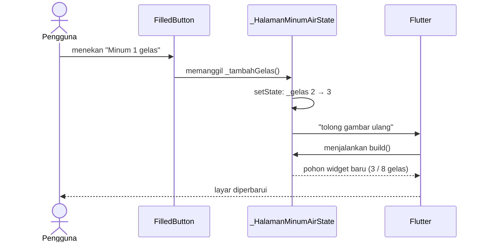

> [!IMPORTANT]
> Ubah data **di dalam** `setState`. Jika Anda menulis `_gelas++;` tanpa `setState`, nilainya memang berubah di memori, tetapi **layar tidak ikut berubah**, sehingga aplikasi terlihat macet.

### 2.3 Membaca pengaturan dengan `widget.`

```dart
final bool tercapai = _gelas >= widget.target;
// Progres bermakna 0 (kosong) sampai 1 (penuh).
final double progres = tercapai ? 1 : _gelas / widget.target;
```

Objek *State* punya properti bernama **`widget`** yang menunjuk ke objek widget pasangannya (yang terbaru). Jadi `widget.target` berisi angka `8` yang dikirim dari `HalamanMinumAir(target: 8)` di `MaterialApp`.

`LinearProgressIndicator(value: progres)` menggambar garis progres. Nilainya bermakna `0` (kosong) sampai `1` (penuh); nilai di luar rentang itu otomatis dipotong oleh Flutter. Saat target tercapai, progres langsung ditulis `1` agar maksud kodenya jelas.

### 2.4 Menonaktifkan tombol dengan `onPressed: null`

```dart
OutlinedButton.icon(
  // onPressed: null membuat tombol nonaktif (abu-abu).
  onPressed: _gelas > 0 ? _kurangiGelas : null,
  icon: const Icon(Icons.remove),
  label: const Text('Batal 1'),
),
```

Jika `onPressed` bernilai `null`, tombol otomatis tampil abu-abu dan tidak bisa ditekan. Dengan operator `? :` (Pertemuan 2), tombol "Batal 1" hanya aktif jika sudah ada gelas yang diminum, sehingga `_gelas` tidak mungkin menjadi negatif. Cara ini lebih baik daripada membiarkan tombol aktif lalu memeriksanya di dalam fungsi: pengguna langsung **melihat** bahwa aksi itu belum tersedia.

### 2.5 Nama fungsi tanpa tanda kurung

| Penulisan | Artinya | Hasil |
| :--- | :--- | :--- |
| `onPressed: _tambahGelas` | "Ini fungsinya. Jalankan **nanti** saat tombol ditekan." | ✅ Benar |
| `onPressed: () => _tambahGelas()` | Fungsi tanpa nama yang memanggil `_tambahGelas` saat tombol ditekan | ✅ Benar (berguna jika perlu mengirim argumen) |
| `onPressed: _tambahGelas()` | Jalankan fungsinya **sekarang** (saat `build()`), lalu berikan hasilnya ke `onPressed` | ❌ Error `This expression has a type of 'void' so its value can't be used.` |

### 2.6 *Hot reload* tetap menyimpan *state*

Saat Anda mengubah kode lalu menyimpan berkas (*hot reload*), Flutter menjalankan `build()` ulang **tanpa** membuat objek *State* baru. Akibatnya nilai `_gelas` **tetap**. Ini sangat membantu: Anda bisa mengganti warna tombol tanpa mengulang dari 0 gelas.

Sebaliknya, jika Anda mengubah **nilai awal**, misalnya `int _gelas = 0;` menjadi `int _gelas = 5;`, *hot reload* tidak memakainya karena objek *State* yang lama masih hidup. Lakukan ***hot restart***: tekan `R` (huruf besar) di terminal, atau **Ctrl+Shift+F5** di VS Code. Di DartPad, setiap kali Anda menekan **Run**, aplikasi selalu mulai dari awal.

**🧠 Cek Cepat:** Apa yang terlihat jika tombol "Minum 1 gelas" ditekan 10 kali?

<details>
<summary>Lihat jawaban</summary>

Tulisannya menjadi **"10 / 8 gelas"**, ikonnya berubah menjadi piala, dan muncul pesan "Hebat! Target hari ini tercapai." Garis progres tetap penuh, karena kode langsung memberi nilai `1` saat target tercapai (Flutter juga tidak pernah menggambar garis lebih dari 100%). Tombol "Minum 1 gelas" memang sengaja tidak dinonaktifkan, sebab minum lebih dari target tetap boleh.
</details>

---

## 3. Tombol-Tombol Material 3

Kode lengkap: [`kode/contoh_02_jenis_tombol.dart`](kode/contoh_02_jenis_tombol.dart). Setiap tombol yang ditekan namanya ditampilkan di kartu "Terakhir ditekan".

<p align="center">
  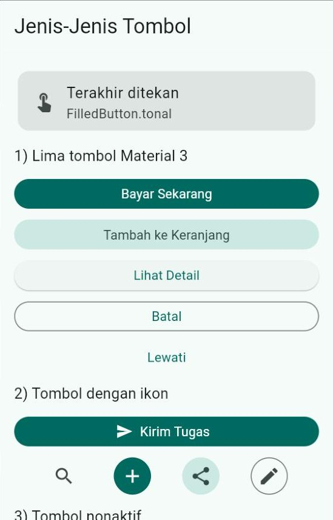
  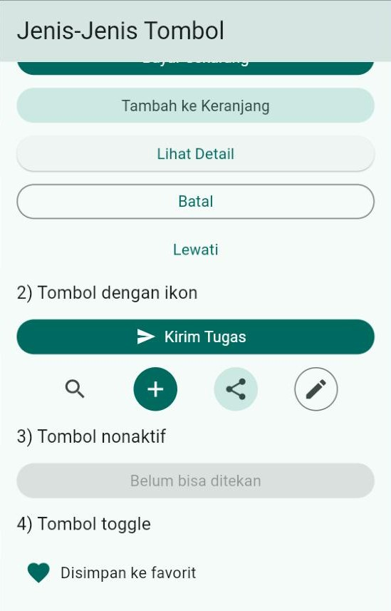
</p>

### 3.1 Lima tombol berteks, dari yang paling menonjol

| Tombol | Tampilan | Kapan dipakai | Contoh label |
| :--- | :--- | :--- | :--- |
| `FilledButton` | Latar penuh warna utama | **Aksi utama** di layar. Cukup satu per layar | Bayar Sekarang, Simpan, Daftar |
| `FilledButton.tonal` | Latar warna lembut | Aksi penting kedua | Tambah ke Keranjang |
| `ElevatedButton` | Latar terang dengan bayangan | Perlu tampak "mengambang", misalnya di atas latar bergambar | Lihat Detail |
| `OutlinedButton` | Hanya garis tepi | Aksi pendamping yang tidak utama | Batal, Kembali |
| `TextButton` | Hanya teks | Aksi paling ringan, juga tombol di dalam dialog | Lewati, Lupa sandi? |

> [!TIP]
> Satu layar sebaiknya hanya punya **satu** `FilledButton`. Jika semua tombol sama menonjolnya, pengguna bingung mana yang harus ditekan.

### 3.2 Tombol yang memakai ikon

Kelima tombol di atas punya versi berikon: `FilledButton.icon`, `FilledButton.tonalIcon`, `ElevatedButton.icon`, `OutlinedButton.icon`, dan `TextButton.icon`. Perhatikan bahwa teksnya ditulis di `label`, bukan `child`:

```dart
FilledButton.icon(
  onPressed: () => _catat('FilledButton.icon'),
  icon: const Icon(Icons.send),
  label: const Text('Kirim Tugas'),
),
```

Untuk tombol yang **hanya berupa ikon**, pakai `IconButton` dengan empat gaya: `IconButton` (polos), `IconButton.filled`, `IconButton.filledTonal`, dan `IconButton.outlined`. Selalu isi `tooltip`, yaitu keterangan yang muncul saat tombol ditekan lama atau disorot *mouse*. Teks ini juga dibacakan oleh pembaca layar (misalnya TalkBack di Android) untuk pengguna tunanetra.

```dart
IconButton.filled(
  onPressed: () => _catat('IconButton.filled'),
  tooltip: 'Tambah',
  icon: const Icon(Icons.add),
),
```

### 3.3 Tiga cara menulis aksi tombol

```dart
// 1) Nama fungsi: jika fungsinya tidak butuh argumen.
onPressed: _tambahGelas,

// 2) Fungsi panah: jika perlu mengirim argumen.
onPressed: () => _catat('FilledButton'),

// 3) Fungsi dengan blok { }: jika isinya lebih dari satu perintah.
onPressed: () {
  setState(() {
    _favorit = !_favorit;
  });
},
```

Pada contoh 02, semua tombol berbagi satu fungsi `_catat(String namaTombol)`. Karena perlu mengirim nama tombol sebagai argumen, dipakailah cara kedua. Selain `onPressed`, tombol juga punya `onLongPress` untuk aksi saat ditekan lama.

### 3.4 Tombol nonaktif dan tombol *toggle*

```dart
// Tombol nonaktif: onPressed bernilai null.
const FilledButton(
  onPressed: null,
  child: Text('Belum bisa ditekan'),
),

// Tombol toggle: menyimpan status menyala/padam.
IconButton(
  isSelected: _favorit,
  tooltip: 'Favorit',
  icon: const Icon(Icons.favorite_border), // saat padam
  selectedIcon: const Icon(Icons.favorite), // saat menyala
  onPressed: () {
    setState(() {
      _favorit = !_favorit; // balik: true <-> false
    });
  },
),
```

Operator `!` membalik nilai `bool`: `!true` menjadi `false`, dan `!false` menjadi `true`. Tombol *toggle* menampilkan `icon` saat `isSelected` bernilai `false`, dan `selectedIcon` saat bernilai `true`.

**🧠 Cek Cepat:** Halaman pembayaran punya tombol "Bayar" dan "Kembali ke keranjang". Jenis tombol apa yang cocok untuk masing-masing?

<details>
<summary>Lihat jawaban</summary>

"Bayar" adalah aksi utama, jadi memakai **`FilledButton`**. "Kembali ke keranjang" adalah aksi pendamping, jadi memakai **`OutlinedButton`** atau **`TextButton`**.
</details>

---

## 4. Menangkap Sentuhan dan Memberi Umpan Balik

Kode lengkap: [`kode/contoh_03_sentuhan_dan_snackbar.dart`](kode/contoh_03_sentuhan_dan_snackbar.dart).

<p align="center">
  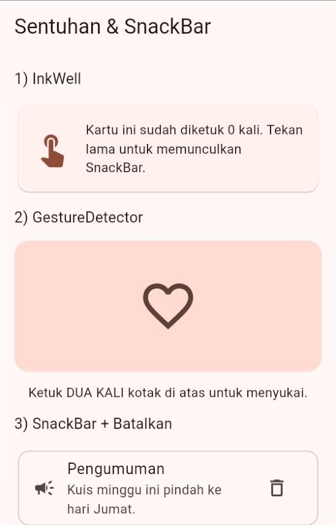
  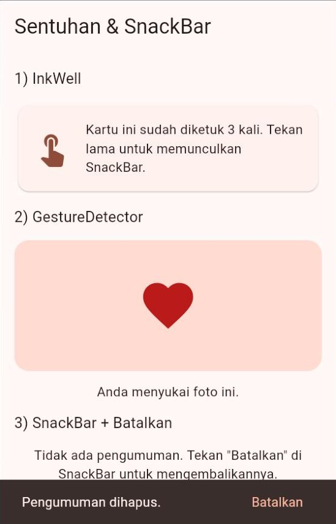
</p>

### 4.1 `InkWell`: membuat apa saja bisa diketuk

Tombol bukan satu-satunya yang bisa ditekan. Dengan `InkWell`, widget apa pun (misalnya sebuah kartu) bisa diketuk, lengkap dengan efek **riak** (*ripple*) seperti tetesan air:

```dart
Card(
  // Agar riak terpotong rapi mengikuti sudut kartu.
  clipBehavior: Clip.antiAlias,
  child: InkWell(
    onTap: () {
      setState(() {
        _jumlahKetukan++;
      });
    },
    onLongPress: () => _tampilkanPesan('Kartu ditekan lama.'),
    child: Padding(/* isi kartu */),
  ),
),
```

- `InkWell` membutuhkan widget **`Material`** di atasnya untuk menggambar riak. `Card` dan `Scaffold` sudah merupakan `Material`, jadi aman.
- `clipBehavior: Clip.antiAlias` memotong riak agar tidak keluar dari sudut kartu yang membulat.
- `ListTile` sudah punya `onTap` sendiri, jadi tidak perlu dibungkus `InkWell` lagi. Anda akan memakainya di [Bagian 10](#10-dialog-dan-bottom-sheet).

### 4.2 `GestureDetector`: mengenali gerakan lain

`GestureDetector` mengenali lebih banyak jenis gerakan, tetapi **tanpa efek visual** apa pun:

```dart
GestureDetector(
  onDoubleTap: () {
    setState(() {
      _disukai = !_disukai;
    });
  },
  child: Container(/* kotak berisi ikon hati */),
),
```

| Gerakan | *Callback* |
| :--- | :--- |
| Ketuk sekali | `onTap` |
| Ketuk dua kali cepat | `onDoubleTap` |
| Tekan lama | `onLongPress` |
| Geser ke kiri atau kanan | `onHorizontalDragEnd` |
| Mencubit untuk memperbesar | `onScaleUpdate` |

| | `InkWell` | `GestureDetector` |
| :--- | :--- | :--- |
| Efek riak | ✅ Ada | ❌ Tidak ada |
| Jenis gerakan | Ketuk, ketuk dua kali, tekan lama | Hampir semua gerakan |
| Syarat | Harus berada di dalam `Material` | Tidak ada syarat |
| Cocok untuk | Kartu atau baris yang bisa diketuk | Gerakan khusus: menyukai foto, menggeser kartu |

> [!TIP]
> Untuk sesuatu yang **bisa diketuk**, utamakan `InkWell` atau tombol. Riaknya memberi tanda kepada pengguna bahwa ketukannya diterima. Tanpa umpan balik apa pun, pengguna cenderung mengetuk berkali-kali karena mengira aplikasinya tidak merespons.

### 4.3 `SnackBar`: pesan singkat di bawah layar

`SnackBar` adalah pesan singkat yang muncul dari bawah layar, lalu hilang sendiri setelah sekitar 4 detik. Cocok untuk memberi tahu bahwa suatu aksi **sudah berhasil**:

```dart
void _tampilkanPesan(String teks) {
  final ScaffoldMessengerState pesan = ScaffoldMessenger.of(context);
  pesan.hideCurrentSnackBar(); // tutup pesan lama agar tidak antre
  pesan.showSnackBar(SnackBar(content: Text(teks)));
}
```

- **`ScaffoldMessenger`** adalah "pengelola pesan" yang sudah disediakan oleh `MaterialApp`. `ScaffoldMessenger.of(context)` artinya "carikan pengelola pesan terdekat di atas widget ini".
- **`hideCurrentSnackBar()`** menutup pesan yang sedang tampil. Tanpa baris ini, jika tombol ditekan lima kali dengan cepat, lima `SnackBar` akan **antre** dan muncul bergantian selama sekitar 20 detik.

### 4.4 Pola "Batalkan" (*undo*)

Untuk aksi yang mudah dikembalikan, misalnya menghapus pengumuman dari layar, aplikasi modern tidak bertanya "Yakin?". Aplikasi langsung menghapusnya, lalu memberi kesempatan untuk **membatalkan**:

```dart
void _hapusPengumuman() {
  setState(() {
    _adaPengumuman = false;
  });
  final ScaffoldMessengerState pesan = ScaffoldMessenger.of(context);
  pesan.hideCurrentSnackBar();
  pesan.showSnackBar(
    SnackBar(
      content: const Text('Pengumuman dihapus.'),
      action: SnackBarAction(
        label: 'Batalkan',
        onPressed: () {
          setState(() {
            _adaPengumuman = true;
          });
        },
      ),
      // SnackBar yang punya tombol aksi tidak hilang sendiri.
      // persist: false membuatnya hilang otomatis setelah ±4 detik.
      persist: false,
    ),
  );
}
```

> [!NOTE]
> Pada Flutter versi sekarang, `SnackBar` yang memiliki `action` **tidak hilang sendiri** sampai pengguna menekan tombolnya. Alasannya agar pengguna sempat membaca dan memilih. Tambahkan `persist: false` jika Anda ingin pesan itu tetap hilang otomatis.

Untuk aksi yang **tidak bisa dikembalikan**, misalnya menghapus data secara permanen, gunakan dialog konfirmasi ([Bagian 10](#10-dialog-dan-bottom-sheet)).

**🧠 Cek Cepat:** Apa yang terjadi jika `clipBehavior: Clip.antiAlias` dihapus dari `Card` pada contoh 03?

<details>
<summary>Lihat jawaban</summary>

Kartu tetap bisa diketuk, tetapi efek riaknya terlihat **keluar dari sudut kartu yang membulat** sehingga tampak kurang rapi.
</details>

---

## 5. Memilih Nilai: `Switch`, `Checkbox`, dan `Radio`

Kode lengkap: [`kode/contoh_04_switch_checkbox_radio.dart`](kode/contoh_04_switch_checkbox_radio.dart). Halaman "Pengaturan" ini menyusun kalimat ringkasan dari semua pilihan pengguna.

<p align="center">
  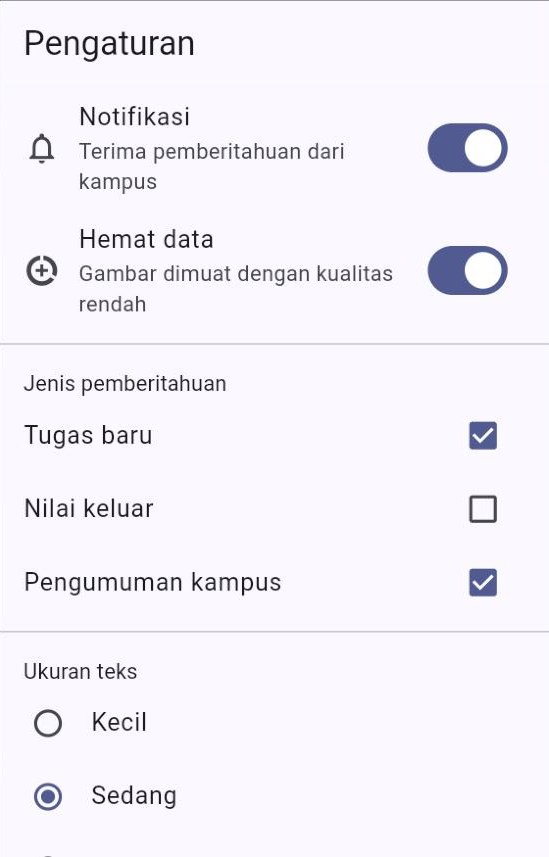
  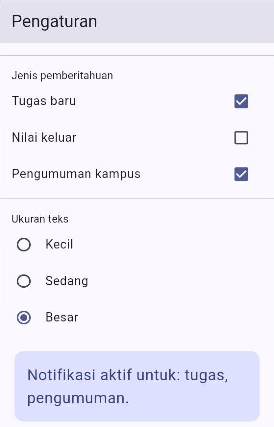
  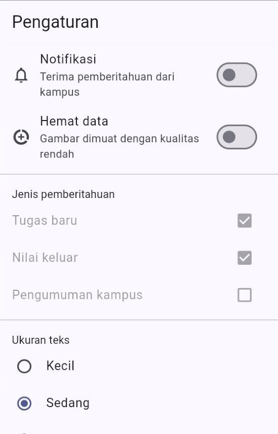
</p>

### 5.1 Pola yang sama untuk semua pemilih nilai

Semua widget pemilih nilai bekerja dengan pola yang sama, yaitu pasangan **`value`** dan **`onChanged`**. Nama parameternya kadang sedikit berbeda (`selected`/`onSelectionChanged` pada `SegmentedButton`, `selected`/`onSelected` pada *chip*, `groupValue`/`onChanged` pada `RadioGroup`), tetapi polanya tetap sama:

- **`value`**: nilai yang **sedang ditampilkan**, diambil dari *state*.
- **`onChanged`**: dipanggil Flutter saat pengguna mengubah pilihan. Flutter **hanya memberi tahu** nilai barunya. **Kita sendiri** yang menyimpannya ke *state* dengan `setState`.

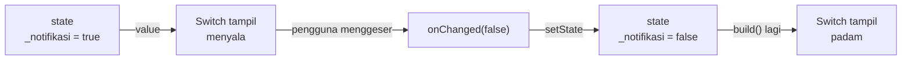

> [!IMPORTANT]
> Jika `onChanged` tidak menyimpan nilai baru ke *state*, sakelar **tidak akan bergeser** walaupun digeser berkali-kali. Widget pemilih nilai tidak menyimpan pilihannya sendiri. Ia selalu menampilkan apa pun yang ada di `value`.

### 5.2 `Switch`: nyala atau mati

```dart
SwitchListTile(
  secondary: const Icon(Icons.notifications_outlined),
  title: const Text('Notifikasi'),
  subtitle: const Text('Terima pemberitahuan dari kampus'),
  value: _notifikasi, // nilai yang SEDANG ditampilkan
  onChanged: (bool nilaiBaru) {
    // Flutter memberi tahu nilai baru; kita yang menyimpannya.
    setState(() {
      _notifikasi = nilaiBaru;
    });
  },
),
```

`SwitchListTile` adalah `ListTile` yang sudah berisi `Switch`. Seluruh barisnya bisa diketuk, bukan hanya sakelarnya, sehingga lebih mudah ditekan di layar kecil. Hal yang sama berlaku untuk `CheckboxListTile` dan `RadioListTile`.

### 5.3 `Checkbox`: boleh memilih lebih dari satu

```dart
CheckboxListTile(
  title: const Text('Tugas baru'),
  value: _infoTugas,
  // Jika notifikasi mati, centang ikut nonaktif (onChanged: null).
  onChanged: _notifikasi
      ? (bool? nilaiBaru) {
          setState(() {
            _infoTugas = nilaiBaru ?? false;
          });
        }
      : null,
),
```

Dua hal baru di sini:

- Nilai yang dikirim ke `onChanged` milik `Checkbox` bertipe **`bool?`**, bukan `bool`. Kotak centang bisa punya keadaan ketiga, yaitu "setengah tercentang", jika diaktifkan dengan `tristate: true`. Karena itu kita memakai `nilaiBaru ?? false` (Pertemuan 2) agar hasilnya pasti `bool`.
- Sama seperti tombol, `onChanged: null` membuat kotak centang **nonaktif**. Di sini, ketiga kotak centang hanya bisa diubah jika sakelar notifikasi menyala.

### 5.4 `Radio`: hanya satu yang boleh dipilih

Pilihan ukuran teks memakai `enum` berproperti dari Pertemuan 3:

```dart
enum UkuranTeks {
  kecil('Kecil', 0.85),
  sedang('Sedang', 1.0),
  besar('Besar', 1.25);

  const UkuranTeks(this.label, this.skala);

  final String label;
  final double skala;
}
```

Beberapa `RadioListTile` dibungkus **satu** `RadioGroup` yang membagikan nilai terpilih (diambil dari *state*) kepada seluruh kelompok:

```dart
RadioGroup<UkuranTeks>(
  groupValue: _ukuran, // pilihan yang sedang aktif
  onChanged: (UkuranTeks? pilihan) {
    if (pilihan == null) return;
    setState(() {
      _ukuran = pilihan;
    });
  },
  child: Column(
    children: [
      for (UkuranTeks ukuran in UkuranTeks.values)
        RadioListTile<UkuranTeks>(
          value: ukuran, // nilai milik pilihan ini
          title: Text(ukuran.label),
        ),
    ],
  ),
),
```

Perulangan `for` di dalam *list* (Pertemuan 4) membuat satu `RadioListTile` untuk setiap nilai `enum`. Jika suatu saat Anda menambah pilihan "Sangat besar" di `enum`, tampilannya otomatis ikut bertambah.

> [!WARNING]
> Banyak tutorial lama menulis `Radio(value: ..., groupValue: _ukuran, onChanged: ...)` pada **setiap** tombol radio. Cara itu sudah usang (*deprecated*) dan memunculkan peringatan `'groupValue' is deprecated and shouldn't be used. Use a RadioGroup ancestor to manage group value instead.` Gunakan `RadioGroup` seperti contoh di atas.

### 5.5 Nilai turunan: ringkasan dari semua pilihan

Kalimat ringkasan **tidak disimpan** sebagai *state*. Ia **dihitung ulang** dari *state* setiap kali `build()` berjalan:

```dart
final List<String> jenisAktif = [
  if (_infoTugas) 'tugas',
  if (_infoNilai) 'nilai',
  if (_infoPengumuman) 'pengumuman',
];

final String ringkasan;
if (!_notifikasi) {
  ringkasan = 'Notifikasi dimatikan.';
} else if (jenisAktif.isEmpty) {
  ringkasan = 'Notifikasi aktif, tetapi belum ada jenis yang dipilih.';
} else {
  ringkasan = 'Notifikasi aktif untuk: ${jenisAktif.join(', ')}.';
}
```

Nilai yang bisa dihitung dari *state* lain disebut **nilai turunan**. Karena selalu dihitung ulang, ringkasan **tidak mungkin ketinggalan** dari pilihan terbaru. `if` di dalam *list* (*collection if*) hanya memasukkan sebuah item jika syaratnya terpenuhi. Teknik nilai turunan ini akan dipakai lagi untuk menghitung total harga di [Bagian 11](#11-mengangkat-state-lifting-state-up).

**🧠 Cek Cepat:** Formulir pendaftaran lomba meminta kelas paralel A, B, atau C (pilih satu), bidang lomba yang diminati (boleh banyak), dan persetujuan menerima *newsletter* (ya/tidak). Widget apa yang cocok untuk masing-masing?

<details>
<summary>Lihat jawaban</summary>

Kelas paralel: **`Radio`** (`RadioGroup` + `RadioListTile`), atau `SegmentedButton` karena pilihannya hanya tiga. Bidang lomba: **`Checkbox`** (`CheckboxListTile`) atau `FilterChip`. *Newsletter*: **`Switch`** (`SwitchListTile`), atau sebuah `Checkbox` jika persetujuan itu bagian dari formulir yang dikirim sekaligus.
</details>

---

## 6. Memilih Nilai: `SegmentedButton`, `Slider`, dan *Chip*

Kode lengkap: [`kode/contoh_05_slider_segmented_chip.dart`](kode/contoh_05_slider_segmented_chip.dart). Aplikasi "Racik Minuman" ini menyusun pesanan teh dari empat jenis pilihan.

<p align="center">
  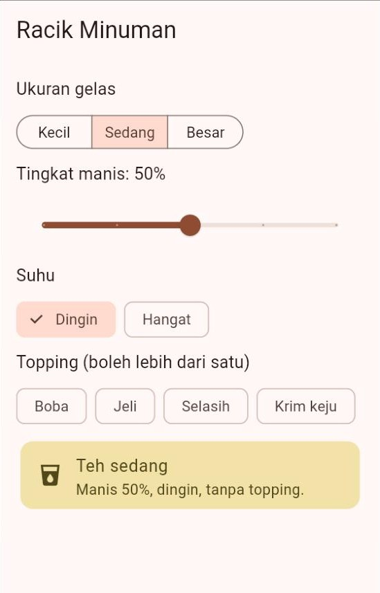
  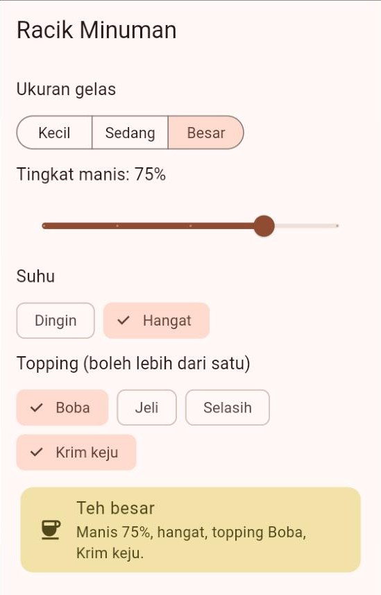
</p>

### 6.1 `SegmentedButton`: pilih satu dari beberapa pilihan berdampingan

```dart
SegmentedButton<UkuranGelas>(
  segments: [
    for (UkuranGelas ukuran in UkuranGelas.values)
      ButtonSegment<UkuranGelas>(
        value: ukuran,
        label: Text(ukuran.label),
      ),
  ],
  // selected berupa Set karena SegmentedButton juga bisa
  // dipakai untuk memilih lebih dari satu.
  selected: {_ukuran},
  onSelectionChanged: (Set<UkuranGelas> pilihan) {
    setState(() {
      _ukuran = pilihan.first;
    });
  },
  // Tanpa ikon centang agar label tetap muat di layar sempit.
  // Pilihan yang aktif tetap terlihat dari warnanya.
  showSelectedIcon: false,
),
```

`selected` dan `onSelectionChanged` memakai **`Set`** (Pertemuan 2), karena `SegmentedButton` juga bisa diatur agar boleh memilih banyak segmen. Untuk pilihan tunggal, kita membungkus satu nilai menjadi `{_ukuran}` dan mengambilnya kembali dengan `pilihan.first`.

> [!NOTE]
> **Pelajaran dari menguji layar sempit.** Secara bawaan, segmen yang terpilih diberi ikon centang. Di layar selebar 320, ikon itu membuat tulisan "Sedang" terpotong menjadi "Sedan" dan "g" di dua baris. Karena itu contoh ini memakai `showSelectedIcon: false`. Warna latar segmen tetap menunjukkan pilihan yang aktif.

### 6.2 `Slider`: memilih angka dengan menggeser

```dart
Slider(
  value: _manis,
  max: 100, // min bawaan = 0
  divisions: 4, // berhenti di 0, 25, 50, 75, 100
  label: '${_manis.round()}%', // gelembung angka saat digeser
  onChanged: (double nilaiBaru) {
    setState(() {
      _manis = nilaiBaru;
    });
  },
),
```

- Nilai `Slider` selalu bertipe **`double`**. Untuk menampilkannya sebagai bilangan bulat, pakai `.round()`.
- `divisions` membuat penggeser berhenti di titik-titik tertentu. Tanpa `divisions`, nilainya bisa berupa pecahan seperti `63.27`.
- Secara bawaan, `label` hanya muncul (sebagai gelembung) jika `divisions` diisi.

### 6.3 *Chip*: pilihan kecil berbentuk kapsul

`ChoiceChip` dipakai untuk **memilih satu**, sedangkan `FilterChip` dipakai untuk **memilih banyak**:

```dart
// Topping: boleh lebih dari satu, disimpan di Set.
final Set<String> _topping = {};

FilterChip(
  label: Text(topping),
  selected: _topping.contains(topping),
  onSelected: (bool dipilih) {
    setState(() {
      if (dipilih) {
        _topping.add(topping);
      } else {
        _topping.remove(topping);
      }
    });
  },
),
```

Kumpulan *chip* dibungkus `Wrap` (Pertemuan 4) agar otomatis pindah baris jika tidak muat.

Perhatikan juga penulisan `onSelected: (_) { ... }` pada `ChoiceChip`. Tanda `_` berarti "nilai yang dikirim Flutter tidak kita pakai", karena pada *chip* "Dingin" kita selalu ingin memilih dingin, apa pun nilai yang dikirim.

### 6.4 Memilih widget pemilih yang tepat

| Kebutuhan | Widget yang cocok |
| :--- | :--- |
| Nyala/mati, langsung berlaku | `Switch` / `SwitchListTile` |
| Boleh memilih banyak dari daftar | `Checkbox` / `CheckboxListTile`, atau `FilterChip` |
| Pilih satu dari 2–5 pilihan, berdampingan | `SegmentedButton` atau `ChoiceChip` |
| Pilih satu dari daftar yang tersusun ke bawah | `RadioGroup` + `RadioListTile` |
| Pilih satu dari banyak pilihan (lebih dari 5) | `DropdownButtonFormField` ([Bagian 9](#9-formulir-dan-validasi)) |
| Angka dalam suatu rentang | `Slider` |

**🧠 Cek Cepat:** Mengapa `_topping` disimpan sebagai `Set<String>`, bukan `List<String>`?

<details>
<summary>Lihat jawaban</summary>

`Set` **tidak pernah berisi data kembar**, jadi topping yang sama tidak mungkin tercatat dua kali. `Set` juga menyediakan `contains`, `add`, dan `remove` yang pas untuk menyalakan dan mematikan pilihan.
</details>

---

## 7. Siklus Hidup *State*

Kode lengkap: [`kode/contoh_06_siklus_hidup_state.dart`](kode/contoh_06_siklus_hidup_state.dart). Contoh ini menampilkan sebuah kartu yang **mencatat setiap tahap hidupnya** ke konsol.

<p align="center">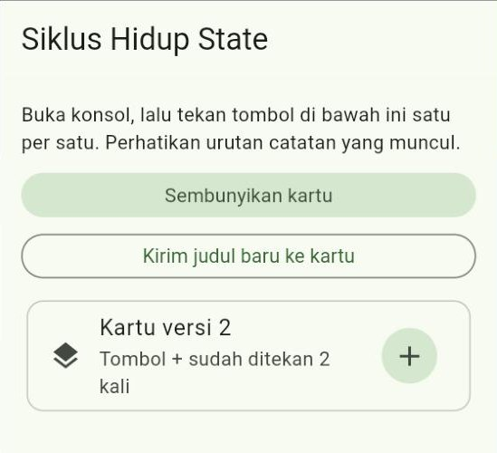</p>

### 7.1 Analogi: mahasiswa magang

Objek *State* menjalani "hidup" seperti mahasiswa magang di sebuah kantor:

1. **Datang** dan didaftarkan (`createState`).
2. Mengikuti **orientasi sekali** di hari pertama (`initState`).
3. **Bekerja berulang-ulang** setiap hari (`build`).
4. Sesekali **menerima arahan baru** dari atasan (`didUpdateWidget`).
5. **Pamit** saat masa magang selesai (`deactivate`).
6. **Mengembalikan kartu akses** dan barang pinjaman sebelum pergi (`dispose`).

### 7.2 Urutan tahapannya

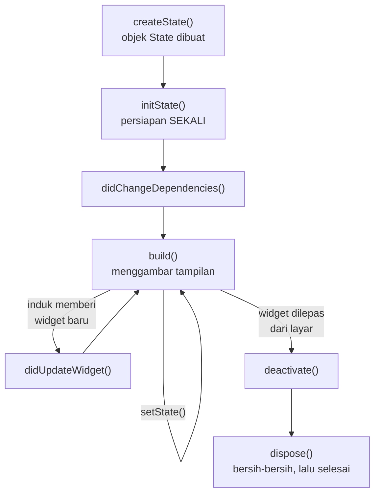

| *Method* | Kapan dipanggil | Berapa kali | Dipakai untuk |
| :--- | :--- | :---: | :--- |
| `createState()` | Widget pertama kali muncul | 1 | Membuat objek *State*, tanpa perintah lain |
| `initState()` | Tepat setelah *State* dibuat | 1 | Menyiapkan nilai awal dari `widget.xxx`, membuat *controller*, memulai pengatur waktu |
| `didChangeDependencies()` | Setelah `initState()`, dan saat data dari atas (misalnya tema) berubah | ≥ 1 | Jarang dipakai pemula |
| `build()` | Setiap kali perlu digambar | Berkali-kali | Menyusun tampilan. Harus cepat dan tidak mengubah data |
| `didUpdateWidget()` | Induk menggambar ulang dan memberikan objek widget baru (biasanya berisi parameter baru) | 0 atau lebih | Menanggapi parameter yang berubah, misalnya dengan membandingkan `oldWidget.judul` dan `widget.judul` |
| `deactivate()` | Widget dilepas dari pohon widget | Biasanya 1 | Jarang dipakai pemula |
| `dispose()` | *State* dibuang selamanya | 1 | Membuang *controller*, menghentikan pengatur waktu |

### 7.3 Melihatnya sendiri di konsol

Jalankan contoh 06, buka konsol (panel **Console** di DartPad, atau terminal tempat `flutter run` berjalan), lalu tekan tombol-tombolnya satu per satu. Catatan yang muncul:

```text
--- saat aplikasi dibuka ---
1. createState(): objek State dibuat
2. initState(): persiapan SEKALI (judul: Kartu versi 1)
3. didChangeDependencies(): data dari atas (misalnya tema) siap
build(): menggambar kartu (_jumlah = 0)
--- tombol + ditekan ---
build(): menggambar kartu (_jumlah = 1)
--- "Kirim judul baru ke kartu" ditekan ---
didUpdateWidget(): judul "Kartu versi 1" -> "Kartu versi 2"
build(): menggambar kartu (_jumlah = 1)
--- "Sembunyikan kartu" ditekan ---
deactivate(): kartu dilepas dari pohon widget
dispose(): State dibuang selamanya (_jumlah ikut hilang)
--- "Tampilkan kartu" ditekan: semuanya mulai lagi dari nol ---
1. createState(): objek State dibuat
2. initState(): persiapan SEKALI (judul: Kartu versi 2)
3. didChangeDependencies(): data dari atas (misalnya tema) siap
build(): menggambar kartu (_jumlah = 0)
```

Tiga pelajaran penting dari catatan di atas:

1. **`setState` hanya menjalankan `build()`**. `initState()` tidak dipanggil lagi.
2. **Parameter baru dari induk tidak membuat *State* baru.** Saat judul berubah, *State* yang sama menerima `didUpdateWidget()`, lalu `build()`. Nilai `_jumlah` tetap 1.
3. **Saat widget hilang dari layar, *State*-nya ikut dibuang.** Ketika kartu ditampilkan lagi, Flutter membuat *State* yang baru, sehingga `_jumlah` kembali ke 0.

### 7.4 Aturan menulis *method* siklus hidup

```dart
@override
void initState() {
  super.initState(); // WAJIB dipanggil paling AWAL
  // ... persiapan Anda
}

@override
void dispose() {
  // ... bersih-bersih Anda
  super.dispose(); // WAJIB dipanggil paling AKHIR
}
```

- Panggil **`super.initState()` di baris pertama** dan **`super.dispose()` di baris terakhir**. Urutannya seperti membuka dan menutup pintu: masuk dulu, baru bekerja; selesai bekerja, baru keluar.
- **Jangan memakai `Theme.of(context)` atau `MediaQuery.of(context)` di `initState()`.** Pada saat itu widget belum siap membaca data dari atasnya, dan Flutter akan menampilkan *error* `dependOnInheritedWidgetOfExactType<...>() or dependOnInheritedElement() was called before ...initState() completed.` Bacalah data tersebut di `build()`.
- **`build()` bisa dipanggil puluhan kali per detik** (misalnya saat animasi). Jangan mengambil data dari internet atau melakukan perhitungan berat di sana. Pekerjaan sekali jalan diletakkan di `initState()` (dibahas lagi di Pertemuan 10).
- Untuk menulis catatan *debug*, pakai **`debugPrint()`**, bukan `print()`. Di VS Code, aturan *linter* `avoid_print` (dari paket `flutter_lints`) akan mengingatkan Anda. DartPad tidak menampilkan peringatan *linter*, jadi biasakan sejak awal.

**🧠 Cek Cepat:** Seorang mahasiswa menaruh `_jumlah = 0;` di dalam `build()` agar nilainya "pasti dimulai dari nol". Apa akibatnya?

<details>
<summary>Lihat jawaban</summary>

Setiap kali tombol + ditekan, `setState` menjalankan `build()`, dan `build()` langsung mengembalikan `_jumlah` menjadi 0. Akibatnya angka di layar **selalu 0**. Nilai awal *state* cukup ditulis sekali saat deklarasi (`int _jumlah = 0;`) atau di `initState()`, tidak pernah di `build()`.
</details>

---

## 8. Kolom Teks: `TextField` dan *Controller*

Kode lengkap: [`kode/contoh_07_textfield_controller.dart`](kode/contoh_07_textfield_controller.dart). Aplikasi "Kartu Ucapan" ini menampilkan pratinjau kartu yang ikut berubah setiap kali Anda mengetik.

<p align="center">
  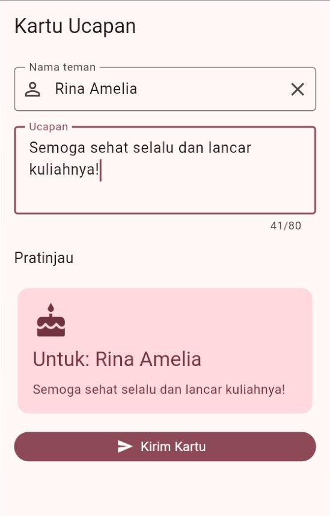
  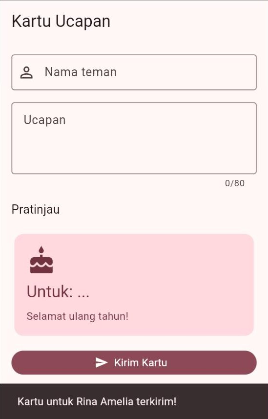
</p>

### 8.1 Menghias kolom dengan `InputDecoration`

```dart
TextField(
  controller: _kontrolNama,
  textCapitalization: TextCapitalization.words, // Huruf Awal Besar
  textInputAction: TextInputAction.next, // tombol "lanjut" di keyboard
  decoration: const InputDecoration(
    labelText: 'Nama teman',
    hintText: 'misalnya Rina',
    prefixIcon: Icon(Icons.person_outline),
    border: OutlineInputBorder(),
  ),
),
```

| Properti `InputDecoration` | Fungsinya |
| :--- | :--- |
| `labelText` | Nama kolom. Saat kolom diisi, label naik ke garis tepi atas |
| `hintText` | Contoh isian berwarna samar, muncul saat kolom aktif tetapi masih kosong |
| `helperText` | Keterangan kecil di bawah kolom, misalnya "Minimal 8 karakter" |
| `prefixIcon` / `suffixIcon` | Ikon di kiri / kanan kolom |
| `border: OutlineInputBorder()` | Garis tepi berbentuk kotak bersudut bulat |
| `errorText` | Pesan *error* berwarna merah di bawah kolom |

### 8.2 Dua cara membaca ketikan

| Cara | Cocok untuk |
| :--- | :--- |
| `onChanged: (String teks) { ... }` | Bereaksi **setiap huruf**: pratinjau langsung, pencarian, penghitung huruf |
| `TextEditingController` | Membaca isi kolom **kapan saja** (misalnya saat tombol ditekan), serta mengisi atau mengosongkan kolom dari kode |

Contoh 07 memakai keduanya. `onChanged` menyalin ketikan ke *state* `_nama` agar pratinjau ikut berubah, sedangkan *controller* dipakai saat tombol "Kirim Kartu" ditekan.

### 8.3 *Controller*: "remote" untuk kolom teks

Bayangkan *controller* sebagai **remote TV** untuk sebuah kolom teks. Dengan remote itu, kode Anda bisa membaca, mengisi, dan mengosongkan kolom tanpa menyentuhnya. Siklus hidupnya ada tiga langkah:

```dart
class _HalamanKartuUcapanState extends State<HalamanKartuUcapan> {
  // 1) BUAT sekali, sebagai properti State.
  final TextEditingController _kontrolNama = TextEditingController();

  // 3) BUANG saat halaman ditutup.
  @override
  void dispose() {
    _kontrolNama.dispose();
    super.dispose();
  }

  // 2) PAKAI: pasang di TextField, lalu baca atau ubah isinya.
  void _kirim() {
    final String nama = _kontrolNama.text.trim(); // trim = buang spasi tepi
    // ...
    _kontrolNama.clear(); // kosongkan kolom dari kode
  }
}
```

| Yang ingin dilakukan | Kode |
| :--- | :--- |
| Membaca isi kolom | `_kontrolNama.text` |
| Mengisi kolom dari kode | `_kontrolNama.text = 'Rina';` |
| Mengosongkan kolom | `_kontrolNama.clear();` |

> [!WARNING]
> Setiap *controller* yang Anda buat **wajib dibuang** di `dispose()`. *Controller* menyimpan teks beserta daftar "pendengar" (kolom teks yang memakainya selalu mendengarkan perubahan dari *controller*). `dispose()` melepas semua itu. Tanpa `dispose()`, sumber dayanya bisa tertahan di memori (*memory leak*), dan aplikasi bisa makin berat jika halamannya sering dibuka dan ditutup.

Ada satu jebakan kecil: **`clear()` tidak memanggil `onChanged`**. Karena itu, setelah mengosongkan kolom, salinan di *state* juga dikosongkan sendiri:

```dart
_kontrolNama.clear();
_kontrolUcapan.clear();
// clear() TIDAK memanggil onChanged, jadi salinannya dikosongkan sendiri.
setState(() {
  _nama = '';
  _ucapan = '';
});
```

### 8.4 Mengatur keyboard

| Properti | Contoh nilai | Efeknya |
| :--- | :--- | :--- |
| `keyboardType` | `TextInputType.number`, `.emailAddress`, `.phone` | Keyboard angka, keyboard dengan tombol `@`, keyboard telepon |
| `textInputAction` | `TextInputAction.next`, `.done` | Tombol kanan bawah keyboard menjadi "lanjut" (pindah ke kolom berikutnya) atau "selesai" |
| `textCapitalization` | `TextCapitalization.words`, `.sentences` | Huruf besar otomatis di awal kata atau di awal kalimat |
| `maxLength` | `80` | Batas jumlah huruf, beserta penghitung di kanan bawah |
| `maxLines` | `3` | Kolom setinggi 3 baris |
| `obscureText` | `true` | Ketikan disamarkan menjadi titik, untuk kata sandi |

Keyboard yang tepat membuat pengguna lebih cepat mengisi dan lebih jarang salah ketik.

### 8.5 Menutup keyboard dan mengatur fokus

Kolom yang sedang diketik disebut kolom yang **mendapat fokus**. Selama ada kolom yang fokus, keyboard ponsel tetap terbuka. Agar keyboard tertutup saat pengguna mengetuk area lain, contoh 07 memakai `onTapOutside`:

```dart
// Menutup keyboard saat pengguna mengetuk area lain.
// primaryFocus = kolom yang sedang aktif (sedang diketik).
onTapOutside: (_) =>
    FocusManager.instance.primaryFocus?.unfocus(),
```

> [!NOTE]
> **Pelajaran dari pengujian.** Banyak tutorial menulis `FocusScope.of(context).unfocus()`. Saat menguji studi kasus di [Bagian 12](#12-studi-kasus-memesan-menu-kantin), cara itu menimbulkan masalah: setelah dialog konfirmasi ditutup, kolom catatan **aktif lagi dengan sendirinya**, sehingga di ponsel keyboard akan muncul kembali. Penyebabnya, `FocusScope` masih "mengingat" kolom terakhir yang fokus. `FocusManager.instance.primaryFocus?.unfocus()` melepas fokus dari kolom itu sendiri, sehingga masalah tersebut hilang.

Satu detail lagi: tombol hapus (ikon ×) di dalam kolom Nama dibungkus `ExcludeFocus`. Tanpa pembungkus itu, menekan "lanjut" di keyboard akan memindahkan fokus ke tombol ×, bukan ke kolom Ucapan.

```dart
suffixIcon: _nama.isEmpty
    ? null // tombol hapus hanya muncul jika kolom berisi teks
    : ExcludeFocus(
        child: IconButton(
          tooltip: 'Hapus nama',
          icon: const Icon(Icons.clear),
          onPressed: () {
            _kontrolNama.clear();
            setState(() {
              _nama = '';
            });
          },
        ),
      ),
```

**🧠 Cek Cepat:** Seorang mahasiswa membuat *controller* di dalam `build()`: `final TextEditingController c = TextEditingController();`. Apa yang terjadi saat ia mengetik di kolom yang juga memakai `onChanged` + `setState`?

<details>
<summary>Lihat jawaban</summary>

Setiap huruf memicu `setState`, lalu `build()` membuat *controller* **baru yang kosong**. Akibatnya ketikan hilang atau kursor melompat ke awal, dan *controller* lama tidak pernah dibuang. *Controller* harus dibuat **sekali** sebagai properti *State*, lalu dibuang di `dispose()`.
</details>

---

## 9. Formulir dan Validasi

Kode lengkap: [`kode/contoh_08_form_validasi.dart`](kode/contoh_08_form_validasi.dart). Formulir "Daftar UKM Robotika" ini memeriksa setiap isian sebelum data diterima.

<p align="center">
  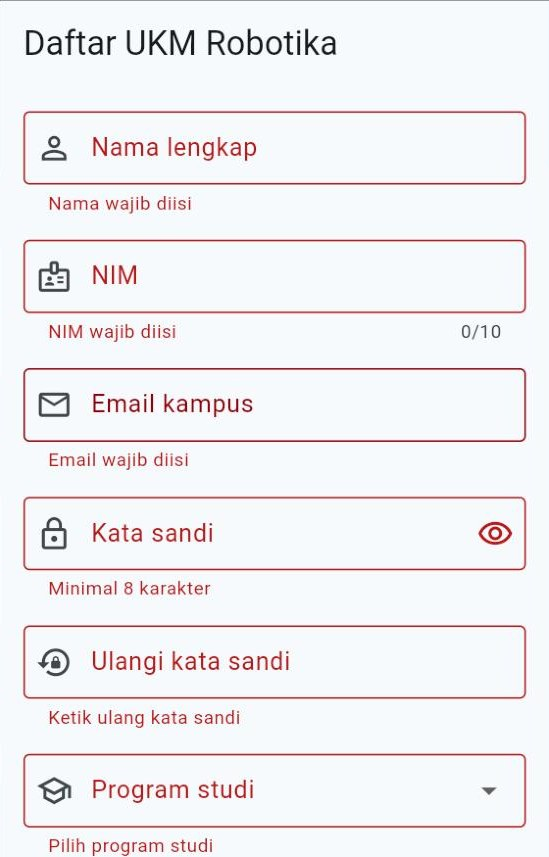
  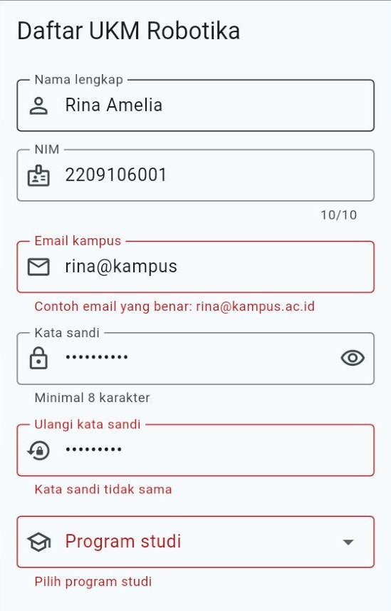
  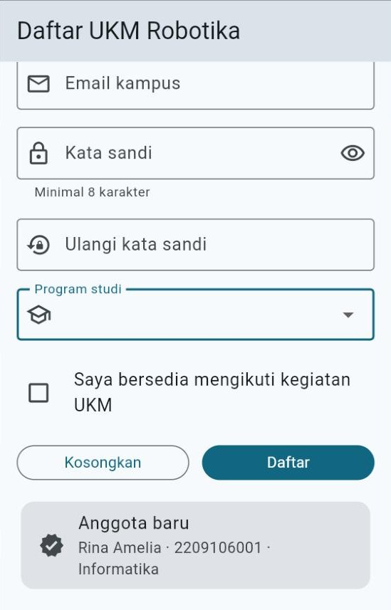
</p>

### 9.1 Tiga bahan utama

| Bahan | Peran | Analogi |
| :--- | :--- | :--- |
| `Form` | Wadah yang mengelompokkan semua kolom isian | Stopmap berisi lembar-lembar formulir |
| `GlobalKey<FormState>` | "Remote" untuk memerintah `Form` dari luar: periksa (`validate`) dan kembalikan ke keadaan awal (`reset`) | Petugas pemeriksa formulir |
| `TextFormField` + `validator` | Kolom isian yang punya aturan pemeriksaan sendiri | Satu lembar dengan syarat pengisiannya |

```dart
// Kunci untuk "memanggil" Form dari luar: validate() dan reset().
final GlobalKey<FormState> _kunciForm = GlobalKey<FormState>();

// ...
Form(
  key: _kunciForm, // pasang kuncinya di sini
  child: Column(
    children: [
      TextFormField(
        controller: _kontrolNama,
        decoration: const InputDecoration(labelText: 'Nama lengkap'),
        validator: _cekNama, // nama fungsi, tanpa tanda ()
      ),
      // ... kolom-kolom lain
    ],
  ),
),
```

### 9.2 Aturan *validator*: kembalikan `null` jika benar

*Validator* adalah fungsi yang menerima isian (`String?`) dan mengembalikan:

- **`null`** jika isiannya **benar**, atau
- **pesan *error*** (`String`) jika isiannya **salah**. Pesan ini ditampilkan dengan warna merah di bawah kolom.

```dart
String? _cekNama(String? isian) {
  final String teks = isian?.trim() ?? '';
  if (teks.isEmpty) return 'Nama wajib diisi';
  if (teks.length < 3) return 'Nama minimal 3 huruf';
  return null; // lolos semua pemeriksaan
}

String? _cekEmail(String? isian) {
  final String teks = isian?.trim() ?? '';
  if (teks.isEmpty) return 'Email wajib diisi';
  // Pemeriksaan sederhana: ada "@" (bukan di awal) dan ada titik
  // sesudahnya, misalnya rina@kampus.ac.id.
  final int posisiAt = teks.indexOf('@');
  if (posisiAt < 1 || !teks.substring(posisiAt).contains('.')) {
    return 'Contoh email yang benar: rina@kampus.ac.id';
  }
  return null;
}
```

Tuliskan pesan *error* yang **memberi tahu cara memperbaikinya**. "Contoh email yang benar: rina@kampus.ac.id" jauh lebih membantu daripada "Input tidak valid".

### 9.3 `validate()` dan `reset()`

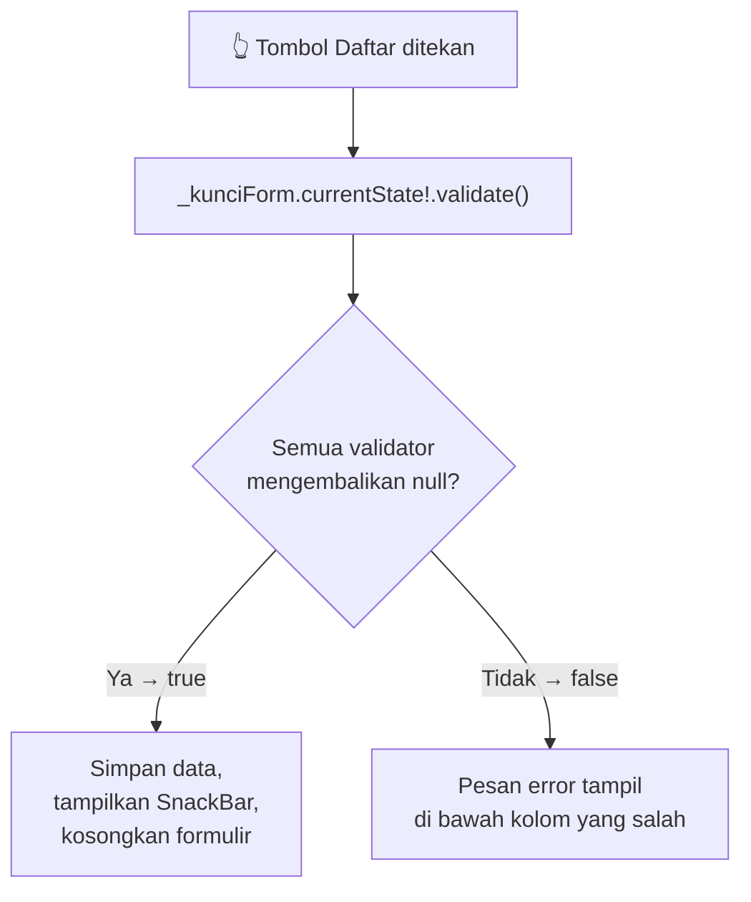

```dart
void _daftar() {
  // validate() menjalankan SEMUA validator di dalam Form.
  // Hasilnya true hanya jika semuanya lolos.
  final bool semuaBenar = _kunciForm.currentState!.validate();
  if (!semuaBenar) return; // pesan error sudah tampil di bawah kolom

  // ... simpan data dan tampilkan SnackBar
  _kosongkan();
}

void _kosongkan() {
  // reset() mengembalikan SEMUA kolom ke keadaan awal dan
  // menghapus pesan error.
  _kunciForm.currentState!.reset();
  setState(() {
    _prodi = null;
    _sandiTersembunyi = true;
  });
}
```

`currentState!` memakai tanda `!` karena `currentState` bisa `null` jika kunci belum terpasang pada `Form` mana pun. Selama `key: _kunciForm` sudah dipasang, nilainya pasti ada.

### 9.4 Kapan pesan *error* muncul?

Properti `autovalidateMode` pada `Form` menentukan kapan pemeriksaan berjalan **otomatis**:

| Nilai | Pemeriksaan otomatis berjalan... |
| :--- | :--- |
| `disabled` (bawaan) | Tidak pernah. Hanya saat `validate()` dipanggil |
| `always` | Terus-menerus, bahkan sebelum pengguna mengetik apa pun |
| `onUserInteraction` | Setelah pengguna mengubah isian |
| `onUnfocus` | Saat pengguna meninggalkan sebuah kolom |
| `onUserInteractionIfError` | Setelah pengguna mengubah isian, **hanya jika masih ada *error*** |

Contoh 08 memakai `onUserInteractionIfError`:

```dart
Form(
  key: _kunciForm,
  // Pesan error baru muncul setelah tombol Daftar ditekan. Setelah
  // itu, pesan diperbarui setiap kali pengguna mengubah isian.
  autovalidateMode: AutovalidateMode.onUserInteractionIfError,
  child: /* ... */,
),
```

Hasilnya ramah pengguna: formulir yang baru dibuka tetap bersih. Setelah tombol "Daftar" ditekan dan muncul *error*, setiap pesan langsung hilang begitu kolomnya diperbaiki.

> [!NOTE]
> **Pelajaran dari pengujian.** Versi pertama contoh ini memakai `onUserInteraction` pada `Form`. Ternyata, begitu **satu huruf** diketik di kolom Nama, **semua** kolom langsung bergaris merah, karena `Form` memeriksa seluruh isinya setelah ada interaksi pertama. Pengguna dimarahi sebelum sempat mengisi. Pilihan mode pemeriksaan ikut menentukan nyaman tidaknya sebuah formulir.

<p align="center">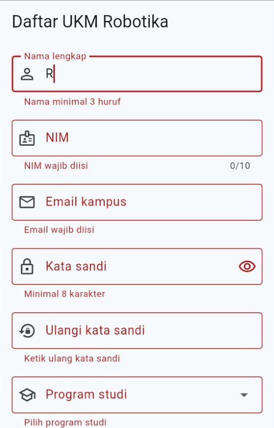</p>

### 9.5 Kolom-kolom khusus

**NIM: hanya angka, tepat 10 digit.** `keyboardType` menampilkan keyboard angka, `inputFormatters` **menolak** huruf yang diketik, dan `maxLength` membatasi panjangnya. *Formatter* ini memerlukan `import 'package:flutter/services.dart';`.

```dart
TextFormField(
  controller: _kontrolNim,
  keyboardType: TextInputType.number, // keyboard angka
  // Huruf yang diketik langsung ditolak, hanya angka masuk.
  inputFormatters: [FilteringTextInputFormatter.digitsOnly],
  maxLength: 10,
  decoration: const InputDecoration(labelText: 'NIM'),
  validator: _cekNim,
),
```

**Kata sandi yang bisa diintip.** `obscureText` mengikuti *state* `_sandiTersembunyi`, dan tombol mata di `suffixIcon` membaliknya. Kolom "Ulangi kata sandi" memakai *validator* yang **membaca kolom lain** lewat *controller*-nya:

```dart
String? _cekUlangSandi(String? isian) {
  if (isian == null || isian.isEmpty) return 'Ketik ulang kata sandi';
  // Validator boleh membaca kolom lain lewat controller-nya.
  if (isian != _kontrolSandi.text) return 'Kata sandi tidak sama';
  return null;
}
```

**Program studi: pilihan berbentuk *dropdown*.** `DropdownButtonFormField` adalah *dropdown* yang ikut diperiksa oleh `Form`:

```dart
DropdownButtonFormField<String>(
  decoration: const InputDecoration(labelText: 'Program studi'),
  items: [
    for (String prodi in daftarProdi)
      DropdownMenuItem<String>(value: prodi, child: Text(prodi)),
  ],
  onChanged: (String? pilihan) {
    setState(() {
      _prodi = pilihan;
    });
  },
  validator: (String? pilihan) {
    if (pilihan == null) return 'Pilih program studi';
    return null;
  },
),
```

> [!TIP]
> Untuk memberi pilihan awal, gunakan `initialValue: 'Informatika'`. Properti lama bernama `value` sudah usang (*deprecated*) pada `DropdownButtonFormField`. Jangan lupa menyamakan *state*-nya juga: `String? _prodi = 'Informatika';`, dan kembalikan ke nilai itu (bukan `null`) di `_kosongkan()`.

**Kotak centang persetujuan.** `CheckboxListTile` bukan kolom formulir, sehingga tidak ikut diperiksa oleh `Form`. Solusinya, bungkus dengan **`FormField<bool>`**, yang bisa menjadikan widget **apa saja** sebagai kolom formulir:

```dart
FormField<bool>(
  initialValue: false,
  validator: (bool? setuju) {
    if (setuju != true) return 'Centang dulu persetujuan ini';
    return null;
  },
  builder: (FormFieldState<bool> kolom) {
    return CheckboxListTile(
      title: const Text('Saya bersedia mengikuti kegiatan UKM'),
      value: kolom.value,
      onChanged: kolom.didChange, // simpan pilihan ke kolom
      subtitle: kolom.hasError
          ? Text(kolom.errorText!, style: TextStyle(color: warna.error))
          : null,
    );
  },
),
```

### 9.6 Validasi di aplikasi bukan pengaman data

Validasi di aplikasi membantu pengguna **mengisi dengan benar**. Namun, data tetap harus diperiksa lagi oleh *server* yang menerimanya, karena orang yang berniat jahat bisa mengirim data tanpa melewati aplikasi Anda. Pengiriman data ke *server* dibahas pada Pertemuan 10.

**🧠 Cek Cepat:** Apa hasil `_cekNim('22091')`, `_cekNim('')`, dan `_cekNim('2209106001')`?

<details>
<summary>Lihat jawaban</summary>

- `_cekNim('22091')` → `'NIM harus 10 angka'` (panjangnya 5).
- `_cekNim('')` → `'NIM wajib diisi'`.
- `_cekNim('2209106001')` → `null`, artinya **benar** (tepat 10 angka).
</details>

---

## 10. Dialog dan *Bottom Sheet*

Kode lengkap: [`kode/contoh_09_dialog_dan_bottom_sheet.dart`](kode/contoh_09_dialog_dan_bottom_sheet.dart). Daftar "Tugas Kuliah" ini meminta konfirmasi sebelum menghapus tugas, dan memakai *bottom sheet* untuk memilih prioritas.

<p align="center">
  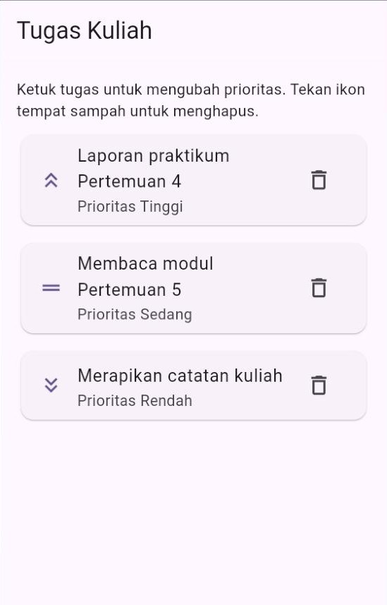
  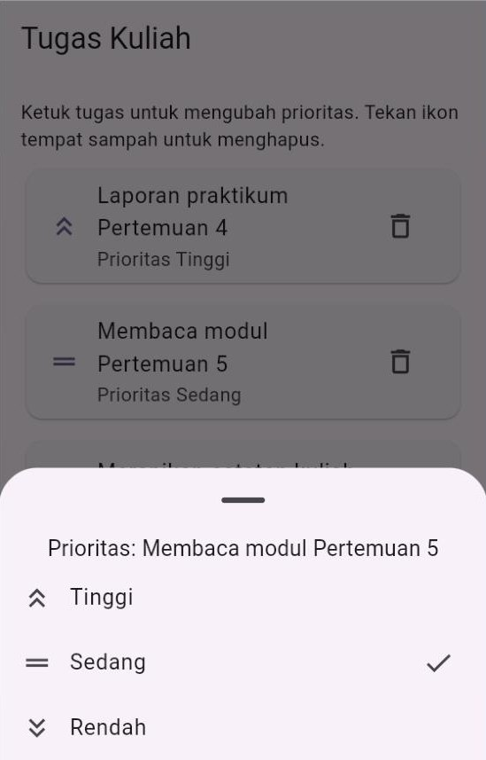
  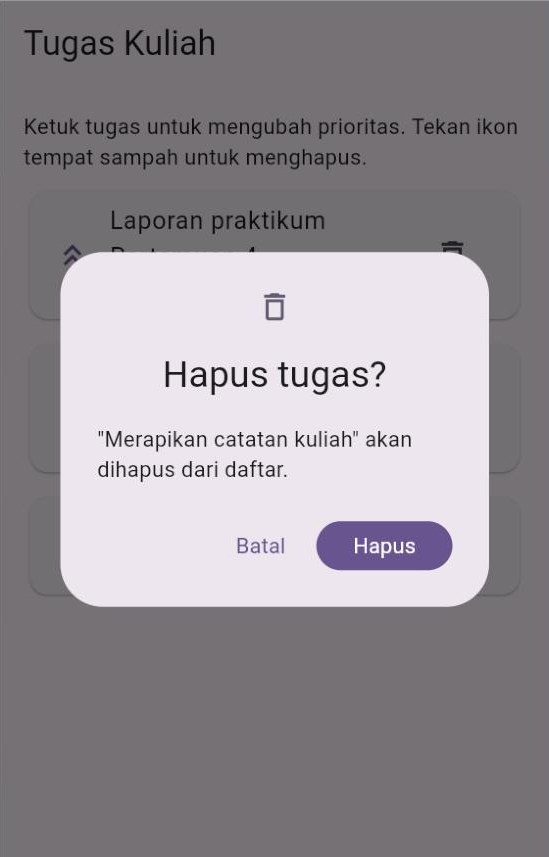
</p>

### 10.1 Dialog konfirmasi dengan `showDialog`

```dart
// async karena kita MENUNGGU jawaban pengguna (Pertemuan 3).
Future<void> _konfirmasiHapus(Tugas tugas) async {
  final bool? yakin = await showDialog<bool>(
    context: context,
    builder: (BuildContext context) {
      return AlertDialog(
        icon: const Icon(Icons.delete_outline),
        title: const Text('Hapus tugas?'),
        content: Text('"${tugas.judul}" akan dihapus dari daftar.'),
        actions: [
          // Navigator.pop menutup dialog sambil mengirim jawaban.
          TextButton(
            onPressed: () => Navigator.pop(context, false),
            child: const Text('Batal'),
          ),
          FilledButton(
            onPressed: () => Navigator.pop(context, true),
            child: const Text('Hapus'),
          ),
        ],
      );
    },
  );

  // Selama menunggu, halaman ini bisa saja sudah ditutup.
  // Periksa dulu sebelum memakai context atau setState.
  if (!mounted) return;
  // yakin bisa null jika dialog ditutup dengan mengetuk area gelap.
  if (yakin != true) return;

  setState(() {
    _daftar.remove(tugas);
  });
  // ... tampilkan SnackBar
}
```

Mari kita uraikan:

1. **`showDialog<bool>`** menampilkan dialog dan langsung mengembalikan sebuah `Future<bool?>`, yaitu "janji" bahwa jawabannya akan datang nanti (Pertemuan 3). Kata **`await`** membuat fungsi menunggu sampai dialog ditutup.
2. **`Navigator.pop(context, true)`** menutup dialog sambil **mengirim jawaban** `true`. Tombol "Batal" mengirim `false`.
3. Jawabannya bertipe **`bool?`**, karena dialog juga bisa ditutup **tanpa memilih**: dengan mengetuk area gelap di sekitarnya atau menekan tombol kembali. Dalam kasus itu jawabannya `null`. Pemeriksaan `yakin != true` menangani `false` dan `null` sekaligus.
4. `Navigator.pop(context, ...)` menutup **rute paling atas**, yaitu dialog yang sedang tampil. Di dalam `builder`, kita memakai `context` milik dialog itu sendiri agar `Navigator` yang dipakai pasti `Navigator` tempat dialog itu berada.

### 10.2 Periksa `mounted` setelah `await`

Selama `await` menunggu, waktu terus berjalan. Bisa saja pengguna sudah **menutup halaman** sebelum dialog selesai. Celah waktu ini disebut ***async gap***. Jika setelahnya kita tetap memanggil `setState` atau memakai `context`, aplikasi akan *error* (`setState() called after dispose()`).

Objek *State* punya properti **`mounted`**: bernilai `true` selama widgetnya masih ada di layar. Biasakan pola ini:

```dart
final bool? yakin = await showDialog<bool>(/* ... */);
if (!mounted) return; // halaman sudah ditutup? berhenti di sini
// aman memakai context dan setState
```

> [!TIP]
> Di VS Code, aturan *linter* `use_build_context_synchronously` (dari paket `flutter_lints`) akan memperingatkan Anda jika memakai `context` setelah `await` tanpa pemeriksaan `mounted`. DartPad tidak menampilkan peringatan ini, jadi biasakan menulis pemeriksaannya sendiri. Di dalam *class State*, gunakan `mounted`. Di tempat lain yang hanya punya `context`, misalnya `StatelessWidget`, gunakan `context.mounted`.

### 10.3 *Bottom sheet* untuk memilih

*Bottom sheet* adalah lembar yang muncul dari bawah layar. Cara kerjanya mirip dialog: ditampilkan dengan `showModalBottomSheet`, jawabannya ditunggu dengan `await`, dan lembarnya ditutup dengan `Navigator.pop` sambil mengirim pilihan.

```dart
Future<void> _pilihPrioritas(Tugas tugas) async {
  final Prioritas? pilihan = await showModalBottomSheet<Prioritas>(
    context: context,
    showDragHandle: true, // garis kecil di atas lembar
    builder: (BuildContext context) {
      return SafeArea(
        child: Column(
          mainAxisSize: MainAxisSize.min, // setinggi isinya saja
          children: [
            // ... judul lembar
            for (Prioritas p in Prioritas.values)
              ListTile(
                leading: Icon(p.ikon),
                title: Text(p.label),
                trailing: p == tugas.prioritas
                    ? const Icon(Icons.check)
                    : null,
                onTap: () => Navigator.pop(context, p),
              ),
          ],
        ),
      );
    },
  );

  if (!mounted) return;
  if (pilihan == null) return; // ditutup tanpa memilih

  setState(() {
    tugas.prioritas = pilihan;
  });
}
```

`mainAxisSize: MainAxisSize.min` (Pertemuan 4) membuat lembar hanya setinggi isinya, tidak memenuhi layar.

### 10.4 Kapan memakai dialog, *bottom sheet*, atau *SnackBar*?

| Komponen | Sifatnya | Cocok untuk |
| :--- | :--- | :--- |
| **Dialog** | Menghentikan pengguna sampai ia menjawab | Keputusan penting yang **tidak bisa dibatalkan**: hapus permanen, konfirmasi pembayaran |
| ***Bottom sheet*** | Muncul dari bawah, dekat jempol | Pilihan tambahan yang berhubungan dengan isi layar: pilih prioritas, bagikan, urutkan |
| ***SnackBar*** | Muncul sebentar, tidak menghentikan pengguna | Kabar bahwa aksi **sudah** berhasil, termasuk tombol "Batalkan" |

> [!TIP]
> Jangan terlalu sering memakai dialog. Dialog yang muncul untuk hal-hal kecil membuat pengguna terbiasa menekan "OK" tanpa membaca, sehingga dialog yang benar-benar penting pun ikut terlewat.

**🧠 Cek Cepat:** Mengapa `if (yakin != true) return;` lebih aman daripada `if (yakin == false) return;`?

<details>
<summary>Lihat jawaban</summary>

Karena `yakin` bisa bernilai **`null`** (dialog ditutup dengan mengetuk area gelap atau tombol kembali). Dengan `yakin == false`, nilai `null` lolos pemeriksaan sehingga tugas **ikut terhapus** padahal pengguna tidak menekan "Hapus". `yakin != true` hanya meneruskan penghapusan jika jawabannya benar-benar `true`.
</details>

---

## 11. Mengangkat *State* (*Lifting State Up*)

Kode lengkap: [`kode/contoh_10_mengangkat_state.dart`](kode/contoh_10_mengangkat_state.dart). Halaman "Keranjang Kantin" ini berisi tiga kartu menu yang masing-masing punya tombol − dan +, serta total di bagian bawah.

<p align="center">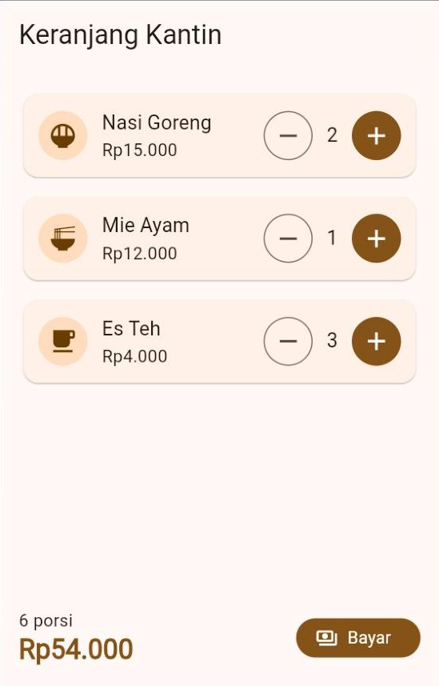</p>

### 11.1 Masalahnya: siapa yang menyimpan jumlah?

Andaikan setiap `KartuMenu` adalah `StatefulWidget` yang menyimpan jumlahnya **sendiri-sendiri**. Tombol − dan + memang bekerja, tetapi halaman **tidak bisa menghitung total**, karena angka-angka itu "terkunci" di dalam setiap kartu. Halaman tidak punya cara untuk membacanya.

Solusinya: **angkat *state* ke induk terdekat yang membutuhkannya**. Jumlah porsi disimpan di halaman (`HalamanKeranjang`). Kartu menu cukup menjadi `StatelessWidget` yang:

- **menerima data** dari induk lewat parameter (`jumlah`), dan
- **melapor** ke induk lewat ***callback*** (`onTambah`, `onKurang`) saat tombolnya ditekan.

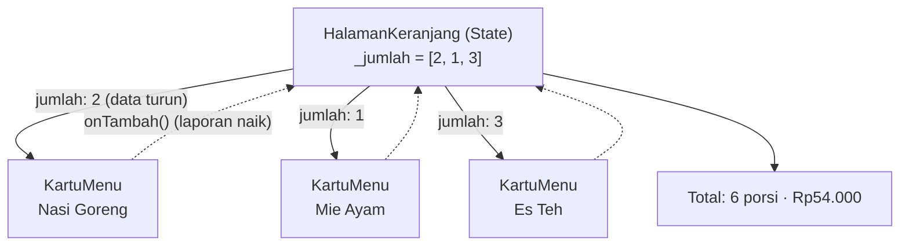

Semboyannya: **data turun, laporan naik** (*data down, events up*).

### 11.2 Anak yang melapor lewat *callback*

```dart
class KartuMenu extends StatelessWidget {
  const KartuMenu({
    super.key,
    required this.menu,
    required this.jumlah,
    required this.onTambah,
    required this.onKurang,
  });

  final Menu menu;
  final int jumlah;
  // VoidCallback = fungsi tanpa parameter dan tanpa nilai kembali.
  final VoidCallback onTambah;
  final VoidCallback onKurang;

  @override
  Widget build(BuildContext context) {
    // (disingkat) ... menampilkan menu.nama, formatRupiah(menu.harga),
    // dan TombolJumlah(jumlah: jumlah, onTambah: onTambah,
    // onKurang: onKurang)
  }
}
```

`VoidCallback` adalah nama lain untuk tipe fungsi `void Function()`, sama seperti tipe `onPressed` pada tombol. Kartu **tidak tahu** apa yang terjadi saat tombol ditekan. Ia hanya meneruskan fungsi dari induknya. Karena itu kartu yang sama bisa dipakai di halaman lain dengan perilaku yang berbeda.

Di sisi induk, setiap kartu diberi fungsi yang sudah "tahu" nomor menunya:

```dart
for (int i = 0; i < daftarMenu.length; i++)
  KartuMenu(
    menu: daftarMenu[i],
    jumlah: _jumlah[i], // data turun ke anak
    onTambah: () => _ubahJumlah(i, 1), // laporan naik ke induk
    onKurang: () => _ubahJumlah(i, -1),
  ),
```

```dart
void _ubahJumlah(int indeks, int perubahan) {
  setState(() {
    _jumlah[indeks] += perubahan;
  });
}
```

### 11.3 Total sebagai nilai turunan

Total porsi dan total harga **tidak disimpan** di variabel tersendiri, melainkan dihitung dari `_jumlah` lewat *getter* (Pertemuan 3):

```dart
// _jumlah[0] untuk menu ke-0, _jumlah[1] untuk menu ke-1, dan seterusnya.
final List<int> _jumlah = List<int>.filled(daftarMenu.length, 0);

int get _totalPorsi {
  int hasil = 0;
  for (int porsi in _jumlah) {
    hasil += porsi;
  }
  return hasil;
}

int get _totalHarga {
  int hasil = 0;
  for (int i = 0; i < daftarMenu.length; i++) {
    hasil += daftarMenu[i].harga * _jumlah[i];
  }
  return hasil;
}
```

Seandainya total disimpan sebagai variabel `_total` dan diperbarui manual di setiap tombol, cukup **satu kali lupa** memperbaruinya, total akan berbeda dengan isi keranjang. Dengan *getter*, total **selalu dihitung dari data terbaru**.

> [!TIP]
> Simpan *state* **sesedikit mungkin**. Sebelum menambah variabel *state* baru, tanyakan: "Bisakah nilai ini dihitung dari *state* yang sudah ada?" Jika bisa, jadikan *getter* atau variabel lokal di `build()`.

Tombol "Bayar" juga memakai nilai turunan: `onPressed: _totalPorsi > 0 ? _bayar : null`, sehingga nonaktif selama keranjang kosong. Setelah dibayar, semua jumlah dikembalikan ke 0 dengan `_jumlah.fillRange(0, _jumlah.length, 0)`.

### 11.4 Mengubah angka menjadi format Rupiah

Contoh 10 dan 11 memakai fungsi kecil buatan sendiri untuk mengubah `15000` menjadi `Rp15.000`:

```dart
// Mengubah 15000 menjadi "Rp15.000": sisipkan titik setiap tiga angka
// dari kanan.
String formatRupiah(int angka) {
  final String digit = angka.toString();
  String hasil = '';
  for (int i = 0; i < digit.length; i++) {
    final int sisaDiKanan = digit.length - i;
    if (i > 0 && sisaDiKanan % 3 == 0) {
      hasil += '.';
    }
    hasil += digit[i];
  }
  return 'Rp$hasil';
}
```

Untuk `15000`, perulangan membaca angka `1`, `5`, `0`, `0`, `0` dari kiri. Saat sampai di angka `0` yang pertama (`i = 2`), sisa angka mulai dari posisi itu ada tiga (`000`), maka sebuah titik disisipkan lebih dulu. Hasilnya `15.000`.

**🧠 Cek Cepat:** Jika `KartuMenu` diubah menjadi `StatefulWidget` yang menyimpan jumlahnya sendiri, apa yang tidak bisa lagi dilakukan halaman?

<details>
<summary>Lihat jawaban</summary>

Halaman **tidak bisa menghitung total** porsi dan harga, juga **tidak bisa mengosongkan** keranjang setelah tombol "Bayar" ditekan, karena jumlah setiap menu tersimpan di dalam kartu masing-masing dan tidak bisa dibaca maupun diubah dari luar.
</details>

---

## 12. Studi Kasus: Memesan Menu Kantin

Pada Pertemuan 4 kita membuat halaman detail menu yang **tampilannya** sudah rapi, tetapi tombolnya masih `onPressed: () {}`. Sekarang halaman itu kita hidupkan. Kode lengkap: [`kode/contoh_11_studi_kasus_pesan_menu.dart`](kode/contoh_11_studi_kasus_pesan_menu.dart).

<p align="center">
  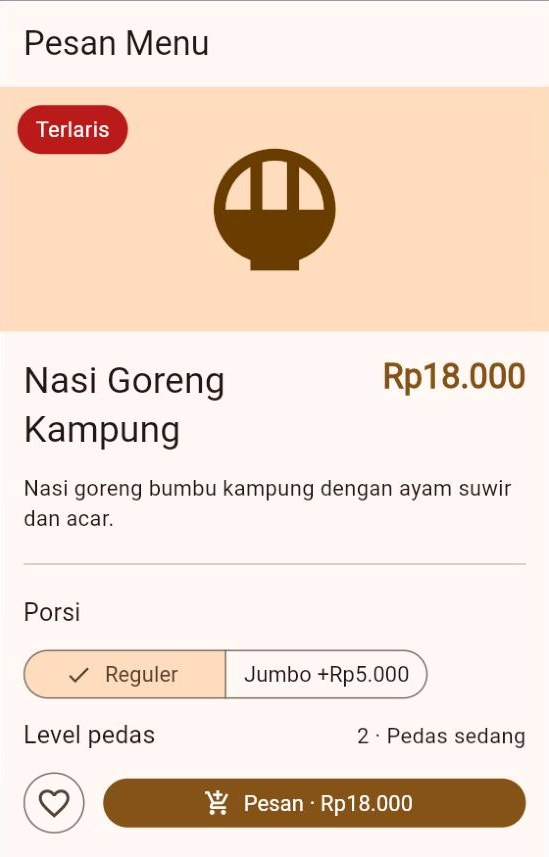
  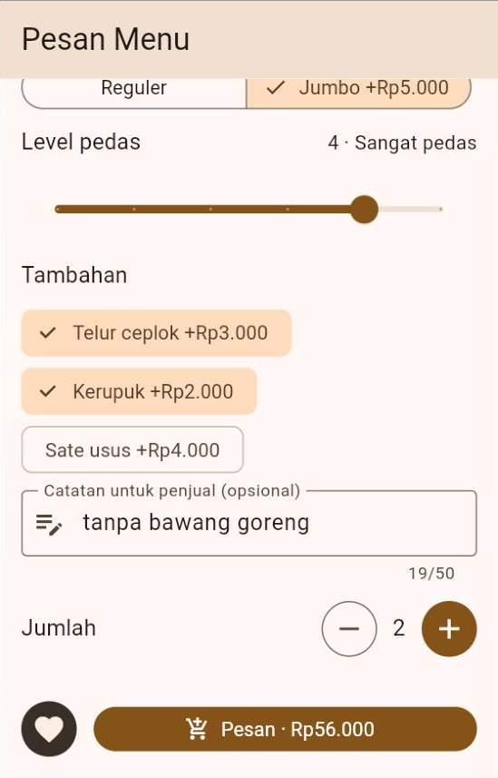
  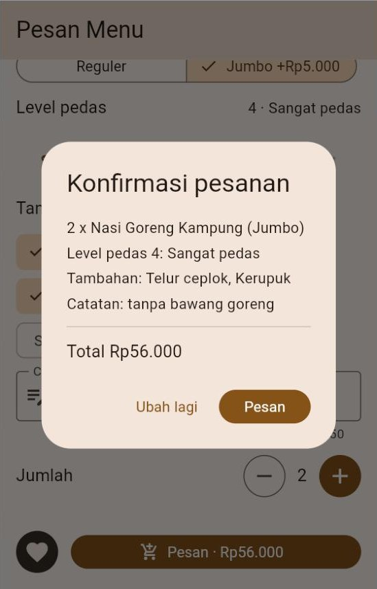
</p>

### 12.1 Daftar *state* dan nilai turunan

Langkah pertama yang baik: **daftar dulu semua hal yang bisa diubah pengguna**. Itulah *state*-nya. Setelah itu, cari nilai yang bisa **dihitung** dari *state* tersebut.

| *State* | Tipe | Diubah oleh |
| :--- | :--- | :--- |
| `_porsi` | `Porsi` (*enum*: reguler, jumbo) | `SegmentedButton` |
| `_levelPedas` | `double` (0–5) | `Slider` |
| `_tambahan` | `Set<Tambahan>` | `FilterChip` |
| `_kontrolCatatan` | `TextEditingController` | `TextField` |
| `_jumlah` | `int` (1–10) | `TombolJumlah` |
| `_favorit` | `bool` | `IconButton` *toggle* |

| Nilai turunan | Dihitung dari |
| :--- | :--- |
| `_hargaSatuan` | harga dasar + tambahan harga porsi + harga semua *topping* |
| `_totalHarga` | `_hargaSatuan * _jumlah` |
| `_keteranganPedas` | `_levelPedas` (0 = "Tidak pedas" ... 4 = "Sangat pedas", 5 = "Pedas maksimal") |

```dart
int get _hargaSatuan {
  int harga = hargaDasar + _porsi.tambahanHarga;
  for (Tambahan tambahan in _tambahan) {
    harga += tambahan.harga;
  }
  return harga;
}

int get _totalHarga => _hargaSatuan * _jumlah;

String get _keteranganPedas {
  // switch ekspresi (Pertemuan 2).
  return switch (_levelPedas.round()) {
    0 => 'Tidak pedas',
    1 => 'Sedikit pedas',
    2 => 'Pedas sedang',
    3 => 'Pedas',
    4 => 'Sangat pedas',
    _ => 'Pedas maksimal',
  };
}
```

**Cek manual.** Pada gambar kedua: porsi Jumbo, telur ceplok, kerupuk, dan 2 porsi. Harga satuannya 18.000 + 5.000 + 3.000 + 2.000 = 28.000. Totalnya 28.000 × 2 = **56.000**, sama dengan yang tertulis di tombol "Pesan · Rp56.000". Biasakan memeriksa hasil hitungan aplikasi dengan hitungan manual seperti ini.

### 12.2 Langkah demi langkah

**Langkah 1 — Porsi dengan `SegmentedButton`.** Pilihan diambil dari `enum Porsi`. Labelnya ikut menampilkan tambahan harga:

```dart
ButtonSegment<Porsi>(
  value: porsi,
  label: Text(
    porsi.tambahanHarga == 0
        ? porsi.label
        : '${porsi.label} +${formatRupiah(porsi.tambahanHarga)}',
  ),
),
```

**Langkah 2 — Level pedas dengan `Slider`.** Nilainya 0 sampai 5 dengan `divisions: 5`. Teks di sebelah kanan judul menampilkan angka dan `_keteranganPedas`.

**Langkah 3 — Tambahan dengan `FilterChip`.** Polanya sama dengan *topping* di [Bagian 6.3](#63-chip-pilihan-kecil-berbentuk-kapsul), hanya saja isinya berupa nilai `enum Tambahan`.

**Langkah 4 — Catatan dengan `TextField` + *controller*.** Catatan baru dibaca saat tombol "Pesan" ditekan, jadi cukup memakai *controller* tanpa `onChanged`.

**Langkah 5 — Jumlah dengan `TombolJumlah`.** Widget dari contoh 10 kini punya batas `minimum` dan `maksimum`. Tombol − nonaktif saat jumlah 1, tombol + nonaktif saat jumlah 10:

```dart
IconButton.outlined(
  tooltip: 'Kurangi',
  onPressed: jumlah > minimum ? onKurang : null,
  icon: const Icon(Icons.remove),
),
```

**Langkah 6 — Tombol di bagian bawah.** Label tombol "Pesan" ikut menampilkan total harga, sehingga pengguna langsung melihat akibat setiap pilihannya:

```dart
Expanded(
  child: FilledButton.icon(
    onPressed: _pesan,
    icon: const Icon(Icons.add_shopping_cart),
    label: Text('Pesan · ${formatRupiah(_totalHarga)}'),
  ),
),
```

**Langkah 7 — Konfirmasi, lalu kembali ke keadaan awal.** `_pesan()` menampilkan dialog berisi ringkasan pesanan. Jika pengguna menekan "Pesan", muncul *SnackBar*, lalu semua pilihan dikembalikan ke keadaan awal untuk pesanan berikutnya:

```dart
if (!mounted) return;
if (jadiPesan != true) return;

ScaffoldMessenger.of(context).showSnackBar(
  SnackBar(
    content: Text(
      'Pesanan dikirim ke dapur. Total ${formatRupiah(_totalHarga)}.',
    ),
  ),
);
// Kembalikan pilihan ke keadaan awal untuk pesanan berikutnya.
_kontrolCatatan.clear();
setState(() {
  _porsi = Porsi.reguler;
  _levelPedas = 2;
  _tambahan.clear();
  _jumlah = 1;
});
```

Perhatikan bahwa `_favorit` sengaja **tidak** dikembalikan. Favorit adalah tanda bahwa pengguna menyukai menu ini, bukan bagian dari satu pesanan.

### 12.3 Pelajaran dari pengujian

Selama membuat studi kasus ini, dua masalah ditemukan **hanya dengan mencobanya**, bukan dengan membaca kode:

1. **Keyboard muncul lagi setelah dialog ditutup.** Penyebab dan perbaikannya sudah dibahas di [Bagian 8.5](#85-menutup-keyboard-dan-mengatur-fokus).
2. **Label terlalu panjang di layar sempit.** Di layar 320, label "Jumbo +Rp5.000" pindah ke dua baris saat dipilih. Karena pindahnya di antara kata, hasilnya masih mudah dibaca, sehingga dibiarkan. Bandingkan dengan "Sedang" pada [Bagian 6.1](#61-segmentedbutton-pilih-satu-dari-beberapa-pilihan-berdampingan) yang terpotong di tengah kata dan harus diperbaiki.

> [!IMPORTANT]
> Aplikasi yang interaktif harus **dicoba seperti pengguna sungguhan**: tekan setiap tombol, isi kolom lalu tutup dialog, batalkan pilihan, coba nilai terkecil dan terbesar, serta uji di layar 320 dan 360. Banyak masalah baru terlihat ketika semua langkah itu dilakukan berurutan.

**🧠 Cek Cepat:** Berapa total yang tertulis di tombol "Pesan" untuk 3 porsi Reguler dengan tambahan sate usus?

<details>
<summary>Lihat jawaban</summary>

Harga satuan: 18.000 + 0 + 4.000 = 22.000. Total: 22.000 × 3 = **66.000**, jadi tombolnya bertuliskan **"Pesan · Rp66.000"**.
</details>

---

## 13. Menulis Kode *State* yang Rapi

| Aturan | Contoh |
| :--- | :--- |
| Simpan *state* sesedikit mungkin; hitung sisanya | Total harga sebagai *getter* `_totalHarga`, bukan variabel yang diperbarui manual |
| Ubah *state* hanya di dalam `setState` | `setState(() { _jumlah++; });` |
| Beri nama *state* yang jelas dan privat (garis bawah) | `_gelas`, `_levelPedas`, `_kontrolCatatan` |
| Letakkan *state* di widget terendah yang membutuhkannya; angkat ke induk jika dipakai bersama | Jumlah porsi di `HalamanKeranjang`, bukan di setiap `KartuMenu` |
| Pakai `enum` untuk pilihan yang tetap | `Porsi`, `UkuranGelas`, `Prioritas` |
| Nonaktifkan tombol yang belum boleh ditekan | `onPressed: _gelas > 0 ? _kurangiGelas : null` |
| Buat *controller* sekali, buang di `dispose()` | `final ... = TextEditingController();` + `_kontrol.dispose();` |
| Periksa `mounted` setelah `await` | `if (!mounted) return;` |
| Jangan mengubah *state* di dalam `build()` | `build()` hanya **membaca** *state* untuk menyusun tampilan |
| Tulis pesan *error* yang menunjukkan cara memperbaikinya | "Contoh email yang benar: rina@kampus.ac.id" |
| Beri umpan balik untuk setiap aksi | Efek riak, *SnackBar*, tombol nonaktif |
| Uji setiap interaksi di layar sempit | Lebar 320 dan 360, termasuk dialog dan *bottom sheet* |

---

## 14. Kesalahan Umum Pemula dan Solusinya

| Pesan *error* / gejala | Penyebab | Solusi |
| :--- | :--- | :--- |
| `The method 'setState' isn't defined for the type '...'.` | Memanggil `setState` di dalam `StatelessWidget` | Ubah menjadi `StatefulWidget`, lalu pindahkan kodenya ke *class State* |
| Variabel sudah berubah, tetapi layar tidak | Mengubah *state* tanpa `setState` | Bungkus perubahannya dengan `setState(() { ... })` |
| `This class (or a class that this class inherits from) is marked as '@immutable', but one or more of its instance fields aren't final` | Variabel yang bisa berubah ditaruh di *class* widget | Pindahkan variabel itu ke *class State* |
| `This expression has a type of 'void' so its value can't be used.` | Menulis `onPressed: _tambahGelas()` | `onPressed: _tambahGelas` (tanpa tanda kurung) |
| `setState() or markNeedsBuild() called during build.` | Memanggil `setState` langsung di dalam `build()` | Panggil `setState` hanya di dalam *callback* seperti `onPressed` |
| `setState() called after dispose()` | Memanggil `setState` setelah `await`, padahal halaman sudah ditutup | Tambahkan `if (!mounted) return;` setelah `await` |
| `dependOnInheritedWidgetOfExactType<...>() or dependOnInheritedElement() was called before ...initState() completed.` | Memakai `Theme.of(context)` atau `MediaQuery.of(context)` di `initState()` | Pindahkan ke `build()` |
| `No Material widget found.` | `InkWell`, `TextField`, atau `ListTile` tidak berada di dalam `Material` | Pastikan ada `Scaffold`, `Card`, atau `Material` di atasnya |
| `Switch` tidak mau bergeser, `Checkbox` tidak mau tercentang | `onChanged` tidak menyimpan nilai baru ke *state* | `setState(() { _nilai = nilaiBaru; });` |
| `A value of type 'bool?' can't be assigned to a variable of type 'bool'.` | `_infoTugas = nilaiBaru;` pada `onChanged` milik `Checkbox` | `_infoTugas = nilaiBaru ?? false;` |
| `'groupValue' is deprecated and shouldn't be used. ...` | Menulis `Radio` dengan cara lama | Bungkus dengan `RadioGroup` ([Bagian 5.4](#54-radio-hanya-satu-yang-boleh-dipilih)) |
| `'value' is deprecated and shouldn't be used. Use initialValue instead. ...` | `DropdownButtonFormField(value: ...)` | Ganti dengan `initialValue: ...` |
| `Null check operator used on a null value` saat menekan "Daftar" | `key: _kunciForm` lupa dipasang pada `Form` | Pasang `key: _kunciForm` |
| Kolom bergaris merah tanpa tulisan apa pun | *Validator* mengembalikan string kosong `''` | Kembalikan `null` jika benar, dan pesan yang jelas jika salah |
| Ketikan hilang atau kursor melompat ke awal | *Controller* dibuat di dalam `build()` | Buat *controller* sekali sebagai properti *State* |
| Keyboard muncul lagi setelah dialog ditutup | Memakai `FocusScope.of(context).unfocus()` | `FocusManager.instance.primaryFocus?.unfocus()` |
| *SnackBar* dengan tombol "Batalkan" tidak pernah hilang | `SnackBar` yang punya `action` secara bawaan menunggu sampai ditekan | Tambahkan `persist: false` |
| *SnackBar* antre dan muncul bergantian lama sekali | Pesan lama tidak ditutup | Panggil `hideCurrentSnackBar()` sebelum `showSnackBar()` |
| Data hilang ketika widget disembunyikan lalu ditampilkan lagi | *State* ikut dibuang (`dispose`) saat widget keluar dari pohon widget | Angkat *state* ke induk yang tetap ada ([Bagian 11](#11-mengangkat-state-lifting-state-up)) |
| Nilai awal yang diubah tidak berpengaruh | *Hot reload* mempertahankan objek *State* yang lama | Lakukan *hot restart* (`R` di terminal) |

---

## 15. Ringkasan

- ***State*** adalah data yang bisa berubah selama aplikasi dibuka dan perubahannya harus terlihat. Flutter bekerja secara **deklaratif**: tampilan = f(*state*).
- **`StatefulWidget`** terdiri atas *class* widget (pengaturan, `final`) dan *class State* (data yang berubah + `build()`). Properti widget dibaca dari *State* lewat `widget.xxx`.
- **`setState()`** mengubah data lalu meminta Flutter menjalankan `build()` lagi. Tanpa `setState`, layar tidak ikut berubah.
- **Tombol Material 3:** `FilledButton` untuk aksi utama, lalu `tonal`, `Elevated`, `Outlined`, dan `TextButton`. `onPressed: null` membuat tombol nonaktif.
- **`InkWell`** memberi efek riak saat diketuk; **`GestureDetector`** mengenali gerakan lain tanpa efek. **`SnackBar`** memberi kabar singkat, termasuk tombol "Batalkan".
- **Pemilih nilai** memakai pasangan `value` + `onChanged`: `Switch`, `Checkbox`, `RadioGroup` + `RadioListTile`, `SegmentedButton`, `Slider`, `ChoiceChip`, dan `FilterChip`.
- **Siklus hidup *State*:** `createState` → `initState` (sekali) → `build` (berkali-kali) → `didUpdateWidget` (saat induk memberi widget baru) → `dispose` (bersih-bersih).
- **`TextEditingController`** membaca, mengisi, dan mengosongkan kolom teks. Buat sekali, buang di `dispose()`.
- **Formulir:** `Form` + `GlobalKey<FormState>` + `TextFormField` dengan *validator* (`null` = benar). `validate()` memeriksa, `reset()` mengembalikan ke keadaan awal.
- **Dialog** dan ***bottom sheet*** mengembalikan jawaban lewat `await` + `Navigator.pop`. Periksa **`mounted`** setelah `await`.
- **Mengangkat *state*:** simpan *state* di induk yang membutuhkannya; data turun lewat parameter, laporan naik lewat *callback* (`VoidCallback`). Nilai yang bisa dihitung dijadikan **nilai turunan**.

---

## 16. Glosarium

| Istilah | Arti sederhana |
| :--- | :--- |
| ***State*** | Data yang bisa berubah selama aplikasi dibuka dan memengaruhi tampilan. |
| ***State* lokal** (*ephemeral state*) | *State* yang hanya dipakai satu widget atau satu halaman. |
| ***State* aplikasi** (*app state*) | *State* yang dipakai bersama oleh banyak halaman. |
| **Deklaratif** | Gaya menulis tampilan dengan menyatakan "tampilan untuk data ini", bukan memerintah langkah demi langkah. |
| **Menggambar ulang** (*rebuild*) | Flutter menjalankan `build()` lagi untuk menghasilkan tampilan terbaru. |
| **Siklus hidup** (*lifecycle*) | Tahap-tahap yang dilalui objek *State*, dari dibuat sampai dibuang. |
| ***Callback*** | Fungsi yang dititipkan untuk dipanggil nanti, misalnya saat tombol ditekan. |
| **`VoidCallback`** | Tipe fungsi tanpa parameter dan tanpa nilai kembali (`void Function()`). |
| ***Controller*** | Objek pengendali sebuah widget dari kode, misalnya `TextEditingController` untuk kolom teks. |
| **Fokus** (*focus*) | Penanda widget yang sedang menerima ketikan dari keyboard. |
| ***Validator*** | Fungsi yang memeriksa isian; mengembalikan `null` jika benar atau pesan *error* jika salah. |
| ***Async gap*** | Celah waktu saat `await` menunggu, ketika keadaan aplikasi bisa saja berubah. |
| **`mounted`** | Properti *State* yang bernilai `true` selama widgetnya masih ada di layar. |
| **Mengangkat *state*** (*lifting state up*) | Memindahkan *state* ke widget induk agar bisa dipakai bersama oleh beberapa anak. |
| **Nilai turunan** | Nilai yang dihitung dari *state* lain, misalnya total harga dari jumlah porsi. |
| ***Toggle*** | Tombol dengan dua keadaan yang berganti setiap ditekan: menyala dan padam. |
| **Riak** (*ripple*) | Efek lingkaran menyebar saat sebuah komponen Material diketuk. |
| ***Hot restart*** | Menjalankan ulang aplikasi dari awal dengan *state* yang kembali ke nilai awal. |

---

## 17. Referensi

1. Flutter. *Add interactivity to your Flutter app*. <https://docs.flutter.dev/ui/interactivity>
2. Flutter. *Differentiate between ephemeral state and app state*. <https://docs.flutter.dev/data-and-backend/state-mgmt/ephemeral-vs-app>
3. Flutter API. *StatefulWidget*. <https://api.flutter.dev/flutter/widgets/StatefulWidget-class.html>
4. Flutter API. *State* (siklus hidup *State*). <https://api.flutter.dev/flutter/widgets/State-class.html>
5. Flutter. *Taps, drags, and other gestures*. <https://docs.flutter.dev/ui/interactivity/gestures>
6. Flutter. *Display a snackbar*. <https://docs.flutter.dev/cookbook/design/snackbars>
7. Flutter. *Retrieve the value of a text field*. <https://docs.flutter.dev/cookbook/forms/retrieve-input>
8. Flutter. *Build a form with validation*. <https://docs.flutter.dev/cookbook/forms/validation>
9. Flutter API. *RadioGroup*. <https://api.flutter.dev/flutter/widgets/RadioGroup-class.html>
10. Flutter API. *showDialog* dan *showModalBottomSheet*. <https://api.flutter.dev/flutter/material/showDialog.html>
11. Dart. *Linter rule: use_build_context_synchronously*. <https://dart.dev/tools/linter-rules/use_build_context_synchronously>
12. Material Design 3. *Buttons*. <https://m3.material.io/components/all-buttons>

---

## ➡️ Langkah Berikutnya

1. Kerjakan **[🧪 Jobsheet Pertemuan 5](JOBSHEET.md)**: lima praktikum interaksi dan satu tugas mandiri.
2. Uji pemahaman Anda di **[✍️ Latihan Pertemuan 5](LATIHAN.md)**.
3. Pertemuan 6 membahas **daftar data dan navigasi antarhalaman**: menampilkan banyak data dengan `ListView`/`GridView`, lalu berpindah ke halaman detail sambil mengirim data, misalnya dari daftar menu ke halaman pesan menu yang Anda buat hari ini.

[🏠 Beranda](../README.md) · [⬆️ Kembali ke atas](#pertemuan-5--interaksi-pengguna--state-lokal)
