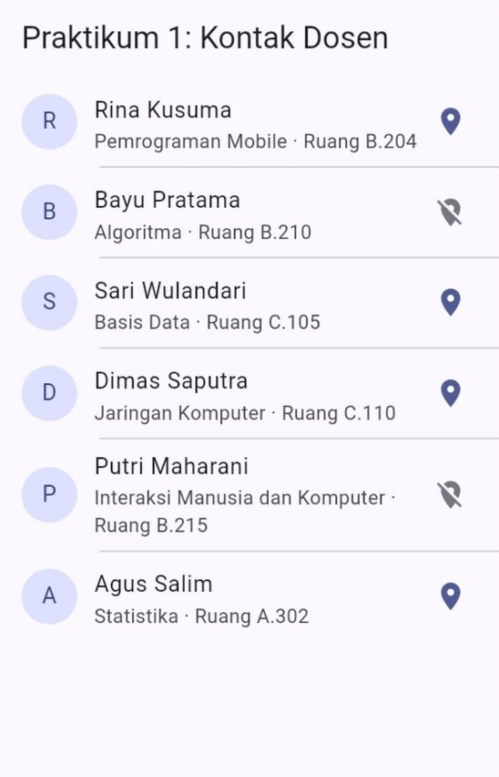
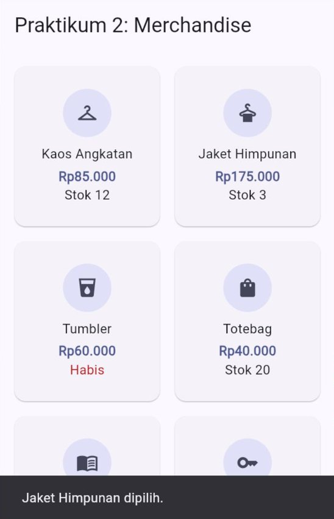
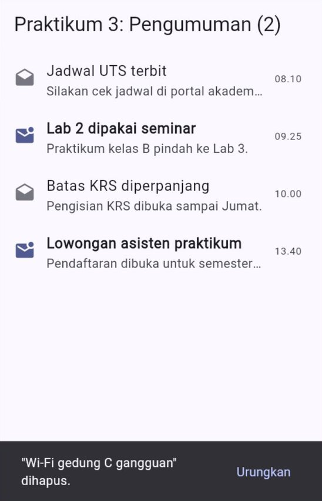
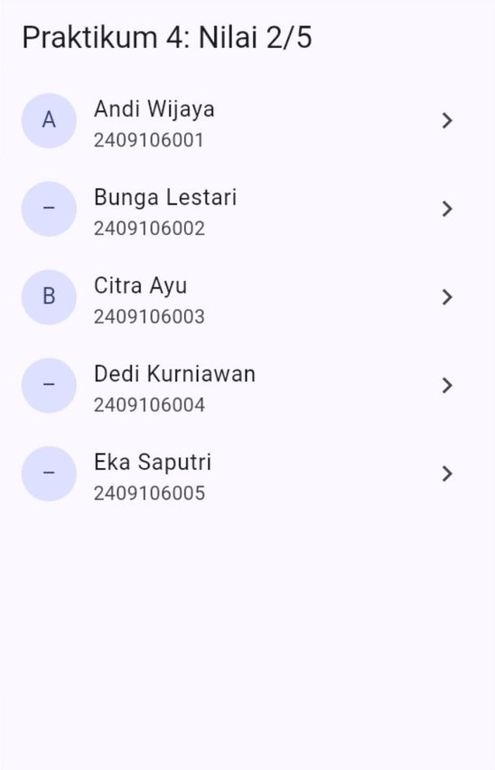
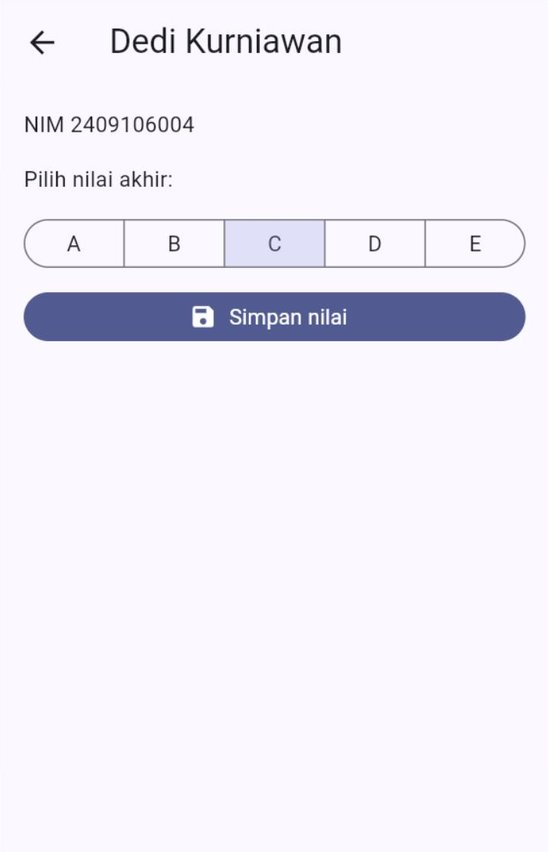
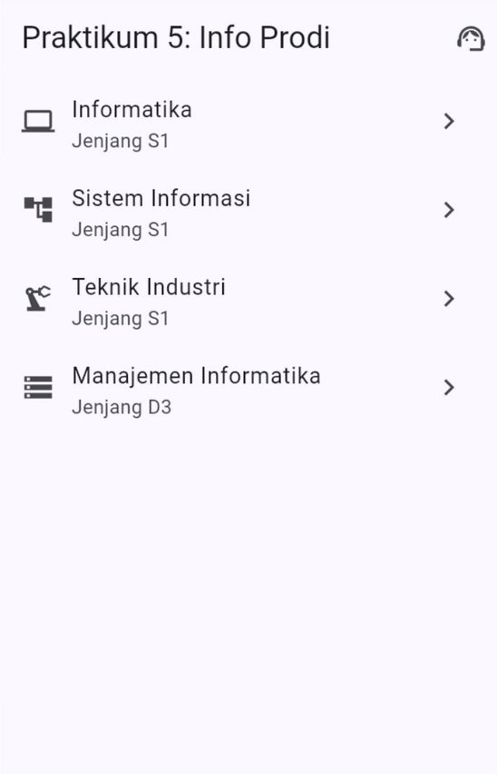
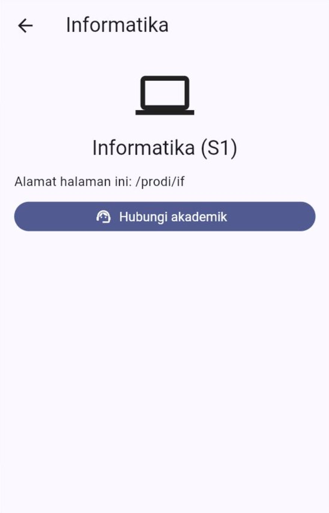

# 🧪 Jobsheet Pertemuan 6 — Daftar Data & Navigasi

[🏠 Beranda](../README.md) · [📖 Modul](README.md) · [✍️ Latihan](LATIHAN.md) · [💻 Kode Contoh](kode/)

| Informasi | Keterangan |
| :--- | :--- |
| Mata kuliah | Pemrograman Piranti Bergerak |
| Pertemuan | 6 — Daftar Data & Navigasi Antarhalaman |
| Bentuk kegiatan | Praktikum individu |
| Estimasi waktu | 120–150 menit |
| Alat | DartPad **atau** proyek Flutter di VS Code yang dijalankan di Chrome. Praktikum 5 memakai paket `go_router` |
| Hasil akhir | Aplikasi "Agenda Acara Kampus" berisi daftar acara yang bisa dicari dan disaring, halaman detail, serta pendaftaran yang hasilnya dikirim kembali ke halaman daftar. Aplikasi nyaman dipakai di layar selebar 360 dan 320 |

---

## 🎯 Tujuan Praktikum

Setelah menyelesaikan jobsheet ini, Anda mampu:

1. Menyimpan data sebagai *class* model dan `List` objek, lalu menampilkannya dengan `ListView.separated`.
2. Menyusun `GridView` yang jumlah kolomnya menyesuaikan lebar layar, dengan tinggi kotak yang aman.
3. Menghapus item dengan gerakan geser lengkap dengan tombol "Urungkan", serta menghitung nilai turunan dari sebuah `Set`.
4. Membuka halaman baru dengan `Navigator`, mengirim data ke halaman itu, dan menerima hasilnya kembali.
5. Menyusun peta rute `go_router` yang memiliki parameter alamat dan halaman "tidak ditemukan".

## 📌 Petunjuk Umum

> [!IMPORTANT]
> 1. Setiap praktikum diawali **kode terbimbing**. **Ketik sendiri** kodenya, kecuali bagian yang ditandai *boleh disalin*.
> 2. Jalankan, lalu **coba semuanya**: gulir daftarnya, ketuk itemnya, geser untuk menghapus, lalu buka dan tutup halamannya. Mulai hari ini aplikasi Anda punya lebih dari satu halaman, jadi uji juga **tombol kembali**.
> 3. Kerjakan **🔧 Modifikasi** di setiap praktikum. Jawaban berupa penjelasan ditulis sebagai **komentar** di dalam kode.
> 4. Simpan setiap praktikum sebagai berkas terpisah berisi kode **lengkap** (kerangka + data + halaman): `praktikum1.dart`, `praktikum2.dart`, dan seterusnya.
> 5. Rapikan kode sebelum menyimpan: tombol **Format** di DartPad, atau `Shift` + `Alt` + `F` di VS Code. Pastikan tidak ada garis merah maupun kuning.

> [!TIP]
> - Gambar **✅ Hasil yang diharapkan** diambil pada layar selebar **360**. Keterangan di atas setiap gambar menjelaskan apa saja yang dilakukan sebelum gambar diambil, jadi Anda bisa mengulanginya dan membandingkan hasilnya.
> - Di browser tidak ada layar sentuh. Untuk **menggeser** item, tahan klik kiri pada item, tarik *mouse* ke samping, lalu lepaskan.

<details>
<summary>❓ Lupa cara menjalankan aplikasi Flutter?</summary>

- **DartPad:** buka <https://dartpad.dev>, hapus kode bawaannya, tempelkan kode Anda, lalu klik **Run**. Simpan hasil pekerjaan dengan menyalin kodenya ke berkas `.dart` di komputer Anda.
- **Proyek Flutter:** buka proyek latihan dari Pertemuan 1 di VS Code, ganti seluruh isi `lib/main.dart` dengan kode Anda, lalu jalankan dengan **F5** (atau `flutter run -d chrome` di terminal). Untuk *hot reload*, simpan berkas jika dijalankan dari VS Code, atau tekan `r` jika dijalankan dari terminal. Jika Anda mengubah **isi data** atau **nilai awal** sebuah *state*, lakukan *hot restart* dengan menekan `R` di terminal ([Modul Pertemuan 5, Bagian 2.6](../pertemuan_05_interaksi_dan_state/README.md#26-hot-reload-tetap-menyimpan-state)).

Penjelasan lengkap ada di [Modul Pertemuan 1, Bagian 9](../pertemuan_01_pengenalan_flutter/README.md#9-menjalankan-aplikasi).
</details>

---

## Kerangka Aplikasi (dipakai di Praktikum 1–4)

Kerangka ini sama seperti Pertemuan 5, hanya warna benihnya diganti `Colors.indigo`. Kerangka ini **boleh disalin**:

```dart
import 'package:flutter/material.dart';

void main() {
  runApp(const AplikasiPraktikum());
}

class AplikasiPraktikum extends StatelessWidget {
  const AplikasiPraktikum({super.key});

  @override
  Widget build(BuildContext context) {
    return MaterialApp(
      debugShowCheckedModeBanner: false,
      theme: ThemeData(
        colorScheme: ColorScheme.fromSeed(seedColor: Colors.indigo),
      ),
      home: const HalamanPraktikum(),
    );
  }
}
```

Di **bawah** kerangka tersebut, ketik bagian-bagian dari setiap praktikum secara berurutan. Mulai hari ini, selain halaman, Anda juga mengetik ***class* model** untuk datanya dan **widget satu baris** untuk tampilannya ([Modul Bagian 2](README.md#2-menyiapkan-data-class-model-dan-list-objek) dan [Bagian 4.2](README.md#42-satu-baris--satu-widget-kecil)).

Praktikum 5 **tidak** memakai kerangka ini, karena `MaterialApp` diganti `MaterialApp.router`. Kode lengkapnya diberikan di sana.

---

## Praktikum 1 — Kontak Dosen

**Konsep:** *class* model, `List` berisi objek, `ListView.separated`, widget satu baris, dan *getter* sebagai nilai turunan. ([Modul Bagian 2](README.md#2-menyiapkan-data-class-model-dan-list-objek) dan [Bagian 4](README.md#4-listviewseparated-dan-desain-satu-baris))

Program studi ingin daftar kontak dosen yang memuat nama, bidang keahlian, ruang, dan keterangan apakah dosen sedang berada di kampus.

### Langkah 1 — *Class* model `Dosen` (ketik sendiri)

```dart
class Dosen {
  const Dosen({
    required this.nama,
    required this.bidang,
    required this.ruang,
    required this.diKampus,
  });

  final String nama;
  final String bidang;
  final String ruang;
  final bool diKampus;

  // Nilai turunan: huruf pertama nama, untuk lingkaran di kiri.
  String get inisial => nama.substring(0, 1);
}
```

`inisial` adalah ***getter*** (Pertemuan 3). Nilainya dihitung dari `nama` setiap kali dibaca, sehingga tidak perlu disimpan sebagai properti tersendiri. `substring(0, 1)` mengambil huruf pertama (Pertemuan 2).

### Langkah 2 — Data dosen (boleh disalin)

```dart
const List<Dosen> daftarDosen = [
  Dosen(
    nama: 'Rina Kusuma',
    bidang: 'Pemrograman Mobile',
    ruang: 'B.204',
    diKampus: true,
  ),
  Dosen(
    nama: 'Bayu Pratama',
    bidang: 'Algoritma',
    ruang: 'B.210',
    diKampus: false,
  ),
  Dosen(
    nama: 'Sari Wulandari',
    bidang: 'Basis Data',
    ruang: 'C.105',
    diKampus: true,
  ),
  Dosen(
    nama: 'Dimas Saputra',
    bidang: 'Jaringan Komputer',
    ruang: 'C.110',
    diKampus: true,
  ),
  Dosen(
    nama: 'Putri Maharani',
    bidang: 'Interaksi Manusia dan Komputer',
    ruang: 'B.215',
    diKampus: false,
  ),
  Dosen(
    nama: 'Agus Salim',
    bidang: 'Statistika',
    ruang: 'A.302',
    diKampus: true,
  ),
];
```

Semua nama di atas fiktif.

### Langkah 3 — Halaman dan widget satu baris (ketik sendiri)

```dart
class HalamanPraktikum extends StatelessWidget {
  const HalamanPraktikum({super.key});

  @override
  Widget build(BuildContext context) {
    return Scaffold(
      appBar: AppBar(title: const Text('Praktikum 1: Kontak Dosen')),
      body: ListView.separated(
        itemCount: daftarDosen.length,
        // Garis pemisah dimulai sejajar teks, tidak di bawah lingkaran.
        separatorBuilder: (BuildContext context, int index) {
          return const Divider(height: 1, indent: 72);
        },
        itemBuilder: (BuildContext context, int index) {
          return BarisDosen(dosen: daftarDosen[index]);
        },
      ),
    );
  }
}

class BarisDosen extends StatelessWidget {
  const BarisDosen({super.key, required this.dosen});

  final Dosen dosen;

  @override
  Widget build(BuildContext context) {
    final ColorScheme warna = Theme.of(context).colorScheme;

    return ListTile(
      leading: CircleAvatar(
        backgroundColor: warna.primaryContainer,
        child: Text(dosen.inisial),
      ),
      title: Text(dosen.nama),
      subtitle: Text('${dosen.bidang} · Ruang ${dosen.ruang}'),
      // Bentuk DAN warna ikon berbeda, agar tetap jelas walau tanpa warna.
      trailing: Icon(
        dosen.diKampus ? Icons.location_on : Icons.location_off,
        color: dosen.diKampus ? warna.primary : warna.outline,
        semanticLabel: dosen.diKampus ? 'Di kampus' : 'Di luar kampus',
      ),
    );
  }
}
```

✅ **Hasil yang diharapkan** (saat aplikasi baru dibuka):

<p align="center"></p>

> [!NOTE]
> Keterangan "di kampus" dibedakan dari **bentuk** ikonnya (`location_on` dan `location_off`), bukan hanya dari warnanya. Dengan begitu pengguna yang sulit membedakan warna tetap bisa membacanya. `semanticLabel` membuat pembaca layar (*screen reader*) menyebutkan "Di kampus" atau "Di luar kampus".

🔧 **Modifikasi:**

1. Tambahkan **dua** dosen baru ke `daftarDosen` (nama dan bidang bebas; satu di kampus, satu di luar kampus), lalu lakukan *hot restart*. Jawab sebagai komentar: mengapa daftar langsung bertambah, padahal kode `ListView.separated` tidak diubah sedikit pun?
2. Tampilkan jumlah dosen di judul, misalnya **"Praktikum 1: Kontak Dosen (8)"**. Angkanya harus diambil dari `daftarDosen.length`, bukan diketik manual.
3. Tambahkan properti **`email`** (`String`, `required`) pada `Dosen`, lalu isi untuk semua dosen, misalnya `rina@kampus.ac.id`. Saat sebuah baris **diketuk**, tampilkan `SnackBar` **"Email Rina Kusuma: rina@kampus.ac.id"**. Tutup dulu pesan yang lama dengan `hideCurrentSnackBar()`. (Petunjuk: properti `onTap` milik `ListTile`.)
4. **Eksperimen:** ubah `indent: 72` menjadi `indent: 0`, lalu `indent: 16`, dan amati garis pemisahnya. Jawab sebagai komentar: mengapa angka **72** membuat garis dimulai tepat sejajar nama dosen? (Petunjuk: jumlahkan tiga jarak di sebelah kiri nama, yaitu jarak tepi kiri `ListTile` 16, lebar lingkaran `CircleAvatar` 40, dan jarak lingkaran ke teks 16.) Kembalikan ke 72 setelahnya.
5. **Tantangan:** ubah *getter* `inisial` agar menghasilkan **dua huruf**, yaitu huruf pertama nama depan dan huruf pertama nama belakang: `'Rina Kusuma'` → `'RK'`, `'Putri Maharani'` → `'PM'`. Nama yang hanya terdiri atas satu kata tetap menghasilkan satu huruf, misalnya `'Wulan'` → `'W'`. (Petunjuk: `nama.split(' ')` dari Pertemuan 2 menghasilkan `['Rina', 'Kusuma']`.)

---

## Praktikum 2 — Etalase Merchandise Himpunan

**Konsep:** `GridView.builder`, `SliverGridDelegateWithMaxCrossAxisExtent`, `mainAxisExtent`, kotak yang bisa diketuk (`Card` + `InkWell`), dan teks yang dibatasi `maxLines`. ([Modul Bagian 5](README.md#5-gridview-daftar-berbentuk-kotak))

Himpunan mahasiswa menjual merchandise dan ingin menampilkannya sebagai kotak-kotak, seperti etalase di aplikasi belanja.

### Langkah 1 — Data barang dan `formatRupiah` (boleh disalin)

```dart
class Barang {
  const Barang(this.nama, this.harga, this.stok, this.ikon);

  final String nama;
  final int harga;
  final int stok;
  final IconData ikon;
}

const List<Barang> daftarBarang = [
  Barang('Kaos Angkatan', 85000, 12, Icons.checkroom),
  Barang('Jaket Himpunan', 175000, 3, Icons.dry_cleaning),
  Barang('Tumbler', 60000, 0, Icons.local_drink),
  Barang('Totebag', 40000, 20, Icons.shopping_bag),
  Barang('Buku Catatan', 25000, 35, Icons.menu_book),
  Barang('Gantungan Kunci', 15000, 0, Icons.key),
  Barang('Payung Lipat', 70000, 8, Icons.umbrella),
  Barang('Stiker (1 set)', 10000, 50, Icons.sticky_note_2),
];

// Mengubah 15000 menjadi "Rp15.000" (sama seperti Pertemuan 5).
String formatRupiah(int angka) {
  final String digit = angka.toString();
  String hasil = '';
  for (int i = 0; i < digit.length; i++) {
    final int sisaDiKanan = digit.length - i;
    if (i > 0 && sisaDiKanan % 3 == 0) {
      hasil += '.';
    }
    hasil += digit[i];
  }
  return 'Rp$hasil';
}
```

### Langkah 2 — Halaman dan kotak barang (ketik sendiri)

```dart
class HalamanPraktikum extends StatelessWidget {
  const HalamanPraktikum({super.key});

  @override
  Widget build(BuildContext context) {
    return Scaffold(
      appBar: AppBar(title: const Text('Praktikum 2: Merchandise')),
      body: GridView.builder(
        padding: const EdgeInsets.all(12),
        gridDelegate: const SliverGridDelegateWithMaxCrossAxisExtent(
          maxCrossAxisExtent: 170,
          mainAxisExtent: 180,
          mainAxisSpacing: 8,
          crossAxisSpacing: 8,
        ),
        itemCount: daftarBarang.length,
        itemBuilder: (BuildContext context, int index) {
          return KotakBarang(barang: daftarBarang[index]);
        },
      ),
    );
  }
}

class KotakBarang extends StatelessWidget {
  const KotakBarang({super.key, required this.barang});

  final Barang barang;

  @override
  Widget build(BuildContext context) {
    final ColorScheme warna = Theme.of(context).colorScheme;
    final bool habis = barang.stok == 0;

    return Card(
      clipBehavior: Clip.antiAlias,
      child: InkWell(
        onTap: () {
          final ScaffoldMessengerState pesan = ScaffoldMessenger.of(context);
          pesan.hideCurrentSnackBar();
          pesan.showSnackBar(
            SnackBar(content: Text('${barang.nama} dipilih.')),
          );
        },
        child: Padding(
          padding: const EdgeInsets.all(12),
          child: Column(
            mainAxisAlignment: MainAxisAlignment.center,
            children: [
              CircleAvatar(
                radius: 26,
                backgroundColor: warna.secondaryContainer,
                child: Icon(barang.ikon, color: warna.onSecondaryContainer),
              ),
              const SizedBox(height: 8),
              Text(
                barang.nama,
                textAlign: TextAlign.center,
                maxLines: 2,
                overflow: TextOverflow.ellipsis,
              ),
              const SizedBox(height: 4),
              Text(
                formatRupiah(barang.harga),
                style: TextStyle(
                  color: warna.primary,
                  fontWeight: FontWeight.bold,
                ),
              ),
              // Keterangan stok: "Habis" ditulis dengan warna error.
              Text(
                habis ? 'Habis' : 'Stok ${barang.stok}',
                style: TextStyle(color: habis ? warna.error : null),
              ),
            ],
          ),
        ),
      ),
    );
  }
}
```

✅ **Hasil yang diharapkan** (setelah kotak **Jaket Himpunan** diketuk):

<p align="center"></p>

Jika Anda menjalankannya di Chrome, coba perlebar jendela browser. Jumlah kolom bertambah dengan sendirinya, karena yang kita tentukan adalah **lebar maksimal** kotak, bukan jumlah kolomnya.

🔧 **Modifikasi:**

1. Barang yang stoknya habis **tidak bisa diketuk**: tidak ada efek riak dan `SnackBar` tidak muncul. (Petunjuk: `onTap: habis ? null : () { ... }`.)
2. Tambahkan **dua** barang baru, salah satunya dengan stok 0. Ikon bebas, misalnya `Icons.watch` atau `Icons.backpack`.
3. Ubah `maxCrossAxisExtent` menjadi **120**, lalu **250**, lalu **400**. Untuk setiap nilai, catat sebagai komentar berapa kolom yang tampil di lebar 360, lalu cocokkan dengan perhitungan "lebar tersedia ÷ (lebar maksimal + jarak antarkotak), dibulatkan ke atas" dari [Modul Bagian 5.2](README.md#52-dua-cara-menentukan-jumlah-kolom). Lebar tersedia di layar 360 adalah 336, karena ada *padding* 12 di kiri dan kanan. Kembalikan ke 170 setelahnya.
4. **Eksperimen:** hapus `mainAxisExtent: 180`, lalu tambahkan `childAspectRatio: 1` di tempatnya. Jalankan di lebar 360 dan 320. Tulis sebagai komentar: apa yang terjadi pada kotak-kotaknya, dan mengapa ([Modul Bagian 5.3](README.md#53-tinggi-kotak-mainaxisextent-lebih-aman))? Kembalikan seperti semula.
5. **Tantangan:** tampilkan ringkasan **"8 barang · 2 habis"** di atas *grid*. Kedua angka dihitung dari `daftarBarang`, sehingga ikut berubah jika data diubah. (Petunjuk: susun ringkasan dan *grid* di dalam `Column`, dan ingat aturan [Modul Bagian 6](README.md#6-daftar-di-dalam-column). Jumlah barang habis bisa dihitung dengan `where(...)` dari Pertemuan 2.)

---

## Praktikum 3 — Kotak Masuk Pengumuman

**Konsep:** `List` di dalam *State*, `Dismissible` dengan `ValueKey`, tombol "Urungkan", `Set` untuk mencatat pengumuman yang sudah dibaca, dan nilai turunan. ([Modul Bagian 7](README.md#7-geser-untuk-menghapus-dan-peran-key))

Aplikasi akademik punya kotak masuk pengumuman. Pengumuman yang belum dibaca ditulis tebal, dan jumlahnya tampil di judul. Pengumuman yang tidak diperlukan bisa dihapus dengan menggesernya ke kiri.

Ketik sendiri seluruh kode berikut. Isi `_daftar` (lima pengumuman) **boleh disalin**.

```dart
class Pengumuman {
  const Pengumuman(this.id, this.judul, this.isi, this.waktu);

  final int id; // unik dan tetap, dipakai sebagai Key
  final String judul;
  final String isi;
  final String waktu;
}

class HalamanPraktikum extends StatefulWidget {
  const HalamanPraktikum({super.key});

  @override
  State<HalamanPraktikum> createState() => _HalamanPraktikumState();
}

class _HalamanPraktikumState extends State<HalamanPraktikum> {
  final List<Pengumuman> _daftar = [
    const Pengumuman(
      1,
      'Jadwal UTS terbit',
      'Silakan cek jadwal di portal akademik.',
      '08.10',
    ),
    const Pengumuman(
      2,
      'Lab 2 dipakai seminar',
      'Praktikum kelas B pindah ke Lab 3.',
      '09.25',
    ),
    const Pengumuman(
      3,
      'Batas KRS diperpanjang',
      'Pengisian KRS dibuka sampai Jumat.',
      '10.00',
    ),
    const Pengumuman(
      4,
      'Lowongan asisten praktikum',
      'Pendaftaran dibuka untuk semester 5.',
      '13.40',
    ),
    const Pengumuman(
      5,
      'Wi-Fi gedung C gangguan',
      'Perbaikan selesai pukul 16.00.',
      '14.15',
    ),
  ];

  // Id pengumuman yang sudah dibaca. Set: tiap id hanya tersimpan sekali.
  final Set<int> _dibaca = {};

  // Nilai turunan: berapa pengumuman yang belum dibaca.
  int get _jumlahBaru {
    return _daftar.where((Pengumuman p) => !_dibaca.contains(p.id)).length;
  }

  void _hapus(int indeks) {
    final Pengumuman terhapus = _daftar[indeks];
    setState(() {
      _daftar.removeAt(indeks);
    });

    final ScaffoldMessengerState pesan = ScaffoldMessenger.of(context);
    pesan.hideCurrentSnackBar();
    pesan.showSnackBar(
      SnackBar(
        content: Text('"${terhapus.judul}" dihapus.'),
        action: SnackBarAction(
          label: 'Urungkan',
          onPressed: () {
            setState(() {
              _daftar.insert(indeks, terhapus);
            });
          },
        ),
        persist: false,
      ),
    );
  }

  @override
  Widget build(BuildContext context) {
    final ColorScheme warna = Theme.of(context).colorScheme;

    return Scaffold(
      appBar: AppBar(title: Text('Praktikum 3: Pengumuman ($_jumlahBaru)')),
      body: _daftar.isEmpty
          ? const Center(child: Text('Kotak masuk kosong.'))
          : ListView.builder(
              itemCount: _daftar.length,
              itemBuilder: (BuildContext context, int index) {
                final Pengumuman p = _daftar[index];
                final bool sudahDibaca = _dibaca.contains(p.id);
                return Dismissible(
                  key: ValueKey<int>(p.id),
                  direction: DismissDirection.endToStart,
                  background: Container(
                    color: warna.errorContainer,
                    alignment: Alignment.centerRight,
                    padding: const EdgeInsets.symmetric(horizontal: 24),
                    child: Icon(Icons.delete, color: warna.onErrorContainer),
                  ),
                  onDismissed: (DismissDirection arah) {
                    _hapus(index);
                  },
                  child: ListTile(
                    leading: Icon(
                      sudahDibaca ? Icons.drafts : Icons.mark_email_unread,
                      color: sudahDibaca ? warna.outline : warna.primary,
                    ),
                    // Belum dibaca = tebal, sudah dibaca = biasa.
                    title: Text(
                      p.judul,
                      style: TextStyle(
                        fontWeight: sudahDibaca
                            ? FontWeight.normal
                            : FontWeight.bold,
                      ),
                    ),
                    subtitle: Text(
                      p.isi,
                      maxLines: 1,
                      overflow: TextOverflow.ellipsis,
                    ),
                    trailing: Text(p.waktu),
                    onTap: () {
                      setState(() {
                        _dibaca.add(p.id);
                      });
                    },
                  ),
                );
              },
            ),
    );
  }
}
```

✅ **Hasil yang diharapkan** (setelah mengetuk "Jadwal UTS terbit" dan "Batas KRS diperpanjang", lalu menggeser "Wi-Fi gedung C gangguan" ke kiri):

<p align="center"></p>

Sekarang tekan **"Urungkan"**. Pengumuman Wi-Fi kembali ke posisi semula, dan angka di judul kembali menjadi 3. Coba juga hapus kelima pengumuman untuk melihat tulisan "Kotak masuk kosong."

> [!NOTE]
> Mengapa `_dibaca` berupa `Set<int>`, bukan `List<int>`? Jika pengumuman yang sama diketuk dua kali, isi `Set` tidak bertambah, karena `Set` hanya menyimpan setiap nilai **satu kali** (Pertemuan 2). Dengan `List`, `id` yang sama bisa tercatat dua kali.

🔧 **Modifikasi:**

1. Tambahkan `IconButton` **"Tandai semua sudah dibaca"** (ikon `Icons.done_all`, lengkap dengan `tooltip`) di `actions` milik `AppBar`. Tombol ini mencatat semua pengumuman sebagai sudah dibaca, dan **nonaktif** jika tidak ada lagi pengumuman baru.
2. Ketukan pada pengumuman yang **sudah** dibaca mengembalikannya menjadi **belum** dibaca. (Petunjuk: `_dibaca.contains(...)`, `add(...)`, dan `remove(...)`.)
3. Izinkan geser ke **dua arah** dengan `DismissDirection.horizontal`. Saat digeser ke kanan, ikon tempat sampah harus tampil di **kiri**. (Petunjuk: `background` dipakai saat item digeser ke kanan. Untuk geser ke kiri, tambahkan `secondaryBackground` dengan ikon di kanan.)
4. **Eksperimen:** ganti `ValueKey<int>(p.id)` menjadi `ValueKey<int>(index)`. Lakukan *hot restart*, lalu hapus pengumuman **pertama** dengan menggesernya. Catat apa yang terjadi. Lakukan *hot restart* lagi, lalu hapus pengumuman **terakhir**. Jawab sebagai komentar: mengapa hasil kedua percobaan berbeda ([Modul Bagian 7.2](README.md#72-mengapa-key-wajib-ada))? Kembalikan ke `p.id` setelahnya.
5. **Eksperimen:** ganti sementara isi *getter* `_jumlahBaru` menjadi `return _daftar.length - _dibaca.length;`. Ketuk satu pengumuman agar terbaca, lalu hapus pengumuman **itu juga** dengan menggesernya. Jawab sebagai komentar: mengapa angka di judul sekarang salah, dan mengapa versi aslinya tidak? Kembalikan seperti semula.

---

## Praktikum 4 — Pemberian Nilai Mahasiswa

**Konsep:** `Navigator.push`, mengirim data lewat *constructor*, membaca `widget` di `initState`, `Navigator.pop(context, hasil)`, memeriksa `mounted` dan hasil `null`, serta `Map` sebagai *state*. ([Modul Bagian 9](README.md#9-navigator-tumpukan-halaman), [10](README.md#10-mengirim-data-ke-halaman-tujuan), dan [11](README.md#11-menerima-hasil-dari-halaman))

Dosen ingin memberi nilai akhir mahasiswa satu per satu. Halaman pertama berisi daftar mahasiswa. Mengetuk seorang mahasiswa membuka halaman kedua untuk memilih nilai, lalu nilainya **dikirim kembali** ke halaman pertama.

Praktikum ini terdiri atas tiga langkah. Salin Langkah 1, lalu ketik sendiri Langkah 2 dan 3 secara berurutan di bawah kerangka.

### Langkah 1 — Data mahasiswa (boleh disalin)

```dart
class Mahasiswa {
  const Mahasiswa(this.nim, this.nama);

  final String nim;
  final String nama;
}

const List<Mahasiswa> daftarMahasiswa = [
  Mahasiswa('2409106001', 'Andi Wijaya'),
  Mahasiswa('2409106002', 'Bunga Lestari'),
  Mahasiswa('2409106003', 'Citra Ayu'),
  Mahasiswa('2409106004', 'Dedi Kurniawan'),
  Mahasiswa('2409106005', 'Eka Saputri'),
];

const List<String> pilihanNilai = ['A', 'B', 'C', 'D', 'E'];
```

### Langkah 2 — Halaman pertama: daftar mahasiswa (ketik sendiri)

```dart
// ---------- Halaman 1: daftar mahasiswa ----------
class HalamanPraktikum extends StatefulWidget {
  const HalamanPraktikum({super.key});

  @override
  State<HalamanPraktikum> createState() => _HalamanPraktikumState();
}

class _HalamanPraktikumState extends State<HalamanPraktikum> {
  // Nilai yang sudah diberikan: NIM -> huruf nilai.
  final Map<String, String> _nilai = {};

  Future<void> _beriNilai(Mahasiswa mahasiswa) async {
    final String? hasil = await Navigator.push<String>(
      context,
      MaterialPageRoute<String>(
        builder: (BuildContext context) {
          return HalamanNilai(
            mahasiswa: mahasiswa,
            nilaiAwal: _nilai[mahasiswa.nim],
          );
        },
      ),
    );
    if (!mounted) return;
    if (hasil == null) return; // kembali tanpa menyimpan

    setState(() {
      _nilai[mahasiswa.nim] = hasil;
    });
  }

  @override
  Widget build(BuildContext context) {
    return Scaffold(
      appBar: AppBar(
        title: Text(
          'Praktikum 4: Nilai ${_nilai.length}/${daftarMahasiswa.length}',
        ),
      ),
      body: ListView.builder(
        itemCount: daftarMahasiswa.length,
        itemBuilder: (BuildContext context, int index) {
          final Mahasiswa mahasiswa = daftarMahasiswa[index];
          final String? nilai = _nilai[mahasiswa.nim];
          return ListTile(
            leading: CircleAvatar(child: Text(nilai ?? '–')),
            title: Text(mahasiswa.nama),
            subtitle: Text(mahasiswa.nim),
            trailing: const Icon(Icons.chevron_right),
            onTap: () => _beriNilai(mahasiswa),
          );
        },
      ),
    );
  }
}
```

Perhatikan `_beriNilai`. Halaman pertama **menunggu** (`await`) sampai halaman kedua ditutup. Selama menunggu, halaman pertama bisa saja sudah tidak ada, sehingga `mounted` diperiksa lebih dulu. Hasilnya bisa `null` jika halaman kedua ditutup tanpa menyimpan ([Modul Bagian 11.3](README.md#113-halaman-pertama-await-hasilnya)).

### Langkah 3 — Halaman kedua: memilih nilai (ketik sendiri)

```dart
// ---------- Halaman 2: memberi nilai satu mahasiswa ----------
class HalamanNilai extends StatefulWidget {
  const HalamanNilai({super.key, required this.mahasiswa, this.nilaiAwal});

  final Mahasiswa mahasiswa;
  final String? nilaiAwal; // null jika belum pernah dinilai

  @override
  State<HalamanNilai> createState() => _HalamanNilaiState();
}

class _HalamanNilaiState extends State<HalamanNilai> {
  String? _pilihan;

  @override
  void initState() {
    super.initState();
    // Mulai dari nilai lama (jika ada) yang dikirim halaman pertama.
    _pilihan = widget.nilaiAwal;
  }

  @override
  Widget build(BuildContext context) {
    final String? pilihan = _pilihan;

    return Scaffold(
      appBar: AppBar(title: Text(widget.mahasiswa.nama)),
      body: Padding(
        padding: const EdgeInsets.all(16),
        child: Column(
          crossAxisAlignment: CrossAxisAlignment.stretch,
          spacing: 16,
          children: [
            Text('NIM ${widget.mahasiswa.nim}'),
            const Text('Pilih nilai akhir:'),
            SegmentedButton<String>(
              segments: [
                for (final String huruf in pilihanNilai)
                  ButtonSegment<String>(value: huruf, label: Text(huruf)),
              ],
              selected: pilihan == null ? <String>{} : <String>{pilihan},
              emptySelectionAllowed: true,
              showSelectedIcon: false,
              onSelectionChanged: (Set<String> baru) {
                setState(() {
                  _pilihan = baru.isEmpty ? null : baru.first;
                });
              },
            ),
            FilledButton.icon(
              // Aktif hanya jika sudah ada nilai yang dipilih.
              onPressed: pilihan == null
                  ? null
                  : () => Navigator.pop(context, pilihan),
              icon: const Icon(Icons.save),
              label: const Text('Simpan nilai'),
            ),
          ],
        ),
      ),
    );
  }
}
```

`nilaiAwal` adalah nilai lama yang dikirim halaman pertama lewat *constructor*. Properti widget tidak boleh diubah (`final`), jadi `initState` **menyalinnya** ke `_pilihan`, dan `_pilihan`-lah yang berubah saat pengguna memilih ([Modul Pertemuan 5, Bagian 2.3](../pertemuan_05_interaksi_dan_state/README.md#23-membaca-pengaturan-dengan-widget)).

✅ **Hasil yang diharapkan** (kiri: setelah Andi Wijaya diberi nilai A dan Citra Ayu nilai B; kanan: halaman nilai Dedi Kurniawan setelah memilih C):

<p align="center">
  
  &nbsp;
  
</p>

Urutan uji yang disarankan:

1. Ketuk **Andi Wijaya**. Halaman nilai terbuka, belum ada nilai yang terpilih, dan tombol **"Simpan nilai"** masih abu-abu.
2. Pilih **A**, lalu tekan **"Simpan nilai"**. Anda kembali ke daftar, lingkaran Andi berisi **A**, dan judul menjadi **Nilai 1/5**.
3. Ketuk Andi lagi. Nilai **A** sudah terpilih, karena dikirim sebagai `nilaiAwal`. Pilih **B**, tetapi kali ini tekan **panah kembali** di `AppBar`. Nilai Andi tetap **A**, karena halaman ditutup tanpa hasil.
4. Ketuk Andi sekali lagi, lalu ketuk **A** yang sedang terpilih. Pilihannya terlepas dan tombol simpan kembali abu-abu. Ini terjadi karena `emptySelectionAllowed: true`.

🔧 **Modifikasi:**

1. Mahasiswa bernilai **D** atau **E** ditandai ikon peringatan `Icons.warning_amber` berwarna *error* (`colorScheme.error`) sebagai `trailing`, menggantikan ikon panah. Mahasiswa lain tetap memakai ikon panah.
2. **Tekan lama** (`onLongPress`) sebuah baris untuk **menghapus** nilai mahasiswa itu, lalu tampilkan `SnackBar` **"Nilai Andi Wijaya dihapus."**. Mahasiswa yang belum punya nilai tidak memunculkan `SnackBar` apa pun. (Petunjuk: `_nilai.remove(mahasiswa.nim)` di dalam `setState`.)
3. Di halaman nilai, tampilkan keterangan di bawah tombol huruf: A = **"Sangat baik"**, B = **"Baik"**, C = **"Cukup"**, D = **"Kurang"**, E = **"Tidak lulus"**. Jika belum ada nilai yang dipilih, tampilkan **"Belum ada nilai yang dipilih."**. (Petunjuk: `switch` ekspresi dari Pertemuan 2.)
4. **Eksperimen:** tambahkan `debugPrint('Hasil dari halaman nilai: $hasil');` tepat di bawah baris `await` di `_beriNilai`. Buka halaman nilai, lalu (a) pilih B dan tekan "Simpan nilai"; (b) buka lagi, pilih C, lalu tekan panah kembali. Catat apa yang tercetak di konsol untuk (a) dan (b), lalu jelaskan sebagai komentar mengapa baris `if (hasil == null) return;` diperlukan.
5. **Tantangan:** tampilkan **rata-rata kelas** di bagian bawah layar (`bottomNavigationBar`), dengan bobot A = 4, B = 3, C = 2, D = 1, E = 0. Contoh: **"Rata-rata: 3,50 dari 2 mahasiswa"**. Mahasiswa yang belum dinilai tidak ikut dihitung. Jika belum ada nilai sama sekali, tampilkan **"Belum ada nilai."**. Rata-rata harus berupa **nilai turunan** dari `_nilai`. (Petunjuk: `toStringAsFixed(2)` dan `replaceAll('.', ',')` dari Pertemuan 2.)

---

## Praktikum 5 — Info Prodi dengan `go_router`

**Konsep:** paket `go_router`, `GoRouter` dan `GoRoute`, rute anak, parameter alamat, `MaterialApp.router`, `context.go` dan `context.push`, serta `errorBuilder`. ([Modul Bagian 13](README.md#13-go_router-navigasi-berbasis-alamat))

Fakultas ingin aplikasi info program studi yang setiap halamannya punya **alamat**, misalnya `/prodi/if` untuk Informatika.

**Persiapan:**

- **DartPad:** paket `go_router` sudah tersedia. Langsung saja ke Langkah 1.
- **Proyek Flutter (VS Code):** tambahkan `go_router: ^17.5.0` di bawah `dependencies:` pada `pubspec.yaml`, simpan, lalu jalankan `flutter pub get` jika paketnya belum terunduh. Langkah lengkapnya ada di [Modul Bagian 13.2](README.md#132-memasang-paket-go_router).

Praktikum ini **tidak** memakai kerangka di atas. Tulis ketiga langkah berikut secara berurutan dalam satu berkas.

### Langkah 1 — *Import*, `main`, dan data (boleh disalin)

```dart
import 'package:flutter/material.dart';
import 'package:go_router/go_router.dart';

void main() {
  runApp(const AplikasiPraktikum());
}

class Prodi {
  const Prodi(this.kode, this.nama, this.jenjang, this.ikon);

  final String kode; // dipakai di alamat: /prodi/if
  final String nama;
  final String jenjang;
  final IconData ikon;
}

const List<Prodi> daftarProdi = [
  Prodi('if', 'Informatika', 'S1', Icons.computer),
  Prodi('si', 'Sistem Informasi', 'S1', Icons.account_tree),
  Prodi('ti', 'Teknik Industri', 'S1', Icons.precision_manufacturing),
  Prodi('mi', 'Manajemen Informatika', 'D3', Icons.storage),
];

Prodi? cariProdi(String kode) {
  for (final Prodi prodi in daftarProdi) {
    if (prodi.kode == kode) {
      return prodi;
    }
  }
  return null;
}
```

`cariProdi` mengembalikan `Prodi?`: objek prodi jika kodenya ditemukan, atau `null` jika tidak ada (Pertemuan 2).

### Langkah 2 — Peta rute dan aplikasi (ketik sendiri)

```dart
// ---------- Peta rute ----------
final GoRouter petaRute = GoRouter(
  routes: [
    GoRoute(
      path: '/',
      builder: (BuildContext context, GoRouterState state) {
        return const HalamanPraktikum();
      },
      routes: [
        GoRoute(
          path: 'prodi/:kode',
          builder: (BuildContext context, GoRouterState state) {
            return HalamanProdi(kode: state.pathParameters['kode']!);
          },
        ),
        GoRoute(
          path: 'kontak',
          builder: (BuildContext context, GoRouterState state) {
            return const HalamanKontak();
          },
        ),
      ],
    ),
  ],
  errorBuilder: (BuildContext context, GoRouterState state) {
    return HalamanSalahAlamat(alamat: state.uri.toString());
  },
);

class AplikasiPraktikum extends StatelessWidget {
  const AplikasiPraktikum({super.key});

  @override
  Widget build(BuildContext context) {
    return MaterialApp.router(
      debugShowCheckedModeBanner: false,
      theme: ThemeData(
        colorScheme: ColorScheme.fromSeed(seedColor: Colors.indigo),
      ),
      routerConfig: petaRute,
    );
  }
}
```

### Langkah 3 — Halaman-halaman (ketik sendiri)

```dart
// ---------- / ----------
class HalamanPraktikum extends StatelessWidget {
  const HalamanPraktikum({super.key});

  @override
  Widget build(BuildContext context) {
    return Scaffold(
      appBar: AppBar(
        title: const Text('Praktikum 5: Info Prodi'),
        actions: [
          IconButton(
            tooltip: 'Kontak akademik',
            onPressed: () => context.push('/kontak'),
            icon: const Icon(Icons.support_agent),
          ),
        ],
      ),
      body: ListView(
        children: [
          for (final Prodi prodi in daftarProdi)
            ListTile(
              leading: Icon(prodi.ikon),
              title: Text(prodi.nama),
              subtitle: Text('Jenjang ${prodi.jenjang}'),
              trailing: const Icon(Icons.chevron_right),
              onTap: () => context.go('/prodi/${prodi.kode}'),
            ),
        ],
      ),
    );
  }
}

// ---------- /prodi/:kode ----------
class HalamanProdi extends StatelessWidget {
  const HalamanProdi({super.key, required this.kode});

  final String kode;

  @override
  Widget build(BuildContext context) {
    final Prodi? prodi = cariProdi(kode);
    if (prodi == null) {
      return HalamanSalahAlamat(alamat: '/prodi/$kode');
    }

    return Scaffold(
      appBar: AppBar(title: Text(prodi.nama)),
      body: Padding(
        padding: const EdgeInsets.all(16),
        child: Column(
          crossAxisAlignment: CrossAxisAlignment.stretch,
          spacing: 12,
          children: [
            Icon(prodi.ikon, size: 64),
            Text(
              '${prodi.nama} (${prodi.jenjang})',
              textAlign: TextAlign.center,
              style: Theme.of(context).textTheme.titleLarge,
            ),
            Text('Alamat halaman ini: /prodi/${prodi.kode}'),
            FilledButton.icon(
              onPressed: () => context.push('/kontak'),
              icon: const Icon(Icons.support_agent),
              label: const Text('Hubungi akademik'),
            ),
          ],
        ),
      ),
    );
  }
}

// ---------- /kontak ----------
class HalamanKontak extends StatelessWidget {
  const HalamanKontak({super.key});

  @override
  Widget build(BuildContext context) {
    return Scaffold(
      appBar: AppBar(title: const Text('Kontak Akademik')),
      body: const ListTile(
        leading: Icon(Icons.mail),
        title: Text('akademik@kampus.ac.id'),
        subtitle: Text('Senin–Jumat, 08.00–15.00'),
      ),
    );
  }
}

// ---------- Alamat yang tidak dikenal ----------
class HalamanSalahAlamat extends StatelessWidget {
  const HalamanSalahAlamat({super.key, required this.alamat});

  final String alamat;

  @override
  Widget build(BuildContext context) {
    return Scaffold(
      appBar: AppBar(title: const Text('Tidak Ditemukan')),
      body: Center(
        child: Padding(
          padding: const EdgeInsets.all(24),
          child: Column(
            mainAxisSize: MainAxisSize.min,
            spacing: 12,
            children: [
              Text('Alamat "$alamat" tidak ada.', textAlign: TextAlign.center),
              FilledButton(
                onPressed: () => context.go('/'),
                child: const Text('Ke beranda'),
              ),
            ],
          ),
        ),
      ),
    );
  }
}
```

✅ **Hasil yang diharapkan** (kiri: beranda saat aplikasi dibuka; kanan: setelah **Informatika** diketuk):

<p align="center">
  
  &nbsp;
  
</p>

Urutan uji yang disarankan:

1. Ketuk **Informatika**. Halaman Informatika terbuka dengan panah kembali di `AppBar`, dan tertulis alamatnya, `/prodi/if`.
2. Tekan **"Hubungi akademik"**. Halaman Kontak Akademik terbuka. Tekan panah kembali: Anda kembali ke halaman **Informatika**, karena halaman kontak dibuka dengan `push` (ditumpuk).
3. Tekan panah kembali sekali lagi untuk kembali ke beranda. Lalu tekan ikon **kontak** di `AppBar` beranda: halaman yang sama terbuka, dan panah kembalinya menuju beranda.

> [!NOTE]
> DartPad memakai `go_router` versi 18, sehingga perpindahan halaman di sana tampil **tanpa animasi**. Itu wajar dan tidak memengaruhi praktikum ini. Di proyek Anda sendiri, pakai `^17.5.0` agar animasinya muncul ([Modul Bagian 13.2](README.md#132-memasang-paket-go_router)).

🔧 **Modifikasi:**

1. Tambahkan prodi kelima, **Sains Data** (kode `ds`, jenjang S1, ikon `Icons.insights`). Jawab sebagai komentar: mengapa Anda **tidak** perlu menambah `GoRoute` baru agar alamat `/prodi/ds` bisa dibuka?
2. Tambahkan dua `ListTile` di bagian bawah beranda: **"Coba prodi yang tidak ada"** yang menjalankan `context.go('/prodi/xyz')`, dan **"Coba alamat yang tidak ada"** yang menjalankan `context.go('/beasiswa')`. Keduanya harus berakhir di halaman "Tidak Ditemukan". Jawab sebagai komentar: bagian kode mana yang menangani **masing-masing** alamat itu?
3. **Eksperimen:** di `HalamanProdi`, ganti `context.push('/kontak')` dengan `context.go('/kontak')`. Buka Informatika, tekan "Hubungi akademik", lalu tekan panah kembali. Ke halaman mana Anda kembali? Bandingkan dengan sebelumnya, lalu jelaskan sebagai komentar ([Modul Bagian 13.4](README.md#134-berpindah-halaman-go-push-dan-pop)). Kembalikan ke `push` setelahnya.
4. Tambahkan halaman **"Tentang Aplikasi"** beralamat `/tentang` (rute anak dari `/`). Halaman ini dibuka dari `IconButton` ber-ikon `Icons.info_outline` di `AppBar` beranda. Isinya bebas, misalnya nama aplikasi, versi, dan nama Anda.
5. **Tantangan:** tambahkan rute anak **`kurikulum`** di bawah `prodi/:kode`, sehingga alamat `/prodi/if/kurikulum` membuka halaman **"Kurikulum Informatika"** berisi minimal empat mata kuliah (boleh sama untuk semua prodi). Halaman ini dibuka dari tombol di halaman prodi dengan `context.push(...)`, dan panah kembalinya menuju halaman prodi. (Petunjuk: tulis `routes: [...]` di dalam `GoRoute` milik `prodi/:kode`. Rute anak tetap bisa membaca `state.pathParameters['kode']`.)

---

## 🏆 Tugas Mandiri — Agenda Acara Kampus

Badan Eksekutif Mahasiswa (BEM) ingin mengganti papan pengumuman acara dengan sebuah aplikasi. Buat **satu aplikasi utuh** bernama `p06_nim_namapanggilan.dart` (huruf kecil semua, misalnya `p06_2609106001_rina.dart`) dengan ketentuan berikut:

1. Judul `AppBar` halaman utama **"Agenda Acara Kampus"**. Warna benih tema bebas.
2. **Data:** *class* model `Acara` dengan `id` unik (`int`), judul, penyelenggara, tanggal (boleh berupa teks, misalnya `'Sabtu, 18 Oktober'`), lokasi, kuota, dan kategori berupa `enum` berproperti (label dan ikon) dengan minimal **3** kategori. Siapkan minimal **8** acara dalam `List` `const`.
3. **Halaman daftar:** acara ditampilkan dengan `ListView.builder` atau `ListView.separated` di dalam `Column` tanpa *error*. Satu baris acara dibuat sebagai **widget tersendiri**, misalnya `BarisAcara`.
4. **Pencarian dan saringan:** kotak pencarian judul acara (huruf besar dan kecil tidak dibedakan) dan `ChoiceChip` kategori, termasuk pilihan "Semua". Data asli tidak diubah: daftar yang tampil berupa **nilai turunan**. Tampilkan jumlah hasil, misalnya **"5 acara ditemukan"**, serta tampilan **hasil kosong** dengan tombol yang mengembalikan semua acara.
5. **Halaman detail:** mengetuk acara membuka halaman detail yang menerima data acara lewat *constructor* (atau lewat alamat `/acara/:id` jika memakai `go_router`), lalu menampilkan seluruh keterangannya.
6. **Mendaftar:** halaman detail punya tombol **"Daftar"** yang menutup halaman sambil **mengirim hasil** ke halaman daftar. Halaman daftar menyimpan `id` acara yang diikuti dalam `Set<int>`, menandai baris acara itu (misalnya dengan ikon centang atau tulisan "Terdaftar"), dan menampilkan `SnackBar`. Jika acara sudah diikuti, tombolnya berganti menjadi **"Batalkan pendaftaran"**. Kembali lewat panah **tanpa** menekan tombol tidak mengubah apa pun. Periksa `mounted` setelah `await`.
7. **Menyembunyikan acara:** acara di halaman daftar bisa **digeser** untuk disembunyikan (`Dismissible` dengan *key* dari `id`), lengkap dengan tombol **"Urungkan"** di `SnackBar`. Petunjuk: simpan `id` acara yang disembunyikan dalam `Set<int>`, lalu keluarkan acara itu dari daftar yang tampil. Untuk mengurungkan, cukup hapus `id`-nya dari `Set` tersebut. Posisi acara otomatis kembali seperti semula, karena daftar yang tampil selalu dihitung ulang dari data asli.
8. **Ringkasan:** halaman daftar menampilkan jumlah acara yang Anda ikuti, misalnya **"Diikuti: 2"** di `AppBar`. Angka ini juga **nilai turunan**.
9. **Navigasi:** boleh memakai `Navigator` atau `go_router`. Jika memakai `go_router`, sediakan halaman "Tidak Ditemukan".
10. **Lolos uji layar sempit dan rapi:** pada lebar **360** dan **320** tidak ada garis kuning-hitam, termasuk di halaman detail. Kode diformat, memakai `const` di tempat yang memungkinkan, dan tanpa tanda peringatan di editor.

Contoh rancangan (susunan dan isinya boleh dikreasikan):

```text
┌───────────────────────────────────────┐
│ Agenda Acara Kampus        Diikuti: 2 │ ← nilai turunan
├───────────────────────────────────────┤
│ ( Cari judul acara                  ) │ ← kotak pencarian
│ [✓ Semua] [Seminar] [Lomba] [Seni]  → │ ← ChoiceChip, bisa digeser
│ 8 acara ditemukan                     │
│ ◉ Seminar Karier Digital            ✓ │ ← sudah terdaftar
│   Sabtu, 18 Oktober · Aula Utama      │
│ ◉ Lomba Desain Poster                 │ ← geser untuk menyembunyikan
│   Senin, 20 Oktober · Gedung C        │
│ ...                                   │
└───────────────────────────────────────┘
        │ ketuk acara         ▲ kirim hasil (true / false)
        ▼                     │
┌───────────────────────────────────────┐
│ ←  Seminar Karier Digital             │
├───────────────────────────────────────┤
│                   ◉                   │ ← ikon kategori
│ Penyelenggara : Himpunan Informatika  │
│ Waktu         : Sabtu, 18 Oktober     │
│ Lokasi        : Aula Utama            │
│ Kuota         : 120 orang             │
│ [            Daftar                 ] │ ← tutup halaman + kirim hasil
└───────────────────────────────────────┘
```

> [!TIP]
> - Kerjakan **bertahap**: data → daftar → pencarian dan saringan → halaman detail → mendaftar → menyembunyikan. Jalankan setiap kali satu bagian selesai.
> - Sebelum menulis kode, buat dulu tabel **"di mana *state* disimpan"** dan gambar **alur datanya**, seperti [Modul Bagian 14.2](README.md#142-rancangan-sebelum-menulis-kode).
> - Setelah selesai, uji seperti pengguna sungguhan: cari acara yang tidak ada, daftar lalu batalkan, kembali tanpa menekan tombol, sembunyikan acara lalu urungkan, dan coba semuanya di lebar 320.

---

## 📤 Pengumpulan

Kumpulkan melalui tempat yang ditentukan dosen:

1. Berkas `praktikum1.dart` sampai `praktikum5.dart` yang **sudah berisi modifikasi**, termasuk jawaban berupa komentar.
2. Berkas tugas mandiri `p06_nim_namapanggilan.dart`.
3. *Screenshot* tugas mandiri: (a) halaman daftar setelah mencari atau menyaring, pada lebar **360** dan **320**; (b) halaman detail; (c) halaman daftar setelah mendaftar dua acara, lengkap dengan `SnackBar`-nya; (d) tampilan hasil kosong; dan (e) `SnackBar` "Urungkan" setelah menyembunyikan acara.

## 📊 Kriteria Penilaian

| Aspek | Indikator | Skor maks. |
| :--- | :--- | :---: |
| Praktikum 1–5 | Semua modifikasi dikerjakan dan berjalan benar (masing-masing 8 poin) | 40 |
| Tugas mandiri: kelengkapan | Ketentuan 1–5 dan 8 terpenuhi | 25 |
| Tugas mandiri: alur data antarhalaman | Ketentuan 6–7: hasil dikirim dan diterima dengan benar, kembali tanpa memilih tidak mengubah apa pun, `mounted` diperiksa, serta menyembunyikan dan mengurungkan berjalan benar | 20 |
| Kerapian dan uji layar | Ketentuan 10: tanpa *overflow* di 360 dan 320 (termasuk halaman detail), kode terformat, `const` dipakai dengan tepat, tanpa peringatan | 15 |
| **Total** | | **100** |

## 💭 Refleksi

1. Dengan kata-kata Anda sendiri, mengapa `ListView.builder` tetap ringan walaupun datanya ribuan, sedangkan `Column` berisi perulangan `for` tidak?
2. Ceritakan perjalanan data saat Anda mendaftar sebuah acara: dari halaman mana ke halaman mana, lewat apa data acaranya dikirim, dan bagaimana hasil "daftar" kembali ke halaman pertama. Boleh dengan diagram panah sederhana.
3. Ceritakan satu masalah yang baru Anda temukan **setelah mencoba aplikasinya** (bukan saat membaca kode), lalu jelaskan cara Anda memperbaikinya.

---

[⬅️ Kembali ke Modul](README.md) · [✍️ Lanjut ke Latihan](LATIHAN.md) · [🏠 Beranda](../README.md)
