# Pertemuan 6 — Daftar Data & Navigasi Antarhalaman

> 📖 **Modul bacaan** · ⏱️ ± 100 menit · 🎯 Untuk pemula
>
> **Bekal yang dibutuhkan:** sudah mengikuti [Pertemuan 3](../pertemuan_03_dart_lanjutan/README.md) (*class*, `enum`, `List`, `async`/`await`), [Pertemuan 4](../pertemuan_04_widget_dan_layout/README.md) (`ListTile`, `Card`, `Column`, `Expanded`), dan [Pertemuan 5](../pertemuan_05_interaksi_dan_state/README.md) (`StatefulWidget`, `setState`, *controller*, dialog, dan pemeriksaan `mounted`).
> **Hasil akhir hari ini:** aplikasi "Katalog Menu Kantin" yang terdiri dari beberapa halaman: daftar menu yang bisa dicari dan disaring, halaman detail beralamat `/menu/:id`, jumlah porsi yang dikirim balik ke halaman daftar, dan keranjang belanja.

[🏠 Beranda](../README.md) · [📋 Silabus](../SILABUS.md) · [🧪 Jobsheet](JOBSHEET.md) · [✍️ Latihan](LATIHAN.md) · [💻 Kode Contoh](kode/) · [📊 Unduh Slide](https://raw.githubusercontent.com/antonprafanto/mobile2026/main/pertemuan_06_daftar_dan_navigasi/slide/PERTEMUAN_06_Daftar_dan_Navigasi.pptx)

---

## Daftar Isi

1. [Daftar dan Navigasi: Dua Kemampuan Wajib Aplikasi](#1-daftar-dan-navigasi-dua-kemampuan-wajib-aplikasi)
2. [Menyiapkan Data: *Class* Model dan *List* Objek](#2-menyiapkan-data-class-model-dan-list-objek)
3. [`ListView.builder`: Daftar yang Dibangun Sesuai Kebutuhan](#3-listviewbuilder-daftar-yang-dibangun-sesuai-kebutuhan)
4. [`ListView.separated` dan Desain Satu Baris](#4-listviewseparated-dan-desain-satu-baris)
5. [`GridView`: Daftar Berbentuk Kotak](#5-gridview-daftar-berbentuk-kotak)
6. [Daftar di Dalam `Column`](#6-daftar-di-dalam-column)
7. [Geser untuk Menghapus dan Peran *Key*](#7-geser-untuk-menghapus-dan-peran-key)
8. [Mencari dan Menyaring Daftar](#8-mencari-dan-menyaring-daftar)
9. [`Navigator`: Tumpukan Halaman](#9-navigator-tumpukan-halaman)
10. [Mengirim Data ke Halaman Tujuan](#10-mengirim-data-ke-halaman-tujuan)
11. [Menerima Hasil dari Halaman](#11-menerima-hasil-dari-halaman)
12. [`PopScope`: Menahan Tombol Kembali](#12-popscope-menahan-tombol-kembali)
13. [`go_router`: Navigasi Berbasis Alamat](#13-go_router-navigasi-berbasis-alamat)
14. [Studi Kasus: Katalog Menu Kantin](#14-studi-kasus-katalog-menu-kantin)
15. [Kesalahan Umum Pemula](#15-kesalahan-umum-pemula-dan-solusinya)
16. [Ringkasan](#16-ringkasan) · [Glosarium](#17-glosarium) · [Referensi](#18-referensi)

---

## 🎯 Tujuan Pembelajaran

Setelah mempelajari modul ini, Anda mampu:

1. Menyimpan data sebagai *list* berisi objek dari *class* model, lalu menampilkannya sebagai daftar.
2. Menjelaskan mengapa daftar panjang wajib memakai `ListView.builder`, dan memakainya dengan `itemCount` serta `itemBuilder`.
3. Membuat daftar bergaris pemisah (`ListView.separated`) dan daftar berbentuk kotak (`GridView`) yang jumlah kolomnya menyesuaikan lebar layar.
4. Menempatkan daftar di dalam `Column` tanpa *error* "*unbounded height*".
5. Menghapus item dengan gerakan geser (`Dismissible`), menjelaskan peran `Key`, dan menyediakan tombol "Urungkan".
6. Membuat fitur pencarian dan penyaringan dengan prinsip "data asli tidak diubah, yang tampil adalah nilai turunan".
7. Berpindah halaman dengan `Navigator.push` dan `Navigator.pop`, mengirim data ke halaman tujuan, serta menerima hasil darinya.
8. Menahan tombol kembali dengan `PopScope` saat masih ada perubahan yang belum disimpan.
9. Menyusun peta rute aplikasi dengan `go_router`, termasuk alamat berparameter dan halaman "tidak ditemukan".

## 🗺️ Peta Materi Hari Ini

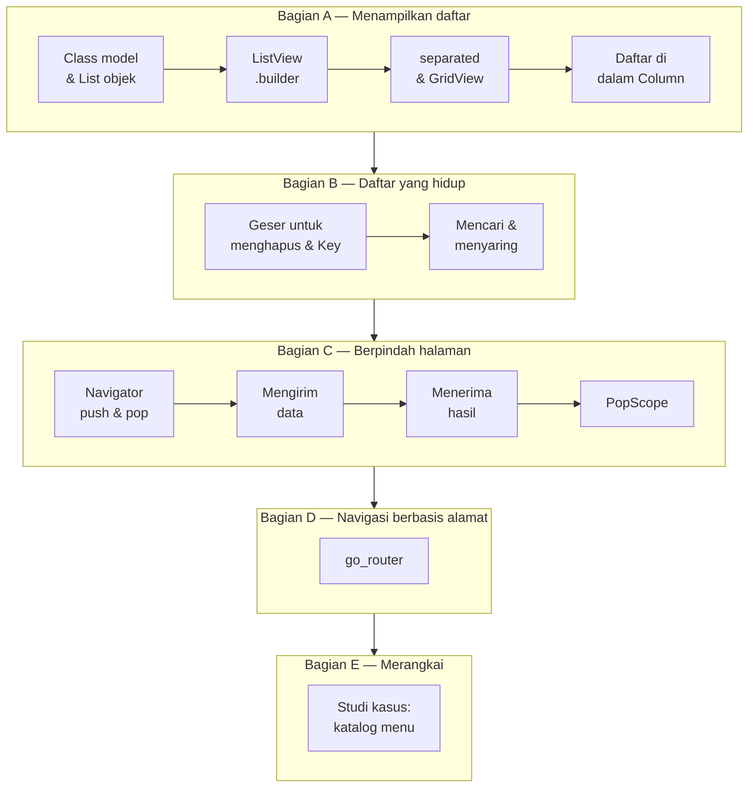

Bagian A menampilkan **data dalam jumlah banyak** dengan rapi dan ringan. Bagian B membuat daftar itu **bisa diubah dan dicari**. Bagian C membawa pengguna **pindah ke halaman lain** sambil membawa data. Bagian D memberi setiap halaman **alamat** seperti situs web. Bagian E merangkai semuanya menjadi aplikasi utuh.

---

## 1. Daftar dan Navigasi: Dua Kemampuan Wajib Aplikasi

Buka beberapa aplikasi di ponsel Anda, lalu perhatikan polanya:

| Aplikasi | Daftar yang tampil | Setelah item diketuk |
| :--- | :--- | :--- |
| WhatsApp | Daftar obrolan | Pindah ke halaman obrolan dengan orang itu |
| Aplikasi belanja | Kotak-kotak produk | Pindah ke halaman detail produk |
| Aplikasi ojek daring | Daftar layanan (makanan, kurir, ...) | Pindah ke halaman layanan tersebut |
| Galeri foto | Kotak-kotak foto | Foto dibuka besar; tombol kembali membawa Anda ke galeri lagi |

Hampir semua aplikasi melakukan dua hal yang sama:

1. **Menampilkan daftar data**, entah memanjang ke bawah (*list*) atau berbentuk kotak-kotak (*grid*).
2. **Berpindah halaman (navigasi)** saat item diketuk, membawa data item itu, lalu kembali ke daftar ketika pengguna menekan tombol kembali.

Sampai Pertemuan 5, semua aplikasi kita hanya punya **satu halaman** dengan isi yang sudah pasti. Hari ini kita belajar kedua kemampuan tersebut.

| Kebutuhan | Alat di Flutter | Bagian |
| :--- | :--- | :--- |
| Daftar panjang yang ringan | `ListView.builder` | 3 |
| Daftar dengan garis pemisah | `ListView.separated` | 4 |
| Daftar berbentuk kotak | `GridView.builder` | 5 |
| Menghapus dengan gerakan geser | `Dismissible` + `Key` | 7 |
| Pindah halaman dan kembali | `Navigator.push` / `Navigator.pop` | 9–11 |
| Menahan tombol kembali | `PopScope` | 12 |
| Halaman beralamat (seperti situs web) | paket `go_router` | 13 |

---

## 2. Menyiapkan Data: *Class* Model dan *List* Objek

### 2.1 Masalahnya: satu item punya banyak keterangan

Misalkan kita ingin menampilkan rak buku perpustakaan. Setiap buku punya **judul, penulis, tahun terbit, dan status** (tersedia atau dipinjam). Cara pemula biasanya menulis beberapa *list* terpisah:

```dart
// ❌ Cara yang rawan salah: empat list yang harus selalu "sejajar".
const List<String> judul = ['Belajar Flutter dari Nol', 'Algoritma untuk Pemula'];
const List<String> penulis = ['Rina Kusuma', 'Bayu Pratama'];
const List<int> tahun = [2025, 2021];
const List<bool> tersedia = [true, false];
```

Bayangkan Anda menghapus satu judul tetapi lupa menghapus penulisnya. Seluruh data setelahnya langsung bergeser dan saling tertukar. Semakin banyak keterangan, semakin besar peluang kesalahan.

### 2.2 Solusinya: satu *class* untuk satu jenis data

Di Pertemuan 3 kita sudah belajar *class* sebagai **cetakan**. Gunakan satu *class* untuk membungkus semua keterangan sebuah buku. *Class* seperti ini disebut ***class* model**, karena tugasnya memodelkan (mewakili) data dari dunia nyata.

```dart
class Buku {
  const Buku({
    required this.judul,
    required this.penulis,
    required this.tahun,
    required this.tersedia,
  });

  final String judul;
  final String penulis;
  final int tahun;
  final bool tersedia;
}
```

Setelah itu, rak buku cukup berupa **satu *list* berisi objek `Buku`**:

```dart
const List<Buku> daftarBuku = [
  Buku(
    judul: 'Belajar Flutter dari Nol',
    penulis: 'Rina Kusuma',
    tahun: 2025,
    tersedia: true,
  ),
  Buku(
    judul: 'Algoritma untuk Pemula',
    penulis: 'Bayu Pratama',
    tahun: 2021,
    tersedia: false,
  ),
  // ... buku lainnya
];
```

Sekarang setiap buku adalah satu "paket" utuh. Menghapus satu buku berarti menghapus seluruh keterangannya sekaligus, tanpa risiko tertukar.

> [!TIP]
> Semua properti ditulis `final` dan *constructor*-nya `const`. Artinya, sebuah objek `Buku` tidak bisa diubah setelah dibuat. Jika suatu saat status buku berubah, kita **membuat objek baru**, bukan mengubah yang lama. Kebiasaan ini membuat data lebih mudah ditelusuri dan akan sangat berguna di Pertemuan 9.

### 2.3 Dari data ke tampilan

Pola yang akan kita pakai di sepanjang modul ini selalu sama:

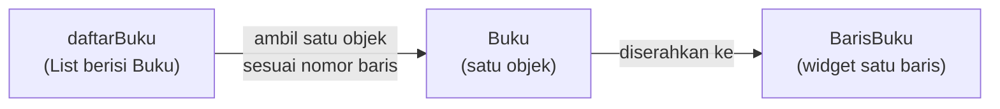

Data disimpan di satu tempat. Untuk setiap nomor baris, kita mengambil **satu objek** lalu menyerahkannya ke **widget kecil** yang tugasnya menggambar satu baris. Pola "widget kecil berparameter" ini sudah Anda kenal sejak Pertemuan 4.

> **🧠 Cek Cepat**
> 1. Mengapa empat *list* terpisah (judul, penulis, tahun, status) disebut rawan salah?
> 2. Apa arti kata "model" pada *class* model?
>
> <details><summary>Lihat jawaban</summary>
>
> 1. Keempat *list* harus selalu sejajar. Jika satu *list* berubah tanpa yang lain ikut berubah, data dari buku yang berbeda akan saling tertukar.
> 2. *Class* itu mewakili (memodelkan) satu jenis benda dari dunia nyata, misalnya buku, beserta semua keterangannya.
> </details>

---

## 3. `ListView.builder`: Daftar yang Dibangun Sesuai Kebutuhan

### 3.1 Masalah daftar yang panjang

Di Pertemuan 4 kita menyusun widget memakai `Column` dan menambahkan `SingleChildScrollView` agar bisa digulir. Cara itu cocok untuk **belasan** widget. Bagaimana jika datanya **seribu** baris, misalnya antrean layanan akademik?

`Column` membuat dan mengatur **semua** anaknya sejak awal, termasuk baris ke-1.000 yang belum tentu pernah dilihat pengguna. Ibaratnya **mencetak seluruh buku telepon** padahal Anda hanya ingin membaca satu halaman. Aplikasi menjadi lambat dibuka dan boros memori.

### 3.2 Solusinya: bangun hanya yang terlihat

`ListView.builder` bekerja seperti **juru masak warung yang memasak sesuai pesanan**. Ia tidak memasak seribu porsi di pagi hari. Ia hanya membuat baris yang **akan tampil di layar** (ditambah sedikit cadangan di bawahnya). Saat Anda menggulir, baris baru dibuat, sedangkan baris yang sudah jauh di atas dibuang dari memori.

```dart
ListView.builder(
  // itemCount: berapa banyak baris seluruhnya.
  itemCount: 1000,
  // itemBuilder: "resep" untuk membuat SATU baris.
  // index dimulai dari 0, jadi nomor antrean = index + 1.
  itemBuilder: (BuildContext context, int index) {
    final int nomor = index + 1;
    return ListTile(
      leading: CircleAvatar(child: Text('$nomor')),
      title: Text('Nomor antrean $nomor'),
      subtitle: Text(nomor.isEven ? 'Loket 2' : 'Loket 1'),
    );
  },
)
```

| Bagian | Artinya |
| :--- | :--- |
| `itemCount` | Jumlah seluruh baris. Biasanya diisi `daftar.length`. |
| `itemBuilder` | Fungsi yang dipanggil Flutter **setiap kali butuh satu baris**. Flutter memberi tahu nomor baris lewat `index`. |
| `index` | Nomor baris yang diminta, **mulai dari 0**. Baris pertama = `index` 0. |

📄 Kode lengkap: [`kode/contoh_01_listview_builder.dart`](kode/contoh_01_listview_builder.dart)

<p align="center">
  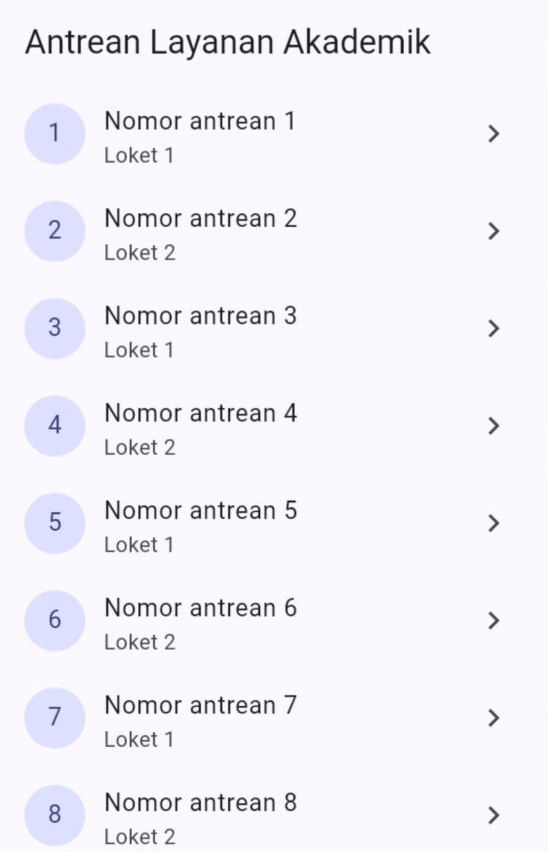
</p>

### 3.3 Membuktikannya lewat konsol

Contoh 01 menuliskan catatan setiap kali sebuah baris dibuat:

```dart
debugPrint('membangun baris ke-$nomor');
```

Jalankan contoh 01, lalu buka konsol (di DartPad: panel di bawah tampilan; di VS Code: tab *Debug Console*). Perhatikan tiga hal:

1. Saat aplikasi dibuka, catatan yang muncul **hanya belasan baris pertama**, bukan seribu. Itulah baris yang terlihat ditambah cadangan sekitar 250 piksel di bawah layar.
2. Gulir pelan-pelan ke bawah. Catatan baru muncul **sedikit demi sedikit**, tepat sebelum barisnya terlihat.
3. Gulir kembali ke atas. Baris yang tadi sudah lewat **dibangun ulang**, karena saat jauh dari layar ia dibuang.

> [!IMPORTANT]
> Karena baris bisa dibuang lalu dibuat ulang kapan saja, **jangan menyimpan data penting di dalam widget satu baris**. Data selalu disimpan di daftar milik halaman (atau di *State*-nya). Widget baris cukup menampilkan data yang diberikan kepadanya.

> [!TIP]
> Jika `itemCount` tidak diisi, `ListView.builder` menganggap daftarnya **tak terbatas**: `itemBuilder` akan terus dipanggil dengan `index` yang makin besar. Untuk data dari *list*, selalu isi `itemCount: daftar.length`. Tanpa itu, aplikasi akan mencoba membaca `daftar[index]` melewati batas dan muncul *error* `RangeError`.

### 3.4 Kapan memakai `ListView` biasa?

`ListView` juga punya bentuk biasa dengan `children`, mirip `Column` yang bisa digulir:

```dart
ListView(
  children: [
    ListTile(title: Text('Profil')),
    ListTile(title: Text('Pengaturan')),
    ListTile(title: Text('Keluar')),
  ],
)
```

| Bentuk | Cocok untuk |
| :--- | :--- |
| `ListView(children: [...])` | Isi **sedikit dan sudah pasti**, misalnya halaman pengaturan atau menu profil. Semua widget anaknya dibuat di awal. |
| `ListView.builder(...)` | Isi **berasal dari data**, apalagi yang jumlahnya banyak atau berubah-ubah. Baris dibuat sesuai kebutuhan. |

> **🧠 Cek Cepat**
> 1. Daftar berisi 500 kontak sebaiknya memakai `ListView` biasa atau `ListView.builder`? Mengapa?
> 2. Di dalam `itemBuilder`, `index` untuk baris pertama bernilai berapa?
>
> <details><summary>Lihat jawaban</summary>
>
> 1. `ListView.builder`, karena barisnya banyak dan berasal dari data. Hanya baris yang terlihat yang dibuat, sehingga aplikasi tetap ringan.
> 2. `0`. Itu sebabnya contoh 01 menampilkan nomor antrean `index + 1`.
> </details>

---

## 4. `ListView.separated` dan Desain Satu Baris

### 4.1 Garis pemisah di antara baris

Daftar sering lebih mudah dibaca jika ada garis tipis di antara barisnya. `ListView.separated` sama seperti `ListView.builder`, ditambah satu fungsi lagi: `separatorBuilder`, yaitu resep untuk membuat **pemisah di antara dua baris**.

```dart
ListView.separated(
  itemCount: daftarBuku.length,
  separatorBuilder: (BuildContext context, int index) {
    return const Divider(height: 1);
  },
  itemBuilder: (BuildContext context, int index) {
    final Buku buku = daftarBuku[index];
    return BarisBuku(buku: buku);
  },
)
```

Pemisah hanya dibuat **di antara** baris, tidak di atas baris pertama maupun di bawah baris terakhir. Jadi 7 buku menghasilkan 6 garis pemisah.

### 4.2 Satu baris = satu widget kecil

Isi `itemBuilder` sengaja dibuat sangat pendek: ambil satu objek, lalu serahkan ke `BarisBuku`. Seluruh urusan tampilan satu buku ada di widget tersebut:

```dart
class BarisBuku extends StatelessWidget {
  const BarisBuku({super.key, required this.buku});

  final Buku buku;

  @override
  Widget build(BuildContext context) {
    final ColorScheme warna = Theme.of(context).colorScheme;

    return ListTile(
      leading: Icon(Icons.menu_book, color: warna.primary),
      title: Text(buku.judul),
      subtitle: Text('${buku.penulis} · ${buku.tahun}'),
      // Tampilan bergantung pada data: tersedia atau sedang dipinjam.
      trailing: Text(
        buku.tersedia ? 'Tersedia' : 'Dipinjam',
        style: TextStyle(
          color: buku.tersedia ? warna.primary : warna.error,
          fontWeight: FontWeight.bold,
        ),
      ),
    );
  }
}
```

Perhatikan bagian `trailing`. **Data menentukan tampilan**: buku yang tersedia diberi tulisan berwarna utama, buku yang dipinjam diberi warna *error* (merah). Kita tidak menulis tujuh `ListTile` satu per satu. Kita menulis **satu aturan** yang berlaku untuk semua buku.

📄 Kode lengkap: [`kode/contoh_02_model_dan_listview_separated.dart`](kode/contoh_02_model_dan_listview_separated.dart)

<p align="center">
  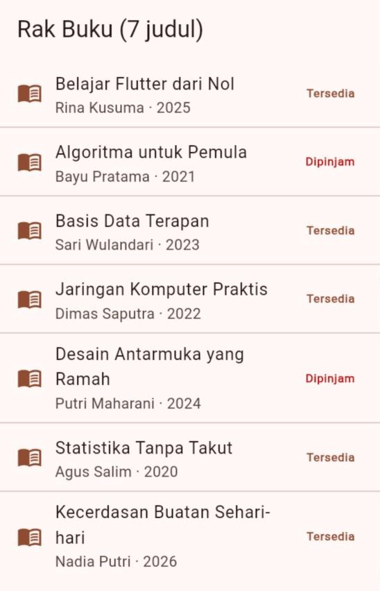
</p>

> [!NOTE]
> Judul AppBar contoh 02 berbunyi `Rak Buku (7 judul)`. Angka 7 tidak ditulis manual, melainkan diambil dari `daftarBuku.length`. Tambahkan satu buku ke daftar, dan judul itu ikut berubah dengan sendirinya.

---

## 5. `GridView`: Daftar Berbentuk Kotak

### 5.1 Dari baris ke kotak

Produk di aplikasi belanja dan foto di galeri biasanya tampil sebagai **kotak-kotak** yang tersusun dalam baris dan kolom. Widget untuk itu adalah `GridView`. Seperti `ListView`, ia punya bentuk `.builder` yang membangun kotak sesuai kebutuhan.

```dart
GridView.builder(
  padding: const EdgeInsets.all(16),
  gridDelegate: const SliverGridDelegateWithMaxCrossAxisExtent(
    maxCrossAxisExtent: 180, // lebar maksimal satu kotak
    mainAxisExtent: 160, // tinggi tetap satu kotak
    mainAxisSpacing: 12, // jarak atas-bawah antarkotak
    crossAxisSpacing: 12, // jarak kiri-kanan antarkotak
  ),
  itemCount: daftarProduk.length,
  itemBuilder: (BuildContext context, int index) {
    return KartuProduk(produk: daftarProduk[index]);
  },
)
```

Bagian baru di sini hanya `gridDelegate`, yaitu **aturan ukuran dan jarak kotak**. Namanya memang panjang, tetapi isinya sederhana.

### 5.2 Dua cara menentukan jumlah kolom

| Aturan (`gridDelegate`) | Cara kerja | Hasil di layar sempit vs lebar |
| :--- | :--- | :--- |
| `SliverGridDelegateWithFixedCrossAxisCount(crossAxisCount: 2)` | Jumlah kolom **tetap** 2 | Ponsel: 2 kolom. Tablet: tetap 2 kolom, kotaknya jadi sangat lebar. |
| `SliverGridDelegateWithMaxCrossAxisExtent(maxCrossAxisExtent: 180)` | Lebar kotak **paling besar** 180 piksel; jumlah kolom dihitung sendiri | Ponsel: 2 kolom. Tablet atau jendela lebar: 3, 4, atau lebih. |

Cara kedua lebih ramah untuk berbagai ukuran layar. Flutter kira-kira menghitung "lebar tersedia dibagi (180 + jarak antarkotak)", lalu **dibulatkan ke atas**. Di ponsel selebar 360 piksel, lebar tersedia 328 piksel (setelah *padding* 16 kiri-kanan), sehingga hasilnya 2 kolom.

<p align="center">
  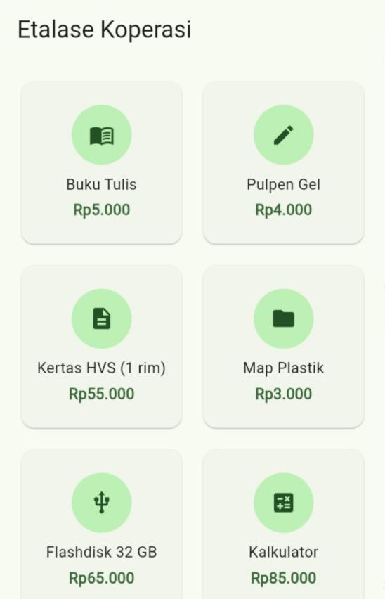
  &nbsp;
  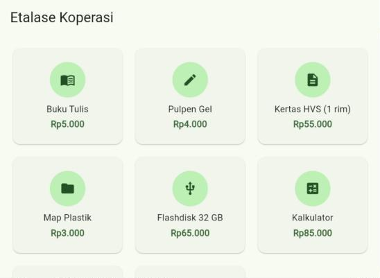
</p>

📄 Kode lengkap: [`kode/contoh_03_gridview.dart`](kode/contoh_03_gridview.dart)

### 5.3 Tinggi kotak: `mainAxisExtent` lebih aman

Ada dua cara mengatur tinggi kotak:

- `childAspectRatio`: perbandingan **lebar : tinggi**. Nilai 1 berarti persegi. Masalahnya, tinggi kotak ikut mengecil saat layar menyempit, sehingga teks di dalamnya bisa *overflow* (garis kuning-hitam dari Pertemuan 4).
- `mainAxisExtent`: tinggi kotak **tetap** dalam piksel, berapa pun lebarnya. Contoh 03 memakai cara ini agar isi kotak selalu muat.

Nama produk yang panjang tetap bisa merepotkan di kotak yang sempit. Karena itu, nama dibatasi paling banyak dua baris, dan sisanya diganti tanda "...":

```dart
Text(
  produk.nama,
  textAlign: TextAlign.center,
  maxLines: 2,
  overflow: TextOverflow.ellipsis,
)
```

### 5.4 Kotak yang bisa diketuk

Setiap kotak adalah `Card` yang dibungkus `InkWell` (Pertemuan 5) agar memberi efek riak saat diketuk:

```dart
Card(
  // Memotong efek riak agar tidak keluar dari sudut kartu yang membulat.
  clipBehavior: Clip.antiAlias,
  child: InkWell(
    onTap: () { /* tampilkan SnackBar */ },
    child: Padding(
      padding: const EdgeInsets.all(12),
      child: Column(/* ikon, nama, harga */),
    ),
  ),
)
```

> **🧠 Cek Cepat**
> 1. Anda ingin galeri foto menampilkan 2 kolom di ponsel tetapi 5 kolom di monitor lebar. Aturan mana yang dipilih?
> 2. Mengapa `mainAxisExtent` lebih aman daripada `childAspectRatio` untuk kotak yang berisi teks?
>
> <details><summary>Lihat jawaban</summary>
>
> 1. `SliverGridDelegateWithMaxCrossAxisExtent`, karena jumlah kolomnya dihitung dari lebar layar.
> 2. Dengan `mainAxisExtent`, tinggi kotak tetap. Dengan `childAspectRatio`, tinggi kotak ikut menyusut di layar sempit sehingga teks bisa tidak muat (*overflow*).
> </details>

---

## 6. Daftar di Dalam `Column`

### 6.1 Kebutuhan: judul diam, daftar bergulir

Sering kali kita ingin sebuah ringkasan **tetap diam** di atas, sedangkan daftar di bawahnya bisa digulir. Contohnya halaman jadwal kuliah: kartu "Senin, 8 mata kuliah" selalu terlihat, dan hanya daftar jadwalnya yang bergerak.

Cara yang terpikir pertama adalah menaruh kartu dan `ListView` di dalam `Column`:

```dart
// ❌ Akan error!
Column(
  children: [
    KartuRingkasan(/* ... */),
    ListView.builder(/* ... */),
  ],
)
```

Hasilnya layar *error*, dan konsol menampilkan pesan:

```text
Vertical viewport was given unbounded height.
Viewports expand in the scrolling direction to fill their container. In this case, a
vertical viewport was given an unlimited amount of vertical space in which to expand.
```

<p align="center">
  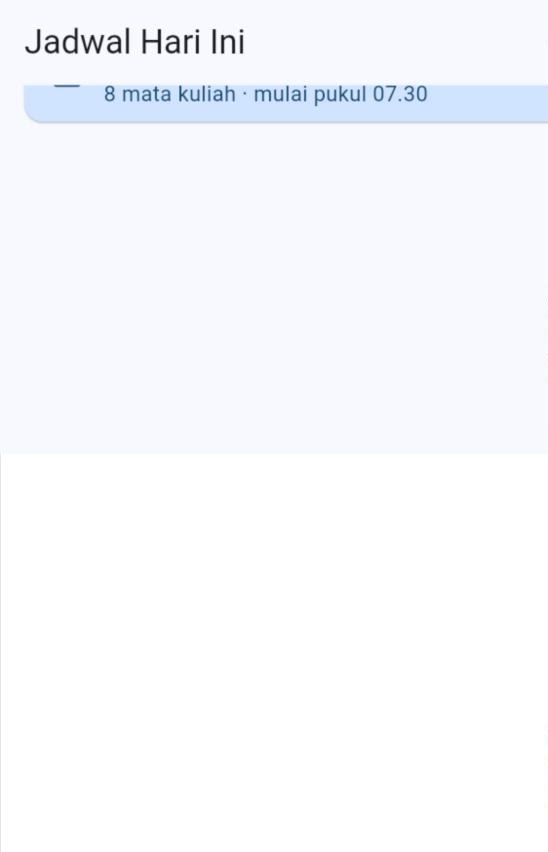
</p>

### 6.2 Mengapa terjadi?

Ingat aturan *constraints* dari Pertemuan 4: **induk memberi batas, anak memilih ukuran**.

- `Column` berkata kepada anak-anaknya, "Silakan setinggi apa pun yang kalian mau." Tinggi yang diberikan **tidak terbatas** (*unbounded*).
- `ListView` selalu ingin **setinggi mungkin**, karena isinya bisa sangat panjang.

"Setinggi mungkin" di dalam "tak terbatas" berarti tinggi tak hingga, dan Flutter tidak bisa menggambarnya. Ibaratnya meminta tukang membuat lemari "setinggi mungkin" di ruangan tanpa atap.

### 6.3 Solusinya: `Expanded`

Bungkus `ListView` dengan `Expanded`. Artinya, "Pakai **semua sisa tinggi** layar, tidak lebih." Kini `ListView` tahu batas tingginya.

```dart
Column(
  crossAxisAlignment: CrossAxisAlignment.start,
  children: [
    KartuRingkasan(/* ... */), // tingginya secukupnya
    Expanded(
      // Pakai SEMUA sisa tinggi layar.
      child: ListView.builder(/* ... */),
    ),
  ],
)
```

📄 Kode lengkap: [`kode/contoh_04_daftar_dalam_column.dart`](kode/contoh_04_daftar_dalam_column.dart)

<p align="center">
  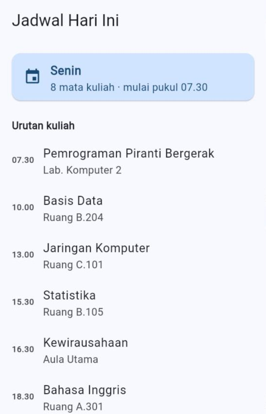
</p>

| Pilihan | Kapan dipakai |
| :--- | :--- |
| `Expanded(child: ListView...)` | **Pilihan utama.** Daftar memakai sisa tinggi layar, judul di atasnya diam. |
| `SizedBox(height: 200, child: ListView...)` | Daftar kecil dengan tinggi tertentu, misalnya deretan foto di tengah halaman. |
| Judul ikut menjadi baris pertama `ListView` | Jika judul **boleh ikut tergulir** ke atas bersama daftar. |
| `ListView(shrinkWrap: true, ...)` | Hanya untuk daftar yang **sangat pendek**. Pilihan ini membuat semua baris dihitung sekaligus, sehingga keunggulan `ListView.builder` hilang. |

> **🧠 Cek Cepat**
> Pesan *error* `Vertical viewport was given unbounded height.` muncul. Widget apa yang kemungkinan besar sedang Anda masukkan, ke dalam widget apa, dan bagaimana memperbaikinya?
>
> <details><summary>Lihat jawaban</summary>
>
> `ListView` (atau `GridView`) dimasukkan langsung ke dalam `Column`, atau ke widget lain yang tidak membatasi tinggi. Perbaikannya: bungkus `ListView` dengan `Expanded`.
> </details>

---

## 7. Geser untuk Menghapus dan Peran *Key*

### 7.1 `Dismissible`: item yang bisa "diusir"

Di banyak aplikasi, item dihapus cukup dengan **menggesernya ke samping**. Flutter menyediakan `Dismissible` untuk gerakan itu. Bungkus widget satu baris dengan `Dismissible`, lalu tulis apa yang terjadi setelah item tergeser habis:

```dart
Dismissible(
  key: ValueKey<int>(tugas.id), // wajib: tanda pengenal unik
  direction: DismissDirection.endToStart, // hanya boleh geser ke kiri
  // Latar yang tampak di belakang item saat digeser.
  background: Container(
    color: warna.errorContainer,
    alignment: Alignment.centerRight,
    padding: const EdgeInsets.symmetric(horizontal: 24),
    child: Icon(Icons.delete, color: warna.onErrorContainer),
  ),
  onDismissed: (DismissDirection arah) {
    _hapus(index);
  },
  child: ListTile(
    title: Text(tugas.judul),
    subtitle: Text(tugas.mataKuliah),
  ),
)
```

| Properti | Artinya |
| :--- | :--- |
| `key` | Tanda pengenal unik item ini. **Wajib**, dibahas di 7.2. |
| `direction` | Arah geser yang diizinkan. `endToStart` = dari kanan ke kiri; `startToEnd` = dari kiri ke kanan; `horizontal` = keduanya. |
| `background` | Widget yang terlihat di belakang item saat digeser, misalnya latar merah dengan ikon tempat sampah. |
| `onDismissed` | Dipanggil setelah item tergeser habis. Di sini kita **wajib menghapus item dari daftar**. |

> [!WARNING]
> `onDismissed` hanya **memberi tahu** bahwa item sudah digeser. Ia tidak menghapus data Anda. Jika item tidak segera dihapus dari daftar (di dalam `setState`), Flutter akan menampilkan *error*:
> `A dismissed Dismissible widget is still part of the tree.`
> Pesan itu diikuti saran: *"Make sure to implement the onDismissed handler and to immediately remove the Dismissible widget from the application once that handler has fired."*

> [!TIP]
> Di browser tidak ada layar sentuh. Untuk menggeser, **tahan klik kiri** pada item, lalu **tarik mouse** ke kiri dan lepaskan.

### 7.2 Mengapa *Key* wajib ada?

Bayangkan sebuah kelas yang tempat duduknya **bernomor**. Dosen mengenali mahasiswa dari **nomor kursi**. Jika mahasiswa di kursi 2 keluar, semua mahasiswa di belakangnya bergeser maju satu kursi. Dosen yang hanya melihat nomor kursi kini salah mengenali: orang di kursi 2 dikira mahasiswa yang tadi keluar.

Flutter bekerja mirip dosen itu. Tanpa *key*, Flutter mencocokkan widget lama dan baru **berdasarkan urutan**. Setelah ada item yang dihapus, urutan bergeser, sehingga Flutter bisa salah memasangkan widget dengan datanya. Akibatnya animasi kacau, atau item yang salah ikut dianggap terhapus.

*Key* ibarat **nama yang tertulis di punggung mahasiswa**. Ke mana pun ia pindah kursi, ia tetap dikenali. Karena itu *key* harus:

1. **Unik**: tidak ada dua item dengan *key* yang sama.
2. **Tetap**: tidak berubah selama item itu ada.

| Pilihan *key* | Bagus? | Alasan |
| :--- | :---: | :--- |
| `ValueKey<int>(tugas.id)` | ✅ | `id` unik dan tidak pernah berubah. |
| `ValueKey<int>(index)` | ❌ | `index` berubah setiap kali ada item yang dihapus. Itulah "nomor kursi" tadi. |
| `UniqueKey()` | ❌ | Membuat *key* baru setiap kali `build` berjalan, sehingga item tidak pernah dikenali sebagai item yang sama. |

Karena itu, *class* model `Tugas` di contoh 05 diberi properti `id`:

```dart
class Tugas {
  const Tugas(this.id, this.judul, this.mataKuliah);

  // id: nomor unik yang TIDAK pernah berubah, dipakai sebagai Key.
  final int id;
  final String judul;
  final String mataKuliah;
}
```

### 7.3 Menyediakan tombol "Urungkan"

Menghapus dengan geser itu cepat, sehingga mudah tidak sengaja. Aplikasi yang ramah menyediakan tombol **"Urungkan"** (*undo*). Kuncinya: **catat barang dan posisinya lebih dulu, baru hapus.**

```dart
void _hapus(int indeks) {
  // Catat DULU barang dan posisinya, baru dihapus.
  final Tugas terhapus = _daftar[indeks];
  setState(() {
    _daftar.removeAt(indeks);
  });

  final ScaffoldMessengerState pesan = ScaffoldMessenger.of(context);
  pesan.hideCurrentSnackBar();
  pesan.showSnackBar(
    SnackBar(
      content: Text('"${terhapus.judul}" dihapus.'),
      action: SnackBarAction(
        label: 'Urungkan',
        onPressed: () {
          // Kembalikan ke posisi semula, bukan ke ujung daftar.
          setState(() {
            _daftar.insert(indeks, terhapus);
          });
        },
      ),
      // Tanpa ini, SnackBar bertombol tidak hilang sendiri (Pertemuan 5).
      persist: false,
    ),
  );
}
```

`insert(indeks, terhapus)` mengembalikan tugas tepat ke posisi asalnya. Jika kita memakai `add`, tugas itu akan pindah ke ujung bawah daftar.

### 7.4 Tampilan saat daftar kosong

Setelah semua tugas dihapus, layar kosong melompong terlihat seperti aplikasi rusak. Tampilkan pesan yang ramah sebagai gantinya:

```dart
body: _daftar.isEmpty
    ? const TampilanKosong() // ikon dan tulisan "Semua tugas beres!"
    : ListView.builder(/* ... */),
```

📄 Kode lengkap: [`kode/contoh_05_dismissible_dan_urungkan.dart`](kode/contoh_05_dismissible_dan_urungkan.dart)

<p align="center">
  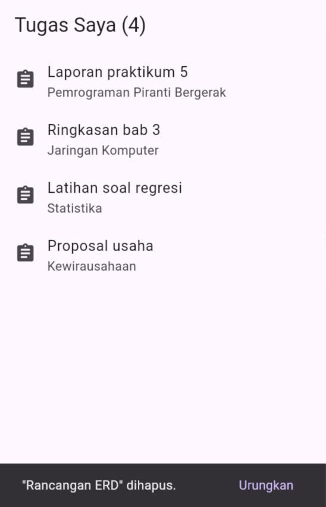
</p>

> **🧠 Cek Cepat**
> 1. Apa yang terjadi jika `onDismissed` tidak menghapus item dari daftar?
> 2. Mengapa `index` tidak boleh dipakai sebagai *key*?
> 3. Mengapa tombol "Urungkan" memakai `insert`, bukan `add`?
>
> <details><summary>Lihat jawaban</summary>
>
> 1. Muncul *error* `A dismissed Dismissible widget is still part of the tree.`
> 2. Karena `index` berubah setiap kali ada item yang dihapus, sehingga *key* tidak lagi menunjuk item yang sama.
> 3. `insert` mengembalikan item ke posisi asalnya. `add` selalu menaruhnya di ujung daftar.
> </details>

---

## 8. Mencari dan Menyaring Daftar

### 8.1 Prinsip utama: data asli tidak pernah diubah

Fitur pencarian terlihat seperti "menghapus" item yang tidak cocok. Padahal **data asli tetap utuh**. Yang berubah hanyalah **apa yang ditampilkan**.

Ingat istilah **nilai turunan** dari Pertemuan 5: nilai yang **dihitung** dari *state*, bukan disimpan sendiri. Hasil pencarian adalah nilai turunan dari tiga hal:

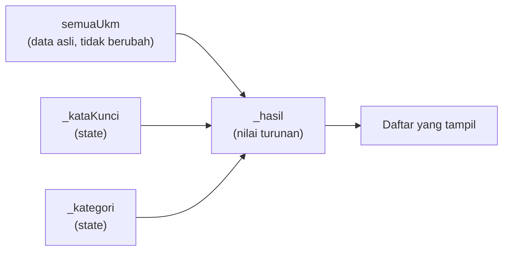

Yang disimpan di *State* hanya **kata kunci** dan **kategori pilihan**. Setiap kali `build()` berjalan, daftar yang tampil dihitung ulang dari keduanya.

```dart
// Nilai turunan: dihitung dari data asli + kata kunci + kategori.
List<Ukm> get _hasil {
  final String kunci = _kataKunci.trim().toLowerCase();
  return semuaUkm.where((Ukm ukm) {
    final bool cocokNama = ukm.nama.toLowerCase().contains(kunci);
    final bool cocokKategori = _kategori == null || ukm.kategori == _kategori;
    return cocokNama && cocokKategori;
  }).toList();
}
```

| Bagian | Fungsinya |
| :--- | :--- |
| `trim()` | Membuang spasi di awal dan akhir. Ketikan `"  futsal "` dianggap `"futsal"`. |
| `toLowerCase()` | Mengubah ke huruf kecil semua, agar `"Futsal"`, `"FUTSAL"`, dan `"futsal"` dianggap sama. Keduanya (kata kunci **dan** nama UKM) harus diubah. |
| `contains(kunci)` | Benar jika nama **mengandung** kata kunci di bagian mana pun. Kata kunci kosong selalu cocok, sehingga semua UKM tampil. |
| `_kategori == null` | `null` kita artikan "Semua kategori", sehingga semua UKM lolos pemeriksaan kategori. |
| `where(...).toList()` | Menyaring *list* (Pertemuan 2), lalu mengubah hasilnya kembali menjadi `List`. |

Mengapa tidak langsung menghapus item yang tidak cocok dari `semuaUkm`? Karena begitu kata kunci dihapus, UKM yang tadi terhapus **tidak bisa kembali**. Dengan nilai turunan, data asli selalu tersedia.

### 8.2 Kotak pencarian Material 3: `SearchBar`

Material 3 menyediakan `SearchBar`, kotak pencarian berbentuk kapsul. Cara memakainya mirip `TextField` dari Pertemuan 5:

```dart
SearchBar(
  controller: _kontrolCari,
  hintText: 'Cari nama UKM',
  leading: const Icon(Icons.search),
  onChanged: (String teks) {
    setState(() {
      _kataKunci = teks;
    });
  },
)
```

Setiap ketikan memanggil `onChanged`, yang mengubah `_kataKunci` di dalam `setState`. `build()` berjalan lagi, `_hasil` dihitung ulang, dan daftar langsung menyesuaikan.

### 8.3 Chip kategori yang bisa digeser

Pilihan kategori memakai `ChoiceChip` dari Pertemuan 5. Agar tidak terpotong di layar sempit, deretan chip dibungkus `SingleChildScrollView` **mendatar**:

```dart
SingleChildScrollView(
  scrollDirection: Axis.horizontal, // digulir ke samping
  padding: const EdgeInsets.symmetric(horizontal: 16),
  child: Row(
    spacing: 8,
    children: [
      ChoiceChip(
        label: const Text('Semua'),
        selected: _kategori == null,
        onSelected: (_) {
          setState(() {
            _kategori = null;
          });
        },
      ),
      for (final KategoriUkm kategori in KategoriUkm.values)
        ChoiceChip(
          label: Text(kategori.label),
          selected: _kategori == kategori,
          onSelected: (_) {
            setState(() {
              _kategori = kategori;
            });
          },
        ),
    ],
  ),
)
```

`for (... in KategoriUkm.values)` membuat satu chip untuk setiap nilai `enum`. Menambah kategori baru cukup dilakukan di `enum`, dan chip-nya muncul sendiri.

> 💡 **Mengapa chip-nya tanpa ikon?** `ChoiceChip` sebenarnya bisa diberi ikon lewat `avatar:`. Namun pada Material 3, saat chip berikon dipilih, ikonnya ditutup lingkaran gelap dan tanda centangnya nyaris tidak terlihat. Chip yang hanya berisi teks lebih rapi: tanda centang muncul dengan jelas di depan teks begitu chip dipilih. Ikon kategori tetap dipakai di daftar (`leading` pada `ListTile`).

### 8.4 Hasil kosong dan tombol "Tampilkan semua"

Jika tidak ada yang cocok, tampilkan pesan yang menjelaskan **mengapa** daftar kosong, beserta jalan keluarnya:

```dart
void _aturUlang() {
  // clear() tidak memanggil onChanged, jadi _kataKunci ikut
  // dikosongkan sendiri di dalam setState.
  _kontrolCari.clear();
  setState(() {
    _kataKunci = '';
    _kategori = null;
  });
}
```

> [!IMPORTANT]
> Ingat Latihan B6 di Pertemuan 5: `controller.clear()` hanya mengosongkan **kolom**, tetapi **tidak** memanggil `onChanged`. Jika `_kataKunci` tidak ikut dikosongkan, kolom terlihat kosong sementara daftar masih tersaring kata kunci lama.

📄 Kode lengkap: [`kode/contoh_06_pencarian_dan_filter.dart`](kode/contoh_06_pencarian_dan_filter.dart)

<p align="center">
  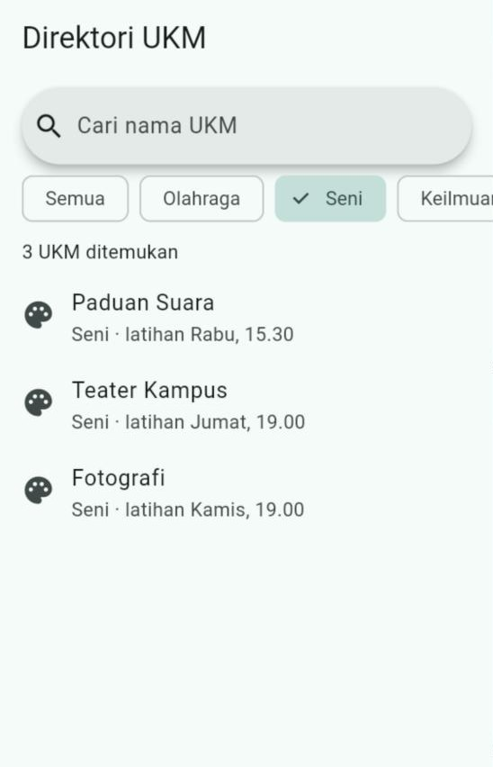
  &nbsp;
  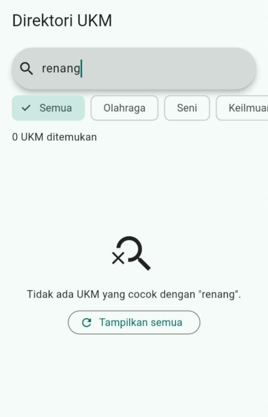
</p>

> **🧠 Cek Cepat**
> 1. Jika kata kunci kosong dan kategori `null`, berapa UKM yang tampil?
> 2. Mengapa kata kunci **dan** nama UKM sama-sama diubah dengan `toLowerCase()`?
>
> <details><summary>Lihat jawaban</summary>
>
> 1. Semuanya, karena teks kosong selalu "terkandung" dalam nama apa pun, dan kategori `null` berarti semua kategori lolos.
> 2. Agar perbandingannya tidak membedakan huruf besar dan kecil. Jika hanya salah satu yang diubah, ketikan `futsal` tidak akan cocok dengan nama `Futsal`.
> </details>

---

## 9. `Navigator`: Tumpukan Halaman

### 9.1 Halaman ditumpuk seperti piring

Saat Anda membuka halaman baru, halaman lama **tidak dibuang**. Ia hanya tertutup oleh halaman baru, seperti **piring yang ditumpuk**:

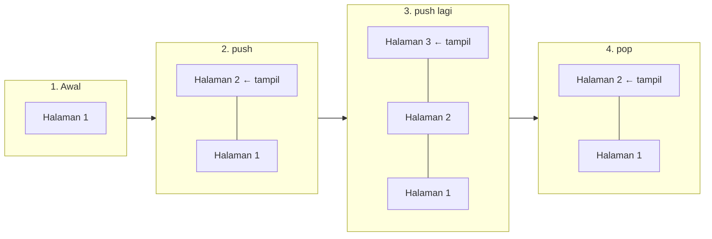

- **`push`** = menaruh halaman baru di **atas** tumpukan.
- **`pop`** = mengambil halaman **teratas**. Halaman di bawahnya tampil lagi, lengkap dengan isinya (*state*-nya tidak hilang).

Pengatur tumpukan ini bernama **`Navigator`**. `MaterialApp` sudah menyediakannya, jadi kita tinggal memakainya.

### 9.2 Membuka halaman: `Navigator.push`

```dart
Navigator.push(
  context,
  MaterialPageRoute<void>(
    builder: (BuildContext context) => const HalamanProfil(),
  ),
);
```

| Bagian | Artinya |
| :--- | :--- |
| `context` | Posisi widget ini di pohon widget. Dari sinilah `Navigator` ditemukan. |
| `MaterialPageRoute` | "Kendaraan" yang membawa halaman baru, lengkap dengan animasi perpindahan bergaya Material. |
| `<void>` | Jenis data yang dikembalikan halaman itu saat ditutup. `void` berarti tidak ada (Bagian 11 memakai jenis lain). |
| `builder` | Fungsi yang membuat halaman tujuan. |

### 9.3 Kembali: `Navigator.pop`

```dart
Navigator.pop(context);
```

Hampir selalu, Anda **tidak perlu** menulis tombol kembali sendiri:

- `AppBar` otomatis menampilkan **panah kembali** selama masih ada halaman di bawahnya.
- Di Android, **tombol atau gerakan kembali** milik sistem juga melakukan `pop`.

### 9.4 Melihat tumpukan bekerja

Contoh 07 membuat halaman yang bisa menumpuk dirinya sendiri, lalu **menggambar isi tumpukan** saat itu:

```dart
void _tumpukHalamanBaru(BuildContext context) {
  // push: taruh halaman baru di ATAS halaman ini.
  Navigator.push(
    context,
    MaterialPageRoute<void>(
      builder: (BuildContext context) => HalamanTumpukan(nomor: nomor + 1),
    ),
  );
}

void _kembaliKePertama(BuildContext context) {
  // popUntil: terus mengambil halaman sampai tersisa yang pertama.
  Navigator.popUntil(context, (Route<dynamic> rute) => rute.isFirst);
}
```

📄 Kode lengkap: [`kode/contoh_07_navigator_push_pop.dart`](kode/contoh_07_navigator_push_pop.dart)

<p align="center">
  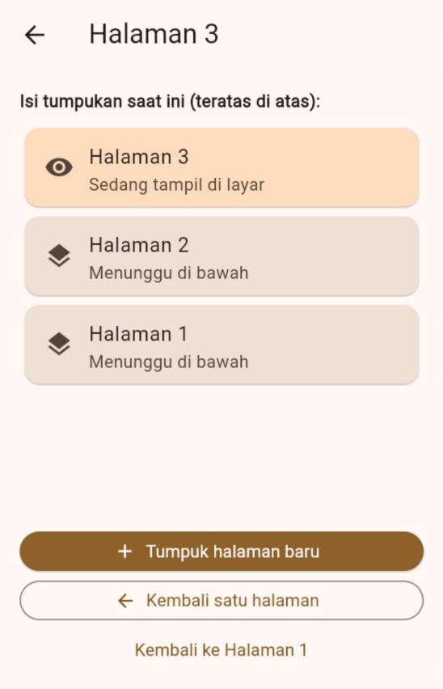
</p>

Coba tekan **"Tumpuk halaman baru"** beberapa kali, lalu tekan panah kembali di AppBar. Perhatikan bahwa halaman muncul kembali **dalam urutan terbalik**: yang terakhir masuk, yang pertama keluar.

### 9.5 Perintah `Navigator` lainnya

| Perintah | Yang terjadi | Contoh penggunaan |
| :--- | :--- | :--- |
| `push` | Tambah halaman di atas | Membuka halaman detail |
| `pop` | Ambil halaman teratas | Kembali dari halaman detail |
| `popUntil` | Terus `pop` sampai syarat terpenuhi | "Kembali ke beranda" dari halaman yang dalam |
| `pushReplacement` | **Ganti** halaman teratas dengan halaman baru | Dari halaman *login* ke beranda, agar tombol kembali tidak membawa pengguna ke *login* lagi |
| `maybePop` | `pop` **jika diizinkan** | Dipakai panah kembali di AppBar; menghormati `PopScope` (Bagian 12) |
| `canPop` | Bertanya: masih ada halaman di bawah? | Menentukan perlu tidaknya tombol "Kembali" |

> [!WARNING]
> Halaman pertama (paling bawah) tidak boleh di-`pop`. Itulah sebabnya contoh 07 **menonaktifkan** tombol "Kembali" saat berada di Halaman 1 (`onPressed: null`, Pertemuan 5).

> **🧠 Cek Cepat**
> Tumpukan saat ini: Beranda → Daftar → Detail (Detail sedang tampil). Pengguna menekan panah kembali **dua kali**. Halaman apa yang tampil?
>
> <details><summary>Lihat jawaban</summary>
>
> Beranda. Tekanan pertama mengambil Detail (Daftar tampil), tekanan kedua mengambil Daftar.
> </details>

---

## 10. Mengirim Data ke Halaman Tujuan

### 10.1 Halaman adalah widget, data dikirim lewat *constructor*

Kabar baiknya, Anda **sudah bisa** melakukan ini. Halaman tujuan hanyalah widget biasa, dan sejak Pertemuan 4 kita mengirim data ke widget lewat *constructor*. Caranya sama persis:

```dart
// Halaman tujuan menerima SATU objek Gedung.
class HalamanDetailGedung extends StatelessWidget {
  const HalamanDetailGedung({super.key, required this.gedung});

  // Data yang dikirim dari halaman daftar.
  final Gedung gedung;

  @override
  Widget build(BuildContext context) {
    return Scaffold(
      appBar: AppBar(title: Text(gedung.nama)),
      // ... tampilkan gedung.kode, gedung.jamBuka, gedung.fasilitas
    );
  }
}
```

Di halaman daftar, objek yang diketuk dikirim saat membuat halaman tujuan:

```dart
ListTile(
  leading: Icon(gedung.ikon),
  title: Text(gedung.nama),
  trailing: const Icon(Icons.chevron_right),
  onTap: () {
    // Kirim objek gedung yang diketuk lewat constructor.
    Navigator.push(
      context,
      MaterialPageRoute<void>(
        builder: (BuildContext context) {
          return HalamanDetailGedung(gedung: gedung);
        },
      ),
    );
  },
)
```

Ikon `chevron_right` (tanda ›) di ujung kanan adalah kebiasaan Material Design untuk memberi isyarat: "baris ini bisa diketuk dan akan membuka halaman baru".

📄 Kode lengkap: [`kode/contoh_08_mengirim_data.dart`](kode/contoh_08_mengirim_data.dart)

<p align="center">
  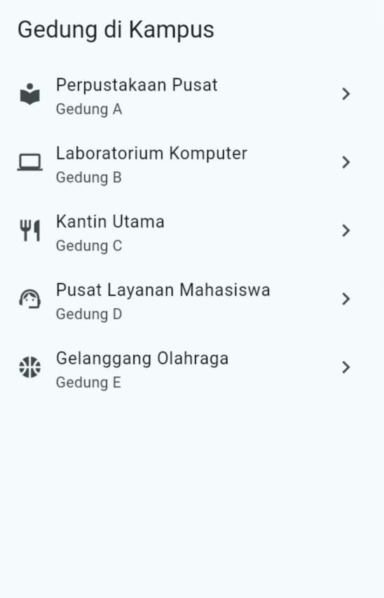
  &nbsp;
  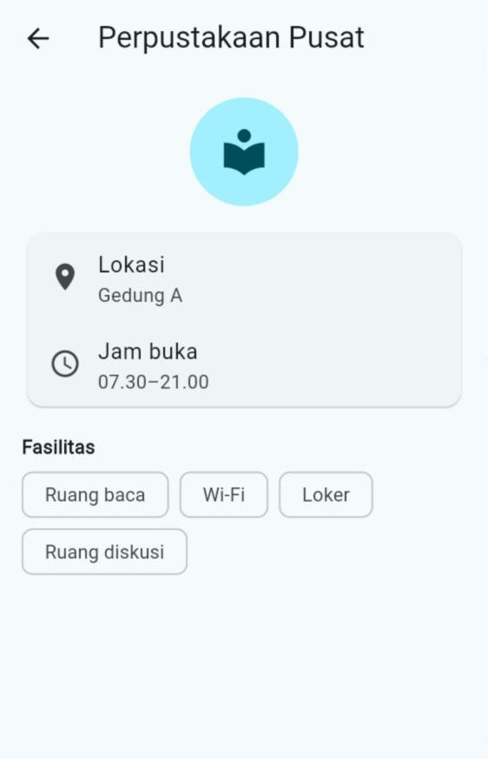
</p>

### 10.2 Halaman detail cukup `StatelessWidget`

Halaman detail di contoh 08 hanya **menampilkan** data yang diterimanya, tanpa mengubah apa pun. Karena itu ia cukup `StatelessWidget`. Gunakan `StatefulWidget` hanya jika halaman itu punya data yang berubah, misalnya jumlah porsi pesanan di studi kasus (Bagian 14).

> [!WARNING]
> Jangan mengirim data antarhalaman lewat **variabel global** (variabel di luar *class* yang bisa diubah dari mana saja). Cara itu terlihat mudah, tetapi sulit dilacak: halaman mana yang mengubahnya, dan kapan? Kirim data lewat *constructor* agar alurnya jelas: data masuk dari pintu depan.

---

## 11. Menerima Hasil dari Halaman

### 11.1 Halaman pemilih

Kadang halaman kedua bertugas **memilihkan** sesuatu, lalu mengembalikan pilihannya ke halaman pertama. Contohnya halaman "Pilih Kota Tujuan" pada formulir pengiriman paket.

Analoginya seperti **menitip pesan kepada teman** yang hendak ke toko: "Nanti kabari ya, harganya berapa." Anda **menunggu** sampai teman itu kembali. Ia bisa kembali membawa jawaban, atau kembali tanpa kabar apa pun.

### 11.2 Halaman kedua: `pop` sambil membawa hasil

```dart
ListTile(
  title: Text(kota),
  onTap: () {
    // Tutup halaman ini SAMBIL mengirim kota yang diketuk.
    Navigator.pop(context, kota);
  },
)
```

Parameter kedua `Navigator.pop` adalah **hasil** yang dibawa pulang.

### 11.3 Halaman pertama: `await` hasilnya

`Navigator.push` ternyata mengembalikan `Future` (Pertemuan 3). Kita bisa **menunggunya** dengan `await`:

```dart
Future<void> _pilihKota() async {
  // <String> = jenis data yang akan DIKEMBALIKAN halaman tujuan.
  final String? kota = await Navigator.push<String>(
    context,
    MaterialPageRoute<String>(
      builder: (BuildContext context) {
        return HalamanPilihKota(terpilih: _kotaTujuan);
      },
    ),
  );

  // Selama menunggu, halaman ini bisa saja sudah ditutup.
  if (!mounted) return;

  if (kota == null) {
    // Pengguna menekan panah kembali tanpa memilih apa pun.
    return;
  }

  setState(() {
    _kotaTujuan = kota;
  });
}
```

Perhatikan tiga hal penting:

1. **Tipe hasil ditulis dua kali**: `Navigator.push<String>` dan `MaterialPageRoute<String>`. Keduanya harus sama dengan jenis data yang dikirim `Navigator.pop`.
2. **Hasilnya `String?` (boleh `null`)**. Jika pengguna menekan panah kembali tanpa memilih, `pop` terjadi tanpa membawa hasil, sehingga nilainya `null`. Ini persis seperti dialog di Pertemuan 5 yang ditutup dengan mengetuk area gelap.
3. **Periksa `mounted` setelah `await`**, sama seperti setelah menunggu dialog (Pertemuan 5, Bagian 10.2).

📄 Kode lengkap: [`kode/contoh_09_menerima_hasil.dart`](kode/contoh_09_menerima_hasil.dart)

<p align="center">
  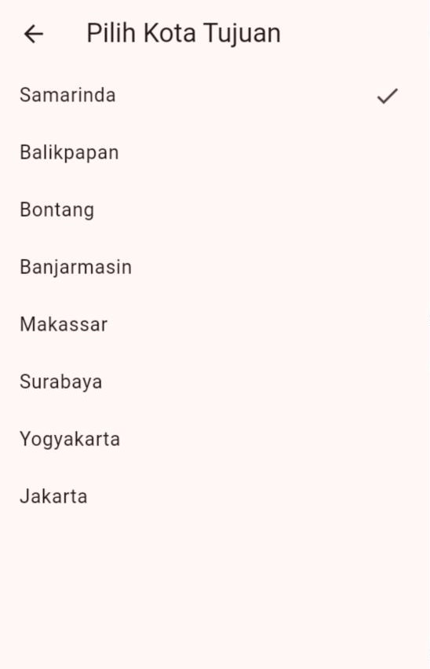
  &nbsp;
  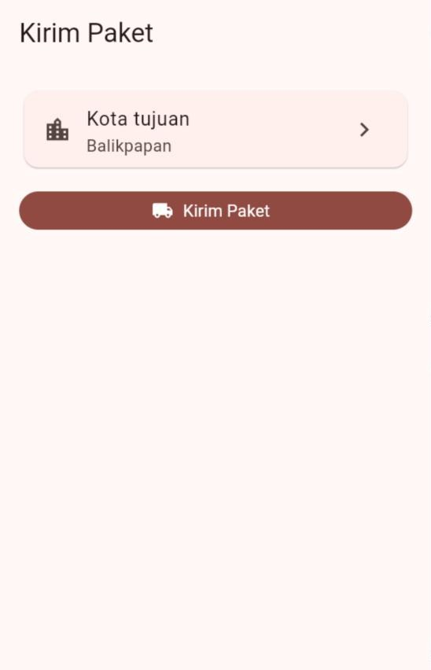
</p>

> **🧠 Cek Cepat**
> Halaman B ditutup dengan `Navigator.pop(context, 5)`. Halaman A membuka B dengan `Navigator.push<String>(...)`. Apa yang salah?
>
> <details><summary>Lihat jawaban</summary>
>
> Jenis datanya tidak cocok. B mengembalikan `int` (angka 5), sedangkan A menunggu `String`. Samakan keduanya, misalnya `Navigator.push<int>` dan `MaterialPageRoute<int>` jika hasilnya angka.
> </details>

---

## 12. `PopScope`: Menahan Tombol Kembali

### 12.1 Masalah: tulisan hilang karena salah pencet

Bayangkan Anda sudah mengetik catatan panjang, lalu tidak sengaja menekan tombol kembali. Halaman tertutup, dan tulisan Anda **hilang tanpa peringatan**. Aplikasi yang baik akan bertanya dulu: "Buang catatan?"

Widget untuk "menahan" tombol kembali adalah `PopScope`.

### 12.2 Cara kerja `PopScope`

```dart
PopScope(
  // canPop: false = tombol kembali DITAHAN. Ditahan hanya jika sudah
  // ada tulisan; jika masih kosong, halaman boleh langsung ditutup.
  canPop: !_adaIsi,
  // Dipanggil setiap kali ada usaha menutup halaman ini.
  onPopInvokedWithResult: (bool sudahTertutup, Object? hasil) async {
    // Sudah tertutup (canPop true, atau lewat _simpan): selesai.
    if (sudahTertutup) return;

    // Masih tertahan: tanyakan dulu kepada pengguna.
    final bool buang = await _tanyaBuang();
    // Fungsi ini ditulis di dalam build, jadi context di sini adalah
    // parameter build. Karena itu yang diperiksa context.mounted.
    if (!context.mounted) return;
    if (buang) {
      Navigator.pop(context);
    }
  },
  child: Scaffold(/* ... */),
)
```

| Bagian | Artinya |
| :--- | :--- |
| `canPop` | `true`: tombol kembali bekerja seperti biasa. `false`: tombol kembali **ditahan**. |
| `onPopInvokedWithResult` | Dipanggil setiap kali ada usaha menutup halaman, baik berhasil maupun tertahan. |
| `sudahTertutup` (`didPop`) | `true` jika halaman **sudah** tertutup. `false` jika usaha itu tertahan oleh `canPop: false`. |

Alurnya:

1. Selama catatan kosong, `canPop` bernilai `true`, sehingga panah kembali langsung menutup halaman.
2. Begitu ada tulisan, `canPop` menjadi `false`. Panah kembali ditahan, dan `onPopInvokedWithResult` dipanggil dengan `sudahTertutup: false`.
3. Kita menampilkan dialog. Jika pengguna memilih **"Buang"**, kita menutup halaman sendiri dengan `Navigator.pop(context)`.

> [!IMPORTANT]
> Mengapa di sini `context.mounted`, bukan `mounted` seperti di `_pilihKota` ([Bagian 11.3](#113-halaman-pertama-await-hasilnya))? Fungsi untuk `onPopInvokedWithResult` ditulis **di dalam `build`**, sehingga `context` yang dipakainya adalah **parameter `build`**, bukan `context` milik *class State*. Aturannya: periksa "masih terpasang" pada `context` yang memang Anda pakai.
>
> | Letak kode yang memakai `context` setelah `await` | Pemeriksaan |
> | :--- | :--- |
> | Metode *class State*, misalnya `_pilihKota` | `if (!mounted) return;` |
> | Fungsi yang ditulis di dalam `build` atau di dalam *builder* | `if (!context.mounted) return;` |
>
> Jika tertukar, `flutter analyze` memberi peringatan `use_build_context_synchronously` dengan pesan "*guarded by an unrelated 'mounted' check*".

> [!NOTE]
> `PopScope` hanya menahan tombol dan gerakan **kembali** (panah AppBar, tombol kembali Android). Perintah `Navigator.pop(context)` yang kita tulis sendiri **tidak ditahan**. Itu sebabnya tombol "Simpan" di contoh 10 tetap bisa menutup halaman sambil mengirim catatan:
> ```dart
> void _simpan() {
>   Navigator.pop(context, _kontrol.text.trim());
> }
> ```

📄 Kode lengkap: [`kode/contoh_10_popscope.dart`](kode/contoh_10_popscope.dart)

<p align="center">
  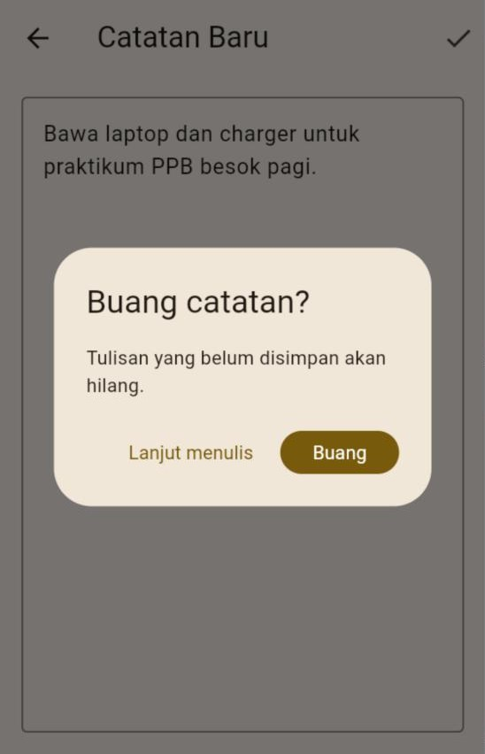
</p>

> [!WARNING]
> Tutorial lama di internet memakai `WillPopScope`. Widget itu **sudah usang** (*deprecated*) sejak Flutter 3.12 dan diganti `PopScope`. Begitu pula properti `onPopInvoked` milik `PopScope` yang sudah diganti `onPopInvokedWithResult`. Jika VS Code mencoret kode Anda, berarti Anda memakai versi yang lama.

---

## 13. `go_router`: Navigasi Berbasis Alamat

### 13.1 Mengapa butuh alamat?

Dengan `Navigator.push`, setiap halaman dibuka dengan **menunjuk widget-nya langsung**. Cara ini sederhana dan cukup untuk aplikasi kecil. Namun aplikasi nyata sering butuh lebih:

- Di **web**, setiap halaman seharusnya punya alamat di *address bar*, misalnya `.../menu/3`, yang bisa disalin, dibagikan, dan dibuka langsung.
- Sebuah **notifikasi** atau **tautan** ("Promo hari ini!") harus bisa langsung membuka halaman tertentu di dalam aplikasi. Fitur ini disebut ***deep linking***.
- Semakin banyak halaman, semakin sulit melacak halaman mana membuka halaman mana jika perintah `push` tersebar di mana-mana.

Paket **`go_router`**, yang dikembangkan oleh tim Flutter sendiri, menjawab semua kebutuhan itu. Ide utamanya: **setiap halaman punya alamat**, dan semua alamat ditulis di **satu peta rute**.

Analoginya seperti **denah gedung kampus** di pintu masuk. Anda tidak perlu tahu jalan dari ruang mana ke ruang mana. Cukup sebut alamatnya ("Gedung B, lantai 2"), dan denah itu yang menentukan jalannya.

| Istilah | Artinya | Contoh |
| :--- | :--- | :--- |
| Alamat (*path*) | Teks yang menunjuk satu halaman | `/`, `/tentang`, `/fakultas/teknik` |
| Rute (`GoRoute`) | Pasangan "alamat → halaman" | `/tentang` → `HalamanTentang` |
| Peta rute (`GoRouter`) | Kumpulan semua rute aplikasi | satu variabel `petaRute` |
| Parameter alamat (*path parameter*) | Bagian alamat yang isinya berubah-ubah, ditulis dengan titik dua | `/fakultas/:kode` cocok dengan `/fakultas/teknik`, `/fakultas/hukum`, dst. |

### 13.2 Memasang paket `go_router`

`go_router` bukan bagian bawaan Flutter. Ia adalah **paket** dari [pub.dev](https://pub.dev/packages/go_router), gudang paket resmi Dart dan Flutter. Ini pertama kalinya kita memakai paket tambahan.

**Di proyek Flutter Anda (VS Code):**

1. Buka berkas `pubspec.yaml` di folder proyek.
2. Di bawah `dependencies:`, tambahkan satu baris `go_router` dengan indentasi **dua spasi**, sejajar dengan `flutter:`:

   ```yaml
   dependencies:
     flutter:
       sdk: flutter
     go_router: ^17.5.0
   ```

3. Simpan berkas. VS Code biasanya langsung mengunduh paketnya. Jika tidak, jalankan di terminal:

   ```text
   flutter pub get
   ```

4. Di bagian atas berkas Dart yang memakainya, tambahkan:

   ```dart
   import 'package:go_router/go_router.dart';
   ```

**Di DartPad:** paket `go_router` sudah tersedia. Cukup tulis baris `import` di atas.

> [!NOTE]
> **Mengapa versi 17, bukan versi terbaru?** Tim Flutter sedang memindahkan pustaka Material ke paket baru bernama `material_ui` (lihat catatan di [Pertemuan 1](../pertemuan_01_pengenalan_flutter/README.md)). Mulai versi 18, `go_router` dibuat untuk aplikasi yang sudah memakai `material_ui`. Proyek buatan `flutter create` di Flutter 3.47 masih memakai `package:flutter/material.dart`, sehingga `go_router` 18 tidak mengenali `MaterialApp` kita: halaman tetap berpindah, tetapi **tanpa animasi** khas Material. `go_router` 17 masih memakai pustaka yang sama dengan proyek kita, sehingga semuanya berjalan normal. DartPad sudah memakai `go_router` 18, jadi wajar jika di sana perpindahan halaman tampil tanpa animasi.

> [!TIP]
> Tanda `^` pada `^17.5.0` berarti "versi 17.5.0 atau yang lebih baru, **selama masih versi 17**". Perbaikan kecil tetap diterima, tetapi perubahan besar di versi 18 tidak ikut terpasang tanpa sepengetahuan Anda.

### 13.3 Menulis peta rute

```dart
final GoRouter petaRute = GoRouter(
  routes: [
    GoRoute(
      path: '/',
      builder: (BuildContext context, GoRouterState state) {
        return const HalamanBeranda();
      },
      // Rute anak: halaman yang "berada di atas" beranda.
      routes: [
        GoRoute(
          // :kode adalah parameter alamat, isinya berubah-ubah.
          path: 'fakultas/:kode',
          builder: (BuildContext context, GoRouterState state) {
            // Tanda ! aman: rute ini hanya cocok jika :kode terisi.
            final String kode = state.pathParameters['kode']!;
            return HalamanFakultas(kode: kode);
          },
        ),
        GoRoute(
          path: 'tentang',
          builder: (BuildContext context, GoRouterState state) {
            return const HalamanTentang();
          },
        ),
      ],
    ),
  ],
  // Halaman untuk alamat yang tidak ada di peta rute.
  errorBuilder: (BuildContext context, GoRouterState state) {
    return HalamanTidakDitemukan(alamat: state.uri.toString());
  },
);
```

Hal-hal yang perlu diperhatikan:

1. **Rute utama** ditulis dengan garis miring di depan (`'/'`). **Rute anak** ditulis **tanpa** garis miring di depan (`'fakultas/:kode'`, `'tentang'`). Alamat lengkap rute anak adalah gabungan keduanya: `/fakultas/:kode` dan `/tentang`.
2. Rute anak berarti halaman itu **ditumpuk di atas** halaman induknya. Karena itu halaman fakultas otomatis punya panah kembali menuju beranda.
3. `GoRouterState state` berisi keterangan tentang alamat yang sedang dibuka, misalnya `state.pathParameters` (isi parameter) dan `state.uri` (alamat lengkap).

Lalu ganti `MaterialApp` dengan `MaterialApp.router`, dan serahkan peta rutenya:

```dart
return MaterialApp.router(
  debugShowCheckedModeBanner: false,
  theme: ThemeData(
    colorScheme: ColorScheme.fromSeed(seedColor: Colors.indigo),
  ),
  routerConfig: petaRute, // menggantikan "home:"
);
```

### 13.4 Berpindah halaman: `go`, `push`, dan `pop`

`go_router` menambahkan perintah baru langsung pada `context`:

| Perintah | Yang terjadi |
| :--- | :--- |
| `context.go('/tentang')` | **Pindah ke alamat itu.** Tumpukan halaman **disusun ulang** mengikuti peta rute: halaman induknya ditaruh di bawah, sisanya dibuang. |
| `context.push('/tentang')` | **Menumpuk** halaman itu di atas halaman sekarang, persis seperti `Navigator.push`. |
| `context.pop()` | Mengambil halaman teratas, persis seperti `Navigator.pop`. Bisa membawa hasil: `context.pop(jumlah)`. |

Perbedaan `go` dan `push` paling mudah dilihat dari halaman fakultas yang membuka halaman "Tentang":

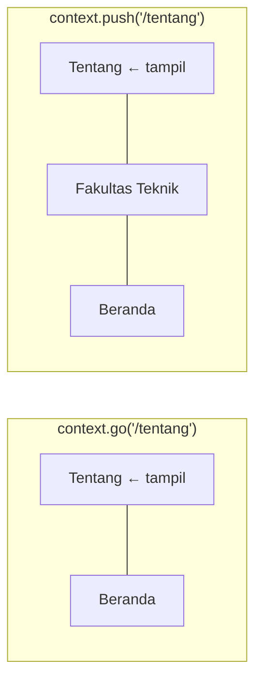

- Setelah **`go`**, panah kembali di halaman Tentang membawa Anda ke **Beranda**, karena di peta rute `tentang` adalah anak dari `/`.
- Setelah **`push`**, panah kembali membawa Anda ke **Fakultas Teknik**, karena halaman Tentang ditumpuk di atasnya.

Aturan praktisnya: gunakan **`go`** untuk berpindah ke "tempat" lain di aplikasi (misalnya dari menu utama), dan **`push`** untuk halaman sementara yang setelah selesai akan **kembali ke halaman sebelumnya**, terutama jika Anda menunggu hasilnya.

### 13.5 Parameter alamat selalu berupa teks

Isi parameter alamat **selalu `String`**, karena alamat adalah teks. Jika yang dibutuhkan angka, ubah dulu dengan `int.tryParse` (Pertemuan 2), dan siapkan jalan keluar jika gagal:

```dart
GoRoute(
  path: 'menu/:id',
  builder: (BuildContext context, GoRouterState state) {
    // Isi alamat selalu berupa teks, jadi id diubah dulu ke int.
    final int? id = int.tryParse(state.pathParameters['id']!);
    final Menu? menu = id == null ? null : cariMenu(id);
    if (menu == null) {
      return HalamanTidakDitemukan(alamat: state.uri.toString());
    }
    return HalamanDetailMenu(menu: menu);
  },
)
```

Pola ini penting: alamat `/menu/abc` (bukan angka) atau `/menu/99` (tidak ada menu ber-`id` 99) tetap dianggap "cocok" dengan rute `menu/:id`. Kitalah yang harus memeriksa apakah datanya benar-benar ada.

> [!TIP]
> Selain parameter alamat, ada juga **parameter kueri** (*query parameter*), yaitu bagian setelah tanda tanya: `/cari?q=soto`. Nilainya dibaca dengan `state.uri.queryParameters['q']`, dan hasilnya `null` jika tidak ada. Parameter kueri cocok untuk nilai yang **boleh tidak ada**, seperti kata kunci pencarian atau urutan tampilan.

> [!WARNING]
> `go` dan `push` juga punya parameter `extra` untuk mengirim objek apa pun. Hindari kebiasaan itu untuk data utama halaman. Objek di `extra` **tidak ikut tertulis di alamat**, sehingga hilang ketika halaman web dimuat ulang atau dibuka dari tautan. Kirim **`id`-nya** di alamat, lalu cari datanya di halaman tujuan, seperti contoh di atas.

### 13.6 Halaman "tidak ditemukan"

Jika pengguna membuka alamat yang **tidak ada di peta rute**, misalnya `/beasiswa`, `go_router` memanggil `errorBuilder`. Tanpa `errorBuilder`, `go_router` menampilkan halaman *error* bawaan bertuliskan *Page Not Found* beserta pesan `no routes for location: /beasiswa`. Halaman buatan sendiri tentu lebih ramah:

```dart
errorBuilder: (BuildContext context, GoRouterState state) {
  return HalamanTidakDitemukan(alamat: state.uri.toString());
},
```

Contoh 11 juga menampilkan alamat halaman yang sedang dibuka di bagian atas setiap halaman, agar Anda bisa melihat alamatnya berubah walaupun di DartPad tidak ada *address bar*:

```dart
final String alamat = GoRouterState.of(context).uri.toString();
```

📄 Kode lengkap: [`kode/contoh_11_go_router.dart`](kode/contoh_11_go_router.dart)

<p align="center">
  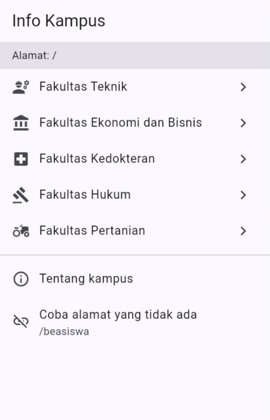
  &nbsp;
  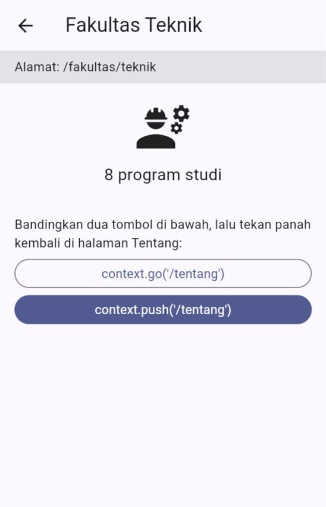
  &nbsp;
  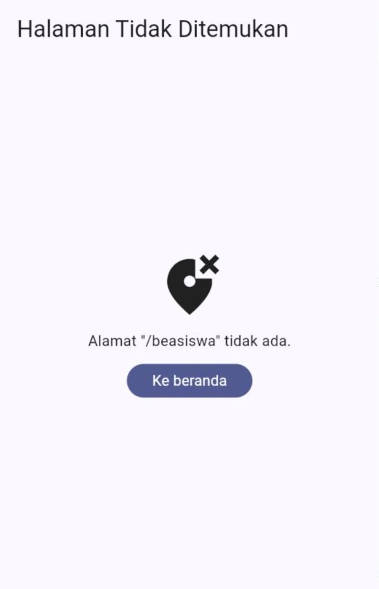
</p>

Saat dijalankan dengan `flutter run -d chrome`, alamat yang sama juga tampil di *address bar* browser, misalnya `localhost:xxxxx/#/fakultas/teknik`. Coba salin alamat itu ke tab baru: halaman fakultas langsung terbuka. Itulah *deep linking*.

### 13.7 `Navigator` atau `go_router`?

| | `Navigator.push` | `go_router` |
| :--- | :--- | :--- |
| Cara membuka halaman | Menunjuk widget langsung | Menyebut alamat |
| Paket tambahan | Tidak perlu | Perlu (`go_router`) |
| Alamat di browser & *deep linking* | Tidak | Ya |
| Daftar semua halaman | Tersebar di banyak tempat | Terkumpul di satu peta rute |
| Cocok untuk | Aplikasi kecil, latihan, halaman sementara | Aplikasi nyata, apalagi yang dijalankan di web |

Keduanya bisa dipakai bersama. Bahkan di aplikasi yang memakai `go_router`, dialog dan *bottom sheet* tetap dibuka dengan cara Pertemuan 5, dan `Navigator.pop(context)` tetap bekerja.

> **🧠 Cek Cepat**
> 1. Rute anak `'menu/:id'` berada di bawah rute `'/'`. Apa alamat lengkapnya jika `id` = 7?
> 2. `state.pathParameters['id']` berisi `'7'`. Apa jenis datanya, dan bagaimana mengubahnya menjadi angka?
> 3. Dari halaman B Anda ingin membuka halaman pemilih C, lalu **kembali ke B** sambil membawa pilihan. `go` atau `push`?
>
> <details><summary>Lihat jawaban</summary>
>
> 1. `/menu/7`.
> 2. `String`. Ubah dengan `int.tryParse(...)`, yang menghasilkan `int?` (bernilai `null` jika teksnya bukan angka).
> 3. `push`, karena `push` menumpuk C di atas B dan mengembalikan `Future` yang bisa ditunggu hasilnya. `go` menyusun ulang tumpukan sehingga B belum tentu masih ada di bawah C.
> </details>

---

## 14. Studi Kasus: Katalog Menu Kantin

### 14.1 Kebutuhan

Di Pertemuan 4 kita membuat **tampilan** detail menu, dan di Pertemuan 5 kita membuat halaman pemesanan **satu** menu yang benar-benar bekerja. Hari ini kantin ingin aplikasi yang lebih lengkap:

1. Halaman **katalog** menampilkan semua menu, lengkap dengan kategori dan harga.
2. Pengguna bisa **mencari** menu dengan mengetik nama dan **menyaring** berdasarkan kategori (Makanan, Minuman, Camilan).
3. Mengetuk menu membuka halaman **detail** beralamat `/menu/:id`, tempat pengguna memilih jumlah porsi.
4. Tombol "Tambah" di halaman detail menutup halaman itu dan **mengirim jumlah porsi** ke katalog.
5. Katalog menandai menu yang sudah masuk keranjang (misalnya **×2**), dan menampilkan tombol keranjang berisi **jumlah porsi dan total harga**.
6. Tombol keranjang membuka **ringkasan pesanan** di *bottom sheet*, lengkap dengan tombol "Pesan sekarang".
7. Alamat yang salah, misalnya `/menu/99`, menampilkan halaman "Tidak Ditemukan" yang ramah.

### 14.2 Rancangan sebelum menulis kode

**Halaman dan alamatnya:**

| Alamat | Halaman | Jenis widget |
| :--- | :--- | :--- |
| `/` | `HalamanKatalog` | `StatefulWidget` (kata kunci, kategori, keranjang) |
| `/menu/:id` | `HalamanDetailMenu` | `StatefulWidget` (jumlah porsi) |
| alamat lain | `HalamanTidakDitemukan` | `StatelessWidget` |

**Di mana *state* disimpan?**

| Data | Disimpan di | Jenis |
| :--- | :--- | :--- |
| Daftar menu | variabel `const` `daftarMenu` | data tetap |
| Kata kunci & kategori | *State* katalog | *state* |
| Isi keranjang (`id` menu → jumlah porsi) | *State* katalog, berupa `Map<int, int>` | *state* |
| Hasil pencarian, isi keranjang lengkap, jumlah porsi, total harga | *getter* di *State* katalog | **nilai turunan** |
| Jumlah porsi yang sedang dipilih | *State* halaman detail | *state* |

Keranjang disimpan sebagai `Map<int, int>`: **kuncinya `id` menu, nilainya jumlah porsi**. Kita menyimpan `id`, bukan objek menunya, dengan alasan yang sama seperti *key* di Bagian 7: `id` adalah tanda pengenal yang unik dan tetap.

**Alur datanya:**

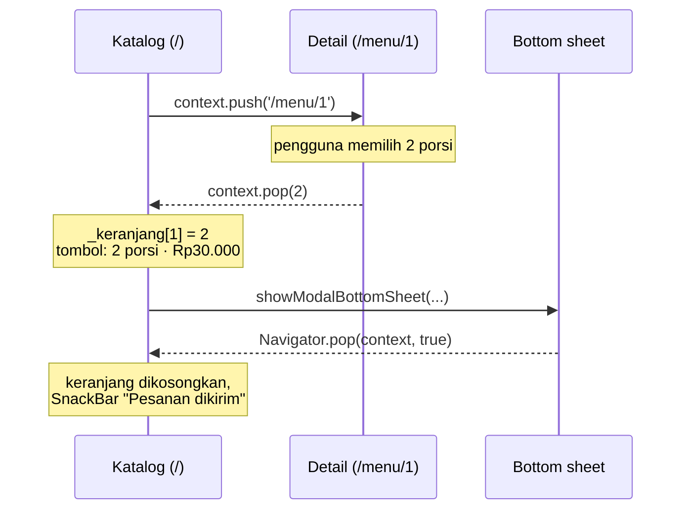

### 14.3 Membaca kodenya bagian demi bagian

Kode lengkap cukup panjang, jadi kita baca per bagian. Setiap bagian memakai materi yang sudah dibahas sebelumnya.

**① Data (Bagian 2).** `enum Kategori`, *class* `Menu` dengan `id` unik, dan daftar `const` berisi delapan menu. Ditambah *class* kecil `ItemKeranjang` yang menggabungkan satu menu dengan jumlah porsinya, lengkap dengan *getter* `subtotal`:

```dart
class ItemKeranjang {
  const ItemKeranjang(this.menu, this.jumlah);

  final Menu menu;
  final int jumlah;

  int get subtotal => menu.harga * jumlah;
}
```

**② Peta rute (Bagian 13).** Rute `/` untuk katalog dan rute anak `menu/:id` untuk detail, yang mengubah `id` dari teks menjadi angka dengan `int.tryParse`.

**③ Nilai turunan di katalog (Bagian 8).** Selain `_hasil` untuk pencarian, ada tiga *getter* lain yang dihitung dari `_keranjang`:

```dart
// Isi keranjang: id menu -> jumlah porsi. Ini state yang sebenarnya.
final Map<int, int> _keranjang = {};

List<ItemKeranjang> get _isiKeranjang {
  final List<ItemKeranjang> hasil = [];
  for (final Menu menu in daftarMenu) {
    final int? jumlah = _keranjang[menu.id];
    if (jumlah != null) {
      hasil.add(ItemKeranjang(menu, jumlah));
    }
  }
  return hasil;
}

int get _jumlahPorsi {
  int total = 0;
  for (final int jumlah in _keranjang.values) {
    total += jumlah;
  }
  return total;
}
```

`_keranjang[menu.id]` menghasilkan `int?`: angka jika menu itu ada di keranjang, `null` jika tidak. Karena perulangan berjalan mengikuti `daftarMenu`, isi keranjang selalu tampil dengan urutan yang sama seperti katalog.

**④ Membuka detail dan menunggu hasilnya (Bagian 11 dan 13).**

```dart
Future<void> _bukaDetail(Menu menu) async {
  // push ke /menu/id lalu MENUNGGU jumlah porsi yang dikirim balik.
  final int? jumlah = await context.push<int>('/menu/${menu.id}');
  if (!mounted) return;
  if (jumlah == null) return; // kembali tanpa menambah

  setState(() {
    _keranjang[menu.id] = (_keranjang[menu.id] ?? 0) + jumlah;
  });
  // ... tampilkan SnackBar "2 × Nasi Goreng Spesial masuk keranjang."
}
```

Baris `(_keranjang[menu.id] ?? 0) + jumlah` berarti: ambil jumlah yang sudah ada di keranjang, atau `0` jika menu itu belum pernah dipesan (operator `??` dari Pertemuan 2), lalu tambahkan jumlah yang baru.

**⑤ Halaman detail mengirim jumlah porsi.** Halaman detail memakai `TombolJumlah` dari Pertemuan 5. Tombol utamanya menutup halaman sambil membawa jumlah porsi:

```dart
FilledButton.icon(
  // Tutup halaman ini SAMBIL mengirim jumlah porsi.
  onPressed: () => context.pop(_jumlah),
  icon: const Icon(Icons.add_shopping_cart),
  label: Text('Tambah · ${formatRupiah(menu.harga * _jumlah)}'),
)
```

**⑥ Tombol keranjang yang muncul hanya jika perlu.**

```dart
// Tombol keranjang hanya muncul jika keranjang tidak kosong.
bottomNavigationBar: porsi == 0
    ? null
    : SafeArea(
        child: Padding(
          padding: const EdgeInsets.all(16),
          child: FilledButton.icon(
            onPressed: _lihatKeranjang,
            icon: const Icon(Icons.shopping_bag),
            label: Text('$porsi porsi · ${formatRupiah(_totalHarga)}'),
          ),
        ),
      ),
```

**⑦ Ringkasan di *bottom sheet* (Pertemuan 5).** `_lihatKeranjang` membuka `LembarKeranjang` dengan `showModalBottomSheet<bool>`. Jika pengguna menekan "Pesan sekarang", lembar itu mengirim `true`. Katalog lalu mengosongkan keranjang dan menampilkan `SnackBar`.

📄 Kode lengkap: [`kode/contoh_12_studi_kasus_katalog_menu.dart`](kode/contoh_12_studi_kasus_katalog_menu.dart)

<p align="center">
  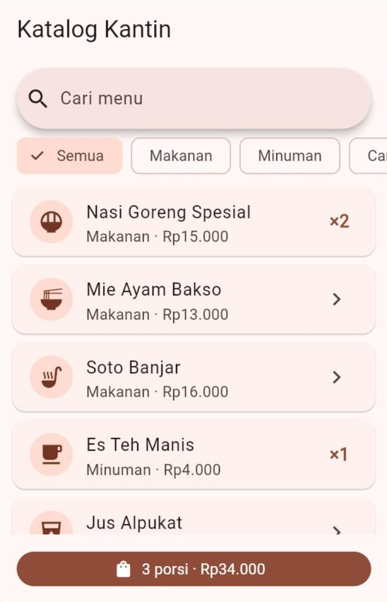
  &nbsp;
  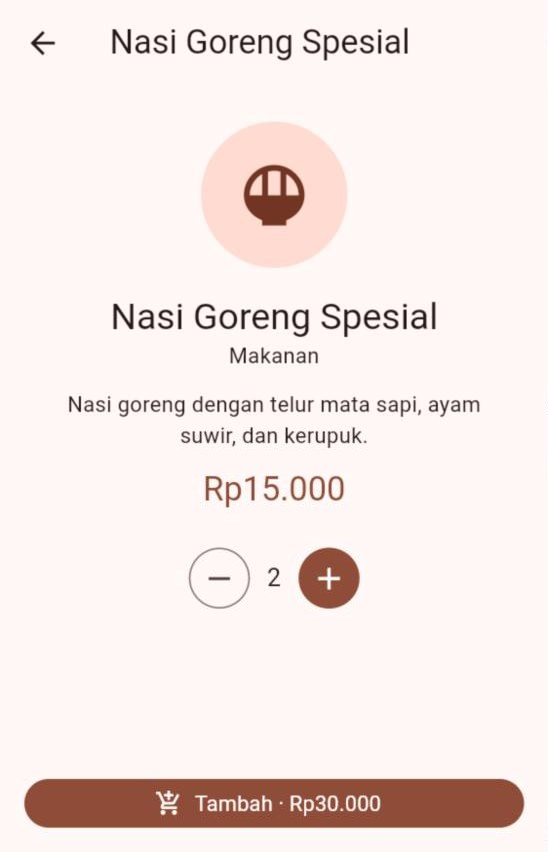
  &nbsp;
  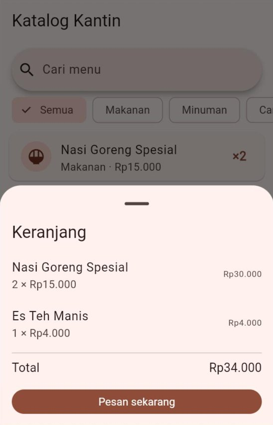
</p>

### 14.4 Uji coba

Jalankan aplikasi dan lakukan skenario berikut **di lebar 360 dan 320** (cara mengatur lebar ada di [Pertemuan 4](../pertemuan_04_widget_dan_layout/README.md)):

| No. | Langkah | Hasil yang diharapkan |
| :---: | :--- | :--- |
| 1 | Buka aplikasi | 8 menu tampil, tombol keranjang belum muncul |
| 2 | Ketik `es` di kotak pencarian | Hanya menu yang namanya mengandung "es" yang tampil |
| 3 | Kosongkan pencarian, pilih chip **Camilan** | Hanya Pisang Goreng dan Tahu Isi |
| 4 | Pilih **Semua**, ketuk **Nasi Goreng Spesial**, tambah menjadi 2, tekan **Tambah** | Kembali ke katalog, `SnackBar` "2 × Nasi Goreng Spesial masuk keranjang.", kartu bertanda **×2**, tombol **2 porsi · Rp30.000** |
| 5 | Ketuk **Es Teh Manis**, lalu tekan panah kembali **tanpa** menekan Tambah | Tidak ada yang berubah (hasilnya `null`) |
| 6 | Ketuk **Es Teh Manis**, tekan **Tambah** (1 porsi) | Tombol menjadi **3 porsi · Rp34.000** |
| 7 | Tekan tombol keranjang | *Bottom sheet* berisi 2 baris, total **Rp34.000** |
| 8 | Tekan **Pesan sekarang** | Keranjang kosong, tombol keranjang hilang, `SnackBar` "Pesanan dikirim ke dapur. Terima kasih!" |

Jika dijalankan di Chrome, coba juga ketik alamat `.../#/menu/3` di *address bar*: halaman Soto Banjar langsung terbuka. Lalu coba `.../#/menu/99`: halaman "Tidak Ditemukan" muncul.

> [!NOTE]
> Keranjang belanja di sini hanya hidup selama halaman katalog terbuka, dan hilang ketika aplikasi ditutup. Menyimpan data agar tidak hilang adalah materi [Pertemuan 11](../SILABUS.md). Membagikan keranjang ke banyak halaman dengan rapi adalah materi manajemen *state* di Pertemuan 9.

---

## 15. Kesalahan Umum Pemula dan Solusinya

| Gejala atau pesan | Penyebab | Solusi |
| :--- | :--- | :--- |
| `Vertical viewport was given unbounded height.` | `ListView`/`GridView` diletakkan langsung di dalam `Column` | Bungkus dengan `Expanded` (Bagian 6) |
| `RangeError (index): Index out of range` saat menggulir | `itemCount` tidak diisi atau tidak sama dengan panjang daftar | `itemCount: daftar.length` |
| Daftar terasa berat dan lambat dibuka | Ratusan baris dibuat dengan `Column` atau `ListView(children: ...)` | Gunakan `ListView.builder` |
| Teks di dalam kotak `GridView` terpotong garis kuning-hitam | Tinggi kotak ikut mengecil karena `childAspectRatio` | Gunakan `mainAxisExtent`, batasi teks dengan `maxLines` (Bagian 5.3) |
| `A dismissed Dismissible widget is still part of the tree.` | Item tidak dihapus dari daftar di `onDismissed` | Hapus item di dalam `setState` pada `onDismissed` |
| Item yang salah ikut hilang atau animasi geser kacau | *Key* `Dismissible` memakai `index` atau `UniqueKey()` | `ValueKey(item.id)` dengan `id` yang unik dan tetap |
| Tombol "Urungkan" mengembalikan item ke ujung daftar | Memakai `add` | Catat indeksnya, lalu `insert(indeks, item)` |
| Kolom pencarian sudah kosong, tetapi daftar masih tersaring | `controller.clear()` tidak memanggil `onChanged` | Kosongkan juga variabel kata kunci di dalam `setState` (Bagian 8.4) |
| `Navigator operation requested with a context that does not include a Navigator.` | `Navigator.push` memakai `context` milik widget **di atas** `MaterialApp` | Panggil dari widget yang berada **di dalam** `MaterialApp` (misalnya halaman `home`) |
| Hasil dari halaman kedua selalu `null` | Halaman kedua ditutup dengan `Navigator.pop(context)` tanpa hasil, atau pengguna menekan panah kembali | Kirim hasil dengan `Navigator.pop(context, nilai)`, dan selalu tangani kemungkinan `null` |
| Peringatan `use_build_context_synchronously` atau `setState() called after dispose()` setelah `await Navigator.push(...)` | Tidak memeriksa `mounted` setelah menunggu | `if (!mounted) return;` tepat setelah `await`; di fungsi yang ditulis di dalam `build`, `if (!context.mounted) return;` ([Bagian 12.2](#122-cara-kerja-popscope)) |
| `WillPopScope` atau `onPopInvoked` dicoret VS Code | Memakai API usang | Gunakan `PopScope` dengan `onPopInvokedWithResult` (Bagian 12) |
| `The method 'go' isn't defined for the type 'BuildContext'.` | Lupa `import 'package:go_router/go_router.dart';` | Tambahkan *import*-nya |
| `Target of URI doesn't exist: 'package:go_router/go_router.dart'.` | Paket belum ditambahkan di `pubspec.yaml` atau belum `flutter pub get` | Ikuti Bagian 13.2 |
| `No GoRouter found in context` | Memakai `context.go` di aplikasi yang masih memakai `MaterialApp` biasa | Gunakan `MaterialApp.router(routerConfig: petaRute)` |
| Halaman "tidak ditemukan" muncul untuk alamat yang terlihat benar | Salah ketik alamat, atau lupa parameternya (misalnya `/fakultas` tanpa kode) | Cocokkan alamat dengan peta rute, huruf besar-kecil juga dibedakan |
| Perpindahan halaman `go_router` tanpa animasi | Memakai `go_router` 18 dengan `package:flutter/material.dart` | Pakai `go_router: ^17.5.0` di proyek Anda (Bagian 13.2). Di DartPad, hal ini wajar |

---

## 16. Ringkasan

1. Data yang punya banyak keterangan dibungkus dalam ***class* model**, lalu disimpan sebagai **satu `List` berisi objek**.
2. **`ListView.builder`** hanya membangun baris yang dibutuhkan, sehingga tetap ringan walaupun datanya ribuan. Isi `itemCount` dengan panjang daftar, dan jangan menyimpan data penting di dalam widget baris.
3. **`ListView.separated`** menambahkan pemisah di antara baris. **`GridView.builder`** dengan `SliverGridDelegateWithMaxCrossAxisExtent` menyesuaikan jumlah kolom dengan lebar layar. `mainAxisExtent` membuat tinggi kotak tetap dan aman.
4. Daftar di dalam `Column` wajib dibungkus **`Expanded`**.
5. **`Dismissible`** menghapus item dengan gerakan geser. Item wajib dihapus dari daftar di `onDismissed`, dan *key*-nya harus **unik dan tetap**, misalnya `ValueKey(item.id)`. Catat item dan posisinya agar bisa **diurungkan**.
6. Hasil pencarian adalah **nilai turunan**: data asli tidak diubah, yang disimpan di *state* hanya kata kunci dan pilihan saringan.
7. **`Navigator`** menyimpan halaman sebagai **tumpukan**: `push` menaruh di atas, `pop` mengambil yang teratas.
8. Data dikirim ke halaman tujuan lewat **constructor**. Hasil diterima dengan **`await Navigator.push<T>(...)`** dan dikirim dengan **`Navigator.pop(context, hasil)`**. Hasilnya bisa `null`, dan **`mounted`** wajib diperiksa setelah `await`.
9. **`PopScope`** dengan `canPop: false` menahan tombol kembali, lalu `onPopInvokedWithResult` dipakai untuk bertanya kepada pengguna.
10. **`go_router`** memberi setiap halaman **alamat**. Semua rute ditulis di satu `GoRouter`, aplikasi memakai `MaterialApp.router`, dan perpindahan memakai `context.go` (pindah tempat) atau `context.push` (menumpuk, bisa menunggu hasil).

### ✅ Daftar Periksa Sebelum Lanjut

- [ ] Saya bisa membuat *class* model dan menampilkan `List` objeknya dengan `ListView.builder`.
- [ ] Saya tahu mengapa `ListView` di dalam `Column` harus dibungkus `Expanded`.
- [ ] Saya bisa membuat `GridView` yang jumlah kolomnya menyesuaikan lebar layar.
- [ ] Saya bisa menghapus item dengan geser, lengkap dengan tombol "Urungkan".
- [ ] Saya bisa membuat pencarian dan saringan tanpa mengubah data asli.
- [ ] Saya bisa membuka halaman baru, mengirim data ke sana, dan menerima hasilnya kembali.
- [ ] Saya bisa menahan tombol kembali dengan `PopScope`.
- [ ] Saya bisa menyusun peta rute `go_router` dengan parameter alamat dan halaman "tidak ditemukan".

---

## 17. Glosarium

| Istilah | Penjelasan sederhana |
| :--- | :--- |
| *Class* model | *Class* yang mewakili satu jenis data dari dunia nyata, misalnya `Buku` atau `Menu`. |
| *Lazy building* | Membangun widget hanya ketika dibutuhkan, seperti yang dilakukan `ListView.builder`. |
| `itemBuilder` | Fungsi "resep" yang membuat satu baris atau satu kotak berdasarkan nomornya (`index`). |
| *Grid* | Susunan berbentuk kotak-kotak dalam baris dan kolom. |
| *Unbounded* | Tidak dibatasi. "*Unbounded height*" berarti tinggi yang diberikan tidak terbatas. |
| *Key* | Tanda pengenal sebuah widget, agar Flutter tetap mengenalinya walaupun posisinya berubah. |
| *Undo* (urungkan) | Membatalkan aksi yang baru saja dilakukan, misalnya mengembalikan item yang terhapus. |
| Navigasi | Perpindahan dari satu halaman ke halaman lain. |
| *Route* (rute) | Satu halaman beserta cara menampilkannya di dalam `Navigator`. Pada `go_router`, pasangan alamat dan halaman. |
| *Push* / *pop* | Menaruh halaman di atas tumpukan / mengambil halaman teratas. |
| *Path* (alamat) | Teks penunjuk halaman, misalnya `/menu/3`. |
| *Path parameter* | Bagian alamat yang isinya berubah-ubah, ditulis `:nama`, misalnya `:id`. |
| *Query parameter* | Bagian alamat setelah tanda `?`, misalnya `?q=soto`. |
| *Deep linking* | Membuka halaman tertentu di dalam aplikasi langsung dari tautan atau notifikasi. |
| Paket (*package*) | Kumpulan kode siap pakai dari pub.dev yang ditambahkan lewat `pubspec.yaml`. |

---

## 18. Referensi

1. Flutter. *Work with long lists*. <https://docs.flutter.dev/cookbook/lists/long-lists>
2. Flutter. *Create a grid list*. <https://docs.flutter.dev/cookbook/lists/grid-lists>
3. Flutter. *Implement swipe to dismiss*. <https://docs.flutter.dev/cookbook/gestures/dismissible>
4. Flutter. *Navigate to a new screen and back*. <https://docs.flutter.dev/cookbook/navigation/navigation-basics>
5. Flutter. *Send data to a new screen*. <https://docs.flutter.dev/cookbook/navigation/passing-data>
6. Flutter. *Return data from a screen*. <https://docs.flutter.dev/cookbook/navigation/returning-data>
7. Flutter. *Navigation and routing*. <https://docs.flutter.dev/ui/navigation>
8. Flutter API. *ListView class*. <https://api.flutter.dev/flutter/widgets/ListView-class.html>
9. Flutter API. *PopScope class*. <https://api.flutter.dev/flutter/widgets/PopScope-class.html>
10. pub.dev. *go_router*. <https://pub.dev/packages/go_router>
11. Material Design 3. *Lists*. <https://m3.material.io/components/lists/overview>
12. Material Design 3. *Search*. <https://m3.material.io/components/search/overview>

---

## ➡️ Langkah Berikutnya

1. Kerjakan **[🧪 Jobsheet Pertemuan 6](JOBSHEET.md)**: lima praktikum daftar dan navigasi, serta satu tugas mandiri.
2. Uji pemahaman Anda di **[✍️ Latihan Pertemuan 6](LATIHAN.md)**.
3. Pertemuan 7 membahas **Material Design 3 dan tampilan responsif**: mengatur tema (warna, tipografi, mode gelap) dan menyusun tata letak yang menyesuaikan ukuran layar, termasuk navigasi bawah (`NavigationBar`) untuk ponsel dan navigasi samping untuk tablet.

[🏠 Beranda](../README.md) · [⬆️ Kembali ke atas](#pertemuan-6--daftar-data--navigasi-antarhalaman)
