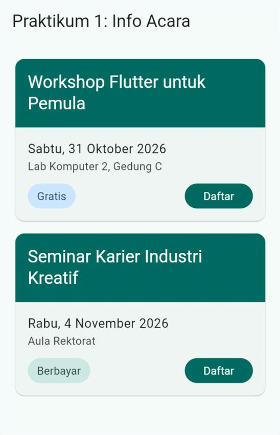
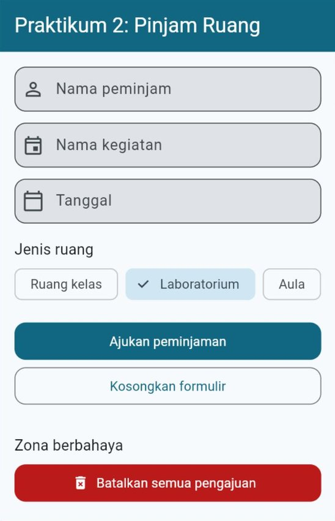
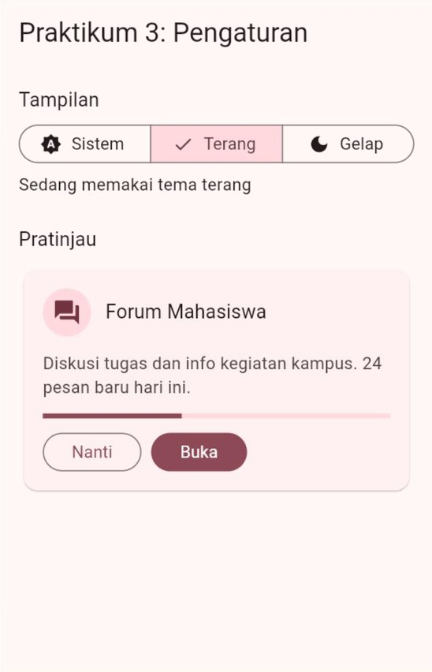
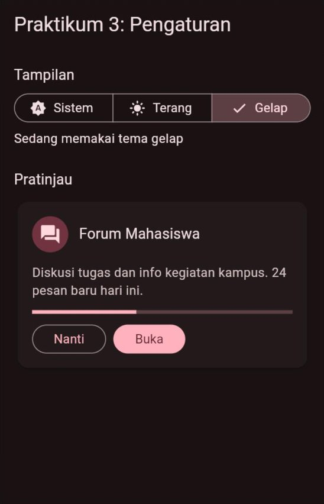
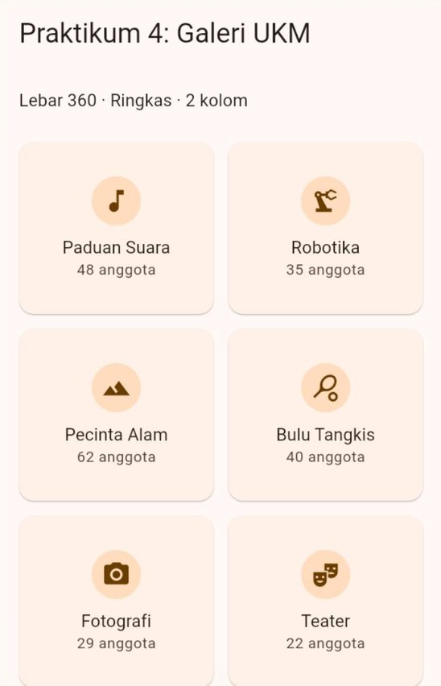
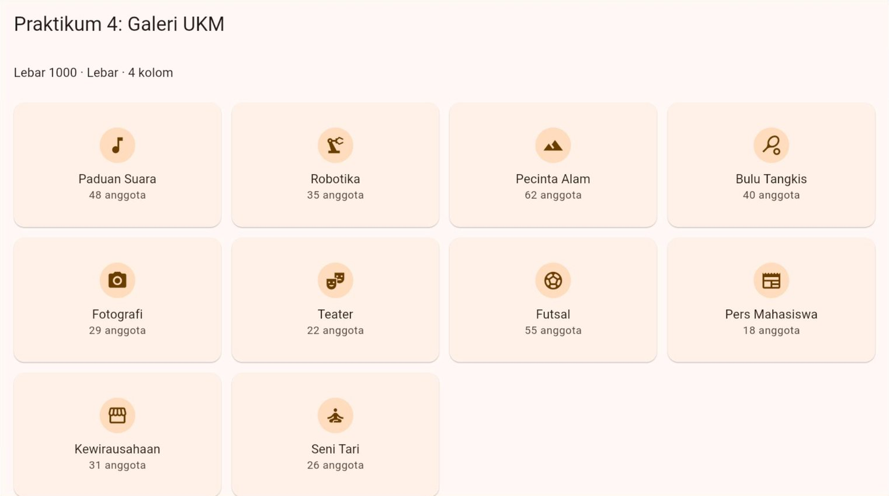
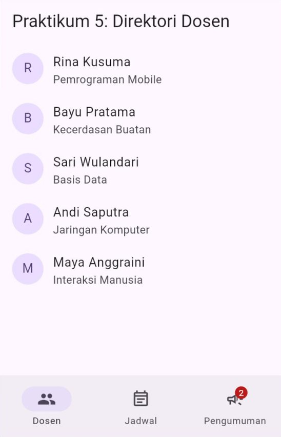
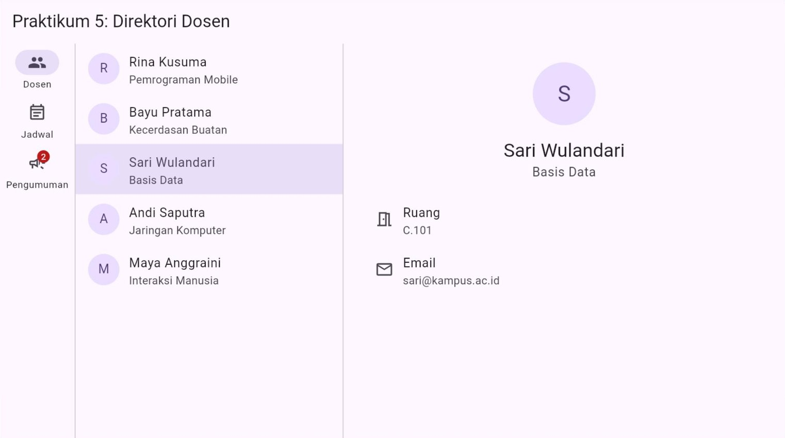

# 🧪 Jobsheet Pertemuan 7 — Material Design 3 & UI Responsif

[🏠 Beranda](../README.md) · [📖 Modul](README.md) · [✍️ Latihan](LATIHAN.md) · [💻 Kode Contoh](kode/)

| Informasi | Keterangan |
| :--- | :--- |
| Mata kuliah | Pemrograman Piranti Bergerak |
| Pertemuan | 7 — Material Design 3 & UI Responsif |
| Bentuk kegiatan | Praktikum individu |
| Estimasi waktu | 120–150 menit |
| Alat | DartPad **atau** proyek Flutter di VS Code yang dijalankan di Chrome. Untuk Praktikum 4 dan 5, Chrome lebih nyaman karena lebar jendelanya mudah diubah |
| Hasil akhir | Aplikasi "Direktori UKM Kampus" yang memakai tema dari satu warna benih, punya mode gelap, dan tata letaknya menyesuaikan lebar layar dari ponsel sampai laptop |

---

## 🎯 Tujuan Praktikum

Setelah menyelesaikan jobsheet ini, Anda mampu:

1. Mengganti warna dan ukuran huruf yang ditulis langsung dengan **peran warna** dan **gaya huruf** dari tema.
2. Mengatur tampilan semua komponen sejenis dengan **tema komponen**, serta mengubah tema hanya pada sebagian layar.
3. Menyediakan **mode gelap** yang bisa dipilih pengguna, dengan *state* di akar aplikasi.
4. Menyusun *grid* yang jumlah kolomnya ditentukan ***breakpoint*** Material 3.
5. Membuat navigasi yang berpindah dari `NavigationBar` ke `NavigationRail`, serta pola daftar–detail.

## 📌 Petunjuk Umum

> [!IMPORTANT]
> 1. Setiap praktikum diawali **kode terbimbing**. **Ketik sendiri** kodenya, kecuali bagian yang ditandai *boleh disalin*.
> 2. Hari ini Anda menguji tampilan di **beberapa keadaan**: lebar layar berbeda, mode terang dan gelap. Ikuti petunjuk uji di setiap praktikum.
> 3. Kerjakan **🔧 Modifikasi** di setiap praktikum. Jawaban berupa penjelasan ditulis sebagai **komentar** di dalam kode.
> 4. Simpan setiap praktikum sebagai berkas terpisah berisi kode **lengkap**: `praktikum1.dart`, `praktikum2.dart`, dan seterusnya.
> 5. Rapikan kode sebelum menyimpan: tombol **Format** di DartPad, atau `Shift` + `Alt` + `F` di VS Code. Pastikan tidak ada garis merah maupun kuning.
> 6. **Aturan hari ini:** di dalam halaman, jangan menulis warna (`Colors.xxx`, `Color(0xFF...)`) maupun `fontSize`. Semuanya diambil dari tema. Pengecualian hanya untuk kode yang memang diberikan sebagai contoh yang salah.

> [!TIP]
> **Cara mengubah lebar layar saat menguji:**
> - **Chrome** (`flutter run -d chrome`): seret tepi jendela Chrome, atau tekan `F12` lalu `Ctrl` + `Shift` + `M` dan ketik lebar yang diinginkan di *device toolbar*.
> - **DartPad**: lebar panel aplikasi mengikuti lebar jendela *browser*; perkecil atau perbesar jendela *browser*.
> - Gambar **✅ Hasil yang diharapkan** diambil pada lebar yang disebutkan di atas setiap gambar.

<details>
<summary>❓ Lupa cara menjalankan aplikasi Flutter?</summary>

- **DartPad:** buka <https://dartpad.dev>, hapus kode bawaannya, tempelkan kode Anda, lalu klik **Run**. Simpan hasil pekerjaan dengan menyalin kodenya ke berkas `.dart` di komputer Anda.
- **Proyek Flutter:** buka proyek latihan dari Pertemuan 1 di VS Code, ganti seluruh isi `lib/main.dart` dengan kode Anda, lalu jalankan dengan **F5** (atau `flutter run -d chrome` di terminal). Untuk *hot reload*, simpan berkas jika dijalankan dari VS Code, atau tekan `r` jika dijalankan dari terminal. Jika Anda mengubah **isi data**, **nilai awal** *state*, atau **tema di `MaterialApp`** lalu tampilannya tidak berubah, lakukan *hot restart* dengan menekan `R`.

Penjelasan lengkap ada di [Modul Pertemuan 1, Bagian 9](../pertemuan_01_pengenalan_flutter/README.md#9-menjalankan-aplikasi).
</details>

---

## Praktikum 1 — Kartu Acara yang Ikut Tema

**Konsep:** `Theme.of(context)`, peran warna, pasangan "*on*", dan gaya huruf `TextTheme`. ([Modul Bagian 3](README.md#3-tema-aplikasi-dan-themeofcontext), [Bagian 4](README.md#4-skema-warna-satu-benih-banyak-peran), dan [Bagian 5](README.md#5-tipografi-15-gaya-huruf-siap-pakai))

Seorang teman membuat kartu info acara, tetapi semua warna dan ukuran hurufnya ditulis langsung. Tugas Anda adalah **memperbaikinya** agar mengikuti tema.

### Langkah 1 — Jalankan kode awal (boleh disalin)

```dart
import 'package:flutter/material.dart';

void main() {
  runApp(const AplikasiAcara());
}

class AplikasiAcara extends StatelessWidget {
  const AplikasiAcara({super.key});

  @override
  Widget build(BuildContext context) {
    return MaterialApp(
      debugShowCheckedModeBanner: false,
      theme: ThemeData(
        colorScheme: ColorScheme.fromSeed(seedColor: Colors.teal),
      ),
      home: const HalamanAcara(),
    );
  }
}

class HalamanAcara extends StatelessWidget {
  const HalamanAcara({super.key});

  @override
  Widget build(BuildContext context) {
    return Scaffold(
      appBar: AppBar(title: const Text('Praktikum 1: Info Acara')),
      body: ListView(
        padding: const EdgeInsets.all(16),
        children: const [
          KartuAcara(
            judul: 'Workshop Flutter untuk Pemula',
            tanggal: 'Sabtu, 31 Oktober 2026',
            tempat: 'Lab Komputer 2, Gedung C',
            gratis: true,
          ),
          SizedBox(height: 8),
          KartuAcara(
            judul: 'Seminar Karier Industri Kreatif',
            tanggal: 'Rabu, 4 November 2026',
            tempat: 'Aula Rektorat',
            gratis: false,
          ),
        ],
      ),
    );
  }
}

// ❌ KODE AWAL: semua warna dan ukuran huruf ditulis langsung.
class KartuAcara extends StatelessWidget {
  const KartuAcara({
    super.key,
    required this.judul,
    required this.tanggal,
    required this.tempat,
    required this.gratis,
  });

  final String judul;
  final String tanggal;
  final String tempat;
  final bool gratis;

  @override
  Widget build(BuildContext context) {
    return Card(
      clipBehavior: Clip.antiAlias,
      child: Column(
        crossAxisAlignment: CrossAxisAlignment.stretch,
        children: [
          Container(
            color: const Color(0xFF1565C0),
            padding: const EdgeInsets.all(16),
            child: Text(
              judul,
              style: const TextStyle(fontSize: 20, color: Colors.white),
            ),
          ),
          Padding(
            padding: const EdgeInsets.all(16),
            child: Column(
              crossAxisAlignment: CrossAxisAlignment.start,
              children: [
                Text(
                  tanggal,
                  style: const TextStyle(fontSize: 16, color: Colors.black87),
                ),
                Text(
                  tempat,
                  style: const TextStyle(fontSize: 14, color: Colors.black54),
                ),
                const SizedBox(height: 12),
                Row(
                  children: [
                    Container(
                      padding: const EdgeInsets.symmetric(
                        horizontal: 12,
                        vertical: 6,
                      ),
                      decoration: BoxDecoration(
                        color: gratis
                            ? const Color(0xFFC8E6C9)
                            : const Color(0xFFFFE0B2),
                        borderRadius: BorderRadius.circular(16),
                      ),
                      child: Text(
                        gratis ? 'Gratis' : 'Berbayar',
                        style: TextStyle(
                          fontSize: 14,
                          color: gratis
                              ? const Color(0xFF1B5E20)
                              : const Color(0xFFE65100),
                        ),
                      ),
                    ),
                    const Spacer(),
                    ElevatedButton(
                      style: ElevatedButton.styleFrom(
                        backgroundColor: const Color(0xFF1565C0),
                        foregroundColor: Colors.white,
                      ),
                      onPressed: () {},
                      child: const Text('Daftar'),
                    ),
                  ],
                ),
              ],
            ),
          ),
        ],
      ),
    );
  }
}
```

Jalankan dan perhatikan: aplikasi memakai benih `Colors.teal`, tetapi kartunya tetap biru, karena warnanya ditulis langsung.

### Langkah 2 — Tentukan pengganti setiap warna

| Bagian kartu | Kode awal | Ganti dengan |
| :--- | :--- | :--- |
| Latar judul | `Color(0xFF1565C0)` | `warna.primary` |
| Teks judul | `fontSize: 20`, `Colors.white` | `gayaTeks.titleLarge` + `warna.onPrimary` |
| Tanggal | `fontSize: 16`, `Colors.black87` | `gayaTeks.bodyLarge` (warnanya sudah `onSurface`) |
| Tempat | `fontSize: 14`, `Colors.black54` | `gayaTeks.bodyMedium` + `warna.onSurfaceVariant` |
| Label "Gratis" | hijau muda + hijau tua | `warna.tertiaryContainer` + `warna.onTertiaryContainer` |
| Label "Berbayar" | oranye muda + oranye tua | `warna.secondaryContainer` + `warna.onSecondaryContainer` |
| Tombol "Daftar" | `ElevatedButton` biru | `FilledButton` **tanpa** `style` |

### Langkah 3 — Tulis ulang `KartuAcara` (ketik sendiri)

Hapus *class* `KartuAcara` yang lama, lalu ketik versi berikut. Label harga dipisah menjadi widget `LabelHarga` agar `KartuAcara` tidak terlalu panjang.

```dart
// ✅ SETELAH DIPERBAIKI: semua warna dan gaya huruf diambil dari tema.
class KartuAcara extends StatelessWidget {
  const KartuAcara({
    super.key,
    required this.judul,
    required this.tanggal,
    required this.tempat,
    required this.gratis,
  });

  final String judul;
  final String tanggal;
  final String tempat;
  final bool gratis;

  @override
  Widget build(BuildContext context) {
    final ColorScheme warna = Theme.of(context).colorScheme;
    final TextTheme gayaTeks = Theme.of(context).textTheme;

    return Card(
      clipBehavior: Clip.antiAlias,
      child: Column(
        crossAxisAlignment: CrossAxisAlignment.stretch,
        children: [
          Container(
            color: warna.primary,
            padding: const EdgeInsets.all(16),
            child: Text(
              judul,
              style: gayaTeks.titleLarge?.copyWith(color: warna.onPrimary),
            ),
          ),
          Padding(
            padding: const EdgeInsets.all(16),
            child: Column(
              crossAxisAlignment: CrossAxisAlignment.start,
              children: [
                Text(tanggal, style: gayaTeks.bodyLarge),
                Text(
                  tempat,
                  style: gayaTeks.bodyMedium?.copyWith(
                    color: warna.onSurfaceVariant,
                  ),
                ),
                const SizedBox(height: 12),
                Row(
                  children: [
                    LabelHarga(gratis: gratis),
                    const Spacer(),
                    FilledButton(onPressed: () {}, child: const Text('Daftar')),
                  ],
                ),
              ],
            ),
          ),
        ],
      ),
    );
  }
}

class LabelHarga extends StatelessWidget {
  const LabelHarga({super.key, required this.gratis});

  final bool gratis;

  @override
  Widget build(BuildContext context) {
    final ColorScheme warna = Theme.of(context).colorScheme;
    final TextTheme gayaTeks = Theme.of(context).textTheme;

    // Pasangan latar dan teks selalu "X" dengan "onX".
    final Color latar = gratis
        ? warna.tertiaryContainer
        : warna.secondaryContainer;
    final Color isi = gratis
        ? warna.onTertiaryContainer
        : warna.onSecondaryContainer;

    return Container(
      padding: const EdgeInsets.symmetric(horizontal: 12, vertical: 6),
      decoration: BoxDecoration(
        color: latar,
        borderRadius: BorderRadius.circular(16),
      ),
      child: Text(
        gratis ? 'Gratis' : 'Berbayar',
        style: gayaTeks.labelLarge?.copyWith(color: isi),
      ),
    );
  }
}
```

✅ **Hasil yang diharapkan** (lebar 360, mode terang):

<p align="center"></p>

🔧 **Modifikasi:**

1. Ganti warna benih menjadi `Colors.deepOrange`, lalu `Colors.indigo`. Jawab sebagai komentar: bagian kartu mana saja yang ikut berubah? Apa yang terjadi jika hal yang sama dilakukan pada **kode awal** di Langkah 1?
2. Tambahkan `dynamicSchemeVariant: DynamicSchemeVariant.fidelity` di `ColorScheme.fromSeed`. Jawab: apa beda warna latar judul dibandingkan sebelumnya (`tonalSpot`)? Hapus kembali setelahnya.
3. **Eksperimen mode gelap:** tambahkan `brightness: Brightness.dark` di `ColorScheme.fromSeed`. Jalankan kode **akhir** Anda, lalu jalankan juga **kode awal** dengan tambahan yang sama. Jawab: pada kode mana teks tanggal dan tempat sulit dibaca, dan mengapa?
4. **Eksperimen kontras:** ganti `warna.onPrimary` pada teks judul menjadi `warna.onSurface`, lalu bandingkan di mode terang dan mode gelap. Jawab: mengapa teks judul seharusnya memakai `onPrimary`? Kembalikan setelahnya.
5. **Tantangan:** tambahkan properti `kuotaTerisi` dan `kuota` (keduanya `int`, `required`) pada `KartuAcara`. Isi acara pertama 54 dari 60 dan acara kedua 20 dari 100. Di bawah tanggal dan tempat, tampilkan `LinearProgressIndicator(value: kuotaTerisi / kuota)` dan tulisan **"Kuota 54/60"** bergaya `labelMedium` berwarna `onSurfaceVariant`. Jika kuota terisi **90% atau lebih**, tampilkan juga label **"Hampir penuh"** berlatar `errorContainer` dengan teks `onErrorContainer` di ujung kanan baris tulisan kuota. Pastikan tidak ada *overflow* di lebar 320.

---

## Praktikum 2 — Formulir Peminjaman Ruang

**Konsep:** tema komponen dan tema lokal. ([Modul Bagian 6](README.md#6-tema-komponen-dan-tema-lokal))

Bagian umum kampus ingin formulir peminjaman ruang yang semua kolom dan tombolnya seragam. Semua gaya ditulis **sekali** di tema, sehingga halaman formulir sama sekali tidak berisi pengaturan gaya.

### Langkah 1 — Tema dengan tema komponen (ketik sendiri)

```dart
import 'package:flutter/material.dart';

void main() {
  runApp(const AplikasiPeminjaman());
}

class AplikasiPeminjaman extends StatelessWidget {
  const AplikasiPeminjaman({super.key});

  @override
  Widget build(BuildContext context) {
    final ColorScheme skema = ColorScheme.fromSeed(seedColor: Colors.blueGrey);

    return MaterialApp(
      debugShowCheckedModeBanner: false,
      theme: ThemeData(
        colorScheme: skema,
        appBarTheme: AppBarThemeData(
          backgroundColor: skema.primary,
          foregroundColor: skema.onPrimary,
        ),
        inputDecorationTheme: InputDecorationThemeData(
          filled: true,
          border: OutlineInputBorder(borderRadius: BorderRadius.circular(12)),
        ),
        filledButtonTheme: FilledButtonThemeData(
          style: FilledButton.styleFrom(
            minimumSize: const Size.fromHeight(48),
            shape: RoundedRectangleBorder(
              borderRadius: BorderRadius.circular(12),
            ),
          ),
        ),
        outlinedButtonTheme: OutlinedButtonThemeData(
          style: OutlinedButton.styleFrom(
            minimumSize: const Size.fromHeight(48),
            shape: RoundedRectangleBorder(
              borderRadius: BorderRadius.circular(12),
            ),
          ),
        ),
      ),
      home: const HalamanPeminjaman(),
    );
  }
}
```

### Langkah 2 — Halaman formulir (ketik sendiri)

Perhatikan bahwa halaman ini **tidak** berisi warna, sudut, maupun tinggi tombol, kecuali tema lokal di bagian "Zona berbahaya".

```dart
const List<String> daftarJenisRuang = ['Ruang kelas', 'Laboratorium', 'Aula'];

class HalamanPeminjaman extends StatefulWidget {
  const HalamanPeminjaman({super.key});

  @override
  State<HalamanPeminjaman> createState() => _HalamanPeminjamanState();
}

class _HalamanPeminjamanState extends State<HalamanPeminjaman> {
  String _jenisRuang = daftarJenisRuang.first;

  @override
  Widget build(BuildContext context) {
    final ColorScheme warna = Theme.of(context).colorScheme;
    final TextTheme gayaTeks = Theme.of(context).textTheme;

    return Scaffold(
      appBar: AppBar(title: const Text('Praktikum 2: Pinjam Ruang')),
      body: ListView(
        padding: const EdgeInsets.all(16),
        children: [
          const TextField(
            decoration: InputDecoration(
              labelText: 'Nama peminjam',
              prefixIcon: Icon(Icons.person_outline),
            ),
          ),
          const SizedBox(height: 12),
          const TextField(
            decoration: InputDecoration(
              labelText: 'Nama kegiatan',
              prefixIcon: Icon(Icons.event_outlined),
            ),
          ),
          const SizedBox(height: 12),
          const TextField(
            decoration: InputDecoration(
              labelText: 'Tanggal',
              hintText: 'contoh: 5 November 2026',
              prefixIcon: Icon(Icons.calendar_today_outlined),
            ),
          ),
          const SizedBox(height: 16),
          Text('Jenis ruang', style: gayaTeks.titleMedium),
          const SizedBox(height: 8),
          Wrap(
            spacing: 8,
            children: [
              for (final String jenis in daftarJenisRuang)
                ChoiceChip(
                  label: Text(jenis),
                  selected: jenis == _jenisRuang,
                  onSelected: (_) {
                    setState(() {
                      _jenisRuang = jenis;
                    });
                  },
                ),
            ],
          ),
          const SizedBox(height: 24),
          FilledButton(
            onPressed: () {},
            child: const Text('Ajukan peminjaman'),
          ),
          const SizedBox(height: 8),
          OutlinedButton(
            onPressed: () {},
            child: const Text('Kosongkan formulir'),
          ),
          const SizedBox(height: 32),
          Text('Zona berbahaya', style: gayaTeks.titleMedium),
          const SizedBox(height: 8),
          Theme(
            data: Theme.of(context).copyWith(
              colorScheme: warna.copyWith(
                primary: warna.error,
                onPrimary: warna.onError,
              ),
            ),
            child: FilledButton.icon(
              onPressed: () {},
              icon: const Icon(Icons.delete_forever),
              label: const Text('Batalkan semua pengajuan'),
            ),
          ),
        ],
      ),
    );
  }
}
```

✅ **Hasil yang diharapkan** (lebar 360, setelah memilih "Laboratorium"):

<p align="center"></p>

🔧 **Modifikasi:**

1. Ubah radius sudut `12` menjadi `24` **di tema**, lalu jalankan ulang (lakukan *hot restart*). Jawab sebagai komentar: berapa tempat yang Anda ubah, dan komponen apa saja yang ikut berubah?
2. Tambahkan `snackBarTheme: const SnackBarThemeData(behavior: SnackBarBehavior.floating)` di tema. Lalu buat tombol "Ajukan peminjaman" menampilkan `SnackBar` **"Pengajuan Laboratorium terkirim."**, dengan jenis ruang diambil dari pilihan pengguna. Tutup dulu pesan yang lama dengan `hideCurrentSnackBar()`.
3. **Eksperimen:** letakkan tombol "Ajukan peminjaman" dan "Kosongkan formulir" **berdampingan** di dalam satu `Row`. Jalankan, lalu salin baris pertama pesan *error* di konsol sebagai komentar. Perbaiki dengan membungkus **setiap** tombol dengan `Expanded` dan memberi jarak `SizedBox(width: 8)` di antaranya. Jawab: mengapa *error* itu muncul? (Petunjuk: [Modul Bagian 6.3](README.md#63-siapa-yang-menang-jika-aturannya-berbeda), kotak peringatan.)
4. **Eksperimen tema lokal:** ubah `child` milik widget `Theme` di zona berbahaya menjadi `Column` berisi dua anak: `Text('Hati-hati, tidak bisa dibatalkan.', style: TextStyle(color: Theme.of(context).colorScheme.primary))` lalu tombol yang sudah ada. Jawab: warna teks itu merah atau biru keabu-abuan? Kemudian pindahkan teks itu ke *class* `StatelessWidget` tersendiri bernama `TeksPeringatan` (dengan `Theme.of(context)` di dalam `build`-nya) dan jalankan lagi. Jawab: mengapa hasilnya berbeda? (Petunjuk: `context` milik siapa yang dipakai `Theme.of`?)
5. **Tantangan:** tambahkan `chipTheme: const ChipThemeData(...)` di tema agar **semua** *chip* berbentuk kapsul (`StadiumBorder()`) dan tidak menampilkan tanda centang (`showCheckmark: false`). Jawab: setelah tanda centang dihilangkan, bagaimana pengguna tetap tahu *chip* mana yang terpilih? Apakah tanda itu cukup bagi pengguna yang sulit membedakan warna?

---

## Praktikum 3 — Pengaturan Mode Gelap

**Konsep:** `theme`, `darkTheme`, `themeMode`, dan *state* di akar aplikasi. ([Modul Bagian 7](README.md#7-mode-gelap))

### Langkah 1 — Akar aplikasi yang menyimpan pilihan mode (ketik sendiri)

```dart
import 'package:flutter/material.dart';

void main() {
  runApp(const AplikasiPengaturan());
}

class AplikasiPengaturan extends StatefulWidget {
  const AplikasiPengaturan({super.key});

  @override
  State<AplikasiPengaturan> createState() => _AplikasiPengaturanState();
}

class _AplikasiPengaturanState extends State<AplikasiPengaturan> {
  ThemeMode _mode = ThemeMode.system;

  @override
  Widget build(BuildContext context) {
    return MaterialApp(
      debugShowCheckedModeBanner: false,
      theme: ThemeData(
        colorScheme: ColorScheme.fromSeed(seedColor: Colors.pink),
      ),
      darkTheme: ThemeData(
        colorScheme: ColorScheme.fromSeed(
          seedColor: Colors.pink,
          brightness: Brightness.dark,
        ),
      ),
      themeMode: _mode,
      home: HalamanPengaturan(
        mode: _mode,
        onModeBerubah: (ThemeMode modeBaru) {
          setState(() {
            _mode = modeBaru;
          });
        },
      ),
    );
  }
}
```

### Langkah 2 — Halaman pengaturan dan kartu pratinjau (ketik sendiri)

```dart
class HalamanPengaturan extends StatelessWidget {
  const HalamanPengaturan({
    super.key,
    required this.mode,
    required this.onModeBerubah,
  });

  final ThemeMode mode;
  final ValueChanged<ThemeMode> onModeBerubah;

  @override
  Widget build(BuildContext context) {
    final ThemeData tema = Theme.of(context);
    final TextTheme gayaTeks = tema.textTheme;
    final bool sedangGelap = tema.brightness == Brightness.dark;

    return Scaffold(
      appBar: AppBar(title: const Text('Praktikum 3: Pengaturan')),
      body: ListView(
        padding: const EdgeInsets.all(16),
        children: [
          Text('Tampilan', style: gayaTeks.titleMedium),
          const SizedBox(height: 8),
          SegmentedButton<ThemeMode>(
            segments: const [
              ButtonSegment(
                value: ThemeMode.system,
                icon: Icon(Icons.brightness_auto),
                label: Text('Sistem'),
              ),
              ButtonSegment(
                value: ThemeMode.light,
                icon: Icon(Icons.light_mode),
                label: Text('Terang'),
              ),
              ButtonSegment(
                value: ThemeMode.dark,
                icon: Icon(Icons.dark_mode),
                label: Text('Gelap'),
              ),
            ],
            selected: {mode},
            onSelectionChanged: (Set<ThemeMode> pilihan) {
              onModeBerubah(pilihan.first);
            },
          ),
          const SizedBox(height: 8),
          Text(
            sedangGelap
                ? 'Sedang memakai tema gelap'
                : 'Sedang memakai tema terang',
          ),
          const SizedBox(height: 24),
          Text('Pratinjau', style: gayaTeks.titleMedium),
          const SizedBox(height: 8),
          const KartuPratinjau(),
        ],
      ),
    );
  }
}

class KartuPratinjau extends StatelessWidget {
  const KartuPratinjau({super.key});

  @override
  Widget build(BuildContext context) {
    final ColorScheme warna = Theme.of(context).colorScheme;
    final TextTheme gayaTeks = Theme.of(context).textTheme;

    return Card(
      child: Padding(
        padding: const EdgeInsets.all(16),
        child: Column(
          crossAxisAlignment: CrossAxisAlignment.start,
          children: [
            Row(
              children: [
                CircleAvatar(
                  backgroundColor: warna.primaryContainer,
                  child: Icon(Icons.forum, color: warna.onPrimaryContainer),
                ),
                const SizedBox(width: 12),
                Expanded(
                  child: Text('Forum Mahasiswa', style: gayaTeks.titleMedium),
                ),
              ],
            ),
            const SizedBox(height: 12),
            Text(
              'Diskusi tugas dan info kegiatan kampus. 24 pesan baru hari ini.',
              style: gayaTeks.bodyMedium?.copyWith(
                color: warna.onSurfaceVariant,
              ),
            ),
            const SizedBox(height: 12),
            const LinearProgressIndicator(value: 0.4),
            const SizedBox(height: 12),
            Row(
              children: [
                OutlinedButton(onPressed: () {}, child: const Text('Nanti')),
                const SizedBox(width: 8),
                FilledButton(onPressed: () {}, child: const Text('Buka')),
              ],
            ),
          ],
        ),
      ),
    );
  }
}
```

✅ **Hasil yang diharapkan** (lebar 360; kiri: setelah memilih **Terang**, kanan: setelah memilih **Gelap**):

<p align="center">
  
  &nbsp;
  
</p>

🔧 **Modifikasi:**

1. Tambahkan pilihan **warna aplikasi** dengan tiga `ChoiceChip`: "Merah muda" (`Colors.pink`), "Hijau" (`Colors.green`), dan "Biru" (`Colors.blue`). Simpan pilihannya di akar aplikasi sebagai `Color _benih`, lalu pakai untuk `theme` **dan** `darkTheme`. Teruskan nilainya ke halaman seperti `mode` dan `onModeBerubah`.
2. **Eksperimen:** jadikan seluruh parameter `darkTheme` sebagai komentar (beri `//` di depan setiap barisnya), lalu pilih **Gelap**. Jawab: apa yang tampil, dan mengapa? Kembalikan setelahnya.
3. **Eksperimen:** hapus `brightness: Brightness.dark` dari `darkTheme`, lalu pilih **Gelap**. Jawab: apa yang tampil, dan apa isi tulisan "Sedang memakai tema ..."? Kembalikan setelahnya.
4. Tambahkan kartu berikut (boleh disalin) di bawah `KartuPratinjau`, lalu uji di mode gelap. Setelah itu **perbaiki** kartu ini agar nyaman dibaca di kedua mode **tanpa menulis warna apa pun**. (Petunjuk: ganti `Container` berwarna putih dengan `Card`, dan pakai gaya huruf dari tema.)

   ```dart
   class KartuLama extends StatelessWidget {
     const KartuLama({super.key});

     @override
     Widget build(BuildContext context) {
       return Container(
         margin: const EdgeInsets.only(top: 8),
         padding: const EdgeInsets.all(16),
         color: Colors.white,
         child: const Text(
           'Pengumuman: perpustakaan tutup pukul 15.00 hari ini.',
           style: TextStyle(fontSize: 16, color: Colors.black),
         ),
       );
     }
   }
   ```

5. **Tantangan:** di bawah tulisan "Sedang memakai tema ...", tampilkan baris **"Pengaturan perangkat: gelap"** atau **"Pengaturan perangkat: terang"** yang dibaca dari `MediaQuery.platformBrightnessOf(context)`. Uji dengan memilih **Terang** dan **Gelap** secara bergantian. Jawab: apa beda `Theme.of(context).brightness` dengan `MediaQuery.platformBrightnessOf(context)`?

---

## Praktikum 4 — Galeri UKM Responsif

**Konsep:** `MediaQuery.widthOf`, *breakpoint* Material 3 sebagai `enum`, jumlah kolom, dan membatasi lebar isi. ([Modul Bagian 10](README.md#10-mengukur-ruang-mediaquery-dan-layoutbuilder) dan [Bagian 11](README.md#11-breakpoint-material-3))

### Langkah 1 — Aplikasi, *breakpoint*, dan data (boleh disalin)

```dart
import 'package:flutter/material.dart';

void main() {
  runApp(const AplikasiGaleri());
}

class AplikasiGaleri extends StatelessWidget {
  const AplikasiGaleri({super.key});

  @override
  Widget build(BuildContext context) {
    return MaterialApp(
      debugShowCheckedModeBanner: false,
      theme: ThemeData(
        colorScheme: ColorScheme.fromSeed(seedColor: Colors.orange),
      ),
      home: const HalamanGaleri(),
    );
  }
}

enum KelasUkuran {
  ringkas('Ringkas', kolom: 2),
  sedang('Sedang', kolom: 3),
  lebar('Lebar', kolom: 4),
  besar('Besar', kolom: 5),
  ekstraBesar('Ekstra besar', kolom: 6);

  const KelasUkuran(this.nama, {required this.kolom});

  final String nama;
  final int kolom;

  static KelasUkuran dari(double lebar) {
    if (lebar < 600) {
      return KelasUkuran.ringkas;
    }
    if (lebar < 840) {
      return KelasUkuran.sedang;
    }
    if (lebar < 1200) {
      return KelasUkuran.lebar;
    }
    if (lebar < 1600) {
      return KelasUkuran.besar;
    }
    return KelasUkuran.ekstraBesar;
  }
}

class Ukm {
  const Ukm(this.nama, this.anggota, this.ikon);

  final String nama;
  final int anggota;
  final IconData ikon;
}

const List<Ukm> daftarUkm = [
  Ukm('Paduan Suara', 48, Icons.music_note),
  Ukm('Robotika', 35, Icons.precision_manufacturing),
  Ukm('Pecinta Alam', 62, Icons.terrain),
  Ukm('Bulu Tangkis', 40, Icons.sports_tennis),
  Ukm('Fotografi', 29, Icons.photo_camera),
  Ukm('Teater', 22, Icons.theater_comedy),
  Ukm('Futsal', 55, Icons.sports_soccer),
  Ukm('Pers Mahasiswa', 18, Icons.newspaper),
  Ukm('Kewirausahaan', 31, Icons.storefront),
  Ukm('Seni Tari', 26, Icons.self_improvement),
];
```

### Langkah 2 — Halaman galeri dan kotak UKM (ketik sendiri)

```dart
class HalamanGaleri extends StatelessWidget {
  const HalamanGaleri({super.key});

  @override
  Widget build(BuildContext context) {
    final double lebar = MediaQuery.widthOf(context);
    final KelasUkuran kelas = KelasUkuran.dari(lebar);
    final TextTheme gayaTeks = Theme.of(context).textTheme;

    return Scaffold(
      appBar: AppBar(title: const Text('Praktikum 4: Galeri UKM')),
      body: Center(
        child: ConstrainedBox(
          constraints: const BoxConstraints(maxWidth: 1200),
          child: Column(
            crossAxisAlignment: CrossAxisAlignment.start,
            children: [
              Padding(
                padding: const EdgeInsets.fromLTRB(16, 16, 16, 8),
                child: Text(
                  'Lebar ${lebar.toStringAsFixed(0)} · ${kelas.nama} · '
                  '${kelas.kolom} kolom',
                  style: gayaTeks.titleSmall,
                ),
              ),
              Expanded(
                child: GridView.builder(
                  padding: const EdgeInsets.all(16),
                  gridDelegate: SliverGridDelegateWithFixedCrossAxisCount(
                    crossAxisCount: kelas.kolom,
                    mainAxisExtent: 140,
                    mainAxisSpacing: 12,
                    crossAxisSpacing: 12,
                  ),
                  itemCount: daftarUkm.length,
                  itemBuilder: (BuildContext context, int index) {
                    return KotakUkm(ukm: daftarUkm[index]);
                  },
                ),
              ),
            ],
          ),
        ),
      ),
    );
  }
}

class KotakUkm extends StatelessWidget {
  const KotakUkm({super.key, required this.ukm});

  final Ukm ukm;

  @override
  Widget build(BuildContext context) {
    final ColorScheme warna = Theme.of(context).colorScheme;
    final TextTheme gayaTeks = Theme.of(context).textTheme;

    return Card(
      margin: EdgeInsets.zero,
      child: Padding(
        padding: const EdgeInsets.all(12),
        child: Column(
          mainAxisAlignment: MainAxisAlignment.center,
          children: [
            CircleAvatar(
              backgroundColor: warna.primaryContainer,
              child: Icon(ukm.ikon, color: warna.onPrimaryContainer),
            ),
            const SizedBox(height: 8),
            Text(
              ukm.nama,
              textAlign: TextAlign.center,
              maxLines: 1,
              overflow: TextOverflow.ellipsis,
              style: gayaTeks.titleSmall,
            ),
            Text(
              '${ukm.anggota} anggota',
              style: gayaTeks.bodySmall?.copyWith(
                color: warna.onSurfaceVariant,
              ),
            ),
          ],
        ),
      ),
    );
  }
}
```

### Langkah 3 — Uji di beberapa lebar

| Lebar jendela | Kelas | Jumlah kolom |
| :---: | :--- | :---: |
| 360 | Ringkas | 2 |
| 700 | Sedang | 3 |
| 1000 | Lebar | 4 |
| 1300 | Besar | 5 |

Di lebar 1300, perhatikan bahwa *grid* **tidak** melebar sampai ujung jendela, karena dibatasi `ConstrainedBox(maxWidth: 1200)`.

✅ **Hasil yang diharapkan** (kiri: lebar 360; kanan: lebar 1000):

<p align="center">
  
  &nbsp;
  
</p>

🔧 **Modifikasi:**

1. Tambahkan properti `margin` (`double`) pada `KelasUkuran`: 16 untuk ringkas, 24 untuk kelas lainnya. Pakai nilainya untuk *padding* kiri-kanan tulisan info **dan** *grid*. Uji di lebar 360 dan 700.
2. **Eksperimen:** tambahkan `builder: (context, child) => Center(child: SizedBox(width: 320, child: child))` di dalam `MaterialApp`, lalu jalankan di jendela yang lebar (≥ 700). Jawab: berapa angka "Lebar" yang tampil, berapa jumlah kolomnya, dan mengapa? (Petunjuk: [Modul Bagian 15](README.md#15-cara-menguji-tampilan-responsif), kotak peringatan.) Hapus kembali `builder` tersebut.
3. **Eksperimen batas:** uji lebar **599, 600, 839, dan 840**. Catat jumlah kolom pada setiap lebar sebagai komentar, lalu jelaskan mengapa 839 dan 840 berbeda.
4. Di dalam `KotakUkm`, bungkus isi kotak dengan `LayoutBuilder`. Jika `batasan.maxWidth` **kurang dari 120**, sembunyikan tulisan jumlah anggota. Uji di lebar 320 (tulisan anggota hilang) dan 360 (tulisan anggota tampil). Jawab: mengapa di sini lebih tepat memakai `LayoutBuilder` daripada `MediaQuery`?
5. **Tantangan:** untuk kelas **ringkas**, tampilkan UKM sebagai **daftar** (`ListView.builder` berisi `ListTile`: ikon, nama, dan jumlah anggota), sedangkan mulai kelas **sedang** tetap berupa *grid*. Pastikan tulisan info lebar tetap tampil di kedua bentuk.

---

## Praktikum 5 — Direktori Dosen Adaptif

**Konsep:** `NavigationBar`, `NavigationRail`, `Badge`, dan pola daftar–detail. ([Modul Bagian 12](README.md#12-navigasi-adaptif-navigationbar-dan-navigationrail) dan [Bagian 13](README.md#13-pola-daftardetail))

### Langkah 1 — Data dan tujuan navigasi (boleh disalin)

```dart
import 'package:flutter/material.dart';

void main() {
  runApp(const AplikasiDirektori());
}

class AplikasiDirektori extends StatelessWidget {
  const AplikasiDirektori({super.key});

  @override
  Widget build(BuildContext context) {
    return MaterialApp(
      debugShowCheckedModeBanner: false,
      theme: ThemeData(
        colorScheme: ColorScheme.fromSeed(seedColor: Colors.deepPurple),
      ),
      home: const HalamanUtama(),
    );
  }
}

// ---------- Data ----------
class Dosen {
  const Dosen(this.id, this.nama, this.bidang, this.ruang, this.email);

  final int id;
  final String nama;
  final String bidang;
  final String ruang;
  final String email;

  String get inisial => nama.substring(0, 1);
}

const List<Dosen> daftarDosen = [
  Dosen(1, 'Rina Kusuma', 'Pemrograman Mobile', 'B.204', 'rina@kampus.ac.id'),
  Dosen(2, 'Bayu Pratama', 'Kecerdasan Buatan', 'B.207', 'bayu@kampus.ac.id'),
  Dosen(3, 'Sari Wulandari', 'Basis Data', 'C.101', 'sari@kampus.ac.id'),
  Dosen(4, 'Andi Saputra', 'Jaringan Komputer', 'C.105', 'andi@kampus.ac.id'),
  Dosen(5, 'Maya Anggraini', 'Interaksi Manusia', 'B.210', 'maya@kampus.ac.id'),
];

Dosen? cariDosen(int? id) {
  for (final Dosen dosen in daftarDosen) {
    if (dosen.id == id) {
      return dosen;
    }
  }
  return null;
}

class Tujuan {
  const Tujuan(this.label, this.ikon, this.ikonTerpilih, {this.jumlah = 0});

  final String label;
  final IconData ikon;
  final IconData ikonTerpilih;
  final int jumlah;
}

const List<Tujuan> daftarTujuan = [
  Tujuan('Dosen', Icons.people_outline, Icons.people),
  Tujuan('Jadwal', Icons.event_note_outlined, Icons.event_note),
  Tujuan('Pengumuman', Icons.campaign_outlined, Icons.campaign, jumlah: 2),
];

class IkonTujuan extends StatelessWidget {
  const IkonTujuan({super.key, required this.ikon, required this.jumlah});

  final IconData ikon;
  final int jumlah;

  @override
  Widget build(BuildContext context) {
    if (jumlah == 0) {
      return Icon(ikon);
    }
    return Badge.count(count: jumlah, child: Icon(ikon));
  }
}
```

### Langkah 2 — Halaman utama: ukur, lalu cabangkan (ketik sendiri)

```dart
// ---------- Halaman utama ----------
class HalamanUtama extends StatefulWidget {
  const HalamanUtama({super.key});

  @override
  State<HalamanUtama> createState() => _HalamanUtamaState();
}

class _HalamanUtamaState extends State<HalamanUtama> {
  int _tujuan = 0;
  int? _idTerpilih;

  void _pilihTujuan(int indeks) {
    setState(() {
      _tujuan = indeks;
    });
  }

  void _bukaHalamanDetail(Dosen dosen) {
    Navigator.push(
      context,
      MaterialPageRoute<void>(
        builder: (BuildContext context) => HalamanDetailDosen(dosen: dosen),
      ),
    );
  }

  @override
  Widget build(BuildContext context) {
    final double lebar = MediaQuery.widthOf(context);
    final bool duaPanel = lebar >= 840;

    final Widget isi;
    if (_tujuan == 0) {
      isi = PanelDosen(
        duaPanel: duaPanel,
        idTerpilih: _idTerpilih,
        onPilih: (Dosen dosen) {
          if (duaPanel) {
            setState(() {
              _idTerpilih = dosen.id;
            });
          } else {
            _bukaHalamanDetail(dosen);
          }
        },
      );
    } else {
      isi = PanelSederhana(tujuan: daftarTujuan[_tujuan]);
    }

    final AppBar appBar = AppBar(
      title: const Text('Praktikum 5: Direktori Dosen'),
    );

    if (lebar < 600) {
      return Scaffold(
        appBar: appBar,
        body: isi,
        bottomNavigationBar: NavigationBar(
          selectedIndex: _tujuan,
          onDestinationSelected: _pilihTujuan,
          destinations: [
            for (final Tujuan tujuan in daftarTujuan)
              NavigationDestination(
                icon: IkonTujuan(ikon: tujuan.ikon, jumlah: tujuan.jumlah),
                selectedIcon: IkonTujuan(
                  ikon: tujuan.ikonTerpilih,
                  jumlah: tujuan.jumlah,
                ),
                label: tujuan.label,
              ),
          ],
        ),
      );
    }

    return Scaffold(
      appBar: appBar,
      body: Row(
        children: [
          NavigationRail(
            selectedIndex: _tujuan,
            onDestinationSelected: _pilihTujuan,
            labelType: NavigationRailLabelType.all,
            destinations: [
              for (final Tujuan tujuan in daftarTujuan)
                NavigationRailDestination(
                  icon: IkonTujuan(ikon: tujuan.ikon, jumlah: tujuan.jumlah),
                  selectedIcon: IkonTujuan(
                    ikon: tujuan.ikonTerpilih,
                    jumlah: tujuan.jumlah,
                  ),
                  label: Text(tujuan.label),
                ),
            ],
          ),
          const VerticalDivider(width: 1, thickness: 1),
          Expanded(child: isi),
        ],
      ),
    );
  }
}
```

### Langkah 3 — Panel dosen dan halaman detail (ketik sendiri)

```dart
// ---------- Panel dosen: satu panel atau dua panel ----------
class PanelDosen extends StatelessWidget {
  const PanelDosen({
    super.key,
    required this.duaPanel,
    required this.idTerpilih,
    required this.onPilih,
  });

  final bool duaPanel;
  final int? idTerpilih;
  final ValueChanged<Dosen> onPilih;

  @override
  Widget build(BuildContext context) {
    final ColorScheme warna = Theme.of(context).colorScheme;

    final Widget daftar = ListView.builder(
      itemCount: daftarDosen.length,
      itemBuilder: (BuildContext context, int index) {
        final Dosen dosen = daftarDosen[index];
        return ListTile(
          selected: duaPanel && dosen.id == idTerpilih,
          selectedTileColor: warna.secondaryContainer,
          selectedColor: warna.onSecondaryContainer,
          leading: CircleAvatar(child: Text(dosen.inisial)),
          title: Text(dosen.nama),
          subtitle: Text(dosen.bidang),
          onTap: () => onPilih(dosen),
        );
      },
    );

    if (!duaPanel) {
      return daftar;
    }

    final Dosen? terpilih = cariDosen(idTerpilih);
    return Row(
      children: [
        SizedBox(width: 340, child: daftar),
        const VerticalDivider(width: 1, thickness: 1),
        Expanded(
          child: terpilih == null
              ? const Center(child: Text('Pilih dosen di sebelah kiri.'))
              : DetailDosen(dosen: terpilih),
        ),
      ],
    );
  }
}

class DetailDosen extends StatelessWidget {
  const DetailDosen({super.key, required this.dosen});

  final Dosen dosen;

  @override
  Widget build(BuildContext context) {
    final ColorScheme warna = Theme.of(context).colorScheme;
    final TextTheme gayaTeks = Theme.of(context).textTheme;

    return ListView(
      padding: const EdgeInsets.all(24),
      children: [
        Center(
          child: CircleAvatar(
            radius: 40,
            backgroundColor: warna.primaryContainer,
            child: Text(
              dosen.inisial,
              style: gayaTeks.headlineMedium?.copyWith(
                color: warna.onPrimaryContainer,
              ),
            ),
          ),
        ),
        const SizedBox(height: 16),
        Text(
          dosen.nama,
          textAlign: TextAlign.center,
          style: gayaTeks.headlineSmall,
        ),
        Text(
          dosen.bidang,
          textAlign: TextAlign.center,
          style: gayaTeks.bodyLarge?.copyWith(color: warna.onSurfaceVariant),
        ),
        const SizedBox(height: 16),
        ListTile(
          leading: const Icon(Icons.meeting_room_outlined),
          title: const Text('Ruang'),
          subtitle: Text(dosen.ruang),
        ),
        ListTile(
          leading: const Icon(Icons.mail_outline),
          title: const Text('Email'),
          subtitle: Text(dosen.email),
        ),
      ],
    );
  }
}

class HalamanDetailDosen extends StatelessWidget {
  const HalamanDetailDosen({super.key, required this.dosen});

  final Dosen dosen;

  @override
  Widget build(BuildContext context) {
    return Scaffold(
      appBar: AppBar(title: const Text('Detail Dosen')),
      body: DetailDosen(dosen: dosen),
    );
  }
}

class PanelSederhana extends StatelessWidget {
  const PanelSederhana({super.key, required this.tujuan});

  final Tujuan tujuan;

  @override
  Widget build(BuildContext context) {
    final ColorScheme warna = Theme.of(context).colorScheme;

    return Center(
      child: Column(
        mainAxisSize: MainAxisSize.min,
        children: [
          Icon(tujuan.ikonTerpilih, size: 64, color: warna.primary),
          const SizedBox(height: 12),
          Text(
            'Halaman ${tujuan.label}',
            style: Theme.of(context).textTheme.titleLarge,
          ),
        ],
      ),
    );
  }
}
```

**Urutan uji:**

1. Lebar **360**: navigasi di bawah. Ketuk "Sari Wulandari" → halaman detail terbuka; tekan panah kembali.
2. Lebar **700**: navigasi pindah ke samping, tetapi daftar dosen masih satu panel.
3. Lebar **1000**: daftar dan detail berdampingan. Ketuk "Sari Wulandari" → detailnya tampil di kanan dan barisnya ditandai.
4. Pilih tujuan **Pengumuman**, ubah lebar jendela, lalu pastikan Pengumuman tetap terpilih.

✅ **Hasil yang diharapkan** (kiri: lebar 360; kanan: lebar 1000 setelah mengetuk "Sari Wulandari"):

<p align="center">
  
  &nbsp;
  
</p>

🔧 **Modifikasi:**

1. Tambahkan tujuan keempat **"Profil"** (ikon `Icons.person_outline` dan `Icons.person`). Jawab sebagai komentar: berapa tempat yang Anda ubah agar tujuan baru muncul di `NavigationBar` **dan** `NavigationRail`? Mengapa?
2. Mulai lebar **1200**, perlebar *rail* (`extended: true`) dengan `labelType` yang sesuai. Uji di lebar 1000 dan 1280.
3. **Eksperimen:** pada *rail* yang diperlebar, ubah `labelType` menjadi `NavigationRailLabelType.all`. Jalankan di lebar 1280, lalu salin syarat yang disebut pesan *error* sebagai komentar. Kembalikan setelahnya.
4. Saat tampil dua panel dan belum ada dosen yang dipilih, tampilkan **dosen pertama** secara otomatis, dan barisnya juga tampak terpilih. Petunjuk: hitung nilai turunan `final int idTampil = _idTerpilih ?? daftarDosen.first.id;` lalu kirimkan ke `PanelDosen`.
5. **Tantangan:** lencana angka pada tujuan **Pengumuman** hilang setelah tujuan itu dibuka. Petunjuk: simpan jumlah pengumuman yang belum dibaca di *state* `HalamanUtama`. Karena `daftarTujuan` sekarang bergantung pada *state*, susun daftar itu di dalam `build` (seperti [Modul Bagian 16.3](README.md#163-langkah-2--ukur-lalu-tentukan-susunan)).

---

## 🏆 Tugas Mandiri — Direktori UKM Kampus

Bagian kemahasiswaan ingin aplikasi direktori Unit Kegiatan Mahasiswa (UKM) yang nyaman dipakai di ponsel, tablet, maupun laptop. Buat **satu aplikasi utuh** bernama `p07_nim_namapanggilan.dart` (huruf kecil semua, misalnya `p07_2609106001_rina.dart`) dengan ketentuan berikut:

1. Judul aplikasi **"Direktori UKM"**.
2. **Data:** *class* model `Ukm` dengan `id` unik (`int`), nama, kategori berupa `enum` berproperti (label dan ikon) dengan minimal **3** kategori (misalnya olahraga, seni, akademik), jadwal latihan, tempat, jumlah anggota, dan deskripsi singkat. Siapkan minimal **8** UKM dalam `List` `const`.
3. **Tema:** warna benih pilihan Anda sendiri. `theme` dan `darkTheme` dibuat dari benih yang **sama**. Gunakan minimal **dua** tema komponen (misalnya `cardTheme` dan `filledButtonTheme`). Di dalam halaman **tidak ada** warna atau `fontSize` yang ditulis langsung.
4. **Pengaturan:** halaman pengaturan berisi `SegmentedButton` untuk memilih mode tema (Sistem/Terang/Gelap). Pilihannya disimpan di akar aplikasi.
5. **Navigasi adaptif** dengan minimal tiga tujuan: **Jelajah**, **Diikuti** (dengan `Badge` berisi jumlah UKM yang diikuti), dan **Pengaturan**. Gunakan `NavigationBar` di jendela < 600, `NavigationRail` di 600–1199, dan *rail* yang diperlebar mulai 1200. Data tujuan ditulis **sekali**.
6. **Jelajah:** UKM ditampilkan sebagai *grid*. Jumlah kolomnya ditentukan *breakpoint* (`enum` dengan metode `static`), dan lebar isinya dibatasi agar tidak membentang di layar sangat lebar.
7. **Detail (pola daftar–detail):** di jendela < 840, mengetuk UKM membuka halaman detail. Mulai 840, *grid*/daftar dan detail tampil **berdampingan**. Widget detail yang sama dipakai di kedua tata letak dan menyusun dirinya dengan `LayoutBuilder`.
8. **Mengikuti UKM:** tombol **"Ikuti"**/**"Berhenti mengikuti"** di detail mengubah `Set<int>` UKM yang diikuti. Tab Diikuti menampilkan UKM yang diikuti, atau tampilan kosong jika belum ada. Angka lencana adalah **nilai turunan**.
9. **Label kategori** memakai pasangan peran warna (misalnya `tertiaryContainer` dan `onTertiaryContainer`) **dan** tulisan nama kategori, bukan warna saja.
10. **Lolos uji:** lebar **320, 360, 700, 1000, dan 1280**, mode **terang dan gelap**, tanpa garis kuning-hitam. Kode diformat, memakai `const` di tempat yang memungkinkan, dan tanpa tanda peringatan di editor.

Contoh rancangan (susunan dan isinya boleh dikreasikan):

```text
Jendela < 600 (ponsel)
┌───────────────────────────────────┐
│ Direktori UKM                     │
├───────────────────────────────────┤
│ ┌───────────────┐ ┌─────────────┐ │
│ │       ◉       │ │      ◉      │ │ ← grid, kolom dari breakpoint
│ │ Paduan Suara  │ │  Robotika   │ │
│ │    [Seni]     │ │ [Akademik]  │ │ ← label: warna + tulisan
│ └───────────────┘ └─────────────┘ │
│ ...                               │
├───────────────────────────────────┤
│  Jelajah   Diikuti (2) Pengaturan │ ← NavigationBar + Badge
└───────────────────────────────────┘

Jendela ≥ 840 (laptop)
┌──────────┬─────────────────────────┬─────────────────────────┐
│ ◉ Jelajah│ ┌─────────┐ ┌─────────┐ │           ◉             │
│          │ │    ◉    │ │    ◉    │ │ Paduan Suara            │
│ ○ Diikuti│ │ Paduan  │ │Robotika │ │ [Seni] · 48 anggota     │
│    (2)   │ │  Suara  │ │         │ │ Latihan: Selasa, 16.00  │
│ ○ Pengat.│ └─────────┘ └─────────┘ │ [        Ikuti        ] │
│          │ ...                     │ ...                     │
└──────────┴─────────────────────────┴─────────────────────────┘
 NavigationRail   grid / daftar        detail (LayoutBuilder)
```

> [!TIP]
> - Kerjakan **bertahap**: tema dan data → *grid* Jelajah dengan *breakpoint* → navigasi adaptif → detail (satu panel dulu, lalu dua panel) → mengikuti UKM → pengaturan mode → uji semua ukuran.
> - Mulailah dari [studi kasus Modul Bagian 16](README.md#16-studi-kasus-pustaka-kampus) sebagai acuan pola, tetapi tulis kode Anda sendiri.
> - Sebelum mengumpulkan, jalankan **daftar periksa** di [Modul Bagian 15](README.md#15-cara-menguji-tampilan-responsif).

---

## 📤 Pengumpulan

Kumpulkan melalui tempat yang ditentukan dosen:

1. Berkas `praktikum1.dart` sampai `praktikum5.dart` yang **sudah berisi modifikasi**, termasuk jawaban berupa komentar.
2. Berkas tugas mandiri `p07_nim_namapanggilan.dart`.
3. *Screenshot* tugas mandiri: (a) Jelajah di lebar **360** mode terang; (b) halaman yang sama di mode **gelap**; (c) lebar **700**; (d) lebar **1000** dengan detail UKM tampil berdampingan; (e) lebar **1280** dengan *rail* yang diperlebar; (f) tab Diikuti setelah mengikuti dua UKM.

## 📊 Kriteria Penilaian

| Aspek | Indikator | Skor maks. |
| :--- | :--- | :---: |
| Praktikum 1–5 | Semua modifikasi dikerjakan dan berjalan benar (masing-masing 8 poin) | 40 |
| Tugas mandiri: tema dan mode gelap | Ketentuan 3, 4, dan 9 | 18 |
| Tugas mandiri: responsif dan adaptif | Ketentuan 5, 6, dan 7 | 22 |
| Tugas mandiri: data dan *state* | Ketentuan 1, 2, dan 8 | 10 |
| Uji tampilan dan kerapian | Ketentuan 10 | 10 |
| **Total** | | **100** |

## 💭 Refleksi

1. Mengapa warna dan ukuran huruf sebaiknya tidak ditulis langsung di halaman? Sebutkan dua akibatnya yang Anda lihat sendiri saat mengerjakan praktikum hari ini.
2. Dengan kata-kata Anda sendiri, jelaskan beda `MediaQuery` dan `LayoutBuilder`. Di bagian mana tugas mandiri Anda memakai masing-masing, dan mengapa?
3. Ceritakan satu masalah tampilan yang baru Anda temukan saat menguji di lebar, mode, atau ukuran huruf yang berbeda, lalu jelaskan cara Anda memperbaikinya.

---

[⬅️ Kembali ke Modul](README.md) · [✍️ Lanjut ke Latihan](LATIHAN.md) · [🏠 Beranda](../README.md)
