# Pertemuan 7 — Material Design 3 & UI Responsif

> 📖 **Modul bacaan** · ⏱️ ± 110 menit · 🎯 Untuk pemula
>
> **Bekal yang dibutuhkan:** sudah mengikuti [Pertemuan 4](../pertemuan_04_widget_dan_layout/README.md) (`Row`, `Column`, `Expanded`, *constraints*, *overflow*), [Pertemuan 5](../pertemuan_05_interaksi_dan_state/README.md) (`StatefulWidget`, `setState`, `SegmentedButton`, `ChoiceChip`, mengangkat *state*), dan [Pertemuan 6](../pertemuan_06_daftar_dan_navigasi/README.md) (`ListView`, `GridView`, `Navigator.push` beserta hasilnya).
> **Hasil akhir hari ini:** aplikasi "Pustaka Kampus" yang warnanya bisa diganti pengguna, punya mode gelap, dan tata letaknya menyesuaikan lebar layar. Di ponsel, navigasinya ada di bawah layar. Di tablet atau laptop, navigasinya pindah ke samping, sedangkan daftar buku dan detailnya tampil berdampingan.

[🏠 Beranda](../README.md) · [📋 Silabus](../SILABUS.md) · [🧪 Jobsheet](JOBSHEET.md) · [✍️ Latihan](LATIHAN.md) · [💻 Kode Contoh](kode/) · [📊 Unduh Slide](https://raw.githubusercontent.com/antonprafanto/mobile2026/main/pertemuan_07_material3_dan_responsif/slide/PERTEMUAN_07_Material3_dan_Responsif.pptx)

---

## Daftar Isi

1. [Dua Tantangan Tampilan: Konsisten dan Muat di Semua Layar](#1-dua-tantangan-tampilan-konsisten-dan-muat-di-semua-layar)
2. [Material Design 3: Sistem Desain di Balik Flutter](#2-material-design-3-sistem-desain-di-balik-flutter)
3. [Tema Aplikasi dan `Theme.of(context)`](#3-tema-aplikasi-dan-themeofcontext)
4. [Skema Warna: Satu Benih, Banyak Peran](#4-skema-warna-satu-benih-banyak-peran)
5. [Tipografi: 15 Gaya Huruf Siap Pakai](#5-tipografi-15-gaya-huruf-siap-pakai)
6. [Tema Komponen dan Tema Lokal](#6-tema-komponen-dan-tema-lokal)
7. [Mode Gelap](#7-mode-gelap)
8. [Warna Khusus dengan `ThemeExtension`](#8-warna-khusus-dengan-themeextension)
9. [Mengapa Tampilan Harus Responsif?](#9-mengapa-tampilan-harus-responsif)
10. [Mengukur Ruang: `MediaQuery` dan `LayoutBuilder`](#10-mengukur-ruang-mediaquery-dan-layoutbuilder)
11. [*Breakpoint* Material 3](#11-breakpoint-material-3)
12. [Navigasi Adaptif: `NavigationBar` dan `NavigationRail`](#12-navigasi-adaptif-navigationbar-dan-navigationrail)
13. [Pola Daftar–Detail](#13-pola-daftardetail)
14. [Ukuran Huruf Pilihan Pengguna dan Aksesibilitas](#14-ukuran-huruf-pilihan-pengguna-dan-aksesibilitas)
15. [Cara Menguji Tampilan Responsif](#15-cara-menguji-tampilan-responsif)
16. [Studi Kasus: Pustaka Kampus](#16-studi-kasus-pustaka-kampus)
17. [Kesalahan Umum Pemula](#17-kesalahan-umum-pemula-dan-solusinya)
18. [Ringkasan](#18-ringkasan) · [Glosarium](#19-glosarium) · [Referensi](#20-referensi)

---

## 🎯 Tujuan Pembelajaran

Setelah mempelajari modul ini, Anda mampu:

1. Menjelaskan Material Design 3 sebagai sistem desain, serta manfaatnya bagi tampilan yang konsisten.
2. Mengatur tema aplikasi dengan `ThemeData`, lalu mengambil warna dan gaya huruf lewat `Theme.of(context)` alih-alih menuliskannya langsung.
3. Membuat skema warna dari satu warna benih (`ColorScheme.fromSeed`) dan memakai **peran warna** beserta pasangan "*on*"-nya dengan benar.
4. Memakai 15 gaya huruf `TextTheme` sesuai perannya.
5. Mengatur tampilan semua komponen sejenis sekaligus lewat **tema komponen**, dan mengubah tema hanya pada sebagian layar dengan widget `Theme`.
6. Menyediakan mode gelap (`theme`, `darkTheme`, `themeMode`) yang tetap nyaman dibaca.
7. Menambahkan warna khusus aplikasi dengan `ThemeExtension`.
8. Membedakan ukuran jendela (`MediaQuery`) dengan ruang yang tersedia untuk sebuah widget (`LayoutBuilder`), lalu memakai *breakpoint* Material 3.
9. Membuat navigasi yang berpindah dari `NavigationBar` ke `NavigationRail`, serta pola daftar–detail yang tampil berdampingan di layar lebar.
10. Menguji tampilan di berbagai lebar layar, di mode gelap, dan dengan ukuran huruf yang diperbesar.

## 🗺️ Peta Materi Hari Ini

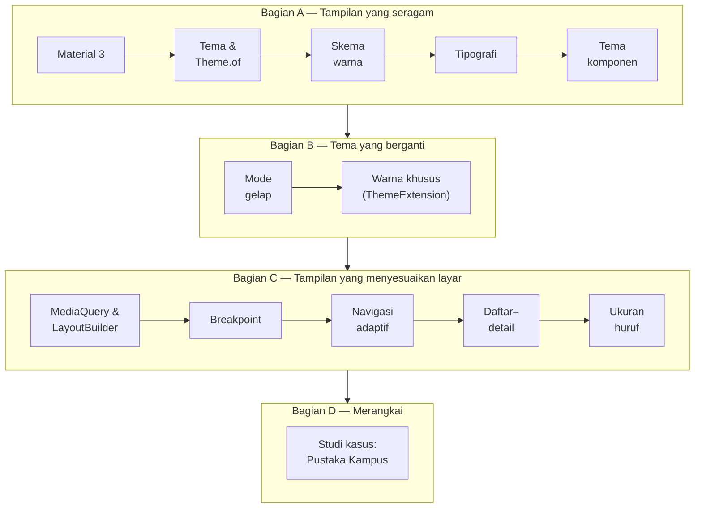

Bagian A membuat semua halaman memakai **warna dan huruf yang seragam** dari satu sumber. Bagian B membuat tema itu **bisa berganti**, misalnya ke mode gelap. Bagian C membuat tata letak **menyesuaikan ukuran layar**, dari ponsel sampai laptop. Bagian D merangkai semuanya menjadi aplikasi utuh.

---

## 1. Dua Tantangan Tampilan: Konsisten dan Muat di Semua Layar

Buka Gmail atau Google Drive di ponsel, lalu buka lagi di tablet atau laptop. Perhatikan dua hal:

1. **Warna, huruf, dan bentuk tombolnya seragam** di semua halaman. Tombol utama selalu berwarna sama, judul selalu memakai ukuran huruf yang sama. Jika aplikasi itu berganti ke mode gelap, **semua** halaman ikut berganti.
2. **Susunannya berubah mengikuti layar.** Di ponsel, menu ada di bawah dan daftar surel memenuhi layar. Di laptop, menu pindah ke samping kiri, sedangkan daftar surel dan isi surel tampil berdampingan.

Dua hal itulah topik hari ini.

| Kebutuhan | Alat di Flutter | Bagian |
| :--- | :--- | :--- |
| Warna dan huruf seragam di semua halaman | `ThemeData` + `Theme.of(context)` | 3 |
| Satu warna merek menjadi palet lengkap | `ColorScheme.fromSeed` | 4 |
| Ukuran huruf yang konsisten | `TextTheme` | 5 |
| Semua tombol/kartu bergaya sama | Tema komponen | 6 |
| Mode gelap | `darkTheme` + `themeMode` | 7 |
| Warna tambahan (misalnya "sukses") | `ThemeExtension` | 8 |
| Mengetahui lebar layar atau ruang yang tersedia | `MediaQuery`, `LayoutBuilder` | 10 |
| Tata letak berbeda untuk ponsel, tablet, laptop | *Breakpoint* | 11 |
| Menu di bawah ↔ menu di samping | `NavigationBar` ↔ `NavigationRail` | 12 |
| Daftar dan detail berdampingan di layar lebar | Pola daftar–detail | 13 |
| Huruf diperbesar oleh pengguna | `TextScaler` | 14 |

> 💡 **Analogi: buku panduan identitas visual kampus.** Kampus menetapkan logo, warna, dan jenis huruf resmi dalam satu buku panduan. Setiap fakultas tinggal mengikutinya saat membuat spanduk, surat, atau situs. Jika suatu hari warna resmi kampus diganti, cukup buku panduannya yang diubah; tidak perlu mengecat ulang setiap spanduk satu per satu. **Tema** di Flutter adalah buku panduan itu.

---

## 2. Material Design 3: Sistem Desain di Balik Flutter

### 2.1 Apa itu sistem desain?

**Sistem desain** (*design system*) adalah kumpulan aturan dan komponen siap pakai agar tampilan sebuah produk konsisten. **Material Design** adalah sistem desain buatan Google. Versi ketiganya, **Material Design 3** (sering disingkat **M3**), adalah versi yang dipakai Flutter saat ini. Isinya antara lain:

| Bagian | Contoh aturan |
| :--- | :--- |
| **Komponen** | Bentuk dan perilaku tombol, kartu, kolom teks, navigasi, dialog |
| **Warna** | Setiap warna punya **peran**: warna utama, warna latar, warna kesalahan, dan seterusnya |
| **Tipografi** | Skala ukuran huruf yang tetap: untuk judul, isi bacaan, tulisan tombol |
| **Bentuk** | Sudut membulat dengan ukuran tertentu, misalnya kartu bersudut 12 |
| **Tata letak** | *Breakpoint* untuk ponsel, tablet, dan layar lebar |

Panduan lengkapnya ada di <https://m3.material.io>. Panduan itu terus diperbarui; misalnya istilah *window size class* kini disebut ***breakpoint*** (Bagian 11).

### 2.2 Flutter sudah memakai M3 sejak awal kuliah

Sejak Flutter 3.16, Material 3 menjadi **bawaan**. Artinya, semua aplikasi yang kita buat sejak Pertemuan 1 sudah memakai M3: `FilledButton`, `Card` yang sudutnya membulat, `NavigationBar`, dan `ColorScheme.fromSeed` di kerangka aplikasi kita.

Setiap komponen M3 mengambil nilai dari **token desain**, yaitu nilai bernama seperti "warna `primary`" atau "gaya huruf `titleLarge`", bukan angka yang ditulis sembarangan. Contoh yang sudah dibuktikan dari kode sumber Flutter 3.47:

| Komponen | Warna latar bawaan | Gaya huruf bawaan |
| :--- | :--- | :--- |
| `AppBar` | `surface` | judul: `titleLarge` |
| `FilledButton` | `primary` | `labelLarge` |
| `FilledButton.tonal` | `secondaryContainer` | `labelLarge` |
| `FloatingActionButton` | `primaryContainer` | — |
| `Card` | `surfaceContainerLow` | — |
| `NavigationBar` | `surfaceContainer` (indikator: `secondaryContainer`) | label: `labelMedium` |
| `SnackBar` | `inverseSurface` | — |
| `Badge` | `error` | — |
| `ListTile` | — | judul: `bodyLarge`, subjudul: `bodyMedium` |

Karena semua komponen membaca token dari **tema**, mengganti tema berarti mengganti tampilan seluruh aplikasi sekaligus.

> [!NOTE]
> **Paket `material_ui`.** Mulai Flutter 3.47, tim Flutter juga menerbitkan komponen Material sebagai paket terpisah bernama `material_ui` di pub.dev, sebagai langkah memisahkan Material dari inti Flutter. Mata kuliah ini tetap memakai `import 'package:flutter/material.dart';` yang masih menjadi bawaan Flutter 3.47. Nama *class*-nya sama persis (`ThemeData`, `ColorScheme`, `NavigationBar`, ...), sehingga semua yang Anda pelajari hari ini tetap berlaku; yang berbeda hanya baris `import`.

> **🧠 Cek Cepat:** Jika aplikasi Anda punya 20 halaman dan dosen meminta warna utamanya diganti dari biru menjadi hijau, berapa banyak tempat yang sebaiknya Anda ubah?
>
> <details><summary>Lihat jawaban</summary>
>
> Satu tempat saja: warna benih di `ThemeData`. Syaratnya, semua halaman mengambil warnanya dari tema, bukan menuliskan warna sendiri-sendiri. Bagian 3 menunjukkan caranya.
> </details>

---

## 3. Tema Aplikasi dan `Theme.of(context)`

### 3.1 Masalahnya: warna ditulis langsung

Pemula sering menulis warna dan ukuran huruf langsung di setiap widget:

```dart
// ❌ Warna dan ukuran huruf ditulis langsung di widget.
Card(
  color: const Color(0xFFE3F2FD), // biru muda
  child: Padding(
    padding: const EdgeInsets.all(16),
    child: Column(
      crossAxisAlignment: CrossAxisAlignment.start,
      children: [
        const Text(
          'Lomba Desain Poster',
          style: TextStyle(fontSize: 22, color: Color(0xFF0D47A1)),
        ),
        // ...
      ],
    ),
  ),
),
```

Kode ini berjalan, tetapi menyimpan tiga masalah:

1. **Tidak seragam.** Halaman lain mungkin memakai biru yang sedikit berbeda, atau ukuran huruf 20, bukan 22.
2. **Sulit diganti.** Mengganti warna aplikasi berarti mencari dan mengubah setiap `Color(...)` di seluruh kode.
3. **Rusak di mode gelap.** Kotak biru muda dengan teks biru tua tetap terang saat aplikasi berganti ke mode gelap (Bagian 7).

### 3.2 Tema dipasang sekali di `MaterialApp`

Tema dipasang di parameter `theme` milik `MaterialApp`. Isinya sebuah `ThemeData`:

```dart
// Satu-satunya tempat untuk mengganti warna SELURUH aplikasi.
// Coba ganti dengan Colors.deepOrange, Colors.green, atau Colors.pink.
const Color warnaBenih = Colors.teal;

// ... di dalam AplikasiPengumuman.build:
return MaterialApp(
  debugShowCheckedModeBanner: false,
  // Tema berlaku untuk SEMUA halaman dan widget di bawah MaterialApp.
  theme: ThemeData(
    colorScheme: ColorScheme.fromSeed(seedColor: warnaBenih),
  ),
  home: const HalamanPengumuman(),
);
```

Dua isi `ThemeData` yang paling sering diatur:

| Isi `ThemeData` | Tipe | Berisi |
| :--- | :--- | :--- |
| `colorScheme` | `ColorScheme` | Semua warna beserta perannya (Bagian 4) |
| `textTheme` | `TextTheme` | 15 gaya huruf (Bagian 5). Jika tidak diisi, Flutter memakai gaya bawaan M3 |

### 3.3 Membaca tema dengan `Theme.of(context)`

Di dalam widget, tema dibaca dengan `Theme.of(context)`:

```dart
// Theme.of(context) = "tema yang berlaku di tempat widget ini berada".
final ColorScheme warna = Theme.of(context).colorScheme;
final TextTheme gayaTeks = Theme.of(context).textTheme;
```

Ingat bahwa `context` adalah **alamat widget di pohon widget** ([Pertemuan 4](../pertemuan_04_widget_dan_layout/README.md)). `Theme.of(context)` berarti: "mulai dari posisi saya, naik ke atas, lalu ambil tema **terdekat**." Untuk aplikasi biasa, tema terdekat itu adalah tema dari `MaterialApp`.

Setelah itu, warna dan gaya huruf dipakai seperti ini:

```dart
// ✅ Semua warna dan gaya huruf diambil dari tema.
Card(
  color: warna.primaryContainer,
  child: Padding(
    padding: const EdgeInsets.all(16),
    child: Column(
      crossAxisAlignment: CrossAxisAlignment.start,
      children: [
        Text(
          'Malam Keakraban 2026',
          style: gayaTeks.titleLarge?.copyWith(
            color: warna.onPrimaryContainer,
          ),
        ),
        // ...
      ],
    ),
  ),
),
```

Dua hal baru di sini:

- **`gayaTeks.titleLarge`** bertipe `TextStyle?` (boleh `null`). Karena itu dipakai `?.` sebelum memanggil `copyWith`: jika gayanya `null`, hasilnya juga `null` tanpa *error* ([Pertemuan 2](../pertemuan_02_dasar_dart/README.md), *null safety*).
- **`copyWith(color: ...)`** membuat salinan gaya `titleLarge` dengan **warna** yang diganti. Ukuran dan ketebalan hurufnya tetap mengikuti tema.

> [!TIP]
> Flutter juga menyediakan jalan pintas `ColorScheme.of(context)` dan `TextTheme.of(context)`, yang hasilnya sama dengan `Theme.of(context).colorScheme` dan `Theme.of(context).textTheme`. Modul ini tetap menulis `Theme.of(context)` agar asal nilainya selalu terlihat jelas.

### 3.4 Membuktikannya

Kode lengkap: [`kode/contoh_01_tema_dan_theme_of.dart`](kode/contoh_01_tema_dan_theme_of.dart). Jalankan, lalu ganti `warnaBenih` dari `Colors.teal` menjadi `Colors.deepOrange` dan jalankan ulang.

<p align="center">
  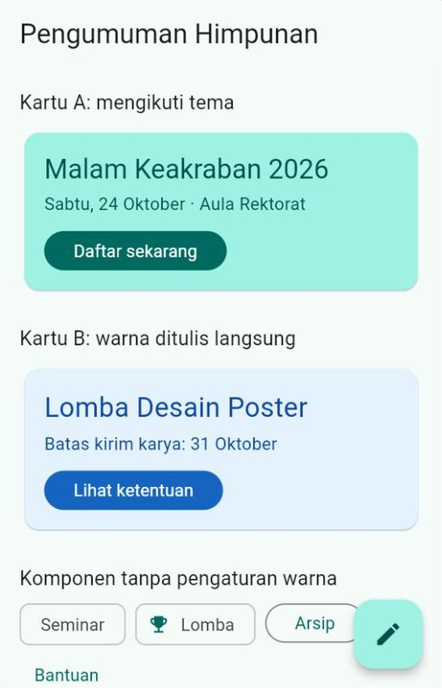
  &nbsp;
  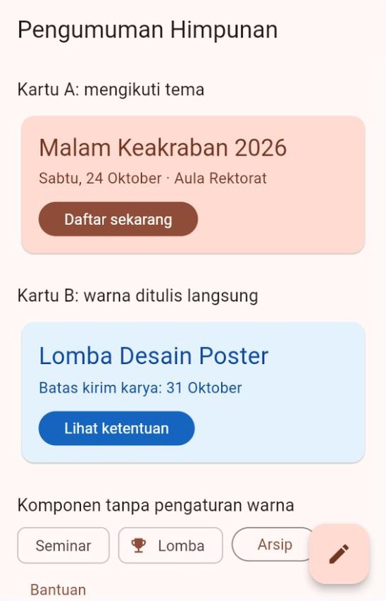
</p>

Perhatikan perbedaannya:

- **Ikut berubah:** Kartu A, tombol "Daftar sekarang", tombol bergambar pensil di kanan bawah (*floating action button*), ikon pada *chip* "Lomba", tombol "Arsip" dan "Bantuan", serta bilah kuota. Semuanya mengambil warna dari tema, padahal sebagian besar tidak kita beri warna sama sekali.
- **Tidak ikut berubah:** Kartu B. Warnanya ditulis langsung, sehingga tetap biru dan terlihat "asing" di aplikasi yang kini bernuansa jingga.

> **🧠 Cek Cepat:** Mengapa `gayaTeks.titleLarge?.copyWith(...)` memakai `?.`, bukan `.` saja?
>
> <details><summary>Lihat jawaban</summary>
>
> Karena setiap gaya di `TextTheme` bertipe `TextStyle?` (boleh `null`). `?.` berarti "panggil `copyWith` hanya jika gayanya tidak `null`". Jika ditulis `.` saja, *analyzer* menolak kode itu karena memanggil metode pada nilai yang mungkin `null`.
> </details>

---

## 4. Skema Warna: Satu Benih, Banyak Peran

### 4.1 Warna punya peran, bukan sekadar nama

Di M3, kita jarang berpikir "tombol ini biru". Kita berpikir "tombol ini memakai warna **`primary`**". Setiap warna di `ColorScheme` punya **peran** (*color role*):

> 💡 **Analogi: peran dalam pentas seni.** Ada pemeran utama, pemeran pendukung, bintang tamu, panggung, dan lampu tanda bahaya. Kostum pemeran boleh berganti setiap tahun, tetapi perannya tetap. Begitu juga warna: nilainya boleh berganti (biru, hijau, mode gelap), tetapi perannya tetap.

| Peran | Kegunaan | Contoh pemakaian bawaan |
| :--- | :--- | :--- |
| `primary` | Aksi paling penting di layar | `FilledButton`, bilah kemajuan, `Switch` yang aktif |
| `primaryContainer` | Wadah yang ingin ditonjolkan | `FloatingActionButton`, kartu sorotan |
| `secondary`, `secondaryContainer` | Unsur pendukung yang tidak terlalu menonjol | `FilledButton.tonal`, indikator `NavigationBar`, *chip* terpilih |
| `tertiary`, `tertiaryContainer` | Aksen pembeda untuk menyeimbangkan | Penanda khusus, ilustrasi |
| `error`, `errorContainer` | Kesalahan dan aksi berbahaya | Pesan *error* `TextField`, `Badge` |
| `surface` | Latar halaman | `Scaffold`, `AppBar`, `NavigationRail` |
| `surfaceContainerLowest` … `surfaceContainerHighest` | Latar bertingkat untuk membedakan area | `Card` (*Low*), `NavigationBar` (biasa), dialog (*High*), `TextField` berlatar (*Highest*) |
| `outline`, `outlineVariant` | Garis tepi dan garis pemisah | Garis `TextField` dan `OutlinedButton`; `Divider` |
| `inverseSurface` | Latar "kebalikan" yang mencolok | `SnackBar` |

### 4.2 Aturan pasangan "*on*"

Hampir setiap peran punya pasangan berawalan **`on`**: `onPrimary`, `onPrimaryContainer`, `onSurface`, `onError`, dan seterusnya. Aturannya sederhana:

> **Teks atau ikon yang diletakkan DI ATAS warna X memakai warna `onX`.**

| Latar | Teks/ikon di atasnya |
| :--- | :--- |
| `primary` | `onPrimary` |
| `primaryContainer` | `onPrimaryContainer` |
| `surface` | `onSurface` (utama) atau `onSurfaceVariant` (keterangan) |
| `errorContainer` | `onErrorContainer` |

Pasangan ini dijamin **kontras** (mudah dibaca), baik di mode terang maupun gelap. Jika Anda mencampur sembarangan, misalnya teks `primary` di atas latar `primaryContainer`, tulisannya bisa sulit dibaca.

### 4.3 `ColorScheme.fromSeed`: palet lengkap dari satu warna

Mengisi puluhan peran warna satu per satu sangat merepotkan. `ColorScheme.fromSeed` mengerjakannya untuk kita: dari **satu warna benih** (*seed color*), algoritma M3 menurunkan **palet nada** (*tonal palette*), lalu memilih nada yang tepat untuk setiap peran, lengkap dengan kontras yang aman.

```dart
final ColorScheme skema = ColorScheme.fromSeed(
  seedColor: _benih.warna,
  brightness: _gelap ? Brightness.dark : Brightness.light,
  dynamicSchemeVariant: _varian,
);
```

| Parameter | Arti | Nilai bawaan |
| :--- | :--- | :--- |
| `seedColor` | Warna benih | (wajib diisi) |
| `brightness` | `Brightness.light` untuk mode terang, `Brightness.dark` untuk mode gelap | `Brightness.light` |
| `dynamicSchemeVariant` | "Gaya" penurunan palet (lihat tabel berikut) | `DynamicSchemeVariant.tonalSpot` |
| `contrastLevel` | Tingkat kontras, dari `-1.0` sampai `1.0`; `1.0` = kontras tinggi | `0.0` |

Ada sembilan varian. Empat yang paling sering dicoba:

| Varian | Hasilnya |
| :--- | :--- |
| `tonalSpot` (bawaan) | Lembut dan tidak menyilaukan; warna benih "dijinakkan" |
| `fidelity` | Setia pada warna benih, walaupun benihnya sangat mencolok |
| `vibrant` | Lebih berwarna dan mencolok |
| `monochrome` | Abu-abu saja, tanpa warna |

> [!IMPORTANT]
> Karena memakai `tonalSpot`, warna `primary` yang dihasilkan **tidak sama persis** dengan warna benih. Benih biru terang bisa menjadi `primary` biru yang lebih kalem. Itu disengaja agar palet nyaman dilihat. Jika warna merek harus tampil persis, coba varian `fidelity`.

### 4.4 Membuktikannya: palet interaktif

Kode lengkap: [`kode/contoh_02_peran_warna.dart`](kode/contoh_02_peran_warna.dart). Aplikasi ini **menggambar** skema hasil `fromSeed` sebagai kotak-kotak. Setiap kotak berlatar satu peran warna, dan tulisan di dalamnya memakai pasangan "*on*"-nya.

<p align="center">
  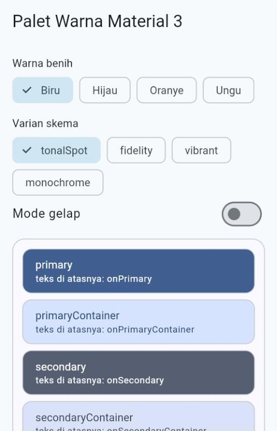
  &nbsp;
  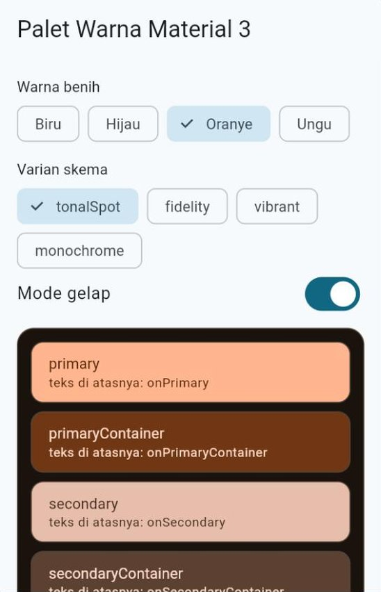
</p>

Cobalah:

1. Ganti benih dari Biru ke Oranye. **Semua** peran ikut berubah, tetapi setiap tulisan tetap terbaca.
2. Nyalakan **Mode gelap**. Benih yang sama menghasilkan palet gelap: `surface` menjadi gelap, `primary` menjadi lebih terang.
3. Pilih varian `monochrome`, lalu `vibrant`. Bandingkan dengan `tonalSpot`.
4. Gulir ke bawah dan perhatikan **tangga `surfaceContainer`**: lima tingkat latar dari yang paling dekat dengan `surface` (*Lowest*) sampai yang paling berbeda (*Highest*).

> **🧠 Cek Cepat:** Anda membuat kotak berlatar `tertiaryContainer`. Warna apa yang tepat untuk tulisan di dalamnya?
>
> <details><summary>Lihat jawaban</summary>
>
> `onTertiaryContainer`. Teks di atas warna X memakai `onX`.
> </details>

---

## 5. Tipografi: 15 Gaya Huruf Siap Pakai

### 5.1 Skala huruf Material 3

M3 menyediakan **15 gaya huruf** dalam lima kelompok. Setiap kelompok punya ukuran *Large*, *Medium*, dan *Small*. Nilai di bawah ini adalah nilai bawaan Flutter (ukuran dalam piksel logis):

| Kelompok | Large | Medium | Small | Dipakai untuk |
| :--- | :---: | :---: | :---: | :--- |
| **display** | 57 | 45 | 36 | Angka atau teks pendek yang sangat besar |
| **headline** | 32 | 28 | 24 | Judul halaman atau judul bagian penting |
| **title** | 22 | 16 · tebal | 14 · tebal | Judul `AppBar` (*titleLarge*), judul kartu, judul bagian kecil |
| **body** | 16 | 14 | 12 | Isi bacaan: paragraf dan keterangan |
| **label** | 14 · tebal | 12 · tebal | 11 · tebal | Tulisan pada tombol, *chip*, dan keterangan kecil |

"Tebal" di sini berarti tebal sedang (`FontWeight.w500`). Nama lengkap setiap gaya adalah gabungan kelompok dan ukurannya: `displayLarge`, `headlineSmall`, `titleMedium`, `bodyLarge`, `labelSmall`, dan seterusnya.

### 5.2 Memakai gaya huruf dari tema

```dart
final TextTheme t = Theme.of(context).textTheme;

// headlineSmall: judul artikel.
Text(
  'Mahasiswa Informatika Juara Lomba Aplikasi',
  style: t.headlineSmall,
),

// labelMedium + onSurfaceVariant: keterangan yang tidak utama.
Text(
  'Senin, 12 Oktober 2026 · 3 menit baca',
  style: t.labelMedium?.copyWith(color: warna.onSurfaceVariant),
),
```

Pilih gaya berdasarkan **peran teks**, bukan berdasarkan ukuran yang "kelihatannya pas". Judul artikel memakai `headlineSmall` karena perannya judul, bukan karena kebetulan Anda ingin ukuran 24.

Banyak komponen **sudah memilih gayanya sendiri**: judul `AppBar` memakai `titleLarge`, tulisan tombol memakai `labelLarge`, judul `ListTile` memakai `bodyLarge`, dan subjudulnya `bodyMedium`. Karena itu Anda jarang perlu mengatur gaya huruf untuk komponen.

### 5.3 Membuktikannya

Kode lengkap: [`kode/contoh_03_tipografi.dart`](kode/contoh_03_tipografi.dart). Bagian atas halaman berisi contoh artikel yang memakai gaya sesuai perannya. Di bawahnya, ke-15 gaya ditampilkan beserta ukurannya. Angka ukuran itu **dibaca langsung dari gayanya** (`gaya?.fontSize`), bukan diketik.

<p align="center">
  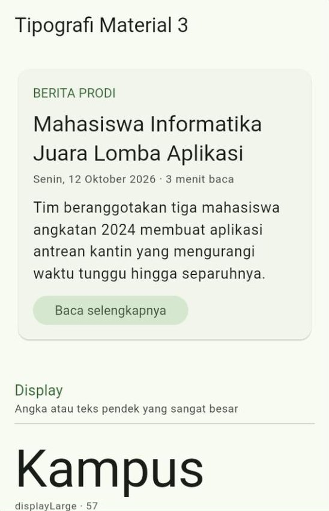
  &nbsp;
  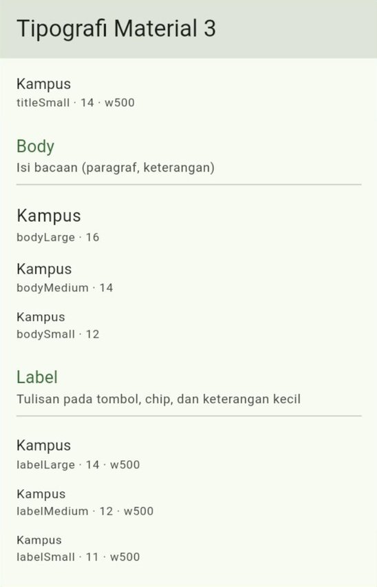
</p>

> [!TIP]
> **Mengganti jenis huruf (pengayaan).** Secara bawaan Flutter memakai jenis huruf sistem (Roboto di Android). Untuk memakai jenis huruf lain, berkas hurufnya harus didaftarkan di `pubspec.yaml` lalu dipasang lewat `ThemeData(fontFamily: ...)`, atau memakai paket `google_fonts`. Kita tidak memakainya hari ini agar contoh tetap bisa dijalankan tanpa berkas tambahan.

> **🧠 Cek Cepat:** Anda menulis keterangan kecil "Diperbarui 5 menit lalu" di bawah judul kartu. Gaya dan warna apa yang cocok?
>
> <details><summary>Lihat jawaban</summary>
>
> Gaya kelompok *label* atau *body* yang kecil, misalnya `labelMedium` atau `bodySmall`, dengan warna `onSurfaceVariant` karena perannya keterangan, bukan isi utama.
> </details>

---

## 6. Tema Komponen dan Tema Lokal

### 6.1 Masalahnya: gaya yang sama diketik berulang-ulang

Misalkan semua tombol utama di aplikasi Anda harus selebar layar dan setinggi 52. Tanpa tema, Anda menulis `style: FilledButton.styleFrom(...)` di **setiap** tombol. Jika suatu hari tingginya diubah menjadi 56, semua tombol harus diubah satu per satu.

### 6.2 Tema komponen: mengatur semua komponen sejenis sekaligus

`ThemeData` punya parameter khusus untuk banyak komponen. Isinya adalah *class* berakhiran `ThemeData`:

| Parameter `ThemeData` | *Class* isinya | Mengatur |
| :--- | :--- | :--- |
| `appBarTheme` | `AppBarThemeData` | Semua `AppBar` |
| `cardTheme` | `CardThemeData` | Semua `Card` |
| `inputDecorationTheme` | `InputDecorationThemeData` | Semua `TextField` dan `TextFormField` |
| `filledButtonTheme` | `FilledButtonThemeData` | Semua `FilledButton` |
| `navigationBarTheme` | `NavigationBarThemeData` | Semua `NavigationBar` |
| `chipTheme` | `ChipThemeData` | Semua *chip* |

Cuplikan dari [`kode/contoh_04_tema_komponen.dart`](kode/contoh_04_tema_komponen.dart):

```dart
// Skema dibuat lebih dulu agar warnanya bisa dipakai tema komponen.
final ColorScheme skema = ColorScheme.fromSeed(seedColor: Colors.indigo);

return MaterialApp(
  debugShowCheckedModeBanner: false,
  theme: ThemeData(
    colorScheme: skema,
    // 1) Semua AppBar: berlatar warna wadah utama.
    appBarTheme: AppBarThemeData(
      backgroundColor: skema.primaryContainer,
      foregroundColor: skema.onPrimaryContainer,
    ),
    // 2) Semua Card: tanpa bayangan, bergaris tepi, sudut 16.
    cardTheme: CardThemeData(
      elevation: 0,
      shape: RoundedRectangleBorder(
        borderRadius: BorderRadius.circular(16),
        side: BorderSide(color: skema.outlineVariant),
      ),
    ),
    // 3) Semua TextField: berlatar dan bergaris tepi.
    inputDecorationTheme: const InputDecorationThemeData(
      filled: true,
      border: OutlineInputBorder(),
    ),
    // 4) Semua FilledButton: selebar wadahnya dan setinggi 52.
    filledButtonTheme: FilledButtonThemeData(
      style: FilledButton.styleFrom(minimumSize: const Size.fromHeight(52)),
    ),
  ),
  home: const HalamanPendaftaran(),
);
```

Di halaman pendaftarannya **tidak ada satu pun** warna, garis tepi, atau tinggi tombol yang ditulis. `TextField` cukup diberi `labelText` dan ikon, tombol cukup diberi tulisan; selebihnya datang dari tema.

<p align="center">
  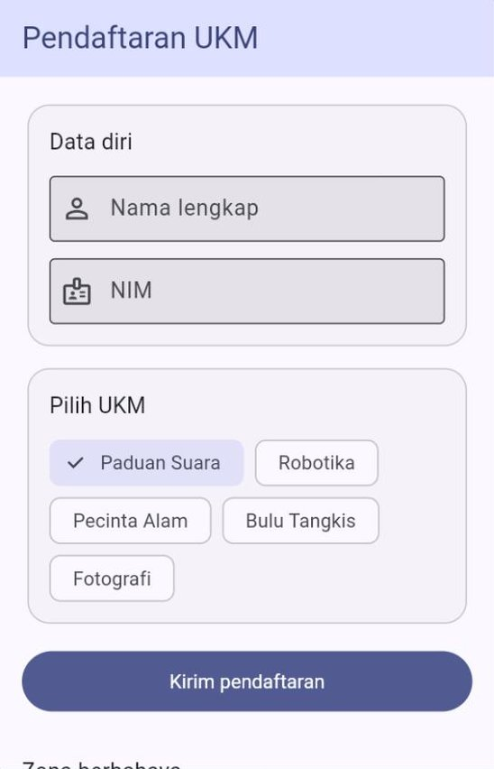
</p>

> [!NOTE]
> **Tutorial lama memakai nama tanpa "Data".** Sejak Flutter 3.35, isi `appBarTheme`, `inputDecorationTheme`, dan `bottomAppBarTheme` memakai *class* berakhiran `Data` (`AppBarThemeData`, `InputDecorationThemeData`, `BottomAppBarThemeData`), menyamakan `CardThemeData`, `DialogThemeData`, dan yang lain. Di tutorial lama Anda akan menemukan `AppBarTheme(color: ...)`. Parameter `color` di sana sudah usang; gunakan `backgroundColor`.

### 6.3 Siapa yang menang jika aturannya berbeda?

Flutter memakai urutan berikut. Aturan yang lebih atas mengalahkan yang di bawahnya:

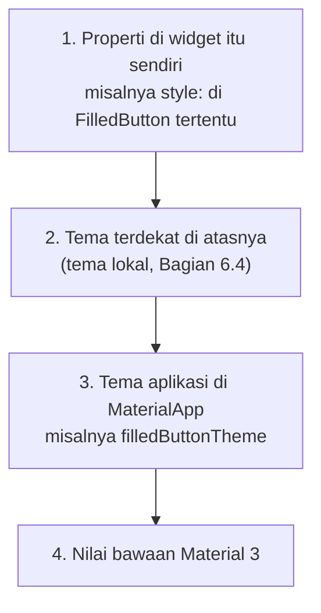

Jadi tema komponen adalah **gaya bawaan baru**. Satu tombol yang memang perlu berbeda tetap boleh diberi `style` sendiri.

> [!WARNING]
> `Size.fromHeight(52)` berarti "tinggi 52, lebar **sebesar-besarnya**". Di dalam `Column` atau `ListView` hal ini aman, karena lebarnya dibatasi induknya. Namun jika tombol seperti ini diletakkan di dalam `Row`, lebarnya menjadi tak terbatas dan layar menampilkan *error* `BoxConstraints forces an infinite width`. Solusinya, bungkus tombol itu dengan `Expanded`, atau beri tombol itu `style` sendiri dengan `minimumSize` yang lebarnya terbatas.

### 6.4 Tema lokal: hanya untuk sebagian layar

Kadang sebuah bagian layar perlu warna berbeda, misalnya tombol berbahaya berwarna merah. Bungkus bagian itu dengan widget **`Theme`**:

```dart
// Tema LOKAL: hanya tombol di dalam Theme ini yang memakai warna
// error sebagai warna utamanya. Bagian lain tetap memakai tema
// aplikasi.
Theme(
  data: Theme.of(context).copyWith(
    colorScheme: warna.copyWith(
      primary: warna.error,
      onPrimary: warna.onError,
    ),
  ),
  child: FilledButton.icon(
    onPressed: () {},
    icon: const Icon(Icons.delete_outline),
    label: const Text('Batalkan semua pendaftaran'),
  ),
),
```

`Theme.of(context).copyWith(...)` berarti "ambil tema yang berlaku sekarang, lalu ganti sebagian isinya". Cara ini lebih aman daripada membuat `ThemeData` baru dari nol, karena pengaturan lain (huruf, tema komponen) tetap terbawa. `FilledButton` di dalamnya membaca tema terdekat, yaitu tema lokal ini, sehingga warnanya merah.

> **🧠 Cek Cepat:** Tombol "Batalkan semua pendaftaran" juga selebar layar dan setinggi 52, padahal tidak diatur di tema lokal. Mengapa?
>
> <details><summary>Lihat jawaban</summary>
>
> Karena tema lokal dibuat dengan `Theme.of(context).copyWith(...)`. Semua isi tema aplikasi, termasuk `filledButtonTheme`, ikut tersalin. Yang diganti hanya `colorScheme`.
> </details>

---

## 7. Mode Gelap

### 7.1 Mengapa mode gelap?

Banyak pengguna memilih mode gelap karena lebih nyaman di ruangan redup, tidak menyilaukan di malam hari, dan dapat menghemat baterai pada layar OLED. Android dan iOS menyediakan pengaturan mode gelap untuk seluruh sistem, dan pengguna berharap aplikasi kita ikut menyesuaikan.

### 7.2 Dua tema dan satu pilihan

`MaterialApp` menerima **dua tema** dan **satu pilihan**:

| Parameter | Isi |
| :--- | :--- |
| `theme` | Tema terang |
| `darkTheme` | Tema gelap |
| `themeMode` | Tema mana yang dipakai: `ThemeMode.system` (ikuti pengaturan perangkat, ini nilai bawaan), `ThemeMode.light` (selalu terang), atau `ThemeMode.dark` (selalu gelap) |

Kedua tema sebaiknya dibuat dari **benih yang sama**, hanya berbeda `brightness`:

```dart
// Tema terang dan tema gelap dibuat dari benih yang SAMA.
theme: ThemeData(
  colorScheme: ColorScheme.fromSeed(seedColor: Colors.deepPurple),
),
darkTheme: ThemeData(
  colorScheme: ColorScheme.fromSeed(
    seedColor: Colors.deepPurple,
    brightness: Brightness.dark,
  ),
),
themeMode: _mode, // tema mana yang dipakai sekarang
```

> [!IMPORTANT]
> Jika `darkTheme` tidak diisi, Flutter memakai `theme` (terang) untuk **semua** pilihan, termasuk `ThemeMode.dark`. Jika `darkTheme` diisi tetapi `brightness: Brightness.dark` lupa ditulis, tema "gelap" itu ternyata terang.

### 7.3 Pilihan pengguna disimpan di akar aplikasi

Pilihan mode dipakai oleh `MaterialApp`, sedangkan tombol pemilihnya ada di halaman pengaturan. Sesuai prinsip **mengangkat *state*** ([Pertemuan 5, Bagian 11](../pertemuan_05_interaksi_dan_state/README.md#11-mengangkat-state-lifting-state-up)), nilainya disimpan di widget **teratas** yang membutuhkannya: akar aplikasi. Akar aplikasi pun menjadi `StatefulWidget`.

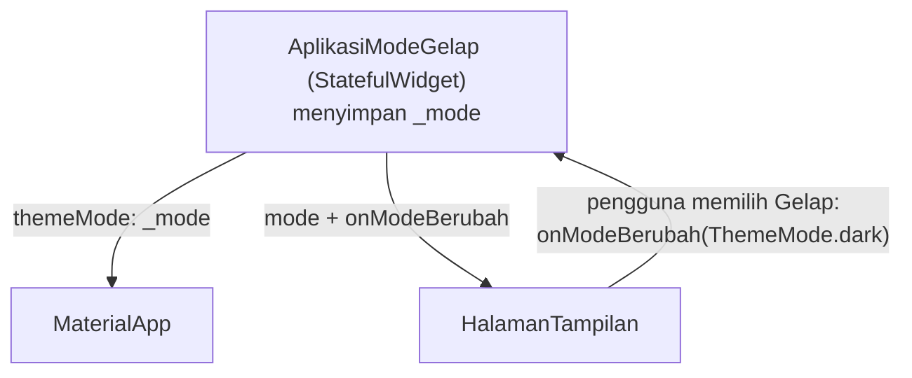

Cuplikan dari [`kode/contoh_05_mode_gelap.dart`](kode/contoh_05_mode_gelap.dart):

```dart
class _AplikasiModeGelapState extends State<AplikasiModeGelap> {
  ThemeMode _mode = ThemeMode.system; // bawaan: ikuti pengaturan perangkat

  void _gantiMode(ThemeMode modeBaru) {
    setState(() {
      _mode = modeBaru;
    });
  }

  // ... build() mengembalikan MaterialApp dengan themeMode: _mode dan
  //     home: HalamanTampilan(mode: _mode, onModeBerubah: _gantiMode)
}
```

Di halaman pengaturan, pilihan ditampilkan dengan `SegmentedButton` ([Pertemuan 5, Bagian 6](../pertemuan_05_interaksi_dan_state/README.md#6-memilih-nilai-segmentedbutton-slider-dan-chip)):

```dart
SegmentedButton<ThemeMode>(
  segments: const [
    ButtonSegment(
      value: ThemeMode.system,
      icon: Icon(Icons.brightness_auto),
      label: Text('Sistem'),
    ),
    ButtonSegment(
      value: ThemeMode.light,
      icon: Icon(Icons.light_mode),
      label: Text('Terang'),
    ),
    ButtonSegment(
      value: ThemeMode.dark,
      icon: Icon(Icons.dark_mode),
      label: Text('Gelap'),
    ),
  ],
  selected: {mode},
  onSelectionChanged: (Set<ThemeMode> pilihan) {
    onModeBerubah(pilihan.first);
  },
),
```

Saat `onModeBerubah` dipanggil, akar aplikasi menjalankan `setState`, `MaterialApp` dibangun ulang dengan `themeMode` yang baru, dan **seluruh** aplikasi berganti tema dengan animasi singkat.

### 7.4 Membuktikannya: warna tema vs warna yang ditulis langsung

<p align="center">
  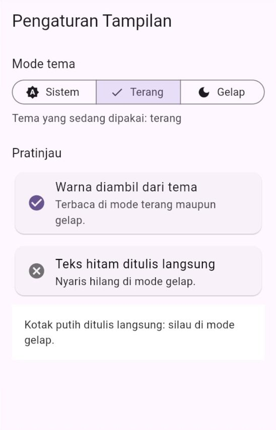
  &nbsp;
  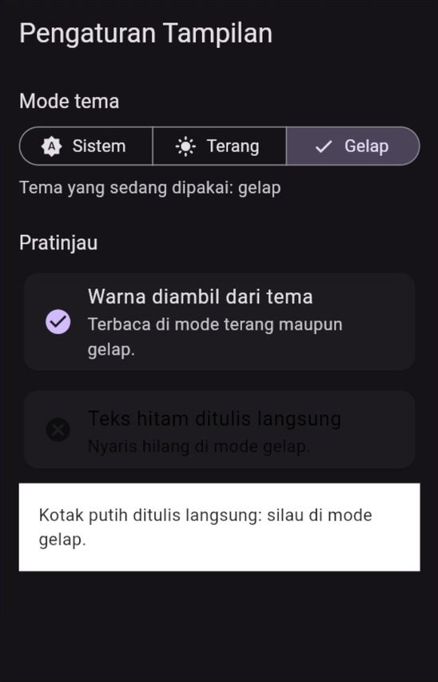
</p>

- Kartu "Warna diambil dari tema" tetap nyaman dibaca di kedua mode.
- Kartu "Teks hitam ditulis langsung" **nyaris hilang** di mode gelap, karena latarnya menjadi gelap sedangkan teksnya tetap hitam.
- Kotak putih yang ditulis langsung **menyilaukan** di tengah layar gelap.

Aturan praktis agar aman di mode gelap:

1. Jangan menulis `Colors.white`, `Colors.black`, atau `Color(0xFF...)` untuk latar dan teks. Gunakan peran warna: `surface` dan `onSurface`, `primaryContainer` dan `onPrimaryContainer`, dan seterusnya.
2. Selalu uji **dua mode** sebelum mengumpulkan tugas.
3. Mode gelap M3 bukan hitam pekat. Latar `surface` gelapnya abu-abu sangat gelap yang sedikit bernuansa warna benih.

> [!NOTE]
> Pilihan mode di contoh ini **hilang** saat aplikasi ditutup, karena hanya disimpan di memori. Menyimpannya ke penyimpanan perangkat dipelajari di Pertemuan 11.

> **🧠 Cek Cepat:** Di contoh 05, `themeMode` bernilai `ThemeMode.system` dan laptop Anda memakai mode gelap. Tema mana yang tampil?
>
> <details><summary>Lihat jawaban</summary>
>
> Tema gelap (`darkTheme`), karena `ThemeMode.system` mengikuti pengaturan perangkat. Di Chrome, "pengaturan perangkat" ini mengikuti tema sistem operasi atau tema Chrome.
> </details>

---

## 8. Warna Khusus dengan `ThemeExtension`

### 8.1 Masalahnya: `ColorScheme` tidak punya warna "sukses"

`ColorScheme` menyediakan warna `error` untuk kesalahan, tetapi tidak menyediakan warna untuk "berhasil" (biasanya hijau) atau "peringatan" (biasanya kuning). Jika warna itu ditulis langsung, misalnya `Colors.green`, kita kembali ke masalah Bagian 3: tidak punya versi gelap dan tidak terdaftar di tema.

Solusinya adalah **`ThemeExtension`**: "laci tambahan" di tema untuk menitipkan nilai milik aplikasi kita sendiri.

### 8.2 Tiga langkah

**Langkah 1 — Buat *class*-nya.** *Class* ini meng-*extend* `ThemeExtension<NamaClassItuSendiri>` dan wajib punya dua metode: `copyWith` dan `lerp`.

```dart
class WarnaStatus extends ThemeExtension<WarnaStatus> {
  const WarnaStatus({
    required this.sukses,
    required this.onSukses,
    required this.peringatan,
    required this.onPeringatan,
  });

  final Color sukses; // latar label "aman"
  final Color onSukses; // teks di atas latar sukses
  final Color peringatan; // latar label "hampir jatuh tempo"
  final Color onPeringatan; // teks di atas latar peringatan

  // Wajib ada (1): membuat salinan dengan sebagian nilai diganti.
  @override
  WarnaStatus copyWith({
    Color? sukses,
    Color? onSukses,
    Color? peringatan,
    Color? onPeringatan,
  }) {
    return WarnaStatus(
      sukses: sukses ?? this.sukses,
      onSukses: onSukses ?? this.onSukses,
      peringatan: peringatan ?? this.peringatan,
      onPeringatan: onPeringatan ?? this.onPeringatan,
    );
  }

  // Wajib ada (2): mencampur dua tema saat berganti terang <-> gelap,
  // supaya warnanya berubah halus, tidak meloncat.
  @override
  WarnaStatus lerp(WarnaStatus? other, double t) {
    if (other == null) {
      return this;
    }
    return WarnaStatus(
      sukses: Color.lerp(sukses, other.sukses, t)!,
      onSukses: Color.lerp(onSukses, other.onSukses, t)!,
      peringatan: Color.lerp(peringatan, other.peringatan, t)!,
      onPeringatan: Color.lerp(onPeringatan, other.onPeringatan, t)!,
    );
  }
}
```

`lerp` adalah singkatan *linear interpolation*: mencari warna "di antara" dua warna. Saat tema berganti, Flutter memanggilnya berulang kali dengan `t` dari 0 sampai 1 sehingga warna berubah perlahan. `Color.lerp` mengembalikan `Color?`, maka diberi `!` karena kedua warnanya pasti ada.

**Langkah 2 — Daftarkan ke tema terang dan tema gelap.** Agar tidak menulis tema dua kali, buat satu fungsi yang menerima `Brightness`:

```dart
ThemeData buatTema(Brightness kecerahan) {
  // Skema bantu: dipakai hanya untuk "meminjam" pasangan warnanya.
  final ColorScheme hijau = ColorScheme.fromSeed(
    seedColor: Colors.green,
    brightness: kecerahan,
  );
  final ColorScheme kuning = ColorScheme.fromSeed(
    seedColor: Colors.amber,
    brightness: kecerahan,
  );

  return ThemeData(
    colorScheme: ColorScheme.fromSeed(
      seedColor: Colors.indigo,
      brightness: kecerahan,
    ),
    // Warna khusus dititipkan ke tema lewat extensions.
    extensions: <ThemeExtension<dynamic>>[
      WarnaStatus(
        sukses: hijau.primaryContainer,
        onSukses: hijau.onPrimaryContainer,
        peringatan: kuning.primaryContainer,
        onPeringatan: kuning.onPrimaryContainer,
      ),
    ],
  );
}
```

Perhatikan triknya: warna hijau dan kuning tidak dipilih dengan menebak, melainkan "dipinjam" dari skema bantu `ColorScheme.fromSeed`. Hasilnya, pasangan latar dan teksnya dijamin kontras, baik di mode terang maupun gelap. Lalu di `MaterialApp`: `theme: buatTema(Brightness.light)` dan `darkTheme: buatTema(Brightness.dark)`.

**Langkah 3 — Baca dari widget.**

```dart
// extension<WarnaStatus>() mengambil warna khusus milik tema aktif.
// Tanda ! dipakai karena kita yakin sudah mendaftarkannya.
final WarnaStatus warnaStatus = tema.extension<WarnaStatus>()!;
```

Kode lengkap: [`kode/contoh_06_warna_khusus_theme_extension.dart`](kode/contoh_06_warna_khusus_theme_extension.dart). Tekan ikon matahari/bulan di `AppBar` untuk berganti mode.

<p align="center">
  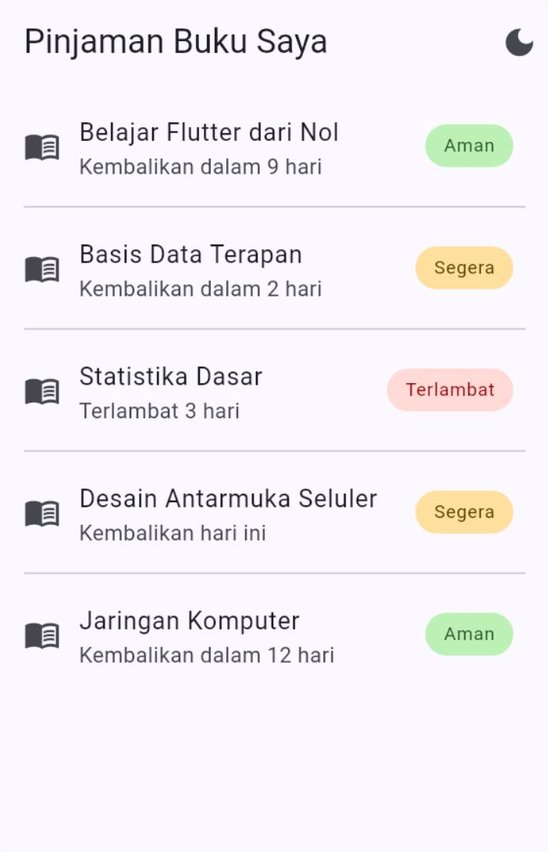
  &nbsp;
  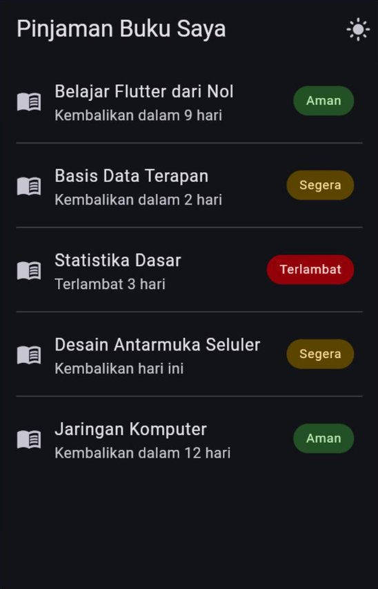
</p>

Label status juga menulis **teks** ("Aman", "Segera", "Terlambat"), bukan hanya warna. Pengguna yang sulit membedakan warna tetap memahami artinya (Bagian 14).

---

## 9. Mengapa Tampilan Harus Responsif?

### 9.1 Ragam ukuran layar

Aplikasi Flutter bisa berjalan di ponsel, tablet, laptop, bahkan jendela *browser* yang ukurannya bisa diubah kapan saja. Ukuran di Flutter dinyatakan dalam **piksel logis** (*logical pixel*), yaitu ukuran yang sudah memperhitungkan kerapatan layar. Ponsel dengan layar 1080 piksel fisik dan rasio kerapatan 3 lebarnya **360 piksel logis**. Inilah sebabnya kita selalu menguji di lebar 360.

| Perangkat | Lebar umum (piksel logis) |
| :--- | :--- |
| Ponsel kecil | 320–360 |
| Ponsel umum | 360–430 |
| Ponsel diputar mendatar (lanskap) | ± 700–930 |
| Ponsel lipat yang dibuka | ± 600–850 |
| Tablet | ± 600–1400 |
| Laptop dan monitor | 1000 ke atas |

Ukuran bisa **berubah saat aplikasi berjalan**: ponsel diputar, ponsel lipat dibuka, layar dibagi dua (*split screen*), atau jendela *browser* diubah ukurannya.

### 9.2 Responsif dan adaptif

Dokumentasi Flutter membedakan dua istilah yang sering dipakai bersamaan:

| Istilah | Pertanyaan yang dijawab | Contoh |
| :--- | :--- | :--- |
| **Responsif** (*responsive*) | Bagaimana agar tampilan **muat** di ruang yang ada? | Jumlah kolom *grid* bertambah di layar lebar; teks panjang turun ke baris berikutnya |
| **Adaptif** (*adaptive*) | Komponen dan tata letak apa yang paling **nyaman dipakai** di ruang itu? | Navigasi di bawah untuk ponsel, navigasi di samping untuk tablet; daftar dan detail berdampingan |

Dalam praktik, keduanya sering digabung dengan sebutan "desain adaptif".

### 9.3 Prinsip dari dokumentasi Flutter

1. **Putuskan berdasarkan ukuran jendela, bukan jenis perangkat.** Jangan bertanya "apakah ini tablet?". Tablet yang layarnya dibagi dua bisa menyisakan jendela selebar ponsel.
2. **Jangan mengunci orientasi.** Aplikasi yang hanya mau tegak akan tampil dengan bingkai hitam di tablet atau ponsel lipat.
3. **Jangan memilih tata letak berdasarkan orientasi.** Orientasi tidak menjelaskan berapa ruang yang dimiliki aplikasi. Gunakan lebar.
4. **Jangan biarkan isi melebar memenuhi layar lebar.** Kolom teks dan kartu yang selebar monitor sulit dibaca.
5. **Pertahankan *state* saat ukuran berubah.** Memutar ponsel tidak boleh menghapus isian formulir atau pilihan pengguna.

---

## 10. Mengukur Ruang: `MediaQuery` dan `LayoutBuilder`

Sebelum menyesuaikan tampilan, kita perlu **mengukur**. Flutter menyediakan dua alat dengan pertanyaan yang berbeda.

### 10.1 `MediaQuery`: "Seberapa besar jendela aplikasi?"

`MediaQuery` menyimpan keterangan tentang **jendela** tempat aplikasi berjalan: ukuran, orientasi, ukuran huruf pilihan pengguna, bagian layar yang tertutup poni kamera, dan lain-lain. Bacalah dengan metode yang **spesifik**:

| Metode | Hasil |
| :--- | :--- |
| `MediaQuery.sizeOf(context)` | Ukuran jendela (`Size`: `width` dan `height`) |
| `MediaQuery.widthOf(context)` | Lebar jendela saja (`double`) |
| `MediaQuery.orientationOf(context)` | `Orientation.portrait` (tegak) atau `Orientation.landscape` (mendatar) |
| `MediaQuery.paddingOf(context)` | Bagian tepi layar yang tertutup bilah status atau poni kamera |
| `MediaQuery.textScalerOf(context)` | Ukuran huruf pilihan pengguna (Bagian 14) |

Mengapa tidak `MediaQuery.of(context).size`? Keduanya menghasilkan ukuran yang sama, tetapi `MediaQuery.of(context)` membuat widget ikut **dibangun ulang setiap kali keterangan apa pun** di `MediaQuery` berubah, termasuk saat papan ketik muncul. `MediaQuery.sizeOf(context)` hanya membangun ulang saat **ukuran** berubah, dan `MediaQuery.widthOf(context)` hanya saat **lebar** berubah. Lebih hemat.

### 10.2 `LayoutBuilder`: "Seberapa besar ruang untuk widget ini?"

Ingat analogi panitia bazar di [Pertemuan 4](../pertemuan_04_widget_dan_layout/README.md): induk memberi **batasan** (*constraints*) kepada anaknya. `LayoutBuilder` memberi kita akses ke batasan itu:

```dart
LayoutBuilder(
  builder: (BuildContext context, BoxConstraints batasan) {
    // batasan.maxWidth = lebar paling besar yang BOLEH dipakai.
    final double ruang = batasan.maxWidth;
    final bool sempit = ruang < batasSempit;
    // ... susun isi kartu berdasarkan nilai sempit
  },
),
```

### 10.3 Kapan memakai yang mana?

| | `MediaQuery` | `LayoutBuilder` |
| :--- | :--- | :--- |
| Mengukur | Seluruh **jendela** aplikasi | **Ruang** yang diberikan induk kepada satu widget |
| Cocok untuk | Keputusan tingkat halaman: navigasi bawah atau samping, satu panel atau dua panel | Widget yang dipakai di banyak tempat: kartu, panel detail |
| Contoh | "Jendela ≥ 840, tampilkan dua panel" | "Kartu ini hanya mendapat 150, susun isinya tegak" |

### 10.4 Membuktikannya

Kode lengkap: [`kode/contoh_07_mediaquery_dan_layoutbuilder.dart`](kode/contoh_07_mediaquery_dan_layoutbuilder.dart). Halaman ini menampilkan ukuran jendela, lalu tiga kartu yang **sama persis** (*class* `KartuAdaptif`). Kartu pertama mendapat hampir seluruh lebar, sedangkan dua kartu di bawahnya berbagi satu baris.

<p align="center">
  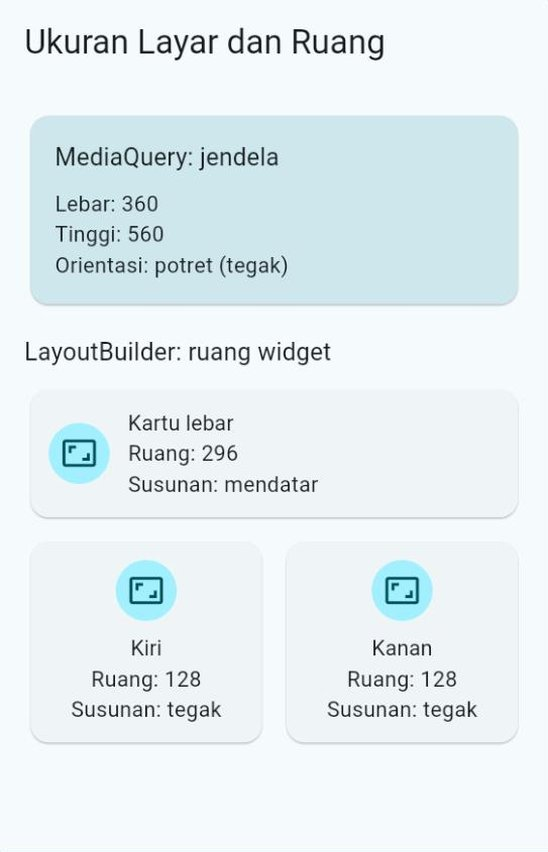
  &nbsp;
  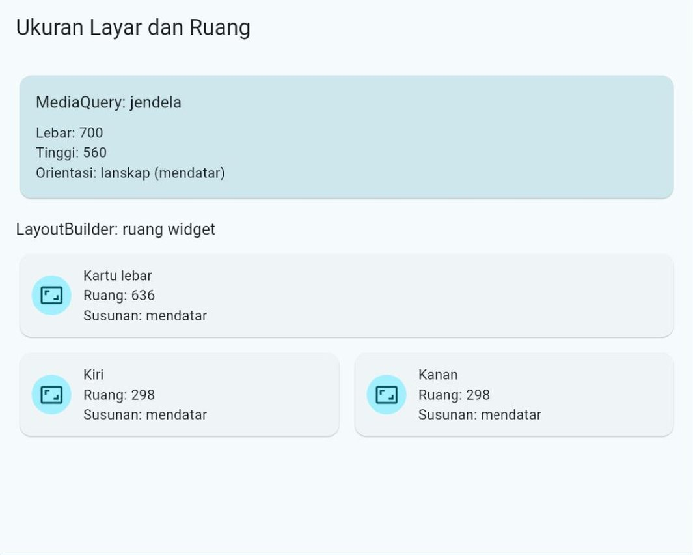
</p>

Di lebar 360, kartu "Kiri" dan "Kanan" hanya mendapat ruang 128, sehingga isinya disusun **tegak**, padahal kartu "Kartu lebar" di jendela yang sama disusun **mendatar**. Inilah gunanya `LayoutBuilder`: setiap widget menyesuaikan diri dengan ruangnya **sendiri**.

Dari mana angka 296 untuk "Kartu lebar"? 360 − 32 (*padding* `ListView` kiri-kanan) − 8 (*margin* bawaan `Card`, 4 kiri dan 4 kanan) − 24 (*padding* 12 di dalam kartu) = **296**.

### 10.5 `SafeArea`: menghindari poni kamera dan bilah sistem

Ponsel modern punya poni kamera, sudut membulat, dan bilah navigasi sistem. `Scaffold` yang memakai `AppBar` sudah menjaga bagian atas. Namun isi yang menempel di tepi bawah atau samping (misalnya saat ponsel lanskap) bisa tertutup. Bungkus isi seperti itu dengan `SafeArea`:

```dart
Scaffold(
  body: SafeArea(
    child: ListView(/* ... */),
  ),
)
```

`SafeArea` menambahkan jarak sebesar `MediaQuery.paddingOf(context)` di setiap sisi yang tertutup. Di DartPad dan Chrome tidak ada poni, sehingga perbedaannya baru terlihat di ponsel sungguhan atau emulator.

> **🧠 Cek Cepat:** Sebuah kartu diletakkan di panel kanan selebar 400 pada jendela selebar 1200. Jika kartu itu memakai `MediaQuery.widthOf(context)` untuk menentukan susunannya, apa yang salah?
>
> <details><summary>Lihat jawaban</summary>
>
> Kartu itu mengira dirinya punya ruang 1200 (lebar jendela), padahal hanya mendapat sekitar 400. Ia bisa memilih susunan mendatar yang ternyata terlalu sempit. Untuk keputusan seperti ini, gunakan `LayoutBuilder`.
> </details>

---

## 11. *Breakpoint* Material 3

### 11.1 Lima kelas lebar jendela

Daripada merancang untuk setiap perangkat, M3 membagi lebar jendela menjadi lima ***breakpoint*** (dulu disebut *window size class*):

| *Breakpoint* | Lebar jendela | Perangkat yang umum | Panel yang disarankan | Navigasi yang disarankan |
| :--- | :--- | :--- | :---: | :--- |
| **Ringkas** (*compact*) | di bawah 600 | Ponsel tegak | 1 | *Navigation bar* (bawah) |
| **Sedang** (*medium*) | 600–839 | Tablet tegak, ponsel lipat terbuka (tegak) | 1 (disarankan) atau 2 | *Navigation bar* atau *navigation rail* |
| **Lebar** (*expanded*) | 840–1199 | Ponsel lanskap, tablet lanskap, laptop | 1 atau 2 (disarankan) | *Navigation rail* |
| **Besar** (*large*) | 1200–1599 | Laptop dan monitor | 1 atau 2 (disarankan) | *Navigation rail* yang diperlebar |
| **Ekstra besar** (*extra-large*) | 1600 ke atas | Monitor lebar | 1 sampai 3 | *Navigation rail* yang diperlebar |

Sumber: halaman *Breakpoints* di situs Material 3 ([Referensi](#20-referensi)). Panduan yang sama juga menyarankan agar satu baris tulisan berisi sekitar **40–60 karakter** di semua *breakpoint*; karena itu isi halaman di layar lebar perlu dibatasi lebarnya.

### 11.2 Menulis *breakpoint* sebagai `enum`

Cuplikan dari [`kode/contoh_08_breakpoint_material3.dart`](kode/contoh_08_breakpoint_material3.dart). Setiap kelas sekaligus menyimpan jumlah kolom dan *margin* yang dipakai halaman:

```dart
enum KelasUkuran {
  ringkas('Ringkas (compact)', kolom: 1, margin: 16),
  sedang('Sedang (medium)', kolom: 2, margin: 24),
  lebar('Lebar (expanded)', kolom: 3, margin: 24),
  besar('Besar (large)', kolom: 3, margin: 24),
  ekstraBesar('Ekstra besar (extra-large)', kolom: 4, margin: 24);

  const KelasUkuran(this.nama, {required this.kolom, required this.margin});

  final String nama;
  final int kolom; // jumlah kolom kartu
  final double margin; // jarak isi ke tepi jendela

  // Menentukan kelas dari lebar jendela (dalam piksel logis).
  static KelasUkuran dari(double lebar) {
    if (lebar < 600) {
      return KelasUkuran.ringkas;
    }
    if (lebar < 840) {
      return KelasUkuran.sedang;
    }
    if (lebar < 1200) {
      return KelasUkuran.lebar;
    }
    if (lebar < 1600) {
      return KelasUkuran.besar;
    }
    return KelasUkuran.ekstraBesar;
  }
}
```

`enum` berproperti seperti ini sudah kita pakai di Pertemuan 6. Yang baru adalah **metode `static`** `dari(...)`: metode milik `enum`-nya, dipanggil sebagai `KelasUkuran.dari(lebar)`.

### 11.3 Memakai kelas untuk menata halaman

```dart
// widthOf: hanya membangun ulang jika LEBAR jendela berubah.
final double lebar = MediaQuery.widthOf(context);
final KelasUkuran kelas = KelasUkuran.dari(lebar);
```

Lalu tiga hal disesuaikan:

1. **Jumlah kolom** *grid*: `crossAxisCount: kelas.kolom`.
2. **Margin** halaman: 16 di jendela ringkas, 24 di jendela yang lebih lebar.
3. **Lebar isi paling besar**: isi dibungkus `Center` + `ConstrainedBox(constraints: BoxConstraints(maxWidth: 1200))`. Di monitor yang sangat lebar, isi tetap di tengah dan tidak melebar ke ujung layar.

```dart
body: Center(
  // Center + ConstrainedBox: isi tidak pernah lebih lebar dari 1200.
  child: ConstrainedBox(
    constraints: const BoxConstraints(maxWidth: lebarIsiMaksimum),
    child: Column(/* info kelas + GridView di dalam Expanded */),
  ),
),
```

<p align="center">
  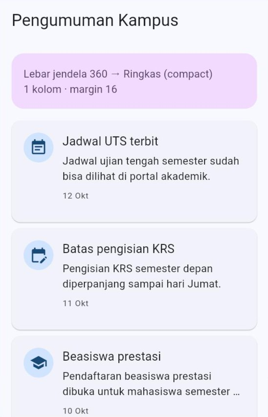
  &nbsp;
  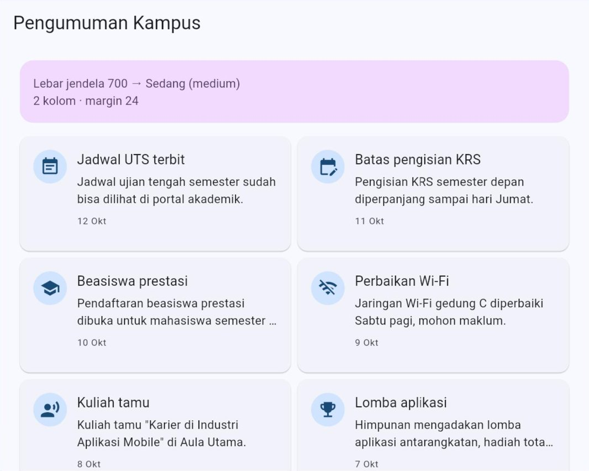
</p>
<p align="center">
  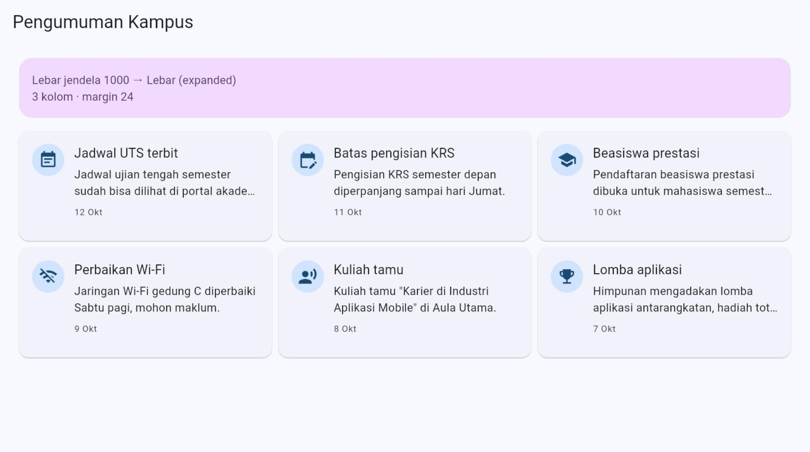
</p>

> **🧠 Cek Cepat:** Berapa jumlah kolom contoh 08 di jendela selebar 839? Dan selebar 840?
>
> <details><summary>Lihat jawaban</summary>
>
> 839 masih kelas **sedang** (600–839), jadi 2 kolom. 840 sudah kelas **lebar**, jadi 3 kolom. Batas bawah setiap kelas ikut masuk ke kelas itu.
> </details>

---

## 12. Navigasi Adaptif: `NavigationBar` dan `NavigationRail`

### 12.1 `NavigationBar`: navigasi di bawah layar

`NavigationBar` adalah bilah navigasi M3 di bawah layar, cocok untuk 3–5 tujuan utama. Setiap tujuan ditulis dengan `NavigationDestination`:

```dart
NavigationBar(
  selectedIndex: _terpilih, // tujuan yang sedang aktif
  onDestinationSelected: _pilih, // dipanggil saat tujuan diketuk
  destinations: const [
    NavigationDestination(
      icon: Icon(Icons.home_outlined),
      selectedIcon: Icon(Icons.home),
      label: 'Beranda',
    ),
    // ... tujuan lain
  ],
)
```

Polanya sama dengan widget pilihan di Pertemuan 5: nilai yang sedang dipilih (`selectedIndex`) disimpan di *state*, dan perubahan dilaporkan lewat fungsi (`onDestinationSelected`). `NavigationBar` dipasang di parameter `bottomNavigationBar` milik `Scaffold`.

Untuk angka pemberitahuan, bungkus ikonnya dengan **`Badge`**. Bentuk `Badge.count(count: 3, child: Icon(...))` menampilkan angka 3 di pojok ikon dengan warna `error`.

### 12.2 `NavigationRail`: navigasi di samping

`NavigationRail` berfungsi sama, tetapi berdiri tegak di sisi kiri layar. Karena bukan bagian dari `Scaffold`, ia diletakkan sendiri di dalam `Row`:

```dart
Row(
  children: [
    NavigationRail(
      selectedIndex: _terpilih,
      onDestinationSelected: _pilih,
      extended: railLebar,
      labelType: railLebar
          ? NavigationRailLabelType.none
          : NavigationRailLabelType.all,
      destinations: [/* NavigationRailDestination(...) */],
    ),
    const VerticalDivider(width: 1, thickness: 1),
    Expanded(child: isi),
  ],
)
```

| Parameter | Arti |
| :--- | :--- |
| `destinations` | Daftar `NavigationRailDestination`. Bedanya dengan `NavigationDestination`: `label`-nya berupa **widget** (`Text(...)`), bukan `String` |
| `labelType` | `NavigationRailLabelType.all` (semua label tampil), `.selected` (hanya label yang terpilih), atau `.none` |
| `extended` | `true` = rail diperlebar (± 256) dengan label di samping ikon |

> [!WARNING]
> Saat `extended: true`, `labelType` **harus** `null` atau `NavigationRailLabelType.none`. Jika diisi `.all`, layar menampilkan *assertion error* yang menyebut syarat yang dilanggar: `!extended || (labelType == null || labelType == NavigationRailLabelType.none)`.

### 12.3 Abstraksi → ukur → cabangkan

Dokumentasi Flutter menyarankan tiga langkah untuk membuat tampilan adaptif:

| Langkah | Artinya | Di contoh 09 |
| :--- | :--- | :--- |
| **1. Abstraksi** | Pisahkan data yang dipakai bersama oleh beberapa tata letak | *Class* `Tujuan` dan `daftarTujuan` ditulis **sekali**, dipakai oleh `NavigationBar` dan `NavigationRail` |
| **2. Ukur** | Ketahui ruang yang tersedia | `MediaQuery.widthOf(context)` |
| **3. Cabangkan** | Pilih tata letak berdasarkan *breakpoint* | `< 600` → `NavigationBar`; `600–1199` → `NavigationRail`; `≥ 1200` → rail diperlebar |

Cuplikan dari [`kode/contoh_09_navigasi_adaptif.dart`](kode/contoh_09_navigasi_adaptif.dart):

```dart
// ---------- 1. ABSTRAKSI: data tujuan ditulis sekali ----------
class Tujuan {
  const Tujuan(this.label, this.ikon, this.ikonTerpilih, {this.jumlahBaru = 0});

  final String label;
  final IconData ikon;
  final IconData ikonTerpilih;
  final int jumlahBaru; // angka pada lencana (badge); 0 = tanpa lencana
}

const List<Tujuan> daftarTujuan = [
  Tujuan('Beranda', Icons.home_outlined, Icons.home),
  Tujuan('Jadwal', Icons.calendar_month_outlined, Icons.calendar_month),
  Tujuan('Tugas', Icons.assignment_outlined, Icons.assignment, jumlahBaru: 3),
  Tujuan('Profil', Icons.person_outline, Icons.person),
];
```

```dart
@override
Widget build(BuildContext context) {
  final double lebar = MediaQuery.widthOf(context); // UKUR
  final Widget isi = IsiHalaman(
    tujuan: daftarTujuan[_terpilih],
    lebar: lebar,
  );

  // CABANG 1: jendela ringkas -> NavigationBar di bawah layar.
  if (lebar < 600) {
    return Scaffold(
      appBar: AppBar(title: const Text('Portal Mahasiswa')),
      body: isi,
      bottomNavigationBar: NavigationBar(/* ... dari daftarTujuan ... */),
    );
  }

  // CABANG 2 dan 3: NavigationRail di samping; diperlebar mulai 1200.
  final bool railLebar = lebar >= 1200;
  return Scaffold(
    appBar: AppBar(title: const Text('Portal Mahasiswa')),
    body: Row(/* NavigationRail + VerticalDivider + Expanded(isi) */),
  );
}
```

<p align="center">
  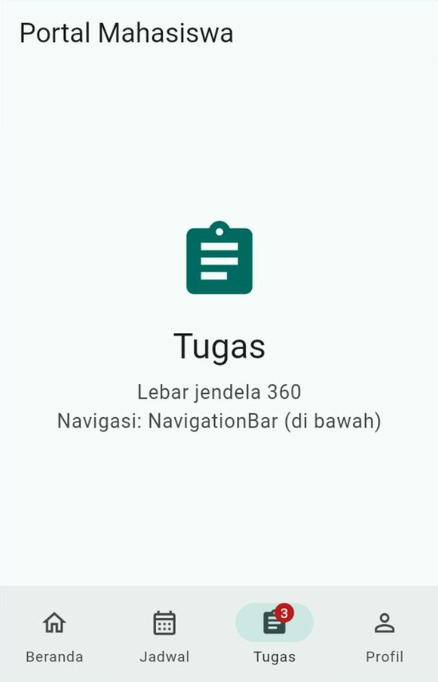
  &nbsp;
  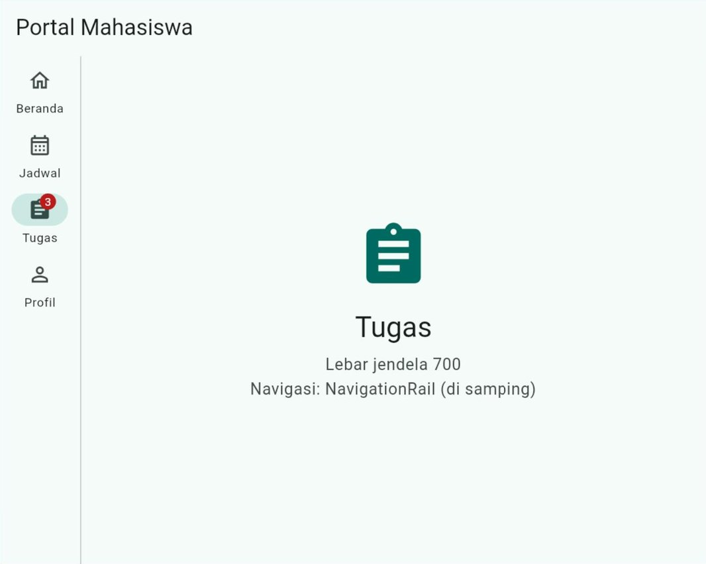
</p>
<p align="center">
  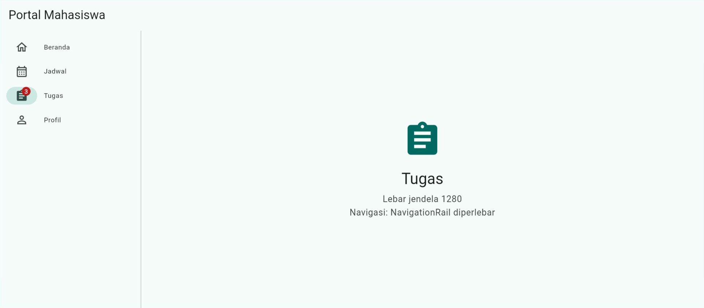
</p>

Perhatikan bahwa tujuan **Tugas tetap terpilih** di ketiga ukuran. `_terpilih` disimpan di *state* `HalamanUtama`, **di atas** percabangan, sehingga tidak ikut hilang saat tata letak berganti. Inilah prinsip ke-5 di Bagian 9.3.

> **🧠 Cek Cepat:** Mengapa `daftarTujuan` cukup ditulis sekali, padahal `NavigationBar` dan `NavigationRail` memakai *class* tujuan yang berbeda?
>
> <details><summary>Lihat jawaban</summary>
>
> Karena yang ditulis sekali adalah **datanya** (label dan ikon), bukan widgetnya. Saat membangun tampilan, data yang sama diubah menjadi `NavigationDestination` atau `NavigationRailDestination` dengan perulangan `for`. Jika ada tujuan baru, cukup tambahkan satu baris di `daftarTujuan`.
> </details>

---

## 13. Pola Daftar–Detail

### 13.1 Konsepnya

Aplikasi surel, obrolan, dan pengaturan di tablet sering menampilkan **daftar di kiri dan detail di kanan**. Di ponsel, ruangnya tidak cukup, sehingga detail dibuka sebagai **halaman baru**. Pola ini disebut **daftar–detail** (*list-detail*).

| Lebar jendela | Saat item diketuk |
| :--- | :--- |
| < 840 (satu panel) | `Navigator.push` ke halaman detail ([Pertemuan 6](../pertemuan_06_daftar_dan_navigasi/README.md#9-navigator-tumpukan-halaman)) |
| ≥ 840 (dua panel) | `setState` mengganti item terpilih; panel kanan menampilkan detailnya |

### 13.2 Satu widget detail untuk dua tata letak

Cuplikan dari [`kode/contoh_10_daftar_detail.dart`](kode/contoh_10_daftar_detail.dart):

```dart
@override
Widget build(BuildContext context) {
  final bool duaPanel = MediaQuery.widthOf(context) >= 840;

  // Jendela sempit: hanya daftar. Detail dibuka sebagai halaman baru.
  if (!duaPanel) {
    return Scaffold(
      appBar: AppBar(title: const Text('Pesan Akademik')),
      body: DaftarPesan(idTerpilih: null, onPilih: _bukaHalamanDetail),
    );
  }

  // Jendela lebar: daftar di kiri, detail di kanan.
  final Pesan? terpilih = cariPesan(_idTerpilih);
  return Scaffold(
    appBar: AppBar(title: const Text('Pesan Akademik')),
    body: Row(
      children: [
        SizedBox(
          width: 360, // panel daftar selebar layar ponsel
          child: DaftarPesan(
            idTerpilih: _idTerpilih,
            onPilih: (Pesan pesan) {
              setState(() {
                _idTerpilih = pesan.id;
              });
            },
          ),
        ),
        const VerticalDivider(width: 1, thickness: 1),
        Expanded(
          child: terpilih == null
              ? const PanelKosong()
              : DetailPesan(pesan: terpilih),
        ),
      ],
    ),
  );
}
```

Tiga hal penting:

1. **`DaftarPesan` dan `DetailPesan` dipakai di kedua tata letak.** Halaman detail untuk ponsel (`HalamanDetailPesan`) hanyalah `Scaffold` yang membungkus `DetailPesan`. Kode tampilan detail tidak ditulis dua kali.
2. **`onPilih` berbeda di setiap tata letak.** Satu panel: membuka halaman baru. Dua panel: menyimpan `_idTerpilih`. `DaftarPesan` tidak perlu tahu bedanya; ia hanya memanggil fungsi yang diberikan.
3. **Baris terpilih ditandai** dengan `ListTile(selected: ..., selectedTileColor: ...)`, agar pengguna tahu pesan mana yang sedang dibuka di panel kanan.

<p align="center">
  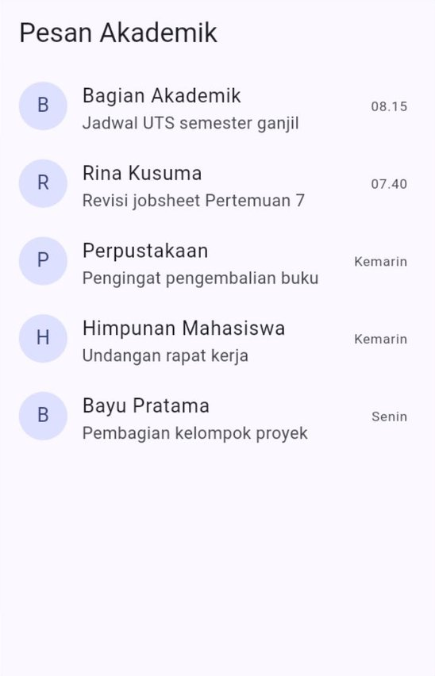
  &nbsp;
  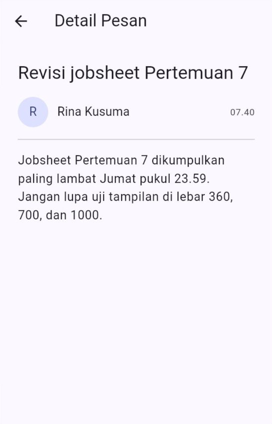
</p>
<p align="center">
  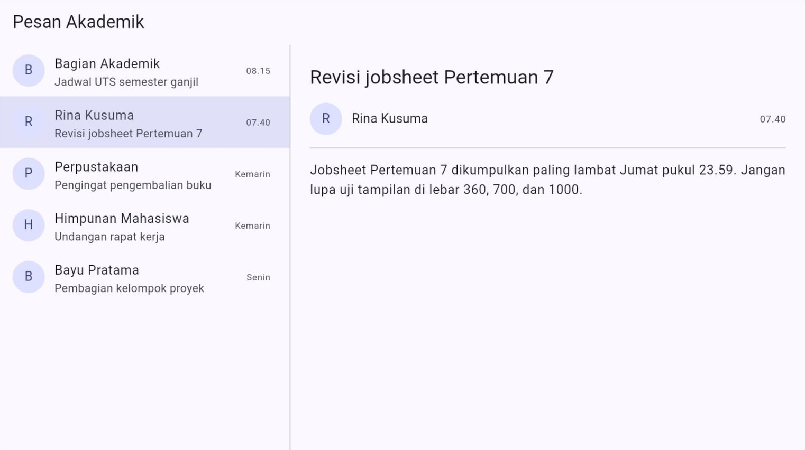
</p>

> [!NOTE]
> Jika jendela diperlebar saat halaman detail sedang terbuka, halaman detail itu tetap menutupi layar sampai pengguna menekan tombol kembali. Untuk aplikasi latihan hal ini wajar. Penanganan yang lebih rapi (misalnya otomatis menutup halaman detail) memerlukan teknik navigasi lanjutan.

---

## 14. Ukuran Huruf Pilihan Pengguna dan Aksesibilitas

### 14.1 Pengguna boleh memperbesar huruf

Android dan iOS menyediakan pengaturan **ukuran huruf** untuk seluruh sistem. Banyak pengguna, terutama yang berkacamata atau lanjut usia, memakainya. Flutter menerapkan pilihan itu **otomatis** ke semua `Text` melalui `MediaQuery` (nilainya bisa dibaca dengan `MediaQuery.textScalerOf(context)`). Akibatnya, tampilan yang rapi di ukuran huruf normal bisa **rusak** saat hurufnya dibesarkan.

### 14.2 Membuktikannya

Kode lengkap: [`kode/contoh_11_ukuran_huruf_pengguna.dart`](kode/contoh_11_ukuran_huruf_pengguna.dart). Penggeser di atas **meniru** pengaturan ukuran huruf ponsel, dari 1× sampai 2×, untuk dua kartu jadwal:

```dart
// Salinan data MediaQuery yang sekarang, tetapi textScaler-nya diganti.
// MediaQuery.of dipakai karena kita butuh SELURUH datanya untuk disalin.
final MediaQueryData dataAsli = MediaQuery.of(context);
final MediaQueryData dataTiruan = dataAsli.copyWith(
  textScaler: TextScaler.linear(_skala),
);
```

Lalu kedua kartu dibungkus `MediaQuery(data: dataTiruan, child: ...)`, sehingga hanya kartu-kartu itu yang hurufnya diperbesar.

<p align="center">
  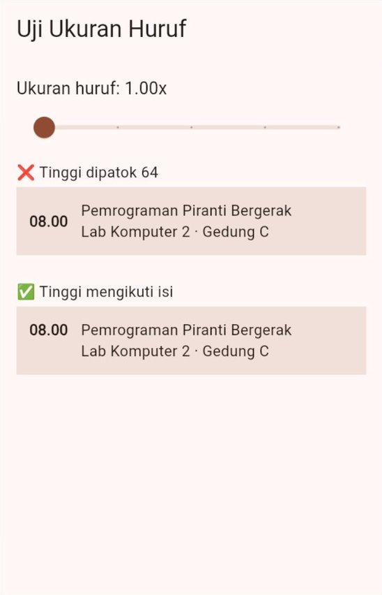
  &nbsp;
  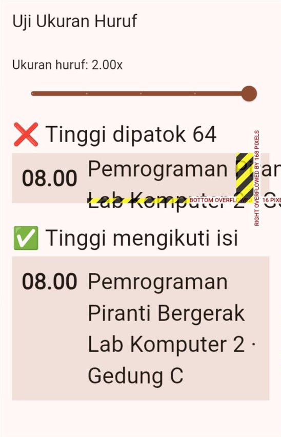
</p>

| Kartu | Masalah / kelebihan |
| :--- | :--- |
| ❌ Tinggi dipatok 64 | `Container(height: 64)` tidak bisa meninggi. Teks di dalam `Row` juga tidak dibungkus `Expanded`, sehingga tidak bisa turun ke baris berikutnya. Hasilnya *overflow* ke kanan **dan** ke bawah |
| ✅ Tinggi mengikuti isi | Tanpa `height`. Kolom teks dibungkus `Expanded`, sehingga teks panjang turun ke baris berikutnya dan kartu ikut meninggi |

> [!NOTE]
> Garis kuning-hitam di contoh 11 **memang disengaja** untuk menunjukkan masalahnya. Konsol juga akan menampilkan pesan *overflow*. Di aplikasi Anda sendiri, garis seperti ini harus dihilangkan.

### 14.3 Aturan agar aman saat huruf diperbesar

1. **Jangan mematok tinggi** wadah yang berisi teks. Biarkan tingginya mengikuti isi.
2. Teks panjang di dalam `Row` dibungkus **`Expanded`** atau `Flexible`.
3. Jika teks memang harus satu baris (misalnya judul di kartu *grid*), gunakan `maxLines` dan `overflow: TextOverflow.ellipsis`.
4. Uji di ukuran huruf **1,5× dan 2×**.
5. `MediaQuery.withClampedTextScaling(maxScaleFactor: ...)` dapat membatasi pembesaran huruf, tetapi pakailah hanya sebagai jalan terakhir, karena pengguna yang memang membutuhkan huruf besar jadi tidak terbantu.

### 14.4 Kebiasaan aksesibilitas lain

**Aksesibilitas** berarti aplikasi bisa dipakai oleh sebanyak mungkin orang, termasuk penyandang disabilitas. Beberapa kebiasaan sederhana:

| Kebiasaan | Alasannya | Di Flutter |
| :--- | :--- | :--- |
| Teks di atas warna X memakai `onX` | Kontras cukup untuk dibaca | Bagian 4.2 |
| Jangan hanya mengandalkan warna | Ada pengguna yang sulit membedakan warna | Label status contoh 06 memakai warna **dan** tulisan |
| Target sentuh cukup besar | Jari tidak selalu tepat sasaran | Di ponsel, komponen M3 sudah memberi area sentuh minimal 48 × 48; jangan mengecilkannya |
| Beri keterangan pada tombol ikon | Pembaca layar (*screen reader*) membacakannya | `IconButton(tooltip: 'Mode gelap', ...)` |
| Jangan mengunci orientasi | Ada pengguna yang memasang ponsel di dudukan mendatar | Bagian 9.3 |

---

## 15. Cara Menguji Tampilan Responsif

| Alat | Caranya |
| :--- | :--- |
| **Chrome** (`flutter run -d chrome`) | Ubah ukuran jendela Chrome dengan menyeret tepinya. Tampilan Flutter langsung menyesuaikan. |
| **Chrome DevTools** | Tekan `F12`, lalu `Ctrl` + `Shift` + `M` (*device toolbar*). Pilih ukuran perangkat (misalnya ponsel 360 atau tablet 768), atau ketik lebar dan tinggi sendiri. |
| **Emulator Android** | Putar layar dengan tombol putar di panel emulator. Ubah ukuran huruf di **Setelan → Tampilan** (letak menunya sedikit berbeda di setiap versi Android), dan nyalakan **Tema gelap** dari menu cepat. |
| **DartPad** | Lebar panel aplikasi mengikuti lebar jendela *browser*. Perkecil atau perbesar jendela *browser* untuk melihat perubahannya. |

> [!WARNING]
> Di Pertemuan 6 kita menguji lebar 320 dengan `builder: (context, child) => Center(child: SizedBox(width: 320, child: child))` di dalam `MaterialApp`. Trik ini **hanya** memengaruhi widget yang memakai `LayoutBuilder` atau batasan induk. `MediaQuery` tetap melaporkan lebar **jendela** yang asli, sehingga *breakpoint* yang memakai `MediaQuery.widthOf` tidak ikut berubah. Untuk menguji *breakpoint*, ubahlah ukuran **jendela**-nya.

**Daftar periksa sebelum mengumpulkan tugas:**

| Uji | Yang diperiksa |
| :--- | :--- |
| Lebar 320 dan 360 | Tidak ada garis kuning-hitam; teks panjang terpotong rapi atau turun ke baris berikutnya |
| Lebar 600, 840, dan 1200 | Tata letak berganti tepat di *breakpoint*; isi tidak melebar ke ujung layar |
| Mode terang dan gelap | Semua teks terbaca; tidak ada kotak putih atau teks hitam yang ditulis langsung |
| Ukuran huruf 1,5× dan 2× | Teks tidak terpotong di tengah kata dan tidak menimbulkan *overflow* |
| Mengubah ukuran saat aplikasi berjalan | Pilihan pengguna (tab yang aktif, item terpilih, isian) tidak hilang |

---

## 16. Studi Kasus: Pustaka Kampus

Saatnya merangkai semua materi hari ini. Kode lengkap: [`kode/contoh_12_studi_kasus_pustaka_kampus.dart`](kode/contoh_12_studi_kasus_pustaka_kampus.dart).

**Kebutuhan aplikasi:**

1. Tiga tujuan: **Katalog**, **Pinjaman**, dan **Pengaturan**. Ikon Pinjaman diberi lencana berisi jumlah buku yang sedang dipinjam.
2. Navigasi adaptif: `NavigationBar` di jendela < 600, `NavigationRail` di 600–1199, rail diperlebar mulai 1200.
3. Katalog memakai pola daftar–detail: satu panel di jendela < 840, dua panel mulai 840.
4. Halaman detail menyusun dirinya sendiri: sampul di atas jika ruangnya sempit, sampul di kiri jika ruangnya lega.
5. Pengguna bisa memilih mode tema (sistem/terang/gelap) dan warna aplikasi (empat pilihan benih).

### 16.1 Peta *state*

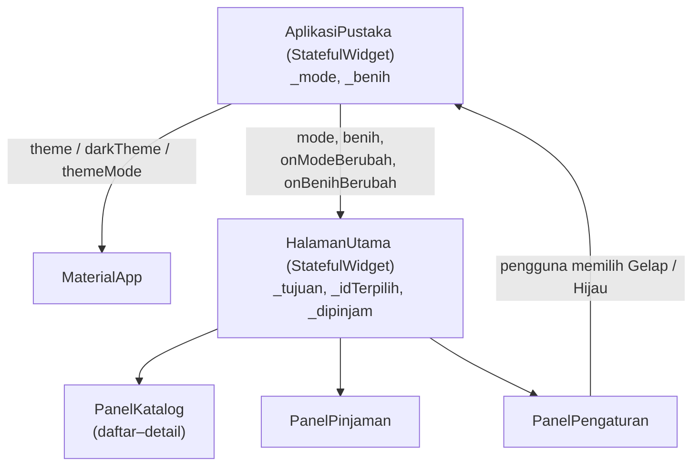

Setiap *state* disimpan di widget **teratas yang membutuhkannya**: pilihan tampilan di akar aplikasi (dipakai `MaterialApp`), sedangkan tab aktif, buku terpilih, dan daftar pinjaman di `HalamanUtama` (dipakai ketiga panel).

> [!TIP]
> Meneruskan nilai dan fungsi melewati dua tingkat widget seperti ini masih wajar. Jika tingkatnya makin banyak, kodenya mulai merepotkan. Pertemuan 9 memperkenalkan cara yang lebih rapi untuk berbagi *state*.

### 16.2 Langkah 1 — Tema dari benih yang bisa diganti

```dart
ThemeData buatTema(Color benih, Brightness kecerahan) {
  return ThemeData(
    colorScheme: ColorScheme.fromSeed(seedColor: benih, brightness: kecerahan),
  );
}
```

Di akar aplikasi, fungsi ini dipanggil dua kali dengan benih yang **sama**:

```dart
return MaterialApp(
  debugShowCheckedModeBanner: false,
  title: 'Pustaka Kampus',
  theme: buatTema(_benih, Brightness.light),
  darkTheme: buatTema(_benih, Brightness.dark),
  themeMode: _mode,
  home: HalamanUtama(/* mode, benih, dan dua fungsi pengubahnya */),
);
```

Saat pengguna memilih warna lain, `_benih` berubah, kedua tema dibuat ulang, dan seluruh aplikasi ikut berganti warna.

### 16.3 Langkah 2 — Ukur, lalu tentukan susunan

```dart
final double lebar = MediaQuery.widthOf(context);
final bool duaPanel = lebar >= 840;

final List<Tujuan> daftarTujuan = [
  const Tujuan('Katalog', Icons.menu_book_outlined, Icons.menu_book),
  Tujuan(
    'Pinjaman',
    Icons.bookmarks_outlined,
    Icons.bookmarks,
    jumlah: _dipinjam.length,
  ),
  const Tujuan('Pengaturan', Icons.settings_outlined, Icons.settings),
];
```

Angka lencana Pinjaman adalah **nilai turunan** dari `_dipinjam.length` ([Pertemuan 6](../pertemuan_06_daftar_dan_navigasi/README.md#8-mencari-dan-menyaring-daftar)), sehingga selalu sesuai dengan isi daftar pinjaman. Sisanya mengikuti pola contoh 09: `< 600` memakai `NavigationBar`, selain itu `NavigationRail` di dalam `Row`.

### 16.4 Langkah 3 — Katalog: satu ketukan, dua perilaku

```dart
isi = PanelKatalog(
  duaPanel: duaPanel,
  idTerpilih: _idTerpilih,
  dipinjam: _dipinjam,
  onPilih: (Buku buku) {
    if (duaPanel) {
      setState(() {
        _idTerpilih = buku.id;
      });
    } else {
      _bukaHalamanDetail(buku);
    }
  },
  onUbahPinjaman: _ubahPinjaman,
);
```

Di jendela sempit, halaman detail dibuka dengan `Navigator.push<bool>` dan **menunggu jawaban** ([Pertemuan 6, Bagian 11](../pertemuan_06_daftar_dan_navigasi/README.md#11-menerima-hasil-dari-halaman)). Tombol "Pinjam buku" atau "Kembalikan" di halaman detail menutup halaman sambil mengirim `true`:

```dart
// Jendela sempit: detail dibuka sebagai halaman baru dan mengirim
// jawaban "true" jika tombol pinjam/kembalikan ditekan.
Future<void> _bukaHalamanDetail(Buku buku) async {
  final bool? ubah = await Navigator.push<bool>(
    context,
    MaterialPageRoute<bool>(
      builder: (BuildContext context) => HalamanDetailBuku(
        buku: buku,
        dipinjam: _dipinjam.contains(buku.id),
      ),
    ),
  );
  if (!mounted) {
    return;
  }
  if (ubah == true) {
    _ubahPinjaman(buku);
  }
}
```

Di jendela lebar, tombol yang sama langsung memanggil `onUbahPinjaman` karena panel detail berada di halaman yang sama.

### 16.5 Langkah 4 — Detail yang menyesuaikan ruangnya

`DetailBuku` dipakai di halaman detail (ponsel) **dan** di panel kanan (layar lebar). Karena ruangnya berbeda-beda, ia memakai `LayoutBuilder`:

```dart
return LayoutBuilder(
  builder: (BuildContext context, BoxConstraints batasan) {
    // Ruang lega: sampul di kiri, keterangan di kanan.
    // Ruang sempit: sampul di atas, keterangan di bawahnya.
    final bool lega = batasan.maxWidth >= 520;

    return ListView(
      padding: const EdgeInsets.all(24),
      children: [
        if (lega)
          Row(
            crossAxisAlignment: CrossAxisAlignment.start,
            children: [
              sampul,
              const SizedBox(width: 24),
              Expanded(child: keterangan),
            ],
          )
        else ...[
          Center(child: sampul),
          const SizedBox(height: 24),
          keterangan,
        ],
        // ... judul "Sinopsis" dan isinya
      ],
    );
  },
);
```

`else ...[ ... ]` memakai **operator *spread*** (`...`) untuk menyisipkan beberapa widget sekaligus ke dalam daftar `children`.

### 16.6 Langkah 5 — Pinjaman dan Pengaturan

- **Pinjaman** menampilkan buku yang `id`-nya ada di `_dipinjam` sebagai `Card.outlined` (varian kartu M3 bergaris tepi). Daftarnya dibungkus `ConstrainedBox(maxWidth: 720)` agar tidak melebar di layar besar.
- **Pengaturan** berisi `SegmentedButton<ThemeMode>` dan `ChoiceChip` warna. Keduanya hanya **memanggil fungsi** dari akar aplikasi (`onModeBerubah`, `onBenihBerubah`); yang mengubah *state* tetap akar aplikasi.

### 16.7 Hasilnya

<p align="center">
  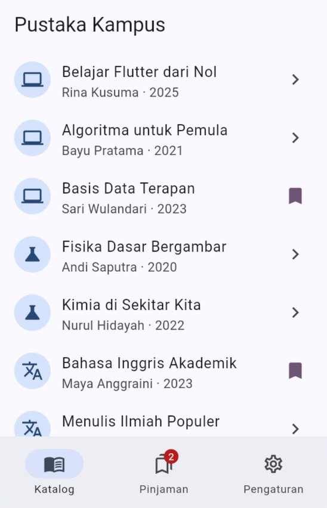
  &nbsp;
  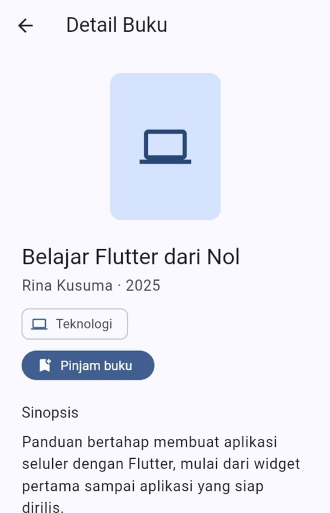
  &nbsp;
  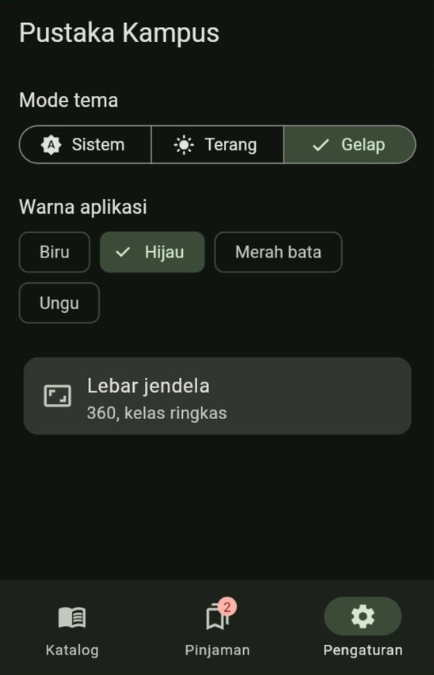
</p>
<p align="center">
  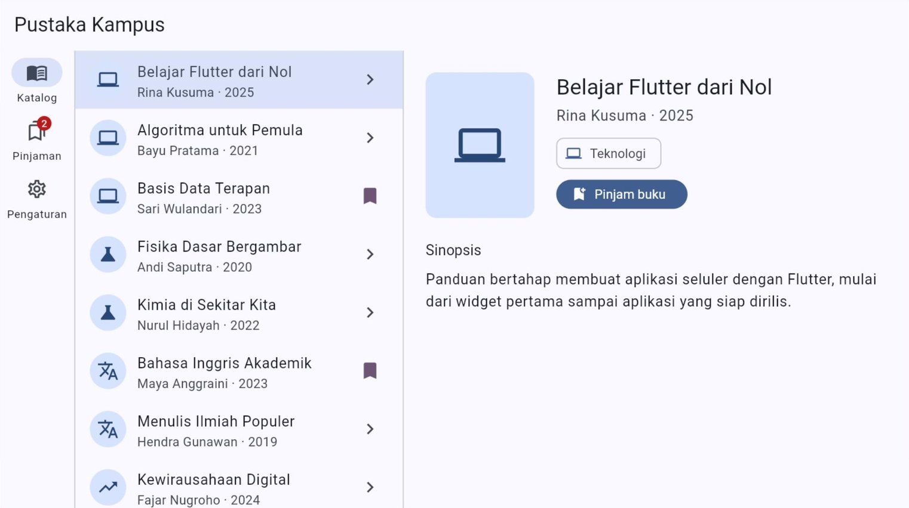
</p>

**Coba sendiri:**

1. Pinjam satu buku dari katalog. Angka lencana Pinjaman bertambah dan buku itu muncul di tab Pinjaman.
2. Di Pengaturan, pilih **Gelap**, lalu ganti warna menjadi **Hijau**. Seluruh aplikasi, termasuk `NavigationBar`, ikut berganti.
3. Perlebar jendela perlahan dan amati tiga perubahan: di 600 navigasi pindah ke samping, di 840 katalog menjadi dua panel, di 1200 rail diperlebar.
4. Pada tampilan dua panel, bandingkan jendela 840 dan 1000. Di 840, panel detail hanya selebar ± 398 sehingga sampul berada di atas. Di 1000, panel detail ± 558 sehingga sampul pindah ke kiri.

---

## 17. Kesalahan Umum Pemula dan Solusinya

| Gejala | Penyebab | Solusi |
| :--- | :--- | :--- |
| Warna aplikasi diganti, tetapi sebagian kartu/teks tidak ikut berubah | Warna ditulis langsung (`Color(0xFF...)`, `Colors.blue`) | Ambil dari `Theme.of(context).colorScheme` |
| Teks sulit dibaca di atas latar berwarna | Pasangan warna salah, misalnya teks `primary` di atas `primaryContainer` | Teks di atas warna X memakai `onX` |
| Di mode gelap ada teks yang hilang atau kotak putih menyilaukan | `Colors.black`/`Colors.white` ditulis langsung | Gunakan `onSurface`, `surface`, dan peran warna lain |
| Memilih "Gelap" tetapi tampilan tetap terang | `darkTheme` tidak diisi, atau `brightness: Brightness.dark` terlupa | Isi `darkTheme` dengan `ColorScheme.fromSeed(..., brightness: Brightness.dark)` |
| Kode dari tutorial lama memakai `AppBarTheme(color: ...)` | Nama dan parameter lama | Gunakan `AppBarThemeData(backgroundColor: ...)` |
| Peringatan *deprecated* pada `background`, `onBackground`, atau `surfaceVariant` | Peran warna lama | Gunakan `surface`, `onSurface`, `surfaceContainerHighest` |
| *Error* `BoxConstraints forces an infinite width` setelah memasang `filledButtonTheme` | Tombol bertinggi `Size.fromHeight(...)` diletakkan di dalam `Row` | Bungkus tombol dengan `Expanded`, atau beri `minimumSize` lain pada tombol itu |
| Tema lokal tidak berpengaruh | `Theme.of(context)` dipanggil dengan `context` yang berada **di atas** widget `Theme` baru, sehingga yang terbaca adalah tema lama | Pindahkan bagian yang membaca tema ke widget (*class*) tersendiri di dalam `Theme` |
| *Assertion error* di `NavigationRail` yang diperlebar | `extended: true` digabung dengan `labelType: NavigationRailLabelType.all` | Saat `extended: true`, isi `labelType` dengan `none` atau biarkan `null` |
| Tab yang dipilih kembali ke awal saat jendela diubah ukurannya | Nilai tab disimpan di bawah percabangan tata letak, atau dibuat ulang di `build` | Simpan di *state* widget yang berada **di atas** percabangan |
| Tata letak "tablet" muncul di ponsel yang diputar, atau tidak muncul di tablet yang layarnya dibagi | Keputusan memakai orientasi atau jenis perangkat | Putuskan berdasarkan **lebar jendela** dan *breakpoint* |
| Garis kuning-hitam saat huruf diperbesar | Tinggi wadah dipatok, atau teks di dalam `Row` tidak dibungkus `Expanded` | Biarkan tinggi mengikuti isi; bungkus teks dengan `Expanded` |
| Di monitor lebar, kartu dan teks membentang dari ujung ke ujung | Isi tidak dibatasi lebarnya | `Center` + `ConstrainedBox(maxWidth: ...)` |
| *Breakpoint* tidak berubah saat diuji dengan `SizedBox(width: 320)` di `MaterialApp.builder` | `MediaQuery` tetap melaporkan lebar jendela asli | Ubah ukuran jendela *browser* atau pakai *device toolbar* Chrome |

---

## 18. Ringkasan

- **Material Design 3** adalah sistem desain yang dipakai Flutter secara bawaan. Komponennya membaca warna dan gaya huruf dari **tema**.
- **Tema** dipasang sekali di `MaterialApp(theme: ThemeData(...))` dan dibaca di mana saja dengan **`Theme.of(context)`**. Jangan menulis warna dan ukuran huruf langsung di widget.
- **`ColorScheme.fromSeed`** menurunkan palet lengkap dari satu warna benih. Setiap warna punya **peran**, dan teks di atas warna X memakai pasangannya, **`onX`**.
- **`TextTheme`** menyediakan 15 gaya huruf (display, headline, title, body, label). Pilih berdasarkan peran teks.
- **Tema komponen** (`AppBarThemeData`, `CardThemeData`, `FilledButtonThemeData`, ...) mengatur semua komponen sejenis sekaligus. Widget **`Theme`** mengubah tema hanya untuk sebagian layar.
- **Mode gelap** = `theme` + `darkTheme` (benih sama, `brightness` berbeda) + `themeMode`. Pilihan pengguna disimpan di akar aplikasi.
- **`ThemeExtension`** menambahkan warna khusus (misalnya "sukses") yang punya versi terang dan gelap.
- **`MediaQuery.sizeOf`/`widthOf`** mengukur jendela; **`LayoutBuilder`** mengukur ruang untuk satu widget.
- **Breakpoint M3:** ringkas < 600, sedang 600–839, lebar 840–1199, besar 1200–1599, ekstra besar ≥ 1600. Putuskan tata letak berdasarkan lebar jendela, bukan jenis perangkat.
- **Navigasi adaptif:** `NavigationBar` di jendela ringkas, `NavigationRail` di jendela yang lebih lebar, dengan data tujuan yang ditulis sekali dan *state* di atas percabangan.
- **Pola daftar–detail:** satu panel + `Navigator.push` di jendela sempit, dua panel berdampingan di jendela lebar, dengan widget detail yang sama.
- Uji tampilan di **berbagai lebar**, di **mode gelap**, dan dengan **huruf yang diperbesar**.

---

## 19. Glosarium

| Istilah | Arti |
| :--- | :--- |
| **Sistem desain** | Kumpulan aturan dan komponen siap pakai agar tampilan sebuah produk konsisten |
| **Material Design 3 (M3)** | Sistem desain dari Google yang dipakai Flutter secara bawaan |
| **Token desain** | Nilai desain bernama, seperti warna `primary` atau gaya `titleLarge`, yang dibaca oleh komponen |
| **Tema** | Kumpulan pengaturan tampilan (`ThemeData`) yang berlaku untuk widget di bawahnya |
| **`Theme.of(context)`** | Cara mengambil tema terdekat di atas sebuah widget |
| **Warna benih** (*seed color*) | Satu warna awal yang diturunkan menjadi palet lengkap oleh `ColorScheme.fromSeed` |
| **Peran warna** (*color role*) | Kegunaan sebuah warna dalam skema, misalnya `primary`, `surface`, `error` |
| **Pasangan "*on*"** | Warna untuk teks/ikon yang diletakkan di atas sebuah peran warna, misalnya `onPrimary` |
| **`TextTheme`** | Kumpulan 15 gaya huruf M3 |
| **Tema komponen** | Pengaturan tampilan untuk semua komponen sejenis, misalnya `filledButtonTheme` |
| **Tema lokal** | Widget `Theme` yang mengubah tema hanya untuk bagian di bawahnya |
| **`ThemeMode`** | Pilihan tema: ikuti sistem, selalu terang, atau selalu gelap |
| **`ThemeExtension`** | "Laci tambahan" di tema untuk nilai milik aplikasi sendiri |
| **`lerp`** | *Linear interpolation*: mencari nilai di antara dua nilai, dipakai untuk animasi pergantian tema |
| **Piksel logis** | Satuan ukuran Flutter yang sudah memperhitungkan kerapatan layar |
| **Responsif** | Tampilan menyesuaikan diri agar **muat** di ruang yang ada |
| **Adaptif** | Tampilan memilih komponen dan tata letak yang paling **nyaman dipakai** di ruang itu |
| **`MediaQuery`** | Keterangan tentang jendela aplikasi: ukuran, orientasi, ukuran huruf, dan lain-lain |
| **`LayoutBuilder`** | Widget yang memberi tahu batasan ruang dari induknya |
| ***Breakpoint*** | Lebar jendela tempat tata letak perlu berubah (ringkas, sedang, lebar, besar, ekstra besar) |
| **`NavigationBar`** | Navigasi M3 di bawah layar |
| **`NavigationRail`** | Navigasi M3 tegak di sisi layar; bisa diperlebar |
| **`Badge`** | Lencana kecil, misalnya angka pemberitahuan, di pojok ikon |
| **Pola daftar–detail** | Daftar dan detail item tampil berdampingan di layar lebar, bergantian di layar sempit |
| **`TextScaler`** | Pengali ukuran huruf sesuai pilihan pengguna |
| **`SafeArea`** | Widget yang memberi jarak agar isi tidak tertutup poni kamera atau bilah sistem |
| **Aksesibilitas** | Upaya agar aplikasi bisa dipakai oleh sebanyak mungkin orang, termasuk penyandang disabilitas |

---

## 20. Referensi

1. Material Design 3. <https://m3.material.io>
2. Material Design 3. *Breakpoints*. <https://m3.material.io/foundations/layout/breakpoints/overview>
3. Flutter. *Use themes to share colors and font styles*. <https://docs.flutter.dev/cookbook/design/themes>
4. Flutter. *Adaptive and responsive design in Flutter*. <https://docs.flutter.dev/ui/adaptive-responsive>
5. Flutter. *General approach to adaptive apps*. <https://docs.flutter.dev/ui/adaptive-responsive/general>
6. Flutter. *Best practices for adaptive design*. <https://docs.flutter.dev/ui/adaptive-responsive/best-practices>
7. Flutter API. *ColorScheme class*. <https://api.flutter.dev/flutter/material/ColorScheme-class.html>
8. Flutter API. *TextTheme class*. <https://api.flutter.dev/flutter/material/TextTheme-class.html>
9. Flutter API. *ThemeExtension class*. <https://api.flutter.dev/flutter/material/ThemeExtension-class.html>
10. Flutter API. *NavigationRail class*. <https://api.flutter.dev/flutter/material/NavigationRail-class.html>
11. Flutter. *Component theme normalization updates* (perubahan Flutter 3.35). <https://docs.flutter.dev/release/breaking-changes/component-theme-normalization-updates>
12. Flutter. *Migrate to standalone material_ui and cupertino_ui packages*. <https://docs.flutter.dev/release/breaking-changes/material-ui-and-cupertino-ui>

---

## ➡️ Langkah Berikutnya

1. Kerjakan [🧪 Jobsheet Pertemuan 7](JOBSHEET.md) di laboratorium.
2. Kerjakan [✍️ Latihan Pertemuan 7](LATIHAN.md) untuk menguji pemahaman Anda.
3. **Pertemuan 8 adalah Ujian Tengah Semester (UTS)**: ujian praktik membangun aplikasi multi-halaman sesuai spesifikasi. Baca [📝 Panduan UTS](../pertemuan_08_uts/README.md), lalu kerjakan [🎯 Simulasi UTS](../pertemuan_08_uts/SIMULASI_UTS.md) dalam 120 menit untuk mengukur kesiapan Anda.

[⬆️ Kembali ke atas](#pertemuan-7--material-design-3--ui-responsif)
