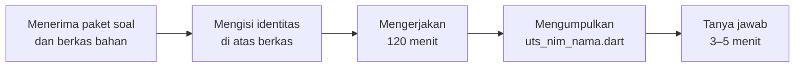

# Pertemuan 8 — Ujian Tengah Semester (UTS)

> 📝 **Panduan ujian** · ⏱️ 120 menit ujian praktik · 🎯 Menguji Pertemuan 1–7
>
> **Bentuk ujian:** ujian praktik individu. Anda membangun **satu aplikasi Flutter multi-halaman** sesuai spesifikasi, lalu menjawab beberapa pertanyaan singkat tentang kode Anda sendiri.
> **Cara bersiap paling ampuh:** kerjakan [🎯 Simulasi UTS](SIMULASI_UTS.md) dalam 120 menit seolah-olah sedang ujian, lalu kerjakan [✍️ Latihan Persiapan](LATIHAN.md).

[🏠 Beranda](../README.md) · [📋 Silabus](../SILABUS.md) · [🎯 Simulasi UTS](SIMULASI_UTS.md) · [✍️ Latihan Persiapan](LATIHAN.md) · [💻 Bahan Simulasi](kode/) · [📊 Unduh Slide](https://raw.githubusercontent.com/antonprafanto/mobile2026/main/pertemuan_08_uts/slide/PERTEMUAN_08_Persiapan_UTS.pptx)

---

## Daftar Isi

1. [Gambaran Ujian](#1-gambaran-ujian)
2. [Materi yang Diujikan (Kisi-kisi)](#2-materi-yang-diujikan-kisi-kisi)
3. [Bentuk Soal: Satu Aplikasi, Sembilan Ketentuan](#3-bentuk-soal-satu-aplikasi-sembilan-ketentuan)
4. [Tata Tertib](#4-tata-tertib)
5. [Persiapan Teknis](#5-persiapan-teknis)
6. [Jalannya Ujian](#6-jalannya-ujian)
7. [Strategi Mengerjakan dalam 120 Menit](#7-strategi-mengerjakan-dalam-120-menit)
8. [Rubrik Penilaian](#8-rubrik-penilaian)
9. [Tanya Jawab Pemahaman](#9-tanya-jawab-pemahaman)
10. [Cara Mengumpulkan](#10-cara-mengumpulkan)
11. [Daftar Periksa Sebelum Mengumpulkan](#11-daftar-periksa-sebelum-mengumpulkan)
12. [Rencana Belajar Satu Minggu](#12-rencana-belajar-satu-minggu)
13. [Pertanyaan yang Sering Diajukan](#13-pertanyaan-yang-sering-diajukan)

---

## 1. Gambaran Ujian

| Hal | Keterangan |
| :--- | :--- |
| Bentuk | Ujian praktik **individu** |
| Durasi | **120 menit** mengerjakan, ditambah tanya jawab singkat (± 3–5 menit per mahasiswa) |
| Yang dibuat | Satu aplikasi Flutter utuh dalam **satu berkas `.dart`**: halaman daftar, halaman detail, dan halaman formulir |
| Bekal dari dosen | Lembar soal dan **berkas bahan awal** berisi `enum`, *class* model, 8 data awal, serta fungsi bantu. Anda tidak perlu mengetik ulang data |
| Sifat ujian | **Buku terbuka terbatas**: boleh membuka materi repositori ini dan berkas praktikum Anda sendiri. **Tanpa asisten AI dan tanpa bantuan orang lain** (rinciannya di [Bagian 4](#4-tata-tertib)) |
| Paket soal | Beberapa paket dengan tema berbeda tetapi **tingkat kesulitan dan rubrik yang sama**. Paket dibagikan oleh pengawas |
| Bobot | 25% dari nilai akhir (lihat [Silabus](../SILABUS.md#6-komponen-penilaian)) |
| Capaian yang diukur | Terutama **CPMK-2** (antarmuka responsif sesuai Material Design 3), ditambah pengelolaan *state* (CPMK-1) dan kerapian kode (CPMK-4) |

> [!NOTE]
> Ketentuan teknis (tempat pengumpulan, ruang ujian, boleh tidaknya memakai laptop sendiri) dapat disesuaikan dosen dan akan diumumkan sebelum ujian. Jika ada perbedaan, **pengumuman dosen yang berlaku**.

---

## 2. Materi yang Diujikan (Kisi-kisi)

Semua yang diujikan **sudah Anda praktikkan** di jobsheet Pertemuan 1–7. Tidak ada materi baru.

| Pertemuan | Kemampuan yang diuji | Dipakai di ketentuan |
| :---: | :--- | :---: |
| [1](../pertemuan_01_pengenalan_flutter/README.md) | Menjalankan aplikasi Flutter (DartPad atau Chrome), struktur `MaterialApp` dan `Scaffold` | semua |
| [2](../pertemuan_02_dasar_dart/README.md) | Tipe data, *null safety* (`?`, `??`, `!`), percabangan, `List` dan `Set`, fungsi | 3, 4, 5 |
| [3](../pertemuan_03_dart_lanjutan/README.md) | *Class* dan *constructor* bernama, `enum` berproperti, `async`/`await` | 4, 5 |
| [4](../pertemuan_04_widget_dan_layout/README.md) | `Row`, `Column`, `Expanded`, `Padding`, `ListTile`, `Card`, mengatasi *overflow* | 2, 6 |
| [5](../pertemuan_05_interaksi_dan_state/README.md) | `StatefulWidget` dan `setState`, `ChoiceChip`, `Switch`, `Slider`, formulir dan validasi, *dropdown*, `SnackBar`, mengangkat *state* | 1, 3, 5, 7, 8 |
| [6](../pertemuan_06_daftar_dan_navigasi/README.md) | *Class* model, `ListView.builder`, `SearchBar`, hasil sebagai nilai turunan, tampilan kosong, `Navigator.push`/`pop` dengan data dan hasil, `mounted` | 2, 3, 4, 5 |
| [7](../pertemuan_07_material3_dan_responsif/README.md) | `ColorScheme.fromSeed`, `theme`/`darkTheme`/`themeMode`, peran warna dan gaya huruf dari tema, `MediaQuery`, pola daftar–detail | 1, 6, 9 |

**Tidak diujikan:** `Stream`, `go_router`, `NavigationRail`, `ThemeExtension`, dan paket di luar Flutter. Boleh dipakai jika Anda mau, tetapi tidak menambah nilai.

---

## 3. Bentuk Soal: Satu Aplikasi, Sembilan Ketentuan

Setiap paket berisi **skenario** (misalnya aplikasi untuk sebuah unit di kampus), **bahan awal**, **sembilan ketentuan**, dan **sketsa tampilan**. Pola ketentuannya selalu sama seperti di [Simulasi UTS](SIMULASI_UTS.md):

| No | Ketentuan | Jenis | Inti kemampuan |
| :---: | :--- | :---: | :--- |
| 1 | Tema dari warna benih dan tombol mode gelap | Inti | `ColorScheme.fromSeed`, `darkTheme`, *state* di akar aplikasi |
| 2 | Halaman daftar | Inti | `ListView.builder`, widget baris berupa *class*, label status |
| 3 | Pencarian dan saringan kategori | Inti | `SearchBar`, `ChoiceChip`, hasil sebagai **nilai turunan**, tampilan kosong |
| 4 | Halaman detail dan perubahan status | Inti | `Navigator.push` + hasil `true`, `mounted`, `SnackBar` |
| 5 | Formulir tambah data | Inti | `Form`, *validator*, *dropdown*, mengirim objek baru ke halaman sebelumnya |
| 6 | Kualitas kode dan uji tampilan | Inti | terformat, tanpa peringatan, tanpa *overflow* di lebar 320 dan 360, terbaca di mode gelap |
| 7 | Ringkasan | Pengayaan | angka yang **dihitung** dari data dan *state* |
| 8 | Fitur khusus paket | Pengayaan | satu fitur kecil yang berbeda di setiap paket |
| 9 | Dua panel di layar lebar | Pengayaan | daftar dan detail berdampingan mulai lebar 840 |

> [!TIP]
> **Ketentuan inti** (1–6) bernilai 80 poin dan bisa diselesaikan dalam ± 90 menit oleh mahasiswa yang menyelesaikan jobsheet Pertemuan 5–7 sendiri. **Pengayaan** (7–9) bernilai 20 poin untuk sisa waktu. Kerjakan inti lebih dulu.

---

## 4. Tata Tertib

| ✅ Boleh | ❌ Tidak boleh |
| :--- | :--- |
| Membuka repositori materi ini: modul, kode contoh, jobsheet | Memakai asisten AI dalam bentuk apa pun (ChatGPT, Gemini, Claude, Copilot, fitur AI di editor atau *browser*, dan sejenisnya) |
| Membuka berkas praktikum dan tugas **milik Anda sendiri** | Bertanya, berdiskusi, atau bertukar berkas dengan orang lain, termasuk lewat pesan atau media sosial |
| Membuka dokumentasi resmi: [docs.flutter.dev](https://docs.flutter.dev), [api.flutter.dev](https://api.flutter.dev), [dart.dev](https://dart.dev) | Membuka situs tanya jawab atau forum, serta menyalin kode dari internet di luar daftar di sebelah kiri |
| Menyalin pola dari kode contoh lalu menyesuaikannya, **asalkan Anda memahami** setiap barisnya | Mengumpulkan kode yang tidak bisa Anda jelaskan |

> [!IMPORTANT]
> 1. Matikan fitur pelengkap kode berbasis AI di editor Anda **sebelum** ujian dimulai (misalnya GitHub Copilot di VS Code).
> 2. Kode yang sangat mirip antarmahasiswa diperiksa lebih lanjut. Pelanggaran tata tertib ditangani sesuai peraturan akademik kampus.

---

## 5. Persiapan Teknis

Lakukan **sehari sebelum ujian**, bukan saat ujian:

1. **Pilih satu cara menjalankan aplikasi** dan pastikan berjalan:
   - **Proyek Flutter di VS Code** dijalankan di Chrome (`flutter run -d chrome`). Siapkan proyek kosong khusus ujian, misalnya `uts_ppb`, lalu jalankan sekali.
   - **DartPad** (<https://dartpad.dev>) jika laboratorium tidak memiliki Flutter. Butuh internet. Biasakan menyalin kode ke berkas di komputer secara berkala.
2. Jalankan `flutter doctor` dan pastikan baris **Chrome** bertanda ✓ (jika memakai VS Code).
3. Coba [bahan simulasi](kode/bahan_simulasi_sewa_alat.dart): salin, jalankan, dan pastikan muncul tulisan **"Bahan siap: 8 alat"**.
4. Pastikan Anda bisa masuk ke tempat pengumpulan yang ditentukan dosen (misalnya LMS kampus).
5. Isi daya laptop dan bawa pengisi daya.

> [!TIP]
> Jika memakai VS Code, buka juga panel **Problems** (`Ctrl` + `Shift` + `M`). Selama ujian, panel ini harus kosong: tidak ada garis merah maupun kuning.

---

## 6. Jalannya Ujian

1. Pengawas membagikan **paket soal** dan **berkas bahan awal**.
2. Isi **identitas** di bagian atas berkas bahan: nama, NIM, paket, dan pernyataan mengerjakan sendiri.
3. Jalankan bahan sekali sampai muncul tulisan **"Bahan siap: 8 ..."**. Waktu mengerjakan dimulai.
4. Pengawas mengingatkan saat waktu tersisa **30 menit** dan **10 menit**.
5. Kumpulkan berkas sebelum waktu habis (lihat [Bagian 10](#10-cara-mengumpulkan)).
6. Tanya jawab dilakukan setelah mengumpulkan atau pada jadwal yang diumumkan dosen.

---

## 7. Strategi Mengerjakan dalam 120 Menit

| Menit | Kegiatan | Ketentuan |
| :---: | :--- | :---: |
| 0–10 | Baca **seluruh** soal, tandai kata penting, salin bahan, jalankan | — |
| 10–20 | Akar aplikasi, tema dari benih, `darkTheme`, tombol mode gelap | 1 |
| 20–50 | Halaman daftar, widget baris, pencarian, `ChoiceChip`, tampilan kosong | 2, 3 |
| 50–70 | Widget detail, halaman detail, perubahan status | 4 |
| 70–90 | Formulir tambah data | 5 |
| 90–110 | Pengayaan, mulai dari yang paling mudah bagi Anda | 7, 8, 9 |
| 110–120 | Format kode, hilangkan peringatan, uji lebar 320 dan mode gelap, kumpulkan | 6 |

**Tujuh kebiasaan yang menyelamatkan nilai:**

1. **Selalu jaga aplikasi tetap bisa dijalankan.** Tambahkan satu bagian, jalankan, baru lanjut. Aplikasi yang gagal dijalankan dinilai **maksimal 40**.
2. **Simpan salinan** setiap selesai satu ketentuan, misalnya `uts_v1.dart`, `uts_v2.dart`. Jika kode berikutnya kacau, Anda masih punya versi yang berjalan.
3. **Tulis *state* dulu, baru tampilannya.** Tentukan variabel apa yang berubah (kata kunci, kategori terpilih, `Set` id, mode gelap) dan di *class* mana ia disimpan.
4. **Hitung, jangan simpan.** Hasil pencarian, jumlah, dan total adalah **nilai turunan**: tulis sebagai *getter* atau hitung di `build`.
5. **Pakai ulang pola yang sudah Anda kuasai.** Studi kasus di [Pertemuan 6](../pertemuan_06_daftar_dan_navigasi/README.md) dan [Pertemuan 7](../pertemuan_07_material3_dan_responsif/README.md#16-studi-kasus-pustaka-kampus) memuat hampir semua pola yang dibutuhkan.
6. **Jangan terjebak.** Jika satu bagian macet lebih dari 10 menit, kerjakan ketentuan lain dulu.
7. **Sisakan 10 menit terakhir** untuk merapikan dan menguji, bukan untuk fitur baru.

---

## 8. Rubrik Penilaian

| No | Ketentuan | Bobot | Nilai penuh jika ... |
| :---: | :--- | :---: | :--- |
| 1 | Tema dan mode gelap | 10 | `theme` dan `darkTheme` dibuat dari benih yang **sama** (gelap memakai `Brightness.dark`); tombol di `AppBar` berganti mode; pilihan disimpan di akar aplikasi; di halaman **tidak ada** `Colors.xxx` maupun `fontSize` |
| 2 | Halaman daftar | 15 | `ListView.builder`; satu baris = satu *class* widget; isi baris sesuai soal; label status memakai pasangan peran warna **dan** tulisan |
| 3 | Pencarian dan saringan | 15 | pencarian tidak membedakan huruf besar/kecil; `ChoiceChip` "Semua" + satu per kategori; pencarian dan saringan bisa digabung; hasil adalah nilai turunan; ada tampilan kosong |
| 4 | Detail dan perubahan status | 15 | detail dibuka dengan `Navigator.push` membawa objek; tombol mengubah status lewat hasil `true`; ada `if (!mounted) return;` setelah `await`; tombol kembali tidak mengubah apa pun; `SnackBar` memberi kabar |
| 5 | Formulir tambah data | 15 | `Form` + `GlobalKey`; setiap *validator* sesuai soal; *dropdown* kategori; *controller* dibuang di `dispose`; data baru muncul di daftar dan `SnackBar` tampil |
| 6 | Kualitas kode dan uji tampilan | 10 | terformat; `const` di tempat yang memungkinkan; tanpa peringatan *analyzer*; tanpa garis kuning-hitam di lebar 320 dan 360; semua teks terbaca di mode gelap; nama variabel bermakna |
| 7 | Ringkasan *(pengayaan)* | 5 | angka ringkasan sesuai soal, dihitung dari data, dan langsung berubah saat status berubah atau data bertambah |
| 8 | Fitur khusus paket *(pengayaan)* | 5 | fitur bekerja sesuai soal dan bisa digabung dengan pencarian/saringan |
| 9 | Dua panel *(pengayaan)* | 10 | mulai lebar 840 daftar dan detail tampil berdampingan; mengetuk baris hanya mengganti detail; widget detail yang **sama** dipakai di halaman detail dan panel; di bawah 840 tetap membuka halaman detail |
| | **Total** | **100** | |

> [!IMPORTANT]
> Nilai diberikan **per ketentuan**: ketentuan yang baru sebagian berjalan tetap mendapat sebagian nilai. Namun, aplikasi yang **gagal dijalankan** (ada *error* merah) hanya dinilai dari kodenya, dengan nilai maksimal **40**.

---

## 9. Tanya Jawab Pemahaman

Setelah mengumpulkan, dosen atau asisten akan menunjuk 2–3 bagian kode **Anda sendiri** dan meminta Anda menjelaskannya. Contoh pertanyaan:

- "Variabel apa saja yang menjadi *state* di halaman ini? Mengapa hasil pencarian tidak disimpan sebagai *state*?"
- "Apa yang terjadi jika baris `if (!mounted) return;` ini dihapus?"
- "Mengapa di sini ditulis `ubah == true`, bukan `if (ubah)`?"
- "Coba ubah warna benih menjadi oranye. Bagian mana saja yang ikut berubah?"
- "Mengapa daftar ini dibungkus `Expanded`?"

> [!WARNING]
> Bagian kode yang **sama sekali tidak bisa Anda jelaskan** tidak diberi nilai. Inilah alasan Anda boleh menyalin pola dari modul: yang dinilai adalah **pemahaman**, bukan hafalan. Bagian [B di Latihan Persiapan](LATIHAN.md#b-jelaskan-kode-ini) melatih Anda menjawab pertanyaan seperti ini.

---

## 10. Cara Mengumpulkan

1. Pastikan identitas di bagian atas berkas sudah terisi.
2. Simpan kode Anda sebagai **`uts_nim_namapanggilan.dart`**, huruf kecil semua, misalnya `uts_2609106001_rina.dart`.
   - **VS Code:** salin isi `lib/main.dart` ke berkas baru dengan nama tersebut.
   - **DartPad:** salin seluruh kode, tempel ke berkas teks baru, lalu simpan dengan nama tersebut.
3. Unggah ke tempat yang ditentukan dosen **sebelum waktu habis**.
4. Buka kembali berkas yang sudah diunggah dan pastikan isinya lengkap (bukan berkas kosong atau versi lama).

> [!CAUTION]
> Hanya **satu berkas** yang dinilai. Jangan mengumpulkan proyek dalam bentuk ZIP atau *screenshot* saja. Berkas harus bisa dijalankan dengan menempelkannya ke `lib/main.dart` tanpa perubahan apa pun.

---

## 11. Daftar Periksa Sebelum Mengumpulkan

- [ ] Identitas (nama, NIM, paket, pernyataan) terisi.
- [ ] Aplikasi berjalan tanpa layar merah, dari awal sampai akhir.
- [ ] Kode sudah diformat (DartPad: tombol **Format**; VS Code: `Shift` + `Alt` + `F`).
- [ ] Tidak ada garis merah maupun kuning di editor.
- [ ] Di lebar **320** dan **360**: tidak ada garis kuning-hitam di halaman daftar, detail, dan formulir.
- [ ] Mode gelap: semua teks terbaca, tidak ada kotak putih mencolok.
- [ ] Pencarian + saringan kategori dicoba bersamaan; tampilan kosong muncul jika tidak ada yang cocok.
- [ ] Buka detail lalu tekan tombol **kembali**: status tidak berubah.
- [ ] Formulir: tombol simpan dengan isian kosong menampilkan pesan *error*; data yang benar muncul di daftar.
- [ ] Nama berkas sesuai format.

---

## 12. Rencana Belajar Satu Minggu

| Hari | Kegiatan | Bahan |
| :---: | :--- | :--- |
| 1 | Ulangi *state*, formulir, dan validasi. Tulis ulang Praktikum Pertemuan 5 **tanpa** melihat jobsheet | [Jobsheet P5](../pertemuan_05_interaksi_dan_state/JOBSHEET.md) |
| 2 | Ulangi daftar, pencarian, dan navigasi dengan hasil. Bandingkan dengan studi kasus | [Modul P6 Bagian 8–11 dan 14](../pertemuan_06_daftar_dan_navigasi/README.md#8-mencari-dan-menyaring-daftar) |
| 3 | Ulangi tema, mode gelap, dan pola daftar–detail | [Modul P7 Bagian 7, 13, dan 16](../pertemuan_07_material3_dan_responsif/README.md) |
| 4 | **Kerjakan simulasi dalam 120 menit**, dengan pengatur waktu, tanpa AI | [Simulasi UTS](SIMULASI_UTS.md) |
| 5 | Nilai hasil simulasi Anda sendiri memakai rubrik, lalu perbaiki bagian yang kurang | [Bagian 8](#8-rubrik-penilaian) |
| 6 | Kerjakan latihan persiapan, terutama bagian B (menjelaskan kode) | [Latihan Persiapan](LATIHAN.md) |
| 7 | Persiapan teknis dan istirahat | [Bagian 5](#5-persiapan-teknis) |

---

## 13. Pertanyaan yang Sering Diajukan

<b>Apakah tampilan harus sama persis dengan sketsa di soal?</b>

Tidak. Sketsa hanya gambaran. Susunan, ikon, dan teks pelengkap boleh berbeda selama semua ketentuan terpenuhi.

<b>Bolehkah memakai <code>go_router</code> atau paket lain?</b>

Gunakan hanya `package:flutter/material.dart`. Berkas Anda akan dijalankan dengan menempelkannya ke proyek Flutter kosong, sehingga paket tambahan bisa membuatnya gagal dijalankan. `Navigator` sudah cukup untuk semua ketentuan.

<b>Bolehkah mengubah bahan awal?</b>

Jangan mengubah isi data dan nama-nama di bagian **BAHAN AWAL**, karena pemeriksa memakai data itu untuk menguji. Hapus saja `main()` dan *class* `HalamanMulai` yang hanya dipakai untuk memeriksa bahan, lalu tulis aplikasi Anda.

<b>Bagaimana jika laptop mati atau DartPad tiba-tiba tertutup?</b>

Segera lapor ke pengawas. Inilah alasan Anda menyimpan salinan setiap selesai satu ketentuan ([Bagian 7](#7-strategi-mengerjakan-dalam-120-menit), kebiasaan 2).

<b>Saya tidak sempat mengerjakan pengayaan. Berapa nilai maksimal saya?</b>

Ketentuan inti (1–6) bernilai 80. Pengayaan adalah kesempatan menambah nilai, bukan syarat lulus.

<b>Apakah simulasi UTS dinilai?</b>

Tidak, kecuali dosen mengumumkan lain. Simulasi adalah alat ukur diri: kerjakan dengan jujur dan berbatas waktu agar Anda tahu bagian mana yang perlu diulang.

---

[🎯 Lanjut ke Simulasi UTS](SIMULASI_UTS.md) · [✍️ Latihan Persiapan](LATIHAN.md) · [🏠 Beranda](../README.md)
