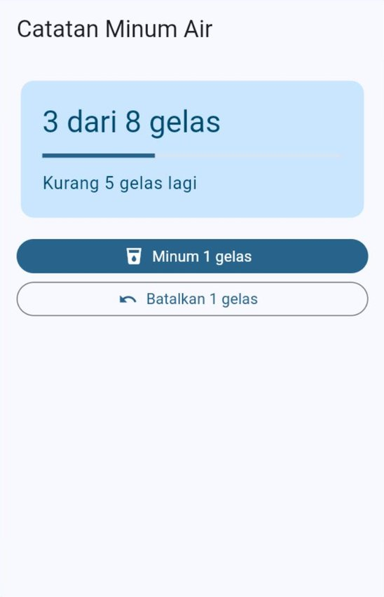
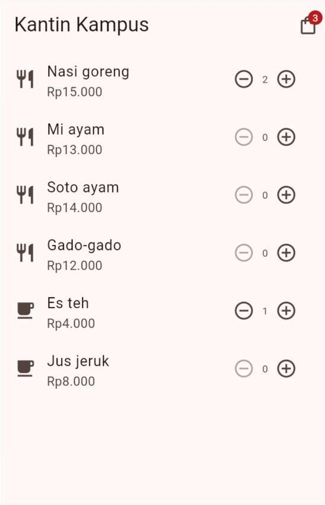
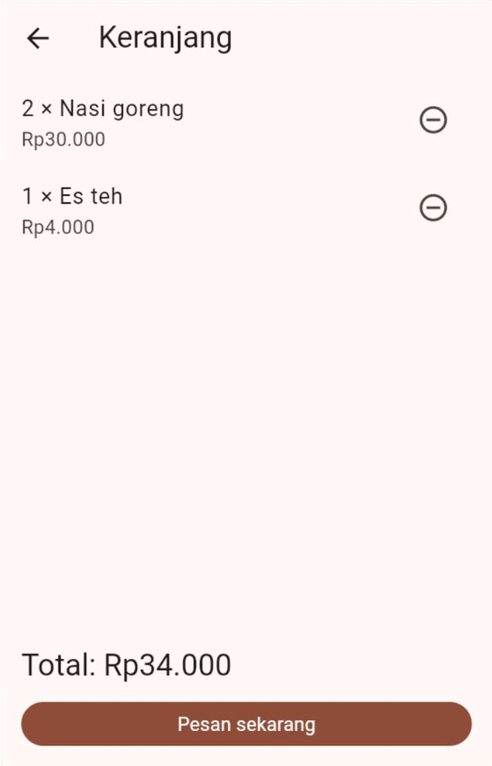
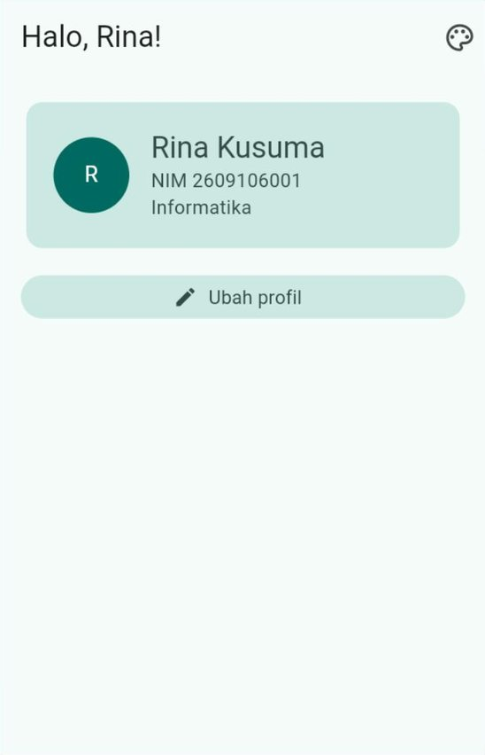
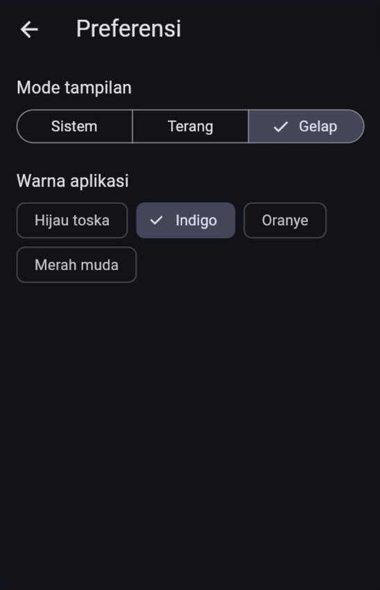
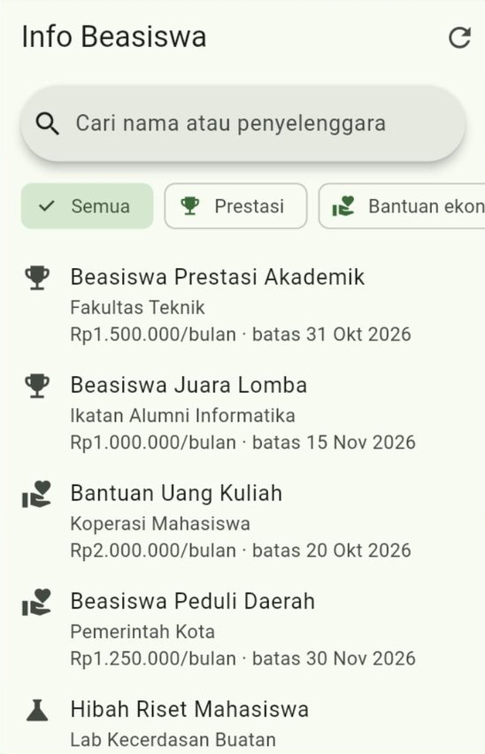
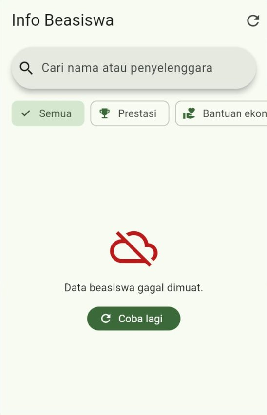
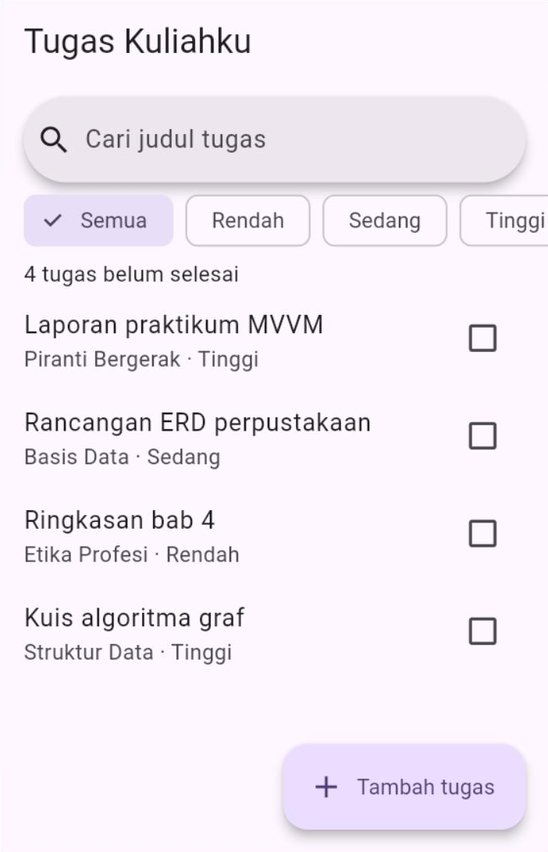

# 🧪 Jobsheet Pertemuan 9 — Manajemen State & Pola MVVM

[🏠 Beranda](../README.md) · [📖 Modul](README.md) · [✍️ Latihan](LATIHAN.md) · [💻 Kode Contoh](kode/)

| Informasi | Keterangan |
| :--- | :--- |
| Mata kuliah | Pemrograman Piranti Bergerak |
| Pertemuan | 9 — Manajemen State & Pola MVVM |
| Bentuk kegiatan | Praktikum individu |
| Estimasi waktu | 150 menit |
| Alat | Praktikum 1–4: DartPad **atau** proyek Flutter di VS Code yang dijalankan di Chrome. Praktikum 5: **wajib** proyek Flutter di VS Code, karena terdiri dari banyak berkas |
| Paket | `provider` untuk Praktikum 2–5. DartPad sudah menyediakannya; di proyek Flutter, jalankan `flutter pub add provider` sekali |
| Hasil akhir | Proyek "Tugas Kuliahku" yang tertata dengan pola MVVM dalam beberapa folder, ditambah empat aplikasi kecil yang memakai `ChangeNotifier` dan `provider` |

---

## 🎯 Tujuan Praktikum

Setelah menyelesaikan jobsheet ini, Anda mampu:

1. Membuat *class* `ChangeNotifier` dengan data privat, *getter*, dan metode pengubah yang memanggil `notifyListeners()`, lalu mendengarkannya dengan `ListenableBuilder` dan `ValueListenableBuilder`.
2. Berbagi *state* aplikasi ke banyak halaman dengan `ChangeNotifierProvider` dan `MultiProvider`.
3. Memilih `watch`, `select`, atau `read` dengan tepat, dan membuktikan akibat pilihan itu.
4. Menyusun halaman dengan pola MVVM: Model, *repository* palsu, ViewModel dengan status memuat–berhasil–gagal, dan View yang hanya menampilkan.
5. Memeriksa ViewModel tanpa layar, serta menata proyek MVVM ke dalam folder `domain`, `data`, dan `ui`.

## 📌 Petunjuk Umum

> [!IMPORTANT]
> 1. Setiap praktikum diawali **kode terbimbing**. **Ketik sendiri** kodenya, kecuali bagian yang ditandai *boleh disalin*.
> 2. Kerjakan **🔧 Modifikasi** di setiap praktikum. Jawaban berupa penjelasan ditulis sebagai **komentar** di dalam kode.
> 3. Simpan Praktikum 1–4 sebagai berkas terpisah berisi kode **lengkap**: `praktikum1.dart` sampai `praktikum4.dart`. Praktikum 5 berupa folder `lib/` dari proyek `tugas_kuliahku`.
> 4. Rapikan kode sebelum menyimpan: tombol **Format** di DartPad, atau `Shift` + `Alt` + `F` di VS Code. Pastikan tidak ada garis merah maupun kuning.
> 5. **Aturan hari ini:** widget **tidak boleh** mengubah data aplikasi secara langsung. Widget hanya **membaca** lewat *getter* dan **memanggil** metode. Setiap metode yang mengubah data diakhiri `notifyListeners()`.
> 6. Banyak modifikasi berupa **eksperimen**: Anda sengaja membuat kesalahan untuk melihat akibatnya. Setelah akibatnya dicatat sebagai komentar, **kembalikan** kodenya seperti semula, kecuali diminta lain.

> [!TIP]
> **Di mana melihat isi konsol?** Beberapa eksperimen memakai `debugPrint` dan pesan *error* di konsol.
> - **DartPad:** panel **Console** di bawah panel aplikasi.
> - **VS Code:** tab **Debug Console** saat aplikasi dijalankan dengan **F5**.
> - **Terminal:** keluaran perintah `flutter run -d chrome`.

<details>
<summary>❓ Lupa cara menjalankan aplikasi Flutter?</summary>

- **DartPad:** buka <https://dartpad.dev>, hapus kode bawaannya, tempelkan kode Anda, lalu klik **Run**. Paket `provider` sudah tersedia, jadi baris `import 'package:provider/provider.dart';` langsung bisa dipakai.
- **Proyek Flutter:** buka proyek latihan dari Pertemuan 1 di VS Code. Jalankan `flutter pub add provider` **sekali** di terminal folder proyek, lalu ganti seluruh isi `lib/main.dart` dengan kode Anda dan jalankan dengan **F5** (atau `flutter run -d chrome`). Jika Anda mengubah isi `main()` atau nilai awal sebuah objek lalu tampilannya tidak berubah, lakukan *hot restart* dengan menekan `R`.

Penjelasan lengkap ada di [Modul Pertemuan 1, Bagian 9](../pertemuan_01_pengenalan_flutter/README.md#9-menjalankan-aplikasi).
</details>

---

## Praktikum 1 — Catatan Minum Air

**Konsep:** `ChangeNotifier`, `ListenableBuilder`, dan `ValueNotifier`. ([Modul Bagian 3](README.md#3-changenotifier-objek-yang-mengumumkan-perubahan), [Bagian 4](README.md#4-listenablebuilder-mendengarkan-tanpa-paket-tambahan), dan [Bagian 5](README.md#5-valuenotifier-untuk-satu-nilai))

Anda membuat pencatat minum air dengan target 8 gelas per hari. Datanya disimpan di sebuah objek `ChangeNotifier`, dan halamannya **tidak memanggil `setState` sama sekali**.

### Langkah 1 — Objek yang mengumumkan perubahan (ketik sendiri)

```dart
import 'package:flutter/material.dart';

void main() {
  runApp(const AplikasiMinum());
}

// ---------- Objek yang menyimpan data dan mengumumkan perubahan ----------
class CatatanMinum extends ChangeNotifier {
  final int target = 8; // target gelas per hari
  int _gelas = 0; // privat: hanya bisa diubah lewat metode di bawah

  int get gelas => _gelas;
  bool get tercapai => _gelas >= target;
  int get sisa => tercapai ? 0 : target - _gelas;
  double get kemajuan => tercapai ? 1 : _gelas / target;

  void minum() {
    _gelas++;
    notifyListeners();
  }

  void batal() {
    if (_gelas == 0) {
      return; // tidak ada yang bisa dibatalkan
    }
    _gelas--;
    notifyListeners();
  }
}
```

Perhatikan bahwa `tercapai`, `sisa`, dan `kemajuan` tidak disimpan, melainkan **dihitung** dari `_gelas`. Ketiganya selalu benar tanpa perlu diperbarui satu per satu.

### Langkah 2 — Aplikasi, halaman, dan kartu kemajuan (ketik sendiri)

```dart
// ---------- Aplikasi ----------
class AplikasiMinum extends StatelessWidget {
  const AplikasiMinum({super.key});

  @override
  Widget build(BuildContext context) {
    return MaterialApp(
      debugShowCheckedModeBanner: false,
      title: 'Catatan Minum',
      theme: ThemeData(
        colorScheme: ColorScheme.fromSeed(seedColor: Colors.lightBlue),
      ),
      home: const HalamanMinum(),
    );
  }
}

class HalamanMinum extends StatefulWidget {
  const HalamanMinum({super.key});

  @override
  State<HalamanMinum> createState() => _HalamanMinumState();
}

class _HalamanMinumState extends State<HalamanMinum> {
  // Dibuat sekali bersama State, dibuang di dispose.
  final CatatanMinum _catatan = CatatanMinum();

  @override
  void dispose() {
    _catatan.dispose();
    super.dispose();
  }

  // Tidak ada setState di halaman ini.
  @override
  Widget build(BuildContext context) {
    return Scaffold(
      appBar: AppBar(title: const Text('Catatan Minum Air')),
      body: ListView(
        padding: const EdgeInsets.all(16),
        children: [
          KartuKemajuan(catatan: _catatan),
          const SizedBox(height: 16),
          // Tombol ini hanya MEMANGGIL metode, jadi tidak perlu mendengarkan.
          FilledButton.icon(
            onPressed: _catatan.minum,
            icon: const Icon(Icons.local_drink),
            label: const Text('Minum 1 gelas'),
          ),
          const SizedBox(height: 8),
          // Tombol ini perlu mendengarkan, karena aktif atau tidaknya
          // bergantung pada jumlah gelas.
          ListenableBuilder(
            listenable: _catatan,
            builder: (BuildContext context, Widget? child) {
              return OutlinedButton.icon(
                onPressed: _catatan.gelas > 0 ? _catatan.batal : null,
                icon: const Icon(Icons.undo),
                label: const Text('Batalkan 1 gelas'),
              );
            },
          ),
        ],
      ),
    );
  }
}

class KartuKemajuan extends StatelessWidget {
  const KartuKemajuan({super.key, required this.catatan});

  final CatatanMinum catatan;

  @override
  Widget build(BuildContext context) {
    final ColorScheme warna = Theme.of(context).colorScheme;
    final TextTheme gayaTeks = Theme.of(context).textTheme;

    return ListenableBuilder(
      listenable: catatan,
      builder: (BuildContext context, Widget? child) {
        return Card.filled(
          color: warna.primaryContainer,
          child: Padding(
            padding: const EdgeInsets.all(20),
            child: Column(
              crossAxisAlignment: CrossAxisAlignment.start,
              children: [
                Text(
                  '${catatan.gelas} dari ${catatan.target} gelas',
                  style: gayaTeks.headlineMedium?.copyWith(
                    color: warna.onPrimaryContainer,
                  ),
                ),
                const SizedBox(height: 12),
                LinearProgressIndicator(value: catatan.kemajuan),
                const SizedBox(height: 12),
                Text(
                  catatan.tercapai
                      ? 'Target hari ini tercapai!'
                      : 'Kurang ${catatan.sisa} gelas lagi',
                  style: gayaTeks.bodyLarge?.copyWith(
                    color: warna.onPrimaryContainer,
                  ),
                ),
              ],
            ),
          ),
        );
      },
    );
  }
}
```

Jalankan, lalu tekan **Minum 1 gelas** tiga kali.

✅ **Hasil yang diharapkan** (lebar 360, setelah tiga kali minum):

<p align="center"></p>

🔧 **Modifikasi:**

1. **Eksperimen — lupa mengumumkan.** Hapus baris `notifyListeners();` di dalam `minum()`. Jalankan ulang, tekan **Minum 1 gelas** tiga kali, lalu coba tekan **Batalkan 1 gelas**. Jawab sebagai komentar: apa yang tampil di kartu, dan mengapa tombol batal tetap tidak bisa ditekan, padahal `_gelas` sebenarnya sudah bernilai 3? Kembalikan barisnya.
2. **Target bisa diubah.** Ubah `target` menjadi data privat `_target` (nilai awal 8) dengan *getter* `target` dan metode `ubahTarget(int target)` yang memanggil `notifyListeners()`. Di bawah kartu, tambahkan `SegmentedButton<int>` berisi pilihan **6**, **8**, dan **10** gelas, dibungkus `ListenableBuilder` agar pilihannya ikut berubah. Pastikan tulisan "Kurang ... gelas lagi" langsung menyesuaikan saat target diganti.
3. **`ValueNotifier` untuk ukuran gelas.** Di `_HalamanMinumState`, tambahkan `final ValueNotifier<int> _ukuranGelas = ValueNotifier<int>(250);` dan buang di `dispose`. Tampilkan tiga `ChoiceChip` (**200 ml**, **250 ml**, **300 ml**) di dalam `ValueListenableBuilder<int>`; mengetuk sebuah *chip* mengganti `_ukuranGelas.value`.
4. **Mendengarkan dua objek sekaligus.** Di bawah tombol, tampilkan teks **"Total hari ini: 750 ml"** (jumlah gelas × ukuran gelas). Karena teks ini bergantung pada **dua** objek, bungkus dengan `ListenableBuilder(listenable: Listenable.merge([_catatan, _ukuranGelas]), ...)`. Jawab sebagai komentar: apa yang salah jika teks itu hanya mendengarkan `_catatan`?
5. **Tantangan — riwayat jam minum.** Ganti `int _gelas` dengan `final List<DateTime> _waktu = [];`. `gelas` menjadi nilai turunan `_waktu.length`, `minum()` menambahkan `DateTime.now()`, dan `batal()` membuang waktu **terakhir**. Buka *getter* `waktu` bertipe `UnmodifiableListView<DateTime>` (dari `dart:collection`). Di bawah kartu, tampilkan daftar seperti **"Gelas 1 · 08.15"** dengan jam dan menit dua digit (`padLeft(2, '0')`). Pastikan daftar ikut berkurang saat tombol batal ditekan.

---

## Praktikum 2 — Kantin Kampus

**Konsep:** `ChangeNotifierProvider`, `context.watch`, `context.read`, `context.select`, dan `Consumer`. ([Modul Bagian 6](README.md#6-paket-provider-menitipkan-objek-di-pohon-widget) dan [Bagian 7](README.md#7-watch-read-select-dan-consumer))

Anda membuat aplikasi pesan makanan di kantin. Keranjangnya dititipkan di atas `MaterialApp`, sehingga halaman menu dan halaman keranjang memakai objek yang **sama**.

### Langkah 1 — Data menu (boleh disalin)

```dart
import 'package:flutter/material.dart';
import 'package:provider/provider.dart';

void main() {
  runApp(
    // Keranjang dititipkan di atas MaterialApp agar bisa dipakai semua halaman.
    ChangeNotifierProvider(
      create: (BuildContext context) => KeranjangKantin(),
      child: const AplikasiKantin(),
    ),
  );
}

// ---------- Langkah 1: data menu ----------
class Menu {
  const Menu({
    required this.id,
    required this.nama,
    required this.harga,
    required this.minuman,
  });

  final int id;
  final String nama;
  final int harga;
  final bool minuman;
}

const List<Menu> daftarMenu = [
  Menu(id: 1, nama: 'Nasi goreng', harga: 15000, minuman: false),
  Menu(id: 2, nama: 'Mi ayam', harga: 13000, minuman: false),
  Menu(id: 3, nama: 'Soto ayam', harga: 14000, minuman: false),
  Menu(id: 4, nama: 'Gado-gado', harga: 12000, minuman: false),
  Menu(id: 5, nama: 'Es teh', harga: 4000, minuman: true),
  Menu(id: 6, nama: 'Jus jeruk', harga: 8000, minuman: true),
];

String formatRupiah(int angka) {
  final String digit = angka.toString();
  String hasil = '';
  for (int i = 0; i < digit.length; i++) {
    final int sisaDiKanan = digit.length - i;
    if (i > 0 && sisaDiKanan % 3 == 0) {
      hasil += '.';
    }
    hasil += digit[i];
  }
  return 'Rp$hasil';
}
```

Garis merah pada `KeranjangKantin` dan `AplikasiKantin` akan hilang setelah Langkah 2 dan 3 selesai.

### Langkah 2 — Keranjang (ketik sendiri)

```dart
// ---------- Langkah 2: keranjang ----------
class KeranjangKantin extends ChangeNotifier {
  final Map<int, int> _porsi = {}; // id menu -> jumlah porsi

  int porsiDari(Menu menu) => _porsi[menu.id] ?? 0;

  int get totalPorsi {
    int total = 0;
    for (final int porsi in _porsi.values) {
      total += porsi;
    }
    return total;
  }

  int get totalHarga {
    int total = 0;
    for (final Menu menu in daftarMenu) {
      total += porsiDari(menu) * menu.harga;
    }
    return total;
  }

  // Menu yang sudah dipesan, urut seperti daftar menu.
  List<Menu> get isi =>
      daftarMenu.where((Menu menu) => porsiDari(menu) > 0).toList();

  void tambah(Menu menu) {
    _porsi[menu.id] = porsiDari(menu) + 1;
    notifyListeners();
  }

  void kurangi(Menu menu) {
    final int porsi = porsiDari(menu);
    if (porsi == 0) {
      return; // belum dipesan: tidak ada yang berubah
    }
    if (porsi == 1) {
      _porsi.remove(menu.id);
    } else {
      _porsi[menu.id] = porsi - 1;
    }
    notifyListeners();
  }

  void kosongkan() {
    _porsi.clear();
    notifyListeners();
  }
}
```

Jumlah porsi disimpan di `Map` dengan kunci `id` menu. `totalPorsi`, `totalHarga`, dan `isi` semuanya **nilai turunan**.

### Langkah 3 — Aplikasi dan halaman menu (ketik sendiri)

```dart
// ---------- Langkah 3: aplikasi dan halaman menu ----------
class AplikasiKantin extends StatelessWidget {
  const AplikasiKantin({super.key});

  @override
  Widget build(BuildContext context) {
    return MaterialApp(
      debugShowCheckedModeBanner: false,
      title: 'Kantin Kampus',
      theme: ThemeData(
        colorScheme: ColorScheme.fromSeed(seedColor: Colors.deepOrange),
      ),
      home: const HalamanMenu(),
    );
  }
}

// Halaman ini sendiri tidak mendengarkan keranjang. Yang mendengarkan hanya
// TombolKeranjang dan PengaturPorsi.
class HalamanMenu extends StatelessWidget {
  const HalamanMenu({super.key});

  @override
  Widget build(BuildContext context) {
    return Scaffold(
      appBar: AppBar(
        title: const Text('Kantin Kampus'),
        actions: const [TombolKeranjang()],
      ),
      body: ListView.builder(
        itemCount: daftarMenu.length,
        itemBuilder: (BuildContext context, int index) {
          final Menu menu = daftarMenu[index];
          return ListTile(
            leading: Icon(menu.minuman ? Icons.local_cafe : Icons.restaurant),
            title: Text(menu.nama),
            subtitle: Text(formatRupiah(menu.harga)),
            trailing: PengaturPorsi(menu: menu),
          );
        },
      ),
    );
  }
}

class TombolKeranjang extends StatelessWidget {
  const TombolKeranjang({super.key});

  @override
  Widget build(BuildContext context) {
    // select: hanya peduli jumlah porsi, bukan seluruh isi keranjang.
    final int totalPorsi = context.select(
      (KeranjangKantin keranjang) => keranjang.totalPorsi,
    );

    return IconButton(
      onPressed: () {
        Navigator.push(
          context,
          MaterialPageRoute<void>(
            builder: (BuildContext context) => const HalamanKeranjang(),
          ),
        );
      },
      tooltip: 'Keranjang',
      icon: Badge.count(
        count: totalPorsi,
        isLabelVisible: totalPorsi > 0,
        child: const Icon(Icons.shopping_bag_outlined),
      ),
    );
  }
}

class PengaturPorsi extends StatelessWidget {
  const PengaturPorsi({super.key, required this.menu});

  final Menu menu;

  @override
  Widget build(BuildContext context) {
    // select: dibangun ulang HANYA jika porsi menu ini berubah.
    final int porsi = context.select(
      (KeranjangKantin keranjang) => keranjang.porsiDari(menu),
    );

    return Row(
      mainAxisSize: MainAxisSize.min,
      children: [
        IconButton(
          // read: tombol hanya memanggil metode.
          onPressed: porsi > 0
              ? () => context.read<KeranjangKantin>().kurangi(menu)
              : null,
          tooltip: 'Kurangi',
          icon: const Icon(Icons.remove_circle_outline),
        ),
        Text('$porsi'),
        IconButton(
          onPressed: () => context.read<KeranjangKantin>().tambah(menu),
          tooltip: 'Tambah',
          icon: const Icon(Icons.add_circle_outline),
        ),
      ],
    );
  }
}
```

Perhatikan bahwa `HalamanMenu` sendiri **tidak mendengarkan** keranjang. Yang mendengarkan hanya dua widget kecil, dan keduanya memakai `select`:

| Widget | Memilih | Dibangun ulang saat |
| :--- | :--- | :--- |
| `TombolKeranjang` | `totalPorsi` | Jumlah porsi seluruh keranjang berubah |
| `PengaturPorsi` | `porsiDari(menu)` | Porsi menu **di baris itu** berubah |

### Langkah 4 — Halaman keranjang (ketik sendiri)

```dart
// ---------- Langkah 4: halaman keranjang ----------
class HalamanKeranjang extends StatelessWidget {
  const HalamanKeranjang({super.key});

  void _pesan(BuildContext context) {
    final KeranjangKantin keranjang = context.read<KeranjangKantin>();
    final String pesan =
        'Pesanan ${keranjang.totalPorsi} porsi '
        '(${formatRupiah(keranjang.totalHarga)}) dikirim ke dapur.';
    keranjang.kosongkan();
    ScaffoldMessenger.of(context).showSnackBar(SnackBar(content: Text(pesan)));
  }

  @override
  Widget build(BuildContext context) {
    // watch: halaman ini menampilkan isi keranjang, jadi harus mendengarkan.
    final KeranjangKantin keranjang = context.watch<KeranjangKantin>();
    final List<Menu> isi = keranjang.isi;
    final TextTheme gayaTeks = Theme.of(context).textTheme;

    return Scaffold(
      appBar: AppBar(title: const Text('Keranjang')),
      body: isi.isEmpty
          ? const Center(child: Text('Keranjang masih kosong.'))
          : ListView.builder(
              itemCount: isi.length,
              itemBuilder: (BuildContext context, int index) {
                final Menu menu = isi[index];
                final int porsi = keranjang.porsiDari(menu);
                return ListTile(
                  title: Text('$porsi × ${menu.nama}'),
                  subtitle: Text(formatRupiah(porsi * menu.harga)),
                  trailing: IconButton(
                    onPressed: () =>
                        context.read<KeranjangKantin>().kurangi(menu),
                    tooltip: 'Kurangi',
                    icon: const Icon(Icons.remove_circle_outline),
                  ),
                );
              },
            ),
      bottomNavigationBar: SafeArea(
        child: Padding(
          padding: const EdgeInsets.all(16),
          child: Column(
            mainAxisSize: MainAxisSize.min,
            crossAxisAlignment: CrossAxisAlignment.stretch,
            children: [
              Text(
                'Total: ${formatRupiah(keranjang.totalHarga)}',
                style: gayaTeks.titleLarge,
              ),
              const SizedBox(height: 12),
              FilledButton(
                onPressed: isi.isEmpty ? null : () => _pesan(context),
                child: const Text('Pesan sekarang'),
              ),
            ],
          ),
        ),
      ),
    );
  }
}
```

Jalankan. Tambahkan **2** nasi goreng dan **1** es teh, lalu buka keranjang.

✅ **Hasil yang diharapkan** (lebar 360):

<p align="center">
  
  &nbsp;
  
</p>

🔧 **Modifikasi:**

1. **Eksperimen — `read` di dalam `build`.** Di `HalamanKeranjang`, ganti `context.watch<KeranjangKantin>()` menjadi `context.read<KeranjangKantin>()`. Isi keranjang dengan dua menu, buka keranjang, lalu tekan tombol kurangi pada salah satu baris beberapa kali. Jawab sebagai komentar: apa yang terjadi di layar? Kapan tampilannya akhirnya benar? Kembalikan ke `watch`.
2. **Eksperimen — `watch` di dalam *callback*.** Di `PengaturPorsi`, ganti `context.read` pada tombol **tambah** menjadi `context.watch`, lalu tekan tombol itu. Salin **baris pertama** pesan *error* di konsol sebagai komentar, jelaskan artinya dengan kata-kata Anda sendiri, lalu kembalikan.
3. **Eksperimen — `select` dibandingkan `watch`.** Tambahkan `debugPrint('Baris ${menu.nama} dibangun');` sebagai baris pertama `build` milik `PengaturPorsi`. Kosongkan konsol, tekan tambah pada **Nasi goreng** dua kali, lalu catat baris yang muncul. Setelah itu ganti `context.select(...)` di `PengaturPorsi` menjadi `context.watch<KeranjangKantin>().porsiDari(menu)` dan ulangi. Jawab sebagai komentar: berapa baris yang dibangun ulang pada **setiap** ketukan untuk masing-masing cara? Kembalikan ke `select`.
4. **Ringkasan dengan `Consumer`.** Tambahkan `bottomNavigationBar` pada `HalamanMenu` berisi bilah ringkasan, misalnya **"3 porsi · Rp34.000"**, atau **"Belum ada pesanan"** jika keranjang kosong. Gunakan `Consumer<KeranjangKantin>` agar **hanya** bilah itu yang mendengarkan. Buktikan dengan konsol dari Modifikasi 3 bahwa baris-baris menu tidak ikut dibangun ulang.
5. **Tantangan — aturan di objek *state*.** Kantin membatasi **10 porsi per pesanan**. Ubah `tambah` agar mengembalikan `bool`: `false` **tanpa mengubah apa pun** jika total porsi sudah 10, dan `true` jika berhasil. Di `PengaturPorsi`, jika hasilnya `false`, tampilkan `SnackBar` **"Maksimal 10 porsi per pesanan."** Jawab sebagai komentar: mengapa aturan 10 porsi ditulis di `KeranjangKantin`, sedangkan `SnackBar` ditulis di widget?

---

## Praktikum 3 — Profil dan Preferensi

**Konsep:** `MultiProvider`, `MaterialApp` yang ikut mendengarkan, *state* lokal dan *state* aplikasi dalam satu halaman, serta cakupan *provider*. ([Modul Bagian 8](README.md#8-multiprovider-dan-pengaturan-aplikasi) dan [Bagian 11.4](README.md#114-saat-provider-tidak-ditemukan))

Aplikasi ini punya dua *state* aplikasi: **preferensi tampilan** (mode dan warna) dan **profil mahasiswa**. Keduanya dititipkan sekaligus dengan `MultiProvider`.

### Langkah 1 — Dua *state* aplikasi (ketik sendiri)

```dart
import 'package:flutter/material.dart';
import 'package:provider/provider.dart';

void main() {
  runApp(
    MultiProvider(
      providers: [
        ChangeNotifierProvider(create: (BuildContext context) => Preferensi()),
        ChangeNotifierProvider(
          create: (BuildContext context) => ProfilMahasiswa(),
        ),
      ],
      child: const AplikasiProfil(),
    ),
  );
}

// ---------- Langkah 1: dua state aplikasi ----------
class PilihanWarna {
  const PilihanWarna(this.nama, this.benih);

  final String nama;
  final Color benih;
}

const List<PilihanWarna> daftarWarna = [
  PilihanWarna('Hijau toska', Colors.teal),
  PilihanWarna('Indigo', Colors.indigo),
  PilihanWarna('Oranye', Colors.deepOrange),
  PilihanWarna('Merah muda', Colors.pink),
];

class Preferensi extends ChangeNotifier {
  ThemeMode _mode = ThemeMode.system;
  PilihanWarna _warna = daftarWarna.first;

  ThemeMode get mode => _mode;
  PilihanWarna get warna => _warna;

  void gantiMode(ThemeMode mode) {
    _mode = mode;
    notifyListeners();
  }

  void gantiWarna(PilihanWarna warna) {
    _warna = warna;
    notifyListeners();
  }
}

class ProfilMahasiswa extends ChangeNotifier {
  String _nama = 'Rina Kusuma';
  String _nim = '2609106001';
  String _prodi = 'Informatika';

  String get nama => _nama;
  String get nim => _nim;
  String get prodi => _prodi;
  String get namaDepan => _nama.split(' ').first;

  void simpan({
    required String nama,
    required String nim,
    required String prodi,
  }) {
    _nama = nama.trim();
    _nim = nim.trim();
    _prodi = prodi.trim();
    notifyListeners();
  }
}
```

### Langkah 2 — Aplikasi dan beranda (ketik sendiri)

```dart
// ---------- Langkah 2: aplikasi dan beranda ----------
class AplikasiProfil extends StatelessWidget {
  const AplikasiProfil({super.key});

  @override
  Widget build(BuildContext context) {
    // MaterialApp ikut dibangun ulang saat preferensi berubah.
    final Preferensi atur = context.watch<Preferensi>();

    return MaterialApp(
      debugShowCheckedModeBanner: false,
      title: 'Profil Mahasiswa',
      theme: ThemeData(
        colorScheme: ColorScheme.fromSeed(seedColor: atur.warna.benih),
      ),
      darkTheme: ThemeData(
        colorScheme: ColorScheme.fromSeed(
          seedColor: atur.warna.benih,
          brightness: Brightness.dark,
        ),
      ),
      themeMode: atur.mode,
      home: const HalamanBeranda(),
    );
  }
}

// Beranda tidak mendengarkan apa pun. Yang mendengarkan adalah
// JudulSapaan dan KartuProfil.
class HalamanBeranda extends StatelessWidget {
  const HalamanBeranda({super.key});

  @override
  Widget build(BuildContext context) {
    return Scaffold(
      appBar: AppBar(
        title: const JudulSapaan(),
        actions: [
          IconButton(
            onPressed: () {
              Navigator.push(
                context,
                MaterialPageRoute<void>(
                  builder: (BuildContext context) => const HalamanPreferensi(),
                ),
              );
            },
            tooltip: 'Preferensi',
            icon: const Icon(Icons.palette_outlined),
          ),
        ],
      ),
      body: ListView(
        padding: const EdgeInsets.all(16),
        children: [
          const KartuProfil(),
          const SizedBox(height: 16),
          FilledButton.tonalIcon(
            onPressed: () => _bukaUbahProfil(context),
            icon: const Icon(Icons.edit),
            label: const Text('Ubah profil'),
          ),
        ],
      ),
    );
  }

  Future<void> _bukaUbahProfil(BuildContext context) async {
    final bool? tersimpan = await Navigator.push<bool>(
      context,
      MaterialPageRoute<bool>(
        builder: (BuildContext context) => const HalamanUbahProfil(),
      ),
    );
    if (!context.mounted) return;
    if (tersimpan == true) {
      ScaffoldMessenger.of(context)
          .showSnackBar(const SnackBar(content: Text('Profil disimpan.')));
    }
  }
}

class JudulSapaan extends StatelessWidget {
  const JudulSapaan({super.key});

  @override
  Widget build(BuildContext context) {
    final String namaDepan = context.select(
      (ProfilMahasiswa profil) => profil.namaDepan,
    );
    return Text('Halo, $namaDepan!');
  }
}

class KartuProfil extends StatelessWidget {
  const KartuProfil({super.key});

  @override
  Widget build(BuildContext context) {
    final ProfilMahasiswa profil = context.watch<ProfilMahasiswa>();
    final ColorScheme warna = Theme.of(context).colorScheme;
    final TextTheme gayaTeks = Theme.of(context).textTheme;

    return Card.filled(
      color: warna.secondaryContainer,
      child: Padding(
        padding: const EdgeInsets.all(20),
        child: Row(
          children: [
            CircleAvatar(
              radius: 28,
              backgroundColor: warna.primary,
              foregroundColor: warna.onPrimary,
              child: Text(profil.namaDepan[0]),
            ),
            const SizedBox(width: 16),
            Expanded(
              child: Column(
                crossAxisAlignment: CrossAxisAlignment.start,
                children: [
                  Text(
                    profil.nama,
                    style: gayaTeks.titleLarge?.copyWith(
                      color: warna.onSecondaryContainer,
                    ),
                  ),
                  Text(
                    'NIM ${profil.nim}',
                    style: gayaTeks.bodyMedium?.copyWith(
                      color: warna.onSecondaryContainer,
                    ),
                  ),
                  Text(
                    profil.prodi,
                    style: gayaTeks.bodyMedium?.copyWith(
                      color: warna.onSecondaryContainer,
                    ),
                  ),
                ],
              ),
            ),
          ],
        ),
      ),
    );
  }
}
```

`HalamanBeranda` sengaja tidak mendengarkan apa pun. Judul memakai `select` (cukup nama depan), sedangkan kartu memakai `watch` (menampilkan seluruh profil).

### Langkah 3 — Halaman ubah profil (boleh disalin)

```dart
// ---------- Langkah 3: halaman ubah profil ----------
class HalamanUbahProfil extends StatefulWidget {
  const HalamanUbahProfil({super.key});

  @override
  State<HalamanUbahProfil> createState() => _HalamanUbahProfilState();
}

class _HalamanUbahProfilState extends State<HalamanUbahProfil> {
  // Isi formulir adalah state LOKAL: baru masuk ke ProfilMahasiswa
  // setelah tombol Simpan ditekan.
  final GlobalKey<FormState> _kunciForm = GlobalKey<FormState>();
  late final TextEditingController _kontrolNama;
  late final TextEditingController _kontrolNim;
  late final TextEditingController _kontrolProdi;

  @override
  void initState() {
    super.initState();
    // read di initState: mengambil nilai awal, tanpa mendengarkan.
    final ProfilMahasiswa profil = context.read<ProfilMahasiswa>();
    _kontrolNama = TextEditingController(text: profil.nama);
    _kontrolNim = TextEditingController(text: profil.nim);
    _kontrolProdi = TextEditingController(text: profil.prodi);
  }

  @override
  void dispose() {
    _kontrolNama.dispose();
    _kontrolNim.dispose();
    _kontrolProdi.dispose();
    super.dispose();
  }

  String? _wajibDiisi(String? isi) {
    if ((isi ?? '').trim().isEmpty) {
      return 'Wajib diisi';
    }
    return null;
  }

  String? _cekNim(String? isi) {
    if (!RegExp(r'^\d{10}$').hasMatch((isi ?? '').trim())) {
      return 'NIM terdiri dari 10 angka';
    }
    return null;
  }

  void _simpan() {
    if (!_kunciForm.currentState!.validate()) {
      return;
    }
    context.read<ProfilMahasiswa>().simpan(
      nama: _kontrolNama.text,
      nim: _kontrolNim.text,
      prodi: _kontrolProdi.text,
    );
    Navigator.pop(context, true);
  }

  @override
  Widget build(BuildContext context) {
    return Scaffold(
      appBar: AppBar(title: const Text('Ubah Profil')),
      body: Form(
        key: _kunciForm,
        child: ListView(
          padding: const EdgeInsets.all(16),
          children: [
            TextFormField(
              controller: _kontrolNama,
              decoration: const InputDecoration(
                labelText: 'Nama lengkap',
                border: OutlineInputBorder(),
              ),
              validator: _wajibDiisi,
            ),
            const SizedBox(height: 16),
            TextFormField(
              controller: _kontrolNim,
              keyboardType: TextInputType.number,
              decoration: const InputDecoration(
                labelText: 'NIM',
                border: OutlineInputBorder(),
              ),
              validator: _cekNim,
            ),
            const SizedBox(height: 16),
            TextFormField(
              controller: _kontrolProdi,
              decoration: const InputDecoration(
                labelText: 'Program studi',
                border: OutlineInputBorder(),
              ),
              validator: _wajibDiisi,
            ),
            const SizedBox(height: 24),
            FilledButton.icon(
              onPressed: _simpan,
              icon: const Icon(Icons.save),
              label: const Text('Simpan'),
            ),
          ],
        ),
      ),
    );
  }
}
```

Selama mengetik, isi kolom hanyalah *state* lokal. Profil baru berubah setelah **Simpan** ditekan dan semua kolom lolos validasi.

### Langkah 4 — Halaman preferensi (ketik sendiri)

```dart
// ---------- Langkah 4: halaman preferensi ----------
class HalamanPreferensi extends StatelessWidget {
  const HalamanPreferensi({super.key});

  @override
  Widget build(BuildContext context) {
    final Preferensi atur = context.watch<Preferensi>();
    final TextTheme gayaTeks = Theme.of(context).textTheme;

    return Scaffold(
      appBar: AppBar(title: const Text('Preferensi')),
      body: ListView(
        padding: const EdgeInsets.all(16),
        children: [
          Text('Mode tampilan', style: gayaTeks.titleMedium),
          const SizedBox(height: 8),
          SegmentedButton<ThemeMode>(
            segments: const [
              ButtonSegment(value: ThemeMode.system, label: Text('Sistem')),
              ButtonSegment(value: ThemeMode.light, label: Text('Terang')),
              ButtonSegment(value: ThemeMode.dark, label: Text('Gelap')),
            ],
            selected: {atur.mode},
            onSelectionChanged: (Set<ThemeMode> pilihan) {
              context.read<Preferensi>().gantiMode(pilihan.first);
            },
          ),
          const SizedBox(height: 24),
          Text('Warna aplikasi', style: gayaTeks.titleMedium),
          const SizedBox(height: 8),
          Wrap(
            spacing: 8,
            runSpacing: 8,
            children: [
              for (final PilihanWarna pilihan in daftarWarna)
                ChoiceChip(
                  label: Text(pilihan.nama),
                  selected: pilihan == atur.warna,
                  onSelected: (_) {
                    context.read<Preferensi>().gantiWarna(pilihan);
                  },
                ),
            ],
          ),
        ],
      ),
    );
  }
}
```

Jalankan. Ubah nama menjadi "Budi Santoso" dan pastikan judul beranda berubah menjadi "Halo, Budi!". Coba juga mengosongkan kolom nama atau mengisi NIM dengan huruf: profil tidak boleh berubah. Setelah itu buka **Preferensi**, lalu pilih **Gelap** dan **Indigo**.

✅ **Hasil yang diharapkan** (lebar 360; kiri: beranda saat pertama dibuka, kanan: preferensi setelah memilih Gelap dan Indigo):

<p align="center">
  
  &nbsp;
  
</p>

🔧 **Modifikasi:**

1. **Tanpa `MultiProvider`.** Tulis ulang `main` dengan dua `ChangeNotifierProvider` yang disusun bertingkat. Pastikan aplikasi tetap berjalan sama persis. Jawab sebagai komentar: jika aplikasi punya lima objek *state*, cara mana yang lebih mudah dibaca? (Anda boleh memakai salah satu cara untuk kode akhir.)
2. **Eksperimen — menyimpan setiap ketikan.** Di `HalamanUbahProfil`, tambahkan pada kolom nama: `onChanged: (String teks) => context.read<ProfilMahasiswa>().simpan(nama: teks, nim: _kontrolNim.text, prodi: _kontrolProdi.text),`. Ketik nama baru, lalu tekan tombol kembali **tanpa** menekan Simpan. Jawab sebagai komentar: apa yang terjadi pada beranda? Sebutkan dua alasan mengapa isi formulir sebaiknya tetap *state* lokal sampai disimpan. Hapus kembali `onChanged` tersebut.
3. **Eksperimen — *provider* di tempat yang salah.** Hapus `ChangeNotifierProvider` milik `ProfilMahasiswa` dari `main`, lalu di `HalamanBeranda` bungkus `Scaffold` dengan `ChangeNotifierProvider(create: (BuildContext context) => ProfilMahasiswa(), child: Scaffold(...))`. Jalankan dan tekan **Ubah profil**. Salin **baris pertama** pesan *error*, lalu jelaskan mengapa beranda tetap bisa membaca profil, tetapi halaman ubah profil tidak. Kembalikan seperti semula.
4. **Ringkasan preferensi di beranda.** Di bawah tombol **Ubah profil**, tambahkan widget baru `InfoTampilan` yang menampilkan, misalnya, **"Mode: Sistem · Warna: Hijau toska"**. Gunakan dua `context.select`: satu untuk mode, satu untuk nama warna. Ubah `ThemeMode` menjadi tulisan dengan `switch` ekspresi.
5. **Tantangan — huruf besar.** Tambahkan *state* `bool _hurufBesar` di `Preferensi` (dengan *getter* dan metode pengubah), serta `SwitchListTile` **"Huruf besar"** di halaman preferensi. Terapkan ke **seluruh** aplikasi lewat parameter `builder` milik `MaterialApp`:

   ```dart
   builder: (BuildContext context, Widget? child) {
     return MediaQuery(
       data: MediaQuery.of(context).copyWith(
         textScaler: atur.hurufBesar
             ? const TextScaler.linear(1.3)
             : MediaQuery.textScalerOf(context),
       ),
       child: child!,
     );
   },
   ```

   Uji di lebar 320 dan pastikan tidak ada garis kuning-hitam (ingat [Pertemuan 7 Bagian 14](../pertemuan_07_material3_dan_responsif/README.md#14-ukuran-huruf-pilihan-pengguna-dan-aksesibilitas)).

---

## Praktikum 4 — Info Beasiswa

**Konsep:** pola MVVM, *repository*, status memuat–berhasil–gagal, dan memeriksa ViewModel tanpa layar. ([Modul Bagian 9](README.md#9-pola-mvvm), [Bagian 10](README.md#10-repository-dan-status-memuat), dan [Bagian 12](README.md#12-menguji-viewmodel-tanpa-layar))

Bagian kemahasiswaan ingin menampilkan daftar beasiswa yang sedang dibuka. Datanya diambil dari *repository* palsu yang butuh waktu 1 detik dan **gagal pada percobaan kedua**, agar Anda bisa melihat ketiga status.

### Langkah 1 — Model dan data (boleh disalin)

```dart
import 'package:flutter/material.dart';
import 'package:provider/provider.dart';

void main() {
  runApp(
    Provider<RepositoriBeasiswa>(
      create: (BuildContext context) => RepositoriBeasiswaPalsu(),
      child: const AplikasiBeasiswa(),
    ),
  );
}

// ======================= MODEL =======================

enum KategoriBeasiswa {
  prestasi('Prestasi', Icons.emoji_events),
  ekonomi('Bantuan ekonomi', Icons.volunteer_activism),
  riset('Riset', Icons.science);

  const KategoriBeasiswa(this.label, this.ikon);

  final String label;
  final IconData ikon;
}

class Beasiswa {
  const Beasiswa({
    required this.id,
    required this.nama,
    required this.penyelenggara,
    required this.kategori,
    required this.nominal,
    required this.batas,
  });

  final int id;
  final String nama;
  final String penyelenggara;
  final KategoriBeasiswa kategori;
  final int nominal; // per bulan, dalam rupiah
  final String batas; // batas pendaftaran
}

const List<Beasiswa> dataBeasiswa = [
  Beasiswa(
    id: 1,
    nama: 'Beasiswa Prestasi Akademik',
    penyelenggara: 'Fakultas Teknik',
    kategori: KategoriBeasiswa.prestasi,
    nominal: 1500000,
    batas: '31 Okt 2026',
  ),
  Beasiswa(
    id: 2,
    nama: 'Beasiswa Juara Lomba',
    penyelenggara: 'Ikatan Alumni Informatika',
    kategori: KategoriBeasiswa.prestasi,
    nominal: 1000000,
    batas: '15 Nov 2026',
  ),
  Beasiswa(
    id: 3,
    nama: 'Bantuan Uang Kuliah',
    penyelenggara: 'Koperasi Mahasiswa',
    kategori: KategoriBeasiswa.ekonomi,
    nominal: 2000000,
    batas: '20 Okt 2026',
  ),
  Beasiswa(
    id: 4,
    nama: 'Beasiswa Peduli Daerah',
    penyelenggara: 'Pemerintah Kota',
    kategori: KategoriBeasiswa.ekonomi,
    nominal: 1250000,
    batas: '30 Nov 2026',
  ),
  Beasiswa(
    id: 5,
    nama: 'Hibah Riset Mahasiswa',
    penyelenggara: 'Lab Kecerdasan Buatan',
    kategori: KategoriBeasiswa.riset,
    nominal: 3000000,
    batas: '10 Nov 2026',
  ),
  Beasiswa(
    id: 6,
    nama: 'Beasiswa Asisten Peneliti',
    penyelenggara: 'Pusat Studi Kota Cerdas',
    kategori: KategoriBeasiswa.riset,
    nominal: 1750000,
    batas: '5 Des 2026',
  ),
];

String formatRupiah(int angka) {
  final String digit = angka.toString();
  String hasil = '';
  for (int i = 0; i < digit.length; i++) {
    final int sisaDiKanan = digit.length - i;
    if (i > 0 && sisaDiKanan % 3 == 0) {
      hasil += '.';
    }
    hasil += digit[i];
  }
  return 'Rp$hasil';
}
```

### Langkah 2 — *Repository* (ketik sendiri)

```dart
// ===================== REPOSITORY =====================

abstract class RepositoriBeasiswa {
  Future<List<Beasiswa>> ambilSemua();
}

// Palsu: jeda 1 detik, dan percobaan ke-2 sengaja gagal.
class RepositoriBeasiswaPalsu implements RepositoriBeasiswa {
  int _percobaan = 0;

  @override
  Future<List<Beasiswa>> ambilSemua() async {
    _percobaan++;
    await Future<void>.delayed(const Duration(seconds: 1));
    if (_percobaan == 2) {
      throw Exception('Waktu tunggu habis');
    }
    return dataBeasiswa;
  }
}
```

### Langkah 3 — ViewModel (ketik sendiri)

```dart
// ===================== VIEWMODEL =====================

enum StatusMuat { memuat, berhasil, gagal }

class BeasiswaViewModel extends ChangeNotifier {
  BeasiswaViewModel({required this._repositori});

  final RepositoriBeasiswa _repositori;

  StatusMuat _status = StatusMuat.memuat;
  List<Beasiswa> _semua = [];
  String _kataKunci = '';
  KategoriBeasiswa? _kategori; // null = semua kategori
  bool _sudahDibuang = false;

  // ---------- Dibaca View ----------
  StatusMuat get status => _status;
  KategoriBeasiswa? get kategori => _kategori;

  List<Beasiswa> get tampil {
    final String kunci = _kataKunci.trim().toLowerCase();
    return _semua.where((Beasiswa beasiswa) {
      final bool cocokKata =
          beasiswa.nama.toLowerCase().contains(kunci) ||
          beasiswa.penyelenggara.toLowerCase().contains(kunci);
      final bool cocokKategori =
          _kategori == null || beasiswa.kategori == _kategori;
      return cocokKata && cocokKategori;
    }).toList();
  }

  // ---------- Perintah ----------
  Future<void> muat() async {
    _status = StatusMuat.memuat;
    notifyListeners();
    try {
      _semua = await _repositori.ambilSemua();
      _status = StatusMuat.berhasil;
    } catch (galat) {
      debugPrint('Galat saat memuat beasiswa: $galat');
      _status = StatusMuat.gagal;
    }
    if (_sudahDibuang) {
      return;
    }
    notifyListeners();
  }

  void cari(String teks) {
    _kataKunci = teks;
    notifyListeners();
  }

  void pilihKategori(KategoriBeasiswa? kategori) {
    _kategori = kategori;
    notifyListeners();
  }

  @override
  void dispose() {
    _sudahDibuang = true;
    super.dispose();
  }
}
```

Semua logika ada di sini: memuat, menangani galat, mencari (di nama **dan** penyelenggara), dan menyaring kategori.

### Langkah 4 — View (ketik sendiri)

```dart
// ======================== VIEW ========================

class AplikasiBeasiswa extends StatelessWidget {
  const AplikasiBeasiswa({super.key});

  @override
  Widget build(BuildContext context) {
    return MaterialApp(
      debugShowCheckedModeBanner: false,
      title: 'Info Beasiswa',
      theme: ThemeData(
        colorScheme: ColorScheme.fromSeed(seedColor: Colors.green),
      ),
      home: ChangeNotifierProvider(
        create: (BuildContext context) =>
            BeasiswaViewModel(repositori: context.read<RepositoriBeasiswa>())
              ..muat(),
        child: const HalamanBeasiswa(),
      ),
    );
  }
}

class HalamanBeasiswa extends StatelessWidget {
  const HalamanBeasiswa({super.key});

  @override
  Widget build(BuildContext context) {
    final BeasiswaViewModel vm = context.watch<BeasiswaViewModel>();

    final Widget isi = switch (vm.status) {
      StatusMuat.memuat => const Center(child: CircularProgressIndicator()),
      StatusMuat.gagal => TampilanGagal(
        onCobaLagi: () => context.read<BeasiswaViewModel>().muat(),
      ),
      StatusMuat.berhasil => DaftarBeasiswa(daftar: vm.tampil),
    };

    return Scaffold(
      appBar: AppBar(
        title: const Text('Info Beasiswa'),
        actions: [
          IconButton(
            onPressed: vm.status == StatusMuat.memuat
                ? null
                : () => context.read<BeasiswaViewModel>().muat(),
            tooltip: 'Muat ulang',
            icon: const Icon(Icons.refresh),
          ),
        ],
      ),
      body: Column(
        children: [
          Padding(
            padding: const EdgeInsets.fromLTRB(16, 8, 16, 0),
            child: SearchBar(
              hintText: 'Cari nama atau penyelenggara',
              leading: const Icon(Icons.search),
              onChanged: (String teks) {
                context.read<BeasiswaViewModel>().cari(teks);
              },
            ),
          ),
          SingleChildScrollView(
            scrollDirection: Axis.horizontal,
            padding: const EdgeInsets.all(16),
            child: Row(
              spacing: 8,
              children: [
                ChoiceChip(
                  label: const Text('Semua'),
                  selected: vm.kategori == null,
                  onSelected: (_) {
                    context.read<BeasiswaViewModel>().pilihKategori(null);
                  },
                ),
                for (final KategoriBeasiswa kategori in KategoriBeasiswa.values)
                  ChoiceChip(
                    avatar: Icon(kategori.ikon),
                    label: Text(kategori.label),
                    selected: vm.kategori == kategori,
                    onSelected: (_) {
                      context.read<BeasiswaViewModel>().pilihKategori(kategori);
                    },
                  ),
              ],
            ),
          ),
          Expanded(child: isi),
        ],
      ),
    );
  }
}

class TampilanGagal extends StatelessWidget {
  const TampilanGagal({super.key, required this.onCobaLagi});

  final VoidCallback onCobaLagi;

  @override
  Widget build(BuildContext context) {
    final ColorScheme warna = Theme.of(context).colorScheme;

    return Center(
      child: Column(
        mainAxisSize: MainAxisSize.min,
        children: [
          Icon(Icons.cloud_off, size: 64, color: warna.error),
          const SizedBox(height: 12),
          const Text('Data beasiswa gagal dimuat.'),
          const SizedBox(height: 16),
          FilledButton.icon(
            onPressed: onCobaLagi,
            icon: const Icon(Icons.refresh),
            label: const Text('Coba lagi'),
          ),
        ],
      ),
    );
  }
}

class DaftarBeasiswa extends StatelessWidget {
  const DaftarBeasiswa({super.key, required this.daftar});

  final List<Beasiswa> daftar;

  @override
  Widget build(BuildContext context) {
    if (daftar.isEmpty) {
      return const Center(child: Text('Tidak ada beasiswa yang cocok.'));
    }
    return ListView.builder(
      itemCount: daftar.length,
      itemBuilder: (BuildContext context, int index) {
        final Beasiswa beasiswa = daftar[index];
        return ListTile(
          leading: Icon(beasiswa.kategori.ikon),
          title: Text(beasiswa.nama),
          subtitle: Text(
            '${beasiswa.penyelenggara}\n'
            '${formatRupiah(beasiswa.nominal)}/bulan · '
            'batas ${beasiswa.batas}',
          ),
          isThreeLine: true,
        );
      },
    );
  }
}
```

Kotak pencarian dan *chip* kategori sengaja diletakkan **di luar** `switch`, sehingga tetap tampil (dan isinya tidak hilang) saat data dimuat ulang. Hanya bagian bawahnya yang berganti sesuai status.

Jalankan dan coba urutan berikut: tunggu daftar muncul → tekan ikon muat ulang (percobaan ke-2 gagal) → tekan **Coba lagi** → ketik "riset" di kotak pencarian → pilih *chip* **Bantuan ekonomi**.

✅ **Hasil yang diharapkan** (lebar 360):

<p align="center">
  
  &nbsp;
  
</p>

### Langkah 5 — Periksa ViewModel tanpa layar (ketik sendiri)

Tambahkan kode berikut di **bagian paling bawah** berkas:

```dart
// ============ LANGKAH 5: PERIKSA VIEWMODEL TANPA LAYAR ============

// Repository khusus pemeriksaan: tanpa jeda, dan bisa diatur agar gagal.
class RepositoriBeasiswaUji implements RepositoriBeasiswa {
  RepositoriBeasiswaUji({this.gagal = false});

  final bool gagal;

  @override
  Future<List<Beasiswa>> ambilSemua() async {
    if (gagal) {
      throw Exception('gagal untuk pemeriksaan');
    }
    return dataBeasiswa;
  }
}

void periksa(String nama, Object didapat, Object diharapkan) {
  if (didapat == diharapkan) {
    debugPrint('LULUS  $nama');
  } else {
    debugPrint('GAGAL  $nama: diharapkan $diharapkan, hasilnya $didapat');
  }
}

Future<void> jalankanUji() async {
  final BeasiswaViewModel vm = BeasiswaViewModel(
    repositori: RepositoriBeasiswaUji(),
  );
  periksa('Status awal: memuat', vm.status, StatusMuat.memuat);
  await vm.muat(); // muat() mengembalikan Future, jadi ditunggu dengan await
  periksa('Setelah dimuat: berhasil', vm.status, StatusMuat.berhasil);
  periksa('Semua beasiswa tampil', vm.tampil.length, 6);
  vm.pilihKategori(KategoriBeasiswa.riset);
  periksa('Saringan Riset', vm.tampil.length, 2);
  vm.cari('  ASISTEN ');
  periksa('Cari "ASISTEN" di kategori Riset', vm.tampil.length, 1);
  vm.dispose();

  final BeasiswaViewModel vmGagal = BeasiswaViewModel(
    repositori: RepositoriBeasiswaUji(gagal: true),
  );
  await vmGagal.muat();
  periksa('Repository gagal: status gagal', vmGagal.status, StatusMuat.gagal);
  vmGagal.dispose();
}
```

Lalu ganti fungsi `main` menjadi:

```dart
Future<void> main() async {
  await jalankanUji(); // Langkah 5: periksa ViewModel tanpa layar
  runApp(
    Provider<RepositoriBeasiswa>(
      create: (BuildContext context) => RepositoriBeasiswaPalsu(),
      child: const AplikasiBeasiswa(),
    ),
  );
}
```

`muat()` mengembalikan `Future`, sehingga pemeriksaan harus **menunggunya** dengan `await` sebelum memeriksa hasilnya. Karena itu `jalankanUji` dan `main` ditandai `async`.

✅ **Hasil yang diharapkan** di konsol, sebelum aplikasi tampil:

```text
LULUS  Status awal: memuat
LULUS  Setelah dimuat: berhasil
LULUS  Semua beasiswa tampil
LULUS  Saringan Riset
LULUS  Cari "ASISTEN" di kategori Riset
Galat saat memuat beasiswa: Exception: gagal untuk pemeriksaan
LULUS  Repository gagal: status gagal
```

Baris "Galat saat memuat beasiswa" memang diharapkan: itu pesan dari blok `catch` di ViewModel saat *repository* uji sengaja dibuat gagal.

🔧 **Modifikasi:**

1. **Status baru `kosong`.** Tambahkan nilai `kosong` di `enum StatusMuat`. Salin pesan *analyzer* yang muncul pada `switch` di `HalamanBeasiswa` sebagai komentar. Lalu ubah `muat()` agar memakai status `kosong` jika *repository* mengembalikan daftar kosong, dan tampilkan **"Belum ada beasiswa yang dibuka."** untuk status itu. Uji dengan mengubah sementara `RepositoriBeasiswaPalsu` agar mengembalikan `const []`, lalu kembalikan.
2. **Ringkasan hasil.** Di atas daftar, tampilkan **"Menampilkan 2 dari 6 beasiswa"**. Hitung di ViewModel dengan *getter* baru; View hanya membaca. Tambahkan satu pemeriksaan untuk *getter* itu di `jalankanUji`.
3. **Gagal di percobaan pertama.** Ubah `RepositoriBeasiswaPalsu` agar percobaan **pertama** yang gagal. Jawab sebagai komentar: apa yang pertama kali dilihat pengguna, dan bagian mana saja (Model, ViewModel, View) yang **tidak** perlu diubah sama sekali?
4. **Dua pemeriksaan tambahan.** Di `jalankanUji`, tambahkan pemeriksaan bahwa (a) setelah `pilihKategori(null)` dan `cari('')` keenam beasiswa tampil lagi, dan (b) `cari('fakultas')` menemukan tepat 1 beasiswa, karena pencarian juga melihat nama penyelenggara.
5. **Tantangan — urutan.** Tambahkan `enum Urutan { nama, nominalTerbesar }`, data `_urutan` di ViewModel, dan perintah `pilihUrutan(Urutan urutan)`. *Getter* `tampil` mengembalikan daftar yang sudah diurutkan (gunakan salinan, misalnya `..sort(...)` pada hasil `toList()`). Di View, tambahkan `SegmentedButton<Urutan>` dengan label **A–Z** dan **Nominal**. Tambahkan pemeriksaan: dengan urutan `nominalTerbesar`, beasiswa pertama adalah **Hibah Riset Mahasiswa**.

---

## Praktikum 5 — Menata "Tugas Kuliahku" menjadi Proyek MVVM

**Konsep:** struktur folder MVVM, `import` antarberkas, *repository*, dan *dependency injection* lewat *constructor*. ([Modul Bagian 9](README.md#9-pola-mvvm), [Bagian 10.4](README.md#104-menitipkan-repository-dan-menyerahkannya-ke-viewmodel), dan [Bagian 13](README.md#13-menata-folder-proyek-mvvm))

[Contoh 07](kode/contoh_07_mvvm_dasar.dart) di modul ditulis dalam satu berkas. Di praktikum ini Anda memindahkannya ke **proyek Flutter sungguhan** dengan struktur folder MVVM, sekaligus menambahkan *repository* sebagai sumber data. Praktikum ini **tidak bisa** dikerjakan di DartPad, karena terdiri dari banyak berkas.

### Langkah 1 — Buat proyek baru

Buka terminal di folder tempat Anda menyimpan proyek, lalu jalankan:

```bash
flutter create tugas_kuliahku
cd tugas_kuliahku
flutter pub add provider
```

Buka folder `tugas_kuliahku` di VS Code (**File → Open Folder**). Hapus berkas `test/widget_test.dart` bawaan: berkas itu menguji aplikasi penghitung bawaan yang akan kita ganti, sehingga akan memunculkan *error*. Pengujian dengan berkas di folder `test/` dibahas di Pertemuan 14.

> [!NOTE]
> Nama proyek (`tugas_kuliahku`) tercatat di baris `name:` pada `pubspec.yaml`. Nama inilah yang dipakai di setiap `import 'package:tugas_kuliahku/...'`. Jika Anda memberi nama proyek yang lain, sesuaikan semua `import` di bawah.

### Langkah 2 — Buat struktur folder

Targetnya seperti ini:

```text
tugas_kuliahku/
└── lib/
    ├── main.dart
    ├── domain/
    │   └── models/
    │       └── tugas.dart
    ├── data/
    │   └── repositories/
    │       ├── repositori_tugas.dart
    │       └── repositori_tugas_lokal.dart
    └── ui/
        ├── core/
        │   └── tema.dart
        ├── daftar_tugas/
        │   ├── view_models/
        │   │   └── daftar_tugas_view_model.dart
        │   └── widgets/
        │       ├── baris_tugas.dart
        │       └── halaman_tugas.dart
        └── tambah_tugas/
            └── widgets/
                └── halaman_tambah_tugas.dart
```

> [!TIP]
> Di panel **Explorer** VS Code, klik kanan folder `lib`, pilih **New File...**, lalu ketik jalur lengkapnya, misalnya `domain/models/tugas.dart`. Folder-folder perantaranya dibuat otomatis.

### Langkah 3 — Model (boleh disalin)

`lib/domain/models/tugas.dart`

```dart
// Model: bentuk data tugas. Tidak bergantung pada widget maupun provider.
enum Prioritas {
  rendah('Rendah'),
  sedang('Sedang'),
  tinggi('Tinggi');

  const Prioritas(this.label);

  final String label;
}

class Tugas {
  const Tugas({
    required this.id,
    required this.judul,
    required this.mataKuliah,
    required this.prioritas,
  });

  final int id;
  final String judul;
  final String mataKuliah;
  final Prioritas prioritas;
}
```

### Langkah 4 — *Repository* (ketik sendiri)

`lib/data/repositories/repositori_tugas.dart`

```dart
import 'package:tugas_kuliahku/domain/models/tugas.dart';

// Kontrak: dari mana pun datanya, repository tugas harus bisa memberikan
// semua tugas.
abstract class RepositoriTugas {
  Future<List<Tugas>> ambilSemua();
}
```

`lib/data/repositories/repositori_tugas_lokal.dart`

```dart
import 'package:tugas_kuliahku/data/repositories/repositori_tugas.dart';
import 'package:tugas_kuliahku/domain/models/tugas.dart';

// Data masih ditulis di kode. Pertemuan 10 dan 11 akan menggantinya dengan
// data dari internet dan dari penyimpanan perangkat.
class RepositoriTugasLokal implements RepositoriTugas {
  @override
  Future<List<Tugas>> ambilSemua() async {
    await Future<void>.delayed(const Duration(milliseconds: 500));
    return const [
      Tugas(
        id: 1,
        judul: 'Laporan praktikum MVVM',
        mataKuliah: 'Piranti Bergerak',
        prioritas: Prioritas.tinggi,
      ),
      Tugas(
        id: 2,
        judul: 'Rancangan ERD perpustakaan',
        mataKuliah: 'Basis Data',
        prioritas: Prioritas.sedang,
      ),
      Tugas(
        id: 3,
        judul: 'Ringkasan bab 4',
        mataKuliah: 'Etika Profesi',
        prioritas: Prioritas.rendah,
      ),
      Tugas(
        id: 4,
        judul: 'Kuis algoritma graf',
        mataKuliah: 'Struktur Data',
        prioritas: Prioritas.tinggi,
      ),
    ];
  }
}
```

### Langkah 5 — ViewModel (ketik sendiri)

`lib/ui/daftar_tugas/view_models/daftar_tugas_view_model.dart`

```dart
import 'package:flutter/foundation.dart';
import 'package:tugas_kuliahku/data/repositories/repositori_tugas.dart';
import 'package:tugas_kuliahku/domain/models/tugas.dart';

class DaftarTugasViewModel extends ChangeNotifier {
  // Repository diterima lewat constructor, tidak dibuat sendiri.
  DaftarTugasViewModel({required this._repositori});

  final RepositoriTugas _repositori;

  bool _memuat = true;
  List<Tugas> _semua = [];
  final Set<int> _selesai = {};
  String _kataKunci = '';
  Prioritas? _saringan; // null = semua prioritas
  bool _sudahDibuang = false;

  // ---------- Dibaca View ----------
  bool get memuat => _memuat;
  Prioritas? get saringan => _saringan;
  int get jumlahBelumSelesai => _semua.length - _selesai.length;

  List<Tugas> get tampil {
    final String kunci = _kataKunci.trim().toLowerCase();
    return _semua.where((Tugas tugas) {
      final bool cocokJudul = tugas.judul.toLowerCase().contains(kunci);
      final bool cocokPrioritas =
          _saringan == null || tugas.prioritas == _saringan;
      return cocokJudul && cocokPrioritas;
    }).toList();
  }

  bool sudahSelesai(Tugas tugas) => _selesai.contains(tugas.id);

  // ---------- Perintah yang dipanggil View ----------
  Future<void> muat() async {
    _memuat = true;
    notifyListeners();
    // List.of membuat salinan yang bisa ditambah, walaupun repository
    // mengembalikan daftar yang tidak boleh diubah (misalnya const).
    _semua = List.of(await _repositori.ambilSemua());
    _memuat = false;
    if (_sudahDibuang) {
      return;
    }
    notifyListeners();
  }

  void cari(String teks) {
    _kataKunci = teks;
    notifyListeners();
  }

  void pilihSaringan(Prioritas? prioritas) {
    _saringan = prioritas;
    notifyListeners();
  }

  void ubahStatus(Tugas tugas) {
    if (_selesai.contains(tugas.id)) {
      _selesai.remove(tugas.id);
    } else {
      _selesai.add(tugas.id);
    }
    notifyListeners();
  }

  void tambah(String judul, String mataKuliah, Prioritas prioritas) {
    int idTerbesar = 0;
    for (final Tugas tugas in _semua) {
      if (tugas.id > idTerbesar) {
        idTerbesar = tugas.id;
      }
    }
    _semua.add(
      Tugas(
        id: idTerbesar + 1,
        judul: judul.trim(),
        mataKuliah: mataKuliah.trim(),
        prioritas: prioritas,
      ),
    );
    notifyListeners();
  }

  @override
  void dispose() {
    _sudahDibuang = true;
    super.dispose();
  }
}
```

Bandingkan dengan Contoh 07. Ada tiga perbedaan:

| Perbedaan | Alasannya |
| :--- | :--- |
| Data tugas tidak lagi ditulis di ViewModel, tetapi diambil lewat `muat()` dari *repository* yang diterima *constructor* | ViewModel tidak peduli dari mana datanya ([Modul Bagian 10](README.md#10-repository-dan-status-memuat)) |
| Ada `_memuat` dan penjaga `_sudahDibuang` | Mengambil data butuh waktu |
| Hanya mengimpor `foundation.dart`, bukan `material.dart` | ViewModel tidak mengurusi tampilan |

### Langkah 6 — Widget

`lib/ui/daftar_tugas/widgets/baris_tugas.dart` (boleh disalin)

```dart
import 'package:flutter/material.dart';
import 'package:tugas_kuliahku/domain/models/tugas.dart';

// Widget kecil: tidak mengenal ViewModel, hanya menerima data dan callback.
class BarisTugas extends StatelessWidget {
  const BarisTugas({
    super.key,
    required this.tugas,
    required this.selesai,
    required this.onUbah,
  });

  final Tugas tugas;
  final bool selesai;
  final VoidCallback onUbah;

  @override
  Widget build(BuildContext context) {
    final TextTheme gayaTeks = Theme.of(context).textTheme;

    return CheckboxListTile(
      value: selesai,
      onChanged: (_) => onUbah(),
      title: Text(
        tugas.judul,
        style: selesai
            ? gayaTeks.bodyLarge?.copyWith(
                decoration: TextDecoration.lineThrough,
              )
            : gayaTeks.bodyLarge,
      ),
      subtitle: Text('${tugas.mataKuliah} · ${tugas.prioritas.label}'),
    );
  }
}
```

`lib/ui/tambah_tugas/widgets/halaman_tambah_tugas.dart` (boleh disalin; isinya sama dengan Contoh 07, hanya ditambah `import`)

```dart
import 'package:flutter/material.dart';
import 'package:provider/provider.dart';
import 'package:tugas_kuliahku/domain/models/tugas.dart';
import 'package:tugas_kuliahku/ui/daftar_tugas/view_models/daftar_tugas_view_model.dart';

class HalamanTambahTugas extends StatefulWidget {
  const HalamanTambahTugas({super.key});

  @override
  State<HalamanTambahTugas> createState() => _HalamanTambahTugasState();
}

class _HalamanTambahTugasState extends State<HalamanTambahTugas> {
  // State LOKAL formulir: hanya dipakai halaman ini.
  final GlobalKey<FormState> _kunciForm = GlobalKey<FormState>();
  final TextEditingController _kontrolJudul = TextEditingController();
  final TextEditingController _kontrolMatkul = TextEditingController();
  Prioritas _prioritas = Prioritas.sedang;

  @override
  void dispose() {
    _kontrolJudul.dispose();
    _kontrolMatkul.dispose();
    super.dispose();
  }

  String? _wajibDiisi(String? isi) {
    if ((isi ?? '').trim().isEmpty) {
      return 'Wajib diisi';
    }
    return null;
  }

  void _simpan() {
    if (!_kunciForm.currentState!.validate()) {
      return;
    }
    context.read<DaftarTugasViewModel>().tambah(
      _kontrolJudul.text,
      _kontrolMatkul.text,
      _prioritas,
    );
    Navigator.pop(context, true);
  }

  @override
  Widget build(BuildContext context) {
    return Scaffold(
      appBar: AppBar(title: const Text('Tambah Tugas')),
      body: Form(
        key: _kunciForm,
        child: ListView(
          padding: const EdgeInsets.all(16),
          children: [
            TextFormField(
              controller: _kontrolJudul,
              textInputAction: TextInputAction.next,
              decoration: const InputDecoration(
                labelText: 'Judul tugas',
                border: OutlineInputBorder(),
              ),
              validator: _wajibDiisi,
            ),
            const SizedBox(height: 16),
            TextFormField(
              controller: _kontrolMatkul,
              decoration: const InputDecoration(
                labelText: 'Mata kuliah',
                border: OutlineInputBorder(),
              ),
              validator: _wajibDiisi,
            ),
            const SizedBox(height: 16),
            SegmentedButton<Prioritas>(
              segments: [
                for (final Prioritas prioritas in Prioritas.values)
                  ButtonSegment(value: prioritas, label: Text(prioritas.label)),
              ],
              selected: {_prioritas},
              onSelectionChanged: (Set<Prioritas> pilihan) {
                setState(() {
                  _prioritas = pilihan.first;
                });
              },
            ),
            const SizedBox(height: 24),
            FilledButton.icon(
              onPressed: _simpan,
              icon: const Icon(Icons.save),
              label: const Text('Simpan'),
            ),
          ],
        ),
      ),
    );
  }
}
```

`lib/ui/daftar_tugas/widgets/halaman_tugas.dart` (ketik sendiri)

```dart
import 'package:flutter/material.dart';
import 'package:provider/provider.dart';
import 'package:tugas_kuliahku/domain/models/tugas.dart';
import 'package:tugas_kuliahku/ui/daftar_tugas/view_models/daftar_tugas_view_model.dart';
import 'package:tugas_kuliahku/ui/daftar_tugas/widgets/baris_tugas.dart';
import 'package:tugas_kuliahku/ui/tambah_tugas/widgets/halaman_tambah_tugas.dart';

class HalamanTugas extends StatelessWidget {
  const HalamanTugas({super.key});

  Future<void> _bukaFormulir(BuildContext context) async {
    final bool? tersimpan = await Navigator.push<bool>(
      context,
      MaterialPageRoute<bool>(
        builder: (BuildContext context) => const HalamanTambahTugas(),
      ),
    );
    if (!context.mounted) return;
    if (tersimpan == true) {
      ScaffoldMessenger.of(context)
          .showSnackBar(const SnackBar(content: Text('Tugas ditambahkan.')));
    }
  }

  @override
  Widget build(BuildContext context) {
    // select: halaman ini hanya perlu tahu apakah data masih dimuat.
    final bool memuat = context.select((DaftarTugasViewModel vm) => vm.memuat);

    return Scaffold(
      appBar: AppBar(title: const Text('Tugas Kuliahku')),
      body: memuat
          ? const Center(child: CircularProgressIndicator())
          : const IsiDaftarTugas(),
      floatingActionButton: FloatingActionButton.extended(
        onPressed: memuat ? null : () => _bukaFormulir(context),
        icon: const Icon(Icons.add),
        label: const Text('Tambah tugas'),
      ),
    );
  }
}

class IsiDaftarTugas extends StatelessWidget {
  const IsiDaftarTugas({super.key});

  @override
  Widget build(BuildContext context) {
    final DaftarTugasViewModel vm = context.watch<DaftarTugasViewModel>();
    final List<Tugas> tampil = vm.tampil;

    return Column(
      children: [
        Padding(
          padding: const EdgeInsets.fromLTRB(16, 8, 16, 0),
          child: SearchBar(
            hintText: 'Cari judul tugas',
            leading: const Icon(Icons.search),
            onChanged: (String teks) {
              context.read<DaftarTugasViewModel>().cari(teks);
            },
          ),
        ),
        SingleChildScrollView(
          scrollDirection: Axis.horizontal,
          padding: const EdgeInsets.fromLTRB(16, 8, 16, 8),
          child: Row(
            spacing: 8,
            children: [
              ChoiceChip(
                label: const Text('Semua'),
                selected: vm.saringan == null,
                onSelected: (_) {
                  context.read<DaftarTugasViewModel>().pilihSaringan(null);
                },
              ),
              for (final Prioritas prioritas in Prioritas.values)
                ChoiceChip(
                  label: Text(prioritas.label),
                  selected: vm.saringan == prioritas,
                  onSelected: (_) {
                    context.read<DaftarTugasViewModel>().pilihSaringan(
                      prioritas,
                    );
                  },
                ),
            ],
          ),
        ),
        Padding(
          padding: const EdgeInsets.symmetric(horizontal: 16),
          child: Align(
            alignment: Alignment.centerLeft,
            child: Text('${vm.jumlahBelumSelesai} tugas belum selesai'),
          ),
        ),
        Expanded(
          child: tampil.isEmpty
              ? const Center(child: Text('Tidak ada tugas yang cocok.'))
              : ListView.builder(
                  padding: const EdgeInsets.only(bottom: 88),
                  itemCount: tampil.length,
                  itemBuilder: (BuildContext context, int index) {
                    final Tugas tugas = tampil[index];
                    return BarisTugas(
                      tugas: tugas,
                      selesai: vm.sudahSelesai(tugas),
                      onUbah: () {
                        context.read<DaftarTugasViewModel>().ubahStatus(tugas);
                      },
                    );
                  },
                ),
        ),
      ],
    );
  }
}
```

`HalamanTugas` hanya perlu tahu apakah data masih dimuat, jadi memakai `select`. Isi daftarnya dipindahkan ke widget `IsiDaftarTugas` yang memakai `watch`.

### Langkah 7 — Tema dan `main.dart` (ketik sendiri)

`lib/ui/core/tema.dart`

```dart
import 'package:flutter/material.dart';

// Tema dipakai bersama oleh semua fitur, jadi diletakkan di ui/core/.
final ThemeData temaTerang = ThemeData(
  colorScheme: ColorScheme.fromSeed(seedColor: Colors.deepPurple),
);

final ThemeData temaGelap = ThemeData(
  colorScheme: ColorScheme.fromSeed(
    seedColor: Colors.deepPurple,
    brightness: Brightness.dark,
  ),
);
```

`lib/main.dart` (ganti **seluruh** isinya)

```dart
import 'package:flutter/material.dart';
import 'package:provider/provider.dart';
import 'package:tugas_kuliahku/data/repositories/repositori_tugas.dart';
import 'package:tugas_kuliahku/data/repositories/repositori_tugas_lokal.dart';
import 'package:tugas_kuliahku/ui/core/tema.dart';
import 'package:tugas_kuliahku/ui/daftar_tugas/view_models/daftar_tugas_view_model.dart';
import 'package:tugas_kuliahku/ui/daftar_tugas/widgets/halaman_tugas.dart';

void main() {
  runApp(
    MultiProvider(
      providers: [
        // Satu-satunya tempat yang tahu repository mana yang dipakai.
        Provider<RepositoriTugas>(
          create: (BuildContext context) => RepositoriTugasLokal(),
        ),
        ChangeNotifierProvider(
          create: (BuildContext context) =>
              DaftarTugasViewModel(repositori: context.read<RepositoriTugas>())
                ..muat(),
        ),
      ],
      child: const AplikasiTugas(),
    ),
  );
}

class AplikasiTugas extends StatelessWidget {
  const AplikasiTugas({super.key});

  @override
  Widget build(BuildContext context) {
    return MaterialApp(
      debugShowCheckedModeBanner: false,
      title: 'Tugas Kuliahku',
      theme: temaTerang,
      darkTheme: temaGelap,
      home: const HalamanTugas(),
    );
  }
}
```

Perhatikan bahwa **hanya `main.dart`** yang menyebut `RepositoriTugasLokal`. Bagian lain aplikasi hanya mengenal kontrak `RepositoriTugas`.

### Langkah 8 — Periksa dan jalankan

Di terminal folder proyek, jalankan berurutan:

```bash
dart format .
flutter analyze
flutter run -d chrome
```

`flutter analyze` harus diakhiri tulisan `No issues found!`. Jika masih ada masalah, baca pesannya: biasanya ada `import` yang salah ketik atau berkas yang belum disimpan.

✅ **Hasil yang diharapkan** (lebar 360, setelah lingkaran memuat hilang):

<p align="center"></p>

🔧 **Modifikasi:**

1. **Eksperimen — *import* yang terlupa.** Di `halaman_tugas.dart`, hapus baris `import` milik `daftar_tugas_view_model.dart`. Salin satu pesan *error* dari panel **Problems** VS Code (atau dari `flutter analyze`) sebagai komentar. Lalu arahkan kursor ke `DaftarTugasViewModel` yang bergaris merah, tekan `Ctrl` + `.`, dan pilih saran **Import library ...**. Jawab sebagai komentar: baris apa yang ditambahkan VS Code?
2. **Mengganti sumber data.** Buat berkas `lib/data/repositories/repositori_tugas_kosong.dart` berisi *class* `RepositoriTugasKosong` yang memenuhi kontrak `RepositoriTugas` dan mengembalikan daftar kosong setelah jeda 500 milidetik. Ganti **satu baris** di `main.dart` agar memakai *repository* itu, lalu lakukan *hot restart*. Jawab sebagai komentar di `main.dart`: berkas apa saja yang Anda ubah, dan mengapa ViewModel serta widget tidak perlu disentuh? Kembalikan ke `RepositoriTugasLokal`.
3. **Geser untuk menghapus.** Bungkus `BarisTugas` di `IsiDaftarTugas` dengan `Dismissible` ([Pertemuan 6 Bagian 7](../pertemuan_06_daftar_dan_navigasi/README.md#7-geser-untuk-menghapus-dan-peran-key)). Tambahkan dua perintah di ViewModel: `int hapus(Tugas tugas)` yang menghapus tugas dan mengembalikan posisinya di daftar lengkap, serta `void kembalikan(Tugas tugas, int posisi)`. `SnackBar` bertombol **Urungkan** ditulis di View. Setelah itu, centang sebuah tugas lalu hapus tugas itu. Jawab sebagai komentar: apakah tulisan "... tugas belum selesai" masih benar? Perbaiki *getter* `jumlahBelumSelesai` agar hanya menghitung tugas yang benar-benar ada.
4. **Prioritas tinggi di atas.** Ubah *getter* `tampil` agar tugas berprioritas **Tinggi** selalu di atas, disusul **Sedang**, lalu **Rendah**. Petunjuk: setiap nilai `enum` punya `index` sesuai urutan penulisannya (`Prioritas.tinggi.index` bernilai 2). Jawab sebagai komentar: berkas mana saja yang berubah?
5. **Tantangan — fitur baru: detail tugas.** Buat `lib/ui/detail_tugas/widgets/halaman_detail_tugas.dart`. Di `BarisTugas`, tambahkan parameter `onBuka` dan tombol ikon informasi di sisi kiri (`secondary` milik `CheckboxListTile`) yang membuka halaman detail. Halaman detail menampilkan judul, mata kuliah, prioritas, dan status, serta tombol **"Tandai selesai"**/**"Tandai belum selesai"** yang memanggil `ubahStatus`. Status di halaman detail harus **langsung** berubah saat tombol ditekan.

---

## 🏆 Tugas Mandiri — Lapor Fasilitas Kampus

Bagian sarana dan prasarana kampus ingin mahasiswa bisa melaporkan fasilitas yang rusak dari ponsel. Buat **satu aplikasi utuh** bernama `p09_nim_namapanggilan.dart` (huruf kecil semua, misalnya `p09_2609106001_rina.dart`) dengan ketentuan berikut:

1. Judul aplikasi **"Lapor Fasilitas"**. Tema dari warna benih pilihan Anda sendiri, lengkap dengan `theme` dan `darkTheme`.
2. **Model** `Laporan` yang *immutable*: `id` (`int`), `fasilitas` (misalnya "Proyektor ruang B204"), `lokasi`, `kategori` berupa `enum` berproperti label dan ikon dengan minimal **3** kategori (misalnya listrik, air, kebersihan, perabot), dan `status` berupa `enum` berlabel: **Baru**, **Diproses**, **Selesai**.
3. ***Repository*:** kontrak `abstract class RepositoriLaporan` berisi `Future<List<Laporan>> ambilSemua()` dan `Future<void> kirim(...)`. Implementasi palsunya menyimpan minimal **6** laporan awal di sebuah `List` privat (dengan status yang beragam), memberi jeda **1 detik** pada setiap permintaan, dan membuat `ambilSemua` **gagal pada percobaan kedua**. Laporan yang dikirim ditambahkan ke `List` itu dengan `id` baru dan status **Baru**, sehingga ikut muncul saat daftar dimuat ulang.
4. ***Provider*:** *repository* dititipkan dengan `Provider<RepositoriLaporan>` di atas `MaterialApp`. Hanya baris `create` itu yang boleh menyebut nama *class* palsunya.
5. **ViewModel daftar** (`DaftarLaporanViewModel`): status memuat–berhasil–gagal berupa `enum`, saringan status (`null` = semua), *getter* `tampil` dan `jumlahBaru`, perintah `muat()` dan `pilihSaringan(...)`, serta penjaga `_sudahDibuang`.
6. **Halaman daftar:** tampilan memuat, gagal (pesan ramah dan tombol **Coba lagi**), dan berhasil (*chip* saringan status dan daftar laporan dengan ikon kategori serta label status). Ikon muat ulang nonaktif selama memuat. Sebuah ikon di `AppBar` berlencana **jumlah laporan baru**, dibaca dengan `context.select`.
7. **Halaman kirim laporan** punya ViewModel sendiri (`KirimLaporanViewModel`) yang dititipkan **di dalam rute** halaman itu. Kolom fasilitas dan lokasi wajib diisi (*state* lokal formulir). Pilihan kategori disimpan di ViewModel dan awalnya kosong (`null`); *getter* `bisaDikirim` bernilai `true` hanya jika kategori sudah dipilih dan tidak sedang mengirim.
8. **Mengirim:** selama mengirim, tombol **Kirim** nonaktif dan menampilkan lingkaran memuat kecil. Setelah berhasil, halaman ditutup dengan hasil `true`, daftar dimuat ulang, dan halaman daftar menampilkan `SnackBar` **"Laporan terkirim."**
9. **Pemeriksaan tanpa layar:** fungsi `jalankanUji()` dijalankan sebelum `runApp` memakai *repository* khusus pemeriksaan (tanpa jeda). Isinya minimal **5** pemeriksaan untuk kedua ViewModel, misalnya status setelah dimuat, jumlah laporan per saringan, `jumlahBaru`, status saat *repository* gagal, dan `bisaDikirim`. Hasilnya tampil di konsol sebagai `LULUS` atau `GAGAL`.
10. **Kerapian:** kode diformat, memakai `const` di tempat yang memungkinkan, tanpa tanda peringatan di editor, dan lolos uji di lebar **360** dalam mode **terang dan gelap** tanpa garis kuning-hitam.

Contoh rancangan (susunan dan isinya boleh dikreasikan):

```text
Halaman daftar
┌─────────────────────────────────────┐
│ Lapor Fasilitas          [3]   [↻]  │ ← [3]: lencana jumlah laporan baru
├─────────────────────────────────────┤
│ (Semua) (Baru) (Diproses) (Selesai) │ ← chip saringan status
│                                     │
│  ◉  Proyektor ruang B204            │
│     Gedung B lt. 2 · Baru           │ ← ikon kategori dan label status
│  ◉  Keran wastafel bocor            │
│     Gedung A lt. 1 · Diproses       │
│  ...                                │
│                    [ + Laporan ]    │ ← membuka halaman kirim laporan
└─────────────────────────────────────┘

Halaman kirim laporan
┌─────────────────────────────────────┐
│ ←  Kirim Laporan                    │
├─────────────────────────────────────┤
│ [ Fasilitas yang rusak            ] │ ← wajib diisi (state lokal)
│ [ Lokasi                          ] │ ← wajib diisi (state lokal)
│ Kategori                            │
│ (Listrik) (Air) (Kebersihan) ...    │ ← disimpan di KirimLaporanViewModel
│                                     │
│ [              Kirim              ] │ ← nonaktif + lingkaran memuat saat mengirim
└─────────────────────────────────────┘
```

> [!TIP]
> - Kerjakan **bertahap**: Model dan *repository* → ViewModel dan halaman daftar → saringan dan lencana → halaman kirim → pemeriksaan → uji tampilan.
> - Acuan pola: [Praktikum 4](#praktikum-4--info-beasiswa) (status memuat dan pemeriksaan), [Contoh 09](kode/contoh_09_cakupan_provider.dart) (ViewModel di dalam rute), dan [Contoh 07](kode/contoh_07_mvvm_dasar.dart) (formulir dan hasil `Navigator.pop`).
> - Ingat: `SnackBar` dan `Navigator.pop` dikerjakan **View** setelah perintah ViewModel selesai, bukan oleh ViewModel.

---

## 📤 Pengumpulan

Kumpulkan melalui tempat yang ditentukan dosen:

1. Berkas `praktikum1.dart` sampai `praktikum4.dart` yang **sudah berisi modifikasi**, termasuk jawaban berupa komentar.
2. Folder `lib/` Praktikum 5 (sudah berisi modifikasi) yang dikompres menjadi `praktikum5_lib.zip`.
3. Berkas tugas mandiri `p09_nim_namapanggilan.dart`.
4. *Screenshot* tugas mandiri: (a) daftar berhasil dimuat di lebar **360** mode terang; (b) tampilan gagal; (c) halaman kirim laporan saat sedang mengirim; (d) daftar setelah laporan terkirim beserta `SnackBar`-nya; (e) halaman daftar dalam mode **gelap**; (f) konsol berisi hasil pemeriksaan.

## 📊 Kriteria Penilaian

| Aspek | Indikator | Skor maks. |
| :--- | :--- | :---: |
| Praktikum 1–5 | Semua modifikasi dikerjakan dan berjalan benar (masing-masing 8 poin) | 40 |
| Tugas mandiri: Model, *repository*, dan *provider* | Ketentuan 1–4 | 15 |
| Tugas mandiri: ViewModel dan halaman daftar | Ketentuan 5 dan 6 | 20 |
| Tugas mandiri: halaman kirim laporan | Ketentuan 7 dan 8 | 15 |
| Pemeriksaan ViewModel dan kerapian | Ketentuan 9 dan 10 | 10 |
| **Total** | | **100** |

## 💭 Refleksi

1. Dengan kata-kata Anda sendiri, kapan Anda memakai `setState` dan kapan memakai `ChangeNotifier` dengan `provider`? Berikan satu contoh dari praktikum hari ini untuk masing-masing.
2. Ceritakan hasil eksperimen `select` dibandingkan `watch` di Praktikum 2. Apa artinya bagi aplikasi yang daftarnya berisi ratusan baris?
3. Setelah memecah "Tugas Kuliahku" menjadi beberapa folder, sebutkan satu keuntungan dan satu kesulitan yang Anda rasakan. Bagaimana Anda akan memakai struktur ini di proyek akhir?

---

[⬅️ Kembali ke Modul](README.md) · [✍️ Lanjut ke Latihan](LATIHAN.md) · [🏠 Beranda](../README.md)
