# Pertemuan 9 — Manajemen State & Pola MVVM

> 📖 **Modul bacaan** · ⏱️ ± 110 menit · 🎯 Untuk pemula
>
> **Bekal yang dibutuhkan:** sudah mengikuti [Pertemuan 3](../pertemuan_03_dart_lanjutan/README.md) (*class*, *getter*, `Future`, `async`/`await`), [Pertemuan 5](../pertemuan_05_interaksi_dan_state/README.md) (`StatefulWidget`, `setState`, mengangkat *state*, `dispose`), [Pertemuan 6](../pertemuan_06_daftar_dan_navigasi/README.md) (`Navigator.push` beserta hasilnya), dan [Pertemuan 7](../pertemuan_07_material3_dan_responsif/README.md) (tema dan mode gelap).
> **Hasil akhir hari ini:** aplikasi "Kuis Kampus" yang ditata dengan pola MVVM. Soal diambil dari *repository*, skor dihitung oleh *ViewModel*, dan skor terbaik setiap topik tetap tampil di beranda walaupun halaman kuisnya sudah ditutup.

[🏠 Beranda](../README.md) · [📋 Silabus](../SILABUS.md) · [🧪 Jobsheet](JOBSHEET.md) · [✍️ Latihan](LATIHAN.md) · [💻 Kode Contoh](kode/) · [📊 Unduh Slide](https://raw.githubusercontent.com/antonprafanto/mobile2026/main/pertemuan_09_state_dan_mvvm/slide/PERTEMUAN_09_State_dan_MVVM.pptx)

---

## Daftar Isi

1. [Mengapa `setState` Saja Tidak Cukup?](#1-mengapa-setstate-saja-tidak-cukup)
2. [State Lokal dan State Aplikasi](#2-state-lokal-dan-state-aplikasi)
3. [`ChangeNotifier`: Objek yang Mengumumkan Perubahan](#3-changenotifier-objek-yang-mengumumkan-perubahan)
4. [`ListenableBuilder`: Mendengarkan Tanpa Paket Tambahan](#4-listenablebuilder-mendengarkan-tanpa-paket-tambahan)
5. [`ValueNotifier` untuk Satu Nilai](#5-valuenotifier-untuk-satu-nilai)
6. [Paket `provider`: Menitipkan Objek di Pohon Widget](#6-paket-provider-menitipkan-objek-di-pohon-widget)
7. [`watch`, `read`, `select`, dan `Consumer`](#7-watch-read-select-dan-consumer)
8. [`MultiProvider` dan Pengaturan Aplikasi](#8-multiprovider-dan-pengaturan-aplikasi)
9. [Pola MVVM](#9-pola-mvvm)
10. [*Repository* dan Status Memuat](#10-repository-dan-status-memuat)
11. [Cakupan dan Umur *Provider*](#11-cakupan-dan-umur-provider)
12. [Menguji *ViewModel* Tanpa Layar](#12-menguji-viewmodel-tanpa-layar)
13. [Menata Folder Proyek MVVM](#13-menata-folder-proyek-mvvm)
14. [Studi Kasus: Kuis Kampus](#14-studi-kasus-kuis-kampus)
15. [Kesalahan Umum Pemula](#15-kesalahan-umum-pemula-dan-solusinya)
16. [Ringkasan](#16-ringkasan) · [Glosarium](#17-glosarium) · [Referensi](#18-referensi)

---

## 🎯 Tujuan Pembelajaran

Setelah mempelajari modul ini, Anda mampu:

1. Menjelaskan kapan `setState` cukup dan kapan sebuah data perlu dikelola di luar widget.
2. Membedakan *state* lokal dan *state* aplikasi, lalu memilih tempat menyimpannya.
3. Membuat *class* `ChangeNotifier` dengan data privat, *getter*, dan metode yang memanggil `notifyListeners()`.
4. Mendengarkan perubahan dengan `ListenableBuilder` dan `ValueListenableBuilder`, termasuk membuang objeknya dengan `dispose`.
5. Memakai paket `provider` untuk berbagi *state* ke banyak widget dan halaman: `ChangeNotifierProvider`, `MultiProvider`, `context.watch`, `context.read`, `context.select`, dan `Consumer`.
6. Menata aplikasi dengan pola **MVVM** (*Model–View–ViewModel*) dan *repository*, termasuk status memuat, berhasil, dan gagal.
7. Mengatur cakupan dan umur sebuah *provider*: untuk seluruh aplikasi atau hanya untuk satu halaman.
8. Memeriksa logika *ViewModel* tanpa mengetuk layar.

## 🗺️ Peta Materi Hari Ini

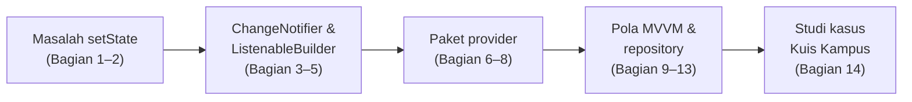

| Bagian | Pertanyaan yang dijawab |
| :--- | :--- |
| 1–2 | Mengapa data yang dipakai banyak halaman sulit dikelola dengan `setState`? |
| 3–5 | Bagaimana sebuah objek memberi tahu widget bahwa datanya berubah? |
| 6–8 | Bagaimana objek itu bisa dipakai widget mana pun tanpa dioper lewat *constructor*? |
| 9–13 | Di mana sebaiknya logika aplikasi ditulis agar kode rapi dan mudah diuji? |
| 14 | Bagaimana semuanya dirangkai menjadi satu aplikasi? |

---

## 1. Mengapa `setState` Saja Tidak Cukup?

### 1.1 Mengingat kembali `setState`

Sejak [Pertemuan 5](../pertemuan_05_interaksi_dan_state/README.md) Anda menyimpan data yang berubah di *class State* milik `StatefulWidget`, lalu mengubahnya di dalam `setState`. Jika data itu dibutuhkan widget lain, Anda **mengangkat *state*** ke widget induk dan mengoper data serta *callback* lewat *constructor*.

Cara ini sangat baik untuk data yang dipakai **satu halaman**. Masalah muncul saat data yang sama dibutuhkan banyak widget yang letaknya berjauhan, bahkan di halaman yang berbeda.

### 1.2 Dua masalah dalam satu contoh

[Contoh 01](kode/contoh_01_masalah_state_bertingkat.dart) adalah toko belanja sederhana. Isi keranjang disimpan di `HalamanToko`, lalu dipakai oleh lencana di `AppBar`, tombol di setiap baris barang, dan halaman Keranjang.

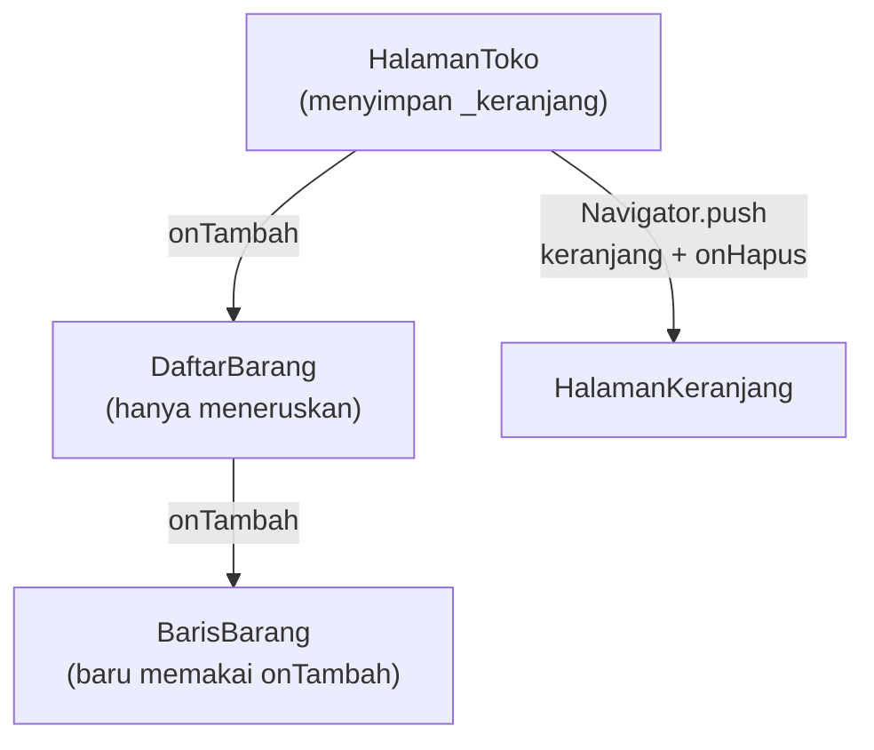

**Masalah 1 — data dioper berantai.** `DaftarBarang` tidak memakai `onTambah`, tetapi tetap harus menerimanya hanya untuk diteruskan ke `BarisBarang`. Bayangkan jika aplikasinya punya lima tingkat widget: setiap tingkat harus menerima dan meneruskan data yang tidak dipakainya. Masalah ini disebut ***prop drilling***.

**Masalah 2 — halaman lain tidak ikut berubah.** Tambahkan tiga barang, buka halaman Keranjang, lalu hapus satu barang. Barang itu **tetap terlihat**, dan judul halaman tetap "Keranjang (3)".

<p align="center">
  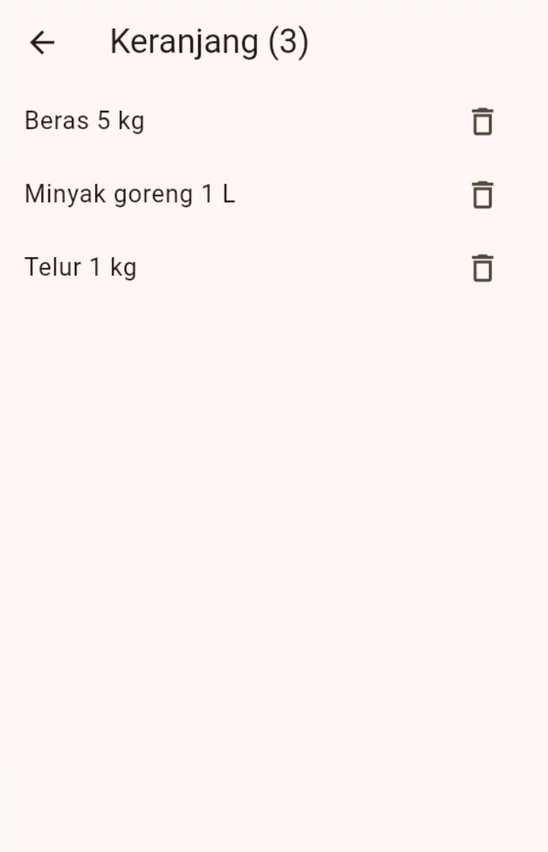
</p>

Mengapa? `setState` di `HalamanToko` hanya membangun ulang `HalamanToko` dan widget di bawahnya. Halaman Keranjang dibuka dengan `Navigator.push` sebagai **halaman terpisah** di atasnya, sehingga tidak ikut dibangun ulang. Tampilan halaman itu seperti **fotokopi** yang dibuat saat halaman dibuka: jika dokumen aslinya diubah, fotokopinya tidak ikut berubah.

> [!WARNING]
> Masalah 2 lebih berbahaya daripada kelihatannya, karena tombol hapus di layar yang usang menunjuk ke **posisi yang salah**. Misalkan keranjang berisi tiga barang:
>
> - Hapus barang **ketiga**, lalu tekan lagi tombol hapus barang itu (barangnya masih terlihat). Aplikasi mencoba menghapus posisi ketiga dari keranjang yang kini hanya berisi dua barang, dan konsol menampilkan *error* `RangeError`.
> - Hapus barang **pertama**, lalu tekan lagi tombol hapus barang itu. Yang terhapus justru barang **lain** yang tidak Anda pilih.

### 1.3 Ide penyelesaiannya

Keluarkan data itu dari widget, lalu simpan di **objek tersendiri** yang:

1. menyimpan datanya dan semua cara mengubahnya;
2. bisa **mengumumkan** bahwa datanya berubah;
3. bisa diambil langsung oleh widget mana pun yang membutuhkannya, di halaman mana pun.

Bagian 3–5 membahas poin 1 dan 2. Bagian 6–8 membahas poin 3.

> **🧠 Cek Cepat:** Di Contoh 01, mengapa lencana jumlah barang di `AppBar` ikut berubah saat barang dihapus, padahal halaman Keranjang tidak?
>
> <details><summary>Lihat jawaban</summary>
>
> Lencana itu bagian dari `HalamanToko`, sehingga ikut dibangun ulang oleh `setState` milik `HalamanToko`. Halaman Keranjang adalah halaman lain yang dibuka di atasnya dan tidak dibangun ulang.
> </details>

---

## 2. State Lokal dan State Aplikasi

Tidak semua data perlu dikeluarkan dari widget. Dokumentasi Flutter membedakan dua jenis *state*:

| Jenis | Contoh | Tempat yang tepat |
| :--- | :--- | :--- |
| ***State* lokal** (*ephemeral state*): hanya dipakai satu widget atau satu halaman, boleh hilang saat halamannya ditutup | Teks yang sedang diketik di kolom formulir, tab yang sedang dipilih, kotak centang di formulir, jumlah porsi sebelum dipesan | `StatefulWidget` + `setState` (Pertemuan 5) |
| ***State* aplikasi** (*app state*): dipakai banyak widget atau banyak halaman, dan harus tetap ada walaupun halaman tertentu ditutup | Isi keranjang belanja, pengguna yang sedang masuk, pilihan mode gelap, daftar data dari server, skor yang sudah dicapai | Objek `ChangeNotifier`, dibagikan dengan `provider` (pertemuan ini) |

Untuk memutuskan, ajukan dua pertanyaan:

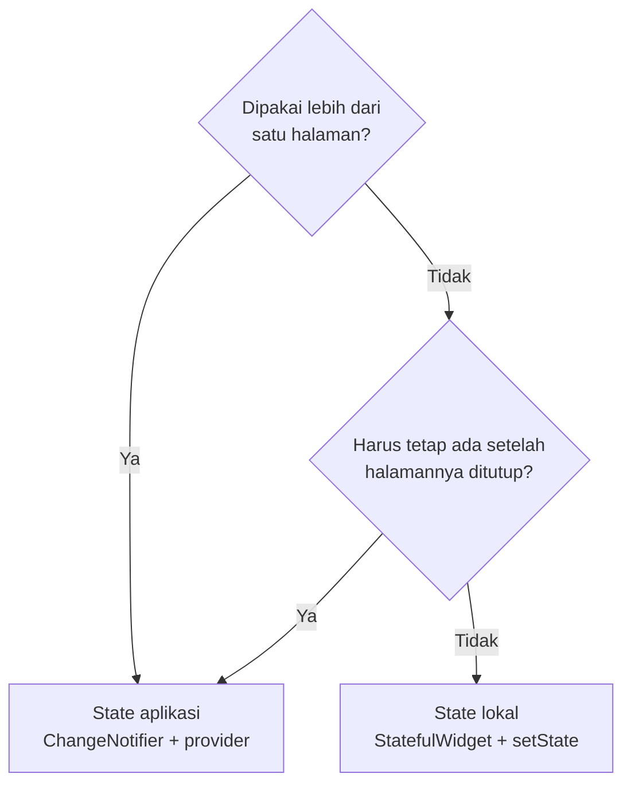

> [!NOTE]
> Satu aplikasi hampir selalu memakai **keduanya**. Di Contoh 07 nanti, isi formulir tambah tugas tetap disimpan dengan `setState` di halaman formulir, sedangkan daftar tugasnya disimpan di luar widget. Di studi kasus Kuis Kampus, skor terbaik setiap topik disimpan sebagai *state* aplikasi.

---

## 3. `ChangeNotifier`: Objek yang Mengumumkan Perubahan

### 3.1 Analogi: petugas antrean dengan pengeras suara

Di ruang layanan akademik, seorang petugas memegang daftar antrean. Setiap kali nomor berikutnya dipanggil, ia **mengumumkan** lewat pengeras suara. Papan nomor, mahasiswa yang menunggu, dan petugas loket lain cukup **mendengarkan** pengumuman itu. Tidak ada yang perlu bertanya terus-menerus "nomor berapa sekarang?".

`ChangeNotifier` adalah *class* bawaan Flutter yang berperan seperti petugas itu:

| Analogi | Di Flutter |
| :--- | :--- |
| Petugas yang memegang daftar antrean | Objek turunan `ChangeNotifier` |
| Mengumumkan lewat pengeras suara | `notifyListeners()` |
| Orang-orang yang mendengarkan | Widget yang mendaftar sebagai pendengar (*listener*) |

### 3.2 Anatomi sebuah `ChangeNotifier`

Berikut objek antrean dari [Contoh 02](kode/contoh_02_changenotifier_dasar.dart):

```dart
class AntreanLayanan extends ChangeNotifier {      // ① turunan ChangeNotifier
  int _nomorTerakhir = 0;                           // ② data PRIVAT
  int _dipanggil = 0;

  int get nomorTerakhir => _nomorTerakhir;          // ③ getter: hanya dibaca
  int get dipanggil => _dipanggil;
  int get menunggu => _nomorTerakhir - _dipanggil;  // ④ nilai turunan
  bool get adaYangMenunggu => menunggu > 0;

  void ambilNomor() {                               // ⑤ metode pengubah
    _nomorTerakhir++;
    notifyListeners();                              // ⑥ umumkan perubahan
  }

  void panggilBerikutnya() {
    if (!adaYangMenunggu) {
      return;
    }
    _dipanggil++;
    notifyListeners();
  }
}
```

| Nomor | Penjelasan |
| :---: | :--- |
| ① | `extends ChangeNotifier` memberi *class* ini kemampuan menyimpan daftar pendengar dan mengumumkan perubahan. |
| ② | Data diberi awalan `_` sehingga **privat**: kode di luar berkas ini tidak bisa mengubahnya langsung. |
| ③ | *Getter* membuat data bisa **dibaca** dari luar, tetapi tidak bisa diubah. |
| ④ | Nilai turunan dihitung dari data, sama seperti di Pertemuan 5 dan 6. |
| ⑤ | Satu-satunya cara mengubah data adalah lewat metode. |
| ⑥ | Setiap metode yang mengubah data diakhiri `notifyListeners()`. |

Mengapa data harus privat? Jika `_dipanggil` dibuat publik, kode di tempat lain bisa menulis `antrean.dipanggil = 5;` tanpa memanggil `notifyListeners()`. Datanya berubah, tetapi tidak ada yang tahu, sehingga tampilan tidak ikut berubah. Dengan data privat dan metode pengubah, **pengumuman tidak mungkin terlupa**.

### 3.3 Siapa yang membuat dan membuang objeknya?

`ChangeNotifier` menyimpan daftar pendengar, sehingga harus **dibuang** (`dispose`) saat tidak dipakai lagi, sama seperti `TextEditingController` di Pertemuan 5. Di Contoh 02, objeknya dibuat bersama `State` dan dibuang di `dispose`:

```dart
class _HalamanAntreanState extends State<HalamanAntrean> {
  final AntreanLayanan _antrean = AntreanLayanan(); // dibuat sekali

  @override
  void dispose() {
    _antrean.dispose(); // dibuang saat halaman ditutup
    super.dispose();
  }
  // ...
}
```

Objek yang sudah dibuang tidak boleh dipakai lagi. Jika tetap dipakai, misalnya `notifyListeners()` dipanggil setelah `dispose()`, Flutter menghentikannya dengan *error* berikut di konsol:

```text
A AntreanLayanan was used after being disposed.
Once you have called dispose() on a AntreanLayanan, it can no longer be used.
```

> **🧠 Cek Cepat:** Seorang teman menulis metode `void reset() { _nomorTerakhir = 0; _dipanggil = 0; }`. Apa yang kurang?
>
> <details><summary>Lihat jawaban</summary>
>
> `notifyListeners()`. Tanpanya, data memang kembali ke 0, tetapi widget yang mendengarkan tidak dibangun ulang, sehingga layar masih menampilkan angka lama.
> </details>

---

## 4. `ListenableBuilder`: Mendengarkan Tanpa Paket Tambahan

### 4.1 Cara kerja

`ListenableBuilder` adalah widget bawaan Flutter yang mendaftar sebagai pendengar sebuah `ChangeNotifier`. Setiap kali objek itu memanggil `notifyListeners()`, fungsi `builder`-nya dijalankan lagi:

```dart
ListenableBuilder(
  listenable: antrean, // objek yang didengarkan
  builder: (BuildContext context, Widget? child) {
    // Dijalankan lagi SETIAP KALI antrean memanggil notifyListeners().
    return Text('${antrean.menunggu} orang menunggu');
  },
)
```

Hanya isi `builder` yang dibangun ulang, bukan seluruh halaman. Di [Contoh 02](kode/contoh_02_changenotifier_dasar.dart), halamannya bahkan **tidak memanggil `setState` sama sekali**. Tiga widget berbeda mendengarkan objek antrean yang sama:

<p align="center">
  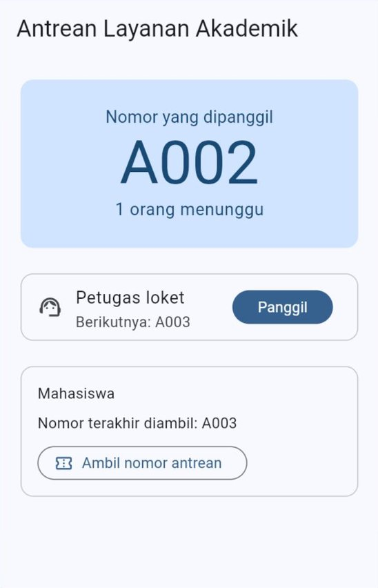
</p>

| Widget | Mendengarkan? | Alasannya |
| :--- | :---: | :--- |
| `PapanPanggilan` | ✅ seluruh kartu | Nomor dan jumlah yang menunggu berubah |
| `PanelPetugas` | ✅ seluruh kartu | Teks "Berikutnya" dan status aktif tombol berubah |
| `PanelMahasiswa` | Sebagian | Hanya teks nomor terakhir yang dibungkus `ListenableBuilder`. Tombolnya cukup **memanggil** `antrean.ambilNomor`, tidak perlu dibangun ulang |

> [!TIP]
> Letakkan `ListenableBuilder` **serendah mungkin**, hanya membungkus bagian yang benar-benar berubah. Semakin kecil bagian yang dibangun ulang, semakin ringan aplikasinya.

### 4.2 Nama lain yang mungkin Anda temui

Di tutorial lama, Anda mungkin menemukan `AnimatedBuilder` dipakai untuk tujuan yang sama. Di Flutter versi sekarang, `AnimatedBuilder` adalah turunan `ListenableBuilder`. Untuk mendengarkan `ChangeNotifier` biasa, gunakan `ListenableBuilder` karena namanya lebih jelas.

---

## 5. `ValueNotifier` untuk Satu Nilai

### 5.1 `ChangeNotifier` siap pakai

Jika yang berubah hanya **satu nilai**, Anda tidak perlu menulis *class* sendiri. `ValueNotifier<T>` adalah `ChangeNotifier` yang membungkus satu nilai bertipe `T`. Mengganti `.value` otomatis mengumumkan perubahan:

```dart
final ValueNotifier<int> _jumlahTiket = ValueNotifier<int>(1);

// Di tombol:
_jumlahTiket.value++; // otomatis notifyListeners()

// Untuk menampilkan:
ValueListenableBuilder<int>(
  valueListenable: _jumlahTiket,
  builder: (BuildContext context, int jumlah, Widget? child) {
    return Text('$jumlah tiket'); // nilai terbaru sudah diberikan
  },
)
```

### 5.2 Jebakan: isi berubah, objeknya tetap

`ValueNotifier` hanya mengumumkan perubahan jika `.value` **diganti** dengan nilai yang berbeda. Untuk `List`, mengubah isinya dengan `.add(...)` tidak mengganti `.value`, karena objek `List`-nya tetap sama:

```dart
final ValueNotifier<List<String>> _peserta = ValueNotifier<List<String>>([]);

// SALAH: isi bertambah, tetapi tidak ada pengumuman.
_peserta.value.add('Peserta baru');

// BENAR: buat List BARU, lalu ganti .value.
_peserta.value = [..._peserta.value, 'Peserta baru'];
```

Buktikan sendiri di [Contoh 03](kode/contoh_03_valuenotifier.dart): tekan **Tambah (cara salah)** dua kali (tampilan diam saja), lalu **Tambah (cara benar)** sekali. Tiba-tiba muncul **tiga** peserta, karena dua nama yang ditambahkan "diam-diam" ikut terlihat saat tampilan akhirnya dibangun ulang.

<p align="center">
  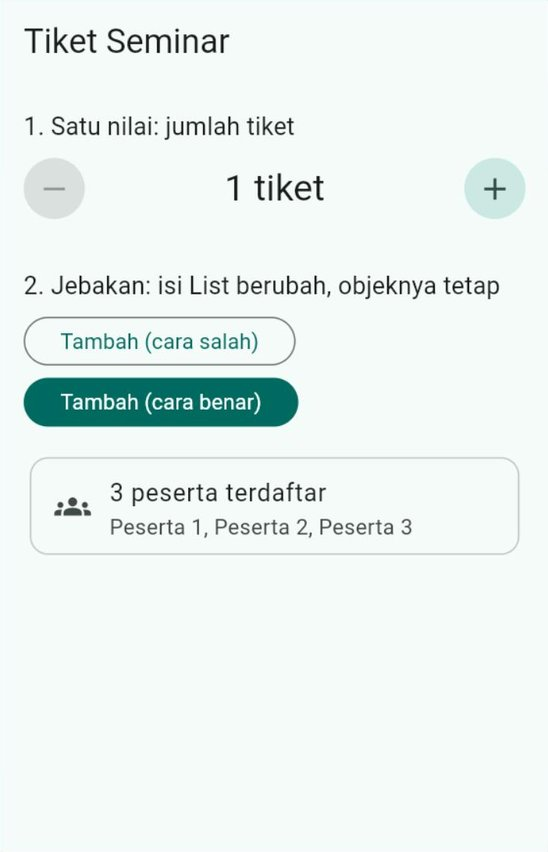
</p>

| Pakai | Jika |
| :--- | :--- |
| `ValueNotifier` | Hanya satu nilai sederhana: angka, `bool`, teks, atau pilihan `enum` |
| *Class* turunan `ChangeNotifier` | Beberapa data yang saling berkaitan, ada nilai turunan, atau ada aturan saat mengubahnya (misalnya "tidak boleh lebih dari 5") |

> **🧠 Cek Cepat:** `ValueNotifier<int>` bernilai 3. Kode `notifier.value = 3;` dijalankan. Apakah widget yang mendengarkannya dibangun ulang?
>
> <details><summary>Lihat jawaban</summary>
>
> Tidak. Nilai barunya sama dengan nilai lama (`3 == 3`), sehingga `ValueNotifier` tidak mengumumkan apa pun.
> </details>

---

## 6. Paket `provider`: Menitipkan Objek di Pohon Widget

### 6.1 Masalah yang masih tersisa

Di Contoh 02, objek antrean masih **dioper lewat *constructor***: `PapanPanggilan(antrean: _antrean)`. Objeknya juga dibuat oleh satu halaman, sehingga halaman lain yang dibuka dengan `Navigator.push` tidak bisa memakainya tanpa dioper lagi.

Yang kita butuhkan: cara **menitipkan** objek di bagian atas pohon widget, agar widget mana pun di bawahnya bisa **mengambilnya sendiri**.

### 6.2 Analogi: penitipan di resepsionis gedung

Sebuah barang dititipkan di meja resepsionis di lobi gedung fakultas. Siapa pun yang berada **di dalam gedung itu**, di lantai berapa pun, bisa memintanya cukup dengan menyebut jenis barangnya: "Saya perlu keranjang." Orang di gedung lain tidak bisa memintanya.

| Analogi | Di Flutter |
| :--- | :--- |
| Meja resepsionis tempat barang dititipkan | Widget `ChangeNotifierProvider` |
| Gedung beserta semua lantainya | Semua widget **di bawah** *provider* itu di pohon widget |
| Meminta dengan menyebut jenis barang | `context.watch<Keranjang>()` atau `context.read<Keranjang>()` |

Widget penitip ini disediakan oleh paket **`provider`**. Dokumentasi resmi Flutter memakainya di panduan *simple app state management* dan di contoh panduan arsitektur aplikasinya.

### 6.3 Memasang paket

Di proyek Flutter, jalankan perintah ini **sekali** di terminal, di dalam folder proyek:

```bash
flutter pub add provider
```

Perintah itu menambahkan satu baris di bagian `dependencies` pada `pubspec.yaml`, kurang lebih seperti ini (angka versinya mengikuti versi terbaru saat Anda memasangnya):

```yaml
dependencies:
  provider: ^6.1.5
```

Setelah itu, tulis baris berikut di bagian atas setiap berkas Dart yang memakainya:

```dart
import 'package:provider/provider.dart';
```

> [!NOTE]
> DartPad sudah menyediakan paket `provider`, jadi Contoh 04–09 dan 11 bisa langsung dijalankan di sana tanpa perintah `flutter pub add`.

### 6.4 Tiga langkah memakai `provider`

[Contoh 04](kode/contoh_04_provider_dasar.dart) adalah toko yang sama dengan Contoh 01, tetapi ditulis ulang dengan `provider`.

**Langkah 1 — Buat *class* `ChangeNotifier`.**

```dart
class Keranjang extends ChangeNotifier {
  final List<String> _isi = [];

  // Dari luar hanya bisa dibaca. UnmodifiableListView melempar error
  // jika ada yang mencoba isi.add(...) tanpa lewat metode tambah.
  UnmodifiableListView<String> get isi => UnmodifiableListView(_isi);
  int get jumlah => _isi.length;

  void tambah(String barang) {
    _isi.add(barang);
    notifyListeners();
  }

  void hapus(int indeks) {
    _isi.removeAt(indeks);
    notifyListeners();
  }

  void kosongkan() {
    _isi.clear();
    notifyListeners();
  }
}
```

Mengapa *getter* `isi` tidak langsung mengembalikan `_isi`? Karena `List` bisa diubah isinya oleh siapa pun yang memegangnya. Jika `_isi` diberikan begitu saja, kode lain bisa menulis `keranjang.isi.add('Sabun')`, dan isi keranjang berubah **tanpa** `notifyListeners()`. `UnmodifiableListView` (dari `import 'dart:collection';`) adalah "kaca etalase": isinya bisa dilihat, tetapi tidak bisa diubah. Jika ada yang mencoba, aplikasi langsung menolak dengan *error* `Unsupported operation: Cannot add to an unmodifiable list`, sehingga kesalahannya cepat ketahuan.

**Langkah 2 — Titipkan objeknya di atas widget yang membutuhkannya.**

```dart
void main() {
  runApp(
    // Keranjang dititipkan DI ATAS MaterialApp, sehingga semua halaman,
    // termasuk yang dibuka dengan Navigator.push, bisa memakainya.
    ChangeNotifierProvider(
      create: (BuildContext context) => Keranjang(),
      child: const AplikasiBelanja(),
    ),
  );
}
```

| Bagian | Artinya |
| :--- | :--- |
| `create` | Fungsi pembuat objek. Dipanggil **sekali**, yaitu saat objek itu pertama kali diminta. |
| `child` | Widget di bawahnya. Semua widget di dalam `AplikasiBelanja`, termasuk semua halamannya, bisa mengambil `Keranjang`. |
| *(otomatis)* | Saat *provider* ini dilepas dari pohon widget, ia memanggil `dispose()` milik objeknya. Kita tidak perlu menulis `dispose` sendiri. |

Mengapa harus **di atas `MaterialApp`**? Halaman-halaman yang dibuka dengan `Navigator.push` diletakkan oleh `Navigator`, dan `Navigator` berada **di dalam** `MaterialApp`. Dengan menitipkan keranjang di atas `MaterialApp`, semua halaman berada "di dalam gedung yang sama".

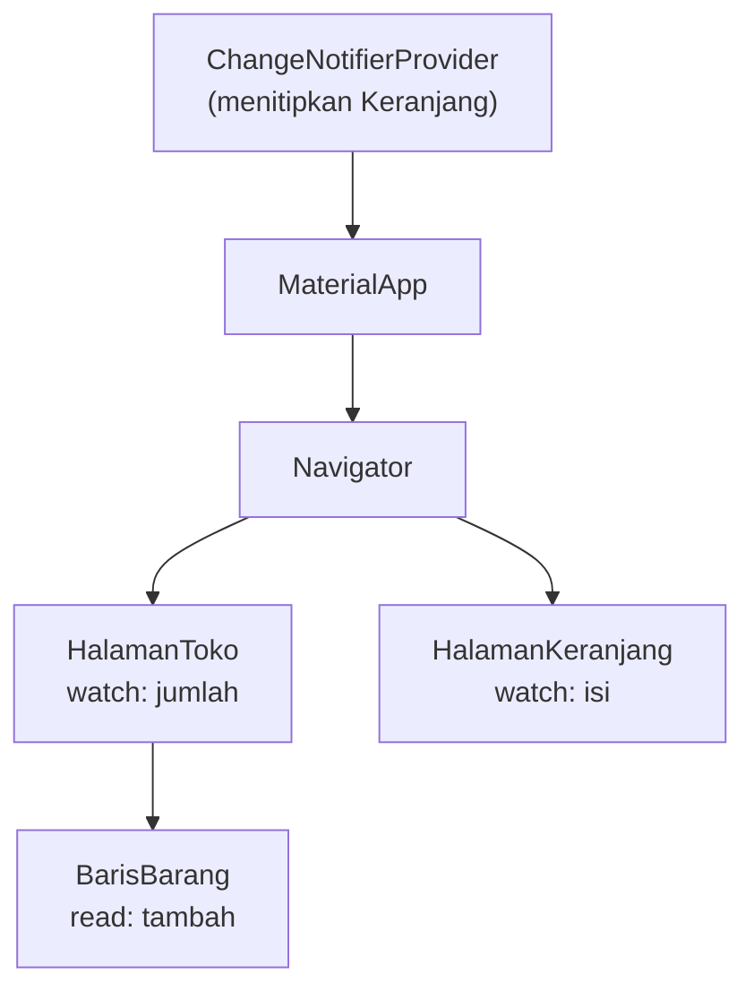

**Langkah 3 — Ambil objeknya di widget yang membutuhkan.**

```dart
// Di HalamanToko (kini StatelessWidget):
// watch: ambil keranjang DAN dengarkan perubahannya.
final int jumlah = context.watch<Keranjang>().jumlah;

// Di BarisBarang, pada tombol tambah:
// read: cukup ambil keranjang lalu panggil metodenya.
onPressed: () => context.read<Keranjang>().tambah(nama),

// Di HalamanKeranjang:
// Halaman ini juga mendengarkan, jadi langsung berubah saat dihapus.
final Keranjang keranjang = context.watch<Keranjang>();
```

Bandingkan kedua versi:

| | Contoh 01 (`setState`) | Contoh 04 (`provider`) |
| :--- | :--- | :--- |
| Tempat isi keranjang | `_keranjang` di `State` milik `HalamanToko` | Objek `Keranjang` di atas `MaterialApp` |
| `HalamanToko` | `StatefulWidget` | `StatelessWidget` |
| Widget perantara `DaftarBarang` | Harus menerima dan meneruskan `onTambah` | Tidak dibutuhkan lagi; `BarisBarang` mengambil keranjang sendiri |
| Halaman Keranjang | Menerima data lewat *constructor*, **tidak** berubah saat barang dihapus | Mengambil sendiri dengan `watch`, **langsung** berubah |

<p align="center">
  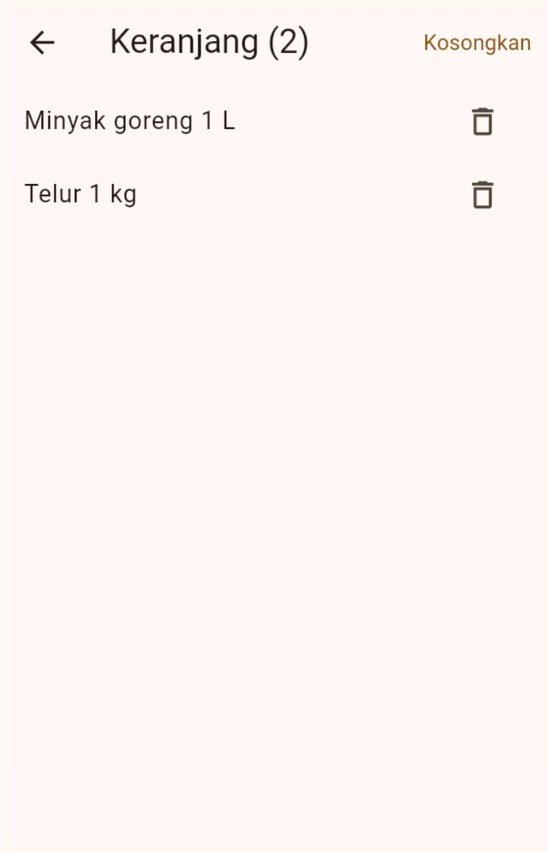
</p>

### 6.5 Buat objek di `create`, bukan di `.value`

Selain `ChangeNotifierProvider(create: ...)`, ada juga `ChangeNotifierProvider.value(value: ...)`. Keduanya sering tertukar.

```dart
// ✅ BENAR: objek BARU dibuat di dalam create.
ChangeNotifierProvider(
  create: (BuildContext context) => Keranjang(),
  child: const AplikasiBelanja(),
)

// ❌ SALAH: objek BARU dibuat lalu diberikan ke .value.
ChangeNotifierProvider.value(
  value: Keranjang(),
  child: const AplikasiBelanja(),
)
```

Jika versi yang salah berada di dalam `build`, **setiap kali** widget itu dibangun ulang, sebuah keranjang baru dibuat dan isinya kembali kosong. Keranjang yang lama juga tidak pernah dibuang, karena `.value` tidak memanggil `dispose()`.

Jadi, `.value` hanya dipakai untuk objek yang **sudah ada** dan dimiliki pihak lain. Contohnya dibahas di [Bagian 11](#11-cakupan-dan-umur-provider).

> **🧠 Cek Cepat:** Di Contoh 04, `HalamanToko` berubah dari `StatefulWidget` menjadi `StatelessWidget`. Mengapa ia tetap bisa menampilkan jumlah barang yang selalu baru?
>
> <details><summary>Lihat jawaban</summary>
>
> Datanya tidak lagi disimpan di halaman itu, melainkan di objek `Keranjang`. `context.watch<Keranjang>()` mendaftarkan `HalamanToko` sebagai pendengar, sehingga halaman itu dibangun ulang setiap kali `Keranjang` memanggil `notifyListeners()`.
> </details>

---

## 7. `watch`, `read`, `select`, dan `Consumer`

### 7.1 Analogi: notifikasi grup obrolan

Cara mengambil objek dari *provider* menentukan **kapan** widget dibangun ulang. Bayangkan Anda bergabung dengan grup obrolan kelas:

| Cara | Analogi | Kapan widget dibangun ulang |
| :--- | :--- | :--- |
| `context.watch<T>()` | Notifikasi grup **aktif**: setiap ada pesan baru, ponsel berbunyi | Setiap kali objek memanggil `notifyListeners()` |
| `context.select(...)` | Ponsel hanya berbunyi jika **nama Anda disebut** | Hanya jika nilai yang dipilih berubah |
| `context.read<T>()` | Notifikasi **dimatikan**; grup dibuka hanya saat Anda perlu mengirim sesuatu | Tidak pernah |
| `Consumer<T>` | Seperti `watch`, tetapi yang "berbunyi" hanya satu bagian kecil layar | Setiap perubahan, hanya isi `builder`-nya |

### 7.2 Kapan memakai yang mana?

| Cara | Ditulis di | Contoh |
| :--- | :--- | :--- |
| `context.watch<T>()` | Di dalam `build`, untuk **menampilkan** data | `context.watch<Keranjang>().jumlah` |
| `context.select((T x) => ...)` | Di dalam `build`, saat hanya **satu bagian** data yang ditampilkan | `context.select((Pertandingan p) => p.skorBiru)` |
| `context.read<T>()` | Di dalam fungsi yang dijalankan **nanti**: `onPressed`, `onChanged`, `onSubmitted`, `initState` | `context.read<Keranjang>().tambah(nama)` |
| `Consumer<T>` | Di tengah sebuah widget, untuk membungkus bagian kecil yang berubah | Kartu "Total gol" di Contoh 05 |

Pegangan singkatnya:

> **Menampilkan data → `watch` atau `select`. Memanggil metode → `read`.**

### 7.3 Membuktikannya: menghitung berapa kali widget dibangun

[Contoh 05](kode/contoh_05_watch_read_select.dart) adalah papan skor futsal. Setiap kartu menuliskan berapa kali ia sudah dibangun. Jalankan, lalu tekan **Gol Tim Biru** tiga kali.

```dart
// KartuSkorBiru: hanya peduli skor Tim Biru.
final int skor = context.select((Pertandingan p) => p.skorBiru);

// KartuKeterangan: dibangun ulang pada SETIAP perubahan.
final Pertandingan pertandingan = context.watch<Pertandingan>();

// PanelTombol: tombol hanya MEMANGGIL metode.
onPressed: () => context.read<Pertandingan>().golBiru(),
```

<p align="center">
  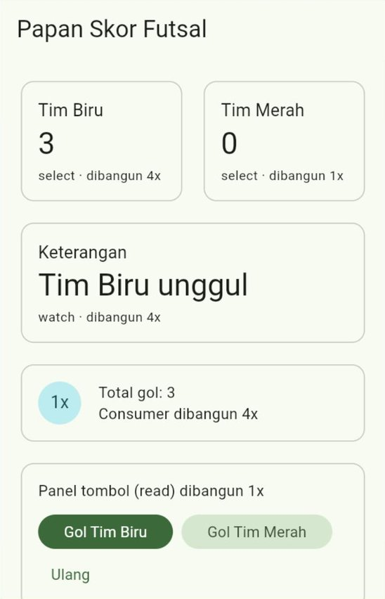
</p>

| Kartu | Cara | Saat dibuka | Setelah 3 gol Tim Biru | Mengapa |
| :--- | :--- | :---: | :---: | :--- |
| Tim Biru | `select` | 1× | 4× | Skor Biru berubah tiga kali |
| Tim Merah | `select` | 1× | 1× | Skor Merah tidak berubah, jadi tidak dibangun ulang |
| Keterangan | `watch` | 1× | 4× | Dibangun ulang setiap perubahan, walaupun tulisannya ("Tim Biru unggul") hanya berubah sekali |
| Total gol | `Consumer` | 1× | 4× | Isi `builder` dibangun ulang setiap perubahan |
| Logo (di dalam `Consumer`) | `child` | 1× | 1× | Dibuat sekali di luar `builder`, lalu dipakai ulang |
| Panel tombol | `read` | 1× | 1× | `read` tidak mendengarkan |

Perhatikan kartu **Keterangan**: dibangun ulang empat kali, padahal tulisannya hanya berubah sekali. Itulah harga `watch`. Di [Latihan](LATIHAN.md), Anda akan menggantinya dengan `select` dan memprediksi angkanya.

> [!NOTE]
> Penghitung di Contoh 05 hanya untuk pembuktian. Pada aplikasi sungguhan, jangan menaruh perhitungan atau efek samping di dalam `build`, karena Flutter boleh memanggil `build` kapan saja.

### 7.4 `Consumer` dan parameter `child`

`Consumer` berguna saat yang perlu berubah hanya **sebagian kecil** dari sebuah widget besar:

```dart
child: Consumer<Pertandingan>(
  builder: (BuildContext context, Pertandingan p, Widget? child) {
    return Row(
      children: [
        child!, // logo, tidak dibuat ulang
        const SizedBox(width: 16),
        Expanded(
          child: Text(
            'Total gol: ${p.totalGol}\n'
            'Consumer dibangun ${catatBuild('consumer')}x',
          ),
        ),
      ],
    );
  },
  child: const LogoLiga(),
),
```

| Parameter `builder` | Isinya |
| :--- | :--- |
| `context` | `BuildContext` di posisi `Consumer` |
| `p` | Objek `Pertandingan` dari *provider* (sudah didengarkan) |
| `child` | Widget yang diberikan lewat parameter `child` milik `Consumer`. Dibuat sekali, lalu diberikan lagi setiap kali `builder` dijalankan |

### 7.5 Pesan *error* yang sering muncul

**`watch` dipakai di dalam `onPressed`:**

```text
Tried to listen to a value exposed with provider, from outside of the widget tree.
```

Artinya: "Anda mencoba mendengarkan dari luar `build`." Ganti `context.watch` dengan `context.read` di dalam *callback*.

**`select` dipakai di luar `build`:**

```text
Tried to use `context.select` outside of the `build` method of a widget.
```

Solusinya sama: di dalam *callback*, pakai `context.read`.

**`read` dipakai di dalam `build` untuk menampilkan data.** Tidak ada *error*, tetapi tampilannya **tidak pernah berubah**, karena `read` tidak mendengarkan. Kesalahan ini paling sulit ditemukan justru karena tidak ada pesan apa pun.

> **🧠 Cek Cepat:** Di Contoh 05, tombol **Ulang** ditulis `context.read<Pertandingan>().ulang()`. Apa yang terjadi jika `read` diganti `watch`, lalu tombolnya ditekan?
>
> <details><summary>Lihat jawaban</summary>
>
> Konsol menampilkan *error* `Tried to listen to a value exposed with provider, from outside of the widget tree.` dan skor tidak kembali ke 0, karena *error* terjadi sebelum `ulang()` sempat dipanggil.
> </details>

---

## 8. `MultiProvider` dan Pengaturan Aplikasi

### 8.1 Menitipkan beberapa objek sekaligus

Aplikasi sungguhan biasanya punya beberapa *state* aplikasi, misalnya pengaturan tampilan **dan** profil pengguna. [Contoh 06](kode/contoh_06_multiprovider.dart) menitipkan keduanya dengan `MultiProvider`:

```dart
void main() {
  runApp(
    MultiProvider(
      providers: [
        ChangeNotifierProvider(
          create: (BuildContext context) => PengaturanTampilan(),
        ),
        ChangeNotifierProvider(
          create: (BuildContext context) => ProfilPengguna(),
        ),
      ],
      child: const AplikasiKu(),
    ),
  );
}
```

Tanpa `MultiProvider`, kita harus menyusunnya bertingkat. Hasilnya sama, tetapi semakin banyak objek, semakin dalam tingkatannya:

```dart
ChangeNotifierProvider(
  create: (BuildContext context) => PengaturanTampilan(),
  child: ChangeNotifierProvider(
    create: (BuildContext context) => ProfilPengguna(),
    child: const AplikasiKu(),
  ),
)
```

### 8.2 `MaterialApp` pun bisa mendengarkan

Karena *provider* dipasang di atas `MaterialApp`, widget yang membuat `MaterialApp` pun bisa memakai `watch`:

```dart
@override
Widget build(BuildContext context) {
  // MaterialApp ikut dibangun ulang saat pengaturan berubah.
  final PengaturanTampilan atur = context.watch<PengaturanTampilan>();

  return MaterialApp(
    debugShowCheckedModeBanner: false,
    title: 'Profil Kampus',
    theme: ThemeData(
      colorScheme: ColorScheme.fromSeed(seedColor: atur.benih),
    ),
    darkTheme: ThemeData(
      colorScheme: ColorScheme.fromSeed(
        seedColor: atur.benih,
        brightness: Brightness.dark,
      ),
    ),
    themeMode: atur.mode,
    home: const HalamanBeranda(),
  );
}
```

Saat halaman Pengaturan memanggil `context.read<PengaturanTampilan>().gantiMode(...)`, objek pengaturan mengumumkan perubahan, `MaterialApp` dibangun ulang dengan tema baru, dan **seluruh** aplikasi ikut berganti.

Bandingkan dengan cara di [Pertemuan 7 (Contoh 05)](../pertemuan_07_material3_dan_responsif/kode/contoh_05_mode_gelap.dart):

| | Pertemuan 7 | Pertemuan 9 |
| :--- | :--- | :--- |
| Tempat menyimpan mode | `State` di akar aplikasi | Objek `PengaturanTampilan` di atas `MaterialApp` |
| Halaman pengaturan menerima | Nilai `mode` dan *callback* `onModeBerubah` lewat *constructor* | Tidak menerima apa pun; mengambil sendiri dengan `watch` dan `read` |
| Menambah pengaturan baru, misalnya warna | Tambah parameter di setiap *constructor* yang dilewati | Tambah *getter* dan metode di `PengaturanTampilan` |

### 8.3 *State* lokal dan *state* aplikasi dalam satu halaman

Halaman Pengaturan memakai **keduanya**:

| Data | Jenis | Disimpan di |
| :--- | :--- | :--- |
| Teks yang **sedang diketik** di kolom nama | Lokal | `TextEditingController` milik halaman Pengaturan |
| Nama yang **sudah disimpan** dan tampil di beranda | Aplikasi | `ProfilPengguna` |

Nilai awal kolom teks diambil dengan `read` di `initState`:

```dart
@override
void initState() {
  super.initState();
  // read boleh dipakai di initState untuk mengambil nilai awal.
  _kontrolNama = TextEditingController(
    text: context.read<ProfilPengguna>().nama,
  );
}
```

Coba ketik nama baru. Judul beranda **belum** berubah selama Anda mengetik, karena teks itu masih *state* lokal. Judul baru berubah setelah Anda menekan tombol ✓ (atau Enter), yang memanggil `context.read<ProfilPengguna>().gantiNama(...)`.

<p align="center">
  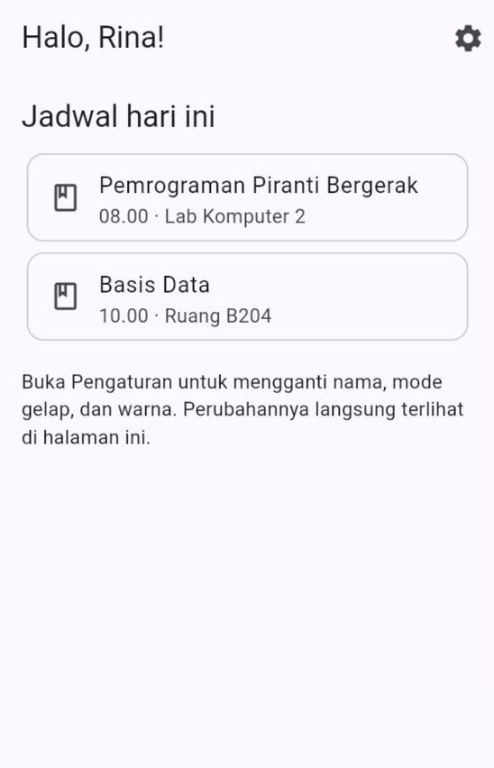
  &nbsp;&nbsp;
  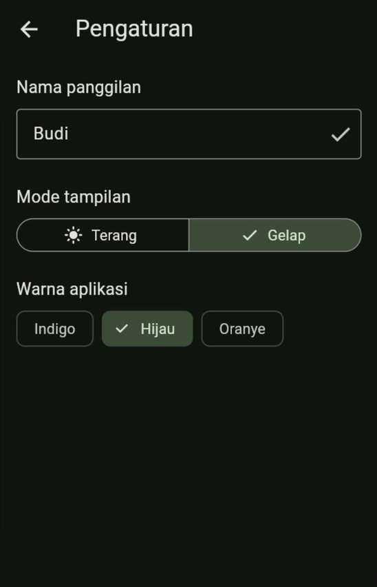
</p>

> **🧠 Cek Cepat:** Mengapa `TextEditingController` di halaman Pengaturan tidak dipindahkan ke `ProfilPengguna` saja?
>
> <details><summary>Lihat jawaban</summary>
>
> Teks yang sedang diketik hanya dipakai halaman itu dan boleh hilang saat halamannya ditutup, jadi termasuk *state* lokal. Selain itu, `TextEditingController` harus dibuang bersama halamannya di `dispose`. Yang disimpan di `ProfilPengguna` cukup hasil akhirnya: nama yang sudah disimpan.
> </details>

---

## 9. Pola MVVM

### 9.1 Masalahnya: semua bercampur di satu tempat

Sampai Pertemuan 7, satu *class State* biasanya berisi **semuanya**: data, aturan menyaring, perhitungan, dan widget yang menampilkannya. Untuk aplikasi kecil, ini wajar. Saat aplikasi membesar, muncul tiga kesulitan:

1. **Sulit dibaca.** Satu berkas berisi ratusan baris campuran logika dan tampilan.
2. **Sulit diuji.** Untuk memastikan aturan menyaring benar, Anda harus menjalankan aplikasi dan mengetuk layar satu per satu.
3. **Sulit diubah.** Mengganti tampilan berisiko merusak logika, dan sebaliknya.

**MVVM** (*Model–View–ViewModel*) adalah pola yang **memisahkan peran-peran itu**. Pola inilah yang direkomendasikan panduan arsitektur resmi Flutter.

### 9.2 Analogi: restoran

| Peran | Analogi restoran | Di kode |
| :--- | :--- | :--- |
| **Model** | Bahan makanan: bentuknya jelas, tidak bisa memasak sendiri | *Class* data, misalnya `Tugas` dan `enum Prioritas` |
| **View** | Pelayan dan ruang makan: menyajikan hidangan dan mencatat pesanan, tetapi **tidak memasak** | Widget |
| **ViewModel** | Dapur: mengolah pesanan menjadi hidangan siap saji | *Class* turunan `ChangeNotifier` |
| **Repository** | Pemasok bahan: dapur tidak peduli bahannya dibeli di pasar mana | *Class* `Repositori...` ([Bagian 10](#10-repository-dan-status-memuat)) |

### 9.3 Alur data satu arah

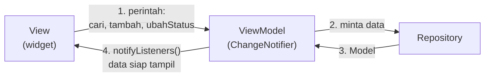

Ketukan dan ketikan pengguna mengalir **dari View ke ViewModel** sebagai perintah. Data mengalir **dari ViewModel ke View** untuk ditampilkan. View tidak pernah mengubah data sendiri. Pola ini disebut **alur data satu arah** (*unidirectional data flow*), dan sangat disarankan oleh dokumentasi resmi Flutter. Karena arahnya selalu sama, sumber masalah lebih mudah dilacak: jika data salah, periksa ViewModel; jika tampilan salah, periksa View.

### 9.4 Aturan yang kita pakai

Diringkas dari panduan arsitektur resmi Flutter:

1. **Satu View berpasangan dengan satu ViewModel.**
2. **View hanya berisi logika tampilan**: `if` sederhana untuk menampilkan atau menyembunyikan widget berdasarkan data dari ViewModel, animasi, tata letak berdasarkan ukuran layar, dan navigasi sederhana.
3. **ViewModel menyimpan *state* halaman sebagai data privat**, membuka *getter* untuk dibaca View, dan menyediakan **perintah** (*command*), yaitu metode yang dipanggil View. Di pertemuan ini, perintah cukup berupa metode biasa.
4. **ViewModel tidak membuat atau mengambil data sendiri**; ia memintanya dari *repository*. (Contoh 07 di bawah masih menyimpan data awalnya langsung di ViewModel agar sederhana; Bagian 10 menunjukkan cara yang benar.)

Ditambah satu kebiasaan baik untuk mata kuliah ini:

5. **ViewModel tidak menyimpan `BuildContext` dan tidak membuat widget.** `SnackBar`, dialog, dan navigasi dikerjakan View.

### 9.5 Membedah Contoh 07: "Tugas Kuliahku"

[Contoh 07](kode/contoh_07_mvvm_dasar.dart) adalah daftar tugas kuliah dengan pencarian, saringan prioritas, kotak centang "selesai", dan formulir tambah tugas.

<p align="center">
  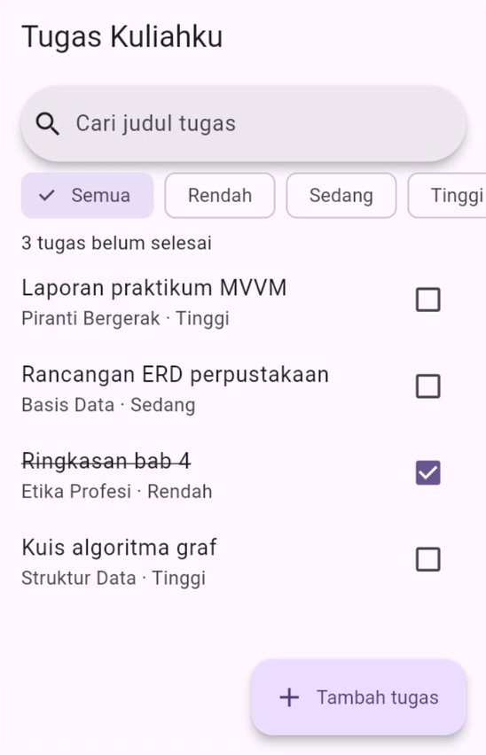
</p>

**Model** — bentuk datanya saja:

```dart
enum Prioritas {
  rendah('Rendah'),
  sedang('Sedang'),
  tinggi('Tinggi');

  const Prioritas(this.label);

  final String label;
}

class Tugas {
  const Tugas({
    required this.id,
    required this.judul,
    required this.mataKuliah,
    required this.prioritas,
  });

  final int id;
  final String judul;
  final String mataKuliah;
  final Prioritas prioritas;
}
```

Semua *field* Model bersifat `final` dan *constructor*-nya `const`. Model seperti ini disebut ***immutable*** (tidak bisa diubah setelah dibuat), dan sangat disarankan panduan resmi Flutter. Jika suatu saat isi sebuah tugas perlu diubah, ViewModel membuat objek `Tugas` baru untuk menggantikannya, sehingga tidak ada data yang berubah diam-diam tanpa sepengetahuan ViewModel. (Status "selesai" di contoh ini pun tidak disimpan di `Tugas`, melainkan di `_selesai` milik ViewModel.)

**ViewModel** — *state* halaman dan semua logikanya (sebagian isi disingkat):

```dart
class DaftarTugasViewModel extends ChangeNotifier {
  final List<Tugas> _semua = [/* empat tugas awal */];
  final Set<int> _selesai = {3};
  String _kataKunci = '';
  Prioritas? _saringan; // null = semua prioritas

  // ---------- Dibaca View ----------
  Prioritas? get saringan => _saringan;
  int get jumlahBelumSelesai => _semua.length - _selesai.length;

  List<Tugas> get tampil {
    final String kunci = _kataKunci.trim().toLowerCase();
    return _semua.where((Tugas tugas) {
      final bool cocokJudul = tugas.judul.toLowerCase().contains(kunci);
      final bool cocokPrioritas =
          _saringan == null || tugas.prioritas == _saringan;
      return cocokJudul && cocokPrioritas;
    }).toList();
  }

  bool sudahSelesai(Tugas tugas) => _selesai.contains(tugas.id);

  // ---------- Perintah yang dipanggil View ----------
  void cari(String teks) {
    _kataKunci = teks;
    notifyListeners();
  }

  void pilihSaringan(Prioritas? prioritas) {
    _saringan = prioritas;
    notifyListeners();
  }

  void ubahStatus(Tugas tugas) {/* ... */}
  void tambah(String judul, String mataKuliah, Prioritas prioritas) {/* ... */}
}
```

*Getter* `tampil` hampir sama persis dengan `_hasil` di [Pertemuan 6 Bagian 8.1](../pertemuan_06_daftar_dan_navigasi/README.md#81-prinsip-utama-data-asli-tidak-pernah-diubah). Yang berbeda hanya **tempatnya**: dulu di *State* halaman, kini di ViewModel. Hasilnya adalah "hidangan siap saji": View tinggal menampilkannya tanpa perlu tahu cara menyaringnya.

**View** — hanya membaca dan meneruskan:

```dart
// View hanya MEMBACA dari ViewModel...
final DaftarTugasViewModel vm = context.watch<DaftarTugasViewModel>();
final List<Tugas> tampil = vm.tampil;

// ...dan meneruskan kejadian ke ViewModel.
onChanged: (String teks) {
  context.read<DaftarTugasViewModel>().cari(teks);
},
```

Siapa mengerjakan apa di Contoh 07:

| Bagian | Peran | Tugasnya |
| :--- | :--- | :--- |
| `Prioritas`, `Tugas` | Model | Bentuk data |
| `DaftarTugasViewModel` | ViewModel | Menyimpan tugas, kata kunci, saringan, dan status selesai; menyediakan perintah `cari`, `pilihSaringan`, `ubahStatus`, `tambah` |
| `HalamanTugas` | View | Menampilkan `vm.tampil`, meneruskan ketikan dan ketukan ke ViewModel, membuka formulir, menampilkan `SnackBar` |
| `BarisTugas` | View (kecil) | Menampilkan satu tugas. **Tidak mengenal ViewModel**: ia hanya menerima `tugas`, `selesai`, dan `onUbah` lewat *constructor* |
| `HalamanTambahTugas` | View | Formulir. Isi kolom dan pilihan prioritas adalah *state* lokal (`setState`); saat disimpan, memanggil `vm.tambah(...)` |

Mengapa `BarisTugas` sengaja tidak memakai `context.watch`? Widget kecil yang hanya menerima data lewat *constructor* lebih mudah dipakai ulang di halaman lain dan lebih mudah diuji. Cukup widget **halaman** yang terhubung ke ViewModel.

> [!NOTE]
> Di Contoh 07, halaman formulir memanggil perintah `tambah` milik ViewModel daftar agar contohnya tetap ringkas. Pada aplikasi yang lebih besar, halaman formulir biasanya punya ViewModel sendiri, sesuai aturan "satu View, satu ViewModel".

> [!TIP]
> Jika Anda membaca studi kasus di panduan arsitektur resmi Flutter, ViewModel di sana **diberikan ke View lewat *constructor*** lalu didengarkan dengan `ListenableBuilder` (Bagian 4), sedangkan `provider` dipakai untuk menitipkan *repository*. Cara itu dan cara `context.watch` di modul ini sama-sama benar; keduanya memakai `ChangeNotifier` dan memisahkan View dari ViewModel. Kita memakai `context.watch` karena lebih ringkas untuk pemula.

### 9.6 Apa untungnya?

| Manfaat | Penjelasannya |
| :--- | :--- |
| Mudah diuji | Logika di ViewModel bisa diperiksa tanpa layar ([Bagian 12](#12-menguji-viewmodel-tanpa-layar)) |
| Mudah dibaca | Setiap *class* punya satu tugas yang jelas |
| Mudah diubah | Tampilan bisa dirombak tanpa menyentuh logika; sumber data bisa diganti tanpa menyentuh tampilan ([Bagian 10](#10-repository-dan-status-memuat)) |
| Mudah dikerjakan bersama | Satu anggota tim mengerjakan View, yang lain ViewModel, dengan kesepakatan *getter* dan perintah di antaranya |

> **🧠 Cek Cepat:** Dosen meminta tugas berprioritas **Tinggi** selalu tampil paling atas. Di mana kode pengurutannya ditulis, dan apakah View perlu diubah?
>
> <details><summary>Lihat jawaban</summary>
>
> Di ViewModel, di dalam *getter* `tampil` (misalnya dengan mengurutkan hasil saringan sebelum dikembalikan). View tidak perlu diubah sama sekali, karena View hanya menampilkan isi `vm.tampil`.
> </details>

---

## 10. *Repository* dan Status Memuat

### 10.1 Mengapa ViewModel tidak mengambil data sendiri?

Data aplikasi bisa datang dari banyak tempat: ditulis langsung di kode (seperti sekarang), diambil dari internet lewat REST API ([Pertemuan 10](../SILABUS.md)), atau dibaca dari penyimpanan perangkat (Pertemuan 11). Jika ViewModel mengambil data sendiri, setiap kali sumbernya berganti, ViewModel harus ditulis ulang.

***Repository*** adalah *class* yang bertugas **menyediakan data**. ViewModel cukup memesan, "Tolong ambilkan semua pengumuman", tanpa peduli dari mana datangnya. Seperti dapur yang memesan bahan ke pemasok: jika pemasoknya berganti, dapur tetap memasak dengan cara yang sama.

### 10.2 Kontrak dan implementasi

[Contoh 08](kode/contoh_08_repository_dan_status_muat.dart) menampilkan pengumuman program studi. *Repository*-nya ditulis dalam dua bagian:

```dart
// Kontrak: APA yang bisa diminta, tanpa peduli DARI MANA datanya.
abstract class RepositoriPengumuman {
  Future<List<Pengumuman>> ambilSemua();
}

// Implementasi palsu untuk latihan.
class RepositoriPengumumanPalsu implements RepositoriPengumuman {
  int _percobaan = 0;

  @override
  Future<List<Pengumuman>> ambilSemua() async {
    _percobaan++;
    await Future<void>.delayed(const Duration(milliseconds: 1500));
    if (_percobaan.isEven) {
      throw Exception('Server tidak dapat dihubungi');
    }
    return const [/* empat pengumuman */];
  }
}
```

| Bagian | Artinya |
| :--- | :--- |
| `abstract class RepositoriPengumuman` | **Kontrak**: hanya menyebutkan metode yang wajib ada, tanpa isinya ([Pertemuan 3 Bagian 6](../pertemuan_03_dart_lanjutan/README.md#6-abstract-class-dan-interface)) |
| `implements RepositoriPengumuman` | Janji: *class* ini menyediakan **semua** metode di kontrak |
| `Future<void>.delayed(...)` | Jeda 1,5 detik, meniru waktu tunggu internet |
| `_percobaan.isEven` | Percobaan ke-2, ke-4, dan seterusnya sengaja dibuat gagal, agar kita bisa melihat tampilan saat gagal |

### 10.3 Tiga status: memuat, berhasil, gagal

Data yang butuh waktu selalu punya tiga kemungkinan keadaan. Kita menuliskannya sebagai `enum`, bukan beberapa `bool` (`sedangMemuat`, `adaGalat`, ...) yang bisa saling bertentangan, misalnya "sedang memuat" dan "gagal" bernilai `true` bersamaan.

```dart
enum StatusMuat { memuat, berhasil, gagal }
```

ViewModel mengatur perpindahan statusnya:

```dart
Future<void> muat() async {
  _status = StatusMuat.memuat;
  notifyListeners();

  try {
    _daftar = await _repositori.ambilSemua();
    _status = StatusMuat.berhasil;
  } catch (galat) {
    // Pesan teknis untuk pengembang (konsol), pesan ramah untuk pengguna.
    debugPrint('Galat saat memuat: $galat');
    _pesanGalat = 'Pengumuman gagal dimuat. Periksa koneksi, lalu coba lagi.';
    _status = StatusMuat.gagal;
  }

  // Selama menunggu, halaman bisa saja sudah ditutup dan ViewModel ini
  // sudah dibuang. Memanggil notifyListeners() setelah dibuang = error.
  if (_sudahDibuang) {
    return;
  }
  notifyListeners();
}
```

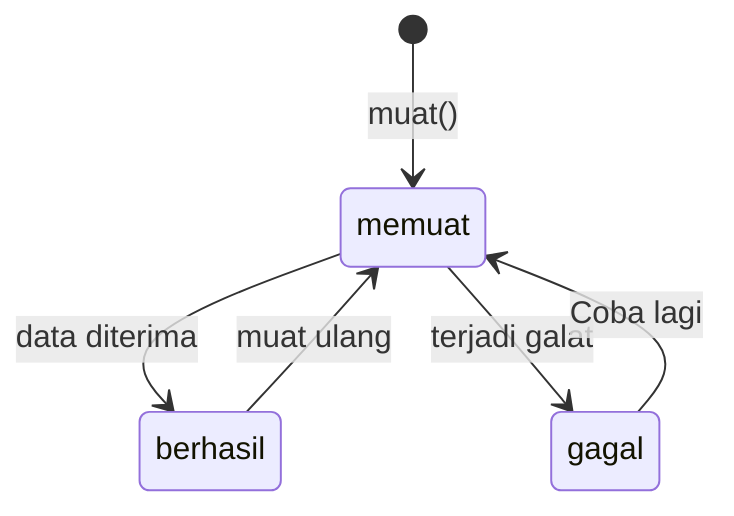

View tinggal memilih tampilan untuk setiap status dengan `switch` ekspresi:

```dart
// switch ekspresi: satu tampilan untuk setiap status.
final Widget isi = switch (vm.status) {
  StatusMuat.memuat => const TampilanMemuat(),
  StatusMuat.gagal => TampilanGagal(
    pesan: vm.pesanGalat,
    onCobaLagi: () => context.read<PengumumanViewModel>().muat(),
  ),
  StatusMuat.berhasil => DaftarPengumuman(daftar: vm.daftar),
};
```

Keuntungan `enum` + `switch`: jika kelak ada status baru, misalnya `kosong`, *analyzer* langsung menandai setiap `switch` yang belum menanganinya.

### 10.4 Menitipkan *repository* dan menyerahkannya ke ViewModel

*Repository* dititipkan sekali untuk seluruh aplikasi:

```dart
void main() {
  runApp(
    // Repository dititipkan sekali untuk seluruh aplikasi. Provider biasa
    // (bukan ChangeNotifierProvider), karena repository tidak mengumumkan
    // perubahan apa pun.
    Provider<RepositoriPengumuman>(
      create: (BuildContext context) => RepositoriPengumumanPalsu(),
      child: const AplikasiPengumuman(),
    ),
  );
}
```

Lalu ViewModel menerimanya lewat *constructor* saat dibuat:

```dart
home: ChangeNotifierProvider(
  create: (BuildContext context) => PengumumanViewModel(
    repositori: context.read<RepositoriPengumuman>(),
  )..muat(),
  child: const HalamanPengumuman(),
),
```

Tiga hal yang perlu diperhatikan:

1. Tipe *provider*-nya adalah **kontrak** (`Provider<RepositoriPengumuman>`), bukan *class* palsunya. Bagian lain aplikasi hanya mengenal kontrak. Saat Pertemuan 10 membuat *repository* yang benar-benar memanggil API, **hanya baris `create` di `main` yang diganti**.
2. ViewModel **tidak membuat** *repository*-nya sendiri; *repository* "disuntikkan" lewat *constructor*. Cara ini disebut ***dependency injection*** (Pertemuan 12 membahasnya lebih dalam).
3. Tanda `..` (*cascade*) berarti: buat objeknya, panggil `muat()` pada objek itu, lalu yang dikembalikan tetap **objeknya** (bukan hasil `muat()`). Jadi data langsung mulai dimuat begitu ViewModel dibuat.

### 10.5 Mencoba ketiga status

| Langkah | Yang terlihat |
| :--- | :--- |
| Jalankan aplikasi | Lingkaran berputar dan tulisan "Memuat pengumuman..." selama 1,5 detik, lalu empat pengumuman (percobaan ke-1 berhasil) |
| Tekan ikon muat ulang di `AppBar` | Memuat lagi, lalu ikon awan tercoret, pesan "Pengumuman gagal dimuat. Periksa koneksi, lalu coba lagi.", dan tombol **Coba lagi** (percobaan ke-2 sengaja gagal). Konsol menampilkan `Galat saat memuat: Exception: Server tidak dapat dihubungi` |
| Tekan **Coba lagi** | Memuat, lalu daftar muncul kembali (percobaan ke-3 berhasil) |

Selama memuat, ikon muat ulang **nonaktif** (`onPressed: null`), sehingga data tidak dimuat dua kali bersamaan.

<p align="center">
  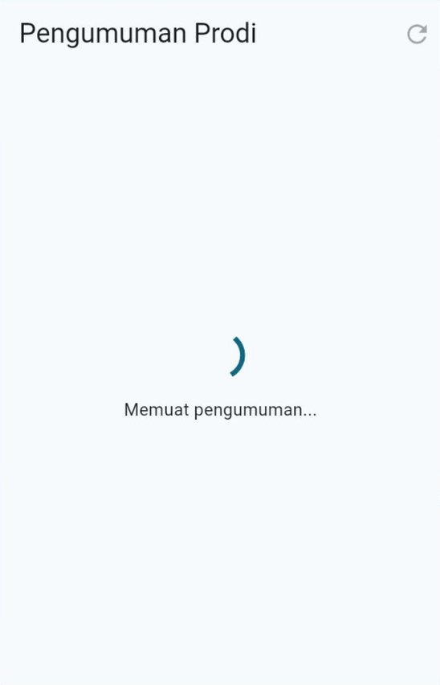
  &nbsp;
  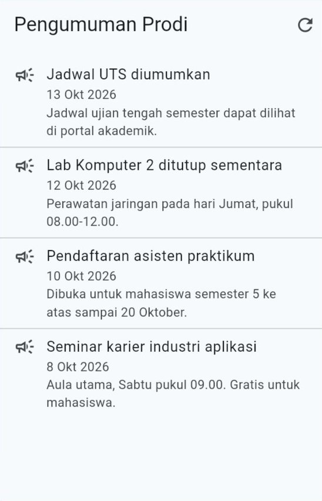
  &nbsp;
  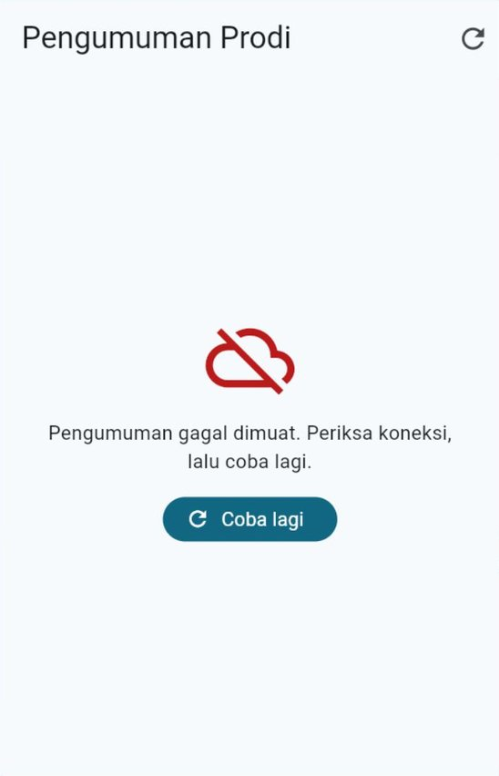
</p>

### 10.6 Mengapa ada `_sudahDibuang`?

Bayangkan halaman yang punya ViewModel sendiri sedang memuat data, lalu pengguna menekan tombol kembali sebelum 1,5 detik. Halaman ditutup, dan *provider* membuang (*dispose*) ViewModel-nya. Sedetik kemudian, `await` selesai dan `muat()` memanggil `notifyListeners()` pada objek yang **sudah dibuang**. Hasilnya *error* seperti di [Bagian 3.3](#33-siapa-yang-membuat-dan-membuang-objeknya):

```text
A PengumumanViewModel was used after being disposed.
Once you have called dispose() on a PengumumanViewModel, it can no longer be used.
```

Penjaganya sederhana: tandai saat `dispose()` dipanggil, lalu periksa tanda itu setelah setiap `await`.

```dart
@override
void dispose() {
  _sudahDibuang = true;
  super.dispose();
}
```

> **🧠 Cek Cepat:** Pertemuan 10 akan membuat `RepositoriPengumumanApi` yang mengambil pengumuman dari internet. Di Contoh 08, bagian mana saja yang perlu diubah?
>
> <details><summary>Lihat jawaban</summary>
>
> Selain menulis *class* barunya, hanya satu baris di `main` yang diubah: `create: (BuildContext context) => RepositoriPengumumanPalsu()` menjadi `RepositoriPengumumanApi()`. ViewModel dan View tidak berubah, karena keduanya hanya mengenal kontrak `RepositoriPengumuman`.
> </details>

---

## 11. Cakupan dan Umur *Provider*

### 11.1 Dua tempat memasang *provider*

**Letak** *provider* menentukan dua hal: **siapa** yang bisa memakainya dan **berapa lama** objeknya hidup. [Contoh 09](kode/contoh_09_cakupan_provider.dart) memakai dua letak sekaligus:

- `Simpanan` (daftar workshop yang disimpan) dititipkan **di atas `MaterialApp`**, di `main`.
- `PendaftaranViewModel` (jumlah peserta untuk satu workshop) dititipkan **di dalam rute** halaman pendaftaran:

```dart
void _bukaDetail(BuildContext context, Workshop workshop) {
  Navigator.push(
    context,
    MaterialPageRoute<void>(
      // Provider dipasang DI DALAM rute: hanya halaman ini yang bisa
      // memakainya, dan objeknya dibuang saat halaman ditutup.
      builder: (BuildContext context) => ChangeNotifierProvider(
        create: (BuildContext context) => PendaftaranViewModel(workshop),
        child: const HalamanPendaftaran(),
      ),
    ),
  );
}
```

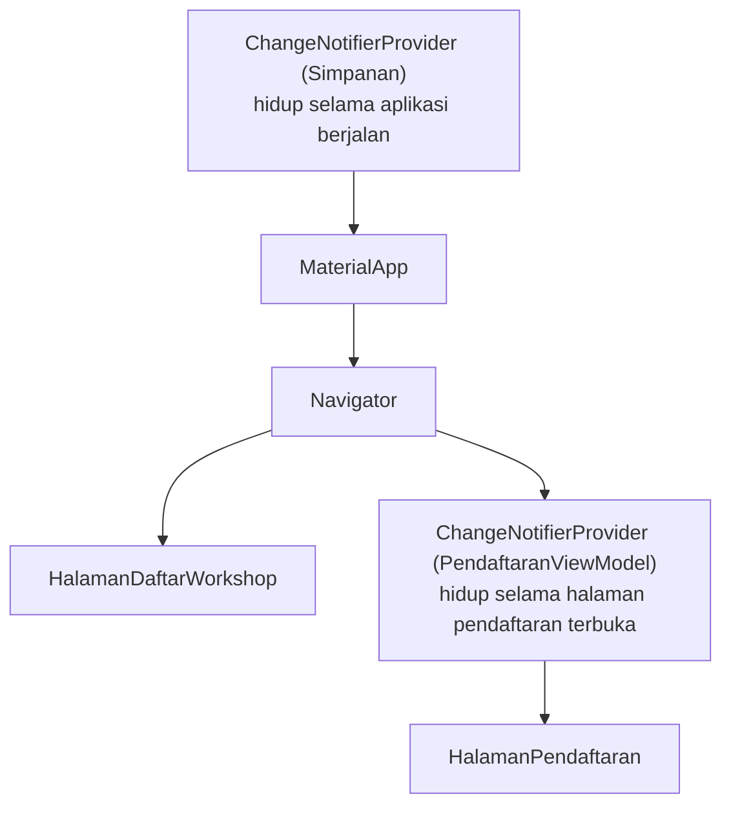

### 11.2 Membuktikannya

`PendaftaranViewModel` sengaja diberi nomor urut pembuatan dan menulis pesan ke konsol saat dibuat dan dibuang.

1. Ketuk **Desain UI dengan Figma**. Chip di halaman pendaftaran bertuliskan **ViewModel ke-1**. Tambah peserta menjadi 3 (total Rp150.000), lalu tekan **Simpan workshop ini**.
2. Kembali ke daftar. Ikon simpanan di `AppBar` kini berlencana **1**: `Simpanan` tetap hidup.
3. Buka workshop yang sama lagi. Chip bertuliskan **ViewModel ke-2** dan peserta kembali **1**, tetapi tombolnya tetap bertuliskan **Tersimpan**.

Konsol menampilkan:

```text
ViewModel ke-1 DIBUAT untuk "Desain UI dengan Figma"
ViewModel ke-1 DIBUANG
ViewModel ke-2 DIBUAT untuk "Desain UI dengan Figma"
```

<p align="center">
  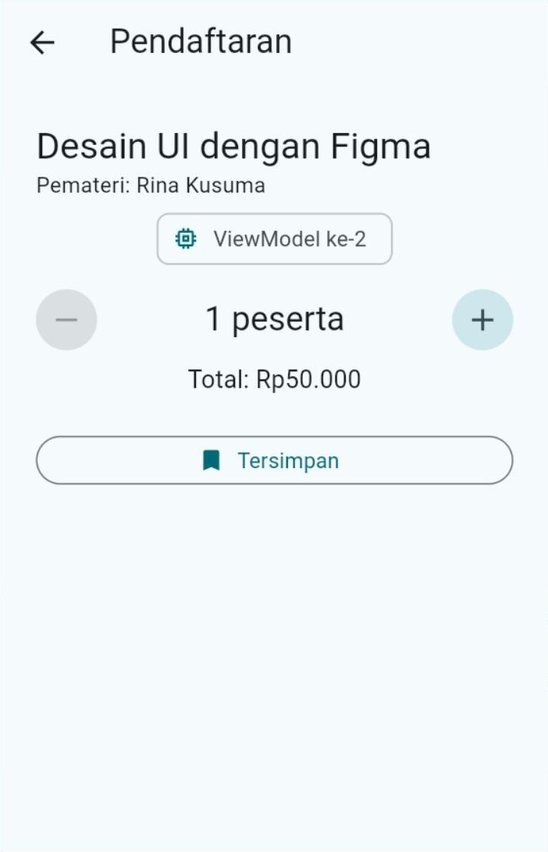
</p>

### 11.3 Memilih letak yang tepat

| Letak *provider* | Siapa yang bisa memakai | Umur objek | Cocok untuk |
| :--- | :--- | :--- | :--- |
| Di atas `MaterialApp` | Semua halaman | Selama aplikasi berjalan | *State* aplikasi: keranjang, pengguna yang masuk, pengaturan, simpanan, riwayat skor, *repository* |
| Di dalam `builder` sebuah rute | Halaman itu dan widget di bawahnya | Selama halaman itu terbuka | ViewModel halaman: formulir pendaftaran, jalannya satu kuis, detail satu barang |

Pertanyaan penentunya sama dengan [Bagian 2](#2-state-lokal-dan-state-aplikasi): **apakah datanya harus tetap ada setelah halamannya ditutup?**

### 11.4 Saat *provider* tidak ditemukan

Jika sebuah widget meminta objek yang tidak dititipkan di atasnya, aplikasi menampilkan *error* seperti ini (nama *class*-nya menyesuaikan):

```text
Error: Could not find the correct Provider<PendaftaranViewModel> above this HalamanRingkasan Widget
```

Penyebab yang paling sering:

| Penyebab | Solusi |
| :--- | :--- |
| *Provider* belum dipasang sama sekali | Pasang di `main` atau di rute yang tepat |
| *Provider* baru ditambahkan di `main`, lalu aplikasi hanya di-*hot reload* | Lakukan *hot restart* (`R` besar di terminal), karena *hot reload* tidak menjalankan ulang `main` |
| *Provider* dipasang di rute halaman **lain**. Halaman yang dibuka dengan `Navigator.push` bukan "anak" halaman sebelumnya; keduanya bersaudara di bawah `Navigator` | Pindahkan *provider* ke atas `MaterialApp` jika dipakai banyak halaman, atau teruskan objek yang sudah ada dengan `.value` (lihat di bawah) |
| `context` yang dipakai berada **di atas** *provider*, misalnya membaca *provider* di `build` yang sama tempat *provider* itu dibuat | Pindahkan bagian yang membaca ke widget (*class*) tersendiri di bawah *provider*, atau bungkus dengan `Consumer` |

**Meneruskan objek yang sudah ada ke halaman berikutnya.** Jika halaman baru hanya perlu "meminjam" ViewModel halaman sebelumnya, ambil objeknya dengan `read`, lalu titipkan lagi dengan `.value`:

```dart
final PendaftaranViewModel vm = context.read<PendaftaranViewModel>();
Navigator.push(
  context,
  MaterialPageRoute<void>(
    builder: (BuildContext context) => ChangeNotifierProvider.value(
      value: vm, // objek yang SUDAH ADA, bukan objek baru
      child: const HalamanRingkasan(),
    ),
  ),
);
```

Inilah kegunaan `.value` yang benar: objeknya sudah ada dan dimiliki *provider* lain. `.value` tidak membuangnya; yang membuang tetap *provider* yang membuatnya.

**`context` yang berada di atas *provider*:**

```dart
// ❌ SALAH: context milik widget ini berada DI ATAS provider yang dibuatnya.
@override
Widget build(BuildContext context) {
  return ChangeNotifierProvider(
    create: (BuildContext context) => Keranjang(),
    child: Text('${context.watch<Keranjang>().jumlah} barang'),
  );
}

// ✅ BENAR: Consumer punya context sendiri yang berada DI BAWAH provider.
@override
Widget build(BuildContext context) {
  return ChangeNotifierProvider(
    create: (BuildContext context) => Keranjang(),
    child: Consumer<Keranjang>(
      builder: (BuildContext context, Keranjang keranjang, Widget? child) {
        return Text('${keranjang.jumlah} barang');
      },
    ),
  );
}
```

> **🧠 Cek Cepat:** Di studi kasus Kuis Kampus, skor terbaik harus tetap tampil di beranda setelah halaman kuis ditutup, sedangkan setiap kuis harus dimulai dari soal pertama. Di mana `RiwayatSkor` dan `KuisViewModel` dititipkan?
>
> <details><summary>Lihat jawaban</summary>
>
> `RiwayatSkor` di atas `MaterialApp`, karena harus tetap hidup setelah halaman kuis ditutup. `KuisViewModel` di dalam rute halaman kuis, karena setiap kali halaman kuis dibuka harus dibuat objek baru yang mulai dari soal pertama.
> </details>

---

## 12. Menguji ViewModel Tanpa Layar

### 12.1 Mengapa bisa?

ViewModel adalah *class* Dart biasa: tidak berisi widget dan tidak butuh `BuildContext`. Artinya, kita bisa **membuat objeknya, memanggil perintahnya, lalu memeriksa hasilnya** langsung di kode, tanpa menjalankan layar dan tanpa mengetuk tombol. Itu salah satu alasan terbesar memakai MVVM.

### 12.2 Pola Siapkan–Lakukan–Periksa

[Contoh 10](kode/contoh_10_menguji_viewmodel.dart) memeriksa `KeranjangViewModel` milik sebuah toko. Aturan tokonya: **belanja mulai Rp100.000 mendapat diskon 10%**. Setiap pemeriksaan mengikuti tiga langkah:

```dart
// SIAPKAN dan LAKUKAN: buat ViewModel, lalu panggil perintahnya.
final KeranjangViewModel kopi = KeranjangViewModel()
  ..tambah('Kopi', 15000)
  ..tambah('Kopi', 15000);
// PERIKSA: bandingkan hasilnya dengan yang diharapkan.
hasil.add(periksa('Tambah kopi 2 kali: 2 barang', kopi.jumlahBarang, 2));
hasil.add(periksa('Total 2 kopi', kopi.total, 30000));
```

Fungsi `periksa` hanya membandingkan dua nilai dan mencatat hasilnya:

```dart
HasilUji periksa(String nama, Object didapat, Object diharapkan) {
  final bool lulus = didapat == diharapkan;
  return HasilUji(
    nama,
    lulus,
    lulus
        ? 'Hasil: $didapat'
        : 'Diharapkan $diharapkan, tetapi hasilnya $didapat',
  );
}
```

### 12.3 Menemukan *bug* di nilai batas

Jalankan Contoh 10. Layar menampilkan **7 dari 8 uji lulus**. Yang gagal:

```text
Diskon belanja TEPAT Rp100.000
Diharapkan 10000, tetapi hasilnya 0
```

<p align="center">
  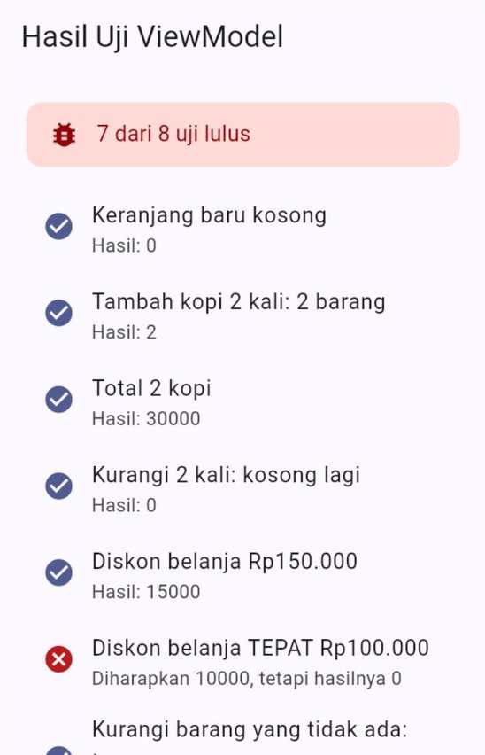
</p>

Penyebabnya ada di satu karakter:

```dart
int get diskon => total > 100000 ? total ~/ 10 : 0;
```

Aturannya "**mulai** Rp100.000", artinya Rp100.000 sendiri sudah mendapat diskon. Tanda `>` (lebih dari) tidak mencakup 100.000; yang benar `>=` (lebih dari atau sama dengan). Perbaiki, jalankan ulang, dan semua uji lulus.

*Bug* seperti ini disebut ***bug* nilai batas** (*boundary bug*), dan sangat sering terjadi. Kebiasaan yang baik: untuk setiap batas, uji tiga nilai, yaitu **tepat di bawah** (Rp99.999), **tepat di batas** (Rp100.000), dan **tepat di atas** (Rp100.001).

### 12.4 Memeriksa kapan `notifyListeners()` dipanggil

Pengumuman juga bisa diperiksa. Caranya: daftarkan pendengar yang hanya menghitung, persis seperti yang dilakukan `ListenableBuilder` dan `provider` di balik layar.

```dart
final KeranjangViewModel teh = KeranjangViewModel();
int jumlahPengumuman = 0;
teh.addListener(() => jumlahPengumuman++);
teh.kurangi('Teh');
hasil.add(
  periksa(
    'Kurangi barang yang tidak ada: tanpa pengumuman',
    jumlahPengumuman,
    0,
  ),
);
teh.tambah('Teh', 5000);
hasil.add(periksa('Tambah: tepat 1 pengumuman', jumlahPengumuman, 1));
```

Pemeriksaan pertama memastikan bahwa mengurangi barang yang **belum ada** tidak mengumumkan apa pun, karena memang tidak ada yang berubah. Mengumumkan perubahan padahal tidak ada yang berubah memang tidak merusak tampilan, tetapi membuat widget dibangun ulang tanpa perlu.

> [!NOTE]
> Contoh 10 menampilkan hasil uji di layar agar mudah diamati di DartPad. [Pertemuan 14](../SILABUS.md) memakai cara resminya: paket `flutter_test` dengan `test()` dan `expect()`, yang dijalankan lewat perintah `flutter test`. Gagasannya sama persis: siapkan, lakukan, periksa.

> **🧠 Cek Cepat:** Tuliskan satu pemeriksaan tambahan untuk memastikan belanja Rp99.999 **tidak** mendapat diskon.
>
> <details><summary>Lihat jawaban</summary>
>
> ```dart
> final KeranjangViewModel buku = KeranjangViewModel()..tambah('Buku', 99999);
> hasil.add(periksa('Belanja Rp99.999 tanpa diskon', buku.diskon, 0));
> ```
>
> Jangan lupa menambahkan `buku` ke daftar objek yang dibuang (*dispose*) di akhir `jalankanSemuaUji`.
> </details>

---

## 13. Menata Folder Proyek MVVM

### 13.1 Dari satu berkas ke banyak berkas

Semua contoh di pertemuan ini ditulis dalam **satu berkas** agar bisa langsung dijalankan di DartPad. Untuk proyek sungguhan, termasuk proyek akhir Anda, setiap peran disimpan di berkasnya sendiri. Berikut struktur yang kita pakai, disederhanakan dari studi kasus di panduan arsitektur resmi Flutter:

```text
tugas_kuliahku/
├── pubspec.yaml                      ← name: tugas_kuliahku
└── lib/
    ├── main.dart                     ← runApp, MultiProvider, MaterialApp
    ├── domain/
    │   └── models/
    │       └── tugas.dart            ← Model: Tugas, Prioritas
    ├── data/
    │   └── repositories/
    │       ├── repositori_tugas.dart         ← kontrak (abstract class)
    │       └── repositori_tugas_lokal.dart   ← implementasi
    └── ui/
        ├── core/
        │   └── tema.dart             ← tema dan widget yang dipakai bersama
        ├── daftar_tugas/
        │   ├── view_models/
        │   │   └── daftar_tugas_view_model.dart
        │   └── widgets/
        │       ├── halaman_tugas.dart
        │       └── baris_tugas.dart
        └── tambah_tugas/
            └── widgets/
                └── halaman_tambah_tugas.dart
```

| Folder | Isinya | Dikelompokkan menurut |
| :--- | :--- | :--- |
| `domain/models/` | Model: bentuk data | Jenis |
| `data/repositories/` | Kontrak dan implementasi *repository* | Jenis |
| `ui/core/` | Tema dan widget yang dipakai banyak fitur | — |
| `ui/<nama_fitur>/` | ViewModel (`view_models/`) dan widget (`widgets/`) milik satu fitur | Fitur (halaman) |

### 13.2 Aturan penamaan

| Aturan | Contoh |
| :--- | :--- |
| Nama berkas: huruf kecil, kata dipisah garis bawah (*snake_case*) | `daftar_tugas_view_model.dart` |
| Nama *class*: setiap kata diawali huruf besar (*UpperCamelCase*) | `DaftarTugasViewModel` |
| Satu berkas, satu tanggung jawab utama | ViewModel tidak dicampur dengan widget |

### 13.3 Mengimpor berkas lain di proyek sendiri

Berkas di dalam `lib/` saling memakai lewat `import 'package:<nama_proyek>/...'`. `<nama_proyek>` adalah isi `name:` di `pubspec.yaml`, dan jalurnya dimulai dari dalam folder `lib/`:

```dart
// lib/ui/daftar_tugas/view_models/daftar_tugas_view_model.dart
import 'package:flutter/foundation.dart';
import 'package:tugas_kuliahku/data/repositories/repositori_tugas.dart';
import 'package:tugas_kuliahku/domain/models/tugas.dart';
```

Perhatikan bahwa ViewModel cukup mengimpor `package:flutter/foundation.dart` (tempat `ChangeNotifier` berada), **bukan** `material.dart`. Jika sebuah ViewModel ternyata butuh `material.dart`, itu tanda ia mulai mengurusi tampilan.

Pemetaan isi Contoh 07 ke struktur di atas:

| Bagian di Contoh 07 | Pindah ke |
| :--- | :--- |
| `enum Prioritas`, `class Tugas` | `lib/domain/models/tugas.dart` |
| `DaftarTugasViewModel` | `lib/ui/daftar_tugas/view_models/daftar_tugas_view_model.dart` |
| `HalamanTugas` | `lib/ui/daftar_tugas/widgets/halaman_tugas.dart` |
| `BarisTugas` | `lib/ui/daftar_tugas/widgets/baris_tugas.dart` |
| `HalamanTambahTugas` | `lib/ui/tambah_tugas/widgets/halaman_tambah_tugas.dart` |
| `main()` dan `AplikasiTugas` | `lib/main.dart` |

Contoh 07 belum punya *repository* (empat tugas awalnya ditulis di ViewModel). Memindahkannya ke `RepositoriTugasLokal` adalah salah satu langkah di [Jobsheet](JOBSHEET.md).

> [!TIP]
> Jangan membuat folder yang belum dibutuhkan. Mulailah dari struktur di atas, lalu tambahkan folder baru saat memang diperlukan, misalnya `data/services/` untuk kode pemanggil API di Pertemuan 10.

---

## 14. Studi Kasus: Kuis Kampus

[Contoh 11](kode/contoh_11_studi_kasus_kuis_kampus.dart) merangkai semua materi hari ini menjadi satu aplikasi kuis untuk mengulang materi kuliah.

| Halaman | Fitur |
| :--- | :--- |
| Beranda | Jumlah kuis yang sudah diselesaikan, tiga topik (Dasar Dart, Widget & Tata Letak, State & Navigasi), dan skor terbaik setiap topik |
| Kuis | Lima soal yang dimuat dari *repository*. Jawaban langsung dinilai (benar atau salah) beserta pembahasannya, dan tidak bisa diganti setelah dipilih |
| Hasil | Skor, pesan sesuai skor, ringkasan jawaban, serta tombol kembali ke beranda dan ulangi kuis |

### 14.1 Peta arsitektur

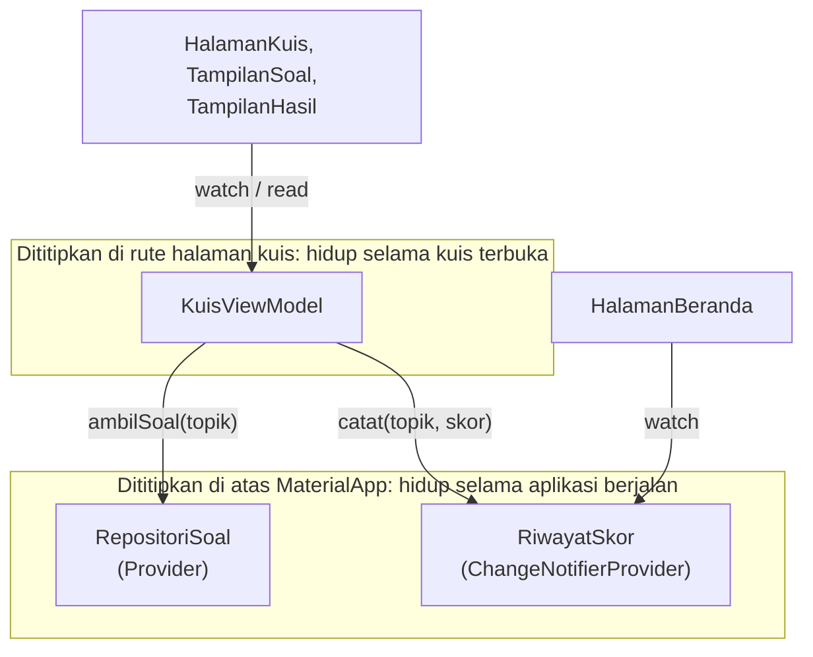

| Bagian | Peran | Letak |
| :--- | :--- | :--- |
| `Topik`, `Soal`, `Skor` | Model | — |
| `RepositoriSoal`, `RepositoriSoalLokal` | *Repository* | Di atas `MaterialApp` (`Provider`) |
| `RiwayatSkor` | *State* aplikasi | Di atas `MaterialApp` (`ChangeNotifierProvider`) |
| `KuisViewModel` | ViewModel halaman kuis | Di dalam rute halaman kuis |
| `HalamanBeranda`, `KartuTopik`, `HalamanKuis`, `TampilanSoal`, `KartuPilihan`, `KartuPembahasan`, `TampilanHasil` | View | — |

### 14.2 Langkah 1 — Model

```dart
enum Topik {
  dart('Dasar Dart', Icons.code),
  widget('Widget & Tata Letak', Icons.widgets),
  state('State & Navigasi', Icons.sync_alt);

  const Topik(this.label, this.ikon);

  final String label;
  final IconData ikon;
}
```

Setiap nilai `enum Topik` membawa label dan ikonnya sendiri, sehingga beranda cukup menulis `for (final Topik topik in Topik.values)` untuk menampilkan semua topik. Dua Model lainnya sederhana:

| Model | *Field* |
| :--- | :--- |
| `Soal` | `pertanyaan`, daftar `pilihan`, `indeksBenar` (posisi jawaban benar, dimulai dari 0), dan `pembahasan` |
| `Skor` | Jumlah jawaban `benar` dan `jumlahSoal` |

### 14.3 Langkah 2 — *Repository*

```dart
abstract class RepositoriSoal {
  Future<List<Soal>> ambilSoal(Topik topik);
}

// Soal disimpan di kode. Pertemuan 10 bisa menggantinya dengan soal dari
// REST API tanpa mengubah ViewModel maupun View.
class RepositoriSoalLokal implements RepositoriSoal {
  @override
  Future<List<Soal>> ambilSoal(Topik topik) async {
    await Future<void>.delayed(const Duration(milliseconds: 800));
    return switch (topik) {
      Topik.dart => soalDart,
      Topik.widget => soalWidget,
      Topik.state => soalState,
    };
  }
}
```

### 14.4 Langkah 3 — *State* aplikasi: `RiwayatSkor`

```dart
class RiwayatSkor extends ChangeNotifier {
  final Map<Topik, Skor> _terbaik = {};
  int _jumlahKuis = 0;

  int get jumlahKuis => _jumlahKuis;
  Skor? terbaik(Topik topik) => _terbaik[topik];

  void catat(Topik topik, Skor skor) {
    _jumlahKuis++;
    final Skor? lama = _terbaik[topik];
    if (lama == null || skor.benar > lama.benar) {
      _terbaik[topik] = skor;
    }
    notifyListeners();
  }
}
```

`terbaik(topik)` mengembalikan `null` jika topik itu belum pernah dicoba. Skor terbaik hanya diganti jika skor baru **lebih tinggi**, sedangkan `jumlahKuis` selalu bertambah setiap kali sebuah kuis selesai.

> [!NOTE]
> Agar contoh tetap sederhana, `RiwayatSkor` adalah `ChangeNotifier` aplikasi yang dipanggil langsung oleh `KuisViewModel`. Saat skor perlu disimpan permanen di perangkat (Pertemuan 11), data seperti ini sebaiknya dipindahkan ke *repository*, karena panduan resmi menyarankan ViewModel mengambil dan menyimpan data lewat *repository*.

### 14.5 Langkah 4 — ViewModel halaman: `KuisViewModel`

**Data privatnya:**

| Data | Artinya |
| :--- | :--- |
| `_status` | `StatusKuis.memuat`, `gagal`, `menjawab`, atau `selesai` |
| `_soal` | Lima soal dari *repository* |
| `_jawaban` | `List<int?>`: pilihan untuk setiap soal. `null` berarti belum dijawab |
| `_indeks` | Posisi soal yang sedang tampil |

**Perintahnya:**

| Perintah | Dipanggil saat | Yang dilakukan |
| :--- | :--- | :--- |
| `muat()` | ViewModel dibuat, atau tombol "Coba lagi" diketuk | Mengambil soal dari *repository*; status berpindah dari memuat ke menjawab (atau gagal) |
| `pilih(i)` | Sebuah pilihan jawaban diketuk | Mencatat jawaban, **sekali saja** |
| `lanjut()` | Tombol "Soal berikutnya" atau "Lihat hasil" diketuk | Pindah ke soal berikutnya. Di soal terakhir: status menjadi selesai dan skor dicatat ke `RiwayatSkor` |
| `ulangi()` | Tombol "Ulangi kuis" diketuk | Mengosongkan jawaban dan kembali ke soal pertama tanpa memuat ulang soal |

Dua perintah terpenting:

```dart
void pilih(int indeksPilihan) {
  // Jawaban yang sudah dipilih tidak bisa diganti.
  if (_status != StatusKuis.menjawab || sudahDijawab) {
    return;
  }
  _jawaban[_indeks] = indeksPilihan;
  notifyListeners();
}

void lanjut() {
  if (!sudahDijawab) {
    return;
  }
  if (soalTerakhir) {
    _status = StatusKuis.selesai;
    _riwayat.catat(topik, Skor(benar: skor, jumlahSoal: jumlahSoal));
  } else {
    _indeks++;
  }
  notifyListeners();
}
```

Perhatikan bahwa aturan permainan, seperti "jawaban tidak bisa diganti" dan "skor dicatat di soal terakhir", dijaga oleh ViewModel. Walaupun View lupa menonaktifkan sebuah tombol, aturannya tetap berlaku.

ViewModel bahkan menyiapkan **keadaan setiap pilihan**, sehingga View tinggal memilih warna:

```dart
// Keadaan setiap pilihan juga disiapkan ViewModel, agar View tinggal
// memilih warnanya.
KeadaanPilihan keadaanPilihan(int indeksPilihan) {
  if (!sudahDijawab) {
    return KeadaanPilihan.biasa;
  }
  if (indeksPilihan == soalSekarang.indeksBenar) {
    return KeadaanPilihan.benar;
  }
  if (indeksPilihan == _jawaban[_indeks]) {
    return KeadaanPilihan.salah;
  }
  return KeadaanPilihan.biasa;
}
```

Pesan di halaman hasil juga dihitung ViewModel:

```dart
String get pesanHasil {
  if (skor == jumlahSoal) {
    return 'Sempurna! Kamu menguasai topik ini.';
  }
  if (skor * 10 >= jumlahSoal * 6) {
    return 'Bagus! Tinggal sedikit lagi.';
  }
  return 'Baca lagi modulnya, lalu coba sekali lagi.';
}
```

`skor * 10 >= jumlahSoal * 6` artinya "skor minimal 60%". Ditulis dengan perkalian bilangan bulat agar tidak perlu pembagian desimal.

### 14.6 Langkah 5 — View

**Membuat `KuisViewModel` di rute halaman kuis.** Setiap kali sebuah topik diketuk, rute baru dibuat beserta ViewModel barunya:

```dart
void _mulaiKuis(BuildContext context, Topik topik) {
  Navigator.push(
    context,
    MaterialPageRoute<void>(
      // KuisViewModel hanya hidup selama halaman kuis terbuka.
      builder: (BuildContext context) => ChangeNotifierProvider(
        create: (BuildContext context) => KuisViewModel(
          topik: topik,
          repositori: context.read<RepositoriSoal>(),
          riwayat: context.read<RiwayatSkor>(),
        )..muat(),
        child: const HalamanKuis(),
      ),
    ),
  );
}
```

**Satu tampilan untuk setiap status.**

```dart
final Widget isi = switch (vm.status) {
  StatusKuis.memuat => const Center(child: CircularProgressIndicator()),
  StatusKuis.gagal => Center(
    child: FilledButton.icon(
      onPressed: () => context.read<KuisViewModel>().muat(),
      icon: const Icon(Icons.refresh),
      label: const Text('Soal gagal dimuat. Coba lagi'),
    ),
  ),
  StatusKuis.menjawab => const TampilanSoal(),
  StatusKuis.selesai => const TampilanHasil(),
};
```

**Warna pilihan jawaban.** `KartuPilihan` menerjemahkan `KeadaanPilihan` menjadi warna dari skema warna tema ([Pertemuan 7](../pertemuan_07_material3_dan_responsif/README.md)):

| `KeadaanPilihan` | Latar | Tanda |
| :--- | :--- | :--- |
| `biasa` | `surface` | — |
| `benar` | `primaryContainer` | Ikon centang dengan `semanticLabel: 'Benar'` |
| `salah` | `errorContainer` | Ikon silang dengan `semanticLabel: 'Salah'` |

Benar dan salah tidak hanya dibedakan dengan **warna**, tetapi juga dengan **ikon** berlabel, agar tetap jelas bagi pengguna yang sulit membedakan warna dan bagi pembaca layar.

### 14.7 Hasilnya

<p align="center">
  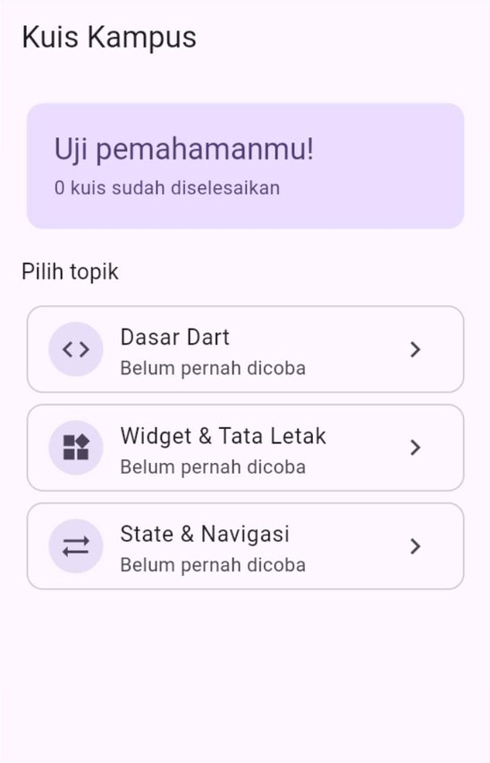
  &nbsp;
  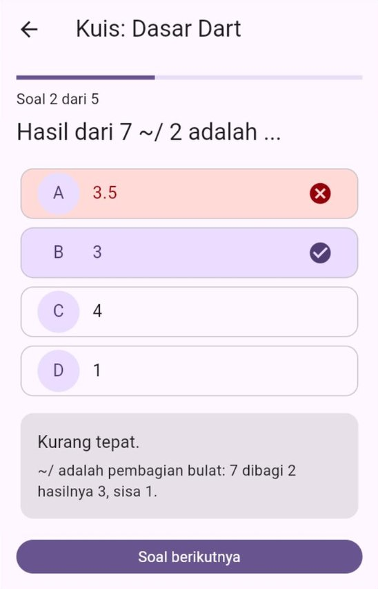
</p>
<p align="center">
  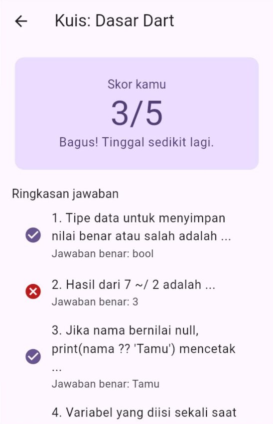
  &nbsp;
  
</p>

### 14.8 Uji mandiri

Jalankan Contoh 11, lalu centang setiap perilaku yang sudah Anda buktikan:

- [ ] Beranda awal menampilkan "0 kuis sudah diselesaikan" dan semua topik "Belum pernah dicoba".
- [ ] Memilih topik menampilkan lingkaran memuat sebentar, lalu "Soal 1 dari 5".
- [ ] Setelah sebuah pilihan diketuk, pilihan lain tidak bisa diketuk lagi.
- [ ] Tombol "Soal berikutnya" baru muncul setelah menjawab; di soal kelima tulisannya "Lihat hasil".
- [ ] Skor di halaman hasil sama dengan jumlah jawaban yang benar.
- [ ] Setelah kembali ke beranda, jumlah kuis bertambah dan skor terbaik topik itu tampil.
- [ ] Mengulang kuis dengan skor **lebih rendah** tidak menurunkan skor terbaik.
- [ ] Menekan tombol kembali saat soal masih dimuat tidak menimbulkan *error* di konsol (berkat `_sudahDibuang`).
- [ ] Saat perangkat atau *browser* memakai mode gelap, semua teks tetap terbaca.

> [!NOTE]
> Status `gagal` belum pernah muncul karena `RepositoriSoalLokal` tidak pernah gagal. Status itu sudah disiapkan untuk Pertemuan 10, saat soal diambil dari internet.

---

## 15. Kesalahan Umum Pemula dan Solusinya

| Gejala | Penyebab | Solusi |
| :--- | :--- | :--- |
| *Error* `Target of URI doesn't exist: 'package:provider/provider.dart'` | Paket `provider` belum dipasang di proyek | Jalankan `flutter pub add provider` di folder proyek |
| Data berubah, tetapi layar tidak | Lupa memanggil `notifyListeners()` di metode pengubah | Akhiri setiap metode yang mengubah data dengan `notifyListeners()` |
| Layar tidak pernah berubah walaupun `notifyListeners()` sudah dipanggil | Widget memakai `context.read` di dalam `build` | Di `build`, pakai `context.watch` atau `context.select` |
| `Tried to listen to a value exposed with provider, from outside of the widget tree.` | `context.watch` dipakai di dalam `onPressed` atau *callback* lain | Di dalam *callback*, pakai `context.read` |
| ``Tried to use `context.select` outside of the `build` method of a widget.`` | `context.select` dipakai di dalam *callback* | Di dalam *callback*, pakai `context.read` |
| `Error: Could not find the correct Provider<...> above this ... Widget` | *Provider* belum dipasang, dipasang di rute lain, baru ditambahkan lalu hanya di-*hot reload*, atau `context`-nya berada di atas *provider* | Lihat [Bagian 11.4](#114-saat-provider-tidak-ditemukan) |
| `A ... was used after being disposed.` | `notifyListeners()` dipanggil setelah halaman (dan ViewModel-nya) ditutup, biasanya setelah `await` | Tambahkan penjaga `_sudahDibuang` ([Bagian 10.6](#106-mengapa-ada-_sudahdibuang)) |
| `ValueNotifier<List<...>>` tidak memperbarui tampilan | Isi `List` diubah dengan `.add(...)`, objeknya tetap sama | Ganti `.value` dengan `List` baru: `[...lama, baru]` |
| Isi keranjang (atau *state* lain) kembali kosong secara tiba-tiba | Objek dibuat di dalam `build`, atau dibuat baru lewat `.value(value: Keranjang())` | Buat objek di `create` milik *provider* |
| Data hilang setiap kali halaman ditutup, padahal harus tetap ada | *Provider* dipasang di dalam rute halaman itu | Pindahkan *provider* ke atas `MaterialApp` |
| Seluruh halaman dibangun ulang padahal yang berubah hanya satu angka | `context.watch` dipakai di widget besar | Pakai `context.select`, bungkus bagian kecil dengan `Consumer`, atau pecah menjadi widget lebih kecil |
| Perhitungan dan aturan (diskon, saringan, skor) tersebar di widget | Logika ditulis di View | Pindahkan ke *getter* dan perintah ViewModel |
| ViewModel menyimpan `BuildContext` untuk menampilkan `SnackBar` | ViewModel mengurusi tampilan | ViewModel cukup mengubah data; `SnackBar`, dialog, dan navigasi dikerjakan View |

---

## 16. Ringkasan

- ***State* lokal** (dipakai satu halaman, boleh hilang) tetap memakai `setState`. ***State* aplikasi** (dipakai banyak halaman, harus tetap ada) disimpan di luar widget.
- **`ChangeNotifier`** menyimpan data privat, membuka *getter*, dan memanggil **`notifyListeners()`** di setiap metode pengubah. Objeknya harus dibuang dengan `dispose()`.
- **`ListenableBuilder`** dan **`ValueListenableBuilder`** membangun ulang sebagian layar saat objek yang didengarkan berubah. **`ValueNotifier`** cocok untuk satu nilai sederhana; untuk `List`, ganti `.value` dengan `List` baru.
- Paket **`provider`** menitipkan objek di pohon widget. **`ChangeNotifierProvider`** membuat objek di `create` dan membuangnya otomatis; **`MultiProvider`** menitipkan beberapa objek sekaligus.
- **Menampilkan data → `watch` atau `select`. Memanggil metode → `read`.** `Consumer` membatasi bagian yang dibangun ulang.
- **MVVM** memisahkan **Model** (bentuk data), **View** (widget yang menampilkan dan meneruskan kejadian), dan **ViewModel** (*state* halaman, *getter*, dan perintah). Data mengalir satu arah.
- ***Repository*** menyediakan data lewat sebuah kontrak, sehingga sumber datanya bisa diganti tanpa mengubah ViewModel dan View. Status **memuat–berhasil–gagal** ditulis sebagai `enum`.
- **Letak *provider* menentukan cakupan dan umur objek**: di atas `MaterialApp` untuk seluruh aplikasi, di dalam rute untuk satu halaman.
- Logika di ViewModel bisa **diuji tanpa layar** dengan pola siapkan–lakukan–periksa. Uji selalu nilai batas.

**Memilih alat yang tepat:**

| Kebutuhan | Pakai |
| :--- | :--- |
| Data yang hanya dipakai satu widget atau satu halaman | `StatefulWidget` + `setState` |
| Satu nilai yang didengarkan beberapa widget di satu halaman | `ValueNotifier` + `ValueListenableBuilder` |
| Beberapa data dan aturan untuk satu halaman | ViewModel (`ChangeNotifier`) yang dititipkan di rute halaman itu |
| Data yang dipakai banyak halaman | `ChangeNotifier` + `ChangeNotifierProvider` di atas `MaterialApp` |
| Sumber data (kode, API, penyimpanan perangkat) | *Repository* dengan kontrak `abstract class`, dititipkan dengan `Provider` |

---

## 17. Glosarium

| Istilah | Arti |
| :--- | :--- |
| ***State* lokal** (*ephemeral state*) | Data yang hanya dipakai satu widget atau satu halaman, misalnya tab terpilih atau teks yang sedang diketik |
| ***State* aplikasi** (*app state*) | Data yang dipakai banyak bagian aplikasi dan harus tetap ada, misalnya isi keranjang atau pengaturan |
| ***Prop drilling*** | Mengoper data lewat *constructor* dari tingkat ke tingkat, termasuk melewati widget yang tidak memakainya |
| **`ChangeNotifier`** | *Class* bawaan Flutter yang bisa mengumumkan perubahan kepada pendengarnya |
| **`notifyListeners()`** | Metode untuk mengumumkan bahwa data sudah berubah |
| **Pendengar** (*listener*) | Fungsi atau widget yang terdaftar untuk diberi tahu saat data berubah |
| **`ListenableBuilder`** | Widget yang menjalankan `builder` lagi setiap kali objek yang didengarkan mengumumkan perubahan |
| **`ValueNotifier`** | `ChangeNotifier` siap pakai untuk satu nilai; mengumumkan perubahan saat `.value` diganti dengan nilai berbeda |
| **`provider`** | Paket untuk menitipkan objek di pohon widget agar bisa diambil widget di bawahnya |
| **`ChangeNotifierProvider`** | Widget dari paket `provider` yang membuat, menitipkan, dan membuang sebuah `ChangeNotifier` |
| **`MultiProvider`** | Widget untuk menitipkan beberapa *provider* sekaligus tanpa menyusunnya bertingkat |
| **`watch` / `select` / `read`** | Cara mengambil objek dari *provider*: mendengarkan semua perubahan / mendengarkan sebagian / tidak mendengarkan |
| **`Consumer`** | Widget yang mendengarkan *provider* dan hanya membangun ulang isi `builder`-nya |
| **MVVM** | *Model–View–ViewModel*: pola yang memisahkan bentuk data, tampilan, dan logika halaman |
| **Model** | *Class* yang menggambarkan bentuk data, misalnya `Tugas` |
| **View** | Widget yang menampilkan data dan meneruskan kejadian ke ViewModel |
| **ViewModel** | *Class* yang menyimpan *state* sebuah halaman beserta logikanya, dan menyiapkan data siap tampil |
| **Perintah** (*command*) | Metode ViewModel yang dipanggil View, misalnya `tambah` atau `muat` |
| ***Repository*** | *Class* yang bertugas menyediakan data bagi ViewModel, apa pun sumbernya |
| **Kontrak** | `abstract class` yang menyebutkan metode yang wajib ada tanpa isinya |
| ***Dependency injection*** | Memberikan kebutuhan sebuah objek (misalnya *repository*) dari luar, lewat *constructor*, alih-alih dibuat sendiri |
| **Alur data satu arah** | Kejadian mengalir dari View ke ViewModel, data mengalir dari ViewModel ke View |
| ***Immutable*** | Tidak bisa diubah setelah dibuat; semua *field* `final` |
| **Cakupan** (*scope*) | Bagian pohon widget yang bisa memakai sebuah *provider* |
| ***Bug* nilai batas** | Kesalahan tepat di batas sebuah aturan, misalnya `>` yang seharusnya `>=` |

---

## 18. Referensi

1. Flutter. *State management*. <https://docs.flutter.dev/data-and-backend/state-mgmt/intro>
2. Flutter. *Differentiate between ephemeral state and app state*. <https://docs.flutter.dev/data-and-backend/state-mgmt/ephemeral-vs-app>
3. Flutter. *Simple app state management*. <https://docs.flutter.dev/data-and-backend/state-mgmt/simple>
4. Flutter. *Guide to app architecture*. <https://docs.flutter.dev/app-architecture/guide>
5. Flutter. *Architecture case study*. <https://docs.flutter.dev/app-architecture/case-study>
6. Flutter. *Architecture recommendations and resources*. <https://docs.flutter.dev/app-architecture/recommendations>
7. Flutter API. *ChangeNotifier class*. <https://api.flutter.dev/flutter/foundation/ChangeNotifier-class.html>
8. Flutter API. *ListenableBuilder class*. <https://api.flutter.dev/flutter/widgets/ListenableBuilder-class.html>
9. Flutter API. *ValueNotifier class*. <https://api.flutter.dev/flutter/foundation/ValueNotifier-class.html>
10. pub.dev. *provider*. <https://pub.dev/packages/provider>
11. Dart. *Effective Dart: Style*. <https://dart.dev/effective-dart/style>

---

## ➡️ Langkah Berikutnya

1. Kerjakan [🧪 Jobsheet Pertemuan 9](JOBSHEET.md) di laboratorium.
2. Kerjakan [✍️ Latihan Pertemuan 9](LATIHAN.md) untuk menguji pemahaman Anda.
3. **Proyek akhir dimulai.** Baca [🚀 Panduan Proyek Akhir](../panduan/05_proyek_akhir.md), bentuk tim sesuai arahan dosen, lalu kumpulkan **proposal** Anda.
4. Pertemuan 10 membahas **Asinkron & Integrasi REST API**. *Repository* palsu di Contoh 08 dan `RepositoriSoalLokal` di Contoh 11 akan diganti *repository* yang benar-benar mengambil data dari internet, tanpa mengubah ViewModel dan View.

[⬆️ Kembali ke atas](#pertemuan-9--manajemen-state--pola-mvvm)
