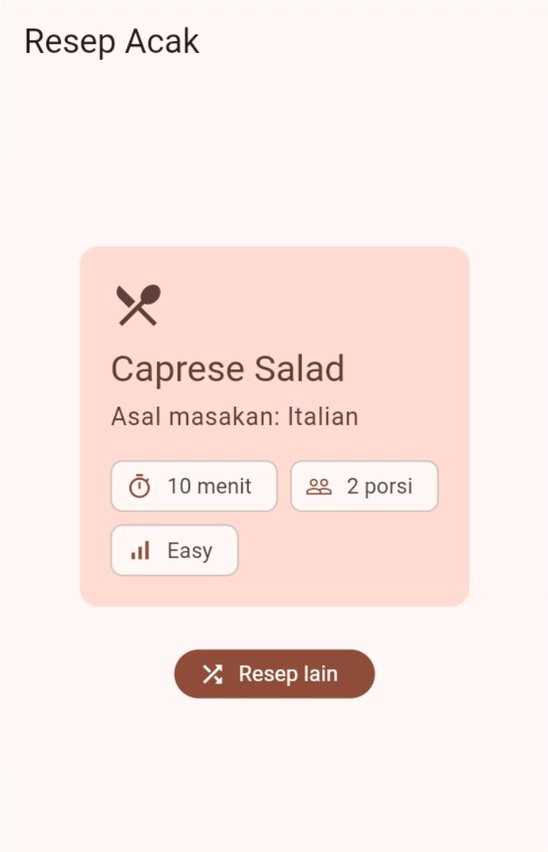
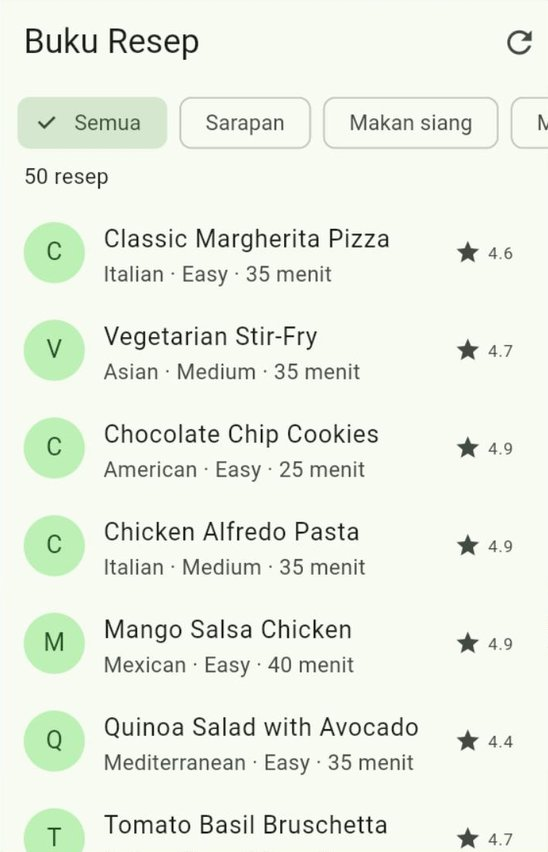
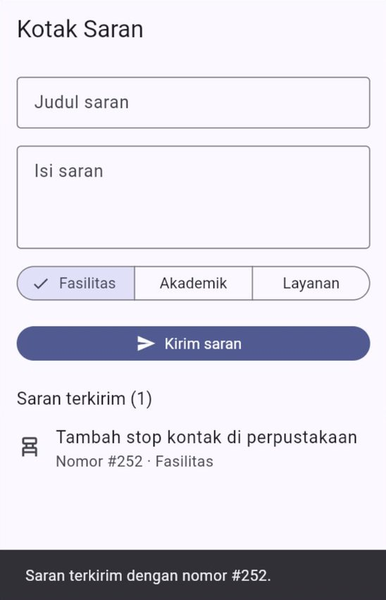
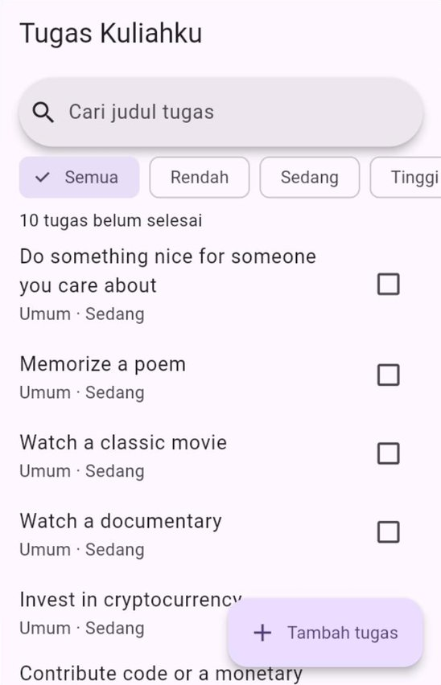

# 🧪 Jobsheet Pertemuan 10 — Asinkron & Integrasi REST API

[🏠 Beranda](../README.md) · [📖 Modul](README.md) · [✍️ Latihan](LATIHAN.md) · [💻 Kode Contoh](kode/)

| Informasi | Keterangan |
| :--- | :--- |
| Mata kuliah | Pemrograman Piranti Bergerak |
| Pertemuan | 10 — Asinkron & Integrasi REST API |
| Bentuk kegiatan | Praktikum individu |
| Estimasi waktu | 150 menit |
| Alat | Praktikum 1–4: DartPad **atau** proyek Flutter di VS Code yang dijalankan di Chrome. Praktikum 5: **wajib** proyek `tugas_kuliahku` dari Pertemuan 9 |
| Paket | `http` untuk semua praktikum, `provider` untuk Praktikum 3 dan 5. DartPad sudah menyediakan keduanya; di proyek Flutter, jalankan `flutter pub add http provider` sekali |
| Koneksi | Semua praktikum **butuh internet**, kecuali langkah pemeriksaan dengan `MockClient` |
| Hasil akhir | Proyek "Tugas Kuliahku" yang mengambil data dari internet lengkap dengan status memuat dan pesan galat, ditambah empat aplikasi kecil: resep acak, kontak alumni, buku resep MVVM, dan kotak saran |

---

## 🎯 Tujuan Praktikum

Setelah menyelesaikan jobsheet ini, Anda mampu:

1. Mengirim permintaan `GET` dengan paket `http`, memeriksa kode status, lalu mengubah JSON menjadi data yang ditampilkan.
2. Membuat *factory* `fromJson` dengan pola Dart 3, termasuk untuk objek bertingkat, dan menampilkan hasil `Future` dengan `FutureBuilder` tanpa terjebak membuat `Future` di dalam `build`.
3. Menyusun lapisan data (layanan dan *repository*) untuk ViewModel, lengkap dengan status memuat–berhasil–gagal dan pesan galat yang ramah.
4. Mengirim data dengan `POST` secara benar (`jsonEncode` dan *header* `Content-Type`), serta mencegah data terkirim dua kali.
5. Menguji lapisan data tanpa internet dengan `MockClient`, dan menyambungkan proyek "Tugas Kuliahku" ke REST API.

## 📌 Petunjuk Umum

> [!IMPORTANT]
> 1. Setiap praktikum diawali **kode terbimbing**. **Ketik sendiri** kodenya, kecuali bagian yang ditandai *boleh disalin*.
> 2. Kerjakan **🔧 Modifikasi** di setiap praktikum. Jawaban berupa penjelasan ditulis sebagai **komentar** di dalam kode.
> 3. Simpan Praktikum 1–4 sebagai berkas terpisah berisi kode **lengkap**: `praktikum1.dart` sampai `praktikum4.dart`. Praktikum 5 berupa folder `lib/` dari proyek `tugas_kuliahku`.
> 4. Rapikan kode sebelum menyimpan: tombol **Format** di DartPad, atau `Shift` + `Alt` + `F` di VS Code. Pastikan tidak ada garis merah maupun kuning.
> 5. **Aturan hari ini:** setiap permintaan ke internet (1) memeriksa kode status **sebelum** membaca isi jawaban, (2) punya tampilan memuat **dan** tampilan gagal, serta (3) memeriksa `mounted` (di halaman) atau `_sudahDibuang` (di ViewModel) setelah `await`.
> 6. Banyak modifikasi berupa **eksperimen**: Anda sengaja membuat kesalahan untuk melihat akibatnya. Setelah akibatnya dicatat sebagai komentar, **kembalikan** kodenya seperti semula, kecuali diminta lain.

> [!NOTE]
> Server latihan [DummyJSON](https://dummyjson.com) gratis dan tidak memerlukan pendaftaran, tetapi hanya **berpura-pura** menyimpan data yang dikirim ([Modul Bagian 11.1](README.md#111-post-menambah-data-baru)). Datanya berbahasa Inggris, sedangkan tulisan di aplikasi kita tetap berbahasa Indonesia.

> [!TIP]
> **Di mana melihat isi konsol?** Hampir semua praktikum mencetak keterangan dengan `debugPrint`.
> - **DartPad:** panel **Console** di bawah panel aplikasi.
> - **VS Code:** tab **Debug Console** saat aplikasi dijalankan dengan **F5**.
> - **Terminal:** keluaran perintah `flutter run -d chrome`.

<details>
<summary>❓ Lupa cara menjalankan aplikasi Flutter?</summary>

- **DartPad:** buka <https://dartpad.dev>, hapus kode bawaannya, tempelkan kode Anda, lalu klik **Run**. Paket `http` dan `provider` sudah tersedia, jadi baris `import`-nya langsung bisa dipakai.
- **Proyek Flutter:** buka proyek latihan dari Pertemuan 1 di VS Code. Jalankan `flutter pub add http provider` **sekali** di terminal folder proyek, lalu ganti seluruh isi `lib/main.dart` dengan kode Anda dan jalankan dengan **F5** (atau `flutter run -d chrome`). Jika Anda mengubah isi `main()` atau alamat server lalu tampilannya tidak berubah, lakukan *hot restart* dengan menekan `R`.

Penjelasan lengkap ada di [Modul Pertemuan 1, Bagian 9](../pertemuan_01_pengenalan_flutter/README.md#9-menjalankan-aplikasi).
</details>

---

## Praktikum 1 — Resep Acak

**Konsep:** `http.get`, kode status, `jsonDecode`, tampilan memuat dan gagal dengan `setState`, serta `mounted`. ([Modul Bagian 2](README.md#2-anatomi-permintaan-dan-jawaban-http), [Bagian 4](README.md#4-paket-http-permintaan-pertama), dan [Bagian 5](README.md#5-membedah-jawaban-server))

Anda membuat aplikasi yang menampilkan satu resep acak. Setiap kali tombol **Resep lain** ditekan, aplikasi meminta resep bernomor acak (1 sampai 30) ke alamat `https://dummyjson.com/recipes/{nomor}`.

> [!TIP]
> Sebelum mengetik, buka <https://dummyjson.com/recipes/1> di *browser*. Perhatikan kunci `name`, `cuisine`, `difficulty`, `prepTimeMinutes`, `cookTimeMinutes`, dan `servings`. Hanya kunci-kunci itu yang akan kita pakai; kunci lainnya diabaikan.

### Langkah 1 — Model dan aplikasi (ketik sendiri)

```dart
import 'dart:convert';
import 'dart:math';

import 'package:flutter/material.dart';
import 'package:http/http.dart' as http;

void main() {
  runApp(const AplikasiResep());
}

// ---------- Langkah 1: model dan aplikasi ----------
// Ringkasan satu resep. Datanya diisi dari jawaban server.
class Resep {
  const Resep({
    required this.nama,
    required this.asal,
    required this.kesulitan,
    required this.menit,
    required this.porsi,
  });

  final String nama;
  final String asal; // asal masakan, misalnya "Italian"
  final String kesulitan; // "Easy" atau "Medium"
  final int menit; // waktu persiapan + waktu memasak
  final int porsi;
}

class AplikasiResep extends StatelessWidget {
  const AplikasiResep({super.key});

  @override
  Widget build(BuildContext context) {
    return MaterialApp(
      debugShowCheckedModeBanner: false,
      title: 'Resep Acak',
      theme: ThemeData(
        colorScheme: ColorScheme.fromSeed(seedColor: Colors.deepOrange),
      ),
      home: const HalamanResep(),
    );
  }
}
```

### Langkah 2 — Mengambil resep dari internet (ketik sendiri)

```dart
// ---------- Langkah 2: mengambil resep dari internet ----------
class HalamanResep extends StatefulWidget {
  const HalamanResep({super.key});

  @override
  State<HalamanResep> createState() => _HalamanResepState();
}

class _HalamanResepState extends State<HalamanResep> {
  final Random _acak = Random();

  bool _memuat = false;
  Resep? _resep;
  String? _galat;

  @override
  void initState() {
    super.initState();
    _ambilResep(); // langsung mengambil satu resep saat halaman dibuka
  }

  Future<void> _ambilResep() async {
    final int nomor = _acak.nextInt(30) + 1; // nomor resep 1 sampai 30
    setState(() {
      _memuat = true;
      _galat = null;
    });

    try {
      // 1. Kirim permintaan GET, lalu TUNGGU jawabannya.
      final http.Response respons = await http.get(
        Uri.parse('https://dummyjson.com/recipes/$nomor'),
        headers: {'Accept': 'application/json'},
      );

      // Selama menunggu, halaman bisa saja sudah ditutup.
      if (!mounted) return;
      debugPrint('Resep #$nomor -> kode status ${respons.statusCode}');

      // 2. Periksa kode status SEBELUM membaca isinya.
      if (respons.statusCode != 200) {
        setState(() {
          _galat = 'Server menjawab dengan kode ${respons.statusCode}.';
          _memuat = false;
        });
        return;
      }

      // 3. Teks JSON -> Map -> objek Resep.
      final Map<String, dynamic> json =
          jsonDecode(respons.body) as Map<String, dynamic>;
      final int persiapan = json['prepTimeMinutes'] as int;
      final int memasak = json['cookTimeMinutes'] as int;
      final Resep resep = Resep(
        nama: json['name'] as String,
        asal: json['cuisine'] as String,
        kesulitan: json['difficulty'] as String,
        menit: persiapan + memasak,
        porsi: json['servings'] as int,
      );

      // 4. Tampilkan.
      setState(() {
        _resep = resep;
        _memuat = false;
      });
    } catch (galat) {
      // Masuk ke sini jika tidak ada jawaban sama sekali, misalnya karena
      // tidak ada koneksi internet.
      debugPrint('Galat: $galat');
      if (!mounted) return;
      setState(() {
        _galat = 'Tidak dapat terhubung ke server. Periksa koneksi Anda.';
        _memuat = false;
      });
    }
  }

  @override
  Widget build(BuildContext context) {
    return Scaffold(
      appBar: AppBar(title: const Text('Resep Acak')),
      body: Center(
        child: SingleChildScrollView(
          padding: const EdgeInsets.all(24),
          child: Column(
            mainAxisSize: MainAxisSize.min,
            children: [
              _isi(),
              const SizedBox(height: 24),
              FilledButton.icon(
                // Nonaktif selama memuat, agar tidak mengirim dua permintaan
                // sekaligus.
                onPressed: _memuat ? null : _ambilResep,
                icon: const Icon(Icons.shuffle),
                label: const Text('Resep lain'),
              ),
            ],
          ),
        ),
      ),
    );
  }

  // Memilih tampilan sesuai keadaan: memuat, gagal, atau berhasil.
  Widget _isi() {
    if (_memuat) {
      return const Column(
        children: [
          CircularProgressIndicator(),
          SizedBox(height: 16),
          Text('Mengambil resep dari internet...'),
        ],
      );
    }
    // Disalin ke variabel lokal agar Dart yakin nilainya tidak berubah
    // setelah diperiksa.
    final String? galat = _galat;
    if (galat != null) {
      return Column(
        children: [
          Icon(
            Icons.wifi_off,
            size: 48,
            color: Theme.of(context).colorScheme.error,
          ),
          const SizedBox(height: 12),
          Text(galat, textAlign: TextAlign.center),
        ],
      );
    }
    final Resep? resep = _resep;
    if (resep == null) {
      return const SizedBox.shrink();
    }
    return KartuResep(resep: resep);
  }
}
```

| Bagian | Penjelasan |
| :--- | :--- |
| `_acak.nextInt(30) + 1` | Bilangan bulat acak 1 sampai 30. *Class* `Random` berasal dari `dart:math` |
| `await http.get(...)` | Mengirim permintaan dan **menunggu** jawaban tanpa membuat aplikasi membeku |
| `if (!mounted) return;` | Selama menunggu, halaman bisa saja sudah ditutup. Memanggil `setState` setelahnya menimbulkan *error* |
| `respons.statusCode != 200` | Kode `404` atau `500` tetap sebuah **jawaban**. Paket `http` tidak melempar *exception* untuk kode apa pun |
| `json['name'] as String` | "Saya yakin nilai kunci `name` berupa teks." Cara sederhana ini dirapikan dengan pola di Modifikasi 5 |
| `final String? galat = _galat;` | Variabel lokal yang sudah diperiksa `!= null` otomatis dianggap bukan `null` oleh Dart. Untuk *field* biasa seperti `_galat`, hal ini tidak berlaku |

### Langkah 3 — Kartu resep (boleh disalin)

```dart
// ---------- Langkah 3: kartu resep ----------
class KartuResep extends StatelessWidget {
  const KartuResep({super.key, required this.resep});

  final Resep resep;

  @override
  Widget build(BuildContext context) {
    final ColorScheme warna = Theme.of(context).colorScheme;
    final TextTheme gayaTeks = Theme.of(context).textTheme;

    return Card.filled(
      color: warna.secondaryContainer,
      child: Padding(
        padding: const EdgeInsets.all(20),
        child: Column(
          crossAxisAlignment: CrossAxisAlignment.start,
          children: [
            Icon(
              Icons.restaurant_menu,
              size: 36,
              color: warna.onSecondaryContainer,
            ),
            const SizedBox(height: 8),
            Text(
              resep.nama,
              style: gayaTeks.headlineSmall?.copyWith(
                color: warna.onSecondaryContainer,
              ),
            ),
            const SizedBox(height: 4),
            Text(
              'Asal masakan: ${resep.asal}',
              style: gayaTeks.bodyLarge?.copyWith(
                color: warna.onSecondaryContainer,
              ),
            ),
            const SizedBox(height: 16),
            Wrap(
              spacing: 8,
              runSpacing: 8,
              children: [
                Chip(
                  avatar: const Icon(Icons.timer_outlined),
                  label: Text('${resep.menit} menit'),
                ),
                Chip(
                  avatar: const Icon(Icons.people_outline),
                  label: Text('${resep.porsi} porsi'),
                ),
                Chip(
                  avatar: const Icon(Icons.signal_cellular_alt),
                  label: Text(resep.kesulitan),
                ),
              ],
            ),
          ],
        ),
      ),
    );
  }
}
```

Jalankan, lalu tekan **Resep lain** beberapa kali dan perhatikan konsol.

✅ **Hasil yang diharapkan** (lebar 360; resepnya acak, jadi isinya bisa berbeda):

<p align="center"></p>

🔧 **Modifikasi:**

1. **Eksperimen — resep yang tidak ada.** Ganti `$nomor` di alamat menjadi `9999`, lalu jalankan ulang. Jawab sebagai komentar: (a) tulisan apa yang tampil di layar, dan baris apa yang muncul di konsol; (b) buka <https://dummyjson.com/recipes/9999> di *browser*, apa isi jawabannya; (c) mengapa blok `catch` **tidak** dijalankan walaupun resepnya tidak ada? Kembalikan alamatnya.
2. **Eksperimen — alamat server salah.** Ganti `dummyjson.com` menjadi `dummyjson.invalid`. Jawab: tulisan apa yang tampil, dan jenis galat apa yang tercetak di baris `Galat:` pada konsol? Bandingkan dengan eksperimen 1: kapan aplikasi menerima kode status, dan kapan tidak menerima jawaban sama sekali? Kembalikan.
3. **Lama menunggu.** Ukur lamanya permintaan dengan `Stopwatch` (dimulai tepat sebelum `http.get`, dihentikan setelah jawaban tiba), simpan di *state* `int? _lamaMs`, lalu tampilkan teks **"Dimuat dalam ... ms"** di bawah kartu. Setelah itu tambahkan `?delay=2000` di akhir alamat dan coba tekan **Resep lain** berkali-kali selama memuat. Jawab: berapa kira-kira lama menunggu sekarang, dan apa yang bisa terjadi jika tombol **tidak** dinonaktifkan selama memuat? Hapus `delay`-nya.
4. **Daftar bahan.** Tambahkan properti `List<String> bahan` ke `Resep`, diisi dari kolom `ingredients` (petunjuk: `List<String>.from(json['ingredients'] as List<dynamic>)`). Di kartu, tampilkan judul **"Bahan (6)"** (angkanya menyesuaikan), lalu maksimal 5 bahan pertama, masing-masing berawalan "•". Jika bahannya lebih dari 5, tambahkan baris **"dan 1 bahan lainnya"** (angkanya juga menyesuaikan).
5. **Tantangan — `fromJson` dengan pola.** Pindahkan pengubahan JSON ke `factory Resep.fromJson(Map<String, dynamic> json)` yang memakai `switch` dengan pola map ([Modul Bagian 6.2](README.md#62-factory-fromjson-dengan-pola-dart-3)), sekaligus tambahkan properti `rating` (`double`, dibaca dengan pola `num`). Tampilkan rating sebagai *chip* berikon bintang, misalnya **4.6**. Bentuk yang tidak cocok melempar `FormatException`. Di `_ambilResep`, tambahkan blok `on FormatException` **sebelum** `catch` dengan pesan **"Data resep dari server tidak bisa dibaca."** Uji dengan sengaja salah menulis satu kunci di pola (misalnya `'nama'`), catat tulisan yang tampil, lalu kembalikan.

---

## Praktikum 2 — Kontak Alumni

**Konsep:** `fromJson` dengan pola bertingkat, membaca daftar JSON, dan `FutureBuilder` dengan `Future` yang dibuat di `initState`. ([Modul Bagian 6](README.md#6-dari-json-menjadi-model) dan [Bagian 7](README.md#7-futurebuilder-dan-jebakannya))

Himpunan mahasiswa ingin menampilkan kontak alumni untuk program *mentoring*. Data 20 alumni diambil dari `https://dummyjson.com/users`. Setiap alumni punya objek `company` (jabatan dan nama perusahaan) **di dalam** objeknya.

> [!TIP]
> Buka <https://dummyjson.com/users?limit=2&select=firstName,lastName,email,university,company> di *browser*. Perhatikan bahwa nilai `company` bukan teks, melainkan **objek di dalam objek**.

### Langkah 1 — Model dengan `fromJson` (ketik sendiri)

```dart
import 'dart:convert';

import 'package:flutter/material.dart';
import 'package:http/http.dart' as http;

void main() {
  runApp(const AplikasiAlumni());
}

// ---------- Langkah 1: model dengan fromJson ----------
class Alumni {
  const Alumni({
    required this.id,
    required this.nama,
    required this.email,
    required this.kampus,
    required this.jabatan,
    required this.perusahaan,
  });

  // JSON -> objek Alumni. Kolom "company" berupa objek di dalam objek,
  // sehingga polanya juga bertingkat.
  factory Alumni.fromJson(Map<String, dynamic> json) {
    return switch (json) {
      {
        'id': int id,
        'firstName': String namaDepan,
        'lastName': String namaBelakang,
        'email': String email,
        'university': String kampus,
        'company': {'title': String jabatan, 'name': String perusahaan},
      } =>
        Alumni(
          id: id,
          nama: '$namaDepan $namaBelakang',
          email: email,
          kampus: kampus,
          jabatan: jabatan,
          perusahaan: perusahaan,
        ),
      _ => throw const FormatException('Bentuk data alumni tidak sesuai'),
    };
  }

  final int id;
  final String nama;
  final String email;
  final String kampus;
  final String jabatan;
  final String perusahaan;
}
```

| Bagian | Penjelasan |
| :--- | :--- |
| `'company': {'title': String jabatan, 'name': String perusahaan}` | Pola map **di dalam** pola map. Cocok jika `company` berupa objek yang punya kunci `title` dan `name` bertipe teks. Kunci lain di dalamnya, misalnya `department` dan `address`, diabaikan |
| `nama: '$namaDepan $namaBelakang'` | Model tidak harus sama dengan bentuk JSON. Dua kolom server digabung menjadi satu properti |
| `_ => throw const FormatException(...)` | Satu kunci saja yang hilang atau salah tipe membuat seluruh pola tidak cocok |

### Langkah 2 — Fungsi pengambil data (ketik sendiri)

```dart
// ---------- Langkah 2: fungsi pengambil data ----------
// Hanya untuk eksperimen: berapa kali server sudah dipanggil.
int jumlahPermintaan = 0;

Future<List<Alumni>> ambilAlumni() async {
  jumlahPermintaan++;
  debugPrint('Permintaan ke-$jumlahPermintaan dikirim ke server');

  // Uri.https menyusun alamat dari potongan-potongannya (Modul Bagian 10.1).
  final Uri alamat = Uri.https('dummyjson.com', '/users', {
    'limit': '20',
    'select': 'firstName,lastName,email,university,company',
  });
  final http.Response respons = await http.get(
    alamat,
    headers: {'Accept': 'application/json'},
  );
  if (respons.statusCode != 200) {
    throw Exception('Server menjawab dengan kode ${respons.statusCode}');
  }

  // Jawabannya berupa objek yang berisi larik "users".
  return switch (jsonDecode(respons.body)) {
    {'users': List<dynamic> isi} =>
      isi
          .map((dynamic item) => Alumni.fromJson(item as Map<String, dynamic>))
          .toList(),
    _ => throw const FormatException('Kunci "users" tidak ditemukan'),
  };
}
```

Variabel `jumlahPermintaan` hanya dipakai untuk eksperimen di Modifikasi 2. `throw Exception(...)` membuat `Future` selesai dengan *error*, sehingga `FutureBuilder` menampilkan cabang galat.

### Langkah 3 — Aplikasi dan halaman (ketik sendiri)

```dart
// ---------- Langkah 3: aplikasi dan halaman ----------
class AplikasiAlumni extends StatelessWidget {
  const AplikasiAlumni({super.key});

  @override
  Widget build(BuildContext context) {
    return MaterialApp(
      debugShowCheckedModeBanner: false,
      title: 'Kontak Alumni',
      theme: ThemeData(
        colorScheme: ColorScheme.fromSeed(seedColor: Colors.teal),
      ),
      home: const HalamanAlumni(),
    );
  }
}

class HalamanAlumni extends StatefulWidget {
  const HalamanAlumni({super.key});

  @override
  State<HalamanAlumni> createState() => _HalamanAlumniState();
}

class _HalamanAlumniState extends State<HalamanAlumni> {
  // Future disimpan di State dan dibuat SEKALI di initState.
  late Future<List<Alumni>> _alumni;

  @override
  void initState() {
    super.initState();
    _alumni = ambilAlumni();
  }

  // Sengaja meminta data baru: ganti Future yang disimpan.
  void _muatUlang() {
    setState(() {
      _alumni = ambilAlumni();
    });
  }

  @override
  Widget build(BuildContext context) {
    return Scaffold(
      appBar: AppBar(
        title: const Text('Kontak Alumni'),
        actions: [
          IconButton(
            onPressed: _muatUlang,
            tooltip: 'Muat ulang',
            icon: const Icon(Icons.refresh),
          ),
        ],
      ),
      body: FutureBuilder<List<Alumni>>(
        future: _alumni,
        builder: (BuildContext context, AsyncSnapshot<List<Alumni>> snapshot) {
          // 1. Masih menunggu jawaban.
          if (snapshot.connectionState != ConnectionState.done) {
            return const Center(child: CircularProgressIndicator());
          }
          // 2. Future selesai dengan error.
          if (snapshot.hasError) {
            return PesanGagal(galat: snapshot.error!, onCobaLagi: _muatUlang);
          }
          // 3. Future selesai dengan data.
          final List<Alumni> daftar = snapshot.data!;
          return ListView.builder(
            itemCount: daftar.length,
            itemBuilder: (BuildContext context, int index) {
              return BarisAlumni(alumni: daftar[index]);
            },
          );
        },
      ),
    );
  }
}
```

### Langkah 4 — Widget kecil (boleh disalin)

```dart
// ---------- Langkah 4: widget kecil ----------
class BarisAlumni extends StatelessWidget {
  const BarisAlumni({super.key, required this.alumni});

  final Alumni alumni;

  @override
  Widget build(BuildContext context) {
    return ListTile(
      leading: CircleAvatar(child: Text(alumni.nama[0])),
      title: Text(alumni.nama),
      subtitle: Text(
        '${alumni.jabatan} di ${alumni.perusahaan}\n${alumni.email}',
      ),
      isThreeLine: true,
    );
  }
}

class PesanGagal extends StatelessWidget {
  const PesanGagal({super.key, required this.galat, required this.onCobaLagi});

  final Object galat;
  final VoidCallback onCobaLagi;

  @override
  Widget build(BuildContext context) {
    return Center(
      child: Padding(
        padding: const EdgeInsets.all(24),
        child: Column(
          mainAxisSize: MainAxisSize.min,
          children: [
            Icon(
              Icons.cloud_off,
              size: 48,
              color: Theme.of(context).colorScheme.error,
            ),
            const SizedBox(height: 12),
            const Text(
              'Gagal memuat data alumni.',
              textAlign: TextAlign.center,
            ),
            const SizedBox(height: 4),
            // Detail teknis ditampilkan hanya untuk belajar.
            Text('$galat', textAlign: TextAlign.center),
            const SizedBox(height: 16),
            FilledButton.icon(
              onPressed: onCobaLagi,
              icon: const Icon(Icons.refresh),
              label: const Text('Coba lagi'),
            ),
          ],
        ),
      ),
    );
  }
}
```

Jalankan. Konsol menampilkan `Permintaan ke-1 dikirim ke server`. Tekan ikon muat ulang di `AppBar`: lingkaran memuat muncul sebentar dan konsol menampilkan permintaan ke-2.

✅ **Hasil yang diharapkan** (lebar 360):

<p align="center"></p>

🔧 **Modifikasi:**

1. **Pencarian.** Bungkus `FutureBuilder` dengan `Column`, lalu tambahkan `TextField` berikon kaca pembesar di atasnya. Simpan teksnya di *state* `_kataKunci` dengan `setState`. Di cabang data, saring daftarnya: tampilkan alumni yang **nama atau perusahaannya** mengandung kata kunci, tanpa membedakan huruf besar dan kecil. Jika tidak ada yang cocok, tampilkan **"Tidak ada alumni yang cocok."** Ingat: di dalam `Column`, `FutureBuilder` perlu dibungkus `Expanded`.
2. **Eksperimen — jebakan `build`.** Ubah `future: _alumni` menjadi `future: ambilAlumni()`. Jalankan ulang, lalu ketik dua huruf di kotak pencarian. Jawab sebagai komentar: (a) berapa baris "Permintaan ke-..." yang bertambah di konsol; (b) apa yang terlihat pada daftar setiap kali Anda mengetik; (c) mengapa hal itu terjadi? Kembalikan ke `future: _alumni`.
3. **Eksperimen — bentuk data berubah.** Hapus `company` dari nilai `select`, lalu jalankan ulang. Salin tulisan galat yang tampil sebagai komentar. Jawab: mengapa **seluruh** daftar gagal, padahal yang hilang hanya satu kolom? Biarkan `select` tanpa `company` untuk modifikasi berikutnya.
4. **Kolom opsional.** Ubah `jabatan` dan `perusahaan` menjadi `String?`. Tambahkan cabang pola **kedua** di `fromJson` untuk data tanpa `company`; kedua properti itu bernilai `null`. Perhatikan urutan cabangnya! Di `BarisAlumni`, jika `perusahaan` bernilai `null`, *subtitle* hanya berisi email dan `isThreeLine` bernilai `false`. Pastikan daftar tampil lagi dengan `select` tanpa `company`. Setelah itu kembalikan `company` ke `select` dan pastikan jabatan muncul kembali.
5. **Tantangan — segarkan tanpa kehilangan data.** Bungkus daftar dengan `RefreshIndicator`. `onRefresh` membuat `Future` baru, menyimpannya ke `_alumni` lewat `setState`, lalu **mengembalikan** `Future` itu. Ubah *builder* agar daftar lama tetap tampil selama `Future` baru ditunggu (dengan `LinearProgressIndicator` tipis di atasnya), sedangkan lingkaran memuat besar hanya tampil jika belum ada data sama sekali. Petunjuk: periksa `snapshot.hasData` **sebelum** `connectionState`. Jawab sebagai komentar: mengapa `snapshot.data` masih berisi data lama saat `Future` baru sedang ditunggu?

---

## Praktikum 3 — Buku Resep dengan MVVM

**Konsep:** layanan, *repository*, ViewModel dengan status, pesan galat yang ramah, parameter *query*, penjaga jawaban terlambat, dan `MockClient`. ([Modul Bagian 8](README.md#8-menangani-galat-jaringan), [Bagian 9](README.md#9-lapisan-data-layanan-dan-repository), [Bagian 10](README.md#10-parameter-query-pencarian-dan-muat-lebih-banyak), dan [Bagian 12](README.md#12-menguji-tanpa-internet-dengan-mockclient))

Anda membuat buku resep dengan saringan jenis hidangan: Semua, Sarapan, Makan siang, Makan malam, Pencuci mulut, dan Camilan. Setiap jenis diambil dari alamatnya sendiri, misalnya `https://dummyjson.com/recipes/meal-type/breakfast`. Kodenya ditata dengan pola MVVM seperti Pertemuan 9, tetapi kini *repository*-nya berbicara dengan server sungguhan.

```text
View (chip + daftar) ──perintah──▶ ResepViewModel ──ambil(jenis)──▶ RepositoriResep
                                                                        │ JSON → Resep
                                                                        ▼
                                          dummyjson.com ◀──GET── LayananDummyJson
```

### Langkah 1 — `main` dan Model (boleh disalin)

```dart
import 'dart:async';
import 'dart:collection';
import 'dart:convert';

import 'package:flutter/material.dart';
import 'package:http/http.dart' as http;
import 'package:provider/provider.dart';

void main() {
  runApp(
    MultiProvider(
      providers: [
        // Layanan dibuat sekali dan DITUTUP saat aplikasi selesai.
        Provider<LayananDummyJson>(
          create: (BuildContext context) => LayananDummyJson(),
          dispose: (BuildContext context, LayananDummyJson layanan) =>
              layanan.tutup(),
        ),
        // Satu-satunya tempat yang tahu repository mana yang dipakai.
        Provider<RepositoriResep>(
          create: (BuildContext context) =>
              RepositoriResepApi(layanan: context.read<LayananDummyJson>()),
        ),
      ],
      child: const AplikasiResep(),
    ),
  );
}

// ======================= MODEL =======================
enum JenisHidangan {
  semua('Semua', null),
  sarapan('Sarapan', 'breakfast'),
  makanSiang('Makan siang', 'lunch'),
  makanMalam('Makan malam', 'dinner'),
  penutup('Pencuci mulut', 'dessert'),
  camilan('Camilan', 'snack');

  const JenisHidangan(this.label, this.kunciApi);

  final String label;
  final String? kunciApi; // nama jenis di alamat API; null = semua resep
}

class Resep {
  const Resep({
    required this.id,
    required this.nama,
    required this.asal,
    required this.kesulitan,
    required this.menit,
    required this.rating,
  });

  final int id;
  final String nama;
  final String asal;
  final String kesulitan;
  final int menit; // waktu persiapan + waktu memasak
  final double rating;
}
```

### Langkah 2 — Layanan (ketik sendiri)

```dart
// ===================== LAYANAN =====================
// Dilempar jika server menjawab dengan kode selain 200.
class ApiException implements Exception {
  const ApiException(this.kodeStatus);

  final int kodeStatus;

  @override
  String toString() => 'ApiException: kode status $kodeStatus';
}

// Layanan: satu-satunya tempat yang mengurus HTTP dan JSON.
// Tidak menyimpan state dan tidak mengenal Model.
class LayananDummyJson {
  LayananDummyJson({
    http.Client? klien,
    this.batasWaktu = const Duration(seconds: 10),
  }) : _klien = klien ?? http.Client();

  static const String _host = 'dummyjson.com';

  final http.Client _klien;
  final Duration batasWaktu;

  Future<Map<String, dynamic>> ambilJson(
    String jalur, {
    Map<String, String>? query,
  }) async {
    final Uri alamat = Uri.https(_host, jalur, query);
    debugPrint('GET $alamat');
    final http.Response respons = await _klien
        .get(alamat, headers: {'Accept': 'application/json'})
        .timeout(batasWaktu);

    if (respons.statusCode != 200) {
      throw ApiException(respons.statusCode);
    }
    return switch (jsonDecode(utf8.decode(respons.bodyBytes))) {
      final Map<String, dynamic> data => data,
      _ => throw const FormatException('Bentuk JSON tidak dikenal'),
    };
  }

  void tutup() => _klien.close();
}
```

Layanan ini sama dengan [Modul Bagian 9.2](README.md#92-layanan-satu-tempat-untuk-urusan-http), ditambah `batasWaktu` yang bisa diatur lewat *constructor*. Pengaturan itu dipakai di eksperimen dan di langkah pemeriksaan.

### Langkah 3 — *Repository* (ketik sendiri)

```dart
// ===================== REPOSITORY =====================
abstract class RepositoriResep {
  Future<List<Resep>> ambil(JenisHidangan jenis);
}

class RepositoriResepApi implements RepositoriResep {
  RepositoriResepApi({required this._layanan});

  final LayananDummyJson _layanan;

  @override
  Future<List<Resep>> ambil(JenisHidangan jenis) async {
    final String? kunci = jenis.kunciApi;
    final Map<String, dynamic> json = await _layanan.ambilJson(
      kunci == null ? '/recipes' : '/recipes/meal-type/$kunci',
      query: {
        'limit': '0', // 0 = semua resep yang cocok
        'select':
            'name,cuisine,difficulty,prepTimeMinutes,cookTimeMinutes,rating',
      },
    );
    return switch (json) {
      {'recipes': final List<dynamic> isi} => isi.map(_dariJson).toList(),
      _ => throw const FormatException('Kunci "recipes" tidak ditemukan'),
    };
  }

  // Bentuk data server -> Model aplikasi.
  Resep _dariJson(dynamic item) {
    return switch (item) {
      {
        'id': final int id,
        'name': final String nama,
        'cuisine': final String asal,
        'difficulty': final String kesulitan,
        'prepTimeMinutes': final int persiapan,
        'cookTimeMinutes': final int memasak,
        'rating': final num rating,
      } =>
        Resep(
          id: id,
          nama: nama,
          asal: asal,
          kesulitan: kesulitan,
          menit: persiapan + memasak,
          rating: rating.toDouble(),
        ),
      _ => throw const FormatException('Bentuk data resep tidak sesuai'),
    };
  }
}
```

| Bagian | Penjelasan |
| :--- | :--- |
| `'/recipes/meal-type/$kunci'` | Jalur khusus DummyJSON untuk resep satu jenis hidangan |
| `'limit': '0'` | Di DummyJSON, `limit=0` berarti "semua data yang cocok" |
| `'select': '...'` | Hanya meminta kolom yang dipakai, sehingga jawabannya lebih kecil |
| `menit: persiapan + memasak` | *Repository* menyesuaikan bentuk data server dengan Model aplikasi |
| `'rating': final num rating` + `toDouble()` | Rating bisa bulat (`5`) atau desimal (`4.8`), jadi dibaca sebagai `num` |

### Langkah 4 — ViewModel (ketik sendiri)

```dart
// ===================== VIEWMODEL =====================
enum StatusMuat { memuat, berhasil, gagal }

// Exception -> kalimat yang dimengerti pengguna (Modul Bagian 8.2).
String pesanRamah(Object galat) {
  return switch (galat) {
    TimeoutException() => 'Server terlalu lama menjawab. Coba lagi.',
    ApiException(kodeStatus: 404) => 'Data resep tidak ditemukan.',
    ApiException(kodeStatus: >= 500) =>
      'Server sedang bermasalah. Coba lagi nanti.',
    ApiException() => 'Permintaan ditolak oleh server.',
    FormatException() => 'Data resep dari server tidak bisa dibaca.',
    http.ClientException() =>
      'Tidak dapat terhubung. Periksa koneksi internet Anda.',
    _ => 'Terjadi kesalahan yang tidak terduga.',
  };
}

class ResepViewModel extends ChangeNotifier {
  ResepViewModel({required this._repositori});

  final RepositoriResep _repositori;

  JenisHidangan _jenis = JenisHidangan.semua;
  StatusMuat _status = StatusMuat.memuat;
  List<Resep> _resep = [];
  String _pesanGalat = '';
  int _nomorPermintaan = 0;
  bool _sudahDibuang = false;

  // ---------- Dibaca View ----------
  JenisHidangan get jenis => _jenis;
  StatusMuat get status => _status;
  UnmodifiableListView<Resep> get resep => UnmodifiableListView(_resep);
  String get pesanGalat => _pesanGalat;

  // ---------- Perintah yang dipanggil View ----------
  Future<void> muat() async {
    final int nomor = ++_nomorPermintaan;
    _status = StatusMuat.memuat;
    notifyListeners();
    try {
      final List<Resep> hasil = await _repositori.ambil(_jenis);
      // Abaikan jawaban yang terlambat (jenis sudah diganti) atau yang
      // tiba setelah ViewModel dibuang.
      if (_sudahDibuang || nomor != _nomorPermintaan) {
        return;
      }
      _resep = hasil;
      _status = StatusMuat.berhasil;
    } catch (galat) {
      if (_sudahDibuang || nomor != _nomorPermintaan) {
        return;
      }
      debugPrint('Galat saat memuat resep: $galat');
      _pesanGalat = pesanRamah(galat);
      _status = StatusMuat.gagal;
    }
    notifyListeners();
  }

  void pilihJenis(JenisHidangan jenis) {
    if (jenis == _jenis) {
      return;
    }
    _jenis = jenis;
    muat();
  }

  @override
  void dispose() {
    _sudahDibuang = true;
    super.dispose();
  }
}
```

Bandingkan dengan [Contoh 11 di modul](README.md#135-viewmodel): status, `pesanRamah`, nomor permintaan, dan `_sudahDibuang` dipakai dengan cara yang sama.

### Langkah 5 — View (ketik sendiri)

```dart
// ======================== VIEW ========================
class AplikasiResep extends StatelessWidget {
  const AplikasiResep({super.key});

  @override
  Widget build(BuildContext context) {
    return MaterialApp(
      debugShowCheckedModeBanner: false,
      title: 'Buku Resep',
      theme: ThemeData(
        colorScheme: ColorScheme.fromSeed(seedColor: Colors.green),
      ),
      darkTheme: ThemeData(
        colorScheme: ColorScheme.fromSeed(
          seedColor: Colors.green,
          brightness: Brightness.dark,
        ),
      ),
      home: ChangeNotifierProvider(
        create: (BuildContext context) =>
            ResepViewModel(repositori: context.read<RepositoriResep>())..muat(),
        child: const HalamanResep(),
      ),
    );
  }
}

class HalamanResep extends StatelessWidget {
  const HalamanResep({super.key});

  @override
  Widget build(BuildContext context) {
    final ResepViewModel vm = context.watch<ResepViewModel>();

    // Satu tampilan untuk setiap status.
    final Widget isi = switch (vm.status) {
      StatusMuat.memuat => const Center(child: CircularProgressIndicator()),
      StatusMuat.gagal => PesanGagal(
        pesan: vm.pesanGalat,
        onCobaLagi: () => context.read<ResepViewModel>().muat(),
      ),
      StatusMuat.berhasil => DaftarResep(daftar: vm.resep),
    };

    return Scaffold(
      appBar: AppBar(
        title: const Text('Buku Resep'),
        actions: [
          IconButton(
            // Nonaktif selama memuat.
            onPressed: vm.status == StatusMuat.memuat
                ? null
                : () => context.read<ResepViewModel>().muat(),
            tooltip: 'Muat ulang',
            icon: const Icon(Icons.refresh),
          ),
        ],
      ),
      body: Column(
        children: [
          const PilihanJenis(),
          Expanded(child: isi),
        ],
      ),
    );
  }
}

class PilihanJenis extends StatelessWidget {
  const PilihanJenis({super.key});

  @override
  Widget build(BuildContext context) {
    // select: hanya dibangun ulang saat jenis terpilih berubah.
    final JenisHidangan terpilih = context.select(
      (ResepViewModel vm) => vm.jenis,
    );

    return SingleChildScrollView(
      scrollDirection: Axis.horizontal,
      padding: const EdgeInsets.symmetric(horizontal: 12, vertical: 8),
      child: Row(
        spacing: 8,
        children: [
          for (final JenisHidangan jenis in JenisHidangan.values)
            ChoiceChip(
              label: Text(jenis.label),
              selected: jenis == terpilih,
              onSelected: (_) =>
                  context.read<ResepViewModel>().pilihJenis(jenis),
            ),
        ],
      ),
    );
  }
}

class DaftarResep extends StatelessWidget {
  const DaftarResep({super.key, required this.daftar});

  final List<Resep> daftar;

  @override
  Widget build(BuildContext context) {
    if (daftar.isEmpty) {
      return const Center(child: Text('Tidak ada resep untuk jenis ini.'));
    }
    return ListView.builder(
      padding: const EdgeInsets.only(bottom: 16),
      itemCount: daftar.length + 1, // +1 untuk baris jumlah di paling atas
      itemBuilder: (BuildContext context, int index) {
        if (index == 0) {
          return Padding(
            padding: const EdgeInsets.fromLTRB(16, 0, 16, 8),
            child: Text('${daftar.length} resep'),
          );
        }
        return BarisResep(resep: daftar[index - 1]);
      },
    );
  }
}

class BarisResep extends StatelessWidget {
  const BarisResep({super.key, required this.resep});

  final Resep resep;

  @override
  Widget build(BuildContext context) {
    return ListTile(
      leading: CircleAvatar(child: Text(resep.nama[0])),
      title: Text(resep.nama),
      subtitle: Text(
        '${resep.asal} · ${resep.kesulitan} · ${resep.menit} menit',
      ),
      trailing: Row(
        mainAxisSize: MainAxisSize.min,
        children: [
          const Icon(Icons.star, size: 18),
          const SizedBox(width: 4),
          Text(resep.rating.toStringAsFixed(1)),
        ],
      ),
    );
  }
}

class PesanGagal extends StatelessWidget {
  const PesanGagal({super.key, required this.pesan, required this.onCobaLagi});

  final String pesan;
  final VoidCallback onCobaLagi;

  @override
  Widget build(BuildContext context) {
    return Center(
      child: Padding(
        padding: const EdgeInsets.all(24),
        child: Column(
          mainAxisSize: MainAxisSize.min,
          children: [
            Icon(
              Icons.cloud_off,
              size: 56,
              color: Theme.of(context).colorScheme.error,
            ),
            const SizedBox(height: 12),
            Text(pesan, textAlign: TextAlign.center),
            const SizedBox(height: 16),
            FilledButton.icon(
              onPressed: onCobaLagi,
              icon: const Icon(Icons.refresh),
              label: const Text('Coba lagi'),
            ),
          ],
        ),
      ),
    );
  }
}
```

Jalankan. Setelah lingkaran memuat hilang, tampil 50 resep. Ketuk *chip* **Camilan**: lingkaran memuat muncul lagi, lalu tampil 3 resep. Perhatikan baris `GET ...` di konsol untuk setiap jenis.

✅ **Hasil yang diharapkan** (lebar 360, *chip* Semua terpilih):

<p align="center"></p>

### Langkah 6 — Periksa tanpa internet (ketik sendiri)

Tambahkan satu baris `import` di bagian atas:

```dart
import 'package:http/testing.dart';
```

Ganti fungsi `main` menjadi:

```dart
Future<void> main() async {
  await jalankanUji(); // Langkah 6: periksa tanpa internet
  runApp(
    MultiProvider(
      providers: [
        // Layanan dibuat sekali dan DITUTUP saat aplikasi selesai.
        Provider<LayananDummyJson>(
          create: (BuildContext context) => LayananDummyJson(),
          dispose: (BuildContext context, LayananDummyJson layanan) =>
              layanan.tutup(),
        ),
        // Satu-satunya tempat yang tahu repository mana yang dipakai.
        Provider<RepositoriResep>(
          create: (BuildContext context) =>
              RepositoriResepApi(layanan: context.read<LayananDummyJson>()),
        ),
      ],
      child: const AplikasiResep(),
    ),
  );
}
```

Lalu tambahkan kode berikut di **paling bawah** berkas:

```dart
// ============ LANGKAH 6: PERIKSA TANPA INTERNET ============
// Data contoh untuk "server tiruan". Rating rendang sengaja bilangan bulat.
const Map<String, Object> nasiGoreng = {
  'id': 1,
  'name': 'Nasi Goreng',
  'cuisine': 'Indonesian',
  'difficulty': 'Easy',
  'prepTimeMinutes': 10,
  'cookTimeMinutes': 15,
  'rating': 4.8,
};

const Map<String, Object> rendang = {
  'id': 2,
  'name': 'Rendang',
  'cuisine': 'Indonesian',
  'difficulty': 'Medium',
  'prepTimeMinutes': 30,
  'cookTimeMinutes': 180,
  'rating': 5,
};

// Membungkus daftar resep seperti bentuk jawaban DummyJSON.
String jawabanResep(List<Map<String, Object>> daftar) {
  return jsonEncode({'recipes': daftar, 'total': daftar.length});
}

void periksa(String nama, Object? didapat, Object? diharapkan) {
  if (didapat == diharapkan) {
    debugPrint('LULUS  $nama');
  } else {
    debugPrint('GAGAL  $nama: diharapkan $diharapkan, hasilnya $didapat');
  }
}

Future<void> jalankanUji() async {
  // Server tiruan: mencatat alamat yang diminta, lalu menjawab. Jawaban
  // untuk camilan sengaja LAMBAT (300 ms) dan hanya berisi 1 resep.
  Uri? alamatTerakhir;
  final MockClient serverTiruan = MockClient((http.Request permintaan) async {
    alamatTerakhir = permintaan.url;
    if (permintaan.url.path.endsWith('/snack')) {
      await Future<void>.delayed(const Duration(milliseconds: 300));
      return http.Response(jawabanResep([nasiGoreng]), 200);
    }
    return http.Response(jawabanResep([nasiGoreng, rendang]), 200);
  });
  final RepositoriResep repo = RepositoriResepApi(
    layanan: LayananDummyJson(klien: serverTiruan),
  );

  // 1-5. Repository: alamat yang diminta dan JSON -> Model.
  final List<Resep> hasil = await repo.ambil(JenisHidangan.sarapan);
  periksa(
    'Alamat untuk sarapan',
    alamatTerakhir?.path,
    '/recipes/meal-type/breakfast',
  );
  periksa('Meminta semua resep', alamatTerakhir?.queryParameters['limit'], '0');
  periksa('Jumlah resep', hasil.length, 2);
  periksa('Menit = persiapan + memasak', hasil[1].menit, 210);
  periksa('Rating 5 terbaca 5.0', hasil[1].rating, 5.0);

  // 6-7. ViewModel: jawaban yang terlambat harus diabaikan.
  final ResepViewModel vm = ResepViewModel(repositori: repo);
  vm.pilihJenis(JenisHidangan.camilan); // lambat, berisi 1 resep
  vm.pilihJenis(JenisHidangan.makanSiang); // cepat, berisi 2 resep
  await Future<void>.delayed(const Duration(milliseconds: 500));
  periksa('Status setelah memuat', vm.status, StatusMuat.berhasil);
  periksa('Jawaban terlambat diabaikan', vm.resep.length, 2);
  vm.dispose();

  // 8-9. Server menjawab 503.
  final ResepViewModel vmGagal = ResepViewModel(
    repositori: RepositoriResepApi(
      layanan: LayananDummyJson(
        klien: MockClient(
          (http.Request permintaan) async => http.Response('', 503),
        ),
      ),
    ),
  );
  await vmGagal.muat();
  periksa('Kode 503: status gagal', vmGagal.status, StatusMuat.gagal);
  periksa(
    'Kode 503: pesan ramah',
    vmGagal.pesanGalat,
    'Server sedang bermasalah. Coba lagi nanti.',
  );
  vmGagal.dispose();
}
```

Pemeriksaan 6–7 meniru pengguna yang mengetuk *chip* Camilan lalu cepat-cepat mengetuk Makan siang. Server tiruan sengaja menjawab Camilan **lebih lambat** dan dengan isi yang berbeda (1 resep), sehingga kita bisa tahu jawaban mana yang akhirnya tampil:

| Waktu | Kejadian | Nomor permintaan |
| :---: | :--- | :---: |
| 0 ms | Kirim permintaan Camilan | 1 |
| 0 ms | Kirim permintaan Makan siang | 2 (terbaru) |
| ± 0 ms | Jawaban Makan siang tiba: 2 resep → **ditampilkan** | 2 = 2 |
| 300 ms | Jawaban Camilan tiba: 1 resep → **diabaikan** | 1 ≠ 2 |

Jalankan ulang. Sebelum aplikasi tampil, konsol menampilkan baris `GET ...` dari layanan dan sembilan baris `LULUS`. Satu baris `Galat saat memuat resep: ApiException: kode status 503` memang **diharapkan**, karena pemeriksaan 8–9 sengaja membuat server tiruan menjawab `503`.

🔧 **Modifikasi:**

1. **Eksperimen — server lambat.** Di `main`, ubah `LayananDummyJson()` menjadi `LayananDummyJson(batasWaktu: const Duration(seconds: 2))`, lalu di *repository* tambahkan `'delay': '3000'` ke `query`. Jalankan ulang. Jawab: pesan apa yang tampil, dan apa isi baris "Galat saat memuat resep" di konsol? Apakah pemeriksaan di Langkah 6 ikut gagal? Mengapa? Kembalikan keduanya.
2. **Eksperimen — server bermasalah.** Ganti sementara jalur `'/recipes'` (untuk Semua) menjadi `'/http/503'`. Pesan apa yang tampil? Lalu ketuk *chip* **Sarapan**: apa yang terjadi, dan mengapa? Kembalikan.
3. **Eksperimen — tanpa penjaga.** Di `muat()`, pada pemeriksaan **pertama** setelah `await`, hapus bagian `|| nomor != _nomorPermintaan`. Jalankan ulang dan lihat konsol. Baris mana yang menjadi `GAGAL`, dan apa isinya? Jelaskan urutan kejadiannya dengan tabel waktu seperti di atas. Kembalikan.
4. **Pencarian dengan *debounce*.** Tambahkan `SearchBar` di atas deretan *chip*. ViewModel mendapat perintah `cari(String teks)` yang menunggu 400 ms sejak ketikan terakhir sebelum memuat ([Modul Bagian 10.3](README.md#103-debounce-menunggu-pengguna-berhenti-mengetik)). Jika kata kunci tidak kosong, *repository* memakai jalur `/recipes/search` dengan parameter `q`, jenis hidangan diabaikan, dan *chip* dinonaktifkan. Batalkan `Timer` di `dispose`. Tambahkan satu pemeriksaan: untuk kata kunci `nasi`, jalur yang diminta adalah `/recipes/search` dengan `q` bernilai `nasi`.
5. **Tantangan — halaman detail.** Ketuk sebuah resep untuk membuka halaman detail yang mengambil data lengkap dari `/recipes/{id}`, termasuk bahan (`ingredients`) dan langkah memasak (`instructions`) yang keduanya berupa larik teks. Buat Model `DetailResep`, perintah *repository* `ambilDetail(int id)`, dan `DetailResepViewModel` yang dititipkan **di dalam rute** halaman detail, seperti [Contoh 09 Pertemuan 9](../pertemuan_09_state_dan_mvvm/kode/contoh_09_cakupan_provider.dart). Halaman detail punya tampilan memuat, gagal (dengan tombol **Coba lagi**), dan berhasil (daftar bahan, lalu langkah memasak bernomor).

---

## Praktikum 4 — Kotak Saran

**Konsep:** `POST`, `jsonEncode`, *header* `Content-Type`, kode status 2xx, mencegah pengiriman ganda, dan formulir. ([Modul Bagian 11](README.md#11-mengirim-data-post-patch-dan-delete), serta formulir dari [Pertemuan 5 Bagian 9](../pertemuan_05_interaksi_dan_state/README.md#9-formulir-dan-validasi))

BEM kampus membuka kotak saran digital. Saran dikirim ke `https://dummyjson.com/posts/add`, lalu server menjawab dengan nomor (`id`) saran tersebut.

### Langkah 1 — Data saran (boleh disalin)

```dart
import 'dart:convert';

import 'package:flutter/material.dart';
import 'package:http/http.dart' as http;

void main() {
  runApp(const AplikasiSaran());
}

// ---------- Langkah 1: data saran ----------
enum KategoriSaran {
  fasilitas('Fasilitas', Icons.chair_alt),
  akademik('Akademik', Icons.school),
  layanan('Layanan', Icons.support_agent);

  const KategoriSaran(this.label, this.ikon);

  final String label;
  final IconData ikon;
}

// Saran yang sudah DITERIMA server, lengkap dengan nomor dari server.
class SaranTerkirim {
  const SaranTerkirim({
    required this.nomor,
    required this.judul,
    required this.kategori,
  });

  final int nomor;
  final String judul;
  final KategoriSaran kategori;
}
```

### Langkah 2 — Mengirim data dengan `POST` (ketik sendiri)

```dart
// ---------- Langkah 2: mengirim data dengan POST ----------
Future<int> kirimSaran({
  required String judul,
  required String isi,
  required KategoriSaran kategori,
}) async {
  // 1. Data -> teks JSON.
  final String body = jsonEncode({
    'title': judul,
    'body': isi,
    'tags': [kategori.name],
    'userId': 1,
  });
  debugPrint('Dikirim: $body');

  // 2. Kirim dengan POST. Header Content-Type memberi tahu server bahwa
  //    body berisi JSON.
  final http.Response respons = await http
      .post(
        Uri.https('dummyjson.com', '/posts/add'),
        headers: {
          'Content-Type': 'application/json',
          'Accept': 'application/json',
        },
        body: body,
      )
      .timeout(const Duration(seconds: 10));
  debugPrint('Kode status: ${respons.statusCode}');
  debugPrint('Diterima: ${respons.body}');

  // 3. Semua kode 2xx berarti berhasil (data baru biasanya dijawab 201).
  if (respons.statusCode < 200 || respons.statusCode >= 300) {
    throw Exception('Server menjawab dengan kode ${respons.statusCode}');
  }

  // 4. Ambil nomor (id) yang diberikan server.
  return switch (jsonDecode(respons.body)) {
    {'id': final int id} => id,
    _ => throw const FormatException('Server tidak mengirim nomor saran'),
  };
}
```

| Bagian | Penjelasan |
| :--- | :--- |
| `jsonEncode({...})` | Data diubah menjadi **teks** JSON sebelum dikirim |
| `'Content-Type': 'application/json'` | Memberi tahu server bahwa *body* berisi JSON |
| `.timeout(...)` | Batas waktu menunggu jawaban (Modul Bagian 8.1) |
| `< 200 \|\| >= 300` | Pembuatan data baru biasanya dijawab `201` (*Created*), jadi yang diperiksa adalah **kelompok** 2xx |
| `{'id': final int id} => id` | Dari jawaban server, kita hanya butuh nomor `id`. Kolom lain diabaikan |

### Langkah 3 — Aplikasi dan formulir (ketik sendiri)

```dart
// ---------- Langkah 3: aplikasi dan formulir ----------
class AplikasiSaran extends StatelessWidget {
  const AplikasiSaran({super.key});

  @override
  Widget build(BuildContext context) {
    return MaterialApp(
      debugShowCheckedModeBanner: false,
      title: 'Kotak Saran',
      theme: ThemeData(
        colorScheme: ColorScheme.fromSeed(seedColor: Colors.indigo),
      ),
      home: const HalamanSaran(),
    );
  }
}

class HalamanSaran extends StatefulWidget {
  const HalamanSaran({super.key});

  @override
  State<HalamanSaran> createState() => _HalamanSaranState();
}

class _HalamanSaranState extends State<HalamanSaran> {
  final GlobalKey<FormState> _kunciForm = GlobalKey<FormState>();
  final TextEditingController _kontrolJudul = TextEditingController();
  final TextEditingController _kontrolIsi = TextEditingController();
  KategoriSaran _kategori = KategoriSaran.fasilitas;
  bool _mengirim = false;
  final List<SaranTerkirim> _terkirim = [];

  @override
  void dispose() {
    _kontrolJudul.dispose();
    _kontrolIsi.dispose();
    super.dispose();
  }

  String? _periksaJudul(String? isi) {
    if ((isi ?? '').trim().length < 5) {
      return 'Judul minimal 5 karakter';
    }
    return null;
  }

  String? _periksaIsi(String? isi) {
    if ((isi ?? '').trim().isEmpty) {
      return 'Isi saran wajib diisi';
    }
    return null;
  }

  Future<void> _kirim() async {
    if (!_kunciForm.currentState!.validate()) {
      return;
    }
    // Ambil semua isian SEBELUM menunggu server, karena pengguna bisa saja
    // mengubahnya selama menunggu.
    final String judul = _kontrolJudul.text.trim();
    final String isi = _kontrolIsi.text.trim();
    final KategoriSaran kategori = _kategori;
    setState(() => _mengirim = true);

    try {
      final int nomor = await kirimSaran(
        judul: judul,
        isi: isi,
        kategori: kategori,
      );
      if (!mounted) return;
      setState(() {
        _terkirim.insert(
          0,
          SaranTerkirim(nomor: nomor, judul: judul, kategori: kategori),
        );
        _mengirim = false;
      });
      _kontrolJudul.clear();
      _kontrolIsi.clear();
      ScaffoldMessenger.of(context).showSnackBar(
        SnackBar(content: Text('Saran terkirim dengan nomor #$nomor.')),
      );
    } catch (galat) {
      debugPrint('Galat saat mengirim: $galat');
      if (!mounted) return;
      setState(() => _mengirim = false);
      ScaffoldMessenger.of(context).showSnackBar(
        const SnackBar(
          content: Text('Saran gagal dikirim. Periksa koneksi lalu coba lagi.'),
        ),
      );
    }
  }

  @override
  Widget build(BuildContext context) {
    return Scaffold(
      appBar: AppBar(title: const Text('Kotak Saran')),
      body: Form(
        key: _kunciForm,
        child: ListView(
          padding: const EdgeInsets.all(16),
          children: [
            TextFormField(
              controller: _kontrolJudul,
              textInputAction: TextInputAction.next,
              decoration: const InputDecoration(
                labelText: 'Judul saran',
                border: OutlineInputBorder(),
              ),
              validator: _periksaJudul,
            ),
            const SizedBox(height: 16),
            TextFormField(
              controller: _kontrolIsi,
              minLines: 3,
              maxLines: 5,
              decoration: const InputDecoration(
                labelText: 'Isi saran',
                alignLabelWithHint: true,
                border: OutlineInputBorder(),
              ),
              validator: _periksaIsi,
            ),
            const SizedBox(height: 16),
            SegmentedButton<KategoriSaran>(
              segments: [
                for (final KategoriSaran kategori in KategoriSaran.values)
                  ButtonSegment(value: kategori, label: Text(kategori.label)),
              ],
              selected: {_kategori},
              onSelectionChanged: (Set<KategoriSaran> pilihan) {
                setState(() => _kategori = pilihan.first);
              },
            ),
            const SizedBox(height: 24),
            FilledButton.icon(
              // Nonaktif selama mengirim, agar saran tidak terkirim dua kali.
              onPressed: _mengirim ? null : _kirim,
              icon: _mengirim
                  ? const SizedBox.square(
                      dimension: 18,
                      child: CircularProgressIndicator(strokeWidth: 2),
                    )
                  : const Icon(Icons.send),
              label: Text(_mengirim ? 'Mengirim...' : 'Kirim saran'),
            ),
            const SizedBox(height: 24),
            DaftarTerkirim(daftar: _terkirim),
          ],
        ),
      ),
    );
  }
}
```

Perhatikan bahwa judul, isi, dan kategori diambil **sebelum** `await`. Selama menunggu server, pengguna masih bisa mengetik atau memilih kategori lain; yang dicatat haruslah data yang benar-benar dikirim.

### Langkah 4 — Daftar saran terkirim (boleh disalin)

```dart
// ---------- Langkah 4: daftar saran terkirim ----------
class DaftarTerkirim extends StatelessWidget {
  const DaftarTerkirim({super.key, required this.daftar});

  final List<SaranTerkirim> daftar;

  @override
  Widget build(BuildContext context) {
    return Column(
      crossAxisAlignment: CrossAxisAlignment.start,
      children: [
        Text(
          'Saran terkirim (${daftar.length})',
          style: Theme.of(context).textTheme.titleMedium,
        ),
        if (daftar.isEmpty)
          const Padding(
            padding: EdgeInsets.symmetric(vertical: 8),
            child: Text('Belum ada saran yang terkirim.'),
          ),
        for (final SaranTerkirim saran in daftar)
          ListTile(
            contentPadding: EdgeInsets.zero,
            leading: Icon(saran.kategori.ikon),
            title: Text(saran.judul),
            subtitle: Text('Nomor #${saran.nomor} · ${saran.kategori.label}'),
          ),
      ],
    );
  }
}
```

Jalankan. Isi judul dan isi saran, pilih kategori, lalu tekan **Kirim saran**. Selama mengirim, tombolnya berubah menjadi "Mengirim..." dengan lingkaran kecil dan tidak bisa ditekan. Konsol menampilkan tiga baris: `Dikirim: ...`, `Kode status: 201`, dan `Diterima: {"id":252,...}`.

✅ **Hasil yang diharapkan** (lebar 360, setelah satu saran terkirim):

<p align="center"></p>

🔧 **Modifikasi:**

1. **Eksperimen — lupa `Content-Type`.** Hapus baris `'Content-Type': 'application/json',`, lalu kirim satu saran. Salin tiga baris konsol (`Dikirim`, `Kode status`, dan `Diterima`) sebagai komentar. Jawab: apa yang dikatakan server, dan mengapa server tidak menemukan `userId` padahal sudah ikut dikirim? Kembalikan.
2. **Eksperimen — ketukan ganda.** Ubah `onPressed: _mengirim ? null : _kirim` menjadi `onPressed: _kirim`. Isi formulir, lalu ketuk tombolnya tiga kali dengan cepat. Jawab: berapa saran yang masuk daftar dan bernomor berapa saja? Apa akibatnya jika ini server sungguhan? Kembalikan.
3. **Batas panjang.** Batasi judul maksimal 60 karakter dan isi maksimal 300 karakter dengan `maxLength`; penghitung karakternya muncul otomatis. Ubah validasi isi menjadi minimal 20 karakter dengan pesan **"Isi saran minimal 20 karakter"**.
4. **Pesan yang ramah dan Coba lagi.** Ganti `Exception` dengan `ApiException` ([Modul Bagian 8.1](README.md#81-empat-jenis-kegagalan)) dan tambahkan fungsi `pesanRamah` ([Bagian 8.2](README.md#82-dari-exception-menjadi-pesan-yang-ramah)). `SnackBar` galat menampilkan pesan ramah dan tombol **Coba lagi** (`SnackBarAction`) yang memanggil `_kirim` lagi. Uji dengan batas waktu 3 detik dan alamat `Uri.https('dummyjson.com', '/posts/add', {'delay': '5000'})`. Pesan apa yang tampil? Kembalikan alamat dan batas waktunya.
5. **Tantangan — pratinjau sebelum mengirim.** Sebelum mengirim, tampilkan `AlertDialog` berjudul **"Kirim saran ini?"** yang berisi JSON yang akan dikirim, dirapikan dengan `const JsonEncoder.withIndent('  ')` dan memakai huruf `monospace`. Saran hanya dikirim jika pengguna menekan **Kirim** di dialog. Petunjuk: pindahkan pembuatan `Map` data ke fungsi `Map<String, Object> dataSaran(...)` agar dipakai oleh dialog **dan** `kirimSaran`, sehingga yang dipratinjau pasti sama dengan yang dikirim.

---

## Praktikum 5 — "Tugas Kuliahku" Tersambung ke Server

**Konsep:** layanan dan *repository* di proyek berfolder, *dependency injection*, status memuat–berhasil–gagal, tarik untuk menyegarkan, dan izin internet Android. ([Modul Bagian 9](README.md#9-lapisan-data-layanan-dan-repository), [Bagian 13.5](README.md#135-viewmodel), dan [Bagian 14.2](README.md#142-di-android-izin-internet))

Lanjutkan proyek `tugas_kuliahku` dari [Praktikum 5 Pertemuan 9](../pertemuan_09_state_dan_mvvm/JOBSHEET.md#praktikum-5--menata-tugas-kuliahku-menjadi-proyek-mvvm). Kini daftar tugas diambil dari `https://dummyjson.com/todos`. Hasil modifikasi Pertemuan 9 Anda (misalnya geser untuk menghapus atau halaman detail) **tetap dipertahankan**: praktikum ini hanya menambah berkas baru dan mengubah bagian tertentu.

> [!IMPORTANT]
> Simpan dulu hasil Pertemuan 9 sebelum mengubah apa pun, misalnya dengan Git: `git add .` lalu `git commit -m "Tugas Kuliahku: MVVM (Pertemuan 9)"`. Jika nanti ada yang salah, Anda bisa kembali ke versi itu. Jika belum memakai Git, salin dulu folder proyeknya.

### Langkah 1 — Pasang paket `http`

Di terminal folder proyek:

```bash
flutter pub add http
```

### Langkah 2 — Berkas yang ditambah dan diubah

```text
tugas_kuliahku/lib/
├── main.dart                               ← DIUBAH (Langkah 8)
├── data/
│   ├── repositories/
│   │   ├── repositori_tugas.dart
│   │   ├── repositori_tugas_api.dart       ← BARU (Langkah 4)
│   │   └── repositori_tugas_lokal.dart
│   └── services/
│       └── layanan_dummy_json.dart         ← BARU (Langkah 3)
├── domain/
│   └── models/
│       └── tugas.dart
└── ui/
    ├── core/
    │   ├── pemuatan.dart                   ← BARU (Langkah 5)
    │   └── tema.dart
    ├── daftar_tugas/
    │   ├── view_models/
    │   │   └── daftar_tugas_view_model.dart  ← DIUBAH (Langkah 6)
    │   └── widgets/
    │       ├── baris_tugas.dart
    │       └── halaman_tugas.dart            ← DIUBAH (Langkah 7)
    └── tambah_tugas/
        └── widgets/
            └── halaman_tambah_tugas.dart
```

### Langkah 3 — Layanan (ketik sendiri)

`lib/data/services/layanan_dummy_json.dart`

```dart
import 'dart:convert';

import 'package:http/http.dart' as http;

// Dilempar jika server menjawab dengan kode selain 200.
class ApiException implements Exception {
  const ApiException(this.kodeStatus);

  final int kodeStatus;

  @override
  String toString() => 'ApiException: kode status $kodeStatus';
}

// Layanan: satu-satunya tempat yang tahu cara berbicara dengan DummyJSON.
// Tidak menyimpan state dan tidak mengenal Model.
class LayananDummyJson {
  // http.Client diterima dari luar, sehingga bisa diganti saat pengujian.
  LayananDummyJson({http.Client? klien}) : _klien = klien ?? http.Client();

  static const String _host = 'dummyjson.com';
  static const Duration _batasWaktu = Duration(seconds: 10);

  final http.Client _klien;

  Future<Map<String, dynamic>> ambilJson(
    String jalur, {
    Map<String, String>? query,
  }) async {
    final Uri alamat = Uri.https(_host, jalur, query);
    final http.Response respons = await _klien
        .get(alamat, headers: {'Accept': 'application/json'})
        .timeout(_batasWaktu);

    if (respons.statusCode != 200) {
      throw ApiException(respons.statusCode);
    }
    return switch (jsonDecode(utf8.decode(respons.bodyBytes))) {
      final Map<String, dynamic> data => data,
      _ => throw const FormatException('Bentuk JSON tidak dikenal'),
    };
  }

  void tutup() => _klien.close();
}
```

### Langkah 4 — *Repository* dari internet (ketik sendiri)

`lib/data/repositories/repositori_tugas_api.dart`

```dart
import 'package:tugas_kuliahku/data/repositories/repositori_tugas.dart';
import 'package:tugas_kuliahku/data/services/layanan_dummy_json.dart';
import 'package:tugas_kuliahku/domain/models/tugas.dart';

// Repository yang mengambil tugas dari internet (server latihan DummyJSON).
class RepositoriTugasApi implements RepositoriTugas {
  RepositoriTugasApi({required this._layanan});

  final LayananDummyJson _layanan;

  @override
  Future<List<Tugas>> ambilSemua() async {
    final Map<String, dynamic> json = await _layanan.ambilJson(
      '/todos',
      query: {'limit': '10', 'select': 'todo'},
    );
    return switch (json) {
      {'todos': final List<dynamic> isi} => isi.map(_dariJson).toList(),
      _ => throw const FormatException('Kunci "todos" tidak ditemukan'),
    };
  }

  // Server tidak mengenal mata kuliah dan prioritas. Repository-lah yang
  // menyesuaikan bentuk data server dengan Model aplikasi.
  Tugas _dariJson(dynamic item) {
    return switch (item) {
      {'id': final int id, 'todo': final String judul} => Tugas(
        id: id,
        judul: judul,
        mataKuliah: 'Umum',
        prioritas: Prioritas.sedang,
      ),
      _ => throw const FormatException('Bentuk data tugas tidak sesuai'),
    };
  }
}
```

Buka <https://dummyjson.com/todos?limit=2&select=todo> di *browser*. Setiap tugas di server hanya punya `id` dan `todo` (dengan `select=todo`), tanpa mata kuliah dan prioritas. *Repository* inilah yang **menyesuaikan** bentuk data server dengan Model `Tugas` milik aplikasi: `todo` menjadi `judul`, sedangkan mata kuliah dan prioritas diisi nilai bawaan. ViewModel dan widget tidak perlu tahu apa pun tentang bentuk JSON-nya.

### Langkah 5 — Status dan pesan ramah bersama (ketik sendiri)

`lib/ui/core/pemuatan.dart`

```dart
import 'dart:async';

import 'package:http/http.dart' as http;
import 'package:tugas_kuliahku/data/services/layanan_dummy_json.dart';

// Dipakai bersama oleh semua fitur, jadi diletakkan di ui/core/.
enum StatusMuat { memuat, berhasil, gagal }

// Exception -> kalimat yang dimengerti pengguna.
String pesanRamah(Object galat) {
  return switch (galat) {
    TimeoutException() => 'Server terlalu lama menjawab. Coba lagi.',
    ApiException(kodeStatus: >= 500) =>
      'Server sedang bermasalah. Coba lagi nanti.',
    ApiException() => 'Permintaan ditolak oleh server.',
    FormatException() => 'Data dari server tidak bisa dibaca.',
    http.ClientException() =>
      'Tidak dapat terhubung. Periksa koneksi internet Anda.',
    _ => 'Terjadi kesalahan yang tidak terduga.',
  };
}
```

### Langkah 6 — Ubah ViewModel

Buka `lib/ui/daftar_tugas/view_models/daftar_tugas_view_model.dart`, lalu lakukan empat perubahan berikut.

**a.** Tambahkan baris ini di antara baris-baris `import`:

```dart
import 'package:tugas_kuliahku/ui/core/pemuatan.dart';
```

**b.** Ganti baris `bool _memuat = true;` dengan:

```dart
  StatusMuat _status = StatusMuat.memuat;
  String _pesanGalat = '';
```

**c.** Ganti tiga *getter* pertama di bawah komentar `Dibaca View` (`memuat`, `saringan`, dan `jumlahBelumSelesai`) dengan:

```dart
  StatusMuat get status => _status;
  String get pesanGalat => _pesanGalat;
  Prioritas? get saringan => _saringan;
  // Hanya menghitung tugas yang benar-benar ada di daftar. Setelah dimuat
  // ulang dari server, id tugas yang sudah hilang bisa masih tersimpan di
  // _selesai.
  int get jumlahBelumSelesai =>
      _semua.where((Tugas tugas) => !_selesai.contains(tugas.id)).length;
```

`jumlahBelumSelesai` kini hanya menghitung tugas yang benar-benar ada di daftar. Jika Anda sudah memperbaikinya di Modifikasi 3 Pertemuan 9, cukup pastikan cara kerjanya sama.

**d.** Ganti **seluruh** metode `muat()` dengan dua metode berikut:

```dart
  // tampilkanMemuat: false saat daftar ditarik untuk menyegarkan, karena
  // RefreshIndicator sudah menampilkan lingkarannya sendiri.
  Future<void> muat({bool tampilkanMemuat = true}) async {
    if (tampilkanMemuat) {
      _status = StatusMuat.memuat;
      notifyListeners();
    }
    try {
      final List<Tugas> hasil = await _repositori.ambilSemua();
      if (_sudahDibuang) {
        return;
      }
      // List.of membuat salinan yang bisa ditambah.
      _semua = List.of(hasil);
      _status = StatusMuat.berhasil;
    } catch (galat) {
      if (_sudahDibuang) {
        return;
      }
      debugPrint('Galat saat memuat tugas: $galat');
      _pesanGalat = pesanRamah(galat);
      _status = StatusMuat.gagal;
    }
    notifyListeners();
  }

  // Untuk "tarik untuk menyegarkan": data lama tetap tampil selama menunggu.
  Future<void> segarkan() => muat(tampilkanMemuat: false);
```

### Langkah 7 — Ubah halaman tugas

Buka `lib/ui/daftar_tugas/widgets/halaman_tugas.dart`.

**a.** Tambahkan `import` berikut:

```dart
import 'package:tugas_kuliahku/ui/core/pemuatan.dart';
```

**b.** Ganti metode `build` milik `HalamanTugas` dengan:

```dart
  @override
  Widget build(BuildContext context) {
    // select: halaman ini hanya perlu tahu statusnya.
    final StatusMuat status = context.select(
      (DaftarTugasViewModel vm) => vm.status,
    );

    return Scaffold(
      appBar: AppBar(title: const Text('Tugas Kuliahku')),
      body: switch (status) {
        StatusMuat.memuat => const Center(child: CircularProgressIndicator()),
        StatusMuat.gagal => const PesanGagalMuat(),
        // Tarik daftar ke bawah untuk memuat ulang dari server.
        StatusMuat.berhasil => RefreshIndicator(
          onRefresh: () => context.read<DaftarTugasViewModel>().segarkan(),
          child: const IsiDaftarTugas(),
        ),
      },
      floatingActionButton: FloatingActionButton.extended(
        onPressed: status == StatusMuat.berhasil
            ? () => _bukaFormulir(context)
            : null,
        icon: const Icon(Icons.add),
        label: const Text('Tambah tugas'),
      ),
    );
  }
```

**c.** Tambahkan *class* berikut di bawah *class* `HalamanTugas` (di atas `IsiDaftarTugas`):

```dart
// Tampilan saat gagal memuat: pesan ramah dan tombol Coba lagi.
class PesanGagalMuat extends StatelessWidget {
  const PesanGagalMuat({super.key});

  @override
  Widget build(BuildContext context) {
    final String pesan = context.select(
      (DaftarTugasViewModel vm) => vm.pesanGalat,
    );

    return Center(
      child: Padding(
        padding: const EdgeInsets.all(24),
        child: Column(
          mainAxisSize: MainAxisSize.min,
          children: [
            Icon(
              Icons.cloud_off,
              size: 56,
              color: Theme.of(context).colorScheme.error,
            ),
            const SizedBox(height: 12),
            Text(pesan, textAlign: TextAlign.center),
            const SizedBox(height: 16),
            FilledButton.icon(
              onPressed: () => context.read<DaftarTugasViewModel>().muat(),
              icon: const Icon(Icons.refresh),
              label: const Text('Coba lagi'),
            ),
          ],
        ),
      ),
    );
  }
}
```

`IsiDaftarTugas` tidak perlu diubah. `RefreshIndicator` membungkusnya dari luar dan bereaksi saat `ListView` di dalamnya ditarik ke bawah.

### Langkah 8 — `main.dart` (ganti seluruh isinya)

```dart
import 'package:flutter/material.dart';
import 'package:provider/provider.dart';
import 'package:tugas_kuliahku/data/repositories/repositori_tugas.dart';
import 'package:tugas_kuliahku/data/repositories/repositori_tugas_api.dart';
import 'package:tugas_kuliahku/data/services/layanan_dummy_json.dart';
import 'package:tugas_kuliahku/ui/core/tema.dart';
import 'package:tugas_kuliahku/ui/daftar_tugas/view_models/daftar_tugas_view_model.dart';
import 'package:tugas_kuliahku/ui/daftar_tugas/widgets/halaman_tugas.dart';

void main() {
  runApp(
    MultiProvider(
      providers: [
        // Layanan dibuat sekali dan DITUTUP saat aplikasi selesai.
        Provider<LayananDummyJson>(
          create: (BuildContext context) => LayananDummyJson(),
          dispose: (BuildContext context, LayananDummyJson layanan) =>
              layanan.tutup(),
        ),
        // Satu-satunya tempat yang tahu repository mana yang dipakai.
        Provider<RepositoriTugas>(
          create: (BuildContext context) =>
              RepositoriTugasApi(layanan: context.read<LayananDummyJson>()),
        ),
        ChangeNotifierProvider(
          create: (BuildContext context) =>
              DaftarTugasViewModel(repositori: context.read<RepositoriTugas>())
                ..muat(),
        ),
      ],
      child: const AplikasiTugas(),
    ),
  );
}

class AplikasiTugas extends StatelessWidget {
  const AplikasiTugas({super.key});

  @override
  Widget build(BuildContext context) {
    return MaterialApp(
      debugShowCheckedModeBanner: false,
      title: 'Tugas Kuliahku',
      theme: temaTerang,
      darkTheme: temaGelap,
      home: const HalamanTugas(),
    );
  }
}
```

Seperti di Pertemuan 9, **hanya `main.dart`** yang menyebut nama *repository* yang dipakai.

### Langkah 9 — Izin internet untuk Android

Buka `android/app/src/main/AndroidManifest.xml` dan tambahkan satu baris `uses-permission` tepat **sebelum** tag `<application`:

```xml
<manifest xmlns:android="http://schemas.android.com/apk/res/android">
    <uses-permission android:name="android.permission.INTERNET" />
    <application
        ...
```

Saat dijalankan dengan `flutter run`, aplikasi Android sudah mendapat izin internet secara otomatis. Tanpa baris ini, berkas **rilis** (APK yang dibagikan) tidak bisa memuat data sama sekali ([Modul Bagian 14.2](README.md#142-di-android-izin-internet)).

### Langkah 10 — Periksa dan jalankan

```bash
dart format .
flutter analyze
flutter run -d chrome
```

`flutter analyze` harus diakhiri tulisan `No issues found!`.

✅ **Hasil yang diharapkan** (lebar 360, setelah lingkaran memuat hilang):

<p align="center"></p>

Tarik daftar ke bawah: lingkaran kecil muncul di bagian atas, lalu data dimuat ulang dari server.

🔧 **Modifikasi:**

1. **Eksperimen — tanpa internet.** Matikan koneksi internet (atau ganti `_host` menjadi `dummyjson.invalid`), lalu lakukan *hot restart*. Catat pesan yang tampil. Nyalakan kembali internet (atau kembalikan `_host`, lalu *hot restart*) dan tekan **Coba lagi**. Jawab sebagai komentar: berkas mana yang menentukan isi pesan itu, dan mengapa tombol **Tambah tugas** tidak berfungsi saat gagal?
2. **Eksperimen — data hanya di memori.** Tambahkan satu tugas baru, centang tugas itu, lalu tarik daftar ke bawah untuk menyegarkan. Jawab: (a) apa yang terjadi pada tugas baru itu, dan mengapa; (b) mengapa angka "... tugas belum selesai" tetap benar; (c) pertemuan berikutnya membahas topik apa yang akan menyelesaikan masalah ini?
3. **Ganti sumber data dalam satu baris.** Di `main.dart`, ganti `RepositoriTugasApi(...)` menjadi `RepositoriTugasLokal()`, lalu lakukan *hot restart*. Jawab: berkas apa saja yang Anda ubah, dan mengapa ViewModel serta widget tidak perlu disentuh? Apakah `LayananDummyJson` tetap dibuat walaupun tidak dipakai? (Petunjuk: cari tahu arti parameter `lazy` pada `Provider`.) Kembalikan ke `RepositoriTugasApi`.
4. **Status selesai dari server.** Tugas yang di server sudah selesai (`completed: true`) harus langsung tercentang saat dimuat. Tambahkan properti `final bool selesai;` ke Model `Tugas` dengan nilai bawaan `false` (`this.selesai = false` di *constructor*). Tambahkan `completed` ke `select`, baca nilainya di *repository*, lalu di `muat()` isi ulang `_selesai` dengan id tugas yang `selesai`. Jawab: mengapa `RepositoriTugasLokal` tidak perlu diubah sama sekali?
5. **Tantangan — menambah tugas lewat server.** Tambahkan `Future<Tugas> tambah(String judul, String mataKuliah, Prioritas prioritas)` ke kontrak `RepositoriTugas`. `RepositoriTugasApi` mengirim `POST` ke `/todos/add` (dengan `jsonEncode` dan `Content-Type`), sedangkan `RepositoriTugasLokal` cukup membuat objek `Tugas`. Ubah `tambah` di ViewModel menjadi `Future<bool>` dengan *getter* `menyimpan`. Halaman tambah tugas menonaktifkan tombol **Simpan** (dan menampilkan lingkaran kecil) selama menyimpan, lalu hanya menutup halaman jika berhasil. Karena DummyJSON selalu memberi `id` yang sama untuk data baru (`255`), tetap gunakan **id lokal** (`idTerbesar + 1`) dan cetak `id` dari server ke konsol saja.

---

## 🏆 Tugas Mandiri — Formulir Alamat Pendaftaran

Panitia penerimaan anggota UKM ingin formulir pendaftaran yang alamatnya **tidak mungkin salah ketik**. Pengguna memilih provinsi, kabupaten/kota, kecamatan, dan kelurahan/desa secara berurutan dari data wilayah resmi, lalu kode pos terisi otomatis. Buat **satu aplikasi utuh** bernama `p10_nim_namapanggilan.dart` (huruf kecil semua, misalnya `p10_2609106001_rina.dart`) dengan ketentuan berikut:

1. Judul aplikasi **"Alamat Pendaftaran"**. Tema dari warna benih pilihan Anda sendiri, lengkap dengan `theme` dan `darkTheme`.
2. **Sumber data:** [API Wilayah Indonesia](https://www.emsifa.com/api-wilayah-indonesia/) versi 2 (gratis, tanpa kunci API), dengan *host* `www.emsifa.com`:

   | Data | Jalur | Contoh |
   | :--- | :--- | :--- |
   | Provinsi | `/api-wilayah-indonesia/v2/provinces.json` | 38 provinsi |
   | Kabupaten/kota | `/api-wilayah-indonesia/v2/regencies/{idProvinsi}.json` | `.../regencies/64.json` (Kalimantan Timur) |
   | Kecamatan | `/api-wilayah-indonesia/v2/districts/{idKabupaten}.json` | `.../districts/64.72.json` (Kota Samarinda) |
   | Kelurahan/desa | `/api-wilayah-indonesia/v2/villages/{idKecamatan}.json` | `.../villages/64.72.05.json` (Samarinda Utara) |

   Semua jawaban berbentuk `{"data": [...], "meta": {...}}`. Setiap unsur di `data` punya `id` berupa **teks** (misalnya `"64.72"`) dan `name`; unsur kelurahan juga punya `postal_code`. Buka alamat-alamat di atas di *browser* untuk melihat bentuk lengkapnya.
3. **Model** *immutable*: `Wilayah` (`id`, `nama`) dan `Kelurahan` (`id`, `nama`, `kodePos`), dibaca dengan pola Dart 3. Data yang bentuknya tidak sesuai melempar `FormatException`.
4. **Layanan** `LayananWilayah` menerima `http.Client` lewat *constructor*, memakai `Uri.https` dan batas waktu, melempar `ApiException` jika kode status bukan `200`, lalu mengembalikan isi `data` dari jawaban.
5. ***Repository*:** kontrak `abstract class RepositoriWilayah` dengan empat perintah: `ambilProvinsi()`, `ambilKabupaten(String idProvinsi)`, `ambilKecamatan(String idKabupaten)`, dan `ambilKelurahan(String idKecamatan)`. Implementasinya memakai `LayananWilayah`, dan hanya `main` yang menyebut nama *class* implementasi itu.
6. **ViewModel** `AlamatViewModel`:
   - menyimpan pilihan dan daftar pilihan di keempat tingkat;
   - memilih tingkat atas **mengosongkan** semua tingkat di bawahnya, lalu memuat daftar tingkat berikutnya;
   - status memuat dan gagal **per tingkat**, lengkap dengan pesan ramah dan perintah untuk mencoba lagi tingkat itu;
   - penjaga jawaban terlambat, misalnya saat pengguna mengganti provinsi sebelum daftar kabupaten tiba;
   - *getter* `lengkap` (keempat tingkat sudah dipilih) dan `kodePos`, serta penjaga `_sudahDibuang`.
7. **View:**
   - kolom **Nama lengkap** dan **Alamat jalan** wajib diisi (*state* lokal formulir), disusul empat *dropdown* bertingkat;
   - *dropdown* tingkat bawah nonaktif sebelum tingkat di atasnya dipilih; selama daftarnya dimuat tampil lingkaran kecil; jika gagal tampil pesan dan tombol **Coba lagi** untuk tingkat itu saja;
   - kolom **Kode pos** hanya-baca dan terisi otomatis setelah kelurahan dipilih;
   - tombol **Simpan** aktif hanya jika alamat lengkap. Setelah validasi lolos, tampilkan kartu atau dialog ringkasan: nama, alamat jalan, kelurahan, kecamatan, kabupaten/kota, provinsi, dan kode pos.
8. **Atribusi:** tulisan "Data wilayah: API Wilayah Indonesia (emsifa)" di bagian bawah halaman.
9. **Pemeriksaan tanpa internet:** fungsi `jalankanUji()` dijalankan sebelum `runApp` dan memakai `MockClient`, berisi minimal **6** pemeriksaan. Contohnya: jalur yang diminta untuk daftar kabupaten, pembacaan nama dan kode pos, pilihan tingkat bawah kosong setelah provinsi diganti, status gagal beserta pesan ramah untuk kode `500`, dan jawaban terlambat yang diabaikan. Hasilnya tampil di konsol sebagai `LULUS` atau `GAGAL`.
10. **Kerapian:** kode diformat, memakai `const` di tempat yang memungkinkan, tanpa tanda peringatan di editor, dan lolos uji di lebar **360** dalam mode **terang dan gelap** tanpa garis kuning-hitam. Nama wilayah yang panjang, misalnya "Kabupaten Penajam Paser Utara", tidak boleh meluber.

Contoh rancangan (susunan dan isinya boleh dikreasikan):

```text
┌─────────────────────────────────────┐
│ Alamat Pendaftaran                  │
├─────────────────────────────────────┤
│ [ Nama lengkap                    ] │ ← wajib diisi (state lokal)
│ [ Alamat jalan, RT/RW             ] │ ← wajib diisi (state lokal)
│ [ Provinsi                      ▾ ] │ ← dimuat saat halaman dibuka
│ [ Kabupaten/kota          ◌     ▾ ] │ ← ◌ = sedang memuat
│ [ Kecamatan                     ▾ ] │ ← nonaktif sebelum kab/kota dipilih
│ [ Kelurahan/desa                ▾ ] │
│ [ Kode pos            75119       ] │ ← hanya-baca, terisi otomatis
│                                     │
│ [              Simpan             ] │ ← aktif jika alamat lengkap
│ Data wilayah: API Wilayah Indonesia │
│ (emsifa)                            │
└─────────────────────────────────────┘
```

> [!TIP]
> - Kerjakan **bertahap**: Model, layanan, dan *repository* → ViewModel dan pemeriksaannya → View → uji tampilan.
> - **Mengosongkan *dropdown*:** `DropdownButtonFormField` memakai `initialValue` (Pertemuan 5), yang hanya dibaca saat widget pertama kali dibuat. Agar pilihan kecamatan kembali kosong saat kabupaten berganti, beri *dropdown* kecamatan `key: ValueKey(idKabupaten)`. Kunci yang berubah membuat Flutter membuat ulang widget itu dari awal.
> - Pakai `isExpanded: true` pada *dropdown* agar nama yang panjang terpotong rapi, bukan meluber.
> - Jika id wilayah salah, server menjawab `404` berisi halaman **HTML**, bukan JSON. Kode status wajib diperiksa sebelum `jsonDecode`.
> - Acuan pola: [Praktikum 3](#praktikum-3--buku-resep-dengan-mvvm) (layanan, *repository*, status, dan pemeriksaan) dan [Modul Bagian 10.4](README.md#104-jawaban-yang-datang-terlambat) (jawaban terlambat).

---

## 📤 Pengumpulan

Kumpulkan melalui tempat yang ditentukan dosen:

1. Berkas `praktikum1.dart` sampai `praktikum4.dart` yang **sudah berisi modifikasi**, termasuk jawaban berupa komentar.
2. Folder `lib/` Praktikum 5 (sudah berisi modifikasi) yang dikompres menjadi `praktikum5_lib.zip`, ditambah berkas `android/app/src/main/AndroidManifest.xml` hasil Langkah 9.
3. Berkas tugas mandiri `p10_nim_namapanggilan.dart`.
4. *Screenshot* tugas mandiri: (a) alamat lengkap beserta kode pos di lebar **360** mode terang; (b) salah satu *dropdown* sedang memuat; (c) tampilan gagal di salah satu tingkat (misalnya matikan internet setelah daftar provinsi tampil, lalu pilih provinsi); (d) ringkasan setelah **Simpan**; (e) halaman dalam mode **gelap**; (f) konsol berisi hasil pemeriksaan.

## 📊 Kriteria Penilaian

| Aspek | Indikator | Skor maks. |
| :--- | :--- | :---: |
| Praktikum 1–5 | Semua modifikasi dikerjakan dan berjalan benar (masing-masing 8 poin) | 40 |
| Tugas mandiri: Model, layanan, dan *repository* | Ketentuan 1–5 | 15 |
| Tugas mandiri: ViewModel bertingkat | Ketentuan 6 | 20 |
| Tugas mandiri: View dan atribusi | Ketentuan 7 dan 8 | 15 |
| Pemeriksaan dan kerapian | Ketentuan 9 dan 10 | 10 |
| **Total** | | **100** |

## 💭 Refleksi

1. Dengan kata-kata Anda sendiri, jelaskan bedanya "server menjawab `404`" dengan "tidak ada jawaban sama sekali". Bagaimana kode Anda membedakan keduanya?
2. Di Praktikum 2 Anda memakai `FutureBuilder`, sedangkan di Praktikum 3 memakai ViewModel. Kapan Anda akan memilih masing-masing? Berikan alasan dari pengalaman hari ini.
3. Pemeriksaan dengan `MockClient` berjalan tanpa internet. Sebutkan satu kesalahan yang berhasil (atau bisa) ditemukan dengan cara itu di Praktikum 3 atau tugas mandiri, lalu jelaskan bagaimana Anda akan memakainya di proyek akhir.

---

[⬅️ Kembali ke Modul](README.md) · [✍️ Lanjut ke Latihan](LATIHAN.md) · [🏠 Beranda](../README.md)
