# Pertemuan 10 — Asinkron & Integrasi REST API

> 📖 **Modul bacaan** · ⏱️ ± 110 menit · 🎯 Untuk pemula
>
> **Bekal yang dibutuhkan:** sudah mengikuti [Pertemuan 3](../pertemuan_03_dart_lanjutan/README.md) (`Future`, `async`/`await`, *exception*), [Pertemuan 6](../pertemuan_06_daftar_dan_navigasi/README.md) (`ListView`), dan [Pertemuan 9](../pertemuan_09_state_dan_mvvm/README.md) (`ChangeNotifier`, `provider`, MVVM, *repository*, status memuat).
> **Hasil akhir hari ini:** aplikasi "Cuaca Kampus" yang mengambil prakiraan cuaca delapan kota dari internet, ditata dengan pola MVVM, menampilkan status memuat dan pesan galat yang ramah, bisa ditarik untuk menyegarkan, dan diuji tanpa koneksi internet.

[🏠 Beranda](../README.md) · [📋 Silabus](../SILABUS.md) · [🧪 Jobsheet](JOBSHEET.md) · [✍️ Latihan](LATIHAN.md) · [💻 Kode Contoh](kode/) · [📊 Unduh Slide](https://raw.githubusercontent.com/antonprafanto/mobile2026/main/pertemuan_10_async_dan_rest_api/slide/PERTEMUAN_10_Async_dan_REST_API.pptx)

---

## Daftar Isi

1. [Aplikasi yang Berbicara dengan Server](#1-aplikasi-yang-berbicara-dengan-server)
2. [Anatomi Permintaan dan Jawaban HTTP](#2-anatomi-permintaan-dan-jawaban-http)
3. [JSON: Bahasa Pertukaran Data](#3-json-bahasa-pertukaran-data)
4. [Paket `http`: Permintaan Pertama](#4-paket-http-permintaan-pertama)
5. [Membedah Jawaban Server](#5-membedah-jawaban-server)
6. [Dari JSON Menjadi Model](#6-dari-json-menjadi-model)
7. [`FutureBuilder` dan Jebakannya](#7-futurebuilder-dan-jebakannya)
8. [Menangani Galat Jaringan](#8-menangani-galat-jaringan)
9. [Lapisan Data: Layanan dan *Repository*](#9-lapisan-data-layanan-dan-repository)
10. [Parameter *Query*, Pencarian, dan Muat Lebih Banyak](#10-parameter-query-pencarian-dan-muat-lebih-banyak)
11. [Mengirim Data: `POST`, `PATCH`, dan `DELETE`](#11-mengirim-data-post-patch-dan-delete)
12. [Menguji Tanpa Internet dengan `MockClient`](#12-menguji-tanpa-internet-dengan-mockclient)
13. [Studi Kasus: Cuaca Kampus](#13-studi-kasus-cuaca-kampus)
14. [Menjalankan di Web dan di Android](#14-menjalankan-di-web-dan-di-android)
15. [Kesalahan Umum Pemula](#15-kesalahan-umum-pemula-dan-solusinya)
16. [Ringkasan](#16-ringkasan) · [Glosarium](#17-glosarium) · [Referensi](#18-referensi)

---

## 🎯 Tujuan Pembelajaran

Setelah mempelajari modul ini, Anda mampu:

1. Menjelaskan cara aplikasi berkomunikasi dengan server: alamat (URL), metode, *header*, kode status, dan *body*.
2. Mengirim permintaan `GET`, `POST`, `PATCH`, dan `DELETE` dengan paket `http`.
3. Mengubah teks JSON menjadi objek model dengan `jsonDecode` dan pola (*pattern*) Dart 3, serta sebaliknya dengan `jsonEncode`.
4. Menampilkan data yang butuh waktu dengan `FutureBuilder` maupun ViewModel, tanpa membuat aplikasi membeku.
5. Membedakan jenis galat jaringan (tidak ada koneksi, terlalu lama, kode status gagal, data rusak) dan menampilkan pesan yang ramah.
6. Menata lapisan data menjadi **layanan** (*service*) dan ***repository***, lalu menghubungkannya ke ViewModel.
7. Membuat pencarian dengan parameter *query*, *debounce*, dan "muat lebih banyak".
8. Menguji lapisan data tanpa internet dengan `MockClient`.

## 🗺️ Peta Materi Hari Ini

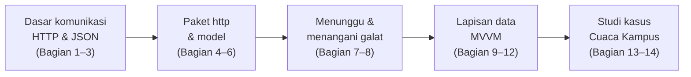

| Bagian | Pertanyaan yang dijawab |
| :--- | :--- |
| 1–3 | Bagaimana aplikasi "berbicara" dengan server, dan seperti apa bahasanya? |
| 4–6 | Bagaimana mengirim permintaan dari Flutter dan mengubah jawabannya menjadi objek Dart? |
| 7–8 | Bagaimana menampilkan data yang butuh waktu, dan apa yang terjadi jika gagal? |
| 9–12 | Di mana kode jaringan sebaiknya ditulis agar rapi, mudah diganti, dan mudah diuji? |
| 13–14 | Bagaimana semuanya dirangkai, dan apa yang perlu diperhatikan di web dan Android? |

> [!NOTE]
> Hampir semua contoh hari ini **butuh koneksi internet**. Server latihan yang dipakai adalah [DummyJSON](https://dummyjson.com) (data contoh: produk, tugas, kutipan, artikel) dan [Open-Meteo](https://open-meteo.com) (cuaca). Keduanya gratis dan tidak memerlukan pendaftaran. Data dari DummyJSON berbahasa Inggris, sedangkan tulisan di aplikasi kita tetap berbahasa Indonesia.

---

## 1. Aplikasi yang Berbicara dengan Server

### 1.1 Data tidak selalu tinggal di dalam aplikasi

Sampai Pertemuan 9, semua data ditulis langsung di kode, misalnya daftar menu kantin atau *repository* palsu berisi pengumuman. Aplikasi sungguhan hampir tidak pernah begitu. Daftar produk di aplikasi belanja, jadwal kuliah di portal akademik, dan prakiraan cuaca disimpan di komputer lain yang selalu menyala, yaitu **server**. Aplikasi di ponsel (disebut **klien**) meminta data itu lewat internet setiap kali dibutuhkan.

Keuntungannya: data cukup diperbarui di satu tempat, lalu semua pengguna langsung melihat data terbaru tanpa harus memperbarui aplikasinya.

### 1.2 Analogi: loket layanan akademik

| Di loket layanan akademik | Di dunia aplikasi |
| :--- | :--- |
| Anda mengisi **formulir permintaan** dan menyerahkannya ke loket tertentu | Aplikasi mengirim **permintaan** (*request*) ke **alamat** tertentu |
| Jenis layanan yang diminta: "minta transkrip", "ajukan cuti", "batalkan cuti" | **Metode**: `GET` (minta data), `POST` (kirim data baru), `PATCH` (ubah), `DELETE` (hapus) |
| Petugas memproses, lalu memberi **jawaban** | Server mengirim **jawaban** (*response*) |
| Stempel pada jawaban: "selesai", "berkas tidak ditemukan", "loket sedang tutup" | **Kode status**: `200` (berhasil), `404` (tidak ditemukan), `503` (server tidak tersedia) |
| Dokumen yang Anda terima | ***Body***: isi jawaban, biasanya berformat **JSON** |
| Anda menunggu di ruang tunggu sambil tetap bisa melakukan hal lain | `await`: aplikasi menunggu jawaban **tanpa membeku** |

### 1.3 Apa itu REST API?

**API** (*Application Programming Interface*) adalah "loket" yang disediakan server agar program lain bisa meminta atau mengirim data. **REST API** adalah gaya API yang paling umum: setiap jenis data punya **alamat** sendiri, dan **metode** menentukan apa yang ingin dilakukan terhadap data itu.

Contoh dari server latihan DummyJSON:

| Permintaan | Artinya |
| :--- | :--- |
| `GET https://dummyjson.com/todos` | Minta daftar tugas |
| `GET https://dummyjson.com/todos/1` | Minta tugas nomor 1 |
| `POST https://dummyjson.com/todos/add` | Kirim tugas baru |
| `PATCH https://dummyjson.com/todos/1` | Ubah sebagian isi tugas nomor 1 |
| `DELETE https://dummyjson.com/todos/1` | Hapus tugas nomor 1 |

> [!TIP]
> Coba sekarang: buka <https://dummyjson.com/todos/1> di *browser*. Yang tampil bukan halaman web yang indah, melainkan **teks data**. Itulah jawaban yang akan dibaca aplikasi kita.

> **🧠 Cek Cepat:** Aplikasi ingin menghapus produk nomor 7 di server DummyJSON. Metode dan alamat apa yang dipakai?
>
> <details><summary>Lihat jawaban</summary>
>
> `DELETE https://dummyjson.com/products/7`. Alamat menunjuk datanya, metode menunjuk tindakannya.
> </details>

---

## 2. Anatomi Permintaan dan Jawaban HTTP

**HTTP** (*Hypertext Transfer Protocol*) adalah aturan percakapan antara klien dan server. Setiap permintaan dan jawaban HTTP punya bagian-bagian yang tetap.

### 2.1 Alamat (URL)

```text
https://dummyjson.com/products/search?q=phone&limit=10
└─┬─┘   └────┬─────┘└──────┬───────┘ └───────┬───────┘
skema      host          jalur        parameter query
```

| Bagian | Contoh | Artinya |
| :--- | :--- | :--- |
| Skema | `https` | Cara berkomunikasi. `https` = terenkripsi; selalu pakai ini |
| *Host* | `dummyjson.com` | Nama server |
| Jalur (*path*) | `/products/search` | Data atau layanan yang diminta |
| Parameter *query* | `?q=phone&limit=10` | Keterangan tambahan: pasangan `nama=nilai` setelah `?`, dipisah `&` |

### 2.2 Metode

| Metode | Kegunaan | Contoh |
| :--- | :--- | :--- |
| `GET` | Mengambil data, tanpa mengubah apa pun | Menampilkan daftar produk |
| `POST` | Mengirim data **baru** | Menambah tugas |
| `PUT` | Mengganti **seluruh** isi data | Mengganti semua kolom profil |
| `PATCH` | Mengubah **sebagian** isi data | Mencentang tugas sebagai selesai |
| `DELETE` | Menghapus data | Menghapus tugas |

### 2.3 *Header*

*Header* adalah keterangan tambahan berbentuk pasangan `Nama: nilai`, seperti kolom "perihal" pada formulir. Tiga yang paling sering dipakai:

| *Header* | Dikirim oleh | Artinya |
| :--- | :--- | :--- |
| `Accept: application/json` | Klien | "Tolong jawab dalam format JSON." |
| `Content-Type: application/json` | Klien (saat mengirim data) atau server | "Isi yang saya kirim berformat JSON." |
| `Authorization: Bearer ...` | Klien | Tanda pengenal pengguna yang sudah masuk (*login*). Dipakai API yang butuh akun |

### 2.4 Kode status

Kode status adalah angka tiga digit di jawaban server. Angka pertamanya menunjukkan kelompok:

| Kode | Arti | Kelompok |
| :---: | :--- | :--- |
| `200` | OK: permintaan berhasil | **2xx: berhasil** |
| `201` | *Created*: data baru berhasil dibuat | |
| `204` | *No Content*: berhasil, tanpa isi jawaban | |
| `400` | *Bad Request*: permintaan salah bentuk | **4xx: kesalahan di sisi aplikasi** |
| `401` | *Unauthorized*: belum masuk (*login*) | |
| `403` | *Forbidden*: tidak punya izin | |
| `404` | *Not Found*: data tidak ditemukan | |
| `429` | *Too Many Requests*: terlalu sering meminta | |
| `500` | *Internal Server Error*: server mengalami galat | **5xx: kesalahan di sisi server** |
| `503` | *Service Unavailable*: server sedang tidak tersedia | |

Pegangan sederhana: **2xx berhasil, 4xx periksa permintaan kita, 5xx tunggu servernya pulih.**

### 2.5 *Body*

*Body* adalah isi utama permintaan atau jawaban. Pada `GET`, permintaan biasanya tanpa *body*, sedangkan jawabannya berisi data. Pada `POST` dan `PATCH`, permintaan berisi data yang dikirim. Hampir semua REST API modern memakai format **JSON** untuk *body*.

> **🧠 Cek Cepat:** Server menjawab dengan kode `401`. Siapa yang perlu memperbaiki sesuatu: aplikasi atau server?
>
> <details><summary>Lihat jawaban</summary>
>
> Aplikasi (kelompok 4xx). Kode `401` berarti permintaan dikirim tanpa tanda pengenal yang sah, misalnya pengguna belum masuk atau tokennya kedaluwarsa.
> </details>

---

## 3. JSON: Bahasa Pertukaran Data

### 3.1 Bentuk JSON

**JSON** (*JavaScript Object Notation*) adalah format teks untuk menulis data terstruktur. Bentuknya sangat mirip `Map` dan `List` di Dart. Berikut jawaban `GET https://dummyjson.com/todos/1` (isinya bisa berbeda di server):

```json
{
  "id": 1,
  "todo": "Do something nice for someone you care about",
  "completed": false,
  "userId": 152
}
```

| Bentuk di JSON | Contoh | Menjadi apa di Dart (setelah `jsonDecode`) |
| :--- | :--- | :--- |
| Objek `{ ... }` | `{"id": 1}` | `Map<String, dynamic>` |
| Larik (*array*) `[ ... ]` | `[1, 2, 3]` | `List<dynamic>` |
| Teks (selalu tanda petik dua) | `"Belajar"` | `String` |
| Angka bulat | `152` | `int` |
| Angka desimal | `9.99` | `double` |
| `true` / `false` | `false` | `bool` |
| `null` | `null` | `null` |

> [!WARNING]
> Di JSON, nama kunci dan teks **wajib** memakai tanda petik dua (`"..."`), dan **tidak boleh** ada koma setelah unsur terakhir. `{'id': 1}` (petik satu) atau `{"id": 1,}` (koma terakhir) bukan JSON yang sah.

### 3.2 `jsonDecode` dan `jsonEncode`

Keduanya ada di pustaka bawaan `dart:convert`:

```dart
import 'dart:convert';

// Teks JSON -> Map
final Map<String, dynamic> tugas =
    jsonDecode('{"id": 1, "todo": "Belajar", "completed": false}')
        as Map<String, dynamic>;
print(tugas['todo']); // Belajar

// Map -> teks JSON
final String teks = jsonEncode({'todo': 'Tidur', 'completed': true});
print(teks); // {"todo":"Tidur","completed":true}
```

| Fungsi | Arah | Dipakai saat |
| :--- | :--- | :--- |
| `jsonDecode(teks)` | Teks JSON → `Map`/`List` | **Menerima** data dari server |
| `jsonEncode(data)` | `Map`/`List` → teks JSON | **Mengirim** data ke server |

Perhatikan `as Map<String, dynamic>`. `jsonDecode` tidak tahu apakah teksnya berisi objek, larik, atau angka, sehingga hasilnya bertipe `dynamic`. Dengan `as`, kita menyatakan "saya yakin isinya objek". Jika ternyata bukan, aplikasi melempar *error* saat dijalankan. Bagian 6 menunjukkan cara yang lebih aman.

---

## 4. Paket `http`: Permintaan Pertama

### 4.1 Memasang paket

Flutter tidak membawa alat pengirim permintaan HTTP yang praktis secara bawaan. Kita memakai paket resmi tim Dart, **`http`**:

```bash
flutter pub add http
```

Lalu di bagian atas berkas:

```dart
import 'package:http/http.dart' as http;
```

Bagian `as http` memberi **awalan** (*prefix*). Semua isi paket dipanggil dengan awalan itu, misalnya `http.get(...)` dan `http.Response`. Tanpa awalan, nama fungsi `get` bisa tertukar dengan nama lain di kode kita, dan pembaca sulit tahu dari mana fungsi itu berasal.

> [!NOTE]
> DartPad sudah menyediakan paket `http`, jadi semua contoh hari ini bisa langsung dijalankan di sana.

### 4.2 Membedah Contoh 01

[Contoh 01](kode/contoh_01_permintaan_pertama.dart) mengambil satu kutipan acak dari `https://dummyjson.com/quotes/random` setiap kali tombol ditekan.

```dart
Future<void> _ambilKutipan() async {
  setState(() {
    _memuat = true;
    _galat = null;
  });

  try {
    // 1. Kirim permintaan GET, lalu TUNGGU jawabannya.
    final http.Response respons = await http.get(
      Uri.parse('https://dummyjson.com/quotes/random'),
      headers: {'Accept': 'application/json'},
    );
    if (!mounted) return;

    if (respons.statusCode == 200) {
      // 2. Teks JSON -> Map.
      final Map<String, dynamic> json =
          jsonDecode(respons.body) as Map<String, dynamic>;
      // 3. Tampilkan.
      setState(() {
        _kutipan = json['quote'] as String;
        _penulis = json['author'] as String;
        _memuat = false;
      });
    } else {
      setState(() {
        _galat = 'Server menjawab dengan kode ${respons.statusCode}.';
        _memuat = false;
      });
    }
  } catch (galat) {
    if (!mounted) return;
    setState(() {
      _galat = 'Tidak dapat terhubung ke server. Periksa koneksi Anda.';
      _memuat = false;
    });
  }
}
```

| Bagian | Penjelasan |
| :--- | :--- |
| `Uri.parse('https://...')` | Mengubah teks alamat menjadi objek `Uri`. Paket `http` hanya menerima `Uri`, bukan `String` |
| `http.get(...)` | Mengirim permintaan `GET`. Hasilnya `Future<http.Response>`: jawabannya baru tersedia nanti |
| `await` | Menunggu jawaban **tanpa membekukan aplikasi** (Pertemuan 3). Selama menunggu, lingkaran memuat tetap berputar |
| `respons.statusCode` | Kode status, misalnya `200` |
| `respons.body` | Isi jawaban berupa **teks** JSON |
| `if (!mounted) return;` | Selama menunggu, pengguna bisa saja menutup halaman. Memanggil `setState` pada halaman yang sudah ditutup menimbulkan *error* (Pertemuan 5) |
| `catch` | Menangkap kegagalan saat **tidak ada jawaban sama sekali**, misalnya karena tidak ada koneksi internet |

<p align="center">
  
</p>

Buka konsol (*Console* di DartPad, atau terminal tempat `flutter run`) untuk melihat teks JSON mentah yang dikirim server. Setiap kali tombol **Kutipan lain** ditekan, isinya berbeda, karena alamat `/quotes/random` memang memilih kutipan secara acak.

### 4.3 Mengapa aplikasi tidak membeku?

Mengambil data dari internet bisa memakan waktu dari puluhan milidetik sampai beberapa detik. Jika aplikasi berhenti total selama itu, tombol tidak bisa ditekan dan animasi berhenti. Inilah gunanya `Future` dan `await` dari Pertemuan 3: fungsi `_ambilKutipan` "berhenti sejenak" di baris `await`, sementara Flutter tetap menggambar layar dan menanggapi sentuhan. Begitu jawaban tiba, fungsi dilanjutkan dari baris berikutnya.

Karena itu, setiap tampilan yang mengambil data dari internet perlu tiga keadaan: **memuat**, **berhasil**, dan **gagal**. Polanya sama dengan status di [Pertemuan 9 Bagian 10](../pertemuan_09_state_dan_mvvm/README.md#10-repository-dan-status-memuat). Bedanya, kini datanya benar-benar datang dari internet.

> **🧠 Cek Cepat:** Di Contoh 01, mengapa tombol **Kutipan lain** dinonaktifkan selama memuat?
>
> <details><summary>Lihat jawaban</summary>
>
> Agar pengguna tidak mengirim beberapa permintaan sekaligus. Jika tombol ditekan tiga kali dengan cepat, tiga jawaban akan datang dalam urutan yang tidak pasti, dan kutipan yang tampil bisa berganti-ganti.
> </details>

---

## 5. Membedah Jawaban Server

[Contoh 02](kode/contoh_02_anatomi_respons.dart) adalah "penjelajah respons". Pilih salah satu percobaan, lalu amati kode status, jenis isi (*header* `Content-Type`), lama menunggu, dan isi jawabannya.

```dart
final Stopwatch stopwatch = Stopwatch()..start();
try {
  final http.Response respons = await http.get(Uri.parse(percobaan.alamat));
  setState(() {
    _kodeStatus = respons.statusCode;
    _jenisIsi = respons.headers['content-type'];
    _isi = respons.body;
  });
} catch (galat) {
  setState(() {
    _galat = galat.toString();
  });
}
```

| Percobaan | Alamat | Yang terlihat |
| :--- | :--- | :--- |
| Berhasil | `/quotes/1` | Kode `200`, isi berupa JSON satu kutipan |
| Tidak ditemukan | `/quotes/99999` | Kode `404`, isi berupa JSON berisi pesan bahwa kutipan tidak ditemukan |
| Server bermasalah | `/http/500/...` | Kode `500`. Alamat khusus DummyJSON ini memang dibuat untuk berlatih menangani galat server |
| Lambat | `/quotes/2?delay=3000` | Kode `200`, tetapi lama menunggu sekitar 3 detik. Parameter `delay` adalah fitur DummyJSON untuk meniru server yang lambat |
| Alamat salah | `server-yang-tidak-ada.invalid` | **Tidak ada kode status sama sekali.** Yang muncul adalah *exception* |

<p align="center">
  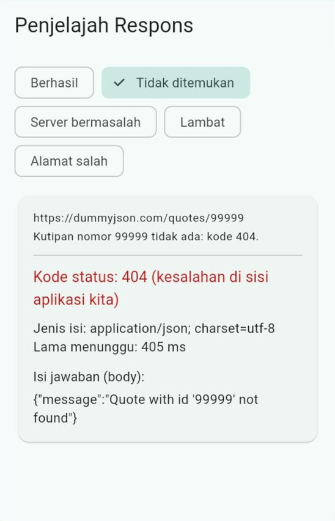
  &nbsp;&nbsp;
  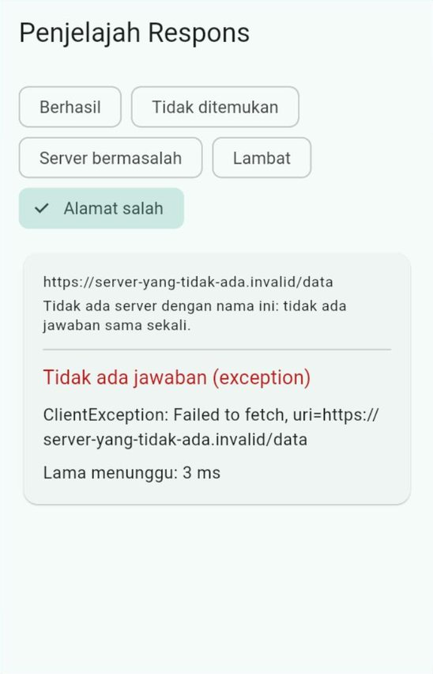
</p>

Dua pelajaran terpenting dari contoh ini:

1. **Kode `404` dan `500` tetap sebuah jawaban.** Paket `http` tidak melempar *exception* untuk kode status apa pun. Jika kita tidak memeriksa `statusCode`, aplikasi akan mencoba membaca isi jawaban galat seolah-olah data yang benar.
2. ***Exception* baru muncul jika tidak ada jawaban sama sekali**: alamat servernya tidak ada, koneksi terputus, atau (di web) server menolak dipanggil dari *browser* ([Bagian 14](#14-menjalankan-di-web-dan-di-android)).

> **🧠 Cek Cepat:** Teman Anda menulis `final data = jsonDecode(respons.body);` tanpa memeriksa `statusCode`. Apa yang terjadi saat server menjawab `404`?
>
> <details><summary>Lihat jawaban</summary>
>
> Tidak ada *exception* dari paket `http`. `jsonDecode` membaca JSON pesan galat (misalnya `{"message": "... not found"}`), lalu kode berikutnya mencari kunci yang tidak ada, misalnya `data['quote']`, dan mendapat `null`. Aplikasi menampilkan data kosong atau gagal dengan pesan yang membingungkan. Selalu periksa `statusCode` lebih dulu.
> </details>

---

## 6. Dari JSON Menjadi Model

### 6.1 Mengapa tidak memakai `Map` langsung?

Di Contoh 01 kita menulis `json['quote'] as String`. Cara ini cepat, tetapi rawan:

| Masalah | Contoh |
| :--- | :--- |
| Salah ketik nama kunci tidak ketahuan saat menulis kode | `json['qoute']` menghasilkan `null`, bukan *error* yang jelas |
| Tidak ada saran otomatis (*autocomplete*) di editor | Editor tidak tahu kunci apa saja yang ada di `Map` |
| Pemeriksaan tipe tersebar di banyak tempat | Setiap halaman menulis `as String`, `as int`, dan seterusnya sendiri-sendiri |

Solusinya sama dengan Pertemuan 6 dan 9: ubah data menjadi **objek model** (*class*) **satu kali**, di satu tempat, lalu seluruh aplikasi memakai objek itu.

### 6.2 *Factory* `fromJson` dengan pola Dart 3

[Contoh 03](kode/contoh_03_json_dan_model.dart) adalah program konsol (tanpa internet) yang mengubah teks JSON berisi tiga produk menjadi objek `Produk`:

```dart
class Produk {
  const Produk({
    required this.id,
    required this.judul,
    required this.harga,
    required this.stok,
    required this.rating,
  });

  factory Produk.fromJson(Map<String, dynamic> json) {
    return switch (json) {
      {
        'id': int id,
        'title': String judul,
        'price': num harga,
        'stock': int stok,
        'rating': num rating,
      } =>
        Produk(
          id: id,
          judul: judul,
          harga: harga.toDouble(),
          stok: stok,
          rating: rating.toDouble(),
        ),
      _ => throw const FormatException('Bentuk data produk tidak sesuai'),
    };
  }

  final int id;
  final String judul;
  final double harga;
  final int stok;
  final double rating;
}
```

| Bagian | Penjelasan |
| :--- | :--- |
| `factory Produk.fromJson(...)` | *Constructor* khusus (Pertemuan 3) yang membuat objek dari `Map` |
| `switch (json) { {...} => ... }` | **Pola map** (*map pattern*): cabang ini hanya dipilih jika `json` punya **semua** kunci yang disebut **dan** tipe nilainya cocok |
| `'id': int id` | "Kunci `id` harus ada, nilainya harus `int`, lalu simpan ke variabel `id`." Sekali jalan: memeriksa sekaligus mengambil |
| `'price': num harga` + `.toDouble()` | JSON tidak membedakan angka bulat dan desimal: `15` dibaca `int`, `9.99` dibaca `double`. Pola `num` menerima keduanya, lalu `toDouble()` menyeragamkannya |
| `_ => throw FormatException(...)` | Jika bentuknya tidak cocok, berhenti dengan *exception* yang jelas, bukan diam-diam menghasilkan data kosong |

Cara ini dipakai di [resep resmi Flutter](https://docs.flutter.dev/cookbook/networking/fetch-data) untuk mengubah JSON menjadi objek. Kunci di JSON (misalnya `title`) tidak harus sama dengan nama properti di Dart (misalnya `judul`): pola itulah yang menghubungkan keduanya.

> [!WARNING]
> Jangan memakai pola `double harga` untuk angka dari JSON. Saat aplikasi berjalan di web, angka `15` bisa saja ikut dianggap `double`, sehingga kesalahan ini tidak terlihat saat diuji di Chrome. Di Android, angka `15` adalah `int`, polanya tidak cocok, dan aplikasi melempar `FormatException`. Selalu pakai `num` untuk angka yang bisa desimal.

### 6.3 Membaca daftar

Jawaban daftar biasanya berupa objek yang berisi larik, misalnya `{"products": [...], "total": 194}`. Lariknya juga dibaca dengan pola, lalu setiap unsurnya diubah dengan `fromJson`:

```dart
final List<Produk> daftar = switch (data) {
  {'products': List<dynamic> isi} =>
    isi
        .map((dynamic item) => Produk.fromJson(item as Map<String, dynamic>))
        .toList(),
  _ => throw const FormatException('Kunci "products" tidak ditemukan'),
};
```

### 6.4 Data yang bentuknya salah

Server bisa saja mengirim data yang tidak sesuai harapan: kolom hilang, tipe berubah, atau teksnya bahkan bukan JSON. Contoh 03 mencoba keempat kemungkinan berikut. Hasilnya di konsol:

```text
=== 3. Data yang bentuknya salah ===
Harga berupa teks -> FormatException: Bentuk data produk tidak sesuai
Kolom tidak lengkap -> FormatException: Bentuk data produk tidak sesuai
Teks bukan JSON yang sah -> FormatException
Salah tulis kunci "produk" -> hasilnya null, bukan List
```

Tiga yang pertama berakhir dengan `FormatException` yang jelas. Yang keempat paling berbahaya: salah tulis nama kunci **tidak** menimbulkan *error*, hanya menghasilkan `null`. Pola map mencegah masalah ini, karena kunci yang tidak ada membuat polanya tidak cocok.

### 6.5 Kebalikannya: `toJson` dan `jsonEncode`

Saat **mengirim** data, objek diubah menjadi `Map`, lalu menjadi teks JSON:

```dart
Map<String, dynamic> toJson() => {
  'id': id,
  'title': judul,
  'price': harga,
  'stock': stok,
  'rating': rating,
};

// di tempat lain:
print(jsonEncode(produk.toJson()));
// {"id":1,"title":"Mascara Lash Princess","price":9.99,"stock":99,"rating":2.56}
```

<details>
<summary>Lihat seluruh output Contoh 03</summary>

```text
=== 1. Teks JSON -> Map ===
Hasil jsonDecode adalah Map: true
Kunci tingkat atas: [products, total, skip, limit]
Produk di server: 194, diambil: 3

=== 2. Map -> objek Produk ===
#1 Mascara Lash Princess | $9.99 | stok 99 | rating 2.56
#2 Eyeshadow Palette | $19.99 | stok 34 | rating 2.86
#3 Powder Canister | $15.00 | stok 89 | rating 4.64
Nilai seluruh stok: $3003.67

=== 3. Data yang bentuknya salah ===
Harga berupa teks -> FormatException: Bentuk data produk tidak sesuai
Kolom tidak lengkap -> FormatException: Bentuk data produk tidak sesuai
Teks bukan JSON yang sah -> FormatException
Salah tulis kunci "produk" -> hasilnya null, bukan List

=== 4. Objek Produk -> teks JSON ===
{"id":1,"title":"Mascara Lash Princess","price":9.99,"stock":99,"rating":2.56}
```

</details>

> [!TIP]
> Untuk aplikasi besar dengan puluhan model, menulis `fromJson` dan `toJson` dengan tangan bisa melelahkan. Ada paket pembuat kode otomatis seperti `json_serializable`. Di mata kuliah ini kita tetap menulisnya sendiri agar paham apa yang terjadi.

> **🧠 Cek Cepat:** Server mengubah kolom `stock` dari `99` menjadi `"99"` (teks). Apa yang terjadi pada `Produk.fromJson`?
>
> <details><summary>Lihat jawaban</summary>
>
> Pola `'stock': int stok` tidak cocok karena nilainya `String`, sehingga cabang `_` dipilih dan `FormatException('Bentuk data produk tidak sesuai')` dilempar. Kesalahan langsung ketahuan di satu tempat, bukan menyebar ke tampilan.
> </details>

---

## 7. `FutureBuilder` dan Jebakannya

### 7.1 Widget yang menunggu `Future`

`FutureBuilder` adalah widget bawaan Flutter yang menampilkan tampilan berbeda sesuai keadaan sebuah `Future`. [Contoh 04](kode/contoh_04_futurebuilder.dart) memakainya untuk menampilkan sepuluh tugas dari `https://dummyjson.com/todos`.

```dart
FutureBuilder<List<Tugas>>(
  future: _tugas, // Future yang SUDAH disimpan di initState
  builder: (BuildContext context, AsyncSnapshot<List<Tugas>> snapshot) {
    // 1. Masih menunggu jawaban.
    if (snapshot.connectionState != ConnectionState.done) {
      return const Center(child: CircularProgressIndicator());
    }
    // 2. Future selesai dengan error.
    if (snapshot.hasError) {
      return Center(child: Text('Gagal memuat: ${snapshot.error}'));
    }
    // 3. Future selesai dengan data.
    final List<Tugas> daftar = snapshot.data!;
    return ListView.builder(/* ... */);
  },
)
```

| Bagian | Artinya |
| :--- | :--- |
| `future` | `Future` yang ditunggu |
| `snapshot` | "Potret" keadaan `Future` saat ini |
| `snapshot.connectionState` | `waiting` (menunggu) atau `done` (selesai) |
| `snapshot.hasError` / `snapshot.error` | Apakah `Future` selesai dengan *error*, dan apa *error*-nya |
| `snapshot.data` | Hasilnya, jika berhasil |

### 7.2 Jebakan: membuat `Future` di dalam `build`

Flutter boleh memanggil `build` **kapan saja**: saat `setState`, saat ukuran layar berubah, saat tema berganti, dan seterusnya. Jika `Future` dibuat di dalam `build`, setiap kali layar dibangun ulang, **permintaan baru dikirim ke server**:

```dart
// ❌ SALAH: permintaan baru setiap kali build() berjalan.
@override
Widget build(BuildContext context) {
  return FutureBuilder<List<Tugas>>(
    future: ambilTugas(),
    builder: /* ... */,
  );
}

// ✅ BENAR: Future dibuat sekali di initState, lalu disimpan.
late Future<List<Tugas>> _tugas;

@override
void initState() {
  super.initState();
  _tugas = ambilTugas();
}
```

Contoh 04 membuktikannya. Nyalakan sakelar **"Future dibuat di build() (cara salah)"**, lalu tekan **Bangun ulang layar** beberapa kali. Setiap ketukan menambah angka **Permintaan terkirim**, dan lingkaran memuat muncul lagi. Matikan sakelarnya, lalu tekan tombol yang sama: angkanya tidak bertambah lagi.

<p align="center">
  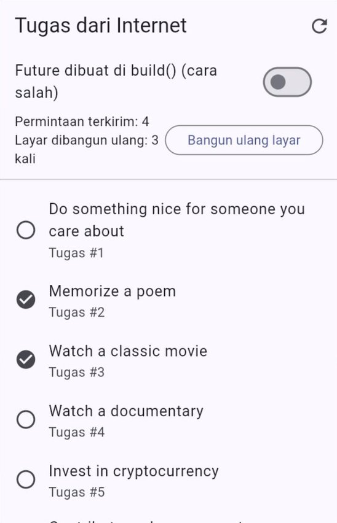
</p>

Untuk meminta data baru dengan sengaja (misalnya tombol muat ulang), **ganti** `Future` yang disimpan di dalam `setState`:

```dart
void _muatUlang() {
  setState(() {
    _tugas = ambilTugas();
  });
}
```

### 7.3 `FutureBuilder` atau ViewModel?

| Pakai | Jika |
| :--- | :--- |
| `FutureBuilder` | Halaman sederhana yang hanya **menampilkan** hasil satu permintaan, tanpa banyak aturan |
| ViewModel + status (Pertemuan 9) | Ada pencarian, saringan, muat lebih banyak, mengirim data, atau logika yang perlu diuji. Inilah cara yang dipakai di sisa modul ini |

> **🧠 Cek Cepat:** Di sebuah halaman, `FutureBuilder` menampilkan lingkaran memuat setiap kali pengguna mengetik di kolom pencarian. Apa kemungkinan penyebabnya?
>
> <details><summary>Lihat jawaban</summary>
>
> `Future`-nya dibuat di dalam `build`. Setiap ketikan memanggil `setState`, `build` berjalan lagi, `Future` baru dibuat, dan `FutureBuilder` kembali ke keadaan menunggu. Simpan `Future` di `initState`, atau pindahkan logikanya ke ViewModel.
> </details>

---

## 8. Menangani Galat Jaringan

### 8.1 Empat jenis kegagalan

Di dunia nyata, permintaan ke internet bisa gagal dengan banyak cara. [Contoh 05](kode/contoh_05_menangani_galat.dart) menyiapkan enam skenario. Setiap kegagalan diubah menjadi *exception* yang jelas jenisnya:

| Yang terjadi | *Exception* yang muncul | Dari mana |
| :--- | :--- | :--- |
| Tidak ada koneksi, alamat server salah | `http.ClientException` | Paket `http` |
| Server terlalu lama menjawab | `TimeoutException` | `.timeout(...)` yang kita pasang |
| Server menjawab dengan kode bukan `200` | `ApiException` (buatan kita) | Pemeriksaan `statusCode` |
| Isi jawaban bukan JSON, atau bentuknya salah | `FormatException` | `jsonDecode` atau pola di `fromJson` |

Fungsi pengambilnya:

```dart
class ApiException implements Exception {
  const ApiException(this.kodeStatus);

  final int kodeStatus;

  @override
  String toString() => 'ApiException: kode status $kodeStatus';
}

const Duration batasWaktu = Duration(seconds: 3);

Future<Map<String, dynamic>> ambilJson(Uri alamat) async {
  final http.Response respons = await http
      .get(alamat, headers: {'Accept': 'application/json'})
      // Jika lebih dari 3 detik tidak ada jawaban: TimeoutException.
      .timeout(batasWaktu);

  if (respons.statusCode != 200) {
    throw ApiException(respons.statusCode);
  }

  // jsonDecode melempar FormatException jika teksnya bukan JSON.
  final Object? data = jsonDecode(respons.body);
  if (data is! Map<String, dynamic>) {
    throw const FormatException('Bentuk JSON tidak dikenal');
  }
  return data;
}
```

Mengapa perlu `.timeout(...)`? Tanpa batas waktu, permintaan ke server yang tidak menjawab bisa menggantung sangat lama, dan pengguna hanya melihat lingkaran berputar tanpa kepastian. Untuk aplikasi sungguhan, batas 10–15 detik sudah wajar. Contoh 05 memakai 3 detik agar mudah diamati.

### 8.2 Dari *exception* menjadi pesan yang ramah

Pengguna tidak perlu membaca `ApiException: kode status 503`. Satu fungsi menerjemahkan **jenis** *exception* menjadi kalimat yang dimengerti, memakai `switch` dengan **pola objek** (Dart 3):

```dart
String pesanRamah(Object galat) {
  return switch (galat) {
    TimeoutException() =>
      'Server terlalu lama menjawab. Coba lagi beberapa saat lagi.',
    ApiException(kodeStatus: 404) => 'Data yang dicari tidak ditemukan.',
    ApiException(kodeStatus: >= 500) =>
      'Server sedang bermasalah. Coba lagi nanti.',
    ApiException() => 'Permintaan ditolak oleh server.',
    FormatException() => 'Data dari server tidak bisa dibaca.',
    http.ClientException() =>
      'Tidak dapat terhubung. Periksa koneksi internet Anda.',
    _ => 'Terjadi kesalahan yang tidak terduga.',
  };
}
```

| Pola | Cocok jika |
| :--- | :--- |
| `TimeoutException()` | Objeknya bertipe `TimeoutException` |
| `ApiException(kodeStatus: 404)` | Bertipe `ApiException` **dan** `kodeStatus`-nya tepat `404` |
| `ApiException(kodeStatus: >= 500)` | Bertipe `ApiException` **dan** `kodeStatus`-nya `500` ke atas (pola relasional) |
| `ApiException()` | `ApiException` lainnya, misalnya `400` atau `401` |
| `_` | Apa pun yang tidak cocok dengan pola di atasnya |

Urutan cabang penting: yang lebih khusus (`404`) ditulis **sebelum** yang lebih umum (`ApiException()`), karena `switch` memilih cabang pertama yang cocok.

<p align="center">
  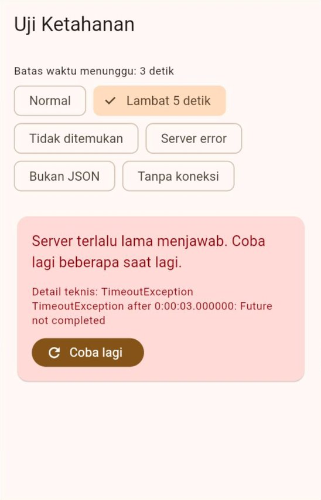
  &nbsp;&nbsp;
  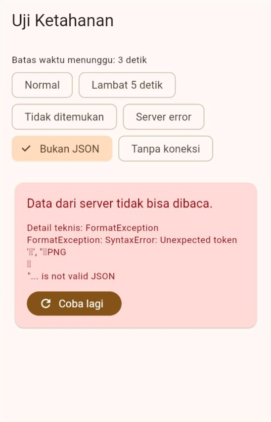
</p>

| Skenario | Pesan untuk pengguna |
| :--- | :--- |
| Normal | (kutipan tampil) |
| Lambat 5 detik | Server terlalu lama menjawab... |
| Tidak ditemukan | Data yang dicari tidak ditemukan. |
| Server error (kode 503) | Server sedang bermasalah... |
| Bukan JSON (gambar) | Data dari server tidak bisa dibaca. |
| Tanpa koneksi | Tidak dapat terhubung... |

> [!IMPORTANT]
> **Pesan teknis untuk pengembang, pesan ramah untuk pengguna.** Contoh 05 menampilkan detail teknis di layar hanya untuk belajar. Di aplikasi sungguhan, detail teknis cukup dicatat dengan `debugPrint` (atau sistem pencatatan galat), sedangkan pengguna melihat kalimat yang jelas beserta tombol **Coba lagi**.

> **🧠 Cek Cepat:** Jika cabang `ApiException()` ditulis **sebelum** `ApiException(kodeStatus: 404)`, pesan apa yang tampil untuk kode `404`?
>
> <details><summary>Lihat jawaban</summary>
>
> "Permintaan ditolak oleh server." `switch` berhenti di cabang pertama yang cocok, dan `ApiException()` cocok untuk semua `ApiException`. Analyzer juga akan memberi peringatan bahwa cabang `404` tidak mungkin tercapai.
> </details>

---

## 9. Lapisan Data: Layanan dan *Repository*

### 9.1 Siapa mengerjakan apa?

Di Pertemuan 9, ViewModel meminta data ke *repository*, dan *repository*-nya palsu. Kini *repository* harus berbicara dengan server sungguhan. Panduan arsitektur resmi Flutter membagi lapisan data menjadi dua peran:

| Peran | Tugas | Di contoh kita |
| :--- | :--- | :--- |
| **Layanan** (*service*) | Membungkus pemanggilan API: membuat alamat, mengirim permintaan, memeriksa kode status, membaca JSON. **Tidak menyimpan *state*** dan tidak mengenal Model | `LayananDummyJson` |
| ***Repository*** | Sumber data bagi ViewModel: meminta data mentah ke layanan, lalu **mengubahnya menjadi Model** | `RepositoriPengumumanApi` |
| **ViewModel** | *State* halaman dan perintah (Pertemuan 9) | `PengumumanViewModel` |

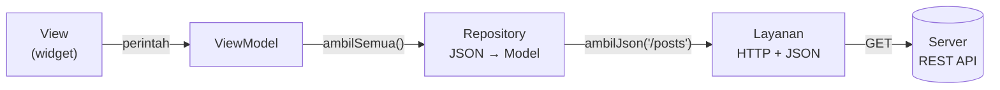

Analogi restoran dari Pertemuan 9 berlanjut: *repository* adalah bagian pembelian bahan, sedangkan layanan adalah **kurir** yang berangkat ke pasar. Kurir hanya tahu cara pergi, membeli, dan membawa pulang. Ia tidak memutuskan menu apa yang dimasak.

### 9.2 Layanan: satu tempat untuk urusan HTTP

[Contoh 06](kode/contoh_06_layanan_dan_repository.dart) mengambil pengumuman dari `https://dummyjson.com/posts`:

```dart
class LayananDummyJson {
  // http.Client diterima dari luar (bisa diganti saat pengujian).
  LayananDummyJson({http.Client? klien}) : _klien = klien ?? http.Client();

  static const String _host = 'dummyjson.com';
  static const Duration _batasWaktu = Duration(seconds: 10);

  final http.Client _klien;

  Future<Map<String, dynamic>> ambilJson(
    String jalur, {
    Map<String, String>? query,
  }) async {
    final Uri alamat = Uri.https(_host, jalur, query);
    final http.Response respons = await _klien
        .get(alamat, headers: {'Accept': 'application/json'})
        .timeout(_batasWaktu);

    if (respons.statusCode != 200) {
      throw ApiException(respons.statusCode);
    }
    return switch (jsonDecode(utf8.decode(respons.bodyBytes))) {
      final Map<String, dynamic> data => data,
      _ => throw const FormatException('Bentuk JSON tidak dikenal'),
    };
  }

  void tutup() => _klien.close();
}
```

Tiga hal baru di sini:

| Bagian | Penjelasan |
| :--- | :--- |
| `http.Client` | "Saluran" untuk mengirim banyak permintaan ke server yang sama. Lebih hemat daripada `http.get` berulang kali, dan **wajib ditutup** (`close`) setelah tidak dipakai. Karena diterima lewat *constructor*, saat pengujian ia bisa diganti dengan server tiruan ([Bagian 12](#12-menguji-tanpa-internet-dengan-mockclient)) |
| `Uri.https(host, jalur, query)` | Membuat alamat dari potongan-potongannya. Lebih aman daripada menyambung teks ([Bagian 10](#10-parameter-query-pencarian-dan-muat-lebih-banyak)) |
| `utf8.decode(respons.bodyBytes)` | Membaca isi jawaban sebagai UTF-8. Jika server lupa menyebutkan *charset* di `Content-Type`, `respons.body` membacanya dengan aturan lama sehingga huruf seperti `é` atau `°` menjadi tulisan aneh (`é`). Cara ini mencegahnya |

Layanan dititipkan dengan `Provider` dan **ditutup** otomatis lewat parameter `dispose`:

```dart
Provider<LayananDummyJson>(
  create: (BuildContext context) => LayananDummyJson(),
  dispose: (BuildContext context, LayananDummyJson layanan) => layanan.tutup(),
),
```

### 9.3 *Repository*: JSON menjadi Model

```dart
class RepositoriPengumumanApi implements RepositoriPengumuman {
  RepositoriPengumumanApi({required LayananDummyJson layanan})
    : _layanan = layanan;

  final LayananDummyJson _layanan;

  @override
  Future<List<Pengumuman>> ambilSemua() async {
    final Map<String, dynamic> json = await _layanan.ambilJson(
      '/posts',
      query: {'limit': '10', 'select': 'title,body,views'},
    );
    return switch (json) {
      {'posts': final List<dynamic> isi} => isi.map(_dariJson).toList(),
      _ => throw const FormatException('Kunci "posts" tidak ditemukan'),
    };
  }

  Pengumuman _dariJson(dynamic item) {
    return switch (item) {
      {
        'title': final String judul,
        'body': final String isi,
        'views': final int dibaca,
      } =>
        Pengumuman(judul: judul, isi: isi, dibaca: dibaca),
      _ => throw const FormatException('Bentuk data pengumuman tidak sesuai'),
    };
  }
}
```

Parameter `select=title,body,views` adalah fitur DummyJSON untuk meminta kolom tertentu saja, sehingga jawabannya lebih kecil.

Di contoh ini, pengubahan JSON menjadi Model ditulis di *repository*, sehingga *class* `Pengumuman` tetap bersih dari urusan JSON. Cara lain yang juga umum (dipakai Contoh 03 dan 04) adalah menaruh `fromJson` di *class* Model. Pertemuan 12 membahas kapan masing-masing cara lebih tepat.

### 9.4 Hasilnya: hanya `main` yang berubah

Bandingkan dengan [Contoh 08 Pertemuan 9](../pertemuan_09_state_dan_mvvm/kode/contoh_08_repository_dan_status_muat.dart):

| Bagian | Pertemuan 9 | Pertemuan 10 |
| :--- | :--- | :--- |
| Kontrak `RepositoriPengumuman` | `ambilSemua()` | **Sama** |
| *Repository* | `RepositoriPengumumanPalsu` (data di kode) | `RepositoriPengumumanApi` (data dari internet) |
| `PengumumanViewModel` | Status memuat, berhasil, gagal | **Sama persis** |
| View | Memilih tampilan dengan `switch` | **Sama**, hanya menampilkan kolom "dibaca" |
| `main` | `create: ... RepositoriPengumumanPalsu()` | `create: ... RepositoriPengumumanApi(...)` |

Contoh 06 menyimpan kedua *repository*. Ubah satu baris `create` di `main` untuk berpindah di antara keduanya. ViewModel dan View tidak tahu, dan tidak perlu tahu, dari mana datanya.

<p align="center">
  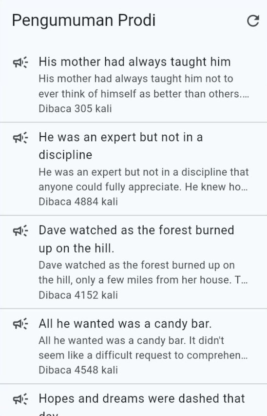
</p>

> **🧠 Cek Cepat:** Server pengumuman pindah ke alamat `api.kampus.ac.id`. Bagian mana yang diubah?
>
> <details><summary>Lihat jawaban</summary>
>
> Hanya layanan (misalnya konstanta `_host`), atau dibuat layanan baru. *Repository*, ViewModel, dan View tidak berubah. Jika bentuk JSON-nya juga berbeda, yang diubah cukup *repository*.
> </details>

---

## 10. Parameter *Query*, Pencarian, dan Muat Lebih Banyak

[Contoh 07](kode/contoh_07_pencarian_dan_muat_lagi.dart) adalah katalog produk dengan kotak pencarian dan tombol "Muat lebih banyak".

### 10.1 Membuat alamat dengan `Uri.https`

```dart
final Uri alamat = Uri.https('dummyjson.com', '/products/search', {
  'q': 'gaming laptop',
  'limit': '10',
  'skip': '0',
});
print(alamat);
// https://dummyjson.com/products/search?q=gaming+laptop&limit=10&skip=0
```

Mengapa tidak disambung manual, misalnya `'https://dummyjson.com/products/search?q=$kataKunci'`? Karena kata kunci dari pengguna bisa berisi spasi, `&`, `?`, atau `#`. Huruf-huruf itu punya arti khusus di alamat, sehingga harus "diterjemahkan" (*di-encode*) dulu. `Uri.https` melakukannya otomatis. Semua nilai di parameter *query* harus berupa `String`, jadi angka ditulis `'$jumlah'`.

### 10.2 Halaman demi halaman: `limit`, `skip`, `total`

Server tidak mengirim 194 produk sekaligus. Kita memintanya per halaman:

| Permintaan | Artinya |
| :--- | :--- |
| `?limit=10&skip=0` | Halaman pertama: produk ke-1 sampai ke-10 |
| `?limit=10&skip=10` | Halaman kedua: lewati 10 produk pertama |
| `?limit=10&skip=20` | Halaman ketiga |

Jawabannya juga menyebutkan `total` (jumlah seluruh produk yang cocok), sehingga ViewModel tahu apakah masih ada yang bisa dimuat:

```dart
bool get masihAda => _produk.length < _total;
```

### 10.3 *Debounce*: menunggu pengguna berhenti mengetik

Jika setiap huruf yang diketik langsung mengirim permintaan, mengetik "laptop" mengirim enam permintaan. Boros, dan hasilnya berkedip-kedip. Solusinya ***debounce***: tunggu sampai pengguna **berhenti mengetik** selama 400 milidetik, baru kirim.

```dart
void cari(String teks) {
  _kataKunci = teks.trim();
  // Batalkan penunda lama, lalu mulai menunggu 400 ms lagi.
  _penunda?.cancel();
  _penunda = Timer(const Duration(milliseconds: 400), muat);
}
```

`Timer` (dari `dart:async`) menjalankan `muat` setelah 400 ms, **kecuali** dibatalkan lebih dulu oleh ketikan berikutnya. Seperti lift yang menunggu beberapa detik setelah orang terakhir masuk sebelum pintunya menutup. Jangan lupa membatalkan `Timer` di `dispose` ViewModel.

### 10.4 Jawaban yang datang terlambat

Bayangkan pengguna mencari "phone", lalu cepat-cepat menggantinya menjadi "laptop". Dua permintaan sedang berjalan. Jawaban "phone" kebetulan lebih lambat:

| Waktu | Kejadian | Tanpa penjaga | Dengan nomor permintaan |
| :---: | :--- | :--- | :--- |
| 0 ms | Kirim pencarian "phone" (nomor 1) | | |
| 300 ms | Kirim pencarian "laptop" (nomor 2) | | |
| 600 ms | Jawaban "laptop" tiba | Tampil laptop ✅ | Nomor 2 = terbaru → tampil ✅ |
| 900 ms | Jawaban "phone" tiba | Tampil phone ❌ (salah!) | Nomor 1 ≠ 2 → **diabaikan** ✅ |

```dart
Future<void> muat() async {
  final int nomor = ++_nomorPermintaan;
  // ... tunggu jawaban ...
  if (_sudahDibuang || nomor != _nomorPermintaan) {
    return; // jawaban terlambat: sudah ada pencarian yang lebih baru
  }
  // ... tampilkan ...
}
```

Penjaga ini sederhana, tetapi sering terlupa. Di Studi Kasus nanti, penjaga yang sama mencegah cuaca kota lama tampil setelah pengguna memilih kota lain.

### 10.5 Gambar dari internet

Setiap produk punya gambar kecil (*thumbnail*). `Image.network` mengunduh dan menampilkannya, lengkap dengan tampilan saat masih mengunduh dan saat gagal:

```dart
Image.network(
  alamat,
  fit: BoxFit.cover,
  loadingBuilder: (BuildContext context, Widget child, ImageChunkEvent? proses) {
    if (proses == null) return child; // sudah selesai
    return const Center(child: CircularProgressIndicator(strokeWidth: 2));
  },
  errorBuilder: (BuildContext context, Object galat, StackTrace? jejak) =>
      const Icon(Icons.broken_image_outlined),
)
```

Gambar yang sudah diunduh disimpan sementara di memori, sehingga tidak diunduh ulang saat daftar digulir kembali.

<p align="center">
  
  &nbsp;&nbsp;
  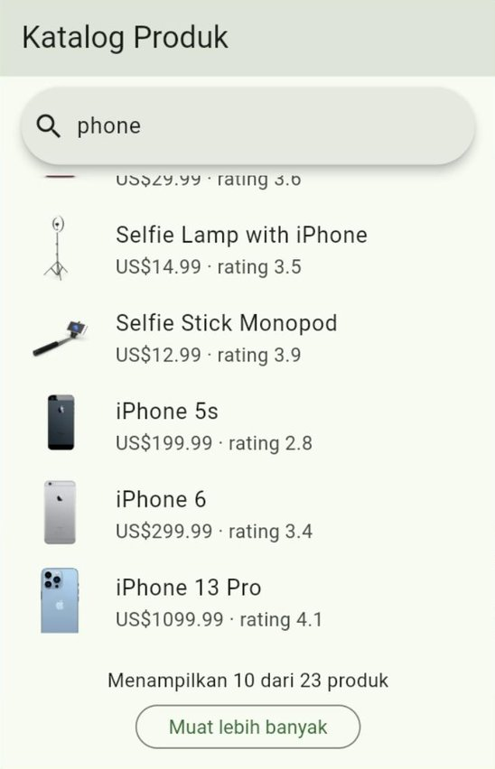
</p>

> **🧠 Cek Cepat:** Di halaman ketiga, nilai `skip` berapa yang harus dikirim jika setiap halaman berisi 10 produk?
>
> <details><summary>Lihat jawaban</summary>
>
> `20`, yaitu jumlah produk yang sudah ditampilkan. Di Contoh 07, nilainya diambil dari `_produk.length`, sehingga selalu tepat.
> </details>

---

## 11. Mengirim Data: `POST`, `PATCH`, dan `DELETE`

### 11.1 `POST`: menambah data baru

[Contoh 08](kode/contoh_08_mengirim_data_post.dart) mengirim tugas baru ke `https://dummyjson.com/todos/add`:

```dart
Future<HasilKirim> kirimTugas({
  required String judul,
  required bool selesai,
}) async {
  // 1. Data -> teks JSON.
  final String body = jsonEncode({
    'todo': judul,
    'completed': selesai,
    'userId': 1,
  });

  // 2. Kirim dengan POST, lengkap dengan header Content-Type.
  final http.Response respons = await http
      .post(
        Uri.parse('https://dummyjson.com/todos/add'),
        headers: {
          'Content-Type': 'application/json',
          'Accept': 'application/json',
        },
        body: body,
      )
      .timeout(const Duration(seconds: 10));

  // 3. Semua kode 2xx dianggap berhasil.
  if (respons.statusCode < 200 || respons.statusCode >= 300) {
    throw ApiException(respons.statusCode);
  }
  // ...
}
```

| Bagian | Penjelasan |
| :--- | :--- |
| `jsonEncode({...})` | Data yang dikirim diubah menjadi teks JSON |
| `'Content-Type': 'application/json'` | Memberi tahu server bahwa *body* berisi JSON. Tanpa ini, banyak server tidak bisa membaca datanya |
| `body: body` | Isi permintaan |
| `< 200 \|\| >= 300` | Pembuatan data biasanya dijawab `201` (*Created*), bukan `200`. Karena itu yang diperiksa adalah **kelompok** 2xx |

Layar Contoh 08 menampilkan apa yang **dikirim** dan apa yang **diterima** kembali. Server menjawab dengan data yang sama ditambah `id` baru.

<p align="center">
  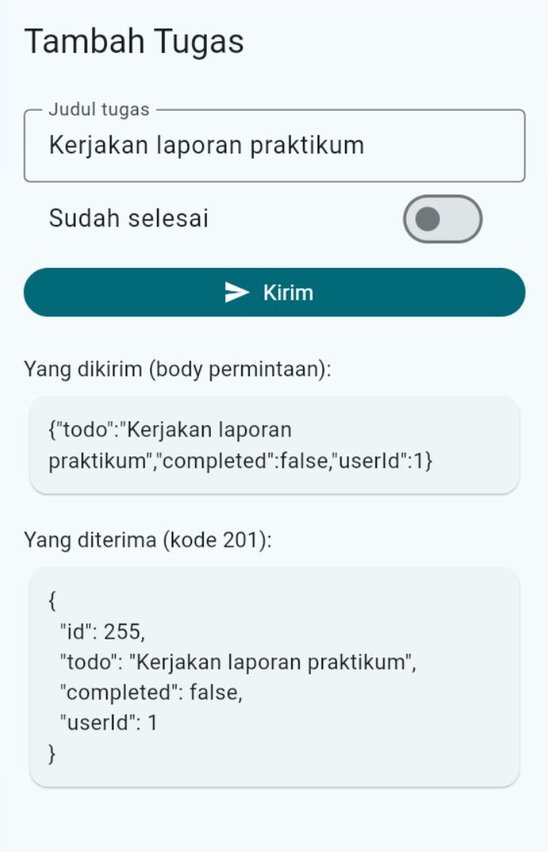
</p>

> [!NOTE]
> DummyJSON adalah server latihan: ia hanya **berpura-pura** menyimpan. Jawabannya terlihat seperti data baru tersimpan, tetapi datanya tidak benar-benar ditambahkan. Karena itu, setiap tugas baru mendapat `id` yang sama, dan tugas itu tidak muncul saat daftar dimuat ulang.

### 11.2 `PATCH` dan `DELETE`

[Contoh 09](kode/contoh_09_ubah_dan_hapus.dart) menampilkan lima tugas. Mencentang sebuah tugas mengirim `PATCH`, dan ikon tempat sampah mengirim `DELETE`:

```dart
// PATCH: kirim HANYA kolom yang berubah.
Future<void> ubahStatus(int id, bool selesai) async {
  final http.Response respons = await http.patch(
    Uri.https(_host, '/todos/$id'),
    headers: _header,
    body: jsonEncode({'completed': selesai}),
  );
  _baca(respons); // melempar ApiException jika bukan 2xx
}

// DELETE: server menjawab dengan data yang dihapus + isDeleted.
Future<void> hapus(int id) async {
  final http.Response respons = await http.delete(
    Uri.https(_host, '/todos/$id'),
    headers: _header,
  );
  final Map<String, dynamic> json = _baca(respons);
  if (json['isDeleted'] != true) {
    throw const FormatException('Server tidak mengonfirmasi penghapusan');
  }
}
```

`PATCH` hanya mengirim kolom yang berubah (`completed`), sedangkan `PUT` mengirim **seluruh** data. Untuk mengubah satu kolom, `PATCH` lebih hemat dan lebih aman.

### 11.3 Ubah tampilan setelah server setuju

Contoh 09 mengubah tampilan **setelah** server menjawab berhasil:

1. Saat dicentang, baris itu menampilkan lingkaran kecil dan tidak bisa diketuk lagi (`_diproses`).
2. Jika server menjawab berhasil, barulah tanda centangnya berubah dan `SnackBar` muncul.
3. Jika gagal, tampilan tidak berubah dan `SnackBar` memberi tahu kegagalannya.

<p align="center">
  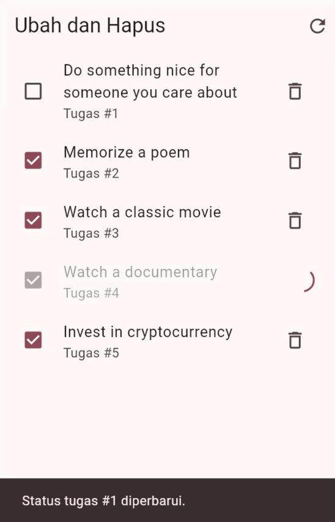
</p>

Ada juga cara sebaliknya yang disebut ***optimistic update***: tampilan langsung diubah, lalu dikembalikan jika server menolak. Terasa lebih cepat, tetapi lebih rumit. Untuk pemula, cara "tunggu server dulu" lebih aman dan lebih mudah diperiksa.

> **🧠 Cek Cepat:** Mengapa tombol **Kirim** di Contoh 08 dinonaktifkan selama mengirim?
>
> <details><summary>Lihat jawaban</summary>
>
> Agar data yang sama tidak terkirim dua kali jika pengguna mengetuknya berulang-ulang. Di server sungguhan, ketukan ganda bisa membuat dua tugas yang sama.
> </details>

---

## 12. Menguji Tanpa Internet dengan `MockClient`

### 12.1 Mengapa perlu server tiruan?

Menguji kode jaringan dengan server sungguhan merepotkan: butuh internet, hasilnya bisa berubah, dan sulit memaksa server mengirim galat `404` atau menjawab terlambat. Paket `http` menyediakan **`MockClient`**: sebuah `http.Client` palsu yang jawabannya kita tentukan sendiri.

Karena `LayananDummyJson` menerima `http.Client` lewat *constructor* ([Bagian 9.2](#92-layanan-satu-tempat-untuk-urusan-http)), saat pengujian ia cukup diberi `MockClient`. Inilah manfaat nyata *dependency injection*.

```dart
import 'package:http/testing.dart';

http.Request? terakhir;
final MockClient serverBaik = MockClient((http.Request permintaan) async {
  terakhir = permintaan; // catat permintaan yang masuk
  return http.Response(jsonDuaProduk, 200); // jawaban yang kita tentukan
});

final RepositoriProdukApi repo = RepositoriProdukApi(
  layanan: LayananDummyJson(klien: serverBaik),
);
```

### 12.2 Apa saja yang diuji?

[Contoh 10](kode/contoh_10_menguji_dengan_mockclient.dart) menjalankan sembilan pemeriksaan dengan pola siapkan–lakukan–periksa dari [Pertemuan 9 Bagian 12](../pertemuan_09_state_dan_mvvm/README.md#12-menguji-viewmodel-tanpa-layar):

| Kelompok | Yang diperiksa |
| :--- | :--- |
| JSON → Model | Jumlah produk dan judulnya terbaca benar |
| Alamat yang dikirim | Jalur `/products` atau `/products/search`, parameter `q` dan `skip` |
| Galat | Kode `404` → `ApiException`, isi bukan JSON → `FormatException`, kolom hilang → `FormatException`, server lambat → `TimeoutException` |

Untuk memeriksa **jenis** galat, fungsi bantu `galatDari` menjalankan aksinya lalu melaporkan *exception* yang muncul:

```dart
Future<String> galatDari(Future<Object?> Function() aksi) async {
  try {
    await aksi();
    return 'tidak ada galat';
  } on ApiException catch (galat) {
    return 'ApiException ${galat.kodeStatus}';
  } on FormatException {
    return 'FormatException';
  } on TimeoutException {
    return 'TimeoutException';
  }
  // ...
}
```

Server yang lambat ditiru dengan `Future.delayed` di dalam `MockClient`, dengan batas waktu layanan yang sangat pendek:

```dart
final RepositoriProdukApi repoLambat = repositoriDengan(
  MockClient((http.Request permintaan) async {
    await Future<void>.delayed(const Duration(milliseconds: 300));
    return http.Response(jsonDuaProduk, 200);
  }),
  batasWaktu: const Duration(milliseconds: 100),
);
```

### 12.3 Menemukan *bug* dengan pengujian

Jalankan Contoh 10. Layar menampilkan **8 dari 9 uji lulus**. Yang gagal:

```text
Halaman ketiga: skip=20
Diharapkan 20, tetapi hasilnya 10
```

<p align="center">
  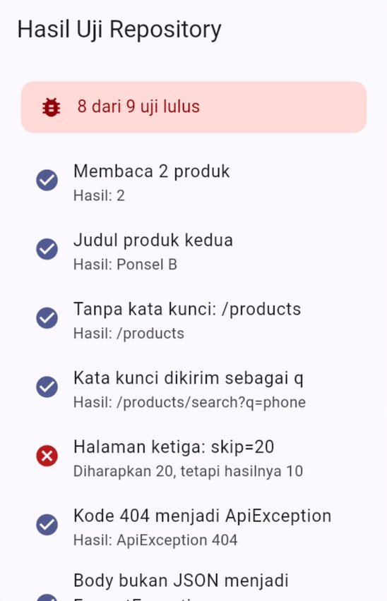
</p>

Cari penyebabnya di `RepositoriProdukApi.cari`. Petunjuk: perhatikan nilai yang dikirim untuk `'skip'`. Kesalahan kecil seperti ini membuat tombol "Muat lebih banyak" menampilkan produk yang **sama** berulang-ulang, dan sulit ditemukan hanya dengan mencoba aplikasinya sekilas. Pemeriksaan yang tepat menemukannya dalam sekejap.

> [!NOTE]
> Contoh 10 menampilkan hasil uji di layar agar mudah diamati di DartPad. Pertemuan 14 memakai cara resminya: paket `flutter_test` dan perintah `flutter test`. `MockClient` tetap dipakai dengan cara yang sama di sana.

---

## 13. Studi Kasus: Cuaca Kampus

[Contoh 11](kode/contoh_11_studi_kasus_cuaca_kampus.dart) merangkai semua materi hari ini menjadi aplikasi prakiraan cuaca untuk delapan kota kampus.

| Bagian | Fitur |
| :--- | :--- |
| Pilihan kota | *Chip* Jakarta, Bandung, Yogyakarta, Surabaya, Denpasar, Samarinda, Makassar, dan Medan |
| Cuaca saat ini | Suhu, kondisi (cerah, berawan, hujan, ...), kelembapan, kecepatan angin, dan jam diperbarui |
| Prakiraan 7 hari | Kondisi, suhu tertinggi dan terendah, serta peluang hujan setiap hari |
| Interaksi | Tarik ke bawah untuk menyegarkan; tombol **Coba lagi** saat gagal |

### 13.1 Sumber data: Open-Meteo

[Open-Meteo](https://open-meteo.com) menyediakan prakiraan cuaca gratis tanpa kunci API untuk keperluan nonkomersial. Datanya berlisensi CC BY 4.0, sehingga aplikasi wajib menyebutkan sumbernya. Contoh 11 menuliskannya di bagian bawah halaman.

Permintaannya dibuat oleh `LayananOpenMeteo`:

```dart
final Uri alamat = Uri.https('api.open-meteo.com', '/v1/forecast', {
  'latitude': '$lintang',
  'longitude': '$bujur',
  'current':
      'temperature_2m,relative_humidity_2m,weather_code,wind_speed_10m',
  'daily':
      'weather_code,temperature_2m_max,temperature_2m_min,'
      'precipitation_probability_max',
  'timezone': 'auto', // tanggal mengikuti zona waktu kota itu
  'forecast_days': '7',
});
```

| Parameter | Artinya |
| :--- | :--- |
| `latitude`, `longitude` | Koordinat lokasi (lintang dan bujur) |
| `current` | Data saat ini yang diminta: suhu, kelembapan, kode cuaca, kecepatan angin |
| `daily` | Data harian yang diminta: kode cuaca, suhu tertinggi dan terendah, peluang hujan tertinggi |
| `timezone=auto` | Tanggal dan jam mengikuti zona waktu lokasi (WIB, WITA, atau WIT) |
| `forecast_days` | Jumlah hari prakiraan |

### 13.2 Bentuk JSON-nya

Jawaban Open-Meteo kira-kira seperti ini (dipersingkat):

```json
{
  "timezone": "Asia/Makassar",
  "current": {
    "time": "2026-10-15T14:00",
    "temperature_2m": 31.4,
    "relative_humidity_2m": 66,
    "weather_code": 3,
    "wind_speed_10m": 7.2
  },
  "daily": {
    "time": ["2026-10-15", "2026-10-16", "2026-10-17"],
    "weather_code": [3, 95, 61],
    "temperature_2m_max": [32.1, 30.5, 31],
    "temperature_2m_min": [24.3, 23.8, 24],
    "precipitation_probability_max": [20, 85, null]
  }
}
```

Bagian `current` berupa objek biasa. Bagian `daily` berbeda dari yang sudah kita lihat: isinya bukan daftar objek, melainkan beberapa **larik sejajar**. Unsur ke-`i` di setiap larik adalah milik hari ke-`i`:

| `i` | `time[i]` | `weather_code[i]` | `temperature_2m_max[i]` | `precipitation_probability_max[i]` |
| :---: | :--- | :---: | :---: | :---: |
| 0 | 2026-10-15 | 3 | 32.1 | 20 |
| 1 | 2026-10-16 | 95 | 30.5 | 85 |
| 2 | 2026-10-17 | 61 | 31 | `null` |

Data nyata tidak selalu rapi: nilai bisa `null`, dan angka bisa bulat (`31`) atau desimal (`32.1`). *Repository* harus siap menghadapi keduanya.

### 13.3 *Repository*: menyatukan larik sejajar

```dart
List<PrakiraanHarian> _harian(Map<String, dynamic> json) {
  if (json case {
    'time': final List<dynamic> tanggal,
    'weather_code': final List<dynamic> kode,
    'temperature_2m_max': final List<dynamic> maks,
    'temperature_2m_min': final List<dynamic> min,
    'precipitation_probability_max': final List<dynamic> peluang,
  }) {
    final int n = tanggal.length;
    if (kode.length != n ||
        maks.length != n ||
        min.length != n ||
        peluang.length != n) {
      throw const FormatException('Panjang data harian tidak sama');
    }
    return [
      for (int i = 0; i < n; i++)
        PrakiraanHarian(
          tanggal: DateTime.parse(tanggal[i] as String),
          kondisi: Kondisi.dariKode((kode[i] as num).toInt()),
          suhuMaks: (maks[i] as num).toDouble(),
          suhuMin: (min[i] as num).toDouble(),
          peluangHujan: (peluang[i] as num?)?.round(),
        ),
    ];
  }
  throw const FormatException('Bentuk data harian tidak sesuai');
}
```

| Bagian | Penjelasan |
| :--- | :--- |
| `if (json case {...})` | **if-case**: seperti `switch`, tetapi hanya satu pola. Variabel di dalam pola bisa langsung dipakai di dalam `if` |
| Pemeriksaan panjang | Jika panjang lariknya berbeda, kode `[i]` bisa melampaui batas. Lebih baik berhenti dengan `FormatException` yang jelas |
| `(peluang[i] as num?)?.round()` | Nilainya boleh `null`. Jika `null`, hasilnya `null`; jika angka, dibulatkan menjadi `int` |
| `DateTime.parse('2026-10-15')` | Mengubah teks tanggal menjadi `DateTime` |

### 13.4 Kode cuaca menjadi kondisi

Open-Meteo memakai **kode cuaca WMO**: `0` cerah, `3` berawan, `61` hujan ringan, `95` badai petir, dan seterusnya. `enum Kondisi` menerjemahkannya, lengkap dengan label dan ikon:

```dart
static Kondisi dariKode(int kode) {
  return switch (kode) {
    0 => Kondisi.cerah,
    1 || 2 => Kondisi.cerahBerawan,
    3 => Kondisi.berawan,
    45 || 48 => Kondisi.berkabut,
    >= 51 && <= 57 => Kondisi.gerimis,
    61 || 80 => Kondisi.hujanRingan,
    63 || 66 || 81 => Kondisi.hujan,
    65 || 67 || 82 => Kondisi.hujanLebat,
    >= 71 && <= 77 || 85 || 86 => Kondisi.salju,
    >= 95 && <= 99 => Kondisi.badaiPetir,
    _ => Kondisi.tidakDiketahui,
  };
}
```

| Pola | Artinya |
| :--- | :--- |
| `1 \|\| 2` | Pola "atau": kode 1 **atau** 2 |
| `>= 51 && <= 57` | Pola "dan" dengan relasional: 51 sampai 57 |
| `_` | Kode yang tidak dikenal tetap ditangani, bukan membuat aplikasi *error* |

### 13.5 ViewModel

`CuacaViewModel` memakai semua pola yang sudah dibahas: status memuat–berhasil–gagal, `pesanRamah`, nomor permintaan (Bagian 10.4), dan `_sudahDibuang` (Pertemuan 9).

```dart
Future<void> muat({bool tampilkanMemuat = true}) async {
  final int nomor = ++_nomorPermintaan;
  if (tampilkanMemuat) {
    _status = StatusMuat.memuat;
    notifyListeners();
  }
  try {
    final Cuaca cuaca = await _repositori.ambil(_kota);
    if (_sudahDibuang || nomor != _nomorPermintaan) {
      return; // jawaban terlambat (kota sudah diganti)
    }
    _cuaca = cuaca;
    _diperbarui = DateTime.now();
    _status = StatusMuat.berhasil;
  } catch (galat) {
    if (_sudahDibuang || nomor != _nomorPermintaan) {
      return;
    }
    debugPrint('Galat saat memuat cuaca: $galat');
    _pesanGalat = pesanRamah(galat);
    _status = StatusMuat.gagal;
  }
  notifyListeners();
}

Future<void> segarkan() => muat(tampilkanMemuat: false);

void pilihKota(Kota kota) {
  if (kota == _kota) {
    return;
  }
  _kota = kota;
  muat();
}
```

`segarkan` memanggil `muat` tanpa mengubah status menjadi memuat. Saat ditarik untuk menyegarkan, `RefreshIndicator` sudah menampilkan lingkarannya sendiri, dan data lama tetap terlihat sampai data baru tiba.

### 13.6 View

```dart
StatusMuat.berhasil => RefreshIndicator(
  onRefresh: () => context.read<CuacaViewModel>().segarkan(),
  child: IsiCuaca(cuaca: vm.cuaca!, diperbarui: vm.diperbarui!),
),
```

| Widget | Catatan |
| :--- | :--- |
| `RefreshIndicator` | Lingkaran "tarik untuk menyegarkan". `onRefresh` harus mengembalikan `Future`; lingkarannya hilang saat `Future` itu selesai |
| `ListView(physics: AlwaysScrollableScrollPhysics())` | Daftar selalu bisa ditarik, walaupun isinya pendek. Tanpa ini, `RefreshIndicator` tidak bisa dipicu jika isi muat di layar |
| `PilihanKota` | Memakai `context.select((CuacaViewModel vm) => vm.kota)`, sehingga hanya dibangun ulang saat kota berganti |
| `Icon(..., semanticLabel: ...)` | Kondisi cuaca tidak hanya ditunjukkan ikon, tetapi juga label teks yang dibaca pembaca layar |

### 13.7 Pemeriksaan sebelum aplikasi tampil

Seperti Praktikum 4 di Pertemuan 9, `main` menjalankan `jalankanUji()` sebelum `runApp`. *Repository* dan ViewModel diperiksa dengan `MockClient` berisi JSON contoh di atas. Konsol menampilkan (alamat yang panjang dipersingkat dengan `...`):

```text
GET https://api.open-meteo.com/v1/forecast?latitude=-0.5&longitude=117.15&...
LULUS  Alamat memakai lintang kota
LULUS  Kode 3 = Berawan
LULUS  Suhu saat ini
LULUS  Tiga hari prakiraan
LULUS  Hari kedua badai petir
LULUS  Suhu maks 31 terbaca
LULUS  Peluang hujan kosong
LULUS  Kode 42 tidak dikenal
GET https://api.open-meteo.com/v1/forecast?latitude=-6.2&longitude=106.85&...
Galat saat memuat cuaca: ApiException: kode status 500
LULUS  Kode 500: status gagal
LULUS  Kode 500: pesan ramah
GET https://api.open-meteo.com/v1/forecast?latitude=-6.2&longitude=106.85&...
```

| Baris | Asalnya |
| :--- | :--- |
| `GET ...` | `debugPrint` di `LayananOpenMeteo`. Alamatnya dibuat sungguhan, tetapi yang "menjawab" adalah `MockClient`, jadi tidak ada data yang dikirim ke internet |
| `Galat saat memuat cuaca: ...` | Memang **diharapkan**: uji ViewModel sengaja membuat server tiruan menjawab `500` |
| `GET ...` yang terakhir | Permintaan sungguhan ke Open-Meteo saat aplikasi tampil (kota awal: Jakarta) |

Perhatikan juga koma di parameter `current` dan `daily` ditulis sebagai `%2C` di alamat lengkapnya. Itulah `Uri.https` yang mengodekan karakter khusus secara otomatis (Bagian 10.1).

### 13.8 Hasilnya

<p align="center">
  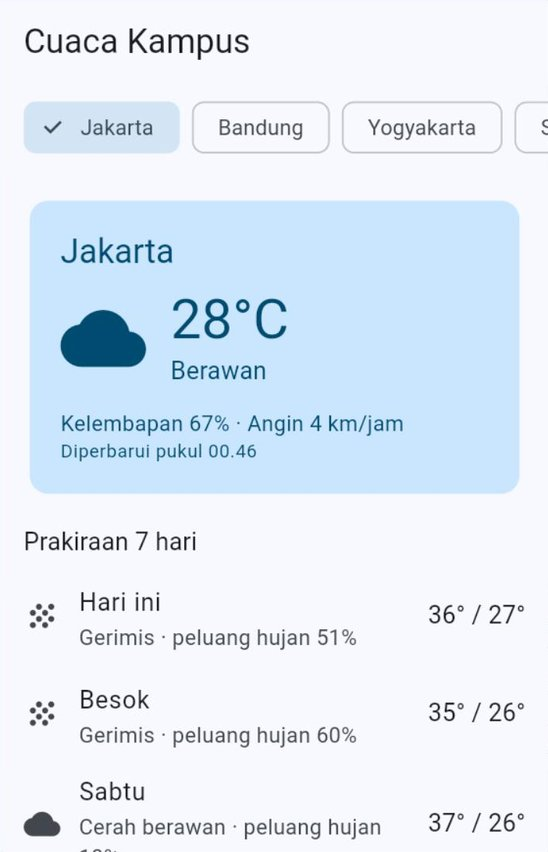
  &nbsp;
  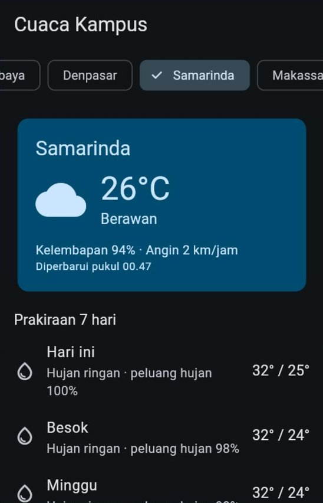
  &nbsp;
  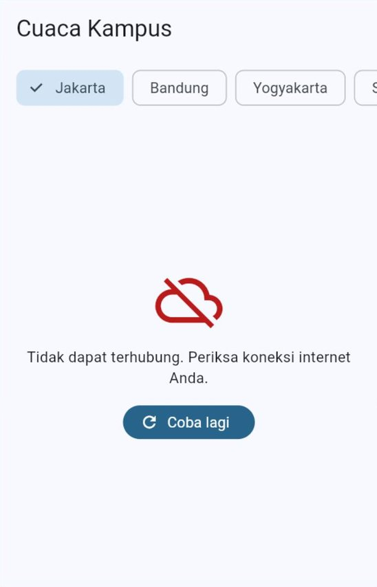
</p>

### 13.9 Uji mandiri

Jalankan Contoh 11, lalu centang setiap perilaku yang sudah Anda buktikan:

- [ ] Konsol menampilkan sepuluh baris `LULUS` sebelum aplikasi tampil.
- [ ] Memilih kota lain menampilkan lingkaran memuat, lalu cuaca kota itu.
- [ ] Memilih dua kota dengan sangat cepat tidak pernah menampilkan cuaca kota yang **pertama** dipilih.
- [ ] Menarik daftar ke bawah menyegarkan data, dan jam "Diperbarui pukul" berubah.
- [ ] Dua baris teratas prakiraan bertuliskan "Hari ini" dan "Besok".
- [ ] Mematikan koneksi internet (atau memakai mode pesawat), lalu menekan kota lain, menampilkan pesan yang ramah dan tombol **Coba lagi**.
- [ ] Dalam mode gelap, semua teks tetap terbaca.

---

## 14. Menjalankan di Web dan di Android

### 14.1 Di web (Chrome dan DartPad): CORS

Saat aplikasi Flutter berjalan sebagai **web**, permintaan HTTP dikirim oleh *browser*. Demi keamanan, *browser* hanya mengizinkan halaman web mengambil data dari server **lain** jika server itu secara tegas mengizinkannya. Aturan ini disebut **CORS** (*Cross-Origin Resource Sharing*).

| Gejala | Penyebab | Solusi |
| :--- | :--- | :--- |
| Lancar di Android, tetapi di Chrome selalu `ClientException` | Server tidak mengizinkan dipanggil dari *browser* | Pilih API yang mendukung CORS, atau uji di HP Android/emulator |
| Alamat dibuka langsung di *browser* tampil normal, tetapi gagal dari aplikasi web | Membuka alamat langsung tidak terkena aturan CORS, sedangkan aplikasi web terkena | Sama seperti di atas |

Server latihan di modul ini (DummyJSON dan Open-Meteo) mengizinkan dipanggil dari *browser*, sehingga semua contoh bisa dijalankan di Chrome dan DartPad. Untuk proyek akhir, **uji API pilihan Anda di Chrome sejak awal** ([Panduan Proyek Akhir Bagian 5.3](../panduan/05_proyek_akhir.md#53-tips-memilih-api)).

> [!CAUTION]
> Jangan mengakali CORS dengan "proxy" gratis yang tidak jelas pemiliknya. Semua data yang lewat, termasuk token masuk pengguna, bisa dibaca oleh pemilik proxy itu.

### 14.2 Di Android: izin internet

Aplikasi Android butuh izin untuk mengakses internet. Saat dijalankan dengan `flutter run` (mode *debug*), izin ini sudah ada secara otomatis. Namun, aplikasi **rilis** (APK untuk dibagikan, Pertemuan 15) hanya mendapat izin jika baris berikut ada di `android/app/src/main/AndroidManifest.xml`, di dalam tag `<manifest>` dan **sebelum** tag `<application>`:

```xml
<uses-permission android:name="android.permission.INTERNET" />
```

Tanpa baris ini, aplikasi rilis tidak bisa memuat data apa pun, padahal saat diuji dengan `flutter run` semuanya lancar. Tambahkan sejak awal di proyek akhir Anda.

### 14.3 Dua hal lain yang sering menjebak

| Situasi | Yang perlu diketahui |
| :--- | :--- |
| Server memakai `http://` (tanpa **s**) | Android menolak koneksi tanpa enkripsi secara bawaan. Pakai `https://` |
| Server dijalankan sendiri di laptop (`localhost`) lalu diakses dari emulator Android | Di dalam emulator, `localhost` berarti emulator itu sendiri. Laptop diakses lewat alamat `10.0.2.2` |

### 14.4 Kunci API: jangan disimpan di repositori

Sebagian API (misalnya layanan peta atau layanan berbayar) meminta **kunci API** (*API key*): teks rahasia yang dikirim di parameter *query* atau *header* sebagai tanda pengenal aplikasi Anda. Semua API di modul ini tidak memerlukannya, tetapi API pilihan proyek akhir Anda mungkin memerlukannya.

| Lakukan | Hindari |
| :--- | :--- |
| Berikan kunci saat menjalankan aplikasi: `flutter run --dart-define=KUNCI_API=isi_kunci`, lalu baca di kode dengan `String.fromEnvironment` | Menulis kunci langsung di kode, misalnya `const kunci = 'abc123';`, lalu mendorongnya ke GitHub |
| Jika kuncinya banyak, kumpulkan di berkas `kunci.json`, jalankan dengan `flutter run --dart-define-from-file=kunci.json`, dan cantumkan `kunci.json` di `.gitignore` **sebelum** *commit* pertama | Membagikan kunci lewat grup obrolan atau tangkapan layar |
| Pilih API tanpa kunci jika memungkinkan | Memakai kunci akun pribadi berbayar di aplikasi yang dibagikan |

```dart
// Diisi saat aplikasi dijalankan atau di-build; kosong jika tidak diberikan.
const String kunciApi = String.fromEnvironment('KUNCI_API');

final Uri alamat = Uri.https('api.contoh.com', '/data', {'key': kunciApi});
```

> [!WARNING]
> `--dart-define` hanya menjaga agar kunci **tidak masuk ke repositori**. Kunci yang ikut dibawa aplikasi tetap bisa dibongkar oleh orang yang cukup paham. Kunci yang benar-benar rahasia (misalnya kunci pembayaran) tidak boleh ada di aplikasi sama sekali: aplikasi memanggil server milik sendiri, dan server itulah yang menyimpan kuncinya.

---

## 15. Kesalahan Umum Pemula dan Solusinya

| Gejala | Penyebab | Solusi |
| :--- | :--- | :--- |
| `Target of URI doesn't exist: 'package:http/http.dart'` | Paket `http` belum dipasang | `flutter pub add http` |
| `The argument type 'String' can't be assigned to the parameter type 'Uri'` | Alamat diberikan sebagai teks ke `http.get` | Bungkus dengan `Uri.parse(...)` atau buat dengan `Uri.https(...)` |
| Data kosong atau `null` saat server menjawab `404`/`500` | `statusCode` tidak diperiksa | Periksa `statusCode` sebelum membaca *body* |
| `type 'List<dynamic>' is not a subtype of type 'Map<String, dynamic>'` | Jawabannya berupa larik, tetapi diperlakukan sebagai objek (atau sebaliknya) | Buka alamatnya di *browser* dan lihat bentuk JSON-nya dulu |
| `FormatException` saat membaca angka | Pola `double` dipakai untuk angka yang kadang bulat | Pakai `num`, lalu `.toDouble()` |
| Lingkaran memuat muncul terus dan permintaan terkirim berulang-ulang | `Future` dibuat di dalam `build` | Buat `Future` di `initState` atau pakai ViewModel |
| `setState() called after dispose()` atau `A ... was used after being disposed.` | Halaman/ViewModel sudah ditutup saat jawaban tiba | `if (!mounted) return;` di halaman, `_sudahDibuang` di ViewModel |
| Lingkaran memuat berputar sangat lama tanpa kepastian | Tidak ada batas waktu | Pasang `.timeout(...)` dan tangani `TimeoutException` |
| Hasil pencarian lama menimpa hasil yang baru | Jawaban yang terlambat tidak diabaikan | Nomor permintaan (Bagian 10.4) |
| Server menolak data yang dikirim dengan `POST` (kode `400`) atau datanya tidak terbaca | *Body* bukan JSON, atau *header* `Content-Type` tidak dikirim | `jsonEncode(...)` + `'Content-Type': 'application/json'` |
| Huruf aneh seperti `é` atau `°` | Server tidak menyebutkan *charset* | `utf8.decode(respons.bodyBytes)` |
| Lancar di Android, tetapi `ClientException` di Chrome | CORS | Bagian 14.1 |
| Lancar saat `flutter run`, tetapi APK rilis tidak memuat data | Izin internet belum ditambahkan | Bagian 14.2 |
| Pesan galat teknis tampil ke pengguna | `galat.toString()` ditampilkan langsung | Terjemahkan dengan fungsi seperti `pesanRamah` |

---

## 16. Ringkasan

- Aplikasi (klien) meminta data ke **server** lewat **REST API**: setiap data punya **alamat**, dan **metode** (`GET`, `POST`, `PUT`, `PATCH`, `DELETE`) menentukan tindakannya.
- Jawaban server berisi **kode status** (2xx berhasil, 4xx salah di sisi aplikasi, 5xx salah di sisi server), ***header***, dan ***body*** berformat **JSON**.
- `jsonDecode` mengubah teks JSON menjadi `Map`/`List`; **pola map** di `fromJson` memeriksa sekaligus mengambil data. Angka JSON dibaca dengan `num`. `jsonEncode` mengubah data menjadi teks untuk dikirim.
- Paket **`http`**: `http.get`, `post`, `patch`, `delete` mengembalikan `Future<http.Response>`. Kode `404`/`500` **bukan** *exception*; *exception* muncul jika tidak ada jawaban.
- `FutureBuilder` menampilkan keadaan `Future`; `Future`-nya dibuat **sekali** di `initState`, bukan di `build`.
- Galat jaringan: `ClientException`, `TimeoutException` (dari `.timeout`), `ApiException` buatan sendiri, dan `FormatException`. Terjemahkan menjadi **pesan yang ramah** dengan `switch` pola objek.
- **Layanan** mengurus HTTP dan JSON; ***repository*** mengubahnya menjadi Model; ViewModel dan View tidak perlu tahu dari mana datanya.
- `Uri.https` membuat alamat dengan parameter *query* yang aman. Pencarian memakai ***debounce***, halaman demi halaman memakai `limit`/`skip`/`total`, dan jawaban terlambat diabaikan dengan **nomor permintaan**.
- `MockClient` adalah server tiruan untuk menguji lapisan data **tanpa internet**.
- Di web perhatikan **CORS**; di Android rilis tambahkan **izin internet**; **kunci API** tidak pernah ditulis di kode yang masuk repositori.

**Memilih alat yang tepat:**

| Kebutuhan | Pakai |
| :--- | :--- |
| Coba-coba satu permintaan di halaman sederhana | `http.get` + `setState` (Contoh 01) |
| Menampilkan hasil satu `Future` tanpa banyak aturan | `FutureBuilder` dengan `Future` dari `initState` |
| Pencarian, saringan, muat lebih banyak, kirim data | ViewModel + *repository* + layanan |
| Banyak permintaan ke server yang sama | Satu `http.Client` di layanan, ditutup saat selesai |
| Menguji tanpa internet | `MockClient` dari `package:http/testing.dart` |

---

## 17. Glosarium

| Istilah | Arti |
| :--- | :--- |
| **Server** | Komputer yang menyimpan data dan melayani permintaan dari banyak aplikasi |
| **Klien** (*client*) | Aplikasi yang meminta data ke server, misalnya aplikasi Flutter kita |
| **API** | "Loket" yang disediakan sebuah program agar program lain bisa memakai layanannya |
| **REST API** | Gaya API berbasis alamat (URL) untuk setiap data dan metode HTTP untuk tindakannya |
| **HTTP / HTTPS** | Aturan percakapan antara klien dan server; HTTPS adalah versi terenkripsi |
| ***Endpoint*** | Satu alamat API tertentu, misalnya `/todos/1` |
| **Metode** | Jenis tindakan: `GET`, `POST`, `PUT`, `PATCH`, `DELETE` |
| ***Header*** | Keterangan tambahan pada permintaan atau jawaban, misalnya `Content-Type` |
| **Kode status** | Angka tiga digit di jawaban server yang menunjukkan berhasil atau tidaknya permintaan |
| ***Body*** | Isi utama permintaan atau jawaban |
| **JSON** | Format teks untuk data terstruktur: objek `{}`, larik `[]`, teks, angka, `true`/`false`, `null` |
| **Parameter *query*** | Pasangan `nama=nilai` setelah tanda `?` di alamat |
| ***Timeout*** | Batas waktu menunggu jawaban |
| **Layanan** (*service*) | *Class* yang membungkus pemanggilan API: HTTP, kode status, dan JSON |
| ***Debounce*** | Menunda sebuah aksi sampai pengguna berhenti melakukan sesuatu selama waktu tertentu |
| **Paginasi** | Mengambil data sedikit demi sedikit, halaman demi halaman |
| **`MockClient`** | `http.Client` tiruan yang jawabannya ditentukan sendiri, untuk pengujian |
| **CORS** | Aturan *browser* yang menentukan apakah halaman web boleh mengambil data dari server lain |
| **Kunci API** (*API key*) | Teks rahasia yang dikirim ke API sebagai tanda pengenal aplikasi; tidak boleh disimpan di repositori |
| **Kode cuaca WMO** | Angka standar Organisasi Meteorologi Dunia untuk kondisi cuaca, dipakai Open-Meteo |

---

## 18. Referensi

1. Flutter. *Fetch data from the internet*. <https://docs.flutter.dev/cookbook/networking/fetch-data>
2. Flutter. *Send data to the internet*. <https://docs.flutter.dev/cookbook/networking/send-data>
3. Flutter. *Update data over the internet*. <https://docs.flutter.dev/cookbook/networking/update-data>
4. Flutter. *Delete data on the internet*. <https://docs.flutter.dev/cookbook/networking/delete-data>
5. Flutter. *Guide to app architecture* (lapisan data: *services* dan *repositories*). <https://docs.flutter.dev/app-architecture/guide>
6. Dart. *Using JSON* (dart:convert dan pola). <https://dart.dev/libraries/serialization/json>
7. Dart. *Patterns*. <https://dart.dev/language/patterns>
8. pub.dev. *http*. <https://pub.dev/packages/http>
9. DummyJSON. *Docs*. <https://dummyjson.com/docs>
10. Open-Meteo. *Weather Forecast API*. <https://open-meteo.com/en/docs>
11. MDN Web Docs. *HTTP response status codes*. <https://developer.mozilla.org/en-US/docs/Web/HTTP/Status>
12. MDN Web Docs. *Cross-Origin Resource Sharing (CORS)*. <https://developer.mozilla.org/en-US/docs/Web/HTTP/CORS>

---

## ➡️ Langkah Berikutnya

1. Kerjakan [🧪 Jobsheet Pertemuan 10](JOBSHEET.md) di laboratorium.
2. Kerjakan [✍️ Latihan Pertemuan 10](LATIHAN.md) untuk menguji pemahaman Anda.
3. **Proyek akhir:** buat layanan dan *repository* untuk API pilihan Anda, lalu uji dengan `MockClient`. Lihat [🚀 Panduan Proyek Akhir](../panduan/05_proyek_akhir.md).
4. Pertemuan 11 membahas **Penyimpanan Lokal**: menyimpan kota favorit, pengaturan, dan data cadangan agar aplikasi tetap berguna saat tidak ada internet.

[⬆️ Kembali ke atas](#pertemuan-10--asinkron--integrasi-rest-api)
