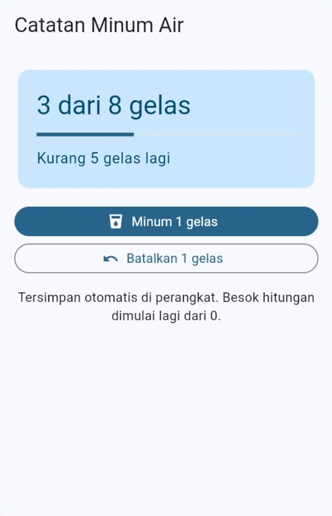
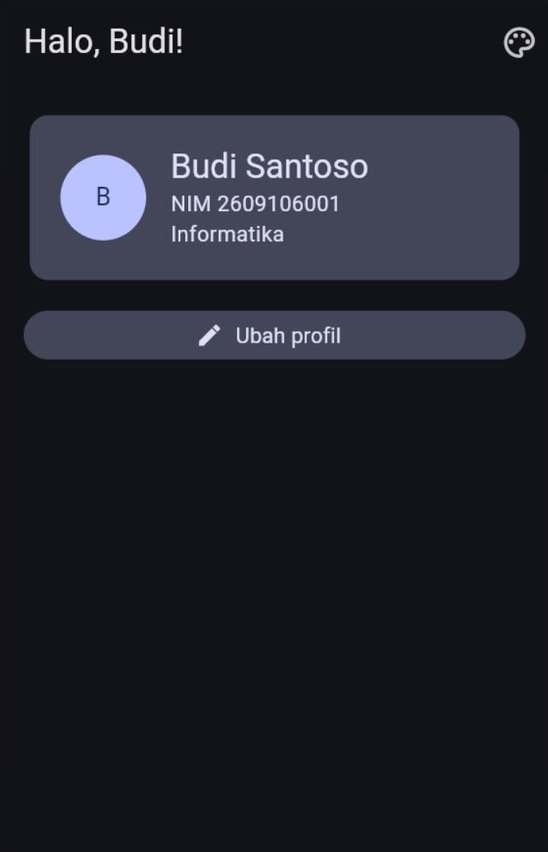
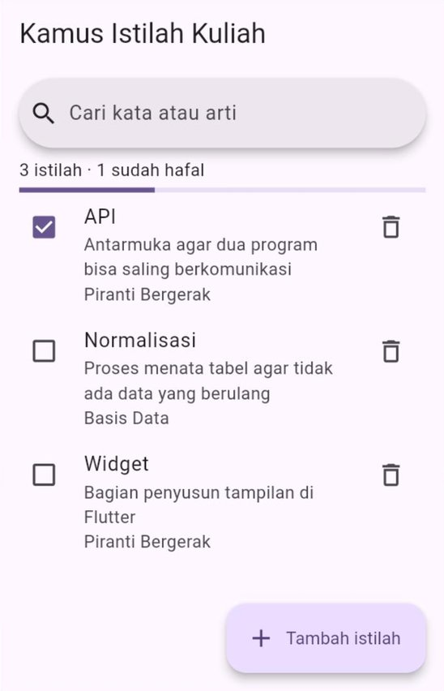
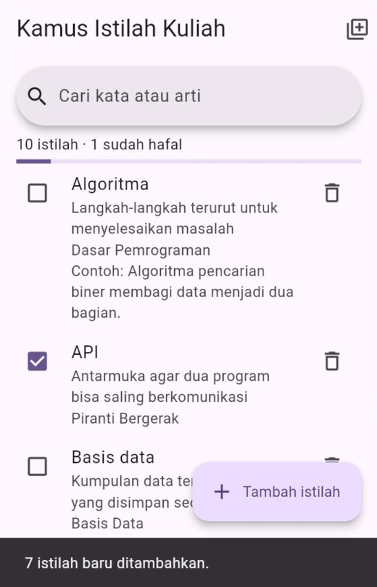
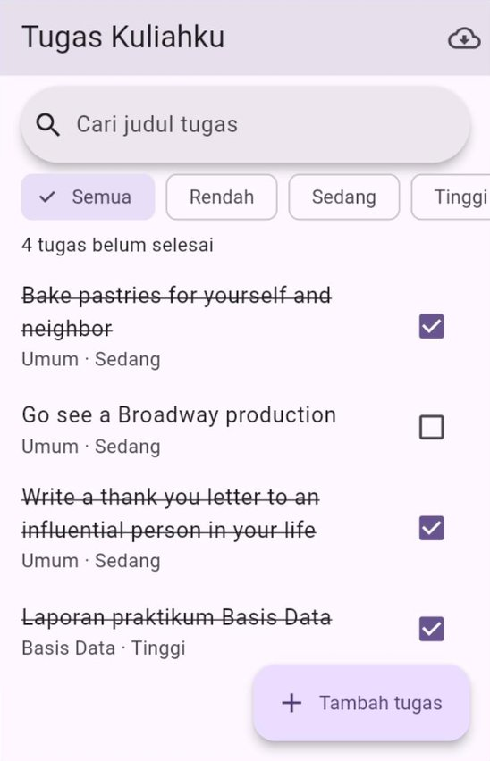

# 🧪 Jobsheet Pertemuan 11 — Penyimpanan Lokal

[🏠 Beranda](../README.md) · [📖 Modul](README.md) · [✍️ Latihan](LATIHAN.md) · [💻 Kode Contoh](kode/)

| Informasi | Keterangan |
| :--- | :--- |
| Mata kuliah | Pemrograman Piranti Bergerak |
| Pertemuan | 11 — Penyimpanan Lokal |
| Bentuk kegiatan | Praktikum individu |
| Estimasi waktu | 150 menit |
| Alat | Proyek Flutter di VS Code, dijalankan di Chrome (`flutter run -d chrome --web-port=8080`) **atau** di HP Android. DartPad **tidak** bisa dipakai untuk semua praktikum hari ini (`shared_preferences` dan `sqflite` tidak berjalan di sana). Praktikum 5: **wajib** proyek `tugas_kuliahku` dari Pertemuan 10 |
| Paket | `shared_preferences` (Praktikum 1, 2), `provider` (Praktikum 2–5), `sqflite` dan `sqflite_common_ffi_web` (Praktikum 3–5), `http` (Praktikum 5) |
| Koneksi | Hanya dibutuhkan untuk memasang paket, langkah *setup* web, dan fitur impor di Praktikum 5 |
| Hasil akhir | Proyek "Tugas Kuliahku" yang tugas-tugasnya tersimpan di database perangkat dan tetap bisa dipakai tanpa internet, ditambah tiga aplikasi kecil: catatan minum air, profil dan preferensi, serta kamus istilah kuliah (dua versi) |

---

## 🎯 Tujuan Praktikum

Setelah menyelesaikan jobsheet ini, Anda mampu:

1. Menyimpan dan membaca data kecil dengan `SharedPreferencesAsync`, lalu membuktikan bahwa data tetap ada setelah aplikasi ditutup.
2. Menyiapkan pengaturan sebelum `runApp` dengan `SharedPreferencesWithCache` dan `allowList`, sehingga aplikasi langsung tampil sesuai pilihan terakhir.
3. Membuat aplikasi CRUD dengan SQLite (`sqflite`) yang ditata dengan pola layanan, *repository*, dan ViewModel, serta aman dari *SQL injection*.
4. Mengubah struktur tabel dengan migrasi tanpa menghapus data, dan menyimpan banyak data sekaligus dengan transaksi dan *batch*.
5. Menguji lapisan data dengan database di memori, dan menjadikan proyek "Tugas Kuliahku" tetap berguna tanpa internet.

## 📌 Petunjuk Umum

> [!IMPORTANT]
> 1. Setiap praktikum diawali **kode terbimbing**. **Ketik sendiri** kodenya, kecuali bagian yang ditandai *boleh disalin*.
> 2. Kerjakan **🔧 Modifikasi** di setiap praktikum. Jawaban berupa penjelasan ditulis sebagai **komentar** di dalam kode.
> 3. Simpan Praktikum 1–4 sebagai berkas terpisah berisi kode **lengkap**: `praktikum1.dart` sampai `praktikum4.dart`. Praktikum 5 berupa folder `lib/` dari proyek `tugas_kuliahku`.
> 4. Rapikan kode sebelum menyimpan (`Shift` + `Alt` + `F` di VS Code). Pastikan tidak ada garis merah maupun kuning.
> 5. **Aturan hari ini:** (1) data disimpan **segera** setelah berubah; (2) nilai dari pengguna masuk ke SQL **hanya** lewat `?` dan `whereArgs`; (3) pemeriksaan memakai database **di memori** (`inMemoryDatabasePath`), bukan data asli; (4) di Chrome, selalu jalankan dengan `--web-port=8080`.
> 6. Banyak modifikasi berupa **eksperimen**: Anda sengaja membuat kesalahan untuk melihat akibatnya. Setelah akibatnya dicatat sebagai komentar, **kembalikan** kodenya seperti semula, kecuali diminta lain.

### Persiapan proyek latihan (sekali saja)

Praktikum 1–4 memakai proyek latihan Anda ([Panduan Menjalankan Kode, Cara 2](../panduan/03_menjalankan_kode_contoh.md#cara-2--proyek-latihan-flutter-di-komputer-sendiri)). Isi `lib/main.dart` diganti dengan kode setiap praktikum. Di terminal folder proyek latihan, jalankan:

```bash
flutter pub add shared_preferences provider sqflite sqflite_common_ffi_web
```

Jika memakai **Chrome**, jalankan juga perintah berikut **sekali** (butuh internet, bisa memakan waktu beberapa menit). Perintah ini menyiapkan berkas `sqlite3.wasm` dan `sqflite_sw.js` di folder `web/` ([Modul Bagian 5.4](README.md#54-memasang-sqflite)):

```bash
dart run sqflite_common_ffi_web:setup
```

Setelah itu, setiap praktikum dijalankan dengan:

```bash
flutter run -d chrome --web-port=8080   # Chrome
flutter run                             # HP Android
```

> [!WARNING]
> Paket baru belum ikut terpasang di aplikasi yang **sedang berjalan**. Setelah `flutter pub add`, hentikan aplikasi (`q`), lalu jalankan lagi. *Hot reload* maupun *hot restart* saja akan memunculkan `MissingPluginException`.

> [!TIP]
> **Di mana melihat isi konsol?** Tab **Debug Console** di VS Code (jika dijalankan dengan **F5**), atau terminal tempat `flutter run` dijalankan. Hasil pemeriksaan (`LULUS`/`GAGAL`) dan pesan migrasi tampil di sana.

---

## Praktikum 1 — Catatan Minum Air yang Tidak Lupa

**Konsep:** `SharedPreferencesAsync`, nama kunci sebagai konstanta, membaca saat aplikasi dibuka, menyimpan setiap kali data berubah, dan mulai dari nol di hari yang baru. ([Modul Bagian 2](README.md#2-shared_preferences-menyimpan-pasangan-kuncinilai))

Di [Praktikum 1 Pertemuan 9](../pertemuan_09_state_dan_mvvm/JOBSHEET.md#praktikum-1--catatan-minum-air), hitungan gelas kembali ke 0 setiap kali aplikasi ditutup. Kini hitungan itu disimpan di perangkat, dan otomatis kembali ke 0 saat hari berganti.

### Langkah 1 — Objek yang menyimpan data ke perangkat (ketik sendiri)

```dart
import 'package:flutter/material.dart';
import 'package:shared_preferences/shared_preferences.dart';

void main() {
  runApp(const AplikasiMinum());
}

// ---------- Langkah 1: objek yang menyimpan data ke perangkat ----------
class CatatanMinum extends ChangeNotifier {
  // Nama kunci (label loker) di penyimpanan perangkat.
  static const String _kunciGelas = 'gelas_hari_ini';
  static const String _kunciTanggal = 'tanggal_catatan';

  final SharedPreferencesAsync _prefs = SharedPreferencesAsync();

  final int target = 8; // target gelas per hari
  int _gelas = 0;
  bool _memuat = true;
  bool _sudahDibuang = false;

  int get gelas => _gelas;
  bool get memuat => _memuat;
  bool get tercapai => _gelas >= target;
  int get sisa => tercapai ? 0 : target - _gelas;
  double get kemajuan => tercapai ? 1 : _gelas / target;

  // Tanggal hari ini sebagai teks, misalnya '2026-10-15'.
  String _hariIni() {
    final DateTime sekarang = DateTime.now();
    final String bulan = sekarang.month.toString().padLeft(2, '0');
    final String hari = sekarang.day.toString().padLeft(2, '0');
    return '${sekarang.year}-$bulan-$hari';
  }

  // Dipanggil sekali saat halaman dibuka.
  Future<void> muat() async {
    final String? tanggal = await _prefs.getString(_kunciTanggal);
    final int? gelas = await _prefs.getInt(_kunciGelas);
    if (_sudahDibuang) {
      return;
    }
    // Catatan dari hari lain tidak dipakai: hari baru dimulai dari 0.
    _gelas = tanggal == _hariIni() ? (gelas ?? 0) : 0;
    _memuat = false;
    notifyListeners();
  }

  Future<void> minum() async {
    _gelas++;
    notifyListeners(); // tampilan berubah lebih dulu...
    await _simpan(); // ...lalu disimpan ke perangkat
  }

  Future<void> batal() async {
    if (_gelas == 0) {
      return;
    }
    _gelas--;
    notifyListeners();
    await _simpan();
  }

  Future<void> _simpan() async {
    await _prefs.setInt(_kunciGelas, _gelas);
    await _prefs.setString(_kunciTanggal, _hariIni());
  }

  @override
  void dispose() {
    _sudahDibuang = true;
    super.dispose();
  }
}
```

| Bagian | Penjelasan |
| :--- | :--- |
| `_kunciGelas`, `_kunciTanggal` | Nama kunci ditulis sekali sebagai konstanta. Salah ketik nama kunci di satu tempat membuat data "hilang" tanpa pesan *error* |
| `_hariIni()` | Tanggal tanpa jam, misalnya `2026-10-15`, agar mudah dibandingkan |
| `muat()` | Jika tanggal tersimpan sama dengan hari ini, pakai jumlah gelas yang tersimpan. Jika berbeda (atau belum ada), hari baru dimulai dari 0 |
| `minum()` dan `batal()` | Tampilan diubah dulu (`notifyListeners`), baru disimpan. Tanggal ikut disimpan agar besok bisa dikenali sebagai hari baru |
| `_sudahDibuang` | Membaca penyimpanan butuh waktu. Jika halaman sudah ditutup sebelum selesai, `notifyListeners` tidak boleh dipanggil lagi ([Pertemuan 9 Bagian 10.6](../pertemuan_09_state_dan_mvvm/README.md#106-mengapa-ada-_sudahdibuang)) |

### Langkah 2 — Aplikasi dan halaman (ketik sendiri)

```dart
// ---------- Langkah 2: aplikasi dan halaman ----------
class AplikasiMinum extends StatelessWidget {
  const AplikasiMinum({super.key});

  @override
  Widget build(BuildContext context) {
    return MaterialApp(
      debugShowCheckedModeBanner: false,
      title: 'Catatan Minum',
      theme: ThemeData(
        colorScheme: ColorScheme.fromSeed(seedColor: Colors.lightBlue),
      ),
      home: const HalamanMinum(),
    );
  }
}

class HalamanMinum extends StatefulWidget {
  const HalamanMinum({super.key});

  @override
  State<HalamanMinum> createState() => _HalamanMinumState();
}

class _HalamanMinumState extends State<HalamanMinum> {
  final CatatanMinum _catatan = CatatanMinum();

  @override
  void initState() {
    super.initState();
    _catatan.muat(); // baca catatan hari ini dari perangkat
  }

  @override
  void dispose() {
    _catatan.dispose();
    super.dispose();
  }

  @override
  Widget build(BuildContext context) {
    return Scaffold(
      appBar: AppBar(title: const Text('Catatan Minum Air')),
      body: ListenableBuilder(
        listenable: _catatan,
        builder: (BuildContext context, Widget? child) {
          if (_catatan.memuat) {
            return const Center(child: CircularProgressIndicator());
          }
          return ListView(
            padding: const EdgeInsets.all(16),
            children: [
              KartuKemajuan(catatan: _catatan),
              const SizedBox(height: 16),
              FilledButton.icon(
                onPressed: _catatan.minum,
                icon: const Icon(Icons.local_drink),
                label: const Text('Minum 1 gelas'),
              ),
              const SizedBox(height: 8),
              OutlinedButton.icon(
                onPressed: _catatan.gelas > 0 ? _catatan.batal : null,
                icon: const Icon(Icons.undo),
                label: const Text('Batalkan 1 gelas'),
              ),
              const SizedBox(height: 16),
              const Text(
                'Tersimpan otomatis di perangkat. Besok hitungan '
                'dimulai lagi dari 0.',
                textAlign: TextAlign.center,
              ),
            ],
          );
        },
      ),
    );
  }
}
```

Selama `memuat` masih `true`, halaman menampilkan lingkaran memuat. Begitu `muat()` selesai, `notifyListeners()` membuat `ListenableBuilder` menggambar isi halaman.

### Langkah 3 — Kartu kemajuan (boleh disalin)

```dart
// ---------- Langkah 3: kartu kemajuan (boleh disalin) ----------
class KartuKemajuan extends StatelessWidget {
  const KartuKemajuan({super.key, required this.catatan});

  final CatatanMinum catatan;

  @override
  Widget build(BuildContext context) {
    final ColorScheme warna = Theme.of(context).colorScheme;
    final TextTheme gayaTeks = Theme.of(context).textTheme;

    return Card.filled(
      color: warna.primaryContainer,
      child: Padding(
        padding: const EdgeInsets.all(20),
        child: Column(
          crossAxisAlignment: CrossAxisAlignment.start,
          children: [
            Text(
              '${catatan.gelas} dari ${catatan.target} gelas',
              style: gayaTeks.headlineMedium?.copyWith(
                color: warna.onPrimaryContainer,
              ),
            ),
            const SizedBox(height: 12),
            LinearProgressIndicator(value: catatan.kemajuan),
            const SizedBox(height: 12),
            Text(
              catatan.tercapai
                  ? 'Target hari ini tercapai!'
                  : 'Kurang ${catatan.sisa} gelas lagi',
              style: gayaTeks.bodyLarge?.copyWith(
                color: warna.onPrimaryContainer,
              ),
            ),
          ],
        ),
      ),
    );
  }
}
```

Jalankan dengan `flutter run -d chrome --web-port=8080`, lalu tekan **Minum 1 gelas** tiga kali. Setelah itu:

1. Tekan `R` di terminal (*hot restart*). Angkanya tetap **3**.
2. Tekan `q`, lalu jalankan lagi dengan perintah yang sama. Angkanya tetap **3**.

✅ **Hasil yang diharapkan** (lebar 360, setelah tiga kali minum lalu *hot restart*):

<p align="center"></p>

🔧 **Modifikasi:**

1. **Eksperimen — hanya di memori.** Jadikan baris `await _simpan();` di dalam `minum()` sebagai komentar. Tekan **Minum 1 gelas** dua kali, lalu lakukan *hot restart*. Catat angka yang tampil dan jelaskan sebagai komentar mengapa begitu. Kembalikan barisnya.
2. **Eksperimen — port lain.** Hentikan aplikasi, lalu jalankan dengan `flutter run -d chrome --web-port=8081`. Berapa gelas yang tampil? Hentikan, lalu jalankan lagi dengan port `8080`. Jelaskan sebagai komentar mengapa angkanya berbeda ([Modul Bagian 2.4](README.md#24-membuktikan-data-benar-benar-tersimpan)). Pengguna HP Android cukup menjawab berdasarkan modul.
3. **Target yang bisa diubah dan diingat.** Ubah `target` menjadi data privat `_target` (nilai awal 8) yang disimpan dengan kunci `target_gelas`, dibaca di `muat()`, dan diubah lewat metode `ubahTarget(int target)`. Di bawah kartu, tambahkan `SegmentedButton<int>` berisi **6**, **8**, dan **10** gelas. Target pilihan pengguna harus tetap dipakai setelah aplikasi dibuka lagi.
4. **Riwayat 7 hari.** Saat `muat()` mendapati tanggal tersimpan **bukan** hari ini dan jumlah gelasnya lebih dari 0, simpan catatan hari itu ke `List<String>` berkunci `riwayat_minum` dalam bentuk `2026-10-14=6`. Entri terbaru di depan, paling banyak 7 entri. Tampilkan di bawah tombol sebagai daftar, misalnya **"14/10 · 6 gelas"**. Untuk mengujinya, ubah sementara `_hariIni()` agar mengembalikan tanggal besok, lakukan *hot restart*, lalu kembalikan.
5. **Tantangan — jam minum yang tersimpan.** Ganti `int _gelas` dengan `List<String> _jam` berisi waktu setiap minum (ISO 8601), disimpan dengan kunci `jam_minum` dan dikosongkan saat hari berganti. `gelas` menjadi `_jam.length`, `batal()` membuang jam **terakhir**, dan di bawah kartu tampil daftar seperti **"Gelas 1 · 08.15"**. Jawab sebagai komentar: mengapa kunci `gelas_hari_ini` kini tidak diperlukan lagi?

---

## Praktikum 2 — Profil dan Preferensi yang Tersimpan

**Konsep:** `SharedPreferencesWithCache` yang dibuat sebelum `runApp`, `allowList`, `WidgetsFlutterBinding.ensureInitialized()`, dan *enum* yang disimpan sebagai namanya. ([Modul Bagian 3](README.md#3-pengaturan-yang-langsung-siap-sejak-layar-pertama))

Lanjutan [Praktikum 3 Pertemuan 9](../pertemuan_09_state_dan_mvvm/JOBSHEET.md#praktikum-3--profil-dan-preferensi). Profil mahasiswa dan preferensi tampilan kini **tersimpan**. Yang berubah hanya `main` dan dua *class state*; **semua halaman tetap sama**. Inilah keuntungan memisahkan *state* dari tampilan sejak Pertemuan 9.

### Langkah 1 — Siapkan kode Pertemuan 9

Salin berkas `praktikum3.dart` hasil Pertemuan 9 Anda menjadi `praktikum2.dart`, lalu tempelkan isinya ke `lib/main.dart`. Jika berkasnya tidak ada, ketik ulang dari [Jobsheet Pertemuan 9](../pertemuan_09_state_dan_mvvm/JOBSHEET.md#praktikum-3--profil-dan-preferensi) (Langkah 1–4, tanpa modifikasi). Hasil modifikasi Pertemuan 9 Anda boleh tetap ada.

### Langkah 2 — Ganti `main` (ketik sendiri)

Ganti baris-baris `import` dan fungsi `main` dengan:

```dart
import 'package:flutter/material.dart';
import 'package:provider/provider.dart';
import 'package:shared_preferences/shared_preferences.dart';

// ---------- Langkah 2: main membaca penyimpanan sebelum runApp ----------
Future<void> main() async {
  // Wajib, karena plugin dipakai sebelum runApp.
  WidgetsFlutterBinding.ensureInitialized();

  final SharedPreferencesWithCache prefs =
      await SharedPreferencesWithCache.create(
        cacheOptions: const SharedPreferencesWithCacheOptions(
          allowList: {
            Preferensi.kunciMode,
            Preferensi.kunciWarna,
            ProfilMahasiswa.kunciNama,
            ProfilMahasiswa.kunciNim,
            ProfilMahasiswa.kunciProdi,
          },
        ),
      );

  runApp(
    MultiProvider(
      providers: [
        ChangeNotifierProvider(
          create: (BuildContext context) => Preferensi(prefs),
        ),
        ChangeNotifierProvider(
          create: (BuildContext context) => ProfilMahasiswa(prefs),
        ),
      ],
      child: const AplikasiProfil(),
    ),
  );
}
```

| Bagian | Penjelasan |
| :--- | :--- |
| `Future<void> main() async` | `main` kini menunggu (`await`) penyimpanan selesai dibaca sebelum menjalankan aplikasi |
| `WidgetsFlutterBinding.ensureInitialized()` | Wajib, karena plugin dipakai **sebelum** `runApp` |
| `allowList` | Lima kunci yang boleh dipakai aplikasi ini. Nama kuncinya diambil dari konstanta di kedua *class*, jadi tidak mungkin salah ketik |
| `Preferensi(prefs)` dan `ProfilMahasiswa(prefs)` | Objek penyimpanan yang **sama** diberikan kepada kedua *class* lewat *constructor* |

### Langkah 3 — Ganti dua *state* aplikasi (ketik sendiri)

Ganti bagian `PilihanWarna` sampai akhir *class* `ProfilMahasiswa` dengan kode berikut. `PilihanWarna` dan `daftarWarna` tidak berubah; yang baru adalah fungsi `cariWarna` dan isi kedua *class*.

```dart
// ---------- Langkah 3: dua state aplikasi yang tersimpan ----------
class PilihanWarna {
  const PilihanWarna(this.nama, this.benih);

  final String nama;
  final Color benih;
}

const List<PilihanWarna> daftarWarna = [
  PilihanWarna('Hijau toska', Colors.teal),
  PilihanWarna('Indigo', Colors.indigo),
  PilihanWarna('Oranye', Colors.deepOrange),
  PilihanWarna('Merah muda', Colors.pink),
];

// Mencari pilihan warna berdasarkan namanya. Jika tidak ketemu (misalnya
// belum pernah disimpan), pakai warna pertama.
PilihanWarna cariWarna(String? nama) {
  for (final PilihanWarna pilihan in daftarWarna) {
    if (pilihan.nama == nama) {
      return pilihan;
    }
  }
  return daftarWarna.first;
}

class Preferensi extends ChangeNotifier {
  Preferensi(this._prefs) {
    // Nilai awal dibaca dari cache: sinkron, tanpa await.
    final String? namaMode = _prefs.getString(kunciMode);
    _mode = ThemeMode.values.asNameMap()[namaMode] ?? ThemeMode.system;
    _warna = cariWarna(_prefs.getString(kunciWarna));
  }

  static const String kunciMode = 'mode_tema';
  static const String kunciWarna = 'warna_tema';

  final SharedPreferencesWithCache _prefs;
  ThemeMode _mode = ThemeMode.system;
  PilihanWarna _warna = daftarWarna.first;

  ThemeMode get mode => _mode;
  PilihanWarna get warna => _warna;

  Future<void> gantiMode(ThemeMode mode) async {
    _mode = mode;
    notifyListeners();
    await _prefs.setString(kunciMode, mode.name); // misalnya 'dark'
  }

  Future<void> gantiWarna(PilihanWarna warna) async {
    _warna = warna;
    notifyListeners();
    await _prefs.setString(kunciWarna, warna.nama); // misalnya 'Indigo'
  }
}

class ProfilMahasiswa extends ChangeNotifier {
  ProfilMahasiswa(this._prefs) {
    // Belum pernah disimpan (null)? Pakai profil contoh.
    _nama = _prefs.getString(kunciNama) ?? 'Rina Kusuma';
    _nim = _prefs.getString(kunciNim) ?? '2609106001';
    _prodi = _prefs.getString(kunciProdi) ?? 'Informatika';
  }

  static const String kunciNama = 'profil_nama';
  static const String kunciNim = 'profil_nim';
  static const String kunciProdi = 'profil_prodi';

  final SharedPreferencesWithCache _prefs;
  String _nama = '';
  String _nim = '';
  String _prodi = '';

  String get nama => _nama;
  String get nim => _nim;
  String get prodi => _prodi;
  String get namaDepan => _nama.split(' ').first;

  Future<void> simpan({
    required String nama,
    required String nim,
    required String prodi,
  }) async {
    _nama = nama.trim();
    _nim = nim.trim();
    _prodi = prodi.trim();
    notifyListeners();
    await _prefs.setString(kunciNama, _nama);
    await _prefs.setString(kunciNim, _nim);
    await _prefs.setString(kunciProdi, _prodi);
  }
}
```

| Bagian | Penjelasan |
| :--- | :--- |
| Isi *constructor* | Nilai awal dibaca dari *cache*: sinkron, tanpa `await`. Karena itu tema sudah benar sejak layar pertama |
| `ThemeMode.values.asNameMap()[namaMode]` | Teks `'dark'` kembali menjadi `ThemeMode.dark`. Jika belum pernah disimpan, hasilnya `null`, lalu dipakai `ThemeMode.system` |
| `cariWarna(...)` | Warna disimpan sebagai **nama** (`'Indigo'`), lalu dicari kembali di `daftarWarna` |
| `Future<void> gantiMode(...) async` | Tampilan berubah dulu, lalu disimpan. Pemanggilnya di halaman preferensi tidak perlu diubah |
| `simpan(...)` | Ketiga data profil disimpan dengan tiga kunci terpisah |

Jalankan. Ubah nama menjadi **"Budi Santoso"**, lalu di **Preferensi** pilih **Gelap** dan **Indigo**. Hentikan aplikasi (`q`), lalu jalankan lagi dengan port yang sama.

✅ **Hasil yang diharapkan** (lebar 360, setelah aplikasi dijalankan ulang): aplikasi langsung tampil gelap berwarna indigo, tanpa berkedip, dengan judul **"Halo, Budi!"**.

<p align="center"></p>

🔧 **Modifikasi:**

1. **Eksperimen — `allowList`.** Hapus `ProfilMahasiswa.kunciProdi` dari `allowList`, lalu jalankan ulang. Salin **baris pertama** pesan *error* sebagai komentar, lalu jelaskan kapan pesan itu muncul. Kembalikan seperti semula.
2. **Eksperimen — melihat isi penyimpanan.** Di Chrome, buka DevTools (`F12`) → **Application** → **Local storage** → `http://localhost:8080` ([Modul Bagian 12.1](README.md#121-di-chrome-devtools)). Tulis sebagai komentar kelima kunci beserta nilainya. Mengapa setiap nilai tampil diapit tanda kutip, misalnya `"dark"`, padahal yang disimpan adalah teks `dark`? (Petunjuk: bandingkan dengan kunci `jumlah_tamu` milik Contoh 01 di modul.) Pengguna HP Android cukup menulis kelima kunci dan nilai yang **seharusnya** tersimpan.
3. **Kembalikan ke bawaan.** Tambahkan metode `Future<void> aturUlang()` di `Preferensi` dan `ProfilMahasiswa`: hapus kunci-kuncinya dengan `remove`, kembalikan nilai awal, lalu panggil `notifyListeners()`. Di bawah pilihan warna, tambahkan `OutlinedButton` **"Kembalikan ke bawaan"** yang menampilkan dialog konfirmasi, lalu memanggil kedua metode itu.
4. **Kapan profil terakhir diubah.** Simpan waktu setiap kali profil disimpan (kunci baru `profil_diubah`, isi `toIso8601String()`; jangan lupa `allowList`). Di kartu profil tampilkan **"Diubah 15/10/2026 08.15"**, atau **"Belum pernah diubah"** jika kuncinya belum ada.
5. **Tantangan — memindahkan data dari versi lama.** Misalkan versi lama aplikasi menyimpan mode tema sebagai **angka** urutan (`ThemeMode.dark.index`, yaitu `2`) dengan kunci `mode_index`. Di `main`, setelah `prefs` dibuat dan sebelum `runApp`, tulis kode yang: jika `mode_index` ada, ubah angkanya menjadi nama *enum*, simpan ke `mode_tema`, lalu hapus `mode_index`. Uji dengan menyimpan `mode_index` bernilai `2` satu kali (kode sementara), lalu buktikan aplikasi terbuka dalam mode gelap dan kunci `mode_index` sudah hilang. Jawab sebagai komentar: mengapa menyimpan nama *enum* lebih aman daripada urutannya?

---

## Praktikum 3 — Kamus Istilah Kuliah (CRUD dengan SQLite)

**Konsep:** membuka database sekali, `onCreate`, `insert`/`query`/`update`/`delete`, `whereArgs`, aturan `UNIQUE` dan `DatabaseException`, `COUNT` dan `SUM` dengan `rawQuery`, serta pemeriksaan dengan database di memori. ([Modul Bagian 5–7](README.md#5-mengenal-sqlite-dan-memasang-sqflite))

Anda membuat kamus istilah dari berbagai mata kuliah: istilah bisa ditambah, dicari, ditandai "sudah hafal", dan dihapus. Semua datanya tersimpan di berkas database `kamus_istilah.db`. Strukturnya sama dengan [Contoh 05](kode/contoh_05_catatan_kuliah_crud.dart) di modul, sehingga Anda bisa membandingkan keduanya.

### Langkah 1 — `main` dan Model (boleh disalin)

```dart
import 'package:flutter/foundation.dart' show kIsWeb;
import 'package:flutter/material.dart';
import 'package:provider/provider.dart';
import 'package:sqflite/sqflite.dart';
import 'package:sqflite_common_ffi_web/sqflite_ffi_web.dart';

// ---------- Langkah 1: main dan Model (boleh disalin) ----------
Future<void> main() async {
  WidgetsFlutterBinding.ensureInitialized();
  if (kIsWeb) {
    databaseFactory = databaseFactoryFfiWeb; // SQLite versi web
  }
  await jalankanUji();

  runApp(
    MultiProvider(
      providers: [
        Provider<LayananBasisData>(
          create: (BuildContext context) => LayananBasisData(),
          dispose: (BuildContext context, LayananBasisData layanan) =>
              layanan.tutup(),
        ),
        Provider<RepositoriIstilah>(
          create: (BuildContext context) => RepositoriIstilahSqlite(
            layanan: context.read<LayananBasisData>(),
          ),
        ),
        ChangeNotifierProvider(
          create: (BuildContext context) =>
              KamusViewModel(repositori: context.read<RepositoriIstilah>())
                ..muat(),
        ),
      ],
      child: const AplikasiKamus(),
    ),
  );
}

class Istilah {
  const Istilah({
    this.id,
    required this.kata,
    required this.arti,
    required this.mataKuliah,
    this.hafal = false,
  });

  final int? id; // null = belum disimpan
  final String kata;
  final String arti;
  final String mataKuliah;
  final bool hafal;
}

class Statistik {
  const Statistik({required this.jumlah, required this.hafal});

  final int jumlah;
  final int hafal;
}

// Exception milik aplikasi: lebih mudah dipahami daripada DatabaseException.
class IstilahSudahAda implements Exception {
  const IstilahSudahAda(this.kata);

  final String kata;
}
```

Garis merah pada nama-nama seperti `LayananBasisData` dan `jalankanUji` akan hilang setelah langkah-langkah berikutnya selesai.

### Langkah 2 — Layanan basis data (ketik sendiri)

```dart
// ---------- Langkah 2: Layanan basis data (ketik sendiri) ----------
class LayananBasisData {
  LayananBasisData({this.namaBerkas = 'kamus_istilah.db'});

  final String namaBerkas;
  Future<Database>? _database;

  // Dibuka sekali; pemanggilan berikutnya memakai Future yang sama.
  Future<Database> get database => _database ??= _buka();

  Future<Database> _buka() {
    return openDatabase(
      namaBerkas,
      version: 1,
      onCreate: (Database db, int versi) async {
        // COLLATE NOCASE: huruf besar dan kecil dianggap sama, sehingga
        // 'API' dan 'api' dianggap kembar, dan urutan abjadnya wajar.
        await db.execute('''
          CREATE TABLE istilah (
            id          INTEGER PRIMARY KEY AUTOINCREMENT,
            kata        TEXT NOT NULL UNIQUE COLLATE NOCASE,
            arti        TEXT NOT NULL,
            mata_kuliah TEXT NOT NULL,
            hafal       INTEGER NOT NULL DEFAULT 0
          )
        ''');
      },
    );
  }

  Future<void> tutup() async {
    final Future<Database>? database = _database;
    _database = null;
    if (database == null) {
      return;
    }
    final Database db = await database;
    await db.close();
  }
}
```

`COLLATE NOCASE` membuat kolom `kata` tidak membedakan huruf besar dan kecil, baik saat memeriksa aturan `UNIQUE` maupun saat mengurutkan. Jadi "API" dan "api" dianggap kata yang sama.

### Langkah 3 — *Repository* (ketik sendiri)

```dart
// ---------- Langkah 3: Repository (ketik sendiri) ----------
abstract class RepositoriIstilah {
  Future<List<Istilah>> ambilSemua({String kataKunci = ''});

  Future<Statistik> hitungStatistik();

  Future<Istilah> tambah({
    required String kata,
    required String arti,
    required String mataKuliah,
  });

  Future<void> ubahHafal(int id, bool hafal);

  Future<void> hapus(int id);
}

class RepositoriIstilahSqlite implements RepositoriIstilah {
  RepositoriIstilahSqlite({required this._layanan});

  static const String _tabel = 'istilah';

  final LayananBasisData _layanan;

  // Baris tabel -> Model.
  Istilah _dariBaris(Map<String, Object?> baris) {
    return switch (baris) {
      {
        'id': final int id,
        'kata': final String kata,
        'arti': final String arti,
        'mata_kuliah': final String mataKuliah,
        'hafal': final int hafal,
      } =>
        Istilah(
          id: id,
          kata: kata,
          arti: arti,
          mataKuliah: mataKuliah,
          hafal: hafal == 1,
        ),
      _ => throw FormatException('Baris istilah tidak sesuai: $baris'),
    };
  }

  @override
  Future<List<Istilah>> ambilSemua({String kataKunci = ''}) async {
    final Database db = await _layanan.database;
    final String kunci = kataKunci.trim();
    final List<Map<String, Object?>> baris = await db.query(
      _tabel,
      where: kunci.isEmpty ? null : 'kata LIKE ? OR arti LIKE ?',
      whereArgs: kunci.isEmpty ? null : ['%$kunci%', '%$kunci%'],
      orderBy: 'kata', // urut abjad A-Z
    );
    return baris.map(_dariBaris).toList();
  }

  @override
  Future<Statistik> hitungStatistik() async {
    final Database db = await _layanan.database;
    // COALESCE(x, 0): jika x NULL (tabel masih kosong), hasilnya 0.
    final List<Map<String, Object?>> hasil = await db.rawQuery(
      'SELECT COUNT(*) AS jumlah, COALESCE(SUM(hafal), 0) AS hafal '
      'FROM $_tabel',
    );
    return switch (hasil.first) {
      {'jumlah': final int jumlah, 'hafal': final int hafal} => Statistik(
        jumlah: jumlah,
        hafal: hafal,
      ),
      _ => const Statistik(jumlah: 0, hafal: 0),
    };
  }

  @override
  Future<Istilah> tambah({
    required String kata,
    required String arti,
    required String mataKuliah,
  }) async {
    final Database db = await _layanan.database;
    try {
      final int id = await db.insert(_tabel, {
        'kata': kata,
        'arti': arti,
        'mata_kuliah': mataKuliah,
      });
      return Istilah(id: id, kata: kata, arti: arti, mataKuliah: mataKuliah);
    } on DatabaseException catch (galat) {
      if (galat.isUniqueConstraintError()) {
        throw IstilahSudahAda(kata); // diterjemahkan untuk ViewModel
      }
      rethrow;
    }
  }

  @override
  Future<void> ubahHafal(int id, bool hafal) async {
    final Database db = await _layanan.database;
    await db.update(
      _tabel,
      {'hafal': hafal ? 1 : 0}, // bool -> 1/0
      where: 'id = ?',
      whereArgs: [id],
    );
  }

  @override
  Future<void> hapus(int id) async {
    final Database db = await _layanan.database;
    await db.delete(_tabel, where: 'id = ?', whereArgs: [id]);
  }
}
```

| Bagian | Penjelasan |
| :--- | :--- |
| `_dariBaris` | Mengubah satu baris tabel menjadi Model. `hafal` disimpan sebagai `1`/`0`, lalu diubah kembali menjadi `bool` |
| `orderBy: 'kata'` | Urut abjad A–Z, tanpa membedakan huruf besar dan kecil (berkat `COLLATE NOCASE`) |
| `COUNT(*)` dan `SUM(hafal)` | Dihitung oleh database, bukan dengan perulangan di Dart. `SUM` dari tabel kosong bernilai `NULL`, jadi dibungkus `COALESCE(..., 0)` |
| `on DatabaseException` → `IstilahSudahAda` | *Repository* menerjemahkan galat database menjadi *exception* milik aplikasi. ViewModel tidak perlu tahu apa pun tentang SQLite |

### Langkah 4 — ViewModel (ketik sendiri)

```dart
// ---------- Langkah 4: ViewModel (ketik sendiri) ----------
enum StatusMuat { memuat, berhasil, gagal }

class KamusViewModel extends ChangeNotifier {
  KamusViewModel({required this._repositori});

  final RepositoriIstilah _repositori;

  StatusMuat _status = StatusMuat.memuat;
  List<Istilah> _daftar = [];
  Statistik _statistik = const Statistik(jumlah: 0, hafal: 0);
  String _kataKunci = '';
  int _nomorPermintaan = 0;
  bool _sudahDibuang = false;

  StatusMuat get status => _status;
  List<Istilah> get daftar => _daftar;
  Statistik get statistik => _statistik;
  String get kataKunci => _kataKunci;

  Future<void> muat() async {
    final int nomor = ++_nomorPermintaan;
    try {
      final List<Istilah> daftar = await _repositori.ambilSemua(
        kataKunci: _kataKunci,
      );
      final Statistik statistik = await _repositori.hitungStatistik();
      if (_sudahDibuang || nomor != _nomorPermintaan) {
        return;
      }
      _daftar = daftar;
      _statistik = statistik;
      _status = StatusMuat.berhasil;
    } catch (galat) {
      if (_sudahDibuang || nomor != _nomorPermintaan) {
        return;
      }
      debugPrint('Galat saat membaca kamus: $galat');
      _status = StatusMuat.gagal;
    }
    notifyListeners();
  }

  Future<void> cari(String teks) {
    _kataKunci = teks;
    return muat();
  }

  // Hasil null = berhasil; selain itu kalimat galat untuk pengguna.
  Future<String?> tambah(String kata, String arti, String mataKuliah) async {
    try {
      await _repositori.tambah(
        kata: kata.trim(),
        arti: arti.trim(),
        mataKuliah: mataKuliah.trim(),
      );
    } on IstilahSudahAda catch (galat) {
      return '"${galat.kata}" sudah ada di kamus.';
    } catch (galat) {
      debugPrint('Galat saat menyimpan: $galat');
      return 'Istilah gagal disimpan.';
    }
    await muat(); // database = sumber kebenaran
    return null;
  }

  Future<void> alihkanHafal(Istilah istilah) async {
    await _repositori.ubahHafal(istilah.id!, !istilah.hafal);
    await muat();
  }

  Future<void> hapus(Istilah istilah) async {
    await _repositori.hapus(istilah.id!);
    await muat();
  }

  @override
  void dispose() {
    _sudahDibuang = true;
    super.dispose();
  }
}
```

`tambah` mengembalikan `String?`: `null` berarti berhasil, sedangkan teks berarti ada galat yang perlu ditampilkan di formulir.

### Langkah 5 — View (boleh disalin)

```dart
// ---------- Langkah 5: View (boleh disalin) ----------
class AplikasiKamus extends StatelessWidget {
  const AplikasiKamus({super.key});

  @override
  Widget build(BuildContext context) {
    return MaterialApp(
      debugShowCheckedModeBanner: false,
      title: 'Kamus Istilah',
      theme: ThemeData(
        colorScheme: ColorScheme.fromSeed(seedColor: Colors.deepPurple),
      ),
      darkTheme: ThemeData(
        colorScheme: ColorScheme.fromSeed(
          seedColor: Colors.deepPurple,
          brightness: Brightness.dark,
        ),
      ),
      home: const HalamanKamus(),
    );
  }
}

class HalamanKamus extends StatelessWidget {
  const HalamanKamus({super.key});

  Future<void> _bukaFormulir(BuildContext context) async {
    final bool? tersimpan = await Navigator.push<bool>(
      context,
      MaterialPageRoute<bool>(
        builder: (BuildContext context) => const HalamanTambahIstilah(),
      ),
    );
    if (!context.mounted) {
      return;
    }
    if (tersimpan == true) {
      ScaffoldMessenger.of(context)
          .showSnackBar(const SnackBar(content: Text('Istilah disimpan.')));
    }
  }

  @override
  Widget build(BuildContext context) {
    final StatusMuat status = context.select((KamusViewModel vm) => vm.status);

    return Scaffold(
      appBar: AppBar(title: const Text('Kamus Istilah Kuliah')),
      body: switch (status) {
        StatusMuat.memuat => const Center(child: CircularProgressIndicator()),
        StatusMuat.gagal => const Center(
          child: Text('Kamus gagal dibaca dari penyimpanan.'),
        ),
        StatusMuat.berhasil => const IsiKamus(),
      },
      floatingActionButton: FloatingActionButton.extended(
        onPressed: status == StatusMuat.berhasil
            ? () => _bukaFormulir(context)
            : null,
        icon: const Icon(Icons.add),
        label: const Text('Tambah istilah'),
      ),
    );
  }
}

class IsiKamus extends StatelessWidget {
  const IsiKamus({super.key});

  Future<void> _konfirmasiHapus(BuildContext context, Istilah istilah) async {
    final KamusViewModel vm = context.read<KamusViewModel>();
    final bool? yakin = await showDialog<bool>(
      context: context,
      builder: (BuildContext context) => AlertDialog(
        title: Text('Hapus "${istilah.kata}"?'),
        content: const Text('Istilah ini akan dihapus dari kamus.'),
        actions: [
          TextButton(
            onPressed: () => Navigator.pop(context, false),
            child: const Text('Batal'),
          ),
          FilledButton(
            onPressed: () => Navigator.pop(context, true),
            child: const Text('Hapus'),
          ),
        ],
      ),
    );
    if (yakin == true) {
      await vm.hapus(istilah);
    }
  }

  @override
  Widget build(BuildContext context) {
    final KamusViewModel vm = context.watch<KamusViewModel>();
    final Statistik statistik = vm.statistik;
    final List<Istilah> daftar = vm.daftar;

    return Column(
      children: [
        Padding(
          padding: const EdgeInsets.fromLTRB(16, 8, 16, 8),
          child: SearchBar(
            hintText: 'Cari kata atau arti',
            leading: const Icon(Icons.search),
            onChanged: (String teks) {
              context.read<KamusViewModel>().cari(teks);
            },
          ),
        ),
        Padding(
          padding: const EdgeInsets.symmetric(horizontal: 16),
          child: Column(
            crossAxisAlignment: CrossAxisAlignment.start,
            children: [
              Text(
                '${statistik.jumlah} istilah · ${statistik.hafal} sudah hafal',
              ),
              const SizedBox(height: 4),
              LinearProgressIndicator(
                value: statistik.jumlah == 0
                    ? 0
                    : statistik.hafal / statistik.jumlah,
              ),
            ],
          ),
        ),
        Expanded(
          child: daftar.isEmpty
              ? Center(
                  child: Text(
                    vm.kataKunci.trim().isEmpty
                        ? 'Kamus masih kosong.'
                        : 'Tidak ada istilah yang cocok.',
                  ),
                )
              : ListView.builder(
                  padding: const EdgeInsets.only(bottom: 88),
                  itemCount: daftar.length,
                  itemBuilder: (BuildContext context, int index) {
                    final Istilah istilah = daftar[index];
                    return ListTile(
                      leading: Checkbox(
                        value: istilah.hafal,
                        onChanged: (_) {
                          context.read<KamusViewModel>().alihkanHafal(istilah);
                        },
                      ),
                      title: Text(istilah.kata),
                      subtitle: Text('${istilah.arti}\n${istilah.mataKuliah}'),
                      isThreeLine: true,
                      trailing: IconButton(
                        onPressed: () => _konfirmasiHapus(context, istilah),
                        tooltip: 'Hapus',
                        icon: const Icon(Icons.delete_outline),
                      ),
                    );
                  },
                ),
        ),
      ],
    );
  }
}

class HalamanTambahIstilah extends StatefulWidget {
  const HalamanTambahIstilah({super.key});

  @override
  State<HalamanTambahIstilah> createState() => _HalamanTambahIstilahState();
}

class _HalamanTambahIstilahState extends State<HalamanTambahIstilah> {
  final GlobalKey<FormState> _kunciForm = GlobalKey<FormState>();
  final TextEditingController _kontrolKata = TextEditingController();
  final TextEditingController _kontrolArti = TextEditingController();
  final TextEditingController _kontrolMatkul = TextEditingController();
  bool _menyimpan = false;

  @override
  void dispose() {
    _kontrolKata.dispose();
    _kontrolArti.dispose();
    _kontrolMatkul.dispose();
    super.dispose();
  }

  String? _wajibDiisi(String? isi) {
    if ((isi ?? '').trim().isEmpty) {
      return 'Wajib diisi';
    }
    return null;
  }

  Future<void> _simpan() async {
    if (!_kunciForm.currentState!.validate()) {
      return;
    }
    setState(() => _menyimpan = true);
    final String? galat = await context.read<KamusViewModel>().tambah(
      _kontrolKata.text,
      _kontrolArti.text,
      _kontrolMatkul.text,
    );
    if (!mounted) {
      return;
    }
    if (galat == null) {
      Navigator.pop(context, true);
    } else {
      setState(() => _menyimpan = false);
      ScaffoldMessenger.of(context)
          .showSnackBar(SnackBar(content: Text(galat)));
    }
  }

  @override
  Widget build(BuildContext context) {
    return Scaffold(
      appBar: AppBar(title: const Text('Tambah Istilah')),
      body: Form(
        key: _kunciForm,
        child: ListView(
          padding: const EdgeInsets.all(16),
          children: [
            TextFormField(
              controller: _kontrolKata,
              textInputAction: TextInputAction.next,
              decoration: const InputDecoration(
                labelText: 'Kata atau istilah',
                border: OutlineInputBorder(),
              ),
              validator: _wajibDiisi,
            ),
            const SizedBox(height: 16),
            TextFormField(
              controller: _kontrolArti,
              minLines: 2,
              maxLines: 4,
              decoration: const InputDecoration(
                labelText: 'Arti',
                alignLabelWithHint: true,
                border: OutlineInputBorder(),
              ),
              validator: _wajibDiisi,
            ),
            const SizedBox(height: 16),
            TextFormField(
              controller: _kontrolMatkul,
              decoration: const InputDecoration(
                labelText: 'Mata kuliah',
                border: OutlineInputBorder(),
              ),
              validator: _wajibDiisi,
            ),
            const SizedBox(height: 24),
            FilledButton.icon(
              onPressed: _menyimpan ? null : _simpan,
              icon: const Icon(Icons.save),
              label: const Text('Simpan'),
            ),
          ],
        ),
      ),
    );
  }
}
```

### Langkah 6 — Pemeriksaan dengan database di memori (ketik sendiri)

Tempelkan di bagian paling bawah berkas.

```dart
// ---------- Langkah 6: pemeriksaan di memori (ketik sendiri) ----------
void periksa(String nama, Object? didapat, Object? diharapkan) {
  if (didapat == diharapkan) {
    debugPrint('LULUS  $nama');
  } else {
    debugPrint('GAGAL  $nama: diharapkan $diharapkan, hasilnya $didapat');
  }
}

Future<void> jalankanUji() async {
  // Database di MEMORI: isi kamus Anda yang sebenarnya tidak tersentuh.
  final LayananBasisData layanan = LayananBasisData(
    namaBerkas: inMemoryDatabasePath,
  );
  final RepositoriIstilah repo = RepositoriIstilahSqlite(layanan: layanan);
  try {
    final Statistik kosong = await repo.hitungStatistik();
    periksa('Kamus kosong: 0 istilah', kosong.jumlah, 0);

    final Istilah widget = await repo.tambah(
      kata: 'Widget',
      arti: 'Bagian penyusun tampilan di Flutter',
      mataKuliah: 'Piranti Bergerak',
    );
    await repo.tambah(
      kata: 'API',
      arti: 'Antarmuka agar dua program bisa saling berkomunikasi',
      mataKuliah: 'Piranti Bergerak',
    );
    periksa('Istilah pertama mendapat id 1', widget.id, 1);

    try {
      await repo.tambah(kata: 'api', arti: 'kembar', mataKuliah: 'Uji');
      periksa('Kata kembar ditolak', 'tersimpan', 'IstilahSudahAda');
    } on IstilahSudahAda {
      periksa('Kata kembar ditolak', 'IstilahSudahAda', 'IstilahSudahAda');
    }

    final List<Istilah> semua = await repo.ambilSemua();
    periksa(
      'Urut abjad',
      semua.map((Istilah i) => i.kata).join(', '),
      'API, Widget',
    );

    final List<Istilah> cari = await repo.ambilSemua(kataKunci: 'tampilan');
    periksa('Cari di arti', cari.map((Istilah i) => i.kata).join(), 'Widget');

    await repo.ubahHafal(widget.id!, true);
    final Statistik statistik = await repo.hitungStatistik();
    periksa('Statistik: 2 istilah', statistik.jumlah, 2);
    periksa('Statistik: 1 hafal', statistik.hafal, 1);

    await repo.hapus(widget.id!);
    periksa('Tersisa 1 setelah dihapus', (await repo.ambilSemua()).length, 1);
  } catch (galat) {
    debugPrint('GAGAL  pemeriksaan berhenti: $galat');
  } finally {
    await layanan.tutup();
  }
}
```

Jalankan aplikasi. Di konsol harus tampil **8 baris `LULUS`**. Setelah itu tambahkan tiga istilah lewat tombol **Tambah istilah**:

| Kata | Arti | Mata kuliah |
| :--- | :--- | :--- |
| Widget | Bagian penyusun tampilan di Flutter | Piranti Bergerak |
| API | Antarmuka agar dua program bisa saling berkomunikasi | Piranti Bergerak |
| Normalisasi | Proses menata tabel agar tidak ada data yang berulang | Basis Data |

Centang **API** sebagai sudah hafal, lalu coba tambahkan **api** (huruf kecil) sekali lagi: formulir menampilkan pesan bahwa kata itu sudah ada. Hentikan aplikasi, jalankan lagi, dan pastikan ketiga istilah masih ada.

✅ **Hasil yang diharapkan** (lebar 360):

<p align="center"></p>

🔧 **Modifikasi:**

1. **Eksperimen — `onCreate` hanya sekali.** Tambahkan kolom `contoh TEXT` di `CREATE TABLE`, lalu di `tambah` (*repository*) ikut simpan `'contoh': ''`. Jalankan ulang aplikasi (berkas `kamus_istilah.db` Anda sudah ada), lalu tambahkan sebuah istilah. Salin pesan galat dari konsol sebagai komentar dan jelaskan penyebabnya ([Modul Bagian 8.1](README.md#81-masalahnya)). Kembalikan seperti semula. Cara yang benar dipelajari di Praktikum 4.
2. **Eksperimen — menempel teks ke SQL.** Ganti sementara `where` dan `whereArgs` di `ambilSemua` dengan `where: kunci.isEmpty ? null : "kata LIKE '%$kunci%'"` (tanpa `whereArgs`). Cari kata `Jum'at`. Salin pesan galat dari konsol, lalu jelaskan sebagai komentar mengapa cara ini berbahaya. Kembalikan seperti semula.
3. **Urutan pilihan.** Tambahkan *enum* `Urutan { abjad, terbaru }` di ViewModel beserta perintah `pilihUrutan`. Teruskan pilihan itu ke `ambilSemua` sehingga `orderBy` menjadi `'kata'` atau `'id DESC'`. Tampilkan dua `ChoiceChip` (**A–Z** dan **Terbaru**) di bawah kotak pencarian.
4. **Saringan hafal.** Tambahkan tiga `ChoiceChip`: **Semua**, **Belum hafal**, dan **Sudah hafal**. Saringan dikerjakan oleh **SQL** (`where: 'hafal = ?'`), bukan oleh perulangan di Dart, dan harus tetap bekerja bersama kotak pencarian.
5. **Tantangan — kuis kilat.** Tambahkan tombol ikon di `AppBar` yang menampilkan dialog berisi satu istilah **belum hafal** yang dipilih acak oleh database (`ORDER BY RANDOM() LIMIT 1`). Dialog menampilkan kata lebih dulu; tombol **Lihat arti** menampilkan artinya, dan tombol **Sudah hafal** mencentang istilah itu. Jika semua sudah hafal, tampilkan pesan yang sesuai.

---

## Praktikum 4 — Kamus Istilah Versi 2: Migrasi dan Impor

**Konsep:** menaikkan `version`, `onUpgrade` dengan `ALTER TABLE`, transaksi dan *batch*, `ConflictAlgorithm.ignore`, serta menguji migrasi. ([Modul Bagian 8](README.md#8-mengubah-struktur-tabel-versi-dan-migrasi) dan [Bagian 9](README.md#9-transaksi-dan-batch))

Kamus versi 2 punya kolom baru, **contoh kalimat**, dan tombol untuk mengimpor **10 istilah dasar** sekaligus. Istilah yang sudah Anda simpan di Praktikum 3 **tidak boleh hilang**.

Salin `praktikum3.dart` menjadi `praktikum4.dart`, tempelkan ke `lib/main.dart`, lalu lakukan perubahan berikut. Bagian yang berubah ditandai `[BARU]`.

### Langkah 1 — Model: kolom contoh dan paket istilah (boleh disalin)

Ganti *class* `Istilah` dengan kode berikut (sekaligus menambahkan daftar `paketIstilahDasar` di bawahnya):

```dart
class Istilah {
  const Istilah({
    this.id,
    required this.kata,
    required this.arti,
    required this.mataKuliah,
    this.contoh = '', // [BARU] contoh kalimat, boleh kosong
    this.hafal = false,
  });

  final int? id; // null = belum disimpan
  final String kata;
  final String arti;
  final String mataKuliah;
  final String contoh; // [BARU]
  final bool hafal;
}

// [BARU] Paket istilah dasar yang bisa diimpor sekaligus.
const List<Istilah> paketIstilahDasar = [
  Istilah(
    kata: 'Algoritma',
    arti: 'Langkah-langkah terurut untuk menyelesaikan masalah',
    mataKuliah: 'Dasar Pemrograman',
    contoh: 'Algoritma pencarian biner membagi data menjadi dua bagian.',
  ),
  Istilah(
    kata: 'API',
    arti: 'Antarmuka agar dua program bisa saling berkomunikasi',
    mataKuliah: 'Piranti Bergerak',
    contoh: 'Aplikasi cuaca mengambil data dari API Open-Meteo.',
  ),
  Istilah(
    kata: 'Basis data',
    arti: 'Kumpulan data terorganisasi yang disimpan secara elektronik',
    mataKuliah: 'Basis Data',
  ),
  Istilah(
    kata: 'Debugging',
    arti: 'Proses mencari dan memperbaiki kesalahan program',
    mataKuliah: 'Dasar Pemrograman',
  ),
  Istilah(
    kata: 'Enkapsulasi',
    arti: 'Menyembunyikan data di dalam class dan membukanya lewat metode',
    mataKuliah: 'Pemrograman Berorientasi Objek',
  ),
  Istilah(
    kata: 'Kunci utama',
    arti: 'Kolom yang nilainya tidak pernah kembar di setiap baris tabel',
    mataKuliah: 'Basis Data',
    contoh: 'NIM cocok dijadikan kunci utama tabel mahasiswa.',
  ),
  Istilah(
    kata: 'Normalisasi',
    arti: 'Proses menata tabel agar tidak ada data yang berulang',
    mataKuliah: 'Basis Data',
  ),
  Istilah(
    kata: 'Rekursi',
    arti: 'Fungsi yang memanggil dirinya sendiri',
    mataKuliah: 'Struktur Data',
  ),
  Istilah(
    kata: 'Transaksi',
    arti: 'Sekumpulan perintah database yang berhasil semua atau batal semua',
    mataKuliah: 'Basis Data',
  ),
  Istilah(
    kata: 'Widget',
    arti: 'Bagian penyusun tampilan di Flutter',
    mataKuliah: 'Piranti Bergerak',
  ),
];
```

### Langkah 2 — Naikkan versi database (ketik sendiri)

Ganti metode `_buka()` di `LayananBasisData`:

```dart
  Future<Database> _buka() {
    return openDatabase(
      namaBerkas,
      version: 2, // [BARU] naik dari 1
      // Pengguna baru: langsung struktur terbaru (versi 2).
      onCreate: (Database db, int versi) async {
        await db.execute('''
          CREATE TABLE istilah (
            id          INTEGER PRIMARY KEY AUTOINCREMENT,
            kata        TEXT NOT NULL UNIQUE COLLATE NOCASE,
            arti        TEXT NOT NULL,
            mata_kuliah TEXT NOT NULL,
            hafal       INTEGER NOT NULL DEFAULT 0,
            contoh      TEXT NOT NULL DEFAULT ''
          )
        ''');
      },
      // [BARU] Pengguna lama (database versi 1 dari Praktikum 3).
      onUpgrade: (Database db, int versiLama, int versiBaru) async {
        debugPrint('Migrasi kamus: versi $versiLama -> $versiBaru');
        await tingkatkanSkema(db, versiLama, versiBaru);
      },
    );
  }
```

Lalu tambahkan fungsi berikut di **luar** *class*, tepat di atas komentar Langkah 3:

```dart
// [BARU] Setiap blok if menaikkan database satu versi. Ditulis sebagai
// fungsi tersendiri agar bisa diuji di jalankanUji.
Future<void> tingkatkanSkema(Database db, int versiLama, int versiBaru) async {
  if (versiLama < 2) {
    await db.execute(
      "ALTER TABLE istilah ADD COLUMN contoh TEXT NOT NULL DEFAULT ''",
    );
  }
}
```

| Keadaan berkas `kamus_istilah.db` | Yang dijalankan |
| :--- | :--- |
| Belum ada (teman yang belum mengerjakan Praktikum 3) | `onCreate`: tabel langsung punya kolom `contoh` |
| Versi 1 dari Praktikum 3 | `onUpgrade(db, 1, 2)`: kolom `contoh` ditambahkan, istilah lama tetap ada dengan contoh berupa teks kosong |
| Sudah versi 2 | Tidak ada |

### Langkah 3 — *Repository* (ketik sendiri)

**a.** Di kontrak `RepositoriIstilah`, ganti semua deklarasi mulai dari `tambah` sampai sebelum kurung kurawal penutup dengan kode berikut (yang berubah: parameter `contoh` di `tambah`, dan `imporPaket` yang baru):

```dart
  Future<Istilah> tambah({
    required String kata,
    required String arti,
    required String mataKuliah,
    String contoh = '',
  });

  Future<void> ubahHafal(int id, bool hafal);

  Future<void> hapus(int id);

  // [BARU] Hasilnya jumlah istilah yang BENAR-BENAR baru.
  Future<int> imporPaket(List<Istilah> paket);
```

**b.** Di `_dariBaris`, tambahkan kolom `contoh` pada pola dan pada objek yang dibuat:

```dart
  // Baris tabel -> Model.
  Istilah _dariBaris(Map<String, Object?> baris) {
    return switch (baris) {
      {
        'id': final int id,
        'kata': final String kata,
        'arti': final String arti,
        'mata_kuliah': final String mataKuliah,
        'contoh': final String contoh, // [BARU]
        'hafal': final int hafal,
      } =>
        Istilah(
          id: id,
          kata: kata,
          arti: arti,
          mataKuliah: mataKuliah,
          contoh: contoh,
          hafal: hafal == 1,
        ),
      _ => throw FormatException('Baris istilah tidak sesuai: $baris'),
    };
  }
```

**c.** Ganti metode `tambah` di `RepositoriIstilahSqlite`:

```dart
  @override
  Future<Istilah> tambah({
    required String kata,
    required String arti,
    required String mataKuliah,
    String contoh = '',
  }) async {
    final Database db = await _layanan.database;
    try {
      final int id = await db.insert(_tabel, {
        'kata': kata,
        'arti': arti,
        'mata_kuliah': mataKuliah,
        'contoh': contoh,
      });
      return Istilah(
        id: id,
        kata: kata,
        arti: arti,
        mataKuliah: mataKuliah,
        contoh: contoh,
      );
    } on DatabaseException catch (galat) {
      if (galat.isUniqueConstraintError()) {
        throw IstilahSudahAda(kata); // diterjemahkan untuk ViewModel
      }
      rethrow;
    }
  }
```

**d.** Tambahkan dua metode berikut di bawah metode `hapus` (masih di dalam *class*):

```dart
  // [BARU] Semua istilah dimasukkan dalam SATU transaksi dengan batch.
  // ConflictAlgorithm.ignore: kata yang sudah ada dilewati, bukan galat.
  @override
  Future<int> imporPaket(List<Istilah> paket) async {
    final Database db = await _layanan.database;
    return db.transaction((Transaction txn) async {
      final int sebelum = await _hitung(txn);
      final Batch batch = txn.batch();
      for (final Istilah istilah in paket) {
        batch.insert(_tabel, {
          'kata': istilah.kata,
          'arti': istilah.arti,
          'mata_kuliah': istilah.mataKuliah,
          'contoh': istilah.contoh,
        }, conflictAlgorithm: ConflictAlgorithm.ignore);
      }
      await batch.commit(noResult: true);
      return await _hitung(txn) - sebelum;
    });
  }

  Future<int> _hitung(DatabaseExecutor sql) async {
    return Sqflite.firstIntValue(
          await sql.rawQuery('SELECT COUNT(*) FROM $_tabel'),
        ) ??
        0;
  }
```

| Bagian | Penjelasan |
| :--- | :--- |
| `db.transaction(...)` | Kesepuluh istilah masuk **bersama-sama**. Jika ada yang gagal, tidak ada satu pun yang tersimpan |
| `txn.batch()` dan `batch.insert(...)` | Perintah dikumpulkan dulu, lalu dikirim sekaligus oleh `commit` |
| `ConflictAlgorithm.ignore` | Kata yang sudah ada (melanggar `UNIQUE`) **dilewati** tanpa galat |
| `_hitung` sebelum dan sesudah | Selisihnya adalah jumlah istilah yang benar-benar baru. Parameternya bertipe `DatabaseExecutor`, sehingga bisa diberi `txn` |

### Langkah 4 — ViewModel (ketik sendiri)

**a.** Tambahkan *field* dan *getter* `mengimpor`:

```dart
  bool _mengimpor = false; // [BARU]
```

```dart
  bool get mengimpor => _mengimpor;
```

**b.** Ganti metode `tambah`, lalu tambahkan `imporPaketDasar` di bawahnya:

```dart
  // Hasil null = berhasil; selain itu kalimat galat untuk pengguna.
  Future<String?> tambah(
    String kata,
    String arti,
    String mataKuliah,
    String contoh,
  ) async {
    try {
      await _repositori.tambah(
        kata: kata.trim(),
        arti: arti.trim(),
        mataKuliah: mataKuliah.trim(),
        contoh: contoh.trim(),
      );
    } on IstilahSudahAda catch (galat) {
      return '"${galat.kata}" sudah ada di kamus.';
    } catch (galat) {
      debugPrint('Galat saat menyimpan: $galat');
      return 'Istilah gagal disimpan.';
    }
    await muat(); // database = sumber kebenaran
    return null;
  }

  // [BARU] Mengembalikan kalimat untuk SnackBar.
  Future<String> imporPaketDasar() async {
    _mengimpor = true;
    notifyListeners();
    String pesan;
    try {
      final int baru = await _repositori.imporPaket(paketIstilahDasar);
      pesan = baru == 0
          ? 'Semua istilah dasar sudah ada di kamus.'
          : '$baru istilah baru ditambahkan.';
    } catch (galat) {
      debugPrint('Galat saat impor: $galat');
      pesan = 'Impor gagal. Tidak ada istilah yang ditambahkan.';
    }
    _mengimpor = false;
    await muat();
    return pesan;
  }
```

### Langkah 5 — View (boleh disalin)

**a.** Di `HalamanKamus`, tambahkan metode `_impor` dan ganti awal metode `build` sampai `appBar` dengan:

```dart
  // [BARU]
  Future<void> _impor(BuildContext context) async {
    final ScaffoldMessengerState pesan = ScaffoldMessenger.of(context);
    final String hasil = await context.read<KamusViewModel>().imporPaketDasar();
    pesan.showSnackBar(SnackBar(content: Text(hasil)));
  }

  @override
  Widget build(BuildContext context) {
    final StatusMuat status = context.select((KamusViewModel vm) => vm.status);
    final bool mengimpor = context.select((KamusViewModel vm) => vm.mengimpor);

    return Scaffold(
      appBar: AppBar(
        title: const Text('Kamus Istilah Kuliah'),
        actions: [
          IconButton(
            onPressed: status == StatusMuat.berhasil && !mengimpor
                ? () => _impor(context)
                : null,
            tooltip: 'Impor istilah dasar',
            icon: const Icon(Icons.library_add_outlined),
          ),
        ],
      ),
```

**b.** Di `IsiKamus`, ganti `subtitle` pada `ListTile` agar contoh kalimat ikut tampil:

```dart
                      subtitle: Text(
                        istilah.contoh.isEmpty
                            ? '${istilah.arti}\n${istilah.mataKuliah}'
                            : '${istilah.arti}\n${istilah.mataKuliah}\n'
                                  'Contoh: ${istilah.contoh}',
                      ),
```

**c.** Di `_HalamanTambahIstilahState`, tambahkan pengendali `_kontrolContoh` (jangan lupa `dispose`), kirim `_kontrolContoh.text` sebagai argumen keempat `tambah(...)` di `_simpan`, dan tambahkan kolom berikut **sebelum** tombol **Simpan**:

```dart
            TextFormField(
              controller: _kontrolContoh,
              minLines: 2,
              maxLines: 4,
              decoration: const InputDecoration(
                labelText: 'Contoh kalimat (boleh kosong)',
                alignLabelWithHint: true,
                border: OutlineInputBorder(),
              ),
            ),
```

### Langkah 6 — Pemeriksaan migrasi dan impor (ketik sendiri)

Ganti **seluruh** fungsi `jalankanUji` dengan kode berikut:

```dart
// Struktur tabel versi 1 (Praktikum 3), untuk menguji migrasi.
const String sqlKamusVersi1 = '''
  CREATE TABLE istilah (
    id          INTEGER PRIMARY KEY AUTOINCREMENT,
    kata        TEXT NOT NULL UNIQUE COLLATE NOCASE,
    arti        TEXT NOT NULL,
    mata_kuliah TEXT NOT NULL,
    hafal       INTEGER NOT NULL DEFAULT 0
  )
''';

Future<void> jalankanUji() async {
  // ---- 1. Migrasi versi 1 -> 2 ----
  final Database lama = await openDatabase(inMemoryDatabasePath);
  try {
    await lama.execute(sqlKamusVersi1);
    await lama.insert('istilah', {
      'kata': 'Widget',
      'arti': 'Bagian penyusun tampilan',
      'mata_kuliah': 'Piranti Bergerak',
    });
    await tingkatkanSkema(lama, 1, 2);
    final List<Map<String, Object?>> baris = await lama.query('istilah');
    periksa('Migrasi: istilah lama tetap ada', baris.length, 1);
    periksa('Migrasi: contoh berisi teks kosong', baris.first['contoh'], '');
  } catch (galat) {
    debugPrint('GAGAL  uji migrasi berhenti: $galat');
  } finally {
    await lama.close();
  }

  // ---- 2. Repository versi 2 ----
  final LayananBasisData layanan = LayananBasisData(
    namaBerkas: inMemoryDatabasePath,
  );
  final RepositoriIstilah repo = RepositoriIstilahSqlite(layanan: layanan);
  try {
    await repo.tambah(
      kata: 'Widget',
      arti: 'Bagian penyusun tampilan di Flutter',
      mataKuliah: 'Piranti Bergerak',
      contoh: 'Text dan Row adalah widget.',
    );
    final List<Istilah> semua = await repo.ambilSemua();
    periksa(
      'Contoh kalimat tersimpan',
      semua.first.contoh,
      'Text dan Row adalah widget.',
    );

    final int pertama = await repo.imporPaket(paketIstilahDasar);
    periksa('Impor: 9 baru (Widget sudah ada)', pertama, 9);
    final int kedua = await repo.imporPaket(paketIstilahDasar);
    periksa('Impor ulang: tidak ada yang baru', kedua, 0);
    periksa('Total 10 istilah', (await repo.hitungStatistik()).jumlah, 10);
  } catch (galat) {
    debugPrint('GAGAL  pemeriksaan berhenti: $galat');
  } finally {
    await layanan.tutup();
  }
}
```

Hentikan aplikasi Praktikum 3, lalu jalankan Praktikum 4 dengan **port yang sama**. Di konsol tampil **6 baris `LULUS`**, disusul **`Migrasi kamus: versi 1 -> 2`**. Pesan migrasi itu berasal dari database Anda yang sebenarnya, bukan dari pemeriksaan. Ketiga istilah dari Praktikum 3 masih ada. Tekan tombol impor di `AppBar`: `SnackBar` menampilkan jumlah istilah yang benar-benar baru (**7**, jika isi kamus Anda sama dengan Praktikum 3). Tekan sekali lagi: tidak ada istilah baru.

✅ **Hasil yang diharapkan** (lebar 360, setelah impor):

<p align="center"></p>

🔧 **Modifikasi:**

1. **Eksperimen — lupa menaikkan versi.** Kembalikan sementara `version` menjadi `1` (biarkan `onCreate` memuat kolom `contoh`). Hapus data situs (Chrome: DevTools → **Application** → **Storage** → **Clear site data**; Android: hapus data aplikasi), lalu jalankan. Apakah aplikasi berjalan? Kini bayangkan teman Anda yang sudah memakai versi 1 memperbarui aplikasi ke versi ini. Jelaskan sebagai komentar apa yang terjadi di HP teman Anda dan mengapa. Kembalikan `version` menjadi `2`.
2. **Eksperimen — tanpa transaksi.** Tulis metode sementara `imporTanpaTransaksi` di *repository* yang memasukkan istilah satu per satu dengan `db.insert` **tanpa** transaksi, dan melempar `Exception('Gangguan')` setelah istilah ke-5. Panggil metode itu (misalnya dari tombol sementara) pada kamus yang **belum** berisi paket dasar. Berapa istilah yang tersimpan? Lakukan hal yang sama di dalam `db.transaction(...)` (pakai `txn`). Catat kedua hasilnya dan jelaskan perbedaannya sebagai komentar. Hapus metode sementara itu.
3. **Versi 3: istilah favorit.** Tambahkan kolom `favorit INTEGER NOT NULL DEFAULT 0` lewat migrasi versi 3 (`if (versiLama < 3)`) dan perbarui `onCreate`. Tambahkan ikon bintang di setiap istilah, dan urutkan istilah favorit paling atas (`orderBy: 'favorit DESC, kata'`). Tambahkan pemeriksaan migrasi dari versi 1 **dan** dari versi 2 ke versi 3.
4. **Cadangan sebagai JSON.** Tambahkan tombol di `AppBar` yang menampilkan dialog berisi seluruh isi tabel dalam bentuk teks JSON (`jsonEncode` dari hasil `query`), dengan `SelectableText` agar bisa disalin. Jawab sebagai komentar: mengapa isi kolom `hafal` di JSON berupa angka, bukan `true`/`false`?
5. **Tantangan — impor dari teks JSON.** Tambahkan halaman berisi `TextField` besar tempat pengguna menempelkan JSON berbentuk `[{"kata": "...", "arti": "...", "mata_kuliah": "..."}]`. Ubah setiap unsur menjadi `Istilah` dengan pola Dart 3. Jika **satu saja** unsur bentuknya salah, tidak ada yang disimpan dan tampil pesan yang menyebut nomor unsur yang salah. Jika semua benar, simpan dengan `imporPaket` dan tampilkan jumlah istilah baru.

---

## Praktikum 5 — "Tugas Kuliahku" Tersimpan di Perangkat

**Konsep:** database sebagai sumber kebenaran, *repository* yang memakai dua layanan (database dan server), impor dengan transaksi dan *batch*, hapus yang bisa diurungkan, serta aplikasi yang tetap berguna tanpa internet. ([Modul Bagian 7](README.md#7-crud-dengan-pola-mvvm-catatan-kuliah), [Bagian 9](README.md#9-transaksi-dan-batch), dan [Bagian 10](README.md#10-cache-data-internet-yang-tetap-terbaca-saat-luring))

Di [Modifikasi 2 Praktikum 5 Pertemuan 10](../pertemuan_10_async_dan_rest_api/JOBSHEET.md#praktikum-5--tugas-kuliahku-tersambung-ke-server), tugas yang Anda tambahkan **hilang** setiap kali daftar dimuat ulang dari server, dan tanpa internet aplikasi tidak bisa dipakai sama sekali. Kini semuanya disimpan di database perangkat:

| Sebelum (Pertemuan 10) | Sesudah (Pertemuan 11) |
| :--- | :--- |
| Daftar tugas selalu diambil dari server | Daftar tugas dibaca dari database di perangkat |
| Tanpa internet: halaman galat | Tanpa internet: semua fitur tetap jalan, kecuali impor |
| Tugas baru, centang, dan hapus hilang saat dimuat ulang | Semuanya tersimpan permanen |
| Tarik daftar = muat ulang dari server | Tarik daftar = **impor** tugas baru dari server, tanpa menggandakan yang sudah ada |

> [!IMPORTANT]
> Simpan dulu hasil Pertemuan 10, misalnya dengan Git: `git add .` lalu `git commit -m "Tugas Kuliahku: REST API (Pertemuan 10)"`. Jika Anda sudah mengerjakan Modifikasi 4 atau 5 Pertemuan 10, sebagian perubahan di bawah ini sudah ada; samakan saja dengan kode berikut.

### Langkah 1 — Pasang paket

Di terminal folder proyek `tugas_kuliahku`:

```bash
flutter pub add sqflite sqflite_common_ffi_web
dart run sqflite_common_ffi_web:setup
```

Perintah kedua hanya diperlukan jika Anda memakai Chrome.

### Langkah 2 — Berkas yang ditambah, diubah, dan dihapus

```text
tugas_kuliahku/lib/
├── main.dart                                 ← DIGANTI (Langkah 9)
├── data/
│   ├── repositories/
│   │   ├── repositori_tugas.dart             ← DIGANTI (Langkah 5)
│   │   ├── repositori_tugas_api.dart         ← DIHAPUS (Langkah 6)
│   │   ├── repositori_tugas_lokal.dart       ← DIGANTI (Langkah 6)
│   │   └── repositori_tugas_luring.dart      ← BARU (Langkah 6)
│   └── services/
│       ├── layanan_basis_data.dart           ← BARU (Langkah 4)
│       └── layanan_dummy_json.dart
├── domain/
│   └── models/
│       └── tugas.dart                        ← DIGANTI (Langkah 3)
└── ui/
    ├── core/
    │   ├── pemuatan.dart                     ← DIGANTI (Langkah 7)
    │   └── tema.dart
    ├── daftar_tugas/
    │   ├── view_models/
    │   │   └── daftar_tugas_view_model.dart  ← DIGANTI (Langkah 7)
    │   └── widgets/
    │       ├── baris_tugas.dart
    │       └── halaman_tugas.dart            ← DIGANTI (Langkah 8)
    └── tambah_tugas/
        └── widgets/
            └── halaman_tambah_tugas.dart     ← DIUBAH (Langkah 8)
```

### Langkah 3 — Model (ganti seluruh isinya, boleh disalin)

`lib/domain/models/tugas.dart`

```dart
// Model: bentuk data tugas. Tidak bergantung pada widget, provider,
// maupun database.
enum Prioritas {
  rendah('Rendah'),
  sedang('Sedang'),
  tinggi('Tinggi');

  const Prioritas(this.label);

  final String label;
}

class Tugas {
  const Tugas({
    required this.id,
    required this.judul,
    required this.mataKuliah,
    required this.prioritas,
    this.selesai = false,
    this.idServer,
  });

  final int id;
  final String judul;
  final String mataKuliah;
  final Prioritas prioritas;
  final bool selesai;
  final int? idServer; // id di server DummyJSON; null = dibuat sendiri

  Tugas copyWith({bool? selesai}) {
    return Tugas(
      id: id,
      judul: judul,
      mataKuliah: mataKuliah,
      prioritas: prioritas,
      selesai: selesai ?? this.selesai,
      idServer: idServer,
    );
  }
}
```

Status `selesai` kini menjadi bagian Model, karena harus ikut tersimpan. `idServer` mencatat asal tugas: tugas dari DummyJSON menyimpan id-nya di server, sedangkan tugas buatan sendiri bernilai `null`.

### Langkah 4 — Layanan basis data (ketik sendiri)

`lib/data/services/layanan_basis_data.dart`

```dart
import 'package:sqflite/sqflite.dart';

// Layanan: satu-satunya tempat yang membuka database tugas. Dibuka SEKALI,
// dan tabelnya dibuat saat database pertama kali ada.
class LayananBasisData {
  LayananBasisData({this.namaBerkas = 'tugas_kuliahku.db'});

  final String namaBerkas;
  Future<Database>? _database;

  Future<Database> get database => _database ??= _buka();

  Future<Database> _buka() {
    return openDatabase(
      namaBerkas,
      version: 1,
      onCreate: (Database db, int versi) async {
        // id_server UNIQUE: tugas dari server tidak bisa masuk dua kali.
        // Tugas buatan sendiri berisi NULL, dan NULL boleh banyak.
        await db.execute('''
          CREATE TABLE tugas (
            id          INTEGER PRIMARY KEY AUTOINCREMENT,
            judul       TEXT NOT NULL,
            mata_kuliah TEXT NOT NULL,
            prioritas   TEXT NOT NULL,
            selesai     INTEGER NOT NULL DEFAULT 0,
            id_server   INTEGER UNIQUE
          )
        ''');
      },
    );
  }

  Future<void> tutup() async {
    final Future<Database>? database = _database;
    _database = null;
    if (database == null) {
      return;
    }
    final Database db = await database;
    await db.close();
  }
}
```

Kolom `id_server` bertanda `UNIQUE`. SQLite mengizinkan banyak baris bernilai `NULL` di kolom `UNIQUE`, sehingga semua tugas buatan sendiri tetap boleh disimpan, sedangkan tugas dari server tidak mungkin masuk dua kali.

### Langkah 5 — Kontrak *repository* (ganti seluruh isinya, ketik sendiri)

`lib/data/repositories/repositori_tugas.dart`

```dart
import 'package:tugas_kuliahku/domain/models/tugas.dart';

// Kontrak: dari mana pun datanya, repository tugas harus bisa melakukan
// semua perintah ini.
abstract class RepositoriTugas {
  Future<List<Tugas>> ambilSemua();

  Future<Tugas> tambah({
    required String judul,
    required String mataKuliah,
    required Prioritas prioritas,
  });

  Future<void> ubahSelesai(int id, bool selesai);

  Future<void> hapus(int id);

  // Menyimpan kembali tugas yang baru dihapus (tombol Urungkan).
  Future<void> pulihkan(Tugas tugas);

  // Mengambil tugas dari server lalu menyimpannya. Hasilnya jumlah tugas
  // yang BENAR-BENAR baru.
  Future<int> imporDariServer();
}
```

### Langkah 6 — Dua implementasi *repository*

**a.** Buat `lib/data/repositories/repositori_tugas_luring.dart` (ketik sendiri):

```dart
import 'package:sqflite/sqflite.dart';
import 'package:tugas_kuliahku/data/repositories/repositori_tugas.dart';
import 'package:tugas_kuliahku/data/services/layanan_basis_data.dart';
import 'package:tugas_kuliahku/data/services/layanan_dummy_json.dart';
import 'package:tugas_kuliahku/domain/models/tugas.dart';

// Database di perangkat adalah SUMBER KEBENARAN. Server hanya dipakai
// untuk mengimpor tugas saat pengguna memintanya.
class RepositoriTugasLuring implements RepositoriTugas {
  RepositoriTugasLuring({required this._basisData, required this._server});

  static const String _tabel = 'tugas';

  final LayananBasisData _basisData;
  final LayananDummyJson _server;

  // ---------- Baris tabel <-> Model ----------

  Tugas _dariBaris(Map<String, Object?> baris) {
    return switch (baris) {
      {
        'id': final int id,
        'judul': final String judul,
        'mata_kuliah': final String mataKuliah,
        'prioritas': final String prioritas,
        'selesai': final int selesai,
        'id_server': final int? idServer,
      } =>
        Tugas(
          id: id,
          judul: judul,
          mataKuliah: mataKuliah,
          prioritas:
              Prioritas.values.asNameMap()[prioritas] ?? Prioritas.sedang,
          selesai: selesai == 1,
          idServer: idServer,
        ),
      _ => throw FormatException('Baris tugas tidak sesuai: $baris'),
    };
  }

  Map<String, Object?> _keBaris(Tugas tugas) {
    return {
      'id': tugas.id,
      'judul': tugas.judul,
      'mata_kuliah': tugas.mataKuliah,
      'prioritas': tugas.prioritas.name,
      'selesai': tugas.selesai ? 1 : 0,
      'id_server': tugas.idServer,
    };
  }

  // ---------- Perintah dari kontrak ----------

  @override
  Future<List<Tugas>> ambilSemua() async {
    final Database db = await _basisData.database;
    final List<Map<String, Object?>> baris = await db.query(
      _tabel,
      orderBy: 'id',
    );
    return baris.map(_dariBaris).toList();
  }

  @override
  Future<Tugas> tambah({
    required String judul,
    required String mataKuliah,
    required Prioritas prioritas,
  }) async {
    final Database db = await _basisData.database;
    final int id = await db.insert(_tabel, {
      'judul': judul,
      'mata_kuliah': mataKuliah,
      'prioritas': prioritas.name,
    });
    return Tugas(
      id: id,
      judul: judul,
      mataKuliah: mataKuliah,
      prioritas: prioritas,
    );
  }

  @override
  Future<void> ubahSelesai(int id, bool selesai) async {
    final Database db = await _basisData.database;
    await db.update(
      _tabel,
      {'selesai': selesai ? 1 : 0},
      where: 'id = ?',
      whereArgs: [id],
    );
  }

  @override
  Future<void> hapus(int id) async {
    final Database db = await _basisData.database;
    await db.delete(_tabel, where: 'id = ?', whereArgs: [id]);
  }

  @override
  Future<void> pulihkan(Tugas tugas) async {
    final Database db = await _basisData.database;
    await db.insert(_tabel, _keBaris(tugas)); // lengkap dengan id lamanya
  }

  @override
  Future<int> imporDariServer() async {
    // 1. Ambil dari server (lihat Pertemuan 10). Jika gagal, exception-nya
    //    diteruskan ke ViewModel dan database tidak berubah sama sekali.
    final Map<String, dynamic> json = await _server.ambilJson(
      '/todos',
      query: {'limit': '10', 'select': 'todo,completed'},
    );
    final List<Map<String, Object?>> baru = switch (json) {
      {'todos': final List<dynamic> isi} => isi.map(_barisDariServer).toList(),
      _ => throw const FormatException('Kunci "todos" tidak ditemukan'),
    };

    // 2. Simpan semuanya dalam SATU transaksi dengan batch.
    final Database db = await _basisData.database;
    return db.transaction((Transaction txn) async {
      final int sebelum = await _hitung(txn);
      final Batch batch = txn.batch();
      for (final Map<String, Object?> baris in baru) {
        // id_server yang sudah ada dilewati (bukan galat).
        batch.insert(
          _tabel,
          baris,
          conflictAlgorithm: ConflictAlgorithm.ignore,
        );
      }
      await batch.commit(noResult: true);
      return await _hitung(txn) - sebelum;
    });
  }

  // Server tidak mengenal mata kuliah dan prioritas, jadi diisi bawaan.
  Map<String, Object?> _barisDariServer(dynamic item) {
    return switch (item) {
      {
        'id': final int idServer,
        'todo': final String judul,
        'completed': final bool selesai,
      } =>
        {
          'judul': judul,
          'mata_kuliah': 'Umum',
          'prioritas': Prioritas.sedang.name,
          'selesai': selesai ? 1 : 0,
          'id_server': idServer,
        },
      _ => throw const FormatException('Bentuk data tugas tidak sesuai'),
    };
  }

  Future<int> _hitung(DatabaseExecutor sql) async {
    return Sqflite.firstIntValue(
          await sql.rawQuery('SELECT COUNT(*) FROM $_tabel'),
        ) ??
        0;
  }
}
```

| Bagian | Penjelasan |
| :--- | :--- |
| `_dariBaris` dan `_keBaris` | Pemetaan baris tabel ⇄ Model diletakkan di *repository*, sama seperti `_dariJson` di Pertemuan 10. Model tidak perlu tahu nama-nama kolom |
| `imporDariServer` langkah 1 | Data server diambil **dulu**. Jika internet mati, *exception*-nya diteruskan ke ViewModel dan database tidak tersentuh |
| `imporDariServer` langkah 2 | Semua tugas dimasukkan dalam satu transaksi dengan *batch*. `ConflictAlgorithm.ignore` melewati tugas yang `id_server`-nya sudah ada |
| `pulihkan` | `_keBaris` menyertakan `id` dan `id_server` lama, sehingga tugas kembali persis seperti sebelum dihapus |

**b.** Ganti seluruh isi `lib/data/repositories/repositori_tugas_lokal.dart` (boleh disalin). *Repository* ini menyimpan data di memori saja; kita pertahankan untuk percobaan dan pengujian:

```dart
import 'package:tugas_kuliahku/data/repositories/repositori_tugas.dart';
import 'package:tugas_kuliahku/domain/models/tugas.dart';

// Repository di MEMORI: datanya hilang saat aplikasi ditutup. Tetap
// berguna untuk percobaan dan pengujian, karena cepat dan tidak
// menyentuh database maupun internet.
class RepositoriTugasLokal implements RepositoriTugas {
  final List<Tugas> _isi = [
    const Tugas(
      id: 1,
      judul: 'Laporan praktikum MVVM',
      mataKuliah: 'Piranti Bergerak',
      prioritas: Prioritas.tinggi,
    ),
    const Tugas(
      id: 2,
      judul: 'Rancangan ERD perpustakaan',
      mataKuliah: 'Basis Data',
      prioritas: Prioritas.sedang,
    ),
    const Tugas(
      id: 3,
      judul: 'Ringkasan bab 4',
      mataKuliah: 'Etika Profesi',
      prioritas: Prioritas.rendah,
    ),
    const Tugas(
      id: 4,
      judul: 'Kuis algoritma graf',
      mataKuliah: 'Struktur Data',
      prioritas: Prioritas.tinggi,
    ),
  ];
  int _idTerakhir = 4;

  @override
  Future<List<Tugas>> ambilSemua() async {
    await Future<void>.delayed(const Duration(milliseconds: 300));
    return List.of(_isi);
  }

  @override
  Future<Tugas> tambah({
    required String judul,
    required String mataKuliah,
    required Prioritas prioritas,
  }) async {
    _idTerakhir++;
    final Tugas baru = Tugas(
      id: _idTerakhir,
      judul: judul,
      mataKuliah: mataKuliah,
      prioritas: prioritas,
    );
    _isi.add(baru);
    return baru;
  }

  @override
  Future<void> ubahSelesai(int id, bool selesai) async {
    final int posisi = _isi.indexWhere((Tugas tugas) => tugas.id == id);
    if (posisi >= 0) {
      _isi[posisi] = _isi[posisi].copyWith(selesai: selesai);
    }
  }

  @override
  Future<void> hapus(int id) async {
    _isi.removeWhere((Tugas tugas) => tugas.id == id);
  }

  @override
  Future<void> pulihkan(Tugas tugas) async {
    _isi.add(tugas);
    _isi.sort((Tugas a, Tugas b) => a.id.compareTo(b.id));
  }

  @override
  Future<int> imporDariServer() async => 0; // tidak terhubung ke server
}
```

**c.** Hapus berkas `lib/data/repositories/repositori_tugas_api.dart`. Tugasnya (mengambil tugas dari DummyJSON) kini dikerjakan `RepositoriTugasLuring.imporDariServer`.

### Langkah 7 — Pesan ramah dan ViewModel

**a.** Ganti seluruh isi `lib/ui/core/pemuatan.dart`. Hanya ada dua tambahan: `import` paket `sqflite` dan satu baris untuk `DatabaseException`.

```dart
import 'dart:async';

import 'package:http/http.dart' as http;
import 'package:sqflite/sqflite.dart';
import 'package:tugas_kuliahku/data/services/layanan_dummy_json.dart';

// Dipakai bersama oleh semua fitur, jadi diletakkan di ui/core/.
enum StatusMuat { memuat, berhasil, gagal }

// Exception -> kalimat yang dimengerti pengguna.
String pesanRamah(Object galat) {
  return switch (galat) {
    TimeoutException() => 'Server terlalu lama menjawab. Coba lagi.',
    ApiException(kodeStatus: >= 500) =>
      'Server sedang bermasalah. Coba lagi nanti.',
    ApiException() => 'Permintaan ditolak oleh server.',
    FormatException() => 'Data dari server tidak bisa dibaca.',
    http.ClientException() =>
      'Tidak dapat terhubung. Periksa koneksi internet Anda.',
    // Baru di Pertemuan 11: galat dari database di perangkat.
    DatabaseException() => 'Data di perangkat gagal dibaca atau disimpan.',
    _ => 'Terjadi kesalahan yang tidak terduga.',
  };
}
```

**b.** Ganti seluruh isi `lib/ui/daftar_tugas/view_models/daftar_tugas_view_model.dart` (ketik sendiri). Jika Anda punya modifikasi dari pertemuan sebelumnya di berkas ini (misalnya urutan prioritas), pindahkan ke versi baru ini.

```dart
import 'package:flutter/foundation.dart';
import 'package:tugas_kuliahku/data/repositories/repositori_tugas.dart';
import 'package:tugas_kuliahku/domain/models/tugas.dart';
import 'package:tugas_kuliahku/ui/core/pemuatan.dart';

class DaftarTugasViewModel extends ChangeNotifier {
  // Repository diterima lewat constructor, tidak dibuat sendiri.
  DaftarTugasViewModel({required this._repositori});

  final RepositoriTugas _repositori;

  StatusMuat _status = StatusMuat.memuat;
  String _pesanGalat = '';
  List<Tugas> _semua = [];
  String _kataKunci = '';
  Prioritas? _saringan; // null = semua prioritas
  bool _mengimpor = false;
  bool _sudahDibuang = false;

  // ---------- Dibaca View ----------
  StatusMuat get status => _status;
  String get pesanGalat => _pesanGalat;
  Prioritas? get saringan => _saringan;
  bool get mengimpor => _mengimpor;
  bool get kosong => _semua.isEmpty; // belum ada tugas sama sekali
  // Status selesai kini disimpan di Model (dan di database).
  int get jumlahBelumSelesai =>
      _semua.where((Tugas tugas) => !tugas.selesai).length;

  List<Tugas> get tampil {
    final String kunci = _kataKunci.trim().toLowerCase();
    return _semua.where((Tugas tugas) {
      final bool cocokJudul = tugas.judul.toLowerCase().contains(kunci);
      final bool cocokPrioritas =
          _saringan == null || tugas.prioritas == _saringan;
      return cocokJudul && cocokPrioritas;
    }).toList();
  }

  // ---------- Membaca ----------
  Future<void> muat() async {
    try {
      final List<Tugas> hasil = await _repositori.ambilSemua();
      if (_sudahDibuang) {
        return;
      }
      _semua = List.of(hasil);
      _status = StatusMuat.berhasil;
    } catch (galat) {
      if (_sudahDibuang) {
        return;
      }
      debugPrint('Galat saat membaca tugas: $galat');
      _pesanGalat = pesanRamah(galat);
      _status = StatusMuat.gagal;
    }
    notifyListeners();
  }

  void cari(String teks) {
    _kataKunci = teks;
    notifyListeners();
  }

  void pilihSaringan(Prioritas? prioritas) {
    _saringan = prioritas;
    notifyListeners();
  }

  // ---------- Menulis: database dulu, lalu baca ulang ----------
  Future<bool> tambah(String judul, String mataKuliah, Prioritas prioritas) {
    return _tulis(
      () => _repositori.tambah(
        judul: judul.trim(),
        mataKuliah: mataKuliah.trim(),
        prioritas: prioritas,
      ),
    );
  }

  Future<bool> ubahStatus(Tugas tugas) {
    return _tulis(() => _repositori.ubahSelesai(tugas.id, !tugas.selesai));
  }

  Future<bool> hapus(Tugas tugas) {
    // Dismissible mewajibkan barisnya langsung hilang dari daftar.
    _semua = _semua.where((Tugas t) => t.id != tugas.id).toList();
    notifyListeners();
    return _tulis(() => _repositori.hapus(tugas.id));
  }

  Future<bool> pulihkan(Tugas tugas) {
    return _tulis(() => _repositori.pulihkan(tugas));
  }

  // Mengembalikan kalimat untuk SnackBar.
  Future<String> imporDariServer() async {
    _mengimpor = true;
    notifyListeners();
    String pesan;
    try {
      final int jumlah = await _repositori.imporDariServer();
      pesan = jumlah == 0
          ? 'Tidak ada tugas baru dari server.'
          : '$jumlah tugas baru diimpor dari server.';
    } catch (galat) {
      debugPrint('Galat saat impor: $galat');
      pesan = pesanRamah(galat);
    }
    _mengimpor = false;
    await muat();
    return pesan;
  }

  // Menjalankan satu perintah tulis, lalu SELALU membaca ulang daftar dari
  // database, sehingga tampilan sama dengan isi database.
  Future<bool> _tulis(Future<void> Function() perintah) async {
    bool berhasil = true;
    try {
      await perintah();
    } catch (galat) {
      debugPrint('Galat saat menyimpan tugas: $galat');
      berhasil = false;
    }
    await muat();
    return berhasil;
  }

  @override
  void dispose() {
    _sudahDibuang = true;
    super.dispose();
  }
}
```

| Perubahan | Alasannya |
| :--- | :--- |
| `Set<int> _selesai` dihapus | Status selesai kini tersimpan di setiap `Tugas` (dan di database) |
| `tambah`, `ubahStatus`, `hapus`, `pulihkan` memakai `_tulis` | Database ditulis dulu, lalu daftar dibaca ulang darinya ([Modul Bagian 7.5](README.md#75-viewmodel-tulis-lalu-baca-ulang)) |
| `hapus` membuang dari daftar lebih dulu | Syarat `Dismissible` |
| `imporDariServer` mengembalikan `String` | Kalimat hasil impor (atau pesan galat yang ramah) untuk `SnackBar` |
| `muat` tidak lagi punya `tampilkanMemuat` | Membaca database itu cepat dan tidak butuh internet |

### Langkah 8 — Halaman

**a.** Ganti seluruh isi `lib/ui/daftar_tugas/widgets/halaman_tugas.dart` (boleh disalin). Yang baru: tombol impor di `AppBar`, tarik untuk mengimpor, tampilan kosong yang menawarkan impor, dan geser untuk menghapus yang bisa diurungkan.

```dart
import 'package:flutter/material.dart';
import 'package:provider/provider.dart';
import 'package:tugas_kuliahku/domain/models/tugas.dart';
import 'package:tugas_kuliahku/ui/core/pemuatan.dart';
import 'package:tugas_kuliahku/ui/daftar_tugas/view_models/daftar_tugas_view_model.dart';
import 'package:tugas_kuliahku/ui/daftar_tugas/widgets/baris_tugas.dart';
import 'package:tugas_kuliahku/ui/tambah_tugas/widgets/halaman_tambah_tugas.dart';

class HalamanTugas extends StatelessWidget {
  const HalamanTugas({super.key});

  Future<void> _bukaFormulir(BuildContext context) async {
    final bool? tersimpan = await Navigator.push<bool>(
      context,
      MaterialPageRoute<bool>(
        builder: (BuildContext context) => const HalamanTambahTugas(),
      ),
    );
    if (!context.mounted) return;
    if (tersimpan == true) {
      ScaffoldMessenger.of(context)
          .showSnackBar(const SnackBar(content: Text('Tugas ditambahkan.')));
    }
  }

  @override
  Widget build(BuildContext context) {
    final StatusMuat status = context.select(
      (DaftarTugasViewModel vm) => vm.status,
    );
    final bool mengimpor = context.select(
      (DaftarTugasViewModel vm) => vm.mengimpor,
    );

    return Scaffold(
      appBar: AppBar(
        title: const Text('Tugas Kuliahku'),
        actions: [
          IconButton(
            onPressed: status == StatusMuat.berhasil && !mengimpor
                ? () => jalankanImpor(context)
                : null,
            tooltip: 'Impor dari server',
            icon: const Icon(Icons.cloud_download_outlined),
          ),
        ],
      ),
      body: switch (status) {
        StatusMuat.memuat => const Center(child: CircularProgressIndicator()),
        StatusMuat.gagal => const PesanGagalMuat(),
        // Tarik daftar ke bawah untuk mengimpor tugas baru dari server.
        StatusMuat.berhasil => RefreshIndicator(
          onRefresh: () => jalankanImpor(context),
          child: const IsiDaftarTugas(),
        ),
      },
      floatingActionButton: FloatingActionButton.extended(
        onPressed: status == StatusMuat.berhasil
            ? () => _bukaFormulir(context)
            : null,
        icon: const Icon(Icons.add),
        label: const Text('Tambah tugas'),
      ),
    );
  }
}

// Dipakai tombol di AppBar, tarik untuk menyegarkan, dan tampilan kosong.
Future<void> jalankanImpor(BuildContext context) async {
  // Diambil SEBELUM await, karena context bisa sudah tidak berlaku.
  final DaftarTugasViewModel vm = context.read<DaftarTugasViewModel>();
  final ScaffoldMessengerState pesan = ScaffoldMessenger.of(context);
  final String hasil = await vm.imporDariServer();
  pesan.hideCurrentSnackBar();
  pesan.showSnackBar(SnackBar(content: Text(hasil)));
}

// Tampilan saat database gagal dibaca: pesan ramah dan tombol Coba lagi.
class PesanGagalMuat extends StatelessWidget {
  const PesanGagalMuat({super.key});

  @override
  Widget build(BuildContext context) {
    final String pesan = context.select(
      (DaftarTugasViewModel vm) => vm.pesanGalat,
    );

    return Center(
      child: Padding(
        padding: const EdgeInsets.all(24),
        child: Column(
          mainAxisSize: MainAxisSize.min,
          children: [
            Icon(
              Icons.error_outline,
              size: 56,
              color: Theme.of(context).colorScheme.error,
            ),
            const SizedBox(height: 12),
            Text(pesan, textAlign: TextAlign.center),
            const SizedBox(height: 16),
            FilledButton.icon(
              onPressed: () => context.read<DaftarTugasViewModel>().muat(),
              icon: const Icon(Icons.refresh),
              label: const Text('Coba lagi'),
            ),
          ],
        ),
      ),
    );
  }
}

class IsiDaftarTugas extends StatelessWidget {
  const IsiDaftarTugas({super.key});

  Future<void> _hapus(BuildContext context, Tugas tugas) async {
    final DaftarTugasViewModel vm = context.read<DaftarTugasViewModel>();
    final ScaffoldMessengerState pesan = ScaffoldMessenger.of(context);
    final bool berhasil = await vm.hapus(tugas);
    pesan.hideCurrentSnackBar();
    pesan.showSnackBar(
      SnackBar(
        content: Text(
          berhasil ? 'Tugas "${tugas.judul}" dihapus.' : 'Tugas gagal dihapus.',
        ),
        action: berhasil
            ? SnackBarAction(
                label: 'Urungkan',
                onPressed: () => vm.pulihkan(tugas),
              )
            : null,
      ),
    );
  }

  @override
  Widget build(BuildContext context) {
    final DaftarTugasViewModel vm = context.watch<DaftarTugasViewModel>();
    final List<Tugas> tampil = vm.tampil;
    final ColorScheme warna = Theme.of(context).colorScheme;

    // Belum ada tugas sama sekali: tawarkan impor. ListView agar tetap bisa
    // ditarik untuk menyegarkan.
    if (vm.kosong) {
      return ListView(
        physics: const AlwaysScrollableScrollPhysics(),
        padding: const EdgeInsets.all(24),
        children: [
          const SizedBox(height: 80),
          const Icon(Icons.inbox_outlined, size: 64),
          const SizedBox(height: 12),
          const Text(
            'Belum ada tugas. Tambahkan sendiri, atau impor contoh tugas '
            'dari server.',
            textAlign: TextAlign.center,
          ),
          const SizedBox(height: 16),
          Center(
            child: FilledButton.tonalIcon(
              onPressed: vm.mengimpor ? null : () => jalankanImpor(context),
              icon: const Icon(Icons.cloud_download_outlined),
              label: const Text('Impor dari server'),
            ),
          ),
        ],
      );
    }

    return Column(
      children: [
        Padding(
          padding: const EdgeInsets.fromLTRB(16, 8, 16, 0),
          child: SearchBar(
            hintText: 'Cari judul tugas',
            leading: const Icon(Icons.search),
            onChanged: (String teks) {
              context.read<DaftarTugasViewModel>().cari(teks);
            },
          ),
        ),
        SingleChildScrollView(
          scrollDirection: Axis.horizontal,
          padding: const EdgeInsets.fromLTRB(16, 8, 16, 8),
          child: Row(
            spacing: 8,
            children: [
              ChoiceChip(
                label: const Text('Semua'),
                selected: vm.saringan == null,
                onSelected: (_) {
                  context.read<DaftarTugasViewModel>().pilihSaringan(null);
                },
              ),
              for (final Prioritas prioritas in Prioritas.values)
                ChoiceChip(
                  label: Text(prioritas.label),
                  selected: vm.saringan == prioritas,
                  onSelected: (_) {
                    context.read<DaftarTugasViewModel>().pilihSaringan(
                      prioritas,
                    );
                  },
                ),
            ],
          ),
        ),
        Padding(
          padding: const EdgeInsets.symmetric(horizontal: 16),
          child: Align(
            alignment: Alignment.centerLeft,
            child: Text('${vm.jumlahBelumSelesai} tugas belum selesai'),
          ),
        ),
        Expanded(
          child: tampil.isEmpty
              ? ListView(
                  physics: const AlwaysScrollableScrollPhysics(),
                  children: const [
                    SizedBox(height: 80),
                    Text(
                      'Tidak ada tugas yang cocok.',
                      textAlign: TextAlign.center,
                    ),
                  ],
                )
              : ListView.builder(
                  physics: const AlwaysScrollableScrollPhysics(),
                  padding: const EdgeInsets.only(bottom: 88),
                  itemCount: tampil.length,
                  itemBuilder: (BuildContext context, int index) {
                    final Tugas tugas = tampil[index];
                    return Dismissible(
                      key: ValueKey<int>(tugas.id),
                      direction: DismissDirection.endToStart,
                      background: Container(
                        color: warna.errorContainer,
                        alignment: Alignment.centerRight,
                        padding: const EdgeInsets.only(right: 24),
                        child: Icon(
                          Icons.delete,
                          color: warna.onErrorContainer,
                        ),
                      ),
                      onDismissed: (_) => _hapus(context, tugas),
                      child: BarisTugas(
                        tugas: tugas,
                        selesai: tugas.selesai,
                        onUbah: () {
                          context.read<DaftarTugasViewModel>().ubahStatus(
                            tugas,
                          );
                        },
                      ),
                    );
                  },
                ),
        ),
      ],
    );
  }
}
```

`BarisTugas` tidak perlu diubah: nilai `selesai`-nya kini diambil dari `tugas.selesai`.

**b.** Di `lib/ui/tambah_tugas/widgets/halaman_tambah_tugas.dart`, tambahkan *field* `bool _menyimpan = false;` di bawah `_prioritas`, ganti metode `_simpan` dengan kode berikut, lalu ubah `onPressed` tombol **Simpan** menjadi `_menyimpan ? null : _simpan`.

```dart
  Future<void> _simpan() async {
    if (!_kunciForm.currentState!.validate()) {
      return;
    }
    setState(() => _menyimpan = true);
    // Kini menunggu database selesai menyimpan.
    final bool berhasil = await context.read<DaftarTugasViewModel>().tambah(
      _kontrolJudul.text,
      _kontrolMatkul.text,
      _prioritas,
    );
    if (!mounted) {
      return;
    }
    if (berhasil) {
      Navigator.pop(context, true);
    } else {
      setState(() => _menyimpan = false);
      ScaffoldMessenger.of(context)
          .showSnackBar(const SnackBar(content: Text('Tugas gagal disimpan.')));
    }
  }
```

### Langkah 9 — `main.dart` (ganti seluruh isinya)

```dart
import 'package:flutter/foundation.dart' show kIsWeb;
import 'package:flutter/material.dart';
import 'package:provider/provider.dart';
import 'package:sqflite/sqflite.dart';
import 'package:sqflite_common_ffi_web/sqflite_ffi_web.dart';
import 'package:tugas_kuliahku/data/repositories/repositori_tugas.dart';
import 'package:tugas_kuliahku/data/repositories/repositori_tugas_luring.dart';
import 'package:tugas_kuliahku/data/services/layanan_basis_data.dart';
import 'package:tugas_kuliahku/data/services/layanan_dummy_json.dart';
import 'package:tugas_kuliahku/ui/core/tema.dart';
import 'package:tugas_kuliahku/ui/daftar_tugas/view_models/daftar_tugas_view_model.dart';
import 'package:tugas_kuliahku/ui/daftar_tugas/widgets/halaman_tugas.dart';

void main() {
  // Di Chrome, sqflite memakai SQLite versi web.
  if (kIsWeb) {
    databaseFactory = databaseFactoryFfiWeb;
  }
  runApp(
    MultiProvider(
      providers: [
        Provider<LayananDummyJson>(
          create: (BuildContext context) => LayananDummyJson(),
          dispose: (BuildContext context, LayananDummyJson layanan) =>
              layanan.tutup(),
        ),
        Provider<LayananBasisData>(
          create: (BuildContext context) => LayananBasisData(),
          dispose: (BuildContext context, LayananBasisData layanan) =>
              layanan.tutup(),
        ),
        // Satu-satunya tempat yang tahu repository mana yang dipakai.
        Provider<RepositoriTugas>(
          create: (BuildContext context) => RepositoriTugasLuring(
            basisData: context.read<LayananBasisData>(),
            server: context.read<LayananDummyJson>(),
          ),
        ),
        ChangeNotifierProvider(
          create: (BuildContext context) =>
              DaftarTugasViewModel(repositori: context.read<RepositoriTugas>())
                ..muat(),
        ),
      ],
      child: const AplikasiTugas(),
    ),
  );
}

class AplikasiTugas extends StatelessWidget {
  const AplikasiTugas({super.key});

  @override
  Widget build(BuildContext context) {
    return MaterialApp(
      debugShowCheckedModeBanner: false,
      title: 'Tugas Kuliahku',
      theme: temaTerang,
      darkTheme: temaGelap,
      home: const HalamanTugas(),
    );
  }
}
```

### Langkah 10 — Periksa dan jalankan

```bash
dart format .
flutter analyze
flutter run -d chrome --web-port=8080
```

`flutter analyze` harus diakhiri tulisan `No issues found!`. Database masih kosong, jadi tampil ajakan untuk mengimpor. Tekan **Impor dari server**: sepuluh tugas dari DummyJSON tersimpan. Tambahkan satu tugas sendiri, centang dua tugas, lalu hapus satu tugas dengan menggesernya ke kiri.

✅ **Hasil yang diharapkan** (lebar 360):

<p align="center"></p>

Kini hentikan aplikasi, **matikan internet**, lalu jalankan lagi. Semua tugas, centang, dan hapusan Anda masih ada, dan semua fitur tetap bisa dipakai. Hanya impor yang menampilkan pesan "Tidak dapat terhubung...".

🔧 **Modifikasi:**

1. **Eksperimen — tanpa internet, lalu impor ulang.** Dalam keadaan luring, tambahkan satu tugas dan hapus satu tugas hasil impor. Nyalakan internet, lalu tarik daftar ke bawah. Jawab sebagai komentar: (a) apakah tugas buatan Anda hilang seperti di Pertemuan 10? (b) Tugas hasil impor yang Anda hapus ternyata muncul lagi. Mengapa? (Petunjuk: apa yang dicegah `id_server UNIQUE`, dan apa yang tidak?) (c) Usulkan satu cara agar tugas yang sengaja dihapus tidak diimpor lagi.
2. **Eksperimen — mengintip isi database.** Pengguna Android: buka Android Studio → **App Inspection** → **Database Inspector**, lalu jalankan *query* `SELECT judul, selesai, id_server FROM tugas WHERE selesai = 1`. Pengguna Chrome: tambahkan sementara baris-baris berikut di `ambilSemua()` milik `RepositoriTugasLuring`, tepat sebelum `return` (dan `import 'package:flutter/foundation.dart';` di atas berkas). Jalankan, lalu hapus lagi.

   ```dart
   final List<Map<String, Object?>> intip = await db.rawQuery(
     'SELECT judul, selesai, id_server FROM tugas WHERE selesai = 1',
   );
   debugPrint('$intip');
   ```

   Salin hasilnya sebagai komentar dan jelaskan arti nilai `NULL` di kolom `id_server` (di konsol Chrome tertulis `null`).
3. **Saringan yang diingat.** Pilihan chip prioritas tetap dipakai setelah aplikasi dibuka lagi. Pasang dulu paketnya di proyek ini (`flutter pub add shared_preferences`), lalu buat `lib/data/repositories/repositori_preferensi.dart` berisi kontrak dan implementasi dengan `SharedPreferencesAsync` (kunci `saringan_prioritas`, berisi nama *enum*; hapus kuncinya untuk pilihan **Semua**). ViewModel menerimanya lewat *constructor* dan membacanya di `muat()` pertama. Jawab sebagai komentar: mengapa saringan disimpan dengan `shared_preferences`, bukan di tabel `tugas`?
4. **Versi 2: tenggat.** Tambahkan kolom `tenggat INTEGER` (milidetik, boleh `NULL`) lewat migrasi versi 2. Formulir mendapat tombol **Pilih tenggat** (`showDatePicker`); `BarisTugas` menampilkan **"Tenggat 20/10"**; dan daftar diurutkan: belum selesai lebih dulu, lalu tenggat terdekat, lalu yang tanpa tenggat (`orderBy: 'selesai, tenggat IS NULL, tenggat'`). Pastikan tugas lama tetap ada setelah migrasi.
5. **Tantangan — kirim ke server saat daring.** Terapkan "tulis lokal dulu" dari [panduan *offline-first* Flutter](https://docs.flutter.dev/app-architecture/design-patterns/offline-first): tambahkan kolom `tersinkron INTEGER NOT NULL DEFAULT 1` (migrasi). Tugas buatan sendiri disimpan dengan `tersinkron = 0`, lalu *repository* mencoba mengirimnya ke `POST /todos/add`; jika berhasil, nilainya diubah menjadi 1. Tombol **Sinkronkan** di `AppBar` mengirim ulang semua tugas yang belum tersinkron, dan `BarisTugas` menampilkan ikon awan bercoret untuk tugas yang belum terkirim. (DummyJSON hanya berpura-pura menyimpan, tetapi alurnya sama dengan server sungguhan.)

---

## 🏆 Tugas Mandiri — Dompet Kuliah

Anak kos sering bertanya-tanya ke mana uang bulanannya pergi. Buat aplikasi pencatat keuangan sederhana yang **seluruh datanya tersimpan di perangkat** dan tetap bisa dipakai tanpa internet. Buat **satu aplikasi utuh** bernama `p11_nim_namapanggilan.dart` (huruf kecil semua, misalnya `p11_2609106001_rina.dart`) dengan ketentuan berikut:

1. Judul aplikasi **"Dompet Kuliah"**. Tema dari warna benih pilihan Anda sendiri, lengkap dengan `theme` dan `darkTheme`.
2. **Database SQLite** `dompet_kuliah.db` dengan tabel `transaksi`:

   | Kolom | Tipe | Aturan |
   | :--- | :--- | :--- |
   | `id` | `INTEGER` | Kunci utama, `AUTOINCREMENT` |
   | `jenis` | `TEXT` | `'masuk'` atau `'keluar'` (nama *enum*) |
   | `jumlah` | `INTEGER` | Rupiah, `CHECK (jumlah > 0)` |
   | `kategori` | `TEXT` | Misalnya Makan, Transportasi, Kos, Buku, Kiriman, Lainnya |
   | `catatan` | `TEXT` | Boleh teks kosong |
   | `waktu` | `INTEGER` | Milidetik |
   | `metode` | `TEXT` | `'tunai'` atau `'nontunai'` (lihat ketentuan 3) |

3. **Migrasi:** `version: 2`. Anggap versi 1 belum memiliki kolom `metode`. `onCreate` membuat struktur terbaru, sedangkan `onUpgrade` menambahkan `metode` dengan nilai bawaan `'tunai'`. Fungsi migrasi ditulis terpisah agar bisa diuji.
4. **Lapisan data:** `LayananBasisData` (membuka database sekali), kontrak `abstract class RepositoriTransaksi`, dan implementasi SQLite-nya. Semua nilai dari pengguna masuk lewat `whereArgs`. Hanya `main` yang menyebut nama *class* implementasi.
5. **Ringkasan bulan berjalan** dihitung oleh **SQL**, bukan perulangan di Dart:
   - total pemasukan, total pengeluaran, dan saldo (`SUM` dengan syarat `jenis` dan rentang `waktu` awal sampai akhir bulan);
   - pengeluaran per kategori, dari yang terbesar (`GROUP BY kategori ORDER BY total DESC`).
6. **Anggaran bulanan** disimpan dengan `shared_preferences`. Jika pengeluaran bulan ini melewati **80%** anggaran, ringkasan menampilkan peringatan; jika melewati 100%, peringatannya lebih tegas.
7. **ViewModel:** status memuat–berhasil–gagal, bulan yang sedang dilihat (tombol bulan sebelumnya/berikutnya), perintah tambah, hapus, dan pulihkan (untuk **Urungkan**), serta penjaga `_sudahDibuang`. Setelah setiap perintah tulis, data dibaca ulang dari database.
8. **View:**
   - kartu ringkasan (pemasukan, pengeluaran, saldo, dan bilah anggaran), lalu daftar pengeluaran per kategori, lalu daftar transaksi bulan itu dari yang terbaru;
   - formulir tambah: jenis (`SegmentedButton`), jumlah (hanya angka, wajib lebih dari 0), kategori, metode, catatan, dan tanggal (`showDatePicker`, nilai awal hari ini);
   - geser untuk menghapus dengan `SnackBar` **Urungkan**;
   - semua uang ditampilkan dalam format **Rp1.250.000**.
9. **Pemeriksaan:** fungsi `jalankanUji()` dijalankan sebelum `runApp`, memakai `inMemoryDatabasePath`, berisi minimal **8** pemeriksaan. Contohnya: id pertama, total per jenis, saldo, urutan kategori, transaksi bulan lain tidak ikut terhitung, hapus lalu pulihkan, `CHECK` menolak jumlah 0, dan migrasi dari versi 1 (kolom `metode` bernilai `'tunai'` untuk transaksi lama). Hasilnya tampil di konsol sebagai `LULUS` atau `GAGAL`.
10. **Kerapian:** kode diformat, memakai `const` di tempat yang memungkinkan, tanpa tanda peringatan di editor, dan lolos uji di lebar **360** dalam mode **terang dan gelap** tanpa garis kuning-hitam. Nama kategori dan catatan yang panjang tidak boleh meluber.

Contoh rancangan (susunan dan isinya boleh dikreasikan):

```text
┌─────────────────────────────────────┐
│ Dompet Kuliah            [⚙ anggaran]│
├─────────────────────────────────────┤
│ ◀      Oktober 2026      ▶          │
│ ┌─────────────────────────────────┐ │
│ │ Masuk        Rp1.500.000        │ │
│ │ Keluar       Rp  865.000        │ │
│ │ Saldo        Rp  635.000        │ │
│ │ Anggaran ███████████░░░ 87%  ⚠  │ │ ← peringatan di atas 80%
│ └─────────────────────────────────┘ │
│ Pengeluaran per kategori            │
│  Kos            Rp500.000           │
│  Makan          Rp285.000           │
│  Transportasi   Rp 80.000           │
│ Transaksi                           │
│  🍜 Makan siang      -Rp18.000       │ ← geser untuk menghapus
│  💸 Kiriman orang tua +Rp1.500.000   │
│                        [+ Catat]    │
└─────────────────────────────────────┘
```

> [!TIP]
> - Kerjakan **bertahap**: tabel dan *repository* beserta pemeriksaannya → ViewModel → View → anggaran.
> - Awal bulan: `DateTime(tahun, bulan)`. Awal bulan berikutnya: `DateTime(tahun, bulan + 1)`; Dart otomatis mengubah bulan 13 menjadi Januari tahun berikutnya. Syarat SQL-nya: `waktu >= ? AND waktu < ?`.
> - `SUM` dari nol baris bernilai `NULL`. Pakai `COALESCE(SUM(jumlah), 0)`.
> - Acuan pola: [Praktikum 3](#praktikum-3--kamus-istilah-kuliah-crud-dengan-sqlite) (CRUD dan pemeriksaan), [Praktikum 4](#praktikum-4--kamus-istilah-versi-2-migrasi-dan-impor) (migrasi), dan [Contoh 07](kode/contoh_07_transaksi_dan_batch.dart) (format rupiah dan `SUM`).

---

## 📤 Pengumpulan

Kumpulkan melalui tempat yang ditentukan dosen:

1. Berkas `praktikum1.dart` sampai `praktikum4.dart` yang **sudah berisi modifikasi**, termasuk jawaban berupa komentar.
2. Folder `lib/` Praktikum 5 (sudah berisi modifikasi) yang dikompres menjadi `praktikum5_lib.zip`.
3. Berkas tugas mandiri `p11_nim_namapanggilan.dart`.
4. *Screenshot* tugas mandiri: (a) ringkasan dan daftar transaksi di lebar **360** mode terang; (b) formulir tambah transaksi; (c) peringatan anggaran di atas 80%; (d) `SnackBar` **Urungkan** setelah menghapus; (e) halaman dalam mode **gelap**; (f) konsol berisi hasil pemeriksaan; (g) aplikasi yang dijalankan ulang **tanpa internet** dan datanya masih lengkap.

## 📊 Kriteria Penilaian

| Aspek | Indikator | Skor maks. |
| :--- | :--- | :---: |
| Praktikum 1–5 | Semua modifikasi dikerjakan dan berjalan benar (masing-masing 8 poin) | 40 |
| Tugas mandiri: tabel, migrasi, dan lapisan data | Ketentuan 1–4 | 15 |
| Tugas mandiri: ringkasan SQL, anggaran, dan ViewModel | Ketentuan 5–7 | 20 |
| Tugas mandiri: View | Ketentuan 8 | 15 |
| Pemeriksaan dan kerapian | Ketentuan 9 dan 10 | 10 |
| **Total** | | **100** |

## 💭 Refleksi

1. Dengan kata-kata Anda sendiri, jelaskan kapan Anda memakai `shared_preferences` dan kapan memakai SQLite. Berikan satu contoh data dari proyek akhir Anda untuk masing-masing.
2. Di Praktikum 4 Anda menambah kolom lewat migrasi. Apa yang akan terjadi pada pengguna aplikasi Anda jika suatu hari Anda lupa menaikkan `version` setelah mengubah `CREATE TABLE`?
3. Bandingkan "Tugas Kuliahku" versi Pertemuan 10 dan versi hari ini saat internet mati. Untuk proyek akhir Anda, data mana yang perlu tetap terbaca saat luring, dan strategi mana (Modul Bagian 10–11) yang akan Anda pakai?

---

[⬅️ Kembali ke Modul](README.md) · [✍️ Lanjut ke Latihan](LATIHAN.md) · [🏠 Beranda](../README.md)
