# Pertemuan 11 — Penyimpanan Lokal

> 📖 **Modul bacaan** · ⏱️ ± 110 menit · 🎯 Untuk pemula
>
> **Bekal yang dibutuhkan:** sudah mengikuti [Pertemuan 3](../pertemuan_03_dart_lanjutan/README.md) (`Future`, `async`/`await`, *exception*, `Stream`), [Pertemuan 9](../pertemuan_09_state_dan_mvvm/README.md) (`ChangeNotifier`, `provider`, MVVM, *repository*), dan [Pertemuan 10](../pertemuan_10_async_dan_rest_api/README.md) (JSON, layanan, `MockClient`). Pengetahuan SQL dari mata kuliah Basis Data akan membantu, tetapi bukan syarat: dasarnya diulang di Bagian 5.
> **Hasil akhir hari ini:** aplikasi "Cuaca Kampus Luring" yang mengingat kota terakhir dan kota favorit, menyimpan prakiraan cuaca di database SQLite, dan tetap menampilkan data saat tidak ada internet.

[🏠 Beranda](../README.md) · [📋 Silabus](../SILABUS.md) · [🧪 Jobsheet](JOBSHEET.md) · [✍️ Latihan](LATIHAN.md) · [💻 Kode Contoh](kode/) · [📊 Unduh Slide](https://raw.githubusercontent.com/antonprafanto/mobile2026/main/pertemuan_11_penyimpanan_lokal/slide/PERTEMUAN_11_Penyimpanan_Lokal.pptx)

---

## Daftar Isi

1. [Mengapa Data Hilang Saat Aplikasi Ditutup?](#1-mengapa-data-hilang-saat-aplikasi-ditutup)
2. [`shared_preferences`: Menyimpan Pasangan Kunci–Nilai](#2-shared_preferences-menyimpan-pasangan-kuncinilai)
3. [Pengaturan yang Langsung Siap Sejak Layar Pertama](#3-pengaturan-yang-langsung-siap-sejak-layar-pertama)
4. [Menyimpan Objek dan Daftar](#4-menyimpan-objek-dan-daftar)
5. [Mengenal SQLite dan Memasang `sqflite`](#5-mengenal-sqlite-dan-memasang-sqflite)
6. [SQL Langkah demi Langkah](#6-sql-langkah-demi-langkah)
7. [CRUD dengan Pola MVVM: Catatan Kuliah](#7-crud-dengan-pola-mvvm-catatan-kuliah)
8. [Mengubah Struktur Tabel: Versi dan Migrasi](#8-mengubah-struktur-tabel-versi-dan-migrasi)
9. [Transaksi dan *Batch*](#9-transaksi-dan-batch)
10. [*Cache*: Data Internet yang Tetap Terbaca Saat Luring](#10-cache-data-internet-yang-tetap-terbaca-saat-luring)
11. [Studi Kasus: Cuaca Kampus Luring](#11-studi-kasus-cuaca-kampus-luring)
12. [Melihat, Menghapus, dan Menguji Data Tersimpan](#12-melihat-menghapus-dan-menguji-data-tersimpan)
13. [Keamanan dan Pilihan Penyimpanan Lain](#13-keamanan-dan-pilihan-penyimpanan-lain)
14. [Kesalahan Umum Pemula](#14-kesalahan-umum-pemula-dan-solusinya)
15. [Ringkasan](#15-ringkasan) · [Glosarium](#16-glosarium) · [Referensi](#17-referensi)

---

## 🎯 Tujuan Pembelajaran

Setelah mempelajari modul ini, Anda mampu:

1. Menjelaskan perbedaan data di **memori** dan data di **penyimpanan perangkat**, lalu memilih tempat penyimpanan yang tepat untuk setiap jenis data.
2. Menyimpan dan membaca pengaturan dengan paket `shared_preferences` (`SharedPreferencesAsync` dan `SharedPreferencesWithCache`), termasuk *enum*, waktu, daftar teks, dan objek kecil dalam bentuk JSON.
3. Membuat tabel SQLite dan menjalankan operasi CRUD (*Create, Read, Update, Delete*) dengan paket `sqflite`, memakai `whereArgs` agar aman dari *SQL injection*.
4. Mengubah struktur tabel tanpa menghapus data pengguna dengan **versi dan migrasi** (`onUpgrade`).
5. Menjaga data tetap utuh dengan **transaksi**, dan mempercepat penulisan banyak data dengan ***batch***.
6. Menata kode penyimpanan menjadi layanan, *repository*, dan ViewModel, lalu mengujinya tanpa menyentuh data asli.
7. Menerapkan *cache* agar data dari internet tetap bisa dibaca saat luring (*offline*), dengan strategi "data lokal sebagai cadangan" dan "lokal dulu, lalu server".

## 🗺️ Peta Materi Hari Ini

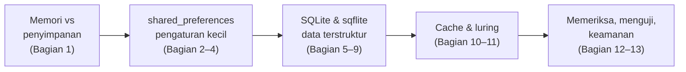

| Bagian | Pertanyaan yang dijawab |
| :--- | :--- |
| 1 | Mengapa data hilang, dan di mana sebaiknya disimpan? |
| 2–4 | Bagaimana menyimpan pengaturan kecil seperti mode gelap atau kota terakhir? |
| 5–9 | Bagaimana menyimpan banyak data yang perlu dicari, diurutkan, diubah, dan dijaga keutuhannya? |
| 10–11 | Bagaimana aplikasi tetap berguna saat internet mati? |
| 12–13 | Bagaimana melihat isi penyimpanan, mengujinya, dan menjaga keamanannya? |

> [!NOTE]
> Contoh hari ini **tidak bisa dijalankan di DartPad**. Paket `sqflite` belum tersedia di sana. Paket `shared_preferences` memang tersedia, tetapi jendela hasil DartPad tidak diizinkan memakai penyimpanan *browser*, sehingga aplikasinya hanya menampilkan lingkaran memuat. Jalankan semua contoh hari ini di proyek latihan Anda ([Panduan Menjalankan Kode, Cara 2](../panduan/03_menjalankan_kode_contoh.md#cara-2--proyek-latihan-flutter-di-komputer-sendiri)), di Chrome atau di HP Android. Persiapannya dijelaskan di [Bagian 2.1](#21-memasang-paket) dan [Bagian 5.4](#54-memasang-sqflite).

---

## 1. Mengapa Data Hilang Saat Aplikasi Ditutup?

### 1.1 Papan tulis dan buku catatan

Di [Praktikum 5 Pertemuan 10](../pertemuan_10_async_dan_rest_api/JOBSHEET.md#praktikum-5--tugas-kuliahku-tersambung-ke-server), tugas yang Anda tambahkan ke "Tugas Kuliahku" **hilang** begitu aplikasi ditutup atau di-*hot restart*. Penyebabnya: semua data itu hanya tersimpan di **memori**.

| Di kelas | Di aplikasi |
| :--- | :--- |
| **Papan tulis**: cepat ditulis dan dibaca, tetapi dihapus saat kelas selesai | **Memori** (RAM): tempat semua variabel Dart, seperti `_jumlah` atau `_daftar`. Kosong lagi saat aplikasi ditutup |
| **Buku catatan**: perlu sedikit waktu untuk menulis, tetapi isinya tetap ada besok | **Penyimpanan perangkat**: berkas di HP atau di *browser*. Isinya tetap ada walaupun aplikasi ditutup, HP dimatikan, lalu dinyalakan lagi |

Agar data tetap ada, aplikasi harus **menyalinnya dari papan tulis ke buku catatan**: menyimpan ke penyimpanan perangkat setiap kali data berubah, lalu membacanya kembali saat aplikasi dibuka.

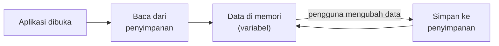

### 1.2 Memilih tempat penyimpanan

Tidak semua data cocok disimpan dengan cara yang sama.

| Jenis data | Contoh | Alat yang dipakai | Dibahas di |
| :--- | :--- | :--- | :--- |
| Pengaturan kecil berbentuk pasangan **kunci–nilai** | Mode gelap, kota terakhir, sudah melihat halaman perkenalan | `shared_preferences` | Bagian 2–4 |
| Data **terstruktur** dalam jumlah banyak, yang perlu dicari, diurutkan, dan diubah | Catatan, daftar tugas, transaksi keuangan | **SQLite** dengan paket `sqflite` | Bagian 5–9 |
| **Salinan** data dari internet | Daftar pengumuman, prakiraan cuaca | *Cache* dengan salah satu alat di atas | Bagian 10–11 |
| Data **rahasia** | Token masuk (*login*), PIN | `flutter_secure_storage` | Bagian 13 |
| **Berkas** | Foto, PDF hasil unduhan | `path_provider` + `dart:io` | Bagian 13 |

### 1.3 Kapan menyimpan?

**Segera setelah data berubah.** Jangan menunggu aplikasi ditutup. Di [Pertemuan 1 Bagian 6](../pertemuan_01_pengenalan_flutter/README.md#6-siklus-hidup-lifecycle-aplikasi) Anda sudah belajar bahwa aplikasi bisa "dibunuh" sistem tanpa sempat melewati status `detached`. Data yang menunggu disimpan "nanti saja" bisa hilang begitu saja.

---

## 2. `shared_preferences`: Menyimpan Pasangan Kunci–Nilai

### 2.1 Memasang paket

`shared_preferences` adalah paket resmi tim Flutter untuk menyimpan data kecil berbentuk **kunci–nilai**: setiap nilai disimpan dengan sebuah nama (kunci), seperti barang di **loker berlabel**. Untuk mengambilnya kembali, cukup sebutkan labelnya.

```bash
flutter pub add shared_preferences
```

```dart
import 'package:shared_preferences/shared_preferences.dart';
```

Paket ini menitipkan data ke tempat penyimpanan bawaan setiap platform, sehingga kodenya sama untuk semua platform:

| Platform | Tempat data disimpan |
| :--- | :--- |
| Android | *DataStore Preferences* (bawaan Android) |
| iOS dan macOS | `NSUserDefaults` |
| Web (Chrome) | *Local Storage* milik *browser* |
| Windows | Berkas di folder *AppData* (*roaming*) |
| Linux | Berkas di folder `XDG_DATA_HOME` |

### 2.2 Tiga cara memakai `shared_preferences`

Sejak versi 2.3.0, paket ini menyediakan tiga cara. Anda akan sering bertemu cara ketiga di tutorial lama.

| Cara | Ciri | Kapan dipakai |
| :--- | :--- | :--- |
| `SharedPreferencesAsync` | Setiap baca dan tulis memakai `await`; selalu membaca nilai terbaru dari platform | Pilihan paling sederhana untuk sebagian besar kebutuhan (Contoh 01, 03, 08, 09) |
| `SharedPreferencesWithCache` | Dibuat sekali dengan `await`; setelah itu **membaca tanpa `await`** karena nilainya disalin ke memori (*cache*) | Pengaturan yang harus sudah ada sejak layar pertama, misalnya tema (Contoh 02) |
| `SharedPreferences` (lama) | `SharedPreferences.getInstance()` | Hanya untuk memahami kode lama. Dokumentasi resmi menyebutnya **akan dihentikan** (*deprecated*) di masa depan |

### 2.3 Membedah Contoh 01

[Contoh 01](kode/contoh_01_penghitung_tersimpan.dart) adalah penghitung tamu seminar. Setiap angkanya berubah, nilainya disimpan. Saat aplikasi dibuka lagi, angka terakhir dibaca kembali.

```dart
// Kunci = "label loker". Ditulis sekali sebagai konstanta agar tidak
// salah ketik di tempat lain.
static const String _kunciJumlah = 'jumlah_tamu';
static const String _kunciWaktu = 'terakhir_diubah';

final SharedPreferencesAsync _penyimpanan = SharedPreferencesAsync();

// Dipanggil sekali dari initState: baca nilai yang tersimpan.
Future<void> _muat() async {
  final int? jumlah = await _penyimpanan.getInt(_kunciJumlah);
  final String? waktu = await _penyimpanan.getString(_kunciWaktu);
  if (!mounted) return;
  setState(() {
    _jumlah = jumlah ?? 0; // null = belum pernah disimpan
    _terakhirDiubah = waktu == null ? null : DateTime.tryParse(waktu);
    _memuat = false;
  });
}

Future<void> _ubah(int selisih) async {
  final DateTime sekarang = DateTime.now();
  setState(() {
    _jumlah += selisih;
    _terakhirDiubah = sekarang;
  });
  // Tampilan diubah dulu (terasa cepat), baru kemudian disimpan.
  await _penyimpanan.setInt(_kunciJumlah, _jumlah);
  await _penyimpanan.setString(_kunciWaktu, sekarang.toIso8601String());
}
```

| Bagian | Penjelasan |
| :--- | :--- |
| `getInt(kunci)` | Membaca bilangan bulat. Hasilnya `Future<int?>`: **`null`** jika kunci itu belum pernah disimpan, misalnya saat aplikasi baru dipasang |
| `jumlah ?? 0` | Jika `null`, pakai nilai awal `0` (operator `??` dari Pertemuan 2) |
| `setInt(kunci, nilai)` | Menyimpan. Jika kunci sudah ada, nilainya **ditimpa** |
| `toIso8601String()` | `DateTime` tidak bisa disimpan langsung, jadi diubah menjadi teks seperti `2026-10-15T08:15:30.000`. `DateTime.tryParse` mengubahnya kembali |
| `remove(kunci)` | Menghapus kunci. Setelah itu `getInt` kembali `null` (dipakai tombol **Mulai dari nol**) |
| `_memuat` | Membaca penyimpanan butuh waktu (asinkron), jadi halaman menampilkan lingkaran memuat lebih dulu, seperti saat mengambil data dari internet |

<p align="center">
  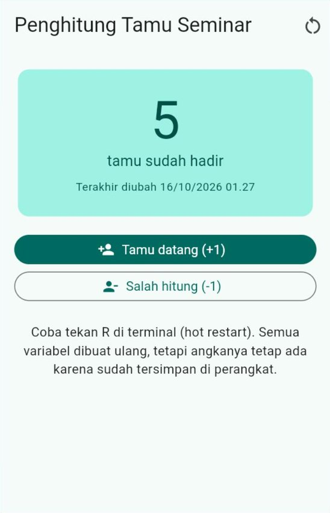
</p>

### 2.4 Membuktikan data benar-benar tersimpan

Tambahkan beberapa tamu, lalu lakukan tiga percobaan berikut.

| Percobaan | Cara | Hasil |
| :--- | :--- | :--- |
| ***Hot restart*** | Tekan `R` di terminal | Semua variabel dibuat ulang dari awal, tetapi angkanya **tetap ada**, karena dibaca dari penyimpanan |
| **Jalankan ulang di Chrome** | Tekan `q`, lalu jalankan lagi `flutter run -d chrome --web-port=8080` | Angkanya tetap ada |
| **Jalankan ulang di Android** | Tutup aplikasi dari daftar aplikasi terbuka, lalu buka lagi | Angkanya tetap ada |

> [!IMPORTANT]
> **Mengapa `--web-port=8080`?** Di Chrome, data disimpan per **alamat situs**, termasuk nomor *port*-nya (`localhost:8080` dan `localhost:8081` dianggap dua situs berbeda). Tanpa `--web-port`, `flutter run` memilih *port* acak setiap kali dijalankan, sehingga aplikasi seolah-olah "lupa" semua data. Selama belajar hari ini, **selalu** jalankan dengan port yang sama:
>
> ```bash
> flutter run -d chrome --web-port=8080
> ```

Ingin melihat isinya langsung? Di Chrome, buka **DevTools** (`F12`) → tab **Application** → **Local Storage** → `http://localhost:8080`. Di sana tampil kunci `jumlah_tamu` beserta nilainya ([Bagian 12.1](#121-di-chrome-devtools)).

### 2.5 Tipe data yang bisa disimpan

| Tipe | Menyimpan | Membaca |
| :--- | :--- | :--- |
| `bool` | `setBool(kunci, true)` | `getBool(kunci)` |
| `int` | `setInt(kunci, 5)` | `getInt(kunci)` |
| `double` | `setDouble(kunci, 0.5)` | `getDouble(kunci)` |
| `String` | `setString(kunci, 'teks')` | `getString(kunci)` |
| `List<String>` | `setStringList(kunci, ['a', 'b'])` | `getStringList(kunci)` |

Tipe lain harus **diubah dulu** menjadi salah satu tipe di atas:

| Data | Disimpan sebagai | Contoh |
| :--- | :--- | :--- |
| `DateTime` | Teks ISO 8601 atau bilangan milidetik | `waktu.toIso8601String()` (Contoh 01) |
| *Enum* | Teks berisi namanya | `ThemeMode.dark.name` → `'dark'` (Contoh 02) |
| Objek kecil atau daftar objek | Teks JSON | `jsonEncode(draf.keJson())` (Contoh 03) |

> [!WARNING]
> Membaca dengan tipe yang berbeda dari saat menyimpan menimbulkan *error* `TypeError`. Misalnya kunci `jumlah_tamu` disimpan dengan `setString('jumlah_tamu', '5')`, lalu dibaca dengan `getInt('jumlah_tamu')`. Pakai **satu tipe untuk satu kunci**, dan tulis nama kuncinya sebagai konstanta.

> **🧠 Cek Cepat:** Aplikasi baru saja dipasang, lalu menjalankan `await prefs.getInt('jumlah_tamu')`. Apa hasilnya, dan mengapa Contoh 01 menulis `jumlah ?? 0`?
>
> <details><summary>Lihat jawaban</summary>
>
> Hasilnya `null`, karena kunci itu belum pernah disimpan. `?? 0` memberi nilai awal `0` agar `_jumlah` (bertipe `int`, tidak boleh `null`) tetap punya nilai.
> </details>

---

## 3. Pengaturan yang Langsung Siap Sejak Layar Pertama

### 3.1 Masalah "berkedip"

Di [Contoh 05 Pertemuan 7](../pertemuan_07_material3_dan_responsif/kode/contoh_05_mode_gelap.dart), pilihan mode gelap **hilang** setiap aplikasi ditutup. Jika kita menyimpannya dengan `SharedPreferencesAsync`, muncul masalah baru: membaca butuh `await`, sehingga layar pertama terlanjur tampil dengan tema bawaan (terang), lalu sesaat kemudian berganti menjadi gelap. Layar seolah **berkedip**.

Penyelesaiannya: baca semua pengaturan **sebelum** `runApp`, dengan `SharedPreferencesWithCache`. [Contoh 02](kode/contoh_02_pengaturan_tampilan.dart) menyimpan tiga pengaturan: mode tema, warna utama, dan tingkat kontras.

```dart
Future<void> main() async {
  // Wajib dipanggil jika plugin dipakai SEBELUM runApp.
  WidgetsFlutterBinding.ensureInitialized();

  // Membaca semua pengaturan ke memori, sekali saja.
  final SharedPreferencesWithCache prefs =
      await SharedPreferencesWithCache.create(
        cacheOptions: const SharedPreferencesWithCacheOptions(
          // Hanya kunci-kunci ini yang boleh dibaca dan ditulis.
          allowList: RepositoriPengaturanPrefs.semuaKunci,
        ),
      );

  runApp(
    ChangeNotifierProvider(
      create: (BuildContext context) =>
          PengaturanViewModel(repositori: RepositoriPengaturanPrefs(prefs)),
      child: const AplikasiPengaturan(),
    ),
  );
}
```

| Bagian | Penjelasan |
| :--- | :--- |
| `WidgetsFlutterBinding.ensureInitialized()` | Plugin (seperti `shared_preferences` dan `sqflite`) berbicara dengan bagian asli platform. Jalurnya baru siap setelah Flutter "dinyalakan". Biasanya `runApp` yang menyalakannya; jika plugin dipakai **sebelum** `runApp`, nyalakan sendiri dengan baris ini |
| `SharedPreferencesWithCache.create(...)` | Membaca semua nilai ke memori. Ini satu-satunya bagian yang perlu `await` |
| `allowList` | Daftar kunci yang boleh dipakai. Memakai kunci di luar daftar menimbulkan `ArgumentError`. Daftar ini juga mencegah aplikasi membaca data lain yang tidak perlu |
| `prefs.getString(...)` (sesudahnya) | Sinkron, **tanpa `await`**, karena nilainya sudah ada di memori |
| `prefs.setString(...)` | Tetap `Future`: nilai di memori langsung berubah, lalu ditulis ke perangkat |

### 3.2 *Enum* disimpan sebagai namanya

`shared_preferences` tidak mengenal `ThemeMode` atau `WarnaTema`. Yang disimpan adalah **namanya** dalam bentuk teks:

```dart
// Menyimpan: ThemeMode.dark -> 'dark'
await _prefs.setString(kunciMode, pengaturan.mode.name);

// Membaca: 'dark' -> ThemeMode.dark
final String? namaMode = _prefs.getString(kunciMode);
final ThemeMode mode =
    ThemeMode.values.asNameMap()[namaMode] ?? ThemeMode.system;
```

`asNameMap()` membuat peta dari nama ke nilai *enum*: `{'system': ThemeMode.system, 'light': ThemeMode.light, 'dark': ThemeMode.dark}`. Jika kunci belum pernah disimpan (`null`) atau isinya tidak dikenal (misalnya nama *enum* yang sudah dihapus di versi aplikasi yang lebih baru), hasilnya `null`, lalu nilai bawaan setelah `??` yang dipakai. Aplikasi tidak pernah *crash* karena data lama.

> [!TIP]
> Mengapa tidak menyimpan **urutannya** (`ThemeMode.dark.index`, yaitu `2`)? Jika suatu hari urutan *enum* diubah atau ditambah nilai baru di tengah, angka lama akan menunjuk ke pilihan yang salah. Nama lebih aman dan lebih mudah dibaca saat diperiksa di DevTools.

### 3.3 Alurnya dalam MVVM

Polanya sama dengan [Pertemuan 9 Bagian 8](../pertemuan_09_state_dan_mvvm/README.md#8-multiprovider-dan-pengaturan-aplikasi), hanya ditambah *repository* yang menyimpan:

```dart
class PengaturanViewModel extends ChangeNotifier {
  PengaturanViewModel({required this._repositori})
    : _pengaturan = _repositori.baca(); // sinkron: sudah ada di cache

  final RepositoriPengaturan _repositori;
  Pengaturan _pengaturan;

  Pengaturan get pengaturan => _pengaturan;

  Future<void> ubahMode(ThemeMode mode) =>
      _terapkan(_pengaturan.copyWith(mode: mode));

  Future<void> _terapkan(Pengaturan baru) async {
    _pengaturan = baru;
    notifyListeners(); // tampilan langsung berubah...
    await _repositori.simpan(baru); // ...lalu pilihan disimpan
  }
}
```

Bagian setelah titik dua (`: _pengaturan = ...`) dijalankan sebelum objeknya jadi. Di situ `_repositori` berarti **parameter** yang baru diterima, sehingga nilai awal `_pengaturan` bisa langsung dibaca darinya.

`MaterialApp` mendengarkan ViewModel ini dengan `context.watch`, sehingga tema seluruh aplikasi langsung berganti. Satu tambahan dari Pertemuan 7: `ColorScheme.fromSeed` kini menerima `contrastLevel` (`0.0` normal, `0.5` sedang, `1.0` tinggi) untuk pengguna yang butuh warna lebih kontras.

<p align="center">
  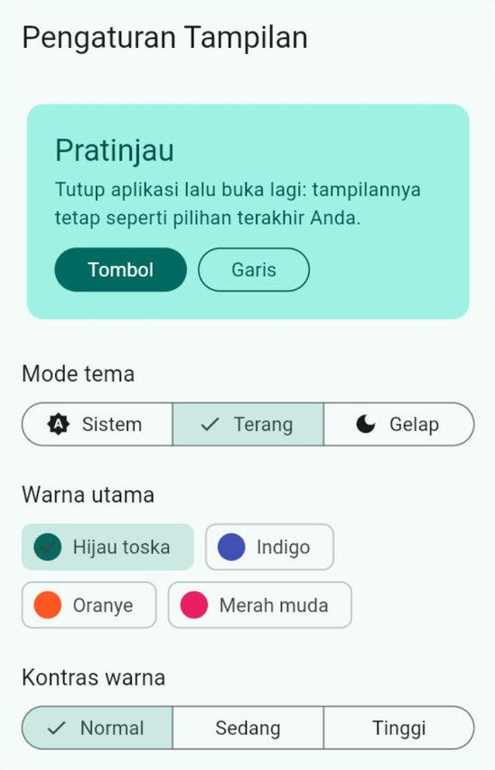
  &nbsp;
  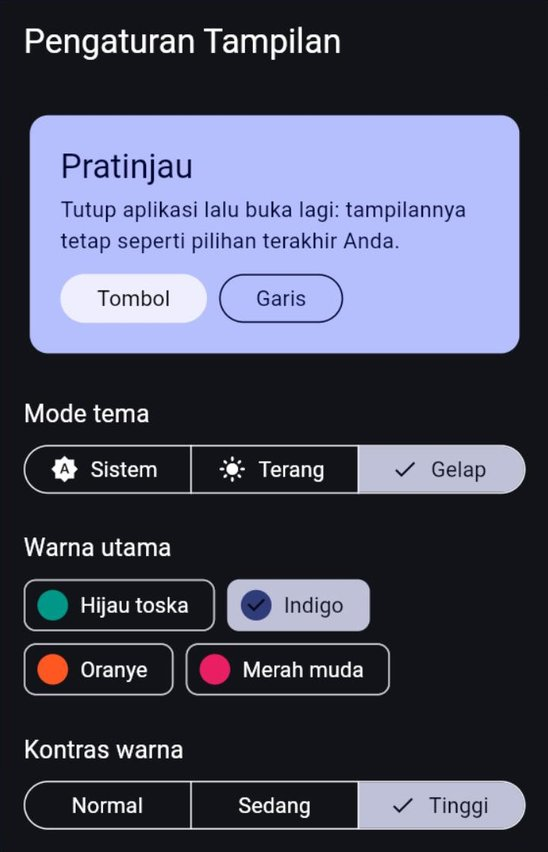
</p>

Pilih mode **Gelap**, warna **Indigo**, dan kontras **Tinggi**. Hentikan aplikasi (`q`), lalu jalankan lagi dengan port yang sama: aplikasi langsung tampil gelap sejak layar pertama, tanpa berkedip.

> **🧠 Cek Cepat:** Mengapa `PengaturanViewModel` bisa membaca pengaturan di dalam *constructor* tanpa `await`, sedangkan halaman di Contoh 01 butuh `_memuat`?
>
> <details><summary>Lihat jawaban</summary>
>
> Contoh 02 memakai `SharedPreferencesWithCache` yang sudah dibuat (dan menunggu pembacaan) di `main` **sebelum** `runApp`. Saat ViewModel dibuat, semua nilai sudah ada di memori. Contoh 01 memakai `SharedPreferencesAsync` yang membaca dari platform setiap kali, sehingga hasilnya baru tersedia setelah `await`.
> </details>

---

## 4. Menyimpan Objek dan Daftar

### 4.1 Objek kecil sebagai teks JSON

[Contoh 03](kode/contoh_03_draf_dan_riwayat.dart) adalah formulir surat izin kuliah yang **drafnya tersimpan sendiri**. Isi formulir (mata kuliah, jenis izin, alasan) adalah satu objek `DrafIzin`. `shared_preferences` tidak bisa menyimpan objek, tetapi bisa menyimpan **teks**. Kita pakai lagi JSON dari [Pertemuan 10 Bagian 6](../pertemuan_10_async_dan_rest_api/README.md#6-dari-json-menjadi-model):

```text
DrafIzin ──keJson()──► Map ──jsonEncode()──► Teks JSON ──setString()──► perangkat
DrafIzin ◄─dariJson()── Map ◄──jsonDecode()── Teks JSON ◄──getString()── perangkat
```

```dart
Future<void> simpanDraf(DrafIzin draf) async {
  final String teks = jsonEncode(draf.keJson());
  // misalnya {"mata_kuliah":"Basis Data","jenis":"sakit","alasan":"Demam"}
  await _prefs.setString(_kunciDraf, teks);
}

Future<DrafIzin?> bacaDraf() async {
  final String? teks = await _prefs.getString(_kunciDraf);
  if (teks == null) return null; // belum ada draf
  try {
    return switch (jsonDecode(teks)) {
      final Map<String, dynamic> json => DrafIzin.dariJson(json),
      _ => null,
    };
  } on FormatException {
    await _prefs.remove(_kunciDraf); // teks rusak: buang saja
    return null;
  }
}
```

Perhatikan `on FormatException`. Data yang tersimpan bisa saja rusak, atau berasal dari versi aplikasi lama yang bentuknya berbeda. Aplikasi yang baik **tidak *crash*** karena itu: draf yang tidak bisa dibaca dibuang, lalu pengguna mulai dari formulir kosong.

### 4.2 Menyimpan otomatis dengan *debounce*

Menyimpan setiap kali satu huruf diketik itu boros. Contoh 03 memakai ***debounce*** dari [Pertemuan 10 Bagian 10.3](../pertemuan_10_async_dan_rest_api/README.md#103-debounce-menunggu-pengguna-berhenti-mengetik): penyimpanan baru dijalankan 600 milidetik setelah pengguna **berhenti** mengetik.

```dart
void _jadwalkanSimpan() {
  _penunda?.cancel(); // batalkan jadwal sebelumnya
  _penunda = Timer(const Duration(milliseconds: 600), _simpanSekarang);
}
```

Saat halaman ditutup sebelum 600 milidetik berlalu, ketikan terakhir disimpan saat itu juga di `dispose()`, agar tidak ada yang hilang.

### 4.3 Daftar teks dengan `List<String>`

Riwayat lima surat terakhir disimpan sebagai `List<String>`:

```dart
Future<List<String>> tambahRiwayat(String entri) async {
  final List<String> lama = await _prefs.getStringList(_kunciRiwayat) ?? [];
  // Entri terbaru di depan, hanya 5 entri yang disimpan.
  final List<String> baru = [entri, ...lama].take(batasRiwayat).toList();
  await _prefs.setStringList(_kunciRiwayat, baru);
  return baru;
}
```

<p align="center">
  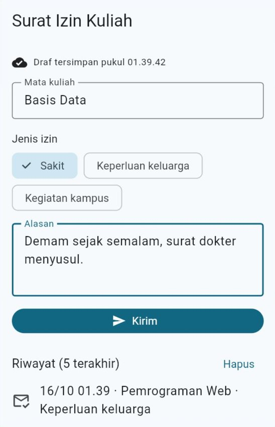
</p>

Isi sebagian formulir, tunggu tulisan "Draf tersimpan pukul ..." muncul, lalu lakukan *hot restart*. Isian Anda kembali, disertai pesan "Draf terakhir dipulihkan."

### 4.4 Batas kemampuan `shared_preferences`

`shared_preferences` cocok untuk data **kecil dan tidak penting**. Dokumentasi resminya sendiri menegaskan: tidak ada jaminan data benar-benar tertulis ke perangkat saat perintah simpan selesai, sehingga paket ini **tidak boleh dipakai untuk data penting**.

| Kebutuhan | `shared_preferences`? | Sebaiknya |
| :--- | :---: | :--- |
| Mode gelap, bahasa, kota terakhir | ✅ | — |
| Draf formulir dan riwayat pencarian singkat | ✅ | — |
| Salinan kecil data internet (*cache*) | ✅ | Bagian 10 |
| Ratusan catatan yang perlu dicari dan diurutkan | ❌ | SQLite (Bagian 5) |
| Transaksi keuangan, nilai, atau data lain yang **tidak boleh hilang** | ❌ | SQLite dengan transaksi (Bagian 9), dan cadangan di server |
| *Password* dan token masuk | ❌ | `flutter_secure_storage` (Bagian 13) |

> **🧠 Cek Cepat:** Mengapa riwayat disimpan sebagai `List<String>`, sedangkan draf disimpan sebagai satu `String` JSON?
>
> <details><summary>Lihat jawaban</summary>
>
> Setiap entri riwayat cukup berupa satu teks, jadi `List<String>` sudah pas. Draf terdiri dari beberapa bagian (mata kuliah, jenis, alasan) yang harus tetap berpasangan, sehingga lebih mudah disimpan sebagai **satu** teks JSON, lalu dibaca kembali menjadi satu objek.
> </details>

---

## 5. Mengenal SQLite dan Memasang `sqflite`

### 5.1 Database dalam satu berkas

**SQLite** adalah sistem database yang seluruh isinya tersimpan dalam **satu berkas** di perangkat, tanpa server. Android, iOS, dan *browser* modern memakainya di balik layar, misalnya untuk menyimpan pesan, kontak, dan riwayat. Dengan paket **`sqflite`**, aplikasi Flutter bisa membuat database SQLite sendiri dan mengolahnya dengan bahasa **SQL**.

Bayangkan sebuah **lemari arsip**:

| Lemari arsip | SQLite |
| :--- | :--- |
| Lemarinya | Berkas database, misalnya `catatan_kuliah.db` |
| Satu laci untuk satu jenis arsip | **Tabel**, misalnya `catatan` atau `mahasiswa` |
| Kolom isian yang sama di setiap kartu (nama, NIM, IPK) | **Kolom** |
| Satu kartu arsip | **Baris** (*row*), yaitu satu data |
| Nomor kartu yang tidak pernah kembar | **Kunci utama** (*primary key*), biasanya kolom `id` |

Dibandingkan `shared_preferences`, SQLite bisa **mencari** (`WHERE`), **mengurutkan** (`ORDER BY`), **menghitung** (`COUNT`, `SUM`), menghubungkan tabel (`JOIN`), dan menjaga keutuhan data (`UNIQUE`, `CHECK`, transaksi), walaupun datanya ribuan.

### 5.2 Tipe data SQLite dan padanannya di Dart

| SQLite | Dart | Catatan |
| :--- | :--- | :--- |
| `INTEGER` | `int` | Bilangan bulat, termasuk uang dalam rupiah |
| `REAL` | `double` (dibaca sebagai `num`) | Bilangan pecahan, misalnya IPK dan suhu |
| `TEXT` | `String` | Teks |
| `BLOB` | `Uint8List` | Data biner, misalnya gambar kecil |
| `NULL` | `null` | Kosong |

SQLite **tidak punya** tipe `bool` dan `DateTime`:

| Data Dart | Disimpan sebagai | Contoh |
| :--- | :--- | :--- |
| `bool` | `INTEGER` 1 atau 0 | `'disematkan': disematkan ? 1 : 0` |
| `DateTime` (waktu) | `INTEGER` milidetik sejak 1 Januari 1970 | `waktu.millisecondsSinceEpoch` |
| `DateTime` (tanggal saja) | `TEXT` berformat `YYYY-MM-DD` | `'2026-10-15'` (urutan teksnya sama dengan urutan tanggal) |
| *Enum* | `TEXT` berisi namanya | `kondisi.name` |

### 5.3 SQL kilat

Jika Anda sudah mengambil mata kuliah Basis Data, bagian ini sekadar pengingat.

```sql
-- Membuat tabel
CREATE TABLE mahasiswa (
  id   INTEGER PRIMARY KEY AUTOINCREMENT, -- nomor otomatis, tidak pernah dipakai ulang
  nim  TEXT NOT NULL UNIQUE,              -- wajib diisi, tidak boleh kembar
  nama TEXT NOT NULL,
  ipk  REAL NOT NULL
);

INSERT INTO mahasiswa (nim, nama, ipk) VALUES ('2609106001', 'Rina Kusuma', 3.75);
SELECT * FROM mahasiswa WHERE ipk >= 3.5 ORDER BY ipk DESC;
UPDATE mahasiswa SET ipk = 3.40 WHERE nim = '2609106002';
DELETE FROM mahasiswa WHERE id = 3;
SELECT COUNT(*) FROM mahasiswa;
```

### 5.4 Memasang `sqflite`

```bash
flutter pub add sqflite sqflite_common_ffi_web
```

| Paket | Gunanya |
| :--- | :--- |
| `sqflite` | Paket SQLite yang paling banyak dipakai di Flutter. Berjalan langsung di **Android**, iOS, dan macOS |
| `sqflite_common_ffi_web` | Membuat `sqflite` bisa berjalan di **Chrome**, memakai SQLite versi WebAssembly. Datanya disimpan di *IndexedDB* milik *browser* |

**Jika memakai HP Android**, tidak ada langkah tambahan. **Jika memakai Chrome**, ada dua hal lagi:

1. Jalankan perintah ini **sekali** di folder proyek (butuh internet, bisa memakan waktu beberapa menit):

   ```bash
   dart run sqflite_common_ffi_web:setup
   ```

   Perintah ini menyiapkan dua berkas di folder `web/`: `sqlite3.wasm` (mesin SQLite untuk *browser*) dan `sqflite_sw.js` (pekerja latar yang menjalankannya).

2. Di `main()`, minta `sqflite` memakai versi web saat berjalan di *browser*:

   ```dart
   import 'package:flutter/foundation.dart' show kIsWeb;
   import 'package:sqflite/sqflite.dart';
   import 'package:sqflite_common_ffi_web/sqflite_ffi_web.dart';

   void main() {
     if (kIsWeb) {
       databaseFactory = databaseFactoryFfiWeb;
     }
     runApp(const AplikasiSaya());
   }
   ```

   `kIsWeb` bernilai `true` hanya saat aplikasi berjalan di *browser*. Di Android, baris itu dilewati dan `sqflite` memakai SQLite bawaan HP. Semua contoh SQLite di modul ini sudah memuat baris tersebut, jadi berkasnya bisa dijalankan di Chrome maupun di Android tanpa diubah.

> [!IMPORTANT]
> - Seperti `shared_preferences`, database di Chrome tersimpan **per *port***. Selalu jalankan dengan `flutter run -d chrome --web-port=8080`.
> - Dukungan web milik `sqflite` masih berlabel **eksperimental**. Untuk belajar dan praktikum sudah memadai. Untuk aplikasi web sungguhan, pertimbangkan pilihan lain ([Bagian 13.3](#133-pilihan-penyimpanan-lain)) atau simpan datanya di server.
> - Paket `sqflite` **belum tersedia di DartPad**. Contoh 04 sampai 07 dan 09 harus dijalankan di proyek latihan.

---

## 6. SQL Langkah demi Langkah

[Contoh 04](kode/contoh_04_sql_langkah_demi_langkah.dart) adalah "Lab SQL Mini". Tekan **Jalankan**, lalu aplikasi menjalankan 11 langkah SQL pada tabel `mahasiswa` dan menampilkan hasil setiap langkah di layar (dan di konsol). Databasenya dibuat di **memori** (`inMemoryDatabasePath`), sehingga setiap kali dijalankan hasilnya selalu sama.

### 6.1 Membuka database dan membuat tabel

```dart
final Database db = await openDatabase(inMemoryDatabasePath);

await db.execute('''
  CREATE TABLE mahasiswa (
    id   INTEGER PRIMARY KEY AUTOINCREMENT,
    nim  TEXT NOT NULL UNIQUE,
    nama TEXT NOT NULL,
    ipk  REAL NOT NULL
  )
''');
```

`openDatabase(...)` membuka (atau membuat) database dan menghasilkan objek `Database`. Semua perintah berikutnya dijalankan lewat objek itu, dan semuanya asinkron (`await`). `execute` menjalankan SQL apa adanya, cocok untuk `CREATE TABLE`.

### 6.2 Empat operasi utama: CRUD

`sqflite` menyediakan metode pembantu sehingga kita tidak perlu menulis SQL lengkap:

| Operasi | Kode Dart | SQL yang dijalankan | Hasilnya |
| :--- | :--- | :--- | :--- |
| ***Create*** | `db.insert('mahasiswa', {'nim': '2609106001', 'nama': 'Rina Kusuma', 'ipk': 3.75})` | `INSERT INTO mahasiswa (nim, nama, ipk) VALUES (?, ?, ?)` | `int`: **id** baris baru |
| ***Read*** | `db.query('mahasiswa', where: 'ipk >= ?', whereArgs: [3.5], orderBy: 'ipk DESC')` | `SELECT * FROM mahasiswa WHERE ipk >= ? ORDER BY ipk DESC` | `List<Map<String, Object?>>`: satu `Map` per baris |
| ***Update*** | `db.update('mahasiswa', {'ipk': 3.40}, where: 'nim = ?', whereArgs: ['2609106002'])` | `UPDATE mahasiswa SET ipk = ? WHERE nim = ?` | `int`: **jumlah** baris yang berubah |
| ***Delete*** | `db.delete('mahasiswa', where: 'id = ?', whereArgs: [3])` | `DELETE FROM mahasiswa WHERE id = ?` | `int`: **jumlah** baris yang terhapus |

Isi baris dikirim sebagai `Map`: **kunci = nama kolom**, **nilai = isinya**. Kolom `id` tidak perlu diisi, karena `AUTOINCREMENT` memberinya nomor sendiri.

Hasil `query` berupa daftar `Map`, misalnya `{id: 1, nim: 2609106001, nama: Rina Kusuma, ipk: 3.75}`. Contoh 04 mengubahnya menjadi objek `Mahasiswa` dengan pola Dart 3, persis seperti `fromJson` di Pertemuan 10:

```dart
factory Mahasiswa.dariBaris(Map<String, Object?> baris) {
  return switch (baris) {
    {
      'id': final int id,
      'nim': final String nim,
      'nama': final String nama,
      'ipk': final num ipk, // REAL dibaca sebagai num
    } =>
      Mahasiswa(id: id, nim: nim, nama: nama, ipk: ipk.toDouble()),
    _ => throw FormatException('Baris tidak sesuai: $baris'),
  };
}
```

### 6.3 SQL bebas: menghitung dengan `rawQuery`

Untuk SQL yang tidak tercakup metode pembantu, misalnya `COUNT` dan `AVG`, pakai `rawQuery`:

```dart
final int? jumlah = Sqflite.firstIntValue(
  await db.rawQuery('SELECT COUNT(*) FROM mahasiswa'),
);
```

`Sqflite.firstIntValue` mengambil angka pertama dari baris pertama hasil *query*. Pasangannya untuk perintah tulis adalah `rawInsert`, `rawUpdate`, dan `rawDelete`.

### 6.4 Database pun bisa menolak: `DatabaseException`

Kolom `nim` bertanda `UNIQUE`. Menyimpan NIM yang sudah ada akan **ditolak** oleh SQLite, dan `sqflite` melempar `DatabaseException`:

```dart
try {
  await db.insert('mahasiswa', {
    'nim': '2609106001', // sudah dipakai Rina
    'nama': 'Rina Palsu',
    'ipk': 4.0,
  });
} on DatabaseException catch (galat) {
  if (galat.isUniqueConstraintError()) {
    catat('Langkah 9 · INSERT NIM kembar -> ditolak (UNIQUE)');
  } else {
    rethrow;
  }
}
```

Aturan seperti `NOT NULL`, `UNIQUE`, dan `CHECK` adalah **pagar terakhir**: walaupun ada *bug* di kode Dart, database tetap menolak data yang melanggar aturan.

### 6.5 Hasil seluruh langkah

<p align="center">
  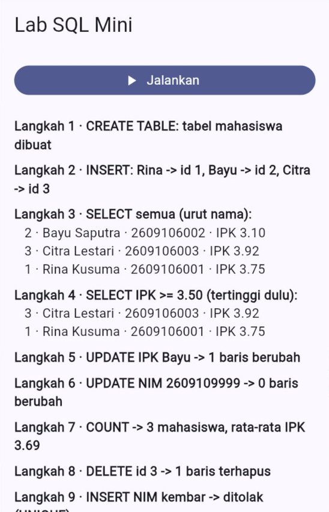
</p>

```text
Langkah 1 · CREATE TABLE: tabel mahasiswa dibuat
Langkah 2 · INSERT: Rina -> id 1, Bayu -> id 2, Citra -> id 3
Langkah 3 · SELECT semua (urut nama):
   2 · Bayu Saputra · 2609106002 · IPK 3.10
   3 · Citra Lestari · 2609106003 · IPK 3.92
   1 · Rina Kusuma · 2609106001 · IPK 3.75
Langkah 4 · SELECT IPK >= 3.50 (tertinggi dulu):
   3 · Citra Lestari · 2609106003 · IPK 3.92
   1 · Rina Kusuma · 2609106001 · IPK 3.75
Langkah 5 · UPDATE IPK Bayu -> 1 baris berubah
Langkah 6 · UPDATE NIM 2609109999 -> 0 baris berubah
Langkah 7 · COUNT -> 3 mahasiswa, rata-rata IPK 3.69
Langkah 8 · DELETE id 3 -> 1 baris terhapus
Langkah 9 · INSERT NIM kembar -> ditolak (UNIQUE)
Langkah 10 · INSERT Dewi -> id 4 (id 3 tidak dipakai lagi)
Langkah 11 · SELECT semua (urut id):
   1 · Rina Kusuma · 2609106001 · IPK 3.75
   2 · Bayu Saputra · 2609106002 · IPK 3.40
   4 · Dewi Anggraini · 2609106004 · IPK 3.58
```

Perhatikan tiga hal:

1. **Langkah 6** tidak gagal. `UPDATE` yang tidak menemukan baris apa pun hanya menghasilkan `0`. Periksa angka ini jika Anda perlu tahu apakah datanya benar-benar ada.
2. **Langkah 7** menghitung rata-rata **setelah** IPK Bayu diubah menjadi 3.40: (3.75 + 3.40 + 3.92) ÷ 3 = 3.69.
3. **Langkah 10**: id 3 sudah pernah dipakai Citra, jadi `AUTOINCREMENT` memberi Dewi id **4**. Nomor yang sudah dihapus tidak dipakai ulang, sehingga id lama di catatan lain tidak tertukar dengan data baru.

### 6.6 Mengapa harus `whereArgs`?

Misalkan nama yang dicari diketik pengguna dan langsung **ditempel** ke SQL:

```dart
// ❌ JANGAN: teks dari pengguna ditempel langsung ke SQL
db.rawQuery("SELECT * FROM mahasiswa WHERE nama = '$nama'");
```

| Isi `nama` | SQL yang terbentuk | Akibatnya |
| :--- | :--- | :--- |
| `Rina Kusuma` | `... WHERE nama = 'Rina Kusuma'` | Berjalan normal |
| `Jum'at` | `... WHERE nama = 'Jum'at'` | *Error*: tanda kutip memotong teks SQL |
| `' OR '1'='1` | `... WHERE nama = '' OR '1'='1'` | **Semua** data tampil. Inilah ***SQL injection*** |

Dengan tanda tanya dan `whereArgs`, nilai dikirim **terpisah** dari perintah SQL. SQLite memperlakukannya sebagai data biasa, apa pun isinya:

```dart
// ✅ BENAR: nilai dikirim lewat whereArgs
db.query('mahasiswa', where: 'nama = ?', whereArgs: [nama]);
db.rawQuery('SELECT * FROM mahasiswa WHERE nama = ?', [nama]);
```

> [!CAUTION]
> Aturan ini berlaku untuk **setiap** nilai yang berasal dari pengguna, dari internet, atau dari mana pun di luar kode Anda. Hanya nama tabel dan nama kolom yang boleh ditulis langsung di teks SQL, karena keduanya Anda tentukan sendiri.

> **🧠 Cek Cepat:** `await db.delete('mahasiswa', where: 'id = ?', whereArgs: [99])` dijalankan, padahal tidak ada mahasiswa dengan id 99. Apakah muncul *exception*? Apa hasilnya?
>
> <details><summary>Lihat jawaban</summary>
>
> Tidak ada *exception*. Hasilnya `0`, artinya tidak ada baris yang terhapus.
> </details>

---

## 7. CRUD dengan Pola MVVM: Catatan Kuliah

### 7.1 Pembagian tugas

[Contoh 05](kode/contoh_05_catatan_kuliah_crud.dart) adalah aplikasi catatan yang datanya tersimpan di berkas `catatan_kuliah.db`. Kodenya ditata dengan pola yang sama dengan Pertemuan 9 dan 10. Yang berbeda hanya sumber datanya: kini dari database, bukan dari internet.

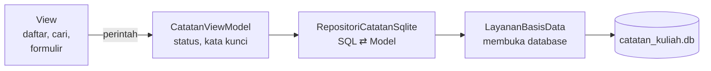

| Lapisan | Tugasnya |
| :--- | :--- |
| `LayananBasisData` (*service*) | Membuka database **sekali**, membuat tabel saat database pertama kali dibuat, dan menutupnya saat aplikasi selesai |
| `RepositoriCatatanSqlite` | Menjalankan `insert`, `query`, `update`, `delete`, serta mengubah baris tabel menjadi Model `Catatan` dan sebaliknya |
| `CatatanViewModel` | Status memuat, kata kunci pencarian, dan perintah tulis. Tidak tahu apa pun tentang SQL |
| View | Daftar, kotak pencarian, geser untuk menghapus, dan formulir |

### 7.2 Model ⇄ baris tabel

```dart
// Model -> baris tabel
Map<String, Object?> keBaris() {
  return {
    'id': ?id, // catatan baru (id null): kolom id diisi SQLite
    'judul': judul,
    'isi': isi,
    'diubah': diubah.millisecondsSinceEpoch, // DateTime -> int
  };
}

// Baris tabel -> Model
factory Catatan.dariBaris(Map<String, Object?> baris) {
  return switch (baris) {
    {
      'id': final int id,
      'judul': final String judul,
      'isi': final String isi,
      'diubah': final int diubah,
    } =>
      Catatan(
        id: id,
        judul: judul,
        isi: isi,
        diubah: DateTime.fromMillisecondsSinceEpoch(diubah),
      ),
    _ => throw FormatException('Baris catatan tidak sesuai: $baris'),
  };
}
```

`id` bertipe `int?`: **`null`** berarti catatan itu belum pernah disimpan. Setelah `insert`, *repository* mengembalikan salinan catatan yang sudah ber-`id` dengan `copyWith(id: id)`.

Tanda `?` di depan nilai (`'id': ?id`) disebut ***null-aware element*** (sejak Dart 3.8): entri itu hanya dimasukkan ke `Map` jika nilainya **tidak** `null`. Jadi catatan baru dikirim tanpa kolom `id`, lalu SQLite mengisinya sendiri (`AUTOINCREMENT`). Di tutorial lain Anda mungkin menemukan bentuk lama `if (id != null) 'id': id`. Artinya sama, tetapi `flutter analyze` kini menyarankan bentuk `?id` (aturan `use_null_aware_elements`).

### 7.3 Layanan: membuka database sekali saja

```dart
class LayananBasisData {
  LayananBasisData({this.namaBerkas = 'catatan_kuliah.db'});

  final String namaBerkas;
  Future<Database>? _database;

  // Pemanggilan pertama membuka database; berikutnya mendapat Future
  // yang SAMA, jadi database tidak dibuka berkali-kali.
  Future<Database> get database => _database ??= _buka();

  Future<Database> _buka() {
    return openDatabase(
      namaBerkas,
      version: 1,
      // onCreate hanya dijalankan SEKALI, saat berkas database belum ada.
      onCreate: (Database db, int versi) async {
        await db.execute('''
          CREATE TABLE catatan (
            id     INTEGER PRIMARY KEY AUTOINCREMENT,
            judul  TEXT NOT NULL,
            isi    TEXT NOT NULL,
            diubah INTEGER NOT NULL
          )
        ''');
      },
    );
  }
}
```

| Bagian | Penjelasan |
| :--- | :--- |
| `'catatan_kuliah.db'` | Cukup nama berkas. `sqflite` menyimpannya di folder database milik aplikasi (di Android: folder `databases` aplikasi). Banyak tutorial menulis `join(await getDatabasesPath(), 'nama.db')` dengan paket `path`; hasilnya sama |
| `_database ??= _buka()` | Operator `??=` mengisi `_database` hanya jika masih `null`. Jadi `openDatabase` hanya dipanggil sekali, walaupun *getter* `database` dipanggil berkali-kali, bahkan secara bersamaan |
| `version: 1` | Nomor versi **struktur** database. Dipakai saat struktur tabel berubah (Bagian 8) |
| `onCreate` | Dijalankan **sekali seumur hidup** berkas database, yaitu saat berkasnya belum ada. Membuka database yang sudah ada **tidak** menjalankannya lagi |

Layanan ini dititipkan dengan `Provider` beserta `dispose`, sehingga database ditutup saat aplikasi selesai, sama seperti `http.Client` di Pertemuan 10.

### 7.4 *Repository*: SQL ⇄ Model

```dart
@override
Future<List<Catatan>> ambilSemua({String kataKunci = ''}) async {
  final Database db = await _layanan.database;
  final String kunci = kataKunci.trim();
  final List<Map<String, Object?>> baris = await db.query(
    _tabel,
    // LIKE '%kata%' = mengandung kata itu (huruf besar dan kecil dianggap
    // sama). Nilainya dikirim lewat whereArgs, BUKAN ditempel ke SQL.
    where: kunci.isEmpty ? null : 'judul LIKE ? OR isi LIKE ?',
    whereArgs: kunci.isEmpty ? null : ['%$kunci%', '%$kunci%'],
    orderBy: 'diubah DESC, id DESC', // terbaru di atas
  );
  return baris.map(Catatan.dariBaris).toList();
}

@override
Future<Catatan> tambah({required String judul, required String isi}) async {
  final Database db = await _layanan.database;
  final Catatan baru = Catatan(judul: judul, isi: isi, diubah: DateTime.now());
  final int id = await db.insert(_tabel, baru.keBaris());
  return baru.copyWith(id: id);
}
```

Mengapa `orderBy: 'diubah DESC, id DESC'`, bukan `'diubah DESC'` saja? Dua catatan bisa saja disimpan pada milidetik yang sama. Tanpa urutan kedua, posisi keduanya bisa berganti-ganti. Dengan `id DESC`, yang dibuat belakangan selalu di atas.

### 7.5 ViewModel: tulis, lalu baca ulang

Setiap perintah tulis (tambah, ubah, hapus, pulihkan) memakai satu fungsi pembantu:

```dart
// Menjalankan satu perintah tulis, lalu SELALU membaca ulang daftar dari
// database. Dengan begitu tampilan selalu sama dengan isi database.
Future<bool> _tulis(Future<void> Function() perintah) async {
  bool berhasil = true;
  try {
    await perintah();
  } catch (galat) {
    debugPrint('Galat saat menulis ke database: $galat');
    berhasil = false;
  }
  await muat();
  return berhasil;
}

Future<bool> tambah(String judul, String isi) {
  return _tulis(
    () => _repositori.tambah(judul: judul.trim(), isi: isi.trim()),
  );
}
```

Database adalah **sumber kebenaran** (*source of truth*). Daripada mengubah daftar di memori sendiri lalu berharap isinya sama dengan database, ViewModel cukup membaca ulang hasil akhirnya. Untuk database di perangkat, membaca ulang beberapa ratus baris hanya butuh beberapa milidetik.

Ada satu pengecualian, yaitu menghapus dengan menggeser (`Dismissible`, [Pertemuan 6](../pertemuan_06_daftar_dan_navigasi/README.md#7-geser-untuk-menghapus-dan-peran-key)). `Dismissible` mewajibkan barisnya **langsung** hilang dari daftar begitu digeser, tidak boleh menunggu database. Karena itu, `hapus` membuang catatan dari daftar di memori lebih dulu, baru menghapusnya dari database:

```dart
Future<bool> hapus(Catatan catatan) {
  _daftar = _daftar.where((Catatan c) => c.id != catatan.id).toList();
  notifyListeners();
  return _tulis(() => _repositori.hapus(catatan.id!));
}
```

Tombol **Urungkan** di `SnackBar` memanggil `pulihkan`, yang menyimpan kembali catatan itu **lengkap dengan id lamanya**.

<p align="center">
  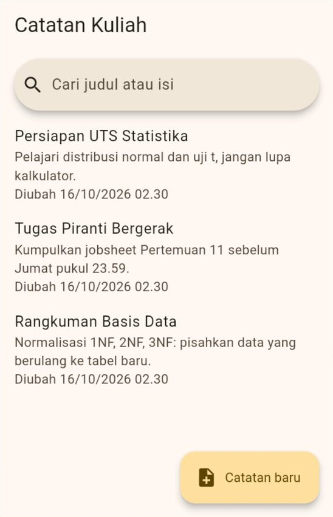
  &nbsp;
  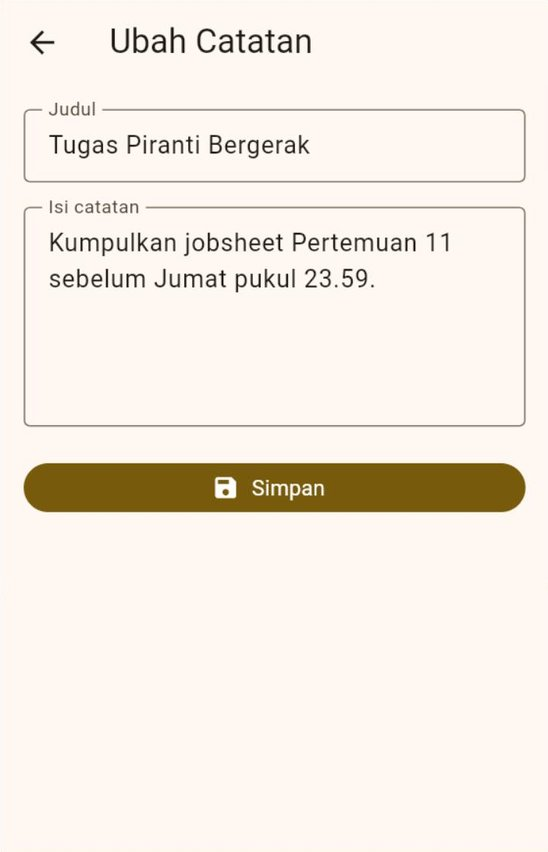
</p>

### 7.6 Menguji dengan database di memori

Sebelum aplikasi tampil, `jalankanUji()` memeriksa *repository* dan ViewModel memakai database **sungguhan** yang dibuat di memori:

```dart
final LayananBasisData layanan = LayananBasisData(
  namaBerkas: inMemoryDatabasePath, // database sementara di memori
);
final RepositoriCatatan repo = RepositoriCatatanSqlite(layanan: layanan);
```

Hanya nama berkasnya yang berbeda. SQL yang diuji sama persis dengan yang dipakai aplikasi, tetapi catatan asli Anda di `catatan_kuliah.db` tidak tersentuh. Hasilnya di konsol:

```text
LULUS  Catatan pertama mendapat id 1
LULUS  Catatan kedua mendapat id 2
LULUS  Ada 2 catatan
LULUS  Yang terbaru di atas
LULUS  Cari tidak membedakan huruf besar
LULUS  Tanda kutip tidak merusak SQL
LULUS  Yang diubah naik ke atas
LULUS  Tersisa 1 setelah dihapus
LULUS  Kembali dengan id lamanya
LULUS  ViewModel: status berhasil
LULUS  ViewModel: hasil pencarian
```

> **🧠 Cek Cepat:** Di `HalamanCatatan`, mengapa `CatatanViewModel` dititipkan di atas `MaterialApp` (di `main`), bukan di `home:` seperti Contoh 06 Pertemuan 10?
>
> <details><summary>Lihat jawaban</summary>
>
> Halaman formulir dibuka dengan `Navigator.push`, sehingga menjadi rute baru yang **bersaudara** dengan `home`, bukan anaknya. *Provider* yang dipasang di `home` tidak terlihat dari rute baru itu ([Pertemuan 9 Bagian 11](../pertemuan_09_state_dan_mvvm/README.md#11-cakupan-dan-umur-provider)). Formulir perlu memanggil `tambah` dan `ubah` milik ViewModel, jadi ViewModel dipasang di atas `MaterialApp`.
> </details>

---

## 8. Mengubah Struktur Tabel: Versi dan Migrasi

### 8.1 Masalahnya

Pengguna ingin bisa **menyematkan** (*pin*) catatan penting agar selalu tampil paling atas. Tabel `catatan` butuh kolom baru: `disematkan`. Cara yang terpikir pertama kali adalah menambah kolom itu di `CREATE TABLE`. Namun, bagi pengguna yang sudah memakai versi lama, hasilnya *error*:

```text
DatabaseException(no such column: disematkan ...)
```

Penyebabnya: **`onCreate` hanya dijalankan sekali**, saat berkas database belum ada. Berkas milik pengguna lama sudah ada, sehingga `CREATE TABLE` yang baru tidak pernah dijalankan.

| "Solusi" | Mengapa tidak boleh untuk pengguna sungguhan |
| :--- | :--- |
| Hapus aplikasi lalu pasang ulang | Semua catatan pengguna **hilang** |
| Hapus berkas database setiap aplikasi dibuka | Sama saja: semua data hilang |

Selama **pengembangan**, menghapus data Anda sendiri (Bagian 12.3) memang cara cepat. Untuk aplikasi yang sudah dipakai orang lain, gunakan **migrasi**.

### 8.2 `version` dan `onUpgrade`

[Contoh 06](kode/contoh_06_migrasi_skema.dart) adalah Contoh 05 ditambah fitur sematkan. Perubahan pentingnya ada di `openDatabase`:

```dart
return openDatabase(
  namaBerkas,
  version: 2, // naik dari 1, karena struktur tabel berubah
  // Pengguna BARU (berkas belum ada): langsung tabel versi terbaru.
  onCreate: (Database db, int versi) async {
    await db.execute('''
      CREATE TABLE catatan (
        id         INTEGER PRIMARY KEY AUTOINCREMENT,
        judul      TEXT NOT NULL,
        isi        TEXT NOT NULL,
        diubah     INTEGER NOT NULL,
        disematkan INTEGER NOT NULL DEFAULT 0
      )
    ''');
  },
  // Pengguna LAMA (berkas versi 1 sudah ada): ditingkatkan.
  onUpgrade: (Database db, int versiLama, int versiBaru) async {
    debugPrint('Migrasi database: versi $versiLama -> $versiBaru');
    await tingkatkanSkema(db, versiLama, versiBaru);
  },
);
```

```dart
// Ditulis sebagai fungsi tersendiri agar bisa diuji (lihat jalankanUji).
Future<void> tingkatkanSkema(Database db, int versiLama, int versiBaru) async {
  if (versiLama < 2) {
    await db.execute(
      'ALTER TABLE catatan ADD COLUMN disematkan INTEGER NOT NULL DEFAULT 0',
    );
  }
  // Perubahan berikutnya cukup menambah blok baru:
  // if (versiLama < 3) { ... }
}
```

`sqflite` menyimpan nomor versi di dalam berkas database. Setiap kali database dibuka, nomor itu dibandingkan dengan `version`:

| Keadaan berkas di perangkat | Yang dijalankan `sqflite` |
| :--- | :--- |
| Belum ada (pengguna baru) | `onCreate(db, 2)` |
| Versi 1 (pengguna lama) | `onUpgrade(db, 1, 2)` |
| Sudah versi 2 | Tidak ada, database langsung dipakai |
| Versi 3 (dibuat aplikasi yang lebih baru) | `onDowngrade`, jika ada. Hindari keadaan ini |

`DEFAULT 0` membuat semua catatan lama otomatis bernilai "tidak disematkan". Tidak ada satu catatan pun yang hilang.

> [!TIP]
> Di Contoh 06, perintah `ALTER TABLE` dibungkus `try` dengan pengecekan `isDuplicateColumnError`. Pengaman itu khusus untuk latihan ini: jika Anda sempat menjalankan Contoh 05 (versi 1) lagi setelah Contoh 06, versi database turun menjadi 1 padahal kolomnya sudah ada. Di aplikasi sungguhan, versi database hanya pernah **naik**.

### 8.3 Aturan emas migrasi

1. **`version` hanya naik**, setiap kali struktur tabel berubah (tambah tabel, tambah kolom, tambah indeks).
2. **`onCreate` selalu membuat struktur terbaru**, untuk pengguna baru.
3. **`onUpgrade` naik setahap demi setahap** dengan `if (versiLama < 2)`, `if (versiLama < 3)`, dan seterusnya, **tanpa `else`**. Pengguna yang melompat dari versi 1 langsung ke versi 3 tetap melewati semua langkah dengan urut.
4. **Jangan mengubah blok migrasi yang sudah dirilis.** Jika ada yang salah, perbaiki di versi berikutnya.
5. `ALTER TABLE` di SQLite terbatas: **menambah** kolom mudah, tetapi mengubah tipe kolom biasanya butuh langkah lebih panjang: buat tabel baru, salin datanya, hapus tabel lama, lalu ganti namanya.
6. **Uji migrasinya.** `jalankanUji()` di Contoh 06 membuat tabel versi 1 di memori, mengisinya, menjalankan `tingkatkanSkema(db, 1, 2)`, lalu memastikan catatan lama masih ada dan kolom barunya bernilai 0.

### 8.4 Mencobanya

1. Jalankan Contoh 05 dengan `flutter run -d chrome --web-port=8080`, lalu tambahkan dua atau tiga catatan.
2. Hentikan aplikasi (`q`), salin isi Contoh 06 ke `lib/main.dart`, lalu jalankan lagi dengan **port yang sama**.
3. Konsol menampilkan `Migrasi database: versi 1 -> 2`. Semua catatan masih ada, dan kini setiap catatan punya tombol pin.
4. Hentikan dan jalankan sekali lagi. Kali ini pesan migrasi **tidak** muncul, karena database sudah versi 2.

<p align="center">
  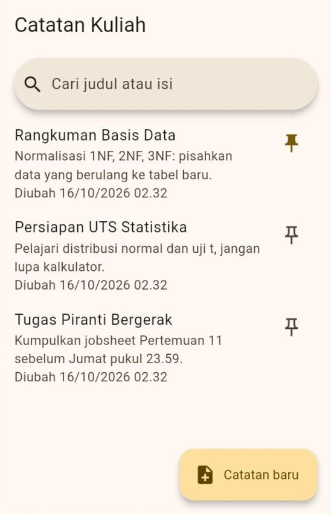
</p>

---

## 9. Transaksi dan *Batch*

### 9.1 Masalah "uang hilang"

[Contoh 07](kode/contoh_07_transaksi_dan_batch.dart) adalah aplikasi bendahara kelas dengan dua dompet: **Kas Kelas** (saldo awal Rp500.000) dan **Kas Study Tour**. Memindahkan uang dari satu dompet ke dompet lain butuh **empat** perintah SQL:

```text
1. UPDATE dompet SET saldo = saldo - 50000 WHERE id = 1   (Kas Kelas berkurang)
2. INSERT INTO mutasi ...                                  (catat uang keluar)
3. UPDATE dompet SET saldo = saldo + 50000 WHERE id = 2   (Kas Study Tour bertambah)
4. INSERT INTO mutasi ...                                  (catat uang masuk)
```

Bagaimana jika aplikasi mati (baterai habis, *crash*, dihentikan sistem) tepat setelah perintah 2? Kas Kelas sudah berkurang, tetapi Kas Study Tour tidak pernah bertambah. **Uang Rp50.000 hilang.** Bank tidak pernah mengizinkan hal ini terjadi, dan aplikasi kita pun tidak boleh.

### 9.2 Transaksi: semua atau tidak sama sekali

**Transaksi** membungkus beberapa perintah menjadi satu kesatuan. Jika semuanya berhasil, perubahan disimpan (*commit*). Jika ada satu saja yang melempar *exception*, **semua** perubahan di dalamnya dibatalkan (*rollback*), seolah-olah tidak pernah terjadi.

```dart
await db.transaction((Transaction txn) async {
  // Di dalam blok ini, pakai txn, JANGAN db.
  await txn.rawUpdate('UPDATE dompet SET saldo = saldo - ? WHERE id = ?', [
    jumlah,
    dariId,
  ]);
  await txn.insert('mutasi', {...});
  await txn.rawUpdate('UPDATE dompet SET saldo = saldo + ? WHERE id = ?', [
    jumlah,
    keId,
  ]);
  await txn.insert('mutasi', {...});
});
```

| Aturan | Alasannya |
| :--- | :--- |
| Di dalam blok transaksi, semua perintah memakai **`txn`** | Database "dikunci" untuk transaksi itu. Memanggil `db` di dalamnya membuat aplikasi **macet** (*deadlock*): `db` menunggu transaksi selesai, padahal transaksi menunggu `db` |
| Biarkan *exception* keluar dari blok | Itulah tanda bagi `sqflite` untuk membatalkan. *Exception* yang sama diteruskan ke pemanggil, sehingga bisa ditangani di ViewModel |
| `onCreate` dan `onUpgrade` tidak perlu dibungkus transaksi lagi | `sqflite` sudah menjalankan keduanya di dalam transaksi |

### 9.3 Percobaan: dengan dan tanpa transaksi

Contoh 07 punya dua sakelar khusus percobaan: **Pakai transaksi** dan **Simulasikan gangguan**. Saat gangguan menyala, *repository* sengaja melempar *exception* tepat setelah perintah 2, seolah-olah aplikasi mati di tengah jalan. Langkah-langkahnya ditulis sekali dan dipakai di kedua mode, karena `Database` dan `Transaction` sama-sama `DatabaseExecutor` ("apa pun yang bisa menjalankan SQL").

Coba ketiga kombinasi berikut dengan jumlah **50 rb**. Tekan tombol **Atur ulang** (kanan atas) sebelum setiap percobaan, agar semuanya dimulai dari saldo awal.

| Pakai transaksi | Gangguan | Kas Kelas | Kas Study Tour | Total uang |
| :---: | :---: | ---: | ---: | ---: |
| ✅ | — | Rp450.000 | Rp50.000 | Rp500.000 ✅ |
| ✅ | ⚡ | Rp500.000 | Rp0 | Rp500.000 ✅ (dibatalkan semua) |
| ❌ | ⚡ | Rp450.000 | Rp0 | **Rp450.000** ❌ (uang hilang) |

<p align="center">
  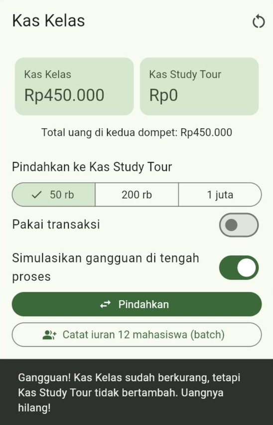
</p>

Tulisan **Total uang** dihitung langsung oleh SQL, bukan dengan perulangan di Dart:

```dart
final int? total = Sqflite.firstIntValue(
  await db.rawQuery('SELECT COALESCE(SUM(saldo), 0) FROM dompet'),
);
```

`SUM(saldo)` menjumlahkan kolom `saldo` dari semua baris. Jika tabelnya kosong, hasil `SUM` adalah `NULL`, lalu `COALESCE(..., 0)` menggantinya dengan `0`. Cara yang sama (ditambah syarat `WHERE`) dipakai untuk menghitung total pemasukan dan pengeluaran di tugas mandiri.

Saldo yang kurang juga ditolak dua lapis. Lapis pertama, *repository* membaca saldo dulu dan melempar `SaldoTidakCukup`. Lapis kedua, kolom `saldo` memakai aturan `CHECK (saldo >= 0)`, sehingga database sendiri menolak saldo negatif walaupun pemeriksaan di Dart terlewat.

### 9.4 *Batch*: banyak perintah sekaligus

Tombol **Catat iuran 12 mahasiswa** menyimpan 12 baris mutasi dan menambah saldo. Daripada mengirim 13 perintah satu per satu, perintah-perintah itu **dikumpulkan** dulu, lalu dikirim sekaligus:

```dart
await db.transaction((Transaction txn) async {
  final Batch batch = txn.batch();
  for (final String nama in namaMahasiswa) {
    batch.insert('mutasi', {
      'dompet_id': idKasKelas,
      'jumlah': iuranPerOrang,
      'keterangan': 'Iuran $nama',
      'waktu': waktu,
    });
  }
  batch.rawUpdate('UPDATE dompet SET saldo = saldo + ? WHERE id = ?', [
    iuranPerOrang * namaMahasiswa.length,
    idKasKelas,
  ]);
  await batch.commit(noResult: true);
});
```

| Bagian | Penjelasan |
| :--- | :--- |
| `batch.insert(...)` | **Belum** dijalankan, hanya dicatat. Perhatikan: tanpa `await` |
| `batch.commit()` | Menjalankan semua perintah yang dicatat dalam satu kali kirim |
| `noResult: true` | Hasil setiap perintah (misalnya id baru) tidak perlu dikembalikan, sehingga lebih cepat |
| *Batch* di dalam transaksi | Semua perintahnya ikut aturan "semua atau tidak sama sekali" |

> **🧠 Cek Cepat:** Di dalam blok `db.transaction((txn) async { ... })`, seorang mahasiswa menulis `await db.insert(...)`. Apa yang terjadi?
>
> <details><summary>Lihat jawaban</summary>
>
> Aplikasi macet (*deadlock*). Perintah lewat `db` menunggu transaksi selesai, sedangkan transaksi tidak bisa selesai karena menunggu perintah itu. Di dalam transaksi, selalu pakai `txn`.
> </details>

---

## 10. *Cache*: Data Internet yang Tetap Terbaca Saat Luring

### 10.1 Apa itu *cache*?

***Cache*** adalah **salinan** data yang disimpan di dekat kita agar bisa dipakai lagi tanpa mengambilnya dari jauh. Seperti memotret jadwal kuliah di papan pengumuman: saat Anda tidak sempat ke kampus, foto itu tetap bisa dibaca, walaupun mungkin sudah tidak yang terbaru.

Dua sifat penting *cache*:

1. ***Cache* boleh hilang.** Jika terhapus, aplikasi cukup mengambil lagi dari server. Karena itu, *cache* yang kecil boleh disimpan dengan `shared_preferences`.
2. ***Cache* bisa basi.** Selalu beri tahu pengguna **kapan** data itu diambil.

### 10.2 Strategi "data lokal sebagai cadangan"

[Contoh 08](kode/contoh_08_cache_data_internet.dart) melanjutkan aplikasi Pengumuman Prodi dari [Contoh 06 Pertemuan 10](../pertemuan_10_async_dan_rest_api/kode/contoh_06_layanan_dan_repository.dart). Alurnya:

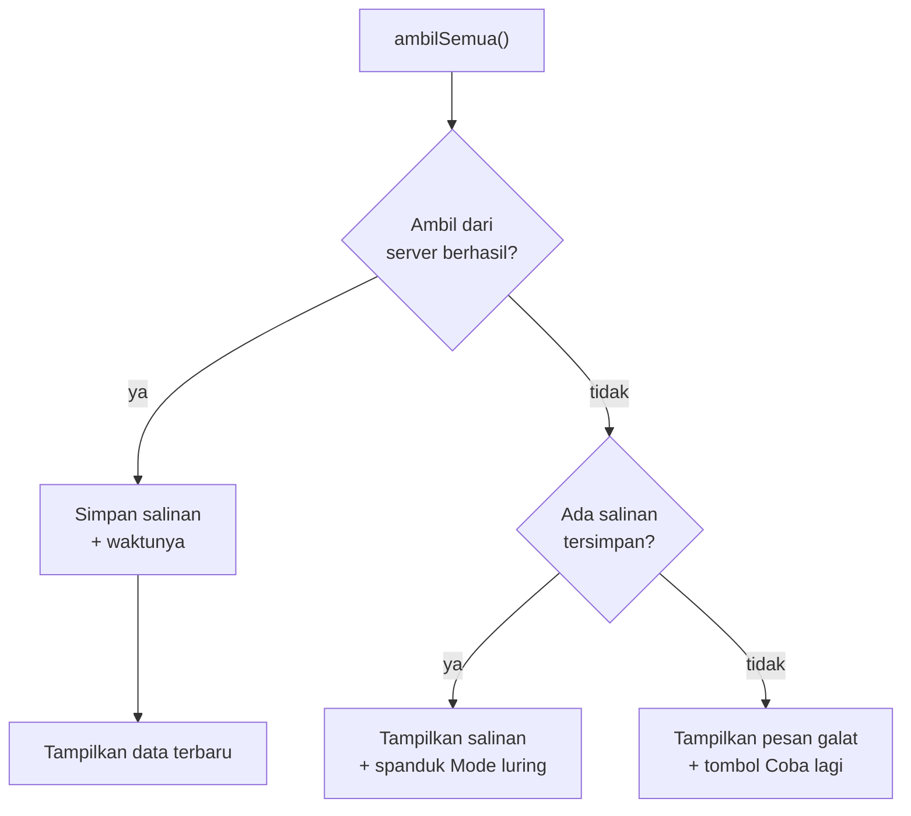

Semua keputusan itu ada di ***repository***. ViewModel dan View tidak perlu tahu dari mana datanya berasal:

```dart
@override
Future<HasilPengumuman> ambilSemua() async {
  try {
    // 1. Coba ambil dari server.
    final List<Pengumuman> daftar = await _ambilDariServer();
    // 2. Berhasil: simpan salinannya untuk nanti.
    final DateTime sekarang = DateTime.now();
    await _cache.simpan(daftar, sekarang);
    return HasilPengumuman(daftar: daftar, waktu: sekarang, dariCache: false);
  } catch (galat) {
    // 3. Gagal: pakai salinan tersimpan, jika ada.
    final HasilPengumuman? tersimpan = await _cache.baca();
    if (tersimpan == null) {
      rethrow; // belum pernah tersimpan: tetap gagal
    }
    return tersimpan;
  }
}
```

`rethrow` melempar ulang *exception* yang sama, sehingga ViewModel tetap bisa menampilkan pesan yang ramah dengan `pesanRamah` dari Pertemuan 10.

### 10.3 Satu teks untuk isi dan waktunya

`CachePengumuman` menyimpan daftar pengumuman **beserta waktunya** dalam **satu** teks JSON:

```json
{"waktu": 1760500000000, "daftar": [{"judul": "Jadwal UTS", "isi": "...", "dibaca": 120}]}
```

Jika disimpan dengan dua kunci terpisah, bisa saja isi yang baru sudah tersimpan tetapi waktunya masih yang lama (misalnya aplikasi mati di antara dua perintah simpan). Dengan satu teks, keduanya selalu cocok.

Perhatikan juga bahwa *cache* memakai **format milik aplikasi sendiri** (`judul`, `isi`, `dibaca`), bukan format JSON server (`title`, `body`, `views`). Jika suatu hari server mengubah bentuk JSON-nya, salinan yang sudah tersimpan tetap bisa dibaca.

### 10.4 Memberi tahu pengguna

<p align="center">
  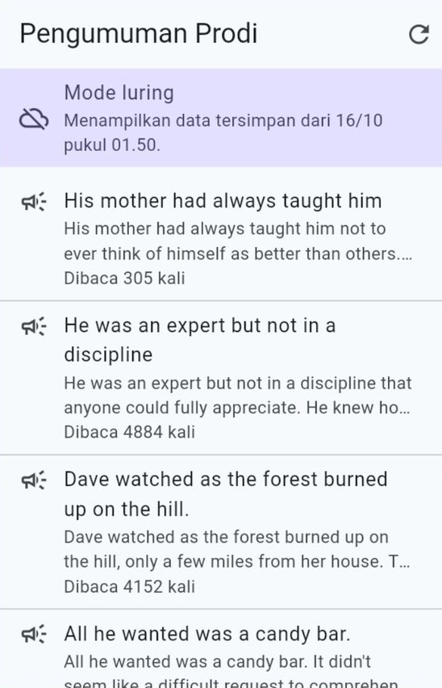
</p>

Spanduk **Mode luring** menjelaskan bahwa data yang tampil adalah salinan, lengkap dengan waktunya. Tanpa spanduk itu, pengguna bisa mengira pengumuman yang sudah basi adalah yang terbaru.

### 10.5 Mengujinya tanpa menyentuh data asli

`CachePengumuman` tidak memakai `shared_preferences` secara langsung, tetapi lewat kontrak kecil `PenyimpananTeks`. Aplikasi memakai `PenyimpananTeksPrefs`, sedangkan `jalankanUji()` memakai `PenyimpananTeksMemori` dan `MockClient` yang bisa "dimatikan":

```text
LULUS  Tanpa salinan + server mati
LULUS  Server hidup: bukan salinan
LULUS  Server hidup: 2 pengumuman
LULUS  Salinan tersimpan
LULUS  Server mati: memakai salinan
LULUS  Isi salinan sama
LULUS  Waktu salinan = waktu pengambilan terakhir
```

> **🧠 Cek Cepat:** Mengapa *cache* pengumuman boleh disimpan dengan `shared_preferences`, padahal di Bagian 4.4 disebutkan paket itu tidak boleh dipakai untuk data penting?
>
> <details><summary>Lihat jawaban</summary>
>
> Karena *cache* hanyalah **salinan**. Data aslinya tetap ada di server. Jika salinannya hilang, aplikasi cukup mengambil lagi dari server saat internet tersedia. Ukurannya pun kecil (sepuluh pengumuman).
> </details>

---

## 11. Studi Kasus: Cuaca Kampus Luring

Saatnya menggabungkan semuanya. [Contoh 09](kode/contoh_09_studi_kasus_cuaca_luring.dart) melanjutkan aplikasi Cuaca Kampus dari [Pertemuan 10 Bagian 13](../pertemuan_10_async_dan_rest_api/README.md#13-studi-kasus-cuaca-kampus).

### 11.1 Fitur baru

| Fitur | Disimpan di | Alasan |
| :--- | :--- | :--- |
| Mengingat **kota terakhir** yang dipilih | `shared_preferences` (`String`) | Satu nilai kecil |
| **Kota favorit** tampil paling depan, ditandai bintang | `shared_preferences` (`List<String>`) | Daftar pendek berisi nama *enum* |
| **Prakiraan terakhir** setiap kota tetap bisa dibaca tanpa internet | SQLite (`cuaca_kampus.db`) | Data terstruktur: cuaca saat ini dan tujuh baris prakiraan per kota |

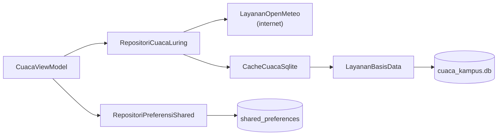

### 11.2 Strategi "lokal dulu, lalu server"

Contoh 08 baru memakai salinan **setelah** server gagal, sehingga pengguna tetap menunggu sampai batas waktu habis. Aplikasi cuaca bisa lebih cepat: tampilkan salinan **segera**, lalu ganti dengan data terbaru begitu tiba. Hasilnya datang **dua kali**, jadi *repository* mengembalikan `Stream`, bukan `Future` ([Pertemuan 3 Bagian 11](../pertemuan_03_dart_lanjutan/README.md#11-stream-data-yang-datang-berkali-kali)):

```dart
@override
Stream<HasilCuaca> pantau(Kota kota) async* {
  // 1. Data tersimpan: cepat dan tidak butuh internet.
  final HasilCuaca? tersimpan = await _cache.baca(kota);
  if (tersimpan != null) {
    yield tersimpan;
  }

  // 2. Data terbaru dari server. Jika baris ini melempar exception,
  //    Stream mengirim galat itu kepada pendengarnya, lalu selesai.
  final Cuaca cuaca = await _ambilDariServer(kota);
  final DateTime sekarang = DateTime.now();
  await _cache.simpan(cuaca, sekarang);
  yield HasilCuaca(cuaca: cuaca, diperbarui: sekarang, dariCache: false);
}
```

(Di Contoh 09, `baca` dan `simpan` juga dibungkus `try`, agar kerusakan *cache* tidak membuat aplikasi gagal total.)

| Keadaan | Yang dikirim `Stream` |
| :--- | :--- |
| Belum ada salinan, internet ada | Data server |
| Ada salinan, internet ada | Salinan, lalu data server |
| Ada salinan, internet mati | Salinan, lalu **galat** |
| Belum ada salinan, internet mati | Galat saja |

Panduan resmi Flutter tentang aplikasi ***offline-first*** menyarankan pola yang sama: kirim data lokal lebih dulu, lalu data dari server, lewat sebuah `Stream`.

### 11.3 *Cache* SQLite: dua tabel dan kunci gabungan

```sql
CREATE TABLE cuaca_saat_ini (
  kota       TEXT PRIMARY KEY,   -- satu baris per kota
  suhu       REAL NOT NULL,
  kelembapan INTEGER NOT NULL,
  angin      REAL NOT NULL,
  kondisi    TEXT NOT NULL,      -- nama enum, misalnya 'hujan'
  diperbarui INTEGER NOT NULL    -- milidetik
);

CREATE TABLE prakiraan_harian (
  kota          TEXT NOT NULL,
  tanggal       TEXT NOT NULL,   -- '2026-10-15'
  kondisi       TEXT NOT NULL,
  suhu_maks     REAL NOT NULL,
  suhu_min      REAL NOT NULL,
  peluang_hujan INTEGER,         -- boleh NULL
  PRIMARY KEY (kota, tanggal)    -- kunci gabungan
);
```

`PRIMARY KEY (kota, tanggal)` adalah **kunci gabungan**: pasangan kota dan tanggal tidak boleh kembar, tetapi satu kota boleh punya banyak tanggal, dan satu tanggal boleh dimiliki banyak kota.

Menyimpan data baru dilakukan dalam **satu transaksi** (Bagian 9):

```dart
await db.transaction((Transaction txn) async {
  // ConflictAlgorithm.replace: jika kota ini sudah ada, barisnya DITIMPA.
  await txn.insert('cuaca_saat_ini', {
    'kota': kota,
    'suhu': cuaca.saatIni.suhu,
    // ... kolom lain ...
  }, conflictAlgorithm: ConflictAlgorithm.replace);

  // Prakiraan lama kota ini dibuang, lalu diganti yang baru (batch).
  await txn.delete('prakiraan_harian', where: 'kota = ?', whereArgs: [kota]);
  final Batch batch = txn.batch();
  for (final PrakiraanHarian hari in cuaca.harian) {
    batch.insert('prakiraan_harian', {
      'kota': kota,
      'tanggal': teksTanggal(hari.tanggal),
      // ... kolom lain ...
    });
  }
  await batch.commit(noResult: true);
});
```

`ConflictAlgorithm.replace` membuat `insert` bekerja sebagai "masukkan, atau **timpa** jika sudah ada", yang sering disebut ***upsert***. Tanpa itu, menyimpan kota yang sama untuk kedua kalinya akan ditolak aturan `PRIMARY KEY`.

### 11.4 Preferensi: kota terakhir dan kota favorit

```dart
@override
Future<Set<Kota>> favorit() async {
  final List<String> nama = await _prefs.getStringList(_kunciFavorit) ?? [];
  final Map<String, Kota> peta = Kota.values.asNameMap();
  // whereType<Kota>() membuang nama yang tidak dikenal (null).
  return nama.map((String n) => peta[n]).whereType<Kota>().toSet();
}
```

Kota favorit disimpan sebagai daftar nama *enum* (`['samarinda', 'medan']`). Saat dibaca, nama yang tidak dikenal (misalnya kota yang dihapus di versi aplikasi berikutnya) dibuang dengan `whereType<Kota>()`, sama prinsipnya dengan `asNameMap()` di Bagian 3.2.

### 11.5 ViewModel: mendengarkan `Stream` dengan `await for`

```dart
Future<void> muat({bool tampilkanMemuat = true}) async {
  final int nomor = ++_nomorPermintaan;
  // ... status memuat ...
  try {
    await for (final HasilCuaca hasil in _repositori.pantau(_kota)) {
      if (_sudahDibuang || nomor != _nomorPermintaan) {
        return; // keluar dari await for = berhenti mendengarkan
      }
      final HasilCuaca? tampil = _hasil;
      if (hasil.dariCache && tampil != null && !tampil.dariCache) {
        continue; // yang tampil sudah lebih baru daripada salinan
      }
      _hasil = hasil;
      _status = StatusMuat.berhasil;
      notifyListeners();
    }
  } catch (galat) {
    if (_hasil != null) {
      _peringatan = pesanRamah(galat); // data lama tetap tampil
    } else {
      _pesanGalat = pesanRamah(galat);
      _status = StatusMuat.gagal;
    }
  }
  // ... _memperbarui = false, notifyListeners() ...
}
```

| Bagian | Penjelasan |
| :--- | :--- |
| `await for` | Menerima nilai `Stream` satu per satu. Setiap nilai langsung ditampilkan (`notifyListeners`) |
| `return` di dalam `await for` | Berhenti mendengarkan. Dipakai saat kota sudah diganti (penjaga jawaban terlambat dari [Pertemuan 10 Bagian 10.4](../pertemuan_10_async_dan_rest_api/README.md#104-jawaban-yang-datang-terlambat)) |
| `continue` | Saat ditarik untuk menyegarkan, yang tampil sudah data server. Salinan yang datang lebih dulu dilewati agar tampilan tidak mundur ke data yang lebih lama |
| `_peringatan` vs `_pesanGalat` | Gagal **tetapi masih ada data** → data tetap tampil dengan spanduk peringatan. Gagal **tanpa data sama sekali** → halaman galat dengan tombol **Coba lagi** |

> [!NOTE]
> Di Pertemuan 3, `StreamBuilder` disebut sebagai pasangan `FutureBuilder` untuk `Stream`. `StreamBuilder` membangun ulang widget setiap kali `Stream` mengirim nilai baru, dan aturannya sama dengan `FutureBuilder`: buat `Stream`-nya sekali (misalnya di `initState`), jangan di dalam `build`. Untuk aplikasi yang punya banyak aturan seperti ini, ViewModel dengan `await for` lebih mudah diatur dan diuji.

### 11.6 Pemeriksaan sebelum aplikasi tampil

`jalankanUji()` memeriksa tiga bagian tanpa internet: *repository* dengan *cache* memori, ViewModel dengan preferensi memori, dan *cache* SQLite sungguhan dengan database di memori.

```text
LULUS  Belum tersimpan: 1 data (dari server)
LULUS  Data server bukan salinan
LULUS  Data server ikut disimpan
LULUS  Sudah tersimpan: salinan dulu, lalu server
LULUS  Server mati: salinan, lalu galat
LULUS  Kota terakhir diingat
LULUS  Luring: tetap berhasil
LULUS  Luring: memakai salinan
LULUS  Luring: ada peringatan
LULUS  Kota baru tanpa salinan: gagal
LULUS  Pilihan kota disimpan
LULUS  Medan menjadi favorit
LULUS  Favorit di urutan pertama
LULUS  SQLite: hari tidak berganda
LULUS  SQLite: kondisi terbaca lagi
LULUS  SQLite: NULL tetap null
LULUS  SQLite: kota lain kosong
```

Di antara baris-baris itu juga tampil pesan seperti `Galat saat memuat cuaca: ClientException: Tidak ada koneksi`. Pesan itu **memang disengaja**, karena sebagian pemeriksaan sengaja mematikan "server".

### 11.7 Hasilnya

<p align="center">
  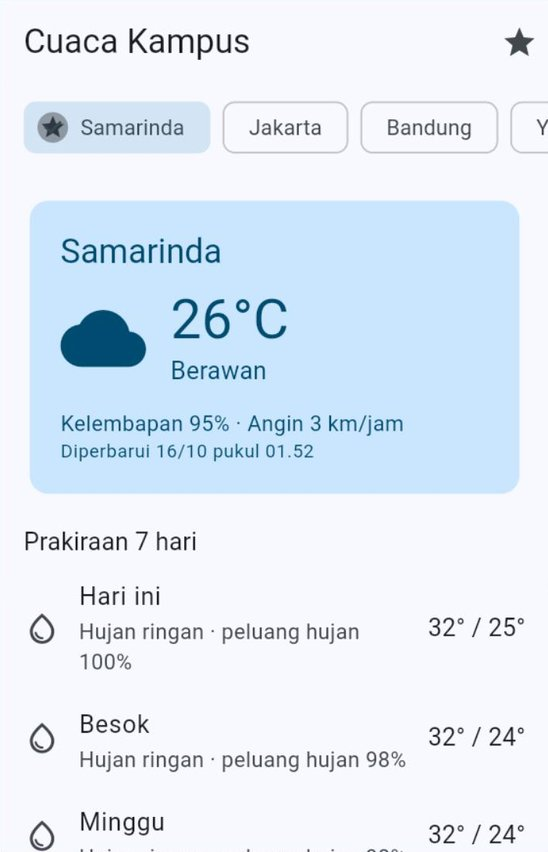
  &nbsp;
  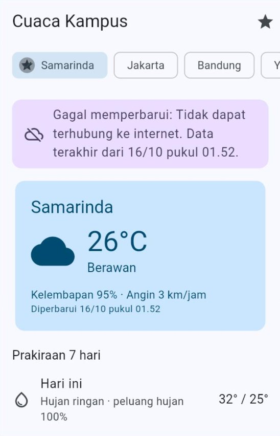
</p>

### 11.8 Uji mandiri

1. Jalankan dengan `flutter run -d chrome --web-port=8080` saat ada internet. Pilih **Samarinda**, lalu tekan ikon bintang di kanan atas. Chip Samarinda pindah ke depan dan bertanda bintang.
2. Pilih **Medan**, lalu kembali ke **Samarinda**. Data Samarinda muncul **seketika** (dari SQLite), disusul garis progres tipis di atas selama data terbaru diambil.
3. Hentikan aplikasi (`q`). Matikan internet (atau ganti `'api.open-meteo.com'` menjadi `'api.open-meteo.invalid'` di `LayananOpenMeteo`).
4. Jalankan lagi dengan port yang sama. Aplikasi langsung membuka **Samarinda** (kota terakhir), menampilkan data tersimpan, dan spanduk "Gagal memperbarui ...".
5. Pilih kota yang **belum pernah** dibuka, misalnya **Makassar**. Karena tidak ada salinan, tampil halaman galat dengan tombol **Coba lagi**.
6. Nyalakan internet (atau kembalikan alamatnya, lalu *hot restart*) dan tarik daftar ke bawah. Spanduk hilang, dan waktu "Diperbarui" berganti.

---

## 12. Melihat, Menghapus, dan Menguji Data Tersimpan

### 12.1 Di Chrome (DevTools)

Tekan `F12`, lalu buka tab **Application**.

| Bagian di DevTools | Isinya |
| :--- | :--- |
| **Storage → Local storage → `http://localhost:8080`** | Data `shared_preferences`. Nilainya tersimpan sebagai teks JSON, misalnya kunci `jumlah_tamu` bernilai `5` dan kunci `mode_tema` bernilai `"dark"` (dengan tanda kutip) |
| **Storage → IndexedDB** | Tempat `sqflite` versi web menyimpan berkas-berkas databasenya |
| **Storage → tombol *Clear site data*** | Menghapus **semua** data situs itu: *Local Storage* dan IndexedDB sekaligus |

### 12.2 Di Android

| Kebutuhan | Caranya |
| :--- | :--- |
| Melihat isi tabel SQLite saat aplikasi berjalan | Android Studio → **App Inspection** → **Database Inspector**. Pilih HP dan aplikasi Anda, lalu buka tabelnya. Anda bahkan bisa menjalankan *query* SQL di sana |
| Menghapus semua data aplikasi | **Setelan → Aplikasi →** (nama aplikasi) **→ Penyimpanan → Hapus data**. Bisa juga dengan menghapus (*uninstall*) aplikasinya |

### 12.3 Menghapus data selama pengembangan

Saat Anda mengubah `CREATE TABLE` di tengah pengembangan dan belum ingin menulis migrasi, menghapus data lama adalah jalan pintas yang wajar, **asalkan itu data Anda sendiri**:

- Chrome: *Clear site data* (Bagian 12.1), lalu jalankan ulang aplikasi.
- Android: hapus data aplikasi (Bagian 12.2).
- Dari kode: `await deleteDatabase('catatan_kuliah.db');` sebelum database dibuka.

> [!WARNING]
> Jangan pernah membiarkan `deleteDatabase` atau `clear()` ikut terbawa ke aplikasi yang dibagikan, kecuali memang untuk tombol seperti **Hapus semua data** yang disertai konfirmasi.

### 12.4 Menguji tanpa menyentuh data asli

| Cara | Dipakai di | Kelebihan |
| :--- | :--- | :--- |
| *Repository* atau penyimpanan **versi memori** (kontrak + implementasi tiruan) | Contoh 08 dan 09, seperti `MockClient` di Pertemuan 10 | Cepat, bisa berjalan di mana saja, cocok untuk menguji ViewModel |
| Database SQLite sungguhan di **memori** (`inMemoryDatabasePath`) | Contoh 05, 06, 07, dan 09 | SQL-nya ikut teruji, tetapi data asli tidak tersentuh dan setiap uji dimulai dari kosong |

Di Pertemuan 14, cara yang sama dipindahkan ke berkas pengujian di folder `test/` dan dijalankan dengan `flutter test`.

---

## 13. Keamanan dan Pilihan Penyimpanan Lain

### 13.1 Data rahasia

Data `shared_preferences` dan SQLite **tidak dienkripsi** oleh aplikasi:

- Di Chrome, siapa pun yang membuka DevTools di komputer itu bisa membacanya, dan kode JavaScript lain di situs yang sama pun bisa.
- Di Android, data memang tersimpan di folder khusus milik aplikasi, tetapi tetap berupa berkas biasa, dan secara bawaan ikut dicadangkan otomatis oleh sistem.

Karena itu, **jangan pernah** menyimpan *password*, PIN, atau token masuk dengan kedua alat itu. Untuk token, pakai paket [`flutter_secure_storage`](https://pub.dev/packages/flutter_secure_storage), yang menyimpannya di **Keychain** (iOS) dan dalam bentuk **terenkripsi** (Android). Dukungan web paket itu masih eksperimental. *Password* sendiri sebaiknya tidak disimpan sama sekali: setelah berhasil masuk, simpan token dari server saja.

### 13.2 Data pribadi pengguna

- Simpan **hanya** yang benar-benar dibutuhkan aplikasi.
- Saat pengguna keluar (*logout*), hapus data miliknya dari perangkat.
- Jelaskan di halaman privasi data apa saja yang disimpan, terutama di proyek akhir yang akan dipakai orang lain.

### 13.3 Pilihan penyimpanan lain

`shared_preferences` dan `sqflite` sudah cukup untuk sebagian besar aplikasi, termasuk proyek akhir. Pilihan berikut layak Anda kenali:

| Pilihan | Jenisnya | Kapan dipertimbangkan |
| :--- | :--- | :--- |
| [`drift`](https://pub.dev/packages/drift) | SQLite dengan kode Dart yang dibuat otomatis (*code generation*) sehingga kesalahan nama kolom ketahuan sebelum aplikasi dijalankan. Mendukung web | Aplikasi besar dengan banyak tabel dan *query*. Mirip peran Room di aplikasi Android native |
| [`hive_ce`](https://pub.dev/packages/hive_ce) | Database kunci–nilai (NoSQL) yang ditulis murni dengan Dart, mendukung web | Menyimpan objek tanpa SQL. Catatan: versi stabil terakhir paket `hive` yang asli dirilis tahun 2022; `hive_ce` adalah lanjutan komunitas yang masih dirawat |
| [`path_provider`](https://pub.dev/packages/path_provider) + `dart:io` | Berkas | Menyimpan foto atau PDF. Tidak berlaku di web |
| Database di server, misalnya Firebase atau Supabase | Data di internet | Data harus sama di beberapa perangkat atau dibagikan ke pengguna lain |

---

## 14. Kesalahan Umum Pemula dan Solusinya

| Gejala | Penyebab | Solusi |
| :--- | :--- | :--- |
| `MissingPluginException(No implementation found for method ...)` | Paket berplugin baru dipasang saat aplikasi sedang berjalan; *hot reload*/*hot restart* tidak memuat bagian aslinya | Hentikan aplikasi (`q`), lalu jalankan lagi dengan `flutter run` |
| Data hilang setiap kali `flutter run -d chrome` dijalankan | *Port* acak, sehingga *browser* menganggapnya situs berbeda | `flutter run -d chrome --web-port=8080` |
| `Binding has not yet been initialized` | Plugin dipakai sebelum `runApp` | `WidgetsFlutterBinding.ensureInitialized();` di baris pertama `main` |
| `type 'String' is not a subtype of type 'int?'` | Satu kunci dibaca dengan tipe yang berbeda dari saat disimpan | Satu tipe untuk satu kunci; tulis nama kunci sebagai konstanta |
| `ArgumentError: ... is not included in the PreferencesFilter allowlist` | Kunci belum dimasukkan ke `allowList` milik `SharedPreferencesWithCache` | Tambahkan kuncinya ke `allowList` |
| `Bad state: databaseFactory not initialized` (di Chrome) | Baris `databaseFactory = databaseFactoryFfiWeb;` belum ada | Tambahkan di `main` di dalam `if (kIsWeb)` (Bagian 5.4) |
| Di Chrome muncul galat yang menyebut `sqlite3.wasm` atau `sqflite_sw.js`, atau aplikasi terus memuat | Langkah *setup* web belum dijalankan | `dart run sqflite_common_ffi_web:setup`, lalu jalankan ulang aplikasi |
| `no such table` atau `no such column` setelah `CREATE TABLE` diubah | `onCreate` hanya berjalan sekali; berkas lama masih memakai struktur lama | Naikkan `version` dan tulis `onUpgrade` (Bagian 8). Selama pengembangan boleh menghapus data sendiri (Bagian 12.3) |
| `duplicate column name` saat migrasi | Migrasi yang sama berjalan dua kali karena versi sempat diturunkan | Versi database hanya boleh naik |
| Aplikasi macet saat menyimpan | `db` dipakai di dalam `db.transaction(...)` | Pakai `txn` di dalam transaksi |
| `UNIQUE constraint failed` | Data kembar pada kolom `UNIQUE` | Tangkap `DatabaseException` dan periksa `isUniqueConstraintError()`, lalu beri pesan yang ramah |
| *Error* atau hasil aneh saat teks berisi tanda kutip (`Jum'at`) | Nilai ditempel langsung ke teks SQL | Selalu pakai `?` dan `whereArgs` |
| `update` tidak mengubah apa pun | Syarat `where` tidak cocok dengan baris mana pun | Periksa hasil `update` (jumlah baris berubah) |
| `A dismissed Dismissible widget is still part of the tree` | Baris baru dibuang dari daftar setelah menunggu database | Buang dari daftar di memori lebih dulu, baru hapus dari database (Bagian 7.5) |
| Nilai `bool` atau `DateTime` tersimpan aneh atau memunculkan peringatan | SQLite tidak punya tipe itu | Ubah ke `1`/`0` dan milidetik (Bagian 5.2) |
| Tema berkedip terang lalu gelap saat aplikasi dibuka | Pengaturan baru dibaca setelah layar pertama tampil | `SharedPreferencesWithCache` dibuat di `main` sebelum `runApp` (Bagian 3) |

---

## 15. Ringkasan

- Variabel hidup di **memori** dan hilang saat aplikasi ditutup. Agar tetap ada, data disimpan ke **penyimpanan perangkat** segera setelah berubah, lalu dibaca kembali saat aplikasi dibuka.
- **`shared_preferences`** menyimpan pasangan **kunci–nilai** kecil (`bool`, `int`, `double`, `String`, `List<String>`). Pakai `SharedPreferencesAsync` untuk kebutuhan umum, dan `SharedPreferencesWithCache` (dibuat sebelum `runApp`, dengan `allowList`) untuk pengaturan yang harus siap sejak layar pertama.
- *Enum* disimpan sebagai **nama**-nya dan dibaca dengan `asNameMap()`; waktu disimpan sebagai teks ISO 8601 atau milidetik; objek kecil sebagai teks **JSON**. Data tersimpan yang rusak ditangani, bukan dibiarkan membuat aplikasi *crash*.
- **SQLite** menyimpan data terstruktur dalam satu berkas: **tabel**, **baris**, **kolom**, dan **kunci utama**. Paket **`sqflite`** menyediakan `insert` (hasil: id), `query`, `update` dan `delete` (hasil: jumlah baris), serta `rawQuery`.
- Nilai dari luar kode **selalu** dikirim lewat `?` dan **`whereArgs`**, agar aman dari *SQL injection*.
- **`onCreate`** hanya berjalan sekali. Perubahan struktur tabel memakai **`version`** yang naik dan **`onUpgrade`** bertahap, tanpa menghapus data pengguna.
- **Transaksi** membuat beberapa perintah berhasil semua atau batal semua; di dalamnya pakai `txn`. ***Batch*** mengirim banyak perintah sekaligus.
- Lapisan data untuk penyimpanan sama dengan untuk internet: **layanan** (membuka database), ***repository*** (SQL ⇄ Model), dan ViewModel. Database adalah **sumber kebenaran**.
- ***Cache*** adalah salinan data internet. Strategi **"data lokal sebagai cadangan"** memakai salinan saat server gagal; strategi **"lokal dulu, lalu server"** menampilkan salinan seketika lalu memperbaruinya lewat `Stream`. Selalu tunjukkan **kapan** data itu diambil.
- Uji tanpa menyentuh data asli: implementasi **memori** dan **`inMemoryDatabasePath`**. Jangan simpan *password* atau token di `shared_preferences` maupun SQLite biasa.

**Memilih alat yang tepat:**

| Kebutuhan | Pakai |
| :--- | :--- |
| Satu atau beberapa nilai kecil yang dibaca dengan `await` | `SharedPreferencesAsync` |
| Pengaturan yang harus siap sejak layar pertama (tema, bahasa) | `SharedPreferencesWithCache` di `main` |
| Banyak data yang perlu dicari, diurutkan, diubah, dan dihitung | SQLite (`sqflite`) + layanan + *repository* |
| Beberapa perintah tulis yang harus berhasil bersama | `db.transaction(...)` |
| Menyimpan puluhan atau ratusan baris sekaligus | `batch` (sebaiknya di dalam transaksi) |
| Data internet yang tetap terbaca saat luring | *Cache* dengan strategi "cadangan" atau "lokal dulu, lalu server" |
| Token dan data rahasia | `flutter_secure_storage` |

---

## 16. Glosarium

| Istilah | Arti |
| :--- | :--- |
| **Penyimpanan lokal** | Menyimpan data di perangkat pengguna sendiri, bukan di server |
| **Persisten** | Tetap ada walaupun aplikasi ditutup atau perangkat dimatikan |
| **Kunci–nilai** (*key–value*) | Cara menyimpan data berpasangan: satu nama (kunci) untuk satu nilai |
| **`allowList`** | Daftar kunci yang boleh dipakai `SharedPreferencesWithCache` |
| **SQLite** | Sistem database dalam satu berkas, tanpa server |
| **Tabel, baris, kolom** | Wadah satu jenis data; satu data; satu isian di setiap data |
| **Kunci utama** (*primary key*) | Kolom (atau gabungan kolom) yang nilainya tidak pernah kembar, penanda setiap baris |
| **`AUTOINCREMENT`** | Nomor otomatis untuk kunci utama yang tidak pernah dipakai ulang |
| **CRUD** | *Create, Read, Update, Delete*: empat operasi dasar pada data |
| **`whereArgs`** | Daftar nilai pengisi tanda `?` di syarat `where`, dikirim terpisah dari teks SQL |
| ***SQL injection*** | Serangan dengan menyisipkan potongan SQL lewat isian pengguna |
| **Skema** | Struktur database: tabel apa saja dan kolom apa saja |
| **Migrasi** | Mengubah skema database pengguna dari versi lama ke versi baru tanpa menghapus datanya |
| **Transaksi** | Sekumpulan perintah yang berhasil semua (*commit*) atau dibatalkan semua (*rollback*) |
| ***Batch*** | Beberapa perintah yang dikumpulkan lalu dikirim ke database sekaligus |
| ***Upsert*** | "*Insert* atau *update*": masukkan baris baru, atau timpa jika kuncinya sudah ada |
| ***Cache*** | Salinan data yang disimpan agar bisa dipakai lagi tanpa mengambilnya dari sumber aslinya |
| **Luring / daring** | *Offline* (tidak terhubung internet) / *online* (terhubung) |
| ***Offline-first*** | Aplikasi yang tetap bisa dipakai tanpa internet karena mengandalkan data di perangkat |
| **Sumber kebenaran** (*source of truth*) | Satu-satunya tempat yang isinya dianggap paling benar; tampilan selalu mengikuti tempat ini |
| ***Local Storage* / IndexedDB** | Dua tempat penyimpanan milik *browser*; dipakai `shared_preferences` dan `sqflite` versi web |

---

## 17. Referensi

1. Flutter. *Store key-value data on disk*. <https://docs.flutter.dev/cookbook/persistence/key-value>
2. Flutter. *Persist data with SQLite*. <https://docs.flutter.dev/cookbook/persistence/sqlite>
3. Flutter. *Persistent storage architecture: Key-value data*. <https://docs.flutter.dev/app-architecture/design-patterns/key-value-data>
4. Flutter. *Persistent storage architecture: SQL*. <https://docs.flutter.dev/app-architecture/design-patterns/sql>
5. Flutter. *Offline-first support*. <https://docs.flutter.dev/app-architecture/design-patterns/offline-first>
6. pub.dev. *shared_preferences*. <https://pub.dev/packages/shared_preferences>
7. pub.dev. *sqflite*. <https://pub.dev/packages/sqflite>
8. pub.dev. *sqflite_common_ffi_web*. <https://pub.dev/packages/sqflite_common_ffi_web>
9. sqflite. *Migration example*. <https://github.com/tekartik/sqflite/blob/master/sqflite/doc/migration_example.md>
10. SQLite. *Datatypes In SQLite*. <https://www.sqlite.org/datatype3.html>
11. SQLite. *ALTER TABLE*. <https://www.sqlite.org/lang_altertable.html>
12. OWASP. *SQL Injection*. <https://owasp.org/www-community/attacks/SQL_Injection>
13. pub.dev. *flutter_secure_storage*. <https://pub.dev/packages/flutter_secure_storage>

---

## ➡️ Langkah Berikutnya

1. Kerjakan [🧪 Jobsheet Pertemuan 11](JOBSHEET.md) di laboratorium.
2. Kerjakan [✍️ Latihan Pertemuan 11](LATIHAN.md) untuk menguji pemahaman Anda.
3. **Proyek akhir:** tentukan data apa yang disimpan di perangkat (pengaturan, data utama, atau *cache*) dan di mana menyimpannya. Lihat [🚀 Panduan Proyek Akhir](../panduan/05_proyek_akhir.md).
4. Pertemuan 12 membahas ***Clean Architecture***: menata layanan, *repository*, dan ViewModel yang sudah kita pakai sejak Pertemuan 9 menjadi lapisan-lapisan yang lebih rapi untuk aplikasi yang semakin besar.

[⬆️ Kembali ke atas](#pertemuan-11--penyimpanan-lokal)
