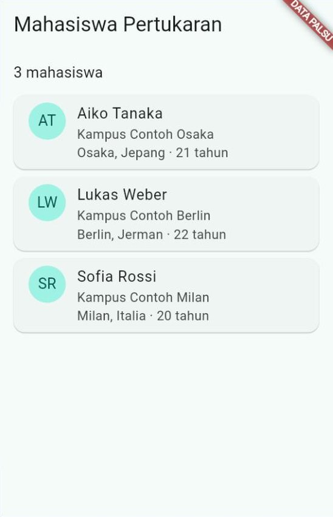
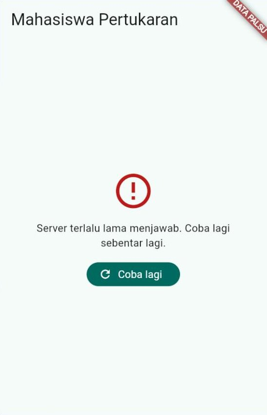
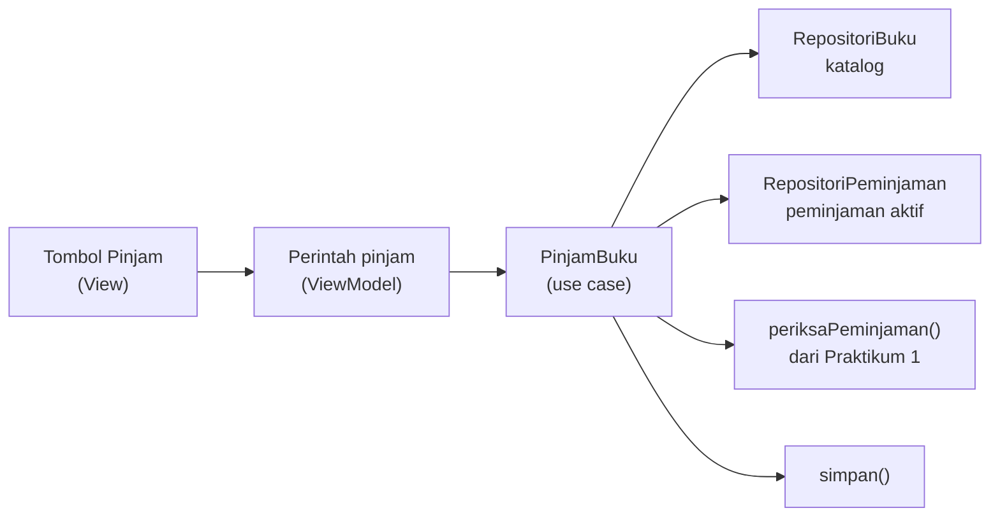
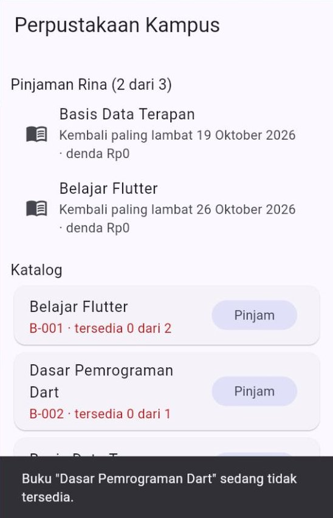
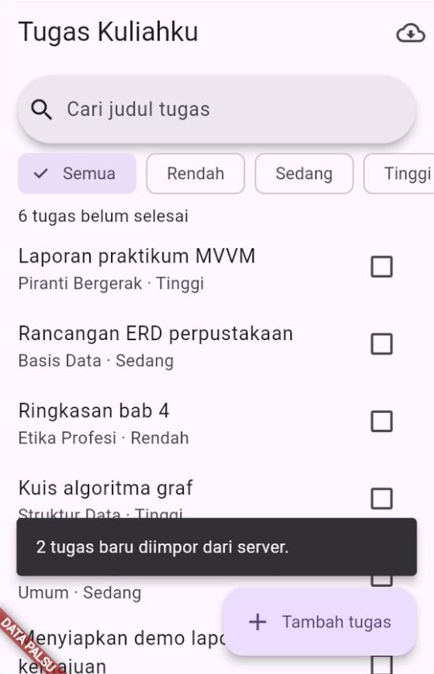

# 🧪 Jobsheet Pertemuan 12 — Arsitektur Aplikasi: *Clean Architecture*

[🏠 Beranda](../README.md) · [📖 Modul](README.md) · [✍️ Latihan](LATIHAN.md) · [💻 Kode Contoh](kode/)

| Informasi | Keterangan |
| :--- | :--- |
| Mata kuliah | Pemrograman Piranti Bergerak |
| Pertemuan | 12 — Arsitektur Aplikasi: *Clean Architecture* |
| Bentuk kegiatan | Praktikum individu |
| Estimasi waktu | 150 menit |
| Alat | Praktikum 1–4: DartPad **atau** proyek latihan Flutter di VS Code yang dijalankan di Chrome. Praktikum 5: **wajib** proyek `tugas_kuliahku` hasil Pertemuan 11 |
| Paket | Praktikum 1 tanpa paket. `http` untuk Praktikum 2 dan 3, `provider` untuk Praktikum 2–5. DartPad sudah menyediakan keduanya; di proyek latihan, jalankan `flutter pub add http provider` sekali |
| Koneksi | Hampir semua praktikum berjalan **tanpa internet**, karena memakai data palsu. Internet hanya dibutuhkan untuk Modifikasi 2–5 Praktikum 2 (data DummyJSON) dan impor di Praktikum 5 versi produksi |
| Hasil akhir | Proyek "Tugas Kuliahku" yang tertata menjadi lapisan UI, domain, dan data, lengkap dengan dua titik masuk (data sungguhan dan data palsu), ditambah tiga program kecil: aturan perpustakaan, direktori mahasiswa pertukaran (dua versi), dan peminjaman buku |

---

## 🎯 Tujuan Praktikum

Setelah menyelesaikan jobsheet ini, Anda mampu:

1. Menulis entitas, objek nilai, dan aturan bisnis dalam **Dart murni**, lalu memeriksanya tanpa Flutter dengan jam yang disuntikkan.
2. Membuat kontrak *repository*, dua implementasinya (data palsu dan server), serta akar komposisi yang memilih implementasi menurut lingkungan.
3. Memisahkan **model API** dari entitas, lalu menerjemahkan JSON berbahasa Inggris (termasuk objek bertingkat) menjadi data milik aplikasi.
4. Mengembalikan `Hasil<T>` berisi `Kegagalan` dari *repository*, lalu memeriksa *repository* dengan server palsu (`MockClient`).
5. Menulis *use case* yang menggabungkan beberapa *repository*, memeriksanya dengan data palsu dan mata-mata (*spy*), serta memakai Perintah agar tombol tidak mengirim dua kali.
6. Menata ulang proyek "Tugas Kuliahku" ke folder `domain/`, `data/`, `ui/`, dan `config/` secara bertahap dan aman.

## 📌 Petunjuk Umum

> [!IMPORTANT]
> 1. Setiap praktikum diawali **kode terbimbing**. **Ketik sendiri** kodenya, kecuali bagian yang ditandai *boleh disalin*.
> 2. Kerjakan **🔧 Modifikasi** di setiap praktikum. Jawaban berupa penjelasan ditulis sebagai **komentar** di dalam kode.
> 3. Simpan Praktikum 1–4 sebagai berkas terpisah berisi kode **lengkap**: `praktikum1.dart` sampai `praktikum4.dart`. Praktikum 5 berupa folder `lib/` dari proyek `tugas_kuliahku`.
> 4. Rapikan kode sebelum menyimpan: tombol **Format** di DartPad, atau `Shift` + `Alt` + `F` di VS Code. Pastikan tidak ada garis merah maupun kuning.
> 5. **Aturan hari ini:** (1) kode domain **tidak** mengimpor Flutter, `http`, `sqflite`, maupun `provider`; (2) nama *class* implementasi hanya disebut di **akar komposisi**; (3) aturan bisnis menerima waktu "sekarang" sebagai parameter, **tidak** memanggil `DateTime.now()` sendiri; (4) mulai Praktikum 3, *repository* **tidak melempar** *exception* ke ViewModel: kegagalan dikembalikan di dalam `Hasil`.
> 6. Banyak modifikasi berupa **eksperimen**: Anda sengaja membuat kesalahan untuk melihat akibatnya. Setelah akibatnya dicatat sebagai komentar, **kembalikan** kodenya seperti semula, kecuali diminta lain.

> [!NOTE]
> Praktikum saling bersambung: **Praktikum 3 melanjutkan Praktikum 2**, dan **Praktikum 4 memakai aturan dari Praktikum 1**. Kerjakan berurutan. Bandingkan juga setiap praktikum dengan contoh di modul: Praktikum 1 ↔ Contoh 02, Praktikum 2 ↔ Contoh 03 dan 04, Praktikum 3 ↔ Contoh 05, Praktikum 4 ↔ Contoh 06 dan 07, Praktikum 5 ↔ Contoh 08.

> [!TIP]
> **Di mana melihat isi konsol?** Hasil pemeriksaan (`LULUS`/`GAGAL`) dicetak ke konsol.
> - **DartPad:** panel **Console** di bawah panel aplikasi.
> - **VS Code:** tab **Debug Console** saat aplikasi dijalankan dengan **F5**.
> - **Terminal:** keluaran perintah `flutter run -d chrome` atau `dart run`.

<details>
<summary>❓ Lupa cara menjalankan aplikasi Flutter?</summary>

- **DartPad:** buka <https://dartpad.dev>, hapus kode bawaannya, tempelkan kode Anda, lalu klik **Run**. Paket `http` dan `provider` sudah tersedia.
- **Proyek latihan:** buka proyek latihan dari Pertemuan 1 di VS Code. Jalankan `flutter pub add http provider` **sekali** di terminal folder proyek, lalu ganti seluruh isi `lib/main.dart` dengan kode Anda dan jalankan dengan **F5** (atau `flutter run -d chrome`). Jika Anda mengubah isi `main()` lalu tampilannya tidak berubah, lakukan *hot restart* dengan menekan `R`.

Penjelasan lengkap ada di [Panduan Menjalankan Kode](../panduan/03_menjalankan_kode_contoh.md).
</details>

---

## Praktikum 1 — Aturan Perpustakaan dalam Dart Murni

**Konsep:** entitas, objek nilai, `operator ==` dan `hashCode`, aturan bisnis sebagai fungsi biasa, konstanta bernama, dan jam yang disuntikkan. ([Modul Bagian 3](README.md#3-lapisan-domain-entitas-dan-aturan-bisnis))

Perpustakaan kampus ingin aplikasinya memeriksa peminjaman buku secara otomatis. Kebijakannya:

| Kebijakan | Mahasiswa | Dosen |
| :--- | :---: | :---: |
| Lama peminjaman | 7 hari | 14 hari |
| Paling banyak dipinjam sekaligus | 3 buku | 5 buku |
| Denda keterlambatan | Rp1.000 per hari, paling banyak Rp50.000 | sama |

Peminjaman juga **ditolak** jika semua eksemplar buku sedang dipinjam orang lain, jika anggota sedang meminjam buku yang sama, atau jika anggota masih punya buku yang terlambat dikembalikan.

Semua kebijakan ini milik **lapisan domain**. Anda menulisnya dalam **Dart murni**: tanpa Flutter, tanpa internet, dan tanpa database. Programnya tidak punya tampilan; hasilnya dibaca di konsol. Di Praktikum 4, aturan yang sama dipakai oleh aplikasi Flutter **tanpa diubah sedikit pun**.

> [!NOTE]
> **Cara menjalankan program Dart murni.** Di DartPad: tempel kode, klik **Run**, lalu baca panel **Console**. Di komputer: simpan sebagai `praktikum1.dart` di folder mana saja, lalu jalankan `dart run praktikum1.dart` di terminal folder itu. Program ini tidak dijalankan dengan `flutter run`.

### Langkah 1 — Objek nilai `Rupiah` (ketik sendiri)

```dart
// Praktikum 1 — Aturan Perpustakaan dalam Dart Murni
// Lapisan domain: entitas, objek nilai, dan aturan bisnis. Tanpa Flutter,
// tanpa internet, tanpa database.

// Program konsol, jadi print() boleh dipakai.
// ignore_for_file: avoid_print

// ----------------------------- OBJEK NILAI -----------------------------

// Rupiah: dikenali dari NILAINYA. Rp1.000 di mana pun tetap Rp1.000.
class Rupiah {
  const Rupiah(this.nilai);

  final int nilai;

  Rupiah operator +(Rupiah lain) => Rupiah(nilai + lain.nilai);

  Rupiah kali(int pengali) => Rupiah(nilai * pengali);

  bool lebihDari(Rupiah lain) => nilai > lain.nilai;

  @override
  bool operator ==(Object other) => other is Rupiah && other.nilai == nilai;

  @override
  int get hashCode => nilai.hashCode;

  // 12500 -> "Rp12.500"
  @override
  String toString() {
    final String angka = nilai.toString();
    final StringBuffer hasil = StringBuffer();
    for (int i = 0; i < angka.length; i++) {
      final int sisa = angka.length - i;
      hasil.write(angka[i]);
      if (sisa > 1 && sisa % 3 == 1) hasil.write('.');
    }
    return 'Rp$hasil';
  }
}
```

| Bagian | Penjelasan |
| :--- | :--- |
| `// ignore_for_file: avoid_print` | Program konsol memang bertugas mencetak, jadi peringatan `avoid_print` dimatikan untuk berkas ini saja |
| `final int nilai` | Uang disimpan sebagai **bilangan bulat** rupiah, bukan `double`. Di komputer, `0.1 + 0.2` tidak tepat sama dengan `0.3`, dan selisih sekecil itu tidak boleh terjadi pada uang |
| `operator +`, `kali`, `lebihDari` | Setiap perhitungan menghasilkan objek `Rupiah` **baru**. Objek lama tidak pernah diubah (*immutable*) |
| `operator ==` dan `hashCode` | Dua `Rupiah` dianggap sama jika **nilainya** sama. Inilah ciri objek nilai ([Modul Bagian 3.1](README.md#31-entitas-dan-objek-nilai)) |
| `toString()` | Mengubah `1250000` menjadi `Rp1.250.000`. Setelah sebuah angka ditulis, titik disisipkan jika banyaknya angka di sebelah kanannya kelipatan tiga |

### Langkah 2 — Entitas (ketik sendiri)

Lanjutkan di bawah kode Langkah 1.

```dart
// ------------------------------- ENTITAS -------------------------------

enum JenisAnggota {
  mahasiswa('Mahasiswa', lamaPinjam: 7, batasPinjam: 3),
  dosen('Dosen', lamaPinjam: 14, batasPinjam: 5);

  const JenisAnggota(
    this.label, {
    required this.lamaPinjam,
    required this.batasPinjam,
  });

  final String label;
  final int lamaPinjam; // hari
  final int batasPinjam; // buku sekaligus
}

class Anggota {
  const Anggota({required this.nomor, required this.nama, required this.jenis});

  final String nomor;
  final String nama;
  final JenisAnggota jenis;
}

class Buku {
  const Buku({
    required this.kode,
    required this.judul,
    required this.eksemplar,
  });

  final String kode;
  final String judul;
  final int eksemplar; // jumlah buku fisik yang dimiliki perpustakaan
}

class Peminjaman {
  const Peminjaman({
    required this.kodeBuku,
    required this.nomorAnggota,
    required this.tanggalPinjam,
    required this.jatuhTempo,
  });

  final String kodeBuku;
  final String nomorAnggota;
  final DateTime tanggalPinjam;
  final DateTime jatuhTempo;
}
```

| Bagian | Penjelasan |
| :--- | :--- |
| `enum JenisAnggota` | *Enum* yang membawa data ([Pertemuan 3](../pertemuan_03_dart_lanjutan/README.md)). Kebijakan setiap jenis anggota ditulis di **satu tempat**: label, lama pinjam, dan batas pinjam |
| `Anggota`, `Buku`, `Peminjaman` | Entitas: data penting perpustakaan dengan nama milik aplikasi. Semua *field* `final` |
| `eksemplar` | Banyaknya buku fisik dengan judul yang sama. Perpustakaan bisa punya dua eksemplar "Belajar Flutter" |
| `kodeBuku` dan `nomorAnggota` | `Peminjaman` cukup "menunjuk" buku dan anggotanya lewat kode, seperti kunci asing di basis data |

### Langkah 3 — Aturan bisnis (ketik sendiri)

```dart
// ---------------------------- ATURAN BISNIS ----------------------------

const Rupiah dendaPerHari = Rupiah(1000);
const Rupiah dendaMaksimal = Rupiah(50000);

// Selisih hari kalender, tanpa memedulikan jam. DateTime.utc dipakai agar
// perhitungan tidak terganggu pergantian jam musim panas di negara lain.
int selisihHari(DateTime dari, DateTime sampai) {
  final DateTime awal = DateTime.utc(dari.year, dari.month, dari.day);
  final DateTime akhir = DateTime.utc(sampai.year, sampai.month, sampai.day);
  return akhir.difference(awal).inDays;
}

DateTime hitungJatuhTempo(Anggota anggota, DateTime tanggalPinjam) {
  return DateTime(
    tanggalPinjam.year,
    tanggalPinjam.month,
    tanggalPinjam.day + anggota.jenis.lamaPinjam,
  );
}

int hariTerlambat(Peminjaman peminjaman, DateTime sekarang) {
  final int selisih = selisihHari(peminjaman.jatuhTempo, sekarang);
  return selisih > 0 ? selisih : 0;
}

Rupiah hitungDenda(Peminjaman peminjaman, DateTime sekarang) {
  final Rupiah denda = dendaPerHari.kali(hariTerlambat(peminjaman, sekarang));
  return denda.lebihDari(dendaMaksimal) ? dendaMaksimal : denda;
}

// Mengembalikan alasan penolakan, atau null jika boleh meminjam.
String? periksaPeminjaman({
  required Anggota anggota,
  required Buku buku,
  required int tersedia,
  required List<Peminjaman> milikAnggota,
  required DateTime sekarang,
}) {
  if (tersedia < 1) {
    return 'Buku "${buku.judul}" sedang tidak tersedia.';
  }
  if (milikAnggota.length >= anggota.jenis.batasPinjam) {
    return 'Batas ${anggota.jenis.batasPinjam} buku untuk '
        '${anggota.jenis.label} sudah tercapai.';
  }
  if (milikAnggota.any((Peminjaman p) => p.kodeBuku == buku.kode)) {
    return 'Buku ini sedang Anda pinjam.';
  }
  if (milikAnggota.any((Peminjaman p) => hariTerlambat(p, sekarang) > 0)) {
    return 'Kembalikan dulu buku yang terlambat.';
  }
  return null;
}
```

| Bagian | Penjelasan |
| :--- | :--- |
| `dendaPerHari`, `dendaMaksimal` | Angka kebijakan ditulis sebagai **konstanta bernama**. Jika denda naik, cukup satu baris yang diubah |
| `selisihHari` | Membandingkan **tanggal**, bukan jam. Diperiksa pukul 09.00 atau pukul 17.00 pada hari yang sama, hasilnya sama |
| `DateTime.utc(...)` | Waktu UTC tidak mengenal pergantian jam musim panas, sehingga selisih dua tanggal selalu tepat kelipatan 24 jam di negara mana pun |
| `hitungJatuhTempo` | `day + lamaPinjam` boleh melewati akhir bulan: "33 Oktober" otomatis menjadi 2 November |
| `hitungDenda` | Denda harian dikalikan hari terlambat, lalu dipangkas di `dendaMaksimal` |
| `periksaPeminjaman` | Mengembalikan **alasan penolakan** atau `null` jika boleh meminjam. Pemeriksaan berhenti di alasan pertama yang ditemukan |
| `required DateTime sekarang` | Fungsi tidak memanggil `DateTime.now()` sendiri. Waktu "sekarang" **disuntikkan** oleh pemanggilnya ([Modul Bagian 3.3](README.md#33-waktu-sekarang-sebagai-parameter)) |

### Langkah 4 — Program pemeriksa (boleh disalin)

```dart
// ------------------------------- PROGRAM -------------------------------

void main() {
  // Jam disuntikkan: semua pemeriksaan memakai Senin, 19 Oktober 2026.
  final DateTime sekarang = DateTime(2026, 10, 19, 9);
  const Anggota rina = Anggota(
    nomor: '2609106011',
    nama: 'Rina',
    jenis: JenisAnggota.mahasiswa,
  );
  const Anggota pakBudi = Anggota(
    nomor: 'D-0042',
    nama: 'Pak Budi',
    jenis: JenisAnggota.dosen,
  );
  const Buku flutter = Buku(
    kode: 'B-001',
    judul: 'Belajar Flutter',
    eksemplar: 2,
  );

  print('=== 1. Objek nilai Rupiah ===');
  print('Rp1.000 x 12 = ${dendaPerHari.kali(12)}');
  print('Rp1.250.000 tertulis ${const Rupiah(1250000)}');
  print(
    'Rp1.000 x 5 == Rupiah(5000)? ${dendaPerHari.kali(5) == const Rupiah(5000)}',
  );
  print('');

  print('=== 2. Jatuh tempo ===');
  print(
    'Rina meminjam 19/10 -> kembali ${_tgl(hitungJatuhTempo(rina, sekarang))}',
  );
  print(
    'Pak Budi meminjam 19/10 -> kembali '
    '${_tgl(hitungJatuhTempo(pakBudi, sekarang))}',
  );
  print('');

  print('=== 3. Denda ===');
  for (final DateTime jatuhTempo in [
    DateTime(2026, 10, 20),
    DateTime(2026, 10, 16),
    DateTime(2026, 8, 1),
  ]) {
    final Peminjaman p = Peminjaman(
      kodeBuku: 'B-001',
      nomorAnggota: rina.nomor,
      tanggalPinjam: DateTime(2026, 7, 25),
      jatuhTempo: jatuhTempo,
    );
    print(
      'Jatuh tempo ${_tgl(p.jatuhTempo)}: terlambat '
      '${hariTerlambat(p, sekarang)} hari, denda ${hitungDenda(p, sekarang)}',
    );
  }
  print('');

  print('=== 4. Boleh meminjam? ===');
  Peminjaman pinjaman(String kode, int jatuhTempoTanggal) => Peminjaman(
    kodeBuku: kode,
    nomorAnggota: rina.nomor,
    tanggalPinjam: DateTime(2026, 10, 12),
    jatuhTempo: DateTime(2026, 10, jatuhTempoTanggal),
  );
  final Map<String, String?> uji = {
    'Belum meminjam apa pun': periksaPeminjaman(
      anggota: rina,
      buku: flutter,
      tersedia: 2,
      milikAnggota: [],
      sekarang: sekarang,
    ),
    'Semua eksemplar dipinjam orang': periksaPeminjaman(
      anggota: rina,
      buku: flutter,
      tersedia: 0,
      milikAnggota: [],
      sekarang: sekarang,
    ),
    'Sudah meminjam 3 buku': periksaPeminjaman(
      anggota: rina,
      buku: flutter,
      tersedia: 2,
      milikAnggota: [
        pinjaman('B-002', 26),
        pinjaman('B-003', 26),
        pinjaman('B-004', 26),
      ],
      sekarang: sekarang,
    ),
    'Buku yang sama masih dipinjam': periksaPeminjaman(
      anggota: rina,
      buku: flutter,
      tersedia: 1,
      milikAnggota: [pinjaman('B-001', 26)],
      sekarang: sekarang,
    ),
    'Ada buku terlambat': periksaPeminjaman(
      anggota: rina,
      buku: flutter,
      tersedia: 2,
      milikAnggota: [pinjaman('B-005', 16)],
      sekarang: sekarang,
    ),
  };
  for (final MapEntry<String, String?> u in uji.entries) {
    print('${u.key} -> ${u.value ?? 'BOLEH'}');
  }
}

String _tgl(DateTime t) => '${t.day}/${t.month}';
```

Semua pemeriksaan memakai "sekarang" yang **sama dan tetap**: Senin, 19 Oktober 2026 pukul 09.00. Karena itu hasilnya selalu sama, kapan pun program dijalankan.

Jalankan programnya.

✅ **Hasil yang diharapkan:**

```text
=== 1. Objek nilai Rupiah ===
Rp1.000 x 12 = Rp12.000
Rp1.250.000 tertulis Rp1.250.000
Rp1.000 x 5 == Rupiah(5000)? true

=== 2. Jatuh tempo ===
Rina meminjam 19/10 -> kembali 26/10
Pak Budi meminjam 19/10 -> kembali 2/11

=== 3. Denda ===
Jatuh tempo 20/10: terlambat 0 hari, denda Rp0
Jatuh tempo 16/10: terlambat 3 hari, denda Rp3.000
Jatuh tempo 1/8: terlambat 79 hari, denda Rp50.000

=== 4. Boleh meminjam? ===
Belum meminjam apa pun -> BOLEH
Semua eksemplar dipinjam orang -> Buku "Belajar Flutter" sedang tidak tersedia.
Sudah meminjam 3 buku -> Batas 3 buku untuk Mahasiswa sudah tercapai.
Buku yang sama masih dipinjam -> Buku ini sedang Anda pinjam.
Ada buku terlambat -> Kembalikan dulu buku yang terlambat.
```

| Baris | Mengapa begitu |
| :--- | :--- |
| `Rp1.000 x 5 == Rupiah(5000)? true` | `kali(5)` membuat objek `Rupiah` **baru** saat program berjalan. Keduanya tetap dianggap sama karena `operator ==` membandingkan **nilainya** |
| `kembali 26/10` dan `kembali 2/11` | Mahasiswa 7 hari, dosen 14 hari. 19 + 14 = "33 Oktober", yang oleh Dart diubah menjadi 2 November |
| `terlambat 0 hari, denda Rp0` | Jatuh tempo 20/10 belum lewat |
| `terlambat 79 hari, denda Rp50.000` | 79 × Rp1.000 = Rp79.000, lalu dipangkas di batas Rp50.000 |
| `Sudah meminjam 3 buku` | Batas mahasiswa sudah tercapai, walaupun bukunya masih tersedia |

🔧 **Modifikasi:**

1. **Eksperimen — objek nilai tanpa `==`.** Jadikan `operator ==` dan `hashCode` di `Rupiah` sebagai komentar, lalu jalankan. Catat baris ketiga bagian 1 sebagai komentar dan jelaskan mengapa hasilnya berubah. Mengapa denda di bagian 3 tetap benar walaupun `==` dihapus? (Petunjuk: lihat isi `lebihDari`.) Kembalikan kodenya.
2. **Eksperimen — jam sungguhan.** Ganti baris `final DateTime sekarang = DateTime(2026, 10, 19, 9);` menjadi `final DateTime sekarang = DateTime.now();`, lalu jalankan. Bagian mana saja yang hasilnya berubah? Jelaskan sebagai komentar mengapa program pemeriksa sebaiknya memakai jam tetap. Kembalikan kodenya.
3. **Hari libur perpustakaan.** Perpustakaan tutup setiap hari Minggu dan pada hari libur kampus. Tambahkan parameter bernama `Set<DateTime> hariLibur = const {}` pada `hitungJatuhTempo`. Jika jatuh tempo jatuh pada hari Minggu atau pada salah satu `hariLibur`, mundurkan satu hari, dan ulangi sampai bukan hari Minggu dan bukan hari libur. Di bagian 2, tambahkan dua baris: (a) Rina meminjam Minggu 11/10 → kembali **19/10**, karena 18/10 hari Minggu; (b) Rina meminjam 19/10 dengan hari libur 26/10 dan 27/10 → kembali **28/10**. Jawab sebagai komentar: mengapa daftar hari libur dijadikan parameter, bukan ditulis tetap di dalam fungsi?
4. **Pemeriksaan otomatis.** Tambahkan bagian 5 berisi fungsi `periksa(String nama, Object? didapat, Object? diharapkan)` yang mencetak `LULUS` atau `GAGAL` (bentuknya seperti di [Contoh 08](kode/contoh_08_studi_kasus_pinjam_ruang.dart)), lalu minimal **8** pemeriksaan. Contohnya: dikembalikan tepat pada hari jatuh tempo → denda Rp0; terlambat 1 hari → Rp1.000; terlambat 50 hari → Rp50.000; terlambat 51 hari → tetap Rp50.000; dosen yang sedang meminjam 4 buku masih boleh meminjam; `selisihHari` dari 31/10 ke 1/11 adalah 1; `Rupiah(1500) + Rupiah(500)` sama dengan `Rupiah(2000)`; serta dua hasil Modifikasi 3. Jawab sebagai komentar: mengapa `periksa('...', hitungDenda(p, sekarang), const Rupiah(3000))` hanya bisa `LULUS` jika `Rupiah` punya `==`?
5. **Tantangan — denda progresif.** Perpustakaan mengubah kebijakan: keterlambatan hari ke-1 sampai ke-7 didenda Rp1.000 per hari, mulai hari ke-8 Rp2.000 per hari, dan tetap paling banyak Rp50.000. Ubah **hanya** bagian aturan bisnis, lalu pastikan: terlambat 3 hari → Rp3.000; 10 hari → Rp13.000; 79 hari → Rp50.000. Jawab sebagai komentar: berapa bagian kode yang berubah, dan apa akibatnya jika aturan denda ini tersebar di beberapa widget?

---

## Praktikum 2 — Direktori Mahasiswa Pertukaran

**Konsep:** kontrak *repository*, dua implementasi (data palsu dan server), model API dan `keDomain()`, objek JSON bertingkat, *dependency injection* lewat *constructor*, serta akar komposisi dengan dua lingkungan. ([Modul Bagian 4](README.md#4-kontrak-repository-dan-dependency-injection) dan [Bagian 5](README.md#5-model-api-entitas-dan-pemetaan))

Kantor Urusan Internasional kampus ingin aplikasi berisi daftar mahasiswa pertukaran dari luar negeri. Server kampus belum siap, jadi tim memakai server latihan **DummyJSON** yang datanya berbahasa Inggris. Rencananya:

1. Tampilan dikembangkan dulu dengan **data palsu**, tanpa internet.
2. Setelah siap, aplikasi berpindah ke server **hanya dengan mengubah satu baris**.

Buka alamat berikut di *browser* untuk melihat bentuk datanya:

<https://dummyjson.com/users?limit=2&select=firstName,lastName,email,age,university,address>

Pengguna pertamanya kurang lebih seperti ini (dirapikan, pengguna kedua tidak ditampilkan):

```json
{
  "users": [
    {
      "id": 1,
      "firstName": "Emily",
      "lastName": "Johnson",
      "email": "emily.johnson@x.dummyjson.com",
      "age": 29,
      "university": "University of Wisconsin--Madison",
      "address": {
        "address": "626 Main Street",
        "city": "Phoenix",
        "state": "Mississippi",
        "stateCode": "MS",
        "postalCode": "29112",
        "coordinates": {"lat": -77.16213, "lng": -92.084824},
        "country": "United States"
      }
    }
  ],
  "total": 208,
  "skip": 0,
  "limit": 2
}
```

Data itu diterjemahkan dua kali, dari JSON ke model API, lalu dari model API ke entitas ([Modul Bagian 5.2–5.3](README.md#52-langkah-1-json-menjadi-model-api)):

| JSON dari server | Model API (`PenggunaApiModel`) | Entitas (`Mahasiswa`) |
| :--- | :--- | :--- |
| `id` | `id` | `id` |
| `firstName`, `lastName` | `firstName`, `lastName` | `nama` (keduanya digabung) |
| `email` | `email` | `email` |
| `age` | `age` | `umur` |
| `university` | `university` | `kampusAsal` |
| `address` → `city` | `city` | `kotaAsal` |
| `address` → `country` | `country` | `negaraAsal` |
| `address` → `state`, `postalCode`, dan lainnya | tidak diambil | — |

Simpan berkasnya sebagai `praktikum2.dart`. **Praktikum 3 melanjutkan berkas ini**, jadi pastikan berjalan benar.

### Langkah 1 — Akar komposisi (ketik sendiri)

```dart
// Praktikum 2 — Direktori Mahasiswa Pertukaran
// Kontrak di lapisan domain, dua implementasi di lapisan data, model API
// yang mengikuti bentuk JSON server, dan akar komposisi yang memilih
// implementasi mana yang dipakai.

import 'dart:convert';

import 'package:flutter/material.dart';
import 'package:http/http.dart' as http;
import 'package:provider/provider.dart';

// ---------- Langkah 1: akar komposisi ----------
// SATU-SATUNYA tempat yang menyebut nama class implementasi.

enum Lingkungan { pengembangan, produksi }

// Ganti menjadi Lingkungan.produksi untuk memakai data dari DummyJSON.
const Lingkungan lingkungan = Lingkungan.pengembangan;

void main() {
  runApp(
    MultiProvider(
      providers: [
        Provider<http.Client>(
          create: (BuildContext context) => http.Client(),
          dispose: (BuildContext context, http.Client klien) => klien.close(),
        ),
        // Jenis yang dititipkan: KONTRAK, bukan implementasinya.
        Provider<RepositoriMahasiswa>(
          create: (BuildContext context) => switch (lingkungan) {
            Lingkungan.pengembangan => RepositoriMahasiswaPalsu(),
            Lingkungan.produksi => RepositoriMahasiswaServer(
              klien: context.read<http.Client>(),
            ),
          },
        ),
        ChangeNotifierProvider<DirektoriViewModel>(
          create: (BuildContext context) => DirektoriViewModel(
            repositori: context.read<RepositoriMahasiswa>(),
          )..muat(),
        ),
      ],
      child: const AplikasiDirektori(lingkungan: lingkungan),
    ),
  );
}
```

| Bagian | Penjelasan |
| :--- | :--- |
| `enum Lingkungan` | Dua keadaan aplikasi: pengembangan (data palsu) dan produksi (server) ([Modul Bagian 4.6](README.md#46-memilih-implementasi-menurut-lingkungan)) |
| `const Lingkungan lingkungan` | Satu-satunya baris yang diubah untuk berpindah sumber data |
| `Provider<http.Client>` dan `dispose` | Klien HTTP dibuat sekali dan ditutup saat aplikasi selesai. *Provider* bersifat malas (*lazy*): di lingkungan pengembangan, klien ini tidak pernah dibuat |
| `Provider<RepositoriMahasiswa>` | Jenis yang dititipkan adalah **kontrak**. ViewModel dan halaman tidak pernah tahu implementasi mana yang dipilih |
| `switch (lingkungan)` | Memilih implementasi. Inilah **satu-satunya** tempat nama `RepositoriMahasiswaPalsu` dan `RepositoriMahasiswaServer` disebut |
| `DirektoriViewModel(repositori: ...)..muat()` | ViewModel menerima *repository* dari luar (*dependency injection*), lalu langsung memuat data |
| `AplikasiDirektori(lingkungan: lingkungan)` | Aplikasi perlu tahu lingkungannya hanya untuk menampilkan pita "DATA PALSU" |

Garis merah di bawah nama-nama yang belum dibuat akan hilang setelah Langkah 6.

### Langkah 2 — Domain: entitas dan kontrak (ketik sendiri)

```dart
// ---------- Langkah 2: domain (entitas dan kontrak) ----------

// Entitas: data yang dibutuhkan APLIKASI, dengan nama milik kita sendiri.
class Mahasiswa {
  const Mahasiswa({
    required this.id,
    required this.nama,
    required this.email,
    required this.umur,
    required this.kampusAsal,
    required this.kotaAsal,
    required this.negaraAsal,
  });

  final int id;
  final String nama;
  final String email;
  final int umur;
  final String kampusAsal;
  final String kotaAsal;
  final String negaraAsal;
}

// Kontrak: hanya menyebut APA yang tersedia, bukan dari mana datanya.
abstract class RepositoriMahasiswa {
  Future<List<Mahasiswa>> semua();
}
```

Entitas `Mahasiswa` memakai nama milik aplikasi (`kampusAsal`, bukan `university`) dan **tidak** punya `fromJson`: JSON adalah urusan lapisan data. Kontraknya hanya berisi satu janji, "berikan semua mahasiswa". Dari mana datanya diambil bukan urusan domain.

### Langkah 3 — Lapisan data: model API (ketik sendiri)

```dart
// ---------- Langkah 3: lapisan data (model API) ----------

// Model API: bentuknya MENGIKUTI JSON DummyJSON, termasuk nama kolomnya.
class PenggunaApiModel {
  const PenggunaApiModel({
    required this.id,
    required this.firstName,
    required this.lastName,
    required this.email,
    required this.age,
    required this.university,
    required this.city,
    required this.country,
  });

  final int id;
  final String firstName;
  final String lastName;
  final String email;
  final int age;
  final String university;
  final String city;
  final String country;

  factory PenggunaApiModel.fromJson(Object? json) {
    return switch (json) {
      {
        'id': final int id,
        'firstName': final String firstName,
        'lastName': final String lastName,
        'email': final String email,
        'age': final int age,
        'university': final String university,
        // Objek bertingkat: kota dan negara ada di dalam "address".
        'address': {'city': final String city, 'country': final String country},
      } =>
        PenggunaApiModel(
          id: id,
          firstName: firstName,
          lastName: lastName,
          email: email,
          age: age,
          university: university,
          city: city,
          country: country,
        ),
      _ => throw const FormatException('Data pengguna tidak sesuai'),
    };
  }

  // Model API -> entitas. Satu-satunya tempat nama kolom server
  // diterjemahkan menjadi nama milik aplikasi.
  Mahasiswa keDomain() {
    return Mahasiswa(
      id: id,
      nama: '$firstName $lastName',
      email: email,
      umur: age,
      kampusAsal: university,
      kotaAsal: city,
      negaraAsal: country,
    );
  }
}
```

| Bagian | Penjelasan |
| :--- | :--- |
| `PenggunaApiModel` | Bentuknya mengikuti server, termasuk nama kolom berbahasa Inggris. *Class* ini tinggal di lapisan data |
| `'address': {'city': ..., 'country': ...}` | Pola *map* bertingkat. Cabang ini dipilih hanya jika `address` adalah *map* yang punya `city` dan `country` bertipe `String`. Kunci lain di dalam `address`, seperti `state`, tidak diperiksa |
| `_ => throw const FormatException(...)` | Data yang bentuknya tidak sesuai dihentikan **di lapisan data**, bukan di tengah tampilan |
| `keDomain()` | Satu-satunya tempat nama server diterjemahkan menjadi nama aplikasi. `firstName` dan `lastName` digabung menjadi `nama` |

### Langkah 4 — Lapisan data: dua implementasi (ketik sendiri)

```dart
// ---------- Langkah 4: lapisan data (dua implementasi) ----------

// Implementasi 1: data palsu, tanpa internet. Untuk mengembangkan
// tampilan dan untuk pengujian.
class RepositoriMahasiswaPalsu implements RepositoriMahasiswa {
  static const List<Mahasiswa> _data = [
    Mahasiswa(
      id: 1,
      nama: 'Aiko Tanaka',
      email: 'aiko.tanaka@kampus.example',
      umur: 21,
      kampusAsal: 'Kampus Contoh Osaka',
      kotaAsal: 'Osaka',
      negaraAsal: 'Jepang',
    ),
    Mahasiswa(
      id: 2,
      nama: 'Lukas Weber',
      email: 'lukas.weber@kampus.example',
      umur: 22,
      kampusAsal: 'Kampus Contoh Berlin',
      kotaAsal: 'Berlin',
      negaraAsal: 'Jerman',
    ),
    Mahasiswa(
      id: 3,
      nama: 'Sofia Rossi',
      email: 'sofia.rossi@kampus.example',
      umur: 20,
      kampusAsal: 'Kampus Contoh Milan',
      kotaAsal: 'Milan',
      negaraAsal: 'Italia',
    ),
  ];

  @override
  Future<List<Mahasiswa>> semua() async {
    // Jeda setengah detik agar terasa seperti mengambil data dari jauh.
    await Future<void>.delayed(const Duration(milliseconds: 500));
    return _data;
  }
}

// Dilempar jika server menjawab dengan kode selain 200.
class ApiException implements Exception {
  const ApiException(this.kodeStatus);

  final int kodeStatus;

  @override
  String toString() => 'ApiException: kode status $kodeStatus';
}

// Implementasi 2: server DummyJSON.
class RepositoriMahasiswaServer implements RepositoriMahasiswa {
  // Klien HTTP disuntikkan dari luar, sehingga kelak bisa diganti
  // server palsu saat pengujian (Praktikum 3).
  RepositoriMahasiswaServer({required this._klien});

  final http.Client _klien;

  static final Uri _alamat = Uri.https('dummyjson.com', '/users', {
    'limit': '10',
    'select': 'firstName,lastName,email,age,university,address',
  });

  @override
  Future<List<Mahasiswa>> semua() async {
    final http.Response respons = await _klien
        .get(_alamat)
        .timeout(const Duration(seconds: 10));
    if (respons.statusCode != 200) {
      throw ApiException(respons.statusCode);
    }
    final Object? json = jsonDecode(utf8.decode(respons.bodyBytes));
    return switch (json) {
      {'users': final List<Object?> users} => [
        for (final Object? baris in users)
          PenggunaApiModel.fromJson(baris).keDomain(),
      ],
      _ => throw const FormatException('Kolom users tidak ditemukan'),
    };
  }
}
```

| Bagian | Penjelasan |
| :--- | :--- |
| `RepositoriMahasiswaPalsu` | Tiga mahasiswa rekaan. Alamat emailnya memakai akhiran `.example` yang memang dicadangkan untuk contoh |
| `Future.delayed(...)` | Jeda 0,5 detik meniru waktu tunggu internet, sehingga tampilan memuat ikut terlihat |
| `required this._klien` | Klien HTTP **disuntikkan**. Di Praktikum 3, klien ini diganti server palsu saat pemeriksaan |
| `Uri.https(..., {'limit': '10', 'select': '...'})` | Hanya 10 pengguna dan hanya kolom yang dibutuhkan yang diminta, sehingga jawaban server kecil |
| `utf8.decode(respons.bodyBytes)` | Jawaban dibaca sebagai UTF-8, agar huruf seperti "é" tidak rusak ([Pertemuan 10](../pertemuan_10_async_dan_rest_api/README.md)) |
| `PenggunaApiModel.fromJson(baris).keDomain()` | Setiap baris JSON → model API → entitas |

### Langkah 5 — ViewModel (ketik sendiri)

```dart
// ---------- Langkah 5: ViewModel ----------

class DirektoriViewModel extends ChangeNotifier {
  // Yang dikenal ViewModel hanya KONTRAK, diterima lewat constructor.
  DirektoriViewModel({required this._repositori});

  final RepositoriMahasiswa _repositori;

  bool _memuat = false;
  String? _galat;
  List<Mahasiswa> _daftar = [];
  bool _sudahDibuang = false;

  bool get memuat => _memuat;
  String? get galat => _galat;
  List<Mahasiswa> get daftar => _daftar;

  Future<void> muat() async {
    _memuat = true;
    _galat = null;
    notifyListeners();
    try {
      _daftar = await _repositori.semua();
    } on Exception catch (galat) {
      debugPrint('Galat saat memuat: $galat');
      _galat = 'Data gagal dimuat. Periksa koneksi, lalu coba lagi.';
    }
    if (_sudahDibuang) return;
    _memuat = false;
    notifyListeners();
  }

  @override
  void dispose() {
    _sudahDibuang = true;
    super.dispose();
  }
}
```

ViewModel ini **tidak tahu** apakah datanya palsu atau berasal dari server, karena yang ia kenal hanya kontrak `RepositoriMahasiswa`. Perhatikan juga kelemahannya: apa pun penyebab kegagalannya, pengguna membaca kalimat yang sama. Praktikum 3 memperbaikinya.

### Langkah 6 — View (boleh disalin)

```dart
// ---------- Langkah 6: View (boleh disalin) ----------

class AplikasiDirektori extends StatelessWidget {
  const AplikasiDirektori({super.key, required this.lingkungan});

  final Lingkungan lingkungan;

  @override
  Widget build(BuildContext context) {
    return MaterialApp(
      debugShowCheckedModeBanner: false,
      title: 'Mahasiswa Pertukaran',
      theme: ThemeData(
        colorScheme: ColorScheme.fromSeed(seedColor: Colors.teal),
      ),
      // Pita "DATA PALSU" agar data latihan tidak tertukar dengan data asli.
      builder: (BuildContext context, Widget? child) {
        if (lingkungan == Lingkungan.pengembangan) {
          return Banner(
            message: 'DATA PALSU',
            location: BannerLocation.topEnd,
            child: child!,
          );
        }
        return child!;
      },
      home: const HalamanDirektori(),
    );
  }
}

class HalamanDirektori extends StatelessWidget {
  const HalamanDirektori({super.key});

  @override
  Widget build(BuildContext context) {
    final DirektoriViewModel vm = context.watch<DirektoriViewModel>();
    return Scaffold(
      appBar: AppBar(title: const Text('Mahasiswa Pertukaran')),
      body: _isi(context, vm),
    );
  }

  Widget _isi(BuildContext context, DirektoriViewModel vm) {
    final String? galat = vm.galat;
    if (vm.memuat && vm.daftar.isEmpty) {
      return const Center(child: CircularProgressIndicator());
    }
    if (galat != null) {
      return PesanGagal(pesan: galat, onCobaLagi: vm.muat);
    }
    return RefreshIndicator(
      onRefresh: vm.muat,
      child: ListView(
        physics: const AlwaysScrollableScrollPhysics(),
        padding: const EdgeInsets.all(12),
        children: [
          Padding(
            padding: const EdgeInsets.fromLTRB(4, 0, 4, 8),
            child: Text(
              '${vm.daftar.length} mahasiswa',
              style: Theme.of(context).textTheme.titleMedium,
            ),
          ),
          for (final Mahasiswa m in vm.daftar) KartuMahasiswa(mahasiswa: m),
        ],
      ),
    );
  }
}

// Widget kecil: hanya menerima data, tidak mengenal ViewModel.
class KartuMahasiswa extends StatelessWidget {
  const KartuMahasiswa({super.key, required this.mahasiswa});

  final Mahasiswa mahasiswa;

  @override
  Widget build(BuildContext context) {
    return Card(
      child: ListTile(
        leading: CircleAvatar(child: Text(inisial(mahasiswa.nama))),
        title: Text(mahasiswa.nama),
        subtitle: Text(
          '${mahasiswa.kampusAsal}\n'
          '${mahasiswa.kotaAsal}, ${mahasiswa.negaraAsal} · '
          '${mahasiswa.umur} tahun',
        ),
        isThreeLine: true,
      ),
    );
  }
}

// "Aiko Tanaka" -> "AT". Urusan tampilan, jadi ditulis di lapisan UI.
String inisial(String nama) {
  return nama
      .split(' ')
      .where((String kata) => kata.isNotEmpty)
      .take(2)
      .map((String kata) => kata[0].toUpperCase())
      .join();
}

class PesanGagal extends StatelessWidget {
  const PesanGagal({super.key, required this.pesan, required this.onCobaLagi});

  final String pesan;
  final VoidCallback onCobaLagi;

  @override
  Widget build(BuildContext context) {
    return Center(
      child: Padding(
        padding: const EdgeInsets.all(24),
        child: Column(
          mainAxisSize: MainAxisSize.min,
          children: [
            Icon(
              Icons.error_outline,
              size: 56,
              color: Theme.of(context).colorScheme.error,
            ),
            const SizedBox(height: 12),
            Text(pesan, textAlign: TextAlign.center),
            const SizedBox(height: 16),
            FilledButton.icon(
              onPressed: onCobaLagi,
              icon: const Icon(Icons.refresh),
              label: const Text('Coba lagi'),
            ),
          ],
        ),
      ),
    );
  }
}
```

| Bagian | Penjelasan |
| :--- | :--- |
| `builder:` di `MaterialApp` | Membungkus semua halaman. Di lingkungan pengembangan, pita merah "DATA PALSU" tampil di pojok kanan atas |
| `vm.memuat && vm.daftar.isEmpty` | Lingkaran memuat hanya tampil saat data pertama kali dimuat. Saat daftar ditarik untuk dimuat ulang, isinya tetap terlihat |
| `KartuMahasiswa` | Widget kecil yang hanya menerima `Mahasiswa`. Ia tidak mengenal ViewModel maupun *repository* |
| `inisial()` | Mengubah nama menjadi inisial untuk avatar. Ini urusan tampilan, jadi ditulis di lapisan UI, bukan di entitas |

Jalankan aplikasinya.

✅ **Hasil yang diharapkan** (lebar 360, lingkungan pengembangan):

<p align="center"></p>

🔧 **Modifikasi:**

1. **Eksperimen — meminta implementasi, bukan kontrak.** Di `ChangeNotifierProvider`, ganti `context.read<RepositoriMahasiswa>()` menjadi `context.read<RepositoriMahasiswaPalsu>()`, lalu jalankan. Salin baris pertama pesan galatnya sebagai komentar, dan jelaskan mengapa *provider*-nya "tidak ditemukan", padahal objeknya jelas ada ([Modul Bagian 4.4](README.md#44-akar-komposisi-composition-root)). Kembalikan kodenya.
2. **Eksperimen — satu baris, sumber berbeda.** Ganti `Lingkungan.pengembangan` menjadi `Lingkungan.produksi`, lalu jalankan (butuh internet). Jawab sebagai komentar: (a) berapa mahasiswa yang tampil dan siapa yang pertama; (b) apa yang terjadi pada pita "DATA PALSU"; (c) berapa baris di `DirektoriViewModel`, `HalamanDirektori`, dan `KartuMahasiswa` yang Anda ubah, dan mengapa. Biarkan lingkungan produksi untuk Modifikasi 3–5.
3. **Kolom baru: nomor telepon.** Tambahkan `phone` ke daftar `select`, ke model API (`phone`), dan ke entitas (`telepon`). Lengkapi data palsu dengan nomor rekaan, misalnya `+81 555 0101`. Saat sebuah kartu diketuk, tampilkan `SnackBar` berisi email dan nomor teleponnya. Jawab sebagai komentar: sebutkan semua tempat yang Anda ubah. Mengapa `DirektoriViewModel` tidak perlu diubah?
4. **Nama negara berbahasa Indonesia.** Server selalu menulis negara dalam bahasa Inggris, misalnya `United States`. Di lapisan data, buat `const Map<String, String> petaNegara` (minimal `United States`, `United Kingdom`, `Germany`, `Japan`, dan `France`), lalu pakai di `keDomain()`. Negara yang tidak ada di peta tetap ditampilkan apa adanya (`petaNegara[country] ?? country`). Jawab sebagai komentar: mengapa terjemahan ini ditulis di `keDomain()`, bukan di `KartuMahasiswa`?
5. **Tantangan — muat lebih banyak.** Ubah kontrak menjadi `Future<List<Mahasiswa>> semua({int lewati = 0})`. Versi server meneruskannya sebagai parameter `skip`; versi palsu mengembalikan daftar kosong jika `lewati` lebih dari 0. ViewModel menyimpan apakah masih ada data berikutnya (jawaban berisi kurang dari 10 baris berarti sudah habis). Di akhir daftar, tampilkan tombol **Muat 10 lagi** yang menambahkan data baru ke daftar, lengkap dengan lingkaran kecil selama memuat. Pastikan tarik-untuk-memuat-ulang kembali ke 10 data pertama.

---

## Praktikum 3 — Direktori Mahasiswa yang Jujur Saat Gagal

**Konsep:** `Hasil<T>`, `sealed class Kegagalan`, *repository* sebagai satu-satunya penerjemah *exception*, ViewModel tanpa `try`–`catch`, `switch` pada `Hasil`, pesan kegagalan di lapisan UI, server palsu `MockClient`, dan data palsu yang bisa pura-pura gagal. ([Modul Bagian 6](README.md#6-hasil-dan-kegagalan-galat-yang-menyeberangi-lapisan) dan [Bagian 9](README.md#9-menguji-setiap-lapisan))

Di Praktikum 2, apa pun penyebab kegagalannya, pengguna hanya membaca "Data gagal dimuat". Server lambat, Wi-Fi mati, atau data rusak, semuanya terlihat sama. Tanda tangan `Future<List<Mahasiswa>> semua()` juga tidak memberi tahu bahwa fungsi itu bisa gagal. Praktikum ini memperbaiki keduanya.

| Praktikum 2 | Praktikum 3 |
| :--- | :--- |
| `Future<List<Mahasiswa>> semua()` | `Future<Hasil<List<Mahasiswa>>> semua()`: kegagalan terlihat di tanda tangan |
| *Repository* server melempar *exception* | *Repository* menerjemahkan setiap *exception* menjadi `Kegagalan` |
| ViewModel memakai `try`–`catch` | ViewModel cukup menyimpan `Hasil` |
| Satu kalimat untuk semua kegagalan | Kalimat yang tepat untuk setiap jenis kegagalan |
| Belum ada pemeriksaan | *Repository* server diperiksa dengan server palsu, tanpa internet |

### Langkah 1 — Salin dan siapkan

1. Salin berkas `praktikum2.dart` menjadi `praktikum3.dart`. Hasil modifikasi Praktikum 2 boleh tetap ada, tetapi kembalikan lingkungannya ke `Lingkungan.pengembangan`.
2. Ganti komentar pembuka dan baris-baris `import` dengan:

```dart
// Praktikum 3 — Direktori Mahasiswa yang Jujur Saat Gagal
// Lanjutan Praktikum 2. Repository kini mengembalikan Hasil<T> berisi
// nilai ATAU Kegagalan, sehingga ViewModel dan View tidak perlu
// mengenal exception dari internet. Sebelum aplikasi tampil, repository
// server diperiksa dengan server palsu (MockClient).

import 'dart:async';
import 'dart:convert';

import 'package:flutter/material.dart';
import 'package:http/http.dart' as http;
import 'package:http/testing.dart';
import 'package:provider/provider.dart';
```

3. Ganti awal fungsi `main`. Hasil pemeriksaan (Langkah 6) akan dicetak ke konsol sebelum aplikasi tampil:

```dart
Future<void> main() async {
  await jalankanUji(); // hasilnya tampil di konsol
  runApp(
    // ... MultiProvider tetap sama seperti Praktikum 2 ...
  );
}
```

Komentar `Langkah ...` dari Praktikum 2 boleh dibiarkan sebagai penanda bagian.

### Langkah 2 — `Hasil` dan `Kegagalan` di lapisan domain (ketik sendiri)

Di bagian domain, ganti kontrak `RepositoriMahasiswa` dengan kode berikut. Letaknya tetap di bawah entitas `Mahasiswa`.

```dart
// Hasil<T>: kotak berisi nilai bertipe T (Berhasil) ATAU kegagalan
// (Gagal). Karena sealed, switch wajib menangani keduanya.
sealed class Hasil<T> {
  const Hasil();
}

final class Berhasil<T> extends Hasil<T> {
  const Berhasil(this.nilai);

  final T nilai;
}

final class Gagal<T> extends Hasil<T> {
  const Gagal(this.kegagalan);

  final Kegagalan kegagalan;
}

// Bahasa kegagalan milik aplikasi, bebas dari istilah HTTP.
sealed class Kegagalan {
  const Kegagalan();
}

final class TanpaKoneksi extends Kegagalan {
  const TanpaKoneksi();
}

final class WaktuHabis extends Kegagalan {
  const WaktuHabis();
}

final class ServerBermasalah extends Kegagalan {
  const ServerBermasalah(this.kodeStatus);

  final int kodeStatus;
}

final class DataRusak extends Kegagalan {
  const DataRusak();
}

// Kontrak: tanda tangannya kini JUJUR, hasilnya bisa saja kegagalan.
abstract class RepositoriMahasiswa {
  Future<Hasil<List<Mahasiswa>>> semua();
}
```

| Bagian | Penjelasan |
| :--- | :--- |
| `sealed class Hasil<T>` | "Kotak" yang isinya **pasti** salah satu dari `Berhasil` atau `Gagal`. Karena `sealed`, `switch` wajib menangani keduanya ([Modul Bagian 6.2](README.md#62-hasilt-kotak-berisi-nilai-atau-kegagalan)) |
| `final T nilai` | Isi `Berhasil`, misalnya `List<Mahasiswa>` |
| `sealed class Kegagalan` | Jenis-jenis kegagalan dalam bahasa aplikasi. Tidak ada satu pun istilah HTTP di sini |
| `ServerBermasalah(this.kodeStatus)` | Satu-satunya kegagalan yang membawa data: kode status dari server |
| `Future<Hasil<List<Mahasiswa>>> semua()` | Tanda tangan yang **jujur**: hasilnya bisa daftar mahasiswa, bisa juga kegagalan |

### Langkah 3 — *Repository*: data palsu dan server (ketik sendiri)

Mula-mula, ubah `RepositoriMahasiswaPalsu`. Tambahkan *constructor* dan *field* `kegagalan`, lalu ganti metode `semua()`. Daftar `_data` tidak berubah.

```dart
// Implementasi 1: data palsu, tanpa internet. Bisa juga PURA-PURA gagal,
// agar tampilan gagal bisa dicoba tanpa mematikan internet.
class RepositoriMahasiswaPalsu implements RepositoriMahasiswa {
  RepositoriMahasiswaPalsu({this.kegagalan});

  final Kegagalan? kegagalan; // null = selalu berhasil

  static const List<Mahasiswa> _data = [
    // ... tiga mahasiswa dari Praktikum 2, tidak berubah ...
  ];

  @override
  Future<Hasil<List<Mahasiswa>>> semua() async {
    // Jeda setengah detik agar terasa seperti mengambil data dari jauh.
    await Future<void>.delayed(const Duration(milliseconds: 500));
    final Kegagalan? kegagalan = this.kegagalan;
    if (kegagalan != null) return Gagal(kegagalan);
    return const Berhasil(_data);
  }
}
```

Lalu **hapus** *class* `ApiException`, dan ganti seluruh `RepositoriMahasiswaServer` dengan:

```dart
// Implementasi 2: server DummyJSON. Repository adalah SATU-SATUNYA
// tempat exception dari internet diterjemahkan menjadi Kegagalan.
class RepositoriMahasiswaServer implements RepositoriMahasiswa {
  RepositoriMahasiswaServer({
    required this._klien,
    this.batasWaktu = const Duration(seconds: 10),
  });

  final http.Client _klien;
  // Bisa diperpendek saat pengujian, agar tidak perlu menunggu 10 detik.
  final Duration batasWaktu;

  static final Uri _alamat = Uri.https('dummyjson.com', '/users', {
    'limit': '10',
    'select': 'firstName,lastName,email,age,university,address',
  });

  @override
  Future<Hasil<List<Mahasiswa>>> semua() async {
    try {
      final http.Response respons = await _klien
          .get(_alamat)
          .timeout(batasWaktu);
      if (respons.statusCode != 200) {
        return Gagal(ServerBermasalah(respons.statusCode));
      }
      final Object? json = jsonDecode(utf8.decode(respons.bodyBytes));
      final List<Mahasiswa> daftar = switch (json) {
        {'users': final List<Object?> users} => [
          for (final Object? baris in users)
            PenggunaApiModel.fromJson(baris).keDomain(),
        ],
        _ => throw const FormatException('Kolom users tidak ditemukan'),
      };
      return Berhasil(daftar);
    } on TimeoutException {
      return const Gagal(WaktuHabis());
    } on http.ClientException {
      return const Gagal(TanpaKoneksi());
    } on FormatException {
      return const Gagal(DataRusak());
    }
  }
}
```

| Bagian | Penjelasan |
| :--- | :--- |
| `RepositoriMahasiswaPalsu({this.kegagalan})` | Data palsu bisa **pura-pura gagal**, sehingga tampilan gagal bisa dicoba tanpa mematikan internet |
| `final Kegagalan? kegagalan = this.kegagalan;` | *Field* disalin ke variabel lokal agar Dart bisa memastikan isinya bukan `null` setelah diperiksa |
| `this.batasWaktu = const Duration(seconds: 10)` | Batas waktu kini bisa disuntikkan. Di aplikasi 10 detik; saat pemeriksaan cukup 0,2 detik |
| `return Gagal(ServerBermasalah(respons.statusCode))` | Kode status selain 200 langsung menjadi kegagalan. `ApiException` tidak diperlukan lagi |
| `try` membungkus semuanya | Mulai dari permintaan sampai membaca JSON. *Exception* dari bagian mana pun tertangkap |
| `on TimeoutException`, `on http.ClientException`, `on FormatException` | Setiap jenis *exception* diterjemahkan **sekali**, di sini ([Modul Bagian 6.4](README.md#64-repository-satu-satunya-penerjemah)). Tidak ada `catch (e)` umum, agar *bug* tetap terlihat |

### Langkah 4 — ViewModel tanpa `try`–`catch` (ketik sendiri)

Ganti seluruh `DirektoriViewModel` dengan:

```dart
class DirektoriViewModel extends ChangeNotifier {
  // Yang dikenal ViewModel hanya KONTRAK, diterima lewat constructor.
  DirektoriViewModel({required this._repositori});

  final RepositoriMahasiswa _repositori;

  bool _memuat = false;
  Hasil<List<Mahasiswa>>? _hasil; // null = belum pernah dimuat
  bool _sudahDibuang = false;

  bool get memuat => _memuat;
  Hasil<List<Mahasiswa>>? get hasil => _hasil;

  Future<void> muat() async {
    _memuat = true;
    notifyListeners();
    // Tidak ada try-catch: semua kemungkinan sudah ada di dalam Hasil.
    final Hasil<List<Mahasiswa>> hasil = await _repositori.semua();
    if (_sudahDibuang) return;
    _hasil = hasil;
    _memuat = false;
    notifyListeners();
  }

  @override
  void dispose() {
    _sudahDibuang = true;
    super.dispose();
  }
}
```

ViewModel kini hanya menyimpan `Hasil` terakhir. Ia tidak perlu tahu apa itu `TimeoutException` atau `ClientException`.

### Langkah 5 — View: membuka `Hasil` (ketik sendiri)

Di `HalamanDirektori`, ganti metode `_isi` dengan kode berikut. Fungsi `pesanKegagalan` ditulis di luar *class*, tepat di bawahnya.

```dart
  Widget _isi(BuildContext context, DirektoriViewModel vm) {
    final Hasil<List<Mahasiswa>>? hasil = vm.hasil;
    // Belum ada hasil, atau sedang mencoba lagi setelah gagal.
    if (hasil == null || (vm.memuat && hasil is Gagal)) {
      return const Center(child: CircularProgressIndicator());
    }
    // Buka isi kotak Hasil: switch wajib menangani kedua kemungkinan.
    return switch (hasil) {
      Gagal(:final Kegagalan kegagalan) => PesanGagal(
        pesan: pesanKegagalan(kegagalan),
        onCobaLagi: vm.muat,
      ),
      Berhasil(:final List<Mahasiswa> nilai) => RefreshIndicator(
        onRefresh: vm.muat,
        child: ListView(
          physics: const AlwaysScrollableScrollPhysics(),
          padding: const EdgeInsets.all(12),
          children: [
            Padding(
              padding: const EdgeInsets.fromLTRB(4, 0, 4, 8),
              child: Text(
                '${nilai.length} mahasiswa',
                style: Theme.of(context).textTheme.titleMedium,
              ),
            ),
            for (final Mahasiswa m in nilai) KartuMahasiswa(mahasiswa: m),
          ],
        ),
      ),
    };
  }
}

// Satu tempat untuk kalimat yang dibaca pengguna. switch wajib lengkap.
String pesanKegagalan(Kegagalan kegagalan) {
  return switch (kegagalan) {
    TanpaKoneksi() => 'Tidak dapat terhubung. Periksa koneksi internet Anda.',
    WaktuHabis() => 'Server terlalu lama menjawab. Coba lagi sebentar lagi.',
    ServerBermasalah(:final int kodeStatus) =>
      'Server sedang bermasalah (kode $kodeStatus). Coba lagi nanti.',
    DataRusak() => 'Data dari server tidak bisa dibaca.',
  };
}
```

| Bagian | Penjelasan |
| :--- | :--- |
| `hasil == null \|\| (vm.memuat && hasil is Gagal)` | Lingkaran memuat tampil saat belum ada hasil, atau saat pengguna menekan **Coba lagi** setelah gagal |
| `Gagal(:final Kegagalan kegagalan) => ...` | "Jika `hasil` adalah `Gagal`, ambil isi *field* `kegagalan`-nya" ([Modul Bagian 6.5](README.md#65-viewmodel-dan-view-membaca-hasil)) |
| `Berhasil(:final List<Mahasiswa> nilai) => ...` | Jika berhasil, `nilai` berisi daftar mahasiswa |
| `pesanKegagalan()` | Satu-satunya tempat kalimat untuk pengguna. Susunan kata adalah urusan tampilan, jadi ditulis di lapisan UI |

### Langkah 6 — Pemeriksaan dengan server palsu (ketik sendiri)

Tambahkan kode berikut di bagian paling bawah berkas.

```dart
// ---------- Pemeriksaan dengan server palsu (MockClient) ----------
// Repository server diuji tanpa internet: MockClient berperan sebagai
// server yang jawabannya bisa kita atur sesuka hati.

int _jumlahUji = 0;
int _jumlahLulus = 0;

void periksa(String nama, Object? didapat, Object? diharapkan) {
  _jumlahUji++;
  if (didapat == diharapkan) {
    _jumlahLulus++;
    debugPrint('LULUS  $nama');
  } else {
    debugPrint('GAGAL  $nama: diharapkan $diharapkan, hasilnya $didapat');
  }
}

// Hasil -> teks pendek, agar mudah dibandingkan.
String ringkas<T>(Hasil<T> hasil) {
  return switch (hasil) {
    Berhasil() => 'berhasil',
    Gagal(:final Kegagalan kegagalan) => switch (kegagalan) {
      TanpaKoneksi() => 'gagal: tanpa koneksi',
      WaktuHabis() => 'gagal: waktu habis',
      ServerBermasalah(:final int kodeStatus) => 'gagal: server $kodeStatus',
      DataRusak() => 'gagal: data rusak',
    },
  };
}

// Bentuknya meniru jawaban DummyJSON, tetapi isinya rekaan.
const String contohJson = '''
{"users": [
  {"id": 7, "firstName": "Lena", "lastName": "Fischer", "age": 23,
   "email": "lena.fischer@kampus.example",
   "university": "Example State University",
   "address": {"city": "Springfield", "country": "United States"}},
  {"id": 8, "firstName": "Marco", "lastName": "Silva", "age": 22,
   "email": "marco.silva@kampus.example",
   "university": "Example Tech Institute",
   "address": {"city": "Riverside", "country": "United States"}}
], "total": 2, "skip": 0, "limit": 2}
''';

Future<void> jalankanUji() async {
  debugPrint('=== Pemeriksaan RepositoriMahasiswaServer ===');
  // Jawaban server palsu bisa diatur sebelum setiap pemeriksaan.
  String jawaban = contohJson;
  int kodeStatus = 200;
  Duration jeda = Duration.zero;
  bool putus = false;

  final RepositoriMahasiswaServer server = RepositoriMahasiswaServer(
    klien: MockClient((http.Request permintaan) async {
      await Future<void>.delayed(jeda);
      if (putus) throw http.ClientException('Tidak ada koneksi');
      return http.Response(jawaban, kodeStatus);
    }),
    // Dipersingkat agar pemeriksaan "lambat" tidak menunggu 10 detik.
    batasWaktu: const Duration(milliseconds: 200),
  );

  final Hasil<List<Mahasiswa>> normal = await server.semua();
  final List<Mahasiswa> daftar = switch (normal) {
    Berhasil(:final List<Mahasiswa> nilai) => nilai,
    Gagal() => const [],
  };
  periksa('Normal -> berhasil', ringkas(normal), 'berhasil');
  periksa('Dua baris JSON -> 2 mahasiswa', daftar.length, 2);
  periksa(
    'firstName + lastName -> nama',
    daftar.firstOrNull?.nama,
    'Lena Fischer',
  );
  periksa(
    'address.city -> kotaAsal',
    daftar.firstOrNull?.kotaAsal,
    'Springfield',
  );

  kodeStatus = 500;
  periksa(
    'Kode 500 -> ServerBermasalah',
    ringkas(await server.semua()),
    'gagal: server 500',
  );

  kodeStatus = 200;
  jawaban = '<html>Sedang perbaikan</html>';
  periksa(
    'Bukan JSON -> DataRusak',
    ringkas(await server.semua()),
    'gagal: data rusak',
  );

  jawaban = '{"products": []}';
  periksa(
    'Kolom users tidak ada -> DataRusak',
    ringkas(await server.semua()),
    'gagal: data rusak',
  );

  jawaban = contohJson;
  jeda = const Duration(seconds: 1);
  periksa(
    'Lambat 1 detik -> WaktuHabis',
    ringkas(await server.semua()),
    'gagal: waktu habis',
  );

  jeda = Duration.zero;
  putus = true;
  periksa(
    'Tanpa koneksi -> TanpaKoneksi',
    ringkas(await server.semua()),
    'gagal: tanpa koneksi',
  );

  debugPrint('Ringkasan: $_jumlahLulus dari $_jumlahUji uji lulus');
}
```

| Bagian | Penjelasan |
| :--- | :--- |
| `MockClient((http.Request permintaan) async { ... })` | Server palsu dari `package:http/testing.dart` ([Pertemuan 10](../pertemuan_10_async_dan_rest_api/README.md)). Permintaan tidak pernah meninggalkan aplikasi |
| `jawaban`, `kodeStatus`, `jeda`, `putus` | Variabel yang menentukan jawaban server palsu. Nilainya diubah sebelum setiap pemeriksaan |
| `batasWaktu: const Duration(milliseconds: 200)` | Server palsu yang "lambat 1 detik" sudah dianggap habis waktu setelah 0,2 detik |
| `ringkas()` | Mengubah `Hasil` menjadi teks pendek, misalnya `gagal: server 500`, agar mudah dibandingkan |
| `daftar.firstOrNull?.nama` | `null` jika daftar kosong, sehingga pemeriksaan menjadi `GAGAL` dan bukan *exception* |
| `contohJson` | Bentuknya meniru DummyJSON, tetapi isinya rekaan dan ditulis sendiri. Hasil pemeriksaan tidak bergantung pada data di internet |

Jalankan aplikasinya. Tampilannya sama dengan Praktikum 2, tetapi konsol kini berisi hasil pemeriksaan.

✅ **Hasil yang diharapkan di konsol:**

```text
=== Pemeriksaan RepositoriMahasiswaServer ===
LULUS  Normal -> berhasil
LULUS  Dua baris JSON -> 2 mahasiswa
LULUS  firstName + lastName -> nama
LULUS  address.city -> kotaAsal
LULUS  Kode 500 -> ServerBermasalah
LULUS  Bukan JSON -> DataRusak
LULUS  Kolom users tidak ada -> DataRusak
LULUS  Lambat 1 detik -> WaktuHabis
LULUS  Tanpa koneksi -> TanpaKoneksi
Ringkasan: 9 dari 9 uji lulus
```

### Langkah 7 — Melihat tampilan gagal tanpa mematikan internet

Di akar komposisi, ganti sementara `RepositoriMahasiswaPalsu()` menjadi:

```dart
            Lingkungan.pengembangan => RepositoriMahasiswaPalsu(
              kegagalan: const WaktuHabis(),
            ),
```

Jalankan lagi, lalu tekan **Coba lagi**. Lingkaran memuat tampil sebentar, lalu pesan yang sama muncul kembali.

✅ **Hasil yang diharapkan** (lebar 360):

<p align="center"></p>

Coba juga `const TanpaKoneksi()` dan `const ServerBermasalah(503)`. Perhatikan: untuk melihat tiga tampilan gagal, Anda **tidak** mengubah ViewModel maupun View sedikit pun. Setelah selesai, kembalikan menjadi `RepositoriMahasiswaPalsu()`.

🔧 **Modifikasi:**

1. **Eksperimen — kegagalan baru.** Tambahkan `final class TerlaluSering extends Kegagalan` (lengkap dengan `const TerlaluSering();`) di bawah `DataRusak`. Jangan ubah yang lain, lalu perhatikan editor: di mana saja muncul garis merah? Salin satu pesan galatnya sebagai komentar. Setelah itu lengkapi: *repository* server mengembalikan `TerlaluSering()` untuk kode status **429**, `pesanKegagalan` menampilkan "Terlalu banyak permintaan. Tunggu sebentar, lalu coba lagi.", `ringkas` menulis `gagal: terlalu sering`, dan tambahkan satu pemeriksaan untuk kode 429.
2. **Eksperimen — *exception* yang lolos.** Jadikan blok `on FormatException { ... }` sebagai komentar, lalu jalankan. Apa yang terjadi pada pemeriksaan "Bukan JSON", pada pemeriksaan sesudahnya, dan pada aplikasinya? Jelaskan sebagai komentar mengapa *repository* harus menerjemahkan **semua** *exception* yang mungkin terjadi. Kembalikan kodenya.
3. **Ikon untuk setiap kegagalan.** Buat fungsi `IconData ikonKegagalan(Kegagalan kegagalan)` di lapisan UI dengan `switch` yang lengkap: `Icons.wifi_off` untuk tanpa koneksi, `Icons.hourglass_bottom` untuk waktu habis, `Icons.cloud_off` untuk server bermasalah, dan `Icons.broken_image` untuk data rusak. `PesanGagal` menerima ikon itu lewat parameter. Jawab sebagai komentar: mengapa ikon tidak disimpan di dalam *class* `Kegagalan`?
4. **Salinan di memori.** `RepositoriMahasiswaServer` menyimpan daftar terakhir yang berhasil dimuat. Panggilan berikutnya langsung mengembalikan salinan itu **tanpa** menghubungi server, kecuali dipanggil dengan `semua(segarkan: true)`. Ubah kontrak, kedua implementasi, dan ViewModel (`RefreshIndicator` memanggil dengan `segarkan: true`). Tambahkan pemeriksaan "Panggilan kedua memakai salinan" dengan menghitung permintaan yang diterima `MockClient` ([Contoh 08](kode/contoh_08_studi_kasus_pinjam_ruang.dart) punya contohnya). Jawab sebagai komentar: mengapa pemeriksaan kode 500 dan seterusnya kini harus memakai `segarkan: true`?
5. **Tantangan — coba ulang otomatis.** Untuk `TanpaKoneksi` dan `WaktuHabis`, *repository* server mencoba lagi paling banyak 2 kali, dengan jeda 300 ms lalu 600 ms. Jeda ini bisa disuntikkan agar pemeriksaan tetap cepat. Kegagalan lain tidak diulang. Tambahkan pemeriksaan: server palsu yang gagal dua kali lalu berhasil → `berhasil` dengan 3 permintaan; kode 500 → `gagal: server 500` dengan 1 permintaan. Jawab sebagai komentar: mengapa `DataRusak` tidak perlu dicoba ulang?

---

## Praktikum 4 — Peminjaman Buku: *Use Case* dan Perintah

**Konsep:** *use case* yang menggabungkan dua *repository* dan jam, aturan bisnis yang dipakai ulang dari Praktikum 1, data palsu dan mata-mata (*spy*), `AturanDilanggar`, Perintah dengan penjaga, serta *listener* untuk `SnackBar`. ([Modul Bagian 7](README.md#7-use-case-satu-tindakan-lengkap-dengan-aturannya) dan [Bagian 8](README.md#8-perintah-command-status-milik-setiap-aksi))

Aturan di Praktikum 1 belum bisa bekerja sendiri, karena membutuhkan data dari luar: buku apa saja yang ada di katalog, dan peminjaman mana yang belum dikembalikan. *Use case* `PinjamBuku` mengumpulkan semuanya, lalu memutuskan:



Aplikasinya memakai data palsu dan jam tetap, yaitu Senin, 19 Oktober 2026 pukul 09.00. Keadaan awalnya:

| Buku | Eksemplar | Sedang dipinjam |
| :--- | :---: | :--- |
| Belajar Flutter (B-001) | 2 | 1, oleh Pak Budi |
| Dasar Pemrograman Dart (B-002) | 1 | 1, oleh Dimas |
| Basis Data Terapan (B-003) | 3 | 1, oleh **Rina** (pengguna aplikasi), jatuh tempo hari ini |
| Desain Antarmuka Mobile (B-004) | 1 | — |

### Langkah 1 — Akar komposisi (ketik sendiri)

```dart
// Praktikum 4 — Peminjaman Buku: Use Case dan Perintah
// Aturan perpustakaan dari Praktikum 1 dipakai oleh use case PinjamBuku,
// yang menggabungkan dua repository dan jam. Tombol "Pinjam" dibungkus
// Perintah, sehingga ketukan berulang tidak menyimpan dua kali.

import 'package:flutter/material.dart';
import 'package:provider/provider.dart';

// ---------- Langkah 1: akar komposisi ----------

// Jam aplikasi latihan ini disuntikkan: selalu Senin, 19 Oktober 2026
// pukul 09.00, agar hasilnya sama dengan gambar di jobsheet.
DateTime jamLatihan() => DateTime(2026, 10, 19, 9);

// Anggota yang sedang memakai aplikasi (di aplikasi sungguhan: hasil login).
const Anggota anggotaAktif = Anggota(
  nomor: '2609106011',
  nama: 'Rina',
  jenis: JenisAnggota.mahasiswa,
);

Future<void> main() async {
  await jalankanUji(); // hasilnya tampil di konsol
  runApp(
    MultiProvider(
      providers: [
        Provider<RepositoriBuku>(
          create: (BuildContext context) => RepositoriBukuPalsu(),
        ),
        Provider<RepositoriPeminjaman>(
          create: (BuildContext context) => RepositoriPeminjamanPalsu(
            contoh: peminjamanContoh,
            jedaSimpan: const Duration(seconds: 2),
          ),
        ),
        Provider<PinjamBuku>(
          create: (BuildContext context) => PinjamBuku(
            buku: context.read<RepositoriBuku>(),
            peminjaman: context.read<RepositoriPeminjaman>(),
            sekarang: jamLatihan,
          ),
        ),
        ChangeNotifierProvider<KatalogViewModel>(
          create: (BuildContext context) => KatalogViewModel(
            anggota: anggotaAktif,
            buku: context.read<RepositoriBuku>(),
            peminjaman: context.read<RepositoriPeminjaman>(),
            pinjamBuku: context.read<PinjamBuku>(),
            sekarang: jamLatihan,
          ),
        ),
      ],
      child: const AplikasiPerpustakaan(),
    ),
  );
}
```

| Bagian | Penjelasan |
| :--- | :--- |
| `DateTime jamLatihan()` | Jam disuntikkan sebagai **fungsi**. Use case dan ViewModel memanggilnya setiap kali butuh waktu "sekarang" |
| `anggotaAktif` | Anggota yang sedang memakai aplikasi. Di aplikasi sungguhan, datanya berasal dari proses *login* |
| `jedaSimpan: const Duration(seconds: 2)` | Data palsu pura-pura butuh 2 detik untuk menyimpan, agar kerja Perintah terlihat |
| `Provider<PinjamBuku>` | *Use case* juga dititipkan. Ia dibuat dari dua *repository* yang **sama** dengan yang dipakai ViewModel |
| `await jalankanUji()` | Pemeriksaan (Langkah 9) dijalankan sebelum aplikasi tampil |

### Langkah 2 — Domain dari Praktikum 1 (boleh disalin)

Salin bagian **OBJEK NILAI**, **ENTITAS**, dan **ATURAN BISNIS** dari `praktikum1.dart` ke bawah akar komposisi, persis seperti aslinya. Hasil modifikasi Praktikum 1 boleh ikut. **Jangan** salin baris `// ignore_for_file: avoid_print`, fungsi `main()`, dan fungsi `_tgl()`.

> [!NOTE]
> Tidak ada satu baris pun aturan Praktikum 1 yang diubah. Aturan bisnis yang ditulis dalam Dart murni bisa dipakai ulang oleh program konsol, aplikasi Flutter, maupun pemeriksaan otomatis.

### Langkah 3 — `Hasil`, `Kegagalan`, dan kontrak (ketik sendiri)

`Hasil` dan empat jenis kegagalan pertama sama dengan Praktikum 3, jadi boleh disalin dari sana. Yang baru adalah `AturanDilanggar` dan dua kontrak.

```dart
// ---------- Langkah 3: Hasil, Kegagalan, dan kontrak ----------

// Hasil<T>: kotak berisi nilai bertipe T (Berhasil) ATAU kegagalan
// (Gagal). Karena sealed, switch wajib menangani keduanya.
sealed class Hasil<T> {
  const Hasil();
}

final class Berhasil<T> extends Hasil<T> {
  const Berhasil(this.nilai);

  final T nilai;
}

final class Gagal<T> extends Hasil<T> {
  const Gagal(this.kegagalan);

  final Kegagalan kegagalan;
}

// Bahasa kegagalan milik aplikasi, bebas dari istilah HTTP.
sealed class Kegagalan {
  const Kegagalan();
}

final class TanpaKoneksi extends Kegagalan {
  const TanpaKoneksi();
}

final class WaktuHabis extends Kegagalan {
  const WaktuHabis();
}

final class ServerBermasalah extends Kegagalan {
  const ServerBermasalah(this.kodeStatus);

  final int kodeStatus;
}

final class DataRusak extends Kegagalan {
  const DataRusak();
}

// Permintaan pengguna melanggar aturan bisnis. Alasannya ditulis domain.
final class AturanDilanggar extends Kegagalan {
  const AturanDilanggar(this.alasan);

  final String alasan;
}

// Kontrak: katalog buku.
abstract class RepositoriBuku {
  Future<Hasil<List<Buku>>> semua();
}

// Kontrak: peminjaman yang belum dikembalikan.
abstract class RepositoriPeminjaman {
  // Milik SEMUA anggota, karena stok dihitung dari seluruh peminjaman.
  Future<Hasil<List<Peminjaman>>> semuaAktif();

  Future<Hasil<Peminjaman>> simpan(Peminjaman peminjaman);
}
```

| Bagian | Penjelasan |
| :--- | :--- |
| `AturanDilanggar(this.alasan)` | Kegagalan karena aturan bisnis. Alasannya ditulis domain, misalnya "Buku ini sedang Anda pinjam." |
| `RepositoriBuku.semua()` | Katalog buku |
| `RepositoriPeminjaman.semuaAktif()` | Peminjaman yang belum dikembalikan, milik **semua** anggota, karena stok dihitung dari seluruh peminjaman |
| `simpan(peminjaman)` | Menyimpan peminjaman baru. Hasilnya bisa gagal, misalnya karena koneksi terputus |

### Langkah 4 — *Use case* `PinjamBuku` (ketik sendiri)

```dart
// ---------- Langkah 4: use case PinjamBuku ----------

// USE CASE: satu tindakan pengguna ("pinjam buku"), lengkap dengan
// aturannya. Ia menggabungkan dua repository dan jam saat ini.
class PinjamBuku {
  PinjamBuku({
    required this._buku,
    required this._peminjaman,
    DateTime Function()? sekarang,
  }) : _sekarang = sekarang ?? DateTime.now;

  final RepositoriBuku _buku;
  final RepositoriPeminjaman _peminjaman;
  final DateTime Function() _sekarang;

  Future<Hasil<Peminjaman>> jalankan({
    required Anggota anggota,
    required String kodeBuku,
  }) async {
    final DateTime sekarang = _sekarang();

    // 1. Data buku terbaru dari katalog.
    final Hasil<List<Buku>> hasilBuku = await _buku.semua();
    final List<Buku> katalog;
    switch (hasilBuku) {
      case Gagal():
        return Gagal(hasilBuku.kegagalan);
      case Berhasil():
        katalog = hasilBuku.nilai;
    }
    final Buku? buku = katalog
        .where((Buku b) => b.kode == kodeBuku)
        .firstOrNull;
    if (buku == null) {
      return const Gagal(AturanDilanggar('Buku tidak ditemukan.'));
    }

    // 2. Semua peminjaman yang belum dikembalikan.
    final Hasil<List<Peminjaman>> hasilAktif = await _peminjaman.semuaAktif();
    final List<Peminjaman> aktif;
    switch (hasilAktif) {
      case Gagal():
        return Gagal(hasilAktif.kegagalan);
      case Berhasil():
        aktif = hasilAktif.nilai;
    }

    // 3. Aturan bisnis dari Praktikum 1.
    final int sedangDipinjam = aktif
        .where((Peminjaman p) => p.kodeBuku == buku.kode)
        .length;
    final String? alasan = periksaPeminjaman(
      anggota: anggota,
      buku: buku,
      tersedia: buku.eksemplar - sedangDipinjam,
      milikAnggota: aktif
          .where((Peminjaman p) => p.nomorAnggota == anggota.nomor)
          .toList(),
      sekarang: sekarang,
    );
    if (alasan != null) {
      return Gagal(AturanDilanggar(alasan));
    }

    // 4. Semua aturan terpenuhi: simpan.
    return _peminjaman.simpan(
      Peminjaman(
        kodeBuku: buku.kode,
        nomorAnggota: anggota.nomor,
        tanggalPinjam: sekarang,
        jatuhTempo: hitungJatuhTempo(anggota, sekarang),
      ),
    );
  }
}
```

| Bagian | Penjelasan |
| :--- | :--- |
| `DateTime Function()? sekarang` | Yang disuntikkan adalah **fungsi** jam. Jika tidak diisi, dipakai `DateTime.now` (tanpa tanda kurung: fungsinya, bukan hasilnya) |
| `case Gagal(): return Gagal(hasilBuku.kegagalan);` | Jika katalog gagal dibaca, kegagalannya diteruskan apa adanya ([Modul Bagian 7.2](README.md#72-ajukanpeminjaman-langkah-demi-langkah)) |
| `final List<Buku> katalog;` lalu diisi di `case Berhasil()` | Variabel `final` boleh diisi belakangan, asal pasti terisi tepat sekali di setiap jalur |
| `.firstOrNull` | Buku pertama yang cocok, atau `null` jika tidak ada |
| `sedangDipinjam` dan `tersedia` | Stok dihitung dari data *repository* saat ini, bukan dari angka yang tampil di layar |
| `periksaPeminjaman(...)` | Aturan dari Praktikum 1 dipakai apa adanya |
| `_peminjaman.simpan(...)` | Hanya dipanggil jika **semua** aturan lolos. Jatuh temponya dihitung `hitungJatuhTempo` |

*Use case* ini layak dibuat karena memenuhi dua syarat di [Modul Bagian 7.1](README.md#71-kapan-butuh-use-case): menggabungkan data dari **dua** *repository*, dan dipakai di dua tempat (ViewModel dan pemeriksaan).

### Langkah 5 — Data palsu (ketik sendiri)

```dart
// ---------- Langkah 5: data palsu ----------

class RepositoriBukuPalsu implements RepositoriBuku {
  static const List<Buku> _katalog = [
    Buku(kode: 'B-001', judul: 'Belajar Flutter', eksemplar: 2),
    Buku(kode: 'B-002', judul: 'Dasar Pemrograman Dart', eksemplar: 1),
    Buku(kode: 'B-003', judul: 'Basis Data Terapan', eksemplar: 3),
    Buku(kode: 'B-004', judul: 'Desain Antarmuka Mobile', eksemplar: 1),
  ];

  @override
  Future<Hasil<List<Buku>>> semua() async => const Berhasil(_katalog);
}

class RepositoriPeminjamanPalsu implements RepositoriPeminjaman {
  RepositoriPeminjamanPalsu({
    List<Peminjaman> contoh = const [],
    this.jedaSimpan = Duration.zero,
  }) : _data = List.of(contoh);

  final List<Peminjaman> _data;
  final Duration jedaSimpan; // pura-pura butuh waktu untuk menyimpan
  bool putus = false; // true = pura-pura koneksi terputus
  int jumlahSimpan = 0; // mata-mata (spy): berapa kali simpan dipanggil

  @override
  Future<Hasil<List<Peminjaman>>> semuaAktif() async {
    if (putus) return const Gagal(TanpaKoneksi());
    return Berhasil(List.unmodifiable(_data));
  }

  @override
  Future<Hasil<Peminjaman>> simpan(Peminjaman peminjaman) async {
    jumlahSimpan++;
    await Future<void>.delayed(jedaSimpan);
    if (putus) return const Gagal(TanpaKoneksi());
    _data.add(peminjaman);
    return Berhasil(peminjaman);
  }
}

// Peminjaman yang sudah ada sebelum aplikasi dibuka.
final List<Peminjaman> peminjamanContoh = [
  // Rina meminjam "Basis Data Terapan"; jatuh temponya hari ini.
  Peminjaman(
    kodeBuku: 'B-003',
    nomorAnggota: '2609106011',
    tanggalPinjam: DateTime(2026, 10, 12),
    jatuhTempo: DateTime(2026, 10, 19),
  ),
  // Satu-satunya eksemplar "Dasar Pemrograman Dart" dipinjam Dimas.
  Peminjaman(
    kodeBuku: 'B-002',
    nomorAnggota: '2609106020',
    tanggalPinjam: DateTime(2026, 10, 14),
    jatuhTempo: DateTime(2026, 10, 21),
  ),
  // Satu dari dua eksemplar "Belajar Flutter" dipinjam Pak Budi.
  Peminjaman(
    kodeBuku: 'B-001',
    nomorAnggota: 'D-0042',
    tanggalPinjam: DateTime(2026, 10, 15),
    jatuhTempo: DateTime(2026, 10, 29),
  ),
];
```

| Bagian | Penjelasan |
| :--- | :--- |
| `_data = List.of(contoh)` | Data awal **disalin**, sehingga daftar `peminjamanContoh` tidak ikut berubah saat peminjaman baru disimpan |
| `putus` | `true` = pura-pura koneksi terputus. Dipakai pemeriksaan untuk menguji jalur gagal |
| `jumlahSimpan` | Mata-mata (*spy*): mencatat berapa kali `simpan` dipanggil ([Modul Bagian 7.4](README.md#74-menguji-dengan-data-palsu)) |
| `List.unmodifiable(_data)` | Daftar yang diberikan ke luar tidak bisa diubah, sehingga isi *repository* hanya berubah lewat `simpan` |
| `peminjamanContoh` | Keadaan awal perpustakaan. Bersifat `final`, bukan `const`, karena `DateTime(...)` tidak bisa `const` |

### Langkah 6 — Perintah (boleh disalin)

Kode berikut sama persis dengan [Modul Bagian 8.2–8.3](README.md#82-isi-class-perintah). Baca kembali tabel penjelasannya di sana.

```dart
// ---------- Langkah 6: Perintah (boleh disalin dari Modul Bagian 8) ----------

abstract class Perintah<T> extends ChangeNotifier {
  bool _sedangBerjalan = false;
  Hasil<T>? _hasil;
  bool _sudahDibuang = false;

  bool get sedangBerjalan => _sedangBerjalan;

  // Hasil terakhir; null jika belum pernah dijalankan atau sudah dibaca.
  Hasil<T>? get hasil => _hasil;

  bool get gagal => _hasil is Gagal<T>;

  bool get berhasil => _hasil is Berhasil<T>;

  // Dipanggil View setelah menanggapi hasil (misalnya menampilkan
  // SnackBar), agar tanggapan itu tidak muncul berulang kali.
  void bersihkanHasil() {
    _hasil = null;
    _kabari();
  }

  Future<void> _jalankan(Future<Hasil<T>> Function() aksi) async {
    // Penjaga: selama aksi masih berjalan, ketukan berikutnya diabaikan.
    if (_sedangBerjalan) return;
    _sedangBerjalan = true;
    _hasil = null;
    _kabari();
    try {
      _hasil = await aksi();
    } finally {
      // finally: tetap dijalankan walaupun aksi melempar exception,
      // sehingga tombol tidak terkunci selamanya.
      _sedangBerjalan = false;
      _kabari();
    }
  }

  void _kabari() {
    if (!_sudahDibuang) notifyListeners();
  }

  @override
  void dispose() {
    _sudahDibuang = true;
    super.dispose();
  }
}

// Perintah tanpa argumen, misalnya "muat".
class Perintah0<T> extends Perintah<T> {
  Perintah0(this._aksi);

  final Future<Hasil<T>> Function() _aksi;

  Future<void> jalankan() => _jalankan(_aksi);
}

// Perintah dengan satu argumen A, misalnya "pinjam(kodeBuku)".
class Perintah1<T, A> extends Perintah<T> {
  Perintah1(this._aksi);

  final Future<Hasil<T>> Function(A) _aksi;

  Future<void> jalankan(A argumen) => _jalankan(() => _aksi(argumen));
}
```

### Langkah 7 — ViewModel (ketik sendiri)

```dart
// ---------- Langkah 7: ViewModel ----------

class KatalogViewModel extends ChangeNotifier {
  KatalogViewModel({
    required this.anggota,
    required this._buku,
    required this._peminjaman,
    required this._pinjamBuku,
    DateTime Function()? sekarang,
  }) : _sekarang = sekarang ?? DateTime.now {
    muat = Perintah0<void>(_muat)..jalankan();
    pinjam = Perintah1<Peminjaman, String>(_pinjam);
  }

  final Anggota anggota;
  final RepositoriBuku _buku;
  final RepositoriPeminjaman _peminjaman;
  final PinjamBuku _pinjamBuku;
  final DateTime Function() _sekarang;

  // late final: diisi sekali di constructor, karena _muat butuh `this`.
  late final Perintah0<void> muat;
  late final Perintah1<Peminjaman, String> pinjam;

  List<Buku> _katalog = [];
  List<Peminjaman> _aktif = [];
  bool _sudahDibuang = false;

  List<Buku> get katalog => _katalog;

  List<Peminjaman> get pinjamanSaya =>
      _aktif.where((Peminjaman p) => p.nomorAnggota == anggota.nomor).toList();

  int tersedia(Buku buku) {
    final int dipinjam = _aktif
        .where((Peminjaman p) => p.kodeBuku == buku.kode)
        .length;
    return buku.eksemplar - dipinjam;
  }

  String judul(String kodeBuku) {
    for (final Buku buku in _katalog) {
      if (buku.kode == kodeBuku) return buku.judul;
    }
    return kodeBuku;
  }

  Rupiah denda(Peminjaman peminjaman) => hitungDenda(peminjaman, _sekarang());

  // Membaca katalog dan peminjaman. Cukup lewat repository: tidak ada
  // aturan yang perlu diperiksa, jadi tidak perlu use case.
  Future<Hasil<void>> _muat() async {
    final Hasil<List<Buku>> hasilBuku = await _buku.semua();
    final List<Buku> katalog;
    switch (hasilBuku) {
      case Gagal():
        return Gagal(hasilBuku.kegagalan);
      case Berhasil():
        katalog = hasilBuku.nilai;
    }
    final Hasil<List<Peminjaman>> hasilAktif = await _peminjaman.semuaAktif();
    switch (hasilAktif) {
      case Gagal():
        return Gagal(hasilAktif.kegagalan);
      case Berhasil():
        if (_sudahDibuang) return const Berhasil(null);
        _katalog = katalog;
        _aktif = hasilAktif.nilai;
        notifyListeners();
        return const Berhasil(null);
    }
  }

  Future<Hasil<Peminjaman>> _pinjam(String kodeBuku) async {
    final Hasil<Peminjaman> hasil = await _pinjamBuku.jalankan(
      anggota: anggota,
      kodeBuku: kodeBuku,
    );
    if (hasil is Berhasil<Peminjaman>) {
      await _muat(); // dibaca ulang dari sumber kebenarannya
    }
    return hasil;
  }

  @override
  void dispose() {
    _sudahDibuang = true;
    muat.dispose(); // perintah juga ChangeNotifier
    pinjam.dispose();
    super.dispose();
  }
}
```

| Bagian | Penjelasan |
| :--- | :--- |
| `muat = Perintah0<void>(_muat)..jalankan()` | Perintah muat dibuat, lalu langsung dijalankan saat ViewModel dibuat |
| `pinjam = Perintah1<Peminjaman, String>(_pinjam)` | Perintah dengan satu argumen, yaitu kode buku. Hasilnya `Hasil<Peminjaman>` |
| `tersedia(buku)` | Angka untuk **ditampilkan**. Keputusan boleh-tidaknya meminjam tetap milik *use case* |
| `_muat()` tanpa *use case* | Hanya membaca dua *repository*, tidak ada aturan yang diperiksa. *Use case* untuk ini justru berlebihan ([Modul Bagian 12](README.md#12-kapan-cukup-kapan-berlebihan)) |
| `if (_sudahDibuang) return const Berhasil(null);` | Jika halaman sudah ditutup saat data tiba, data tidak disimpan dan `notifyListeners()` tidak dipanggil |
| `await _muat()` di `_pinjam` | Setelah berhasil, data dibaca ulang dari *repository*, sumber kebenarannya |
| `dispose()` | Kedua Perintah juga `ChangeNotifier`, jadi ikut dibuang |

### Langkah 8 — View (boleh disalin)

```dart
// ---------- Langkah 8: View (boleh disalin) ----------

class AplikasiPerpustakaan extends StatelessWidget {
  const AplikasiPerpustakaan({super.key});

  @override
  Widget build(BuildContext context) {
    return MaterialApp(
      debugShowCheckedModeBanner: false,
      title: 'Perpustakaan Kampus',
      theme: ThemeData(
        colorScheme: ColorScheme.fromSeed(seedColor: Colors.indigo),
      ),
      home: const HalamanKatalog(),
    );
  }
}

class HalamanKatalog extends StatefulWidget {
  const HalamanKatalog({super.key});

  @override
  State<HalamanKatalog> createState() => _HalamanKatalogState();
}

class _HalamanKatalogState extends State<HalamanKatalog> {
  late final KatalogViewModel _vm;

  @override
  void initState() {
    super.initState();
    _vm = context.read<KatalogViewModel>();
    // Tanggapan sekali jalan (SnackBar) lewat listener, bukan dari build().
    _vm.pinjam.addListener(_saatPinjamBerubah);
  }

  @override
  void dispose() {
    _vm.pinjam.removeListener(_saatPinjamBerubah);
    super.dispose();
  }

  void _saatPinjamBerubah() {
    final Hasil<Peminjaman>? hasil = _vm.pinjam.hasil;
    if (hasil == null) return; // belum selesai, atau sudah ditanggapi
    _vm.pinjam.bersihkanHasil(); // tanggapi satu kali saja
    final String pesan = switch (hasil) {
      Berhasil(:final Peminjaman nilai) =>
        'Berhasil dipinjam. Kembalikan paling lambat '
            '${formatTanggal(nilai.jatuhTempo)}.',
      Gagal(:final Kegagalan kegagalan) => pesanKegagalan(kegagalan),
    };
    ScaffoldMessenger.of(context)
      ..hideCurrentSnackBar()
      ..showSnackBar(SnackBar(content: Text(pesan)));
  }

  @override
  Widget build(BuildContext context) {
    final KatalogViewModel vm = context.watch<KatalogViewModel>();
    return Scaffold(
      appBar: AppBar(title: const Text('Perpustakaan Kampus')),
      body: ListenableBuilder(
        listenable: Listenable.merge([vm.muat, vm.pinjam]),
        builder: (BuildContext context, Widget? child) {
          final Hasil<void>? hasilMuat = vm.muat.hasil;
          if (hasilMuat is Gagal<void>) {
            return PesanGagal(
              pesan: pesanKegagalan(hasilMuat.kegagalan),
              onCobaLagi: vm.muat.jalankan,
            );
          }
          if (vm.katalog.isEmpty) {
            return const Center(child: CircularProgressIndicator());
          }
          // Selama satu peminjaman disimpan, semua tombol Pinjam mati.
          final bool sibuk = vm.pinjam.sedangBerjalan;
          final List<Peminjaman> milikSaya = vm.pinjamanSaya;
          final TextTheme gayaTeks = Theme.of(context).textTheme;
          return ListView(
            padding: const EdgeInsets.all(12),
            children: [
              SizedBox(
                height: 4,
                child: sibuk ? const LinearProgressIndicator() : null,
              ),
              const SizedBox(height: 8),
              Text(
                'Pinjaman ${vm.anggota.nama} (${milikSaya.length} dari '
                '${vm.anggota.jenis.batasPinjam})',
                style: gayaTeks.titleMedium,
              ),
              for (final Peminjaman p in milikSaya)
                ListTile(
                  leading: const Icon(Icons.menu_book),
                  title: Text(vm.judul(p.kodeBuku)),
                  subtitle: Text(
                    'Kembali paling lambat ${formatTanggal(p.jatuhTempo)} · '
                    'denda ${vm.denda(p)}',
                  ),
                ),
              const SizedBox(height: 16),
              Text('Katalog', style: gayaTeks.titleMedium),
              for (final Buku buku in vm.katalog)
                KartuBuku(
                  buku: buku,
                  tersedia: vm.tersedia(buku),
                  onPinjam: sibuk ? null : () => vm.pinjam.jalankan(buku.kode),
                ),
            ],
          );
        },
      ),
    );
  }
}

// Widget kecil: tidak memutuskan aturan apa pun. Tombol tetap bisa
// diketuk walaupun stok habis; yang menolak adalah use case.
class KartuBuku extends StatelessWidget {
  const KartuBuku({
    super.key,
    required this.buku,
    required this.tersedia,
    required this.onPinjam,
  });

  final Buku buku;
  final int tersedia;
  final VoidCallback? onPinjam;

  @override
  Widget build(BuildContext context) {
    final ColorScheme warna = Theme.of(context).colorScheme;
    return Card(
      child: ListTile(
        title: Text(buku.judul),
        subtitle: Text(
          '${buku.kode} · tersedia $tersedia dari ${buku.eksemplar}',
          style: tersedia > 0 ? null : TextStyle(color: warna.error),
        ),
        trailing: FilledButton.tonal(
          onPressed: onPinjam,
          child: const Text('Pinjam'),
        ),
      ),
    );
  }
}

class PesanGagal extends StatelessWidget {
  const PesanGagal({super.key, required this.pesan, required this.onCobaLagi});

  final String pesan;
  final VoidCallback onCobaLagi;

  @override
  Widget build(BuildContext context) {
    return Center(
      child: Padding(
        padding: const EdgeInsets.all(24),
        child: Column(
          mainAxisSize: MainAxisSize.min,
          children: [
            Icon(
              Icons.error_outline,
              size: 56,
              color: Theme.of(context).colorScheme.error,
            ),
            const SizedBox(height: 12),
            Text(pesan, textAlign: TextAlign.center),
            const SizedBox(height: 16),
            FilledButton.icon(
              onPressed: onCobaLagi,
              icon: const Icon(Icons.refresh),
              label: const Text('Coba lagi'),
            ),
          ],
        ),
      ),
    );
  }
}

// Satu tempat untuk kalimat yang dibaca pengguna. switch wajib lengkap.
String pesanKegagalan(Kegagalan kegagalan) {
  return switch (kegagalan) {
    TanpaKoneksi() => 'Tidak dapat terhubung. Periksa koneksi internet Anda.',
    WaktuHabis() => 'Server terlalu lama menjawab. Coba lagi sebentar lagi.',
    ServerBermasalah(:final int kodeStatus) =>
      'Server sedang bermasalah (kode $kodeStatus). Coba lagi nanti.',
    DataRusak() => 'Data dari server tidak bisa dibaca.',
    AturanDilanggar(:final String alasan) => alasan,
  };
}

const List<String> _namaBulan = [
  'Januari',
  'Februari',
  'Maret',
  'April',
  'Mei',
  'Juni',
  'Juli',
  'Agustus',
  'September',
  'Oktober',
  'November',
  'Desember',
];

// 26 Oktober 2026. Urusan tampilan, jadi ditulis di lapisan UI.
String formatTanggal(DateTime t) =>
    '${t.day} ${_namaBulan[t.month - 1]} ${t.year}';
```

| Bagian | Penjelasan |
| :--- | :--- |
| `_vm.pinjam.addListener(_saatPinjamBerubah)` | `SnackBar` ditampilkan oleh *listener*, bukan dari `build()`, sehingga hanya muncul sekali ([Modul Bagian 8.4](README.md#84-memakai-perintah-di-viewmodel-dan-view)) |
| `_vm.pinjam.bersihkanHasil()` | Hasil yang sudah ditanggapi dikosongkan |
| `Listenable.merge([vm.muat, vm.pinjam])` | Bagian halaman ini dibangun ulang jika **salah satu** Perintah berubah |
| `sibuk` | Selama peminjaman disimpan, garis memuat tampil di atas dan **semua** tombol Pinjam mati |
| `KartuBuku` | Tidak memutuskan aturan apa pun. Tombol tetap bisa diketuk walaupun stok habis; yang menolak adalah *use case* |
| `AturanDilanggar(:final String alasan) => alasan` | Alasan dari domain ditampilkan apa adanya |

### Langkah 9 — Pemeriksaan dengan data palsu (ketik sendiri)

```dart
// ---------- Langkah 9: pemeriksaan dengan data palsu ----------

int _jumlahUji = 0;
int _jumlahLulus = 0;

void periksa(String nama, Object? didapat, Object? diharapkan) {
  _jumlahUji++;
  if (didapat == diharapkan) {
    _jumlahLulus++;
    debugPrint('LULUS  $nama');
  } else {
    debugPrint('GAGAL  $nama: diharapkan $diharapkan, hasilnya $didapat');
  }
}

// Hasil -> teks pendek, agar mudah dibandingkan.
String ringkas<T>(Hasil<T> hasil) {
  return switch (hasil) {
    Berhasil() => 'berhasil',
    Gagal(:final Kegagalan kegagalan) => switch (kegagalan) {
      AturanDilanggar(:final String alasan) => 'ditolak: $alasan',
      TanpaKoneksi() => 'gagal: tanpa koneksi',
      WaktuHabis() => 'gagal: waktu habis',
      ServerBermasalah(:final int kodeStatus) => 'gagal: server $kodeStatus',
      DataRusak() => 'gagal: data rusak',
    },
  };
}

Future<void> jalankanUji() async {
  debugPrint('=== Pemeriksaan use case PinjamBuku ===');
  // Jam tetap: hasil pemeriksaan sama, dijalankan hari apa pun.
  DateTime jamTetap() => DateTime(2026, 10, 19, 9);
  PinjamBuku pinjamBuku(RepositoriPeminjamanPalsu peminjaman) => PinjamBuku(
    buku: RepositoriBukuPalsu(),
    peminjaman: peminjaman,
    sekarang: jamTetap,
  );
  Peminjaman milikRina(String kode, int tanggalJatuhTempo) => Peminjaman(
    kodeBuku: kode,
    nomorAnggota: anggotaAktif.nomor,
    tanggalPinjam: DateTime(2026, 10, 12),
    jatuhTempo: DateTime(2026, 10, tanggalJatuhTempo),
  );

  final RepositoriPeminjamanPalsu kosong = RepositoriPeminjamanPalsu();
  final Hasil<Peminjaman> pertama = await pinjamBuku(kosong)
      .jalankan(anggota: anggotaAktif, kodeBuku: 'B-001');
  final String? jatuhTempo = switch (pertama) {
    Berhasil(:final Peminjaman nilai) => formatTanggal(nilai.jatuhTempo),
    Gagal() => null,
  };
  periksa('Belum meminjam apa pun -> berhasil', ringkas(pertama), 'berhasil');
  periksa('Jatuh tempo 7 hari kemudian', jatuhTempo, '26 Oktober 2026');
  periksa('Disimpan tepat satu kali', kosong.jumlahSimpan, 1);

  final RepositoriPeminjamanPalsu habis = RepositoriPeminjamanPalsu(
    contoh: peminjamanContoh,
  );
  periksa(
    'Eksemplar habis -> ditolak',
    ringkas(
      await pinjamBuku(habis)
          .jalankan(anggota: anggotaAktif, kodeBuku: 'B-002'),
    ),
    'ditolak: Buku "Dasar Pemrograman Dart" sedang tidak tersedia.',
  );
  periksa('Yang ditolak tidak disimpan', habis.jumlahSimpan, 0);

  periksa(
    'Sudah 3 buku -> ditolak',
    ringkas(
      await pinjamBuku(
        RepositoriPeminjamanPalsu(
          contoh: [
            milikRina('B-002', 26),
            milikRina('B-003', 26),
            milikRina('B-004', 26),
          ],
        ),
      ).jalankan(anggota: anggotaAktif, kodeBuku: 'B-001'),
    ),
    'ditolak: Batas 3 buku untuk Mahasiswa sudah tercapai.',
  );
  periksa(
    'Ada buku terlambat -> ditolak',
    ringkas(
      await pinjamBuku(
        RepositoriPeminjamanPalsu(contoh: [milikRina('B-003', 16)]),
      ).jalankan(anggota: anggotaAktif, kodeBuku: 'B-001'),
    ),
    'ditolak: Kembalikan dulu buku yang terlambat.',
  );
  periksa(
    'Kode buku tidak dikenal -> ditolak',
    ringkas(
      await pinjamBuku(RepositoriPeminjamanPalsu())
          .jalankan(anggota: anggotaAktif, kodeBuku: 'B-999'),
    ),
    'ditolak: Buku tidak ditemukan.',
  );
  final RepositoriPeminjamanPalsu putus = RepositoriPeminjamanPalsu()
    ..putus = true;
  periksa(
    'Koneksi putus -> Gagal, bukan exception',
    ringkas(
      await pinjamBuku(putus)
          .jalankan(anggota: anggotaAktif, kodeBuku: 'B-001'),
    ),
    'gagal: tanpa koneksi',
  );

  // Perintah: dua ketukan cepat pada tombol yang sama.
  final RepositoriPeminjamanPalsu lambat = RepositoriPeminjamanPalsu(
    jedaSimpan: const Duration(milliseconds: 100),
  );
  final Perintah1<Peminjaman, String> pinjam = Perintah1<Peminjaman, String>(
    (String kode) =>
        pinjamBuku(lambat).jalankan(anggota: anggotaAktif, kodeBuku: kode),
  );
  await Future.wait([pinjam.jalankan('B-001'), pinjam.jalankan('B-001')]);
  periksa('Dua ketukan cepat -> disimpan sekali', lambat.jumlahSimpan, 1);
  pinjam.dispose();

  debugPrint('Ringkasan: $_jumlahLulus dari $_jumlahUji uji lulus');
}
```

| Bagian | Penjelasan |
| :--- | :--- |
| `jamTetap()` | Jam yang selalu sama, sehingga hasil pemeriksaan tidak bergantung pada hari dijalankan |
| `pinjamBuku(...)` | Membuat *use case* baru dengan data palsu yang diberikan. Setiap pemeriksaan memakai data palsunya sendiri |
| `kosong.jumlahSimpan`, `habis.jumlahSimpan` | Mata-mata membuktikan hal yang tidak terlihat di layar: yang ditolak **tidak pernah** disimpan |
| `Future.wait([pinjam.jalankan(...), pinjam.jalankan(...)])` | Dua "ketukan" dikirim hampir bersamaan, seperti pengguna yang tidak sabar. Penjaga Perintah membuat hanya satu yang disimpan |

Jalankan aplikasinya, lalu baca konsol.

✅ **Hasil yang diharapkan di konsol:**

```text
=== Pemeriksaan use case PinjamBuku ===
LULUS  Belum meminjam apa pun -> berhasil
LULUS  Jatuh tempo 7 hari kemudian
LULUS  Disimpan tepat satu kali
LULUS  Eksemplar habis -> ditolak
LULUS  Yang ditolak tidak disimpan
LULUS  Sudah 3 buku -> ditolak
LULUS  Ada buku terlambat -> ditolak
LULUS  Kode buku tidak dikenal -> ditolak
LULUS  Koneksi putus -> Gagal, bukan exception
LULUS  Dua ketukan cepat -> disimpan sekali
Ringkasan: 10 dari 10 uji lulus
```

Kini coba aplikasinya:

1. Ketuk **Pinjam** pada "Belajar Flutter", lalu segera ketuk lagi. Selama 2 detik, garis memuat tampil dan semua tombol **Pinjam** mati.
2. Setelah `SnackBar` "Berhasil dipinjam..." muncul, ketuk **Pinjam** pada "Dasar Pemrograman Dart".

✅ **Hasil yang diharapkan** (lebar 360, setelah kedua langkah di atas):

<p align="center"></p>

Coba juga **Pinjam** pada "Basis Data Terapan". Stoknya masih ada, tetapi *use case* menolak dengan alasan "Buku ini sedang Anda pinjam."

🔧 **Modifikasi:**

1. **Eksperimen — Perintah tanpa penjaga.** Jadikan baris `if (_sedangBerjalan) return;` di `Perintah` sebagai komentar, lalu jalankan. Pemeriksaan mana yang `GAGAL`, dan berapa nilai yang didapat? Jelaskan sebagai komentar mengapa mematikan tombol saja tidak cukup untuk mencegah pengiriman ganda ([Modul Bagian 8.5](README.md#85-mencoba-contoh-07)). Kembalikan kodenya.
2. **Eksperimen — jam sungguhan untuk aplikasi.** Di akar komposisi, ganti kedua `sekarang: jamLatihan` menjadi `sekarang: DateTime.now`. Jalankan dan amati bagian "Pinjaman Rina", lalu coba meminjam "Desain Antarmuka Mobile". Jawab sebagai komentar: (a) apa yang berubah di layar dan mengapa; (b) mengapa semua pemeriksaan di konsol tetap `LULUS`? Kembalikan kodenya.
3. **Ganti anggota.** Tambahkan `SegmentedButton` di bagian atas daftar untuk memilih anggota: **Rina** (`2609106011`, mahasiswa) atau **Pak Budi** (`D-0042`, dosen). `anggota` di ViewModel menjadi data yang bisa diganti lewat metode `pilihAnggota(Anggota anggota)`. Pastikan judul bagian berubah menjadi "Pinjaman Pak Budi (1 dari 5)", dan Pak Budi ditolak saat meminjam "Belajar Flutter" lagi. Jawab sebagai komentar: berapa baris di `PinjamBuku` yang Anda ubah?
4. **Mengembalikan buku.** Tambahkan `Future<Hasil<void>> kembalikan(Peminjaman peminjaman)` ke kontrak dan data palsu. Setiap baris "Pinjaman ..." mendapat tombol **Kembalikan** yang dijalankan lewat Perintah. Setelah berhasil, `SnackBar` menampilkan denda yang harus dibayar, misalnya "Dikembalikan. Denda Rp0." Tentukan sendiri apakah logikanya ditulis sebagai *use case* `KembalikanBuku` atau langsung di ViewModel, lalu jelaskan alasannya sebagai komentar dengan memakai kriteria [Modul Bagian 7.1](README.md#71-kapan-butuh-use-case). Tambahkan 2 pemeriksaan.
5. **Tantangan — memeriksa ViewModel tanpa layar.** Di `jalankanUji()`, buat `KatalogViewModel` dengan data palsu (tanpa jeda) dan jam tetap, tunggu sebentar agar `muat` selesai, lalu jalankan `vm.pinjam.jalankan('B-004')`. Periksa minimal 4 hal: hasil Perintah `berhasil`, `tersedia` untuk B-004 menjadi 0, `pinjamanSaya` bertambah satu, dan Perintah kedua untuk buku yang sama **ditolak**. Tuliskan alasan penolakannya sebagai komentar, lalu jelaskan mengapa alasannya **bukan** "Buku ini sedang Anda pinjam." (petunjuk: perhatikan urutan pemeriksaan di `periksaPeminjaman`). Bandingkan dengan [Modul Bagian 9.1](README.md#91-apa-yang-diuji-di-setiap-lapisan): lapisan mana saja yang ikut teruji oleh pemeriksaan ini?

---

## Praktikum 5 — "Tugas Kuliahku" Ditata Ulang

**Konsep:** memindahkan kontrak ke domain, `Hasil` di seluruh *repository*, satu penerjemah *exception*, Perintah untuk impor, akar komposisi `buatPenyedia()`, dan dua titik masuk. ([Modul Bagian 10](README.md#10-menata-folder-proyek) dan [Bagian 14](README.md#14-laporan-kemajuan-proyek-akhir))

Proyek "Tugas Kuliahku" sudah tumbuh sejak Pertemuan 9: data dari server, lalu penyimpanan di perangkat. Coba buka `lib/ui/core/pemuatan.dart` hasil Pertemuan 11. Berkas di lapisan UI ini mengimpor `http`, `sqflite`, **dan** berkas dari folder `data/`, hanya untuk mengenali *exception*. Hari ini proyek ditata ulang mengikuti Modul Bagian 10, **tanpa menambah fitur**, dengan langkah-langkah aman dari Modul Bagian 14.

| Sebelum (Pertemuan 11) | Sesudah (Pertemuan 12) |
| :--- | :--- |
| Kontrak `RepositoriTugas` di `data/repositories/` | Kontrak di `domain/repositories/` |
| *Repository* melempar *exception*; ViewModel menangkapnya dengan `try`–`catch` | Semua perintah *repository* mengembalikan `Hasil<T>` |
| `ui/core/pemuatan.dart` mengimpor `http`, `sqflite`, dan `data/` | Lapisan UI hanya mengimpor `domain/` dan `ui/` |
| `bool _mengimpor` di ViewModel | `Perintah0<int> impor` dengan status sendiri |
| `MultiProvider` ditulis langsung di `main.dart` | `buatPenyedia(lingkungan)` di `config/dependensi.dart` |
| Satu titik masuk | `main.dart` (data sungguhan) dan `main_pengembangan.dart` (data palsu, tanpa database dan internet) |

### Langkah 1 — Simpan keadaan sekarang, lalu lihat petanya

Menata ulang proyek berarti mengubah banyak berkas sekaligus. Simpan dulu keadaan sekarang dengan Git, agar Anda selalu bisa kembali:

```bash
git add .
git commit -m "Tugas Kuliahku: penyimpanan lokal (Pertemuan 11)"
```

Peta perubahannya:

```text
tugas_kuliahku/lib/
├── main.dart                                 ← DIGANTI (Langkah 9)
├── main_pengembangan.dart                    ← BARU (Langkah 9)
├── config/
│   └── dependensi.dart                       ← BARU (Langkah 9)
├── domain/
│   ├── hasil.dart                            ← BARU (Langkah 2)
│   ├── models/
│   │   └── tugas.dart
│   └── repositories/
│       └── repositori_tugas.dart             ← DIPINDAH (Langkah 3), DIGANTI (Langkah 4)
├── data/
│   ├── repositories/
│   │   ├── repositori_tugas_lokal.dart       ← DIGANTI (Langkah 6)
│   │   └── repositori_tugas_luring.dart      ← DIGANTI (Langkah 5)
│   └── services/
│       ├── layanan_basis_data.dart
│       └── layanan_dummy_json.dart
└── ui/
    ├── core/
    │   ├── aplikasi.dart                     ← BARU (Langkah 9)
    │   ├── pemuatan.dart                     ← DIGANTI (Langkah 7)
    │   ├── perintah.dart                     ← BARU (Langkah 7)
    │   └── tema.dart                         ← DIUBAH (Langkah 9)
    ├── daftar_tugas/
    │   ├── view_models/
    │   │   └── daftar_tugas_view_model.dart  ← DIGANTI (Langkah 8)
    │   └── widgets/
    │       ├── baris_tugas.dart
    │       └── halaman_tugas.dart            ← DIUBAH (Langkah 8)
    └── tambah_tugas/
        └── widgets/
            └── halaman_tambah_tugas.dart
```

> [!IMPORTANT]
> Urutan langkahnya disusun agar aman. Setelah Langkah 2 dan 3, aplikasi masih berjalan seperti biasa. Langkah 4 mengubah kontrak, sehingga **garis merah akan muncul** di beberapa berkas. Itu wajar: implementasinya baru menyusul di Langkah 5–8. Setelah Langkah 8, semua garis merah harus hilang. Jika Anda tersesat, lihat apa saja yang sudah berubah dengan `git status` dan `git diff`. Perubahan pada berkas lama bisa dibatalkan dengan `git restore .`, lalu langkahnya diulang.

### Langkah 2 — `Hasil` dan `Kegagalan` (boleh disalin)

Buat berkas `lib/domain/hasil.dart`. Isinya sama dengan Praktikum 3, ditambah satu jenis kegagalan untuk database di perangkat:

```dart
// Hasil<T> = "kotak" berisi nilai (Berhasil) ATAU kegagalan (Gagal).
// Karena sealed, switch wajib menangani kedua kemungkinan.
sealed class Hasil<T> {
  const Hasil();
}

final class Berhasil<T> extends Hasil<T> {
  const Berhasil(this.nilai);

  final T nilai;
}

final class Gagal<T> extends Hasil<T> {
  const Gagal(this.kegagalan);

  final Kegagalan kegagalan;
}

// Bahasa kegagalan milik aplikasi. Lapisan UI tidak perlu tahu
// ClientException, TimeoutException, maupun DatabaseException.
sealed class Kegagalan {
  const Kegagalan();
}

final class TanpaKoneksi extends Kegagalan {
  const TanpaKoneksi();
}

final class WaktuHabis extends Kegagalan {
  const WaktuHabis();
}

final class ServerBermasalah extends Kegagalan {
  const ServerBermasalah(this.kodeStatus);

  final int kodeStatus;
}

final class DataRusak extends Kegagalan {
  const DataRusak();
}

// Baru: database di perangkat gagal dibaca atau ditulisi.
final class PenyimpananGagal extends Kegagalan {
  const PenyimpananGagal();
}
```

Berkas ini belum dipakai siapa pun, jadi aplikasi tetap berjalan seperti biasa.

### Langkah 3 — Pindahkan kontrak ke lapisan domain

1. Di panel **Explorer** VS Code, buat folder `lib/domain/repositories/`.
2. Seret berkas `lib/data/repositories/repositori_tugas.dart` ke folder baru itu. Jika VS Code menawarkan untuk memperbarui `import`, pilih **Yes**.
3. Jika masih ada garis merah, perbaiki baris `import`-nya secara manual. Di `main.dart`, `daftar_tugas_view_model.dart`, `repositori_tugas_lokal.dart`, dan `repositori_tugas_luring.dart`, alamat lamanya diganti menjadi:

```dart
import 'package:tugas_kuliahku/domain/repositories/repositori_tugas.dart';
```

Isi kontraknya belum diubah. Jalankan aplikasinya: semuanya masih berjalan seperti Pertemuan 11. Simpan langkah ini:

```bash
git add .
git commit -m "Kontrak repository dipindah ke domain"
```

Kontrak berpindah karena **aturan ketergantungan**: ViewModel (lapisan UI) dan kontrak sama-sama boleh bergantung pada domain, tetapi domain tidak boleh bergantung pada data ([Modul Bagian 10.4](README.md#104-pindah-dari-struktur-pertemuan-9)).

### Langkah 4 — Kontrak yang mengembalikan `Hasil` (ganti seluruh isinya, ketik sendiri)

Ganti seluruh isi `lib/domain/repositories/repositori_tugas.dart` dengan:

```dart
import 'package:tugas_kuliahku/domain/hasil.dart';
import 'package:tugas_kuliahku/domain/models/tugas.dart';

// Kontrak milik DOMAIN: dari mana pun datanya, repository tugas harus
// bisa melakukan semua perintah ini. Kegagalan tidak dilempar, tetapi
// dikembalikan di dalam Hasil.
abstract class RepositoriTugas {
  Future<Hasil<List<Tugas>>> ambilSemua();

  Future<Hasil<Tugas>> tambah({
    required String judul,
    required String mataKuliah,
    required Prioritas prioritas,
  });

  Future<Hasil<void>> ubahSelesai(int id, bool selesai);

  Future<Hasil<void>> hapus(int id);

  // Menyimpan kembali tugas yang baru dihapus (tombol Urungkan).
  Future<Hasil<void>> pulihkan(Tugas tugas);

  // Mengambil tugas dari server lalu menyimpannya. Nilainya jumlah tugas
  // yang BENAR-BENAR baru.
  Future<Hasil<int>> imporDariServer();
}
```

Mulai sekarang, garis merah muncul di kedua implementasi dan di ViewModel. Lanjutkan ke langkah berikutnya.

### Langkah 5 — `RepositoriTugasLuring`: satu-satunya penerjemah (ganti seluruh isinya, ketik sendiri)

Ganti seluruh isi `lib/data/repositories/repositori_tugas_luring.dart` dengan:

```dart
import 'dart:async';

import 'package:flutter/foundation.dart';
import 'package:http/http.dart' as http;
import 'package:sqflite/sqflite.dart';
import 'package:tugas_kuliahku/data/services/layanan_basis_data.dart';
import 'package:tugas_kuliahku/data/services/layanan_dummy_json.dart';
import 'package:tugas_kuliahku/domain/hasil.dart';
import 'package:tugas_kuliahku/domain/models/tugas.dart';
import 'package:tugas_kuliahku/domain/repositories/repositori_tugas.dart';

// Database di perangkat adalah SUMBER KEBENARAN. Server hanya dipakai
// untuk mengimpor tugas saat pengguna memintanya. Repository ini juga
// SATU-SATUNYA tempat exception diterjemahkan menjadi Kegagalan.
class RepositoriTugasLuring implements RepositoriTugas {
  RepositoriTugasLuring({required this._basisData, required this._server});

  static const String _tabel = 'tugas';

  final LayananBasisData _basisData;
  final LayananDummyJson _server;

  // ---------- Baris tabel <-> Model ----------

  Tugas _dariBaris(Map<String, Object?> baris) {
    return switch (baris) {
      {
        'id': final int id,
        'judul': final String judul,
        'mata_kuliah': final String mataKuliah,
        'prioritas': final String prioritas,
        'selesai': final int selesai,
        'id_server': final int? idServer,
      } =>
        Tugas(
          id: id,
          judul: judul,
          mataKuliah: mataKuliah,
          prioritas:
              Prioritas.values.asNameMap()[prioritas] ?? Prioritas.sedang,
          selesai: selesai == 1,
          idServer: idServer,
        ),
      _ => throw FormatException('Baris tugas tidak sesuai: $baris'),
    };
  }

  Map<String, Object?> _keBaris(Tugas tugas) {
    return {
      'id': tugas.id,
      'judul': tugas.judul,
      'mata_kuliah': tugas.mataKuliah,
      'prioritas': tugas.prioritas.name,
      'selesai': tugas.selesai ? 1 : 0,
      'id_server': tugas.idServer,
    };
  }

  // ---------- Penerjemah untuk pekerjaan database ----------

  // Menjalankan satu pekerjaan database. Jika gagal, DatabaseException
  // diterjemahkan menjadi PenyimpananGagal, sehingga tidak ada exception
  // yang lolos ke ViewModel.
  Future<Hasil<T>> _aman<T>(Future<T> Function() pekerjaan) async {
    try {
      return Berhasil(await pekerjaan());
    } on DatabaseException catch (galat) {
      debugPrint('Galat database: $galat');
      return const Gagal(PenyimpananGagal());
    }
  }

  // ---------- Perintah dari kontrak ----------

  @override
  Future<Hasil<List<Tugas>>> ambilSemua() {
    return _aman(() async {
      final Database db = await _basisData.database;
      final List<Map<String, Object?>> baris = await db.query(
        _tabel,
        orderBy: 'id',
      );
      return baris.map(_dariBaris).toList();
    });
  }

  @override
  Future<Hasil<Tugas>> tambah({
    required String judul,
    required String mataKuliah,
    required Prioritas prioritas,
  }) {
    return _aman(() async {
      final Database db = await _basisData.database;
      final int id = await db.insert(_tabel, {
        'judul': judul,
        'mata_kuliah': mataKuliah,
        'prioritas': prioritas.name,
      });
      return Tugas(
        id: id,
        judul: judul,
        mataKuliah: mataKuliah,
        prioritas: prioritas,
      );
    });
  }

  @override
  Future<Hasil<void>> ubahSelesai(int id, bool selesai) {
    return _aman(() async {
      final Database db = await _basisData.database;
      await db.update(
        _tabel,
        {'selesai': selesai ? 1 : 0},
        where: 'id = ?',
        whereArgs: [id],
      );
    });
  }

  @override
  Future<Hasil<void>> hapus(int id) {
    return _aman(() async {
      final Database db = await _basisData.database;
      await db.delete(_tabel, where: 'id = ?', whereArgs: [id]);
    });
  }

  @override
  Future<Hasil<void>> pulihkan(Tugas tugas) {
    return _aman(() async {
      final Database db = await _basisData.database;
      await db.insert(_tabel, _keBaris(tugas)); // lengkap dengan id lamanya
    });
  }

  @override
  Future<Hasil<int>> imporDariServer() async {
    try {
      // 1. Ambil dari server. Jika gagal, database tidak berubah sama sekali.
      final Map<String, dynamic> json = await _server.ambilJson(
        '/todos',
        query: {'limit': '10', 'select': 'todo,completed'},
      );
      final List<Map<String, Object?>> baru = switch (json) {
        {'todos': final List<dynamic> isi} =>
          isi.map(_barisDariServer).toList(),
        _ => throw const FormatException('Kunci "todos" tidak ditemukan'),
      };

      // 2. Simpan semuanya dalam SATU transaksi dengan batch.
      final Database db = await _basisData.database;
      final int jumlahBaru = await db.transaction((Transaction txn) async {
        final int sebelum = await _hitung(txn);
        final Batch batch = txn.batch();
        for (final Map<String, Object?> baris in baru) {
          // id_server yang sudah ada dilewati (bukan galat).
          batch.insert(
            _tabel,
            baris,
            conflictAlgorithm: ConflictAlgorithm.ignore,
          );
        }
        await batch.commit(noResult: true);
        return await _hitung(txn) - sebelum;
      });
      return Berhasil(jumlahBaru);
    } on TimeoutException {
      return const Gagal(WaktuHabis());
    } on http.ClientException {
      return const Gagal(TanpaKoneksi());
    } on ApiException catch (galat) {
      return Gagal(ServerBermasalah(galat.kodeStatus));
    } on FormatException {
      return const Gagal(DataRusak());
    } on DatabaseException catch (galat) {
      debugPrint('Galat database saat impor: $galat');
      return const Gagal(PenyimpananGagal());
    }
  }

  // Server tidak mengenal mata kuliah dan prioritas, jadi diisi bawaan.
  Map<String, Object?> _barisDariServer(dynamic item) {
    return switch (item) {
      {
        'id': final int idServer,
        'todo': final String judul,
        'completed': final bool selesai,
      } =>
        {
          'judul': judul,
          'mata_kuliah': 'Umum',
          'prioritas': Prioritas.sedang.name,
          'selesai': selesai ? 1 : 0,
          'id_server': idServer,
        },
      _ => throw const FormatException('Bentuk data tugas tidak sesuai'),
    };
  }

  Future<int> _hitung(DatabaseExecutor sql) async {
    return Sqflite.firstIntValue(
          await sql.rawQuery('SELECT COUNT(*) FROM $_tabel'),
        ) ??
        0;
  }
}
```

| Bagian | Penjelasan |
| :--- | :--- |
| `_aman<T>(Future<T> Function() pekerjaan)` | Penerjemah untuk semua pekerjaan database. Jika berhasil, nilainya dibungkus `Berhasil`; jika `DatabaseException`, hasilnya `Gagal(PenyimpananGagal())` |
| `return _aman(() async { ... });` | Setiap perintah cukup menuliskan pekerjaannya. Penerjemahan tidak perlu ditulis berulang di lima tempat |
| `Future<Hasil<void>>` | Untuk perintah yang tidak menghasilkan nilai, seperti `hapus`. Di `_aman`, `T` menjadi `void` |
| `imporDariServer()` | Menerjemahkan lima jenis *exception*: empat dari internet ditambah satu dari database |
| `debugPrint(...)` | Rincian galat dicatat di konsol untuk pengembang. Lapisan data boleh mengimpor `foundation.dart` hanya untuk ini ([Modul Bagian 10.2](README.md#102-siapa-boleh-mengimpor-siapa)) |
| Tidak ada `catch (e)` umum | `FormatException` dari `_dariBaris` berarti ada *bug* di kode kita, jadi sengaja dibiarkan terlihat |

### Langkah 6 — `RepositoriTugasLokal`: data palsu (ganti seluruh isinya, boleh disalin)

Ganti seluruh isi `lib/data/repositories/repositori_tugas_lokal.dart` dengan:

```dart
import 'package:tugas_kuliahku/domain/hasil.dart';
import 'package:tugas_kuliahku/domain/models/tugas.dart';
import 'package:tugas_kuliahku/domain/repositories/repositori_tugas.dart';

// Repository di MEMORI: datanya hilang saat aplikasi ditutup. Dipakai
// main_pengembangan.dart dan untuk pengujian, karena cepat dan tidak
// menyentuh database maupun internet.
class RepositoriTugasLokal implements RepositoriTugas {
  final List<Tugas> _isi = [
    const Tugas(
      id: 1,
      judul: 'Laporan praktikum MVVM',
      mataKuliah: 'Piranti Bergerak',
      prioritas: Prioritas.tinggi,
    ),
    const Tugas(
      id: 2,
      judul: 'Rancangan ERD perpustakaan',
      mataKuliah: 'Basis Data',
      prioritas: Prioritas.sedang,
    ),
    const Tugas(
      id: 3,
      judul: 'Ringkasan bab 4',
      mataKuliah: 'Etika Profesi',
      prioritas: Prioritas.rendah,
    ),
    const Tugas(
      id: 4,
      judul: 'Kuis algoritma graf',
      mataKuliah: 'Struktur Data',
      prioritas: Prioritas.tinggi,
    ),
  ];
  int _idTerakhir = 4;

  @override
  Future<Hasil<List<Tugas>>> ambilSemua() async {
    await Future<void>.delayed(const Duration(milliseconds: 300));
    return Berhasil(List.of(_isi));
  }

  @override
  Future<Hasil<Tugas>> tambah({
    required String judul,
    required String mataKuliah,
    required Prioritas prioritas,
  }) async {
    _idTerakhir++;
    final Tugas baru = Tugas(
      id: _idTerakhir,
      judul: judul,
      mataKuliah: mataKuliah,
      prioritas: prioritas,
    );
    _isi.add(baru);
    return Berhasil(baru);
  }

  @override
  Future<Hasil<void>> ubahSelesai(int id, bool selesai) async {
    final int posisi = _isi.indexWhere((Tugas tugas) => tugas.id == id);
    if (posisi >= 0) {
      _isi[posisi] = _isi[posisi].copyWith(selesai: selesai);
    }
    return const Berhasil(null);
  }

  @override
  Future<Hasil<void>> hapus(int id) async {
    _isi.removeWhere((Tugas tugas) => tugas.id == id);
    return const Berhasil(null);
  }

  @override
  Future<Hasil<void>> pulihkan(Tugas tugas) async {
    _isi.add(tugas);
    _isi.sort((Tugas a, Tugas b) => a.id.compareTo(b.id));
    return const Berhasil(null);
  }

  // Tugas contoh "dari server" untuk impor palsu: idServer -> judul.
  static const Map<int, String> _contohServer = {
    901: 'Membaca jurnal arsitektur aplikasi',
    902: 'Menyiapkan demo laporan kemajuan',
  };

  // Impor PALSU: tanpa internet. Tugas yang idServer-nya sudah ada
  // dilewati, sama seperti versi database.
  @override
  Future<Hasil<int>> imporDariServer() async {
    await Future<void>.delayed(const Duration(seconds: 1));
    int jumlahBaru = 0;
    for (final MapEntry<int, String> contoh in _contohServer.entries) {
      if (_isi.any((Tugas tugas) => tugas.idServer == contoh.key)) continue;
      _idTerakhir++;
      _isi.add(
        Tugas(
          id: _idTerakhir,
          judul: contoh.value,
          mataKuliah: 'Umum',
          prioritas: Prioritas.sedang,
          idServer: contoh.key,
        ),
      );
      jumlahBaru++;
    }
    return Berhasil(jumlahBaru);
  }
}
```

Kini *repository* di memori juga punya impor **palsu**: dua tugas contoh, tanpa internet. Dengan begitu, tombol impor tetap bisa dicoba saat aplikasi berjalan dengan data palsu.

### Langkah 7 — Perintah dan pesan kegagalan di `ui/core/`

Buat berkas `lib/ui/core/perintah.dart` (boleh disalin, sama dengan Praktikum 4):

```dart
import 'package:flutter/foundation.dart';
import 'package:tugas_kuliahku/domain/hasil.dart';

// Perintah (Command): membungkus satu aksi ViewModel beserta statusnya.
// Perintah yang sedang berjalan tidak bisa dijalankan lagi, jadi tombol
// yang diketuk dua kali tidak mengirim dua permintaan.
abstract class Perintah<T> extends ChangeNotifier {
  bool _sedangBerjalan = false;
  Hasil<T>? _hasil;
  bool _sudahDibuang = false;

  bool get sedangBerjalan => _sedangBerjalan;

  // Hasil terakhir; null jika belum pernah dijalankan atau sudah dibaca.
  Hasil<T>? get hasil => _hasil;

  bool get gagal => _hasil is Gagal<T>;

  bool get berhasil => _hasil is Berhasil<T>;

  // Dipanggil View setelah menanggapi hasil (misalnya menampilkan
  // SnackBar), agar tanggapan itu tidak muncul berulang kali.
  void bersihkanHasil() {
    _hasil = null;
    _kabari();
  }

  Future<void> _jalankan(Future<Hasil<T>> Function() aksi) async {
    // Penjaga: selama aksi masih berjalan, ketukan berikutnya diabaikan.
    if (_sedangBerjalan) return;
    _sedangBerjalan = true;
    _hasil = null;
    _kabari();
    try {
      _hasil = await aksi();
    } finally {
      // finally: tetap dijalankan walaupun aksi melempar exception,
      // sehingga tombol tidak terkunci selamanya.
      _sedangBerjalan = false;
      _kabari();
    }
  }

  void _kabari() {
    if (!_sudahDibuang) notifyListeners();
  }

  @override
  void dispose() {
    _sudahDibuang = true;
    super.dispose();
  }
}

// Perintah tanpa argumen, misalnya "impor".
class Perintah0<T> extends Perintah<T> {
  Perintah0(this._aksi);

  final Future<Hasil<T>> Function() _aksi;

  Future<void> jalankan() => _jalankan(_aksi);
}

// Perintah dengan satu argumen A.
class Perintah1<T, A> extends Perintah<T> {
  Perintah1(this._aksi);

  final Future<Hasil<T>> Function(A) _aksi;

  Future<void> jalankan(A argumen) => _jalankan(() => _aksi(argumen));
}
```

Lalu ganti seluruh isi `lib/ui/core/pemuatan.dart` (ketik sendiri):

```dart
import 'package:tugas_kuliahku/domain/hasil.dart';

// Dipakai bersama oleh semua fitur, jadi diletakkan di ui/core/.
enum StatusMuat { memuat, berhasil, gagal }

// Kegagalan -> kalimat yang dimengerti pengguna. Berkas ini kini cukup
// mengenal Kegagalan milik domain: tidak ada lagi http, sqflite, maupun
// berkas dari folder data/.
String pesanKegagalan(Kegagalan kegagalan) {
  return switch (kegagalan) {
    TanpaKoneksi() => 'Tidak dapat terhubung. Periksa koneksi internet Anda.',
    WaktuHabis() => 'Server terlalu lama menjawab. Coba lagi.',
    ServerBermasalah(:final int kodeStatus) =>
      'Server sedang bermasalah (kode $kodeStatus). Coba lagi nanti.',
    DataRusak() => 'Data dari server tidak bisa dibaca.',
    PenyimpananGagal() => 'Data di perangkat gagal dibaca atau disimpan.',
  };
}
```

Bandingkan `import`-nya dengan versi Pertemuan 11. Berkas ini kini hanya mengenal `domain/hasil.dart`.

### Langkah 8 — ViewModel dan halaman

Ganti seluruh isi `lib/ui/daftar_tugas/view_models/daftar_tugas_view_model.dart` (ketik sendiri):

```dart
import 'package:flutter/foundation.dart';
import 'package:tugas_kuliahku/domain/hasil.dart';
import 'package:tugas_kuliahku/domain/models/tugas.dart';
import 'package:tugas_kuliahku/domain/repositories/repositori_tugas.dart';
import 'package:tugas_kuliahku/ui/core/pemuatan.dart';
import 'package:tugas_kuliahku/ui/core/perintah.dart';

class DaftarTugasViewModel extends ChangeNotifier {
  // Repository diterima lewat constructor, tidak dibuat sendiri.
  DaftarTugasViewModel({required this._repositori}) {
    impor = Perintah0<int>(_impor);
  }

  final RepositoriTugas _repositori;

  // Perintah impor punya status sendiri (sedangBerjalan, hasil).
  // late final: diisi sekali di constructor, karena _impor butuh `this`.
  late final Perintah0<int> impor;

  StatusMuat _status = StatusMuat.memuat;
  String _pesanGalat = '';
  List<Tugas> _semua = [];
  String _kataKunci = '';
  Prioritas? _saringan; // null = semua prioritas
  bool _sudahDibuang = false;

  // ---------- Dibaca View ----------
  StatusMuat get status => _status;
  String get pesanGalat => _pesanGalat;
  Prioritas? get saringan => _saringan;
  bool get kosong => _semua.isEmpty; // belum ada tugas sama sekali
  int get jumlahBelumSelesai =>
      _semua.where((Tugas tugas) => !tugas.selesai).length;

  List<Tugas> get tampil {
    final String kunci = _kataKunci.trim().toLowerCase();
    return _semua.where((Tugas tugas) {
      final bool cocokJudul = tugas.judul.toLowerCase().contains(kunci);
      final bool cocokPrioritas =
          _saringan == null || tugas.prioritas == _saringan;
      return cocokJudul && cocokPrioritas;
    }).toList();
  }

  // ---------- Membaca ----------
  Future<void> muat() async {
    // Tidak ada try-catch: semua kemungkinan sudah ada di dalam Hasil.
    final Hasil<List<Tugas>> hasil = await _repositori.ambilSemua();
    if (_sudahDibuang) {
      return;
    }
    switch (hasil) {
      case Berhasil(:final List<Tugas> nilai):
        _semua = List.of(nilai);
        _status = StatusMuat.berhasil;
      case Gagal(:final Kegagalan kegagalan):
        _pesanGalat = pesanKegagalan(kegagalan);
        _status = StatusMuat.gagal;
    }
    notifyListeners();
  }

  void cari(String teks) {
    _kataKunci = teks;
    notifyListeners();
  }

  void pilihSaringan(Prioritas? prioritas) {
    _saringan = prioritas;
    notifyListeners();
  }

  // ---------- Menulis: database dulu, lalu baca ulang ----------
  Future<bool> tambah(String judul, String mataKuliah, Prioritas prioritas) {
    return _tulis(
      () => _repositori.tambah(
        judul: judul.trim(),
        mataKuliah: mataKuliah.trim(),
        prioritas: prioritas,
      ),
    );
  }

  Future<bool> ubahStatus(Tugas tugas) {
    return _tulis(() => _repositori.ubahSelesai(tugas.id, !tugas.selesai));
  }

  Future<bool> hapus(Tugas tugas) {
    // Dismissible mewajibkan barisnya langsung hilang dari daftar.
    _semua = _semua.where((Tugas t) => t.id != tugas.id).toList();
    notifyListeners();
    return _tulis(() => _repositori.hapus(tugas.id));
  }

  Future<bool> pulihkan(Tugas tugas) {
    return _tulis(() => _repositori.pulihkan(tugas));
  }

  // Dijalankan lewat Perintah impor. Hasilnya dibaca View dari
  // impor.hasil, lalu ditampilkan sebagai SnackBar.
  Future<Hasil<int>> _impor() async {
    final Hasil<int> hasil = await _repositori.imporDariServer();
    await muat(); // database adalah sumber kebenaran: baca ulang
    return hasil;
  }

  // Menjalankan satu pekerjaan tulis, lalu SELALU membaca ulang daftar,
  // sehingga tampilan sama dengan isi repository.
  Future<bool> _tulis(Future<Hasil<Object?>> Function() pekerjaan) async {
    final Hasil<Object?> hasil = await pekerjaan();
    await muat();
    return hasil is Berhasil;
  }

  @override
  void dispose() {
    _sudahDibuang = true;
    impor.dispose(); // perintah juga ChangeNotifier
    super.dispose();
  }
}
```

| Bagian | Penjelasan |
| :--- | :--- |
| `impor = Perintah0<int>(_impor)` | Impor kini dijalankan lewat Perintah. `_mengimpor` dan `imporDariServer()` dihapus |
| `switch (hasil) { case Berhasil(...): ... case Gagal(...): ... }` | `muat()` tidak lagi memakai `try`–`catch`. Setiap kemungkinan ditangani `switch` |
| `_tulis(Future<Hasil<Object?>> Function() pekerjaan)` | Satu fungsi untuk `tambah` (`Hasil<Tugas>`) maupun `hapus` (`Hasil<void>`), karena keduanya bisa dipandang sebagai `Hasil<Object?>` |
| `return hasil is Berhasil;` | Halaman tetap menerima `true` atau `false` seperti sebelumnya, sehingga formulir tambah tugas tidak perlu diubah |

Kemudian buka `lib/ui/daftar_tugas/widgets/halaman_tugas.dart` dan ubah **empat** bagian.

**(a)** Baris-baris `import` (ketik sendiri):

```dart
import 'package:flutter/material.dart';
import 'package:provider/provider.dart';
import 'package:tugas_kuliahku/domain/hasil.dart';
import 'package:tugas_kuliahku/domain/models/tugas.dart';
import 'package:tugas_kuliahku/ui/core/pemuatan.dart';
import 'package:tugas_kuliahku/ui/core/perintah.dart';
import 'package:tugas_kuliahku/ui/daftar_tugas/view_models/daftar_tugas_view_model.dart';
import 'package:tugas_kuliahku/ui/daftar_tugas/widgets/baris_tugas.dart';
import 'package:tugas_kuliahku/ui/tambah_tugas/widgets/halaman_tambah_tugas.dart';
```

**(b)** Awal metode `build` di `HalamanTugas`, sampai akhir `appBar` (ketik sendiri):

```dart
  @override
  Widget build(BuildContext context) {
    final StatusMuat status = context.select(
      (DaftarTugasViewModel vm) => vm.status,
    );
    // Objek Perintah tidak pernah berganti, jadi cukup dibaca sekali.
    final Perintah0<int> impor = context.read<DaftarTugasViewModel>().impor;

    return Scaffold(
      appBar: AppBar(
        title: const Text('Tugas Kuliahku'),
        actions: [
          // Hanya tombol ini yang dibangun ulang saat status impor berubah.
          ListenableBuilder(
            listenable: impor,
            builder: (BuildContext context, Widget? child) {
              if (impor.sedangBerjalan) {
                return const Padding(
                  padding: EdgeInsets.all(14),
                  child: SizedBox.square(
                    dimension: 20,
                    child: CircularProgressIndicator(strokeWidth: 2),
                  ),
                );
              }
              return IconButton(
                onPressed: status == StatusMuat.berhasil
                    ? () => jalankanImpor(context)
                    : null,
                tooltip: 'Impor dari server',
                icon: const Icon(Icons.cloud_download_outlined),
              );
            },
          ),
        ],
      ),
      // ... body dan floatingActionButton tidak berubah ...
```

**(c)** Fungsi `jalankanImpor` (ketik sendiri):

```dart
// Dipakai tombol di AppBar, tarik untuk menyegarkan, dan tampilan kosong.
// RefreshIndicator butuh Future yang selesai bersama impornya, jadi
// perintahnya ditunggu (await), lalu hasilnya dibaca SEKALI.
Future<void> jalankanImpor(BuildContext context) async {
  // Diambil SEBELUM await, karena context bisa sudah tidak berlaku.
  final DaftarTugasViewModel vm = context.read<DaftarTugasViewModel>();
  final ScaffoldMessengerState pesan = ScaffoldMessenger.of(context);
  await vm.impor.jalankan();
  final Hasil<int>? hasil = vm.impor.hasil;
  if (hasil == null) {
    return; // ketukan kedua selama impor berjalan, atau sudah ditanggapi
  }
  vm.impor.bersihkanHasil(); // tanggapi satu kali saja
  final String teks = switch (hasil) {
    Berhasil(nilai: 0) => 'Tidak ada tugas baru dari server.',
    Berhasil(:final int nilai) => '$nilai tugas baru diimpor dari server.',
    Gagal(:final Kegagalan kegagalan) => pesanKegagalan(kegagalan),
  };
  pesan.hideCurrentSnackBar();
  pesan.showSnackBar(SnackBar(content: Text(teks)));
}
```

**(d)** Di `IsiDaftarTugas`, tombol **Impor dari server** pada tampilan kosong (`vm.mengimpor` sudah tidak ada):

```dart
            child: FilledButton.tonalIcon(
              // Ketukan berulang aman: penjaga di Perintah menolaknya.
              onPressed: () => jalankanImpor(context),
              icon: const Icon(Icons.cloud_download_outlined),
              label: const Text('Impor dari server'),
            ),
```

| Bagian | Penjelasan |
| :--- | :--- |
| `context.read<DaftarTugasViewModel>().impor` | Objek Perintah tidak pernah berganti, jadi cukup dibaca sekali dengan `read` |
| `ListenableBuilder(listenable: impor, ...)` | Hanya tombol di `AppBar` yang dibangun ulang saat status impor berubah. Selama impor berjalan, tombol berganti menjadi lingkaran kecil |
| `await vm.impor.jalankan();` | `RefreshIndicator` butuh `Future` yang selesai bersamaan dengan impornya, jadi Perintahnya ditunggu |
| `if (hasil == null) return;` | Ketukan kedua selama impor masih berjalan ditolak penjaga, sehingga hasilnya `null` dan tidak ada `SnackBar` ganda |
| `vm.impor.bersihkanHasil()` | Hasil yang sudah ditanggapi dikosongkan |
| `Berhasil(nilai: 0) => ...` | Pola konstanta di dalam pola objek: cocok jika `nilai` sama dengan 0 |

Sampai di sini, semua garis merah harus sudah hilang. Jalankan `flutter analyze` dan aplikasinya. Aplikasi berjalan seperti Pertemuan 11, karena `main.dart` belum diubah. Simpan langkah ini dengan `git commit`.

### Langkah 9 — Akar komposisi dan dua titik masuk

Buat berkas `lib/config/dependensi.dart` (ketik sendiri):

```dart
import 'package:flutter/widgets.dart';
import 'package:provider/provider.dart';
import 'package:provider/single_child_widget.dart';
import 'package:tugas_kuliahku/data/repositories/repositori_tugas_lokal.dart';
import 'package:tugas_kuliahku/data/repositories/repositori_tugas_luring.dart';
import 'package:tugas_kuliahku/data/services/layanan_basis_data.dart';
import 'package:tugas_kuliahku/data/services/layanan_dummy_json.dart';
import 'package:tugas_kuliahku/domain/repositories/repositori_tugas.dart';
import 'package:tugas_kuliahku/ui/daftar_tugas/view_models/daftar_tugas_view_model.dart';

enum Lingkungan { pengembangan, produksi }

// AKAR KOMPOSISI: satu-satunya tempat yang memilih implementasi. Berkas
// lain cukup mengenal kontrak RepositoriTugas.
List<SingleChildWidget> buatPenyedia(Lingkungan lingkungan) {
  return [
    ...switch (lingkungan) {
      // Data palsu di memori: tanpa database dan tanpa internet.
      Lingkungan.pengembangan => [
        Provider<RepositoriTugas>(
          create: (BuildContext context) => RepositoriTugasLokal(),
        ),
      ],
      // Database di perangkat + server DummyJSON.
      Lingkungan.produksi => [
        Provider<LayananDummyJson>(
          create: (BuildContext context) => LayananDummyJson(),
          dispose: (BuildContext context, LayananDummyJson layanan) =>
              layanan.tutup(),
        ),
        Provider<LayananBasisData>(
          create: (BuildContext context) => LayananBasisData(),
          dispose: (BuildContext context, LayananBasisData layanan) =>
              layanan.tutup(),
        ),
        Provider<RepositoriTugas>(
          create: (BuildContext context) => RepositoriTugasLuring(
            basisData: context.read<LayananBasisData>(),
            server: context.read<LayananDummyJson>(),
          ),
        ),
      ],
    },
    // Sama untuk kedua lingkungan: ViewModel hanya mengenal kontraknya.
    ChangeNotifierProvider<DaftarTugasViewModel>(
      create: (BuildContext context) =>
          DaftarTugasViewModel(repositori: context.read<RepositoriTugas>())
            ..muat(),
    ),
  ];
}
```

| Bagian | Penjelasan |
| :--- | :--- |
| `List<SingleChildWidget> buatPenyedia(Lingkungan lingkungan)` | Satu-satunya tempat yang memilih implementasi ([Modul Bagian 4.6](README.md#46-memilih-implementasi-menurut-lingkungan)) |
| `...switch (lingkungan) { ... }` | Isi daftar yang dipilih disisipkan (*spread*) ke daftar utama |
| `Lingkungan.pengembangan` | Hanya `RepositoriTugasLokal`. Layanan database dan DummyJSON tidak pernah dibuat |
| `ChangeNotifierProvider<DaftarTugasViewModel>` | Sama untuk kedua lingkungan, karena ViewModel hanya mengenal kontrak `RepositoriTugas` |

Buat berkas `lib/ui/core/aplikasi.dart` (ketik sendiri). `AplikasiTugas` dipindahkan dari `main.dart` ke sini, karena kini dipakai oleh **dua** titik masuk:

```dart
import 'package:flutter/material.dart';
import 'package:tugas_kuliahku/ui/core/tema.dart';
import 'package:tugas_kuliahku/ui/daftar_tugas/widgets/halaman_tugas.dart';

// Dipakai oleh kedua titik masuk (main.dart dan main_pengembangan.dart).
class AplikasiTugas extends StatelessWidget {
  const AplikasiTugas({super.key, this.dataPalsu = false});

  // true = tampilkan pita "DATA PALSU", agar tidak tertukar dengan data
  // sungguhan saat aplikasi dicoba atau didemokan.
  final bool dataPalsu;

  @override
  Widget build(BuildContext context) {
    return MaterialApp(
      debugShowCheckedModeBanner: false,
      title: 'Tugas Kuliahku',
      theme: temaTerang,
      darkTheme: temaGelap,
      builder: (BuildContext context, Widget? child) {
        if (dataPalsu) {
          // Pojok kiri bawah, agar tidak menutupi judul dan tombol impor.
          return Banner(
            message: 'DATA PALSU',
            location: BannerLocation.bottomStart,
            child: child!,
          );
        }
        return child!;
      },
      home: const HalamanTugas(),
    );
  }
}
```

`AplikasiTugas` tidak perlu tahu nama lingkungannya. Ia cukup tahu apakah pita "DATA PALSU" perlu ditampilkan. Pita diletakkan di pojok **kiri bawah**, karena pojok kanan atas sudah dipakai tombol impor.

Ubah `lib/ui/core/tema.dart` agar `SnackBar` mengambang di atas tombol tambah dan tidak tertutup pita:

```dart
import 'package:flutter/material.dart';

// Tema dipakai bersama oleh semua fitur, jadi diletakkan di ui/core/.
// SnackBar dibuat mengambang (floating): tampil di atas tombol tambah dan
// tidak tertutup pita "DATA PALSU" di pojok kiri bawah.
final ThemeData temaTerang = ThemeData(
  colorScheme: ColorScheme.fromSeed(seedColor: Colors.deepPurple),
  snackBarTheme: const SnackBarThemeData(behavior: SnackBarBehavior.floating),
);

final ThemeData temaGelap = ThemeData(
  colorScheme: ColorScheme.fromSeed(
    seedColor: Colors.deepPurple,
    brightness: Brightness.dark,
  ),
  snackBarTheme: const SnackBarThemeData(behavior: SnackBarBehavior.floating),
);
```

Ganti seluruh isi `lib/main.dart`:

```dart
import 'package:flutter/foundation.dart' show kIsWeb;
import 'package:flutter/material.dart';
import 'package:provider/provider.dart';
import 'package:sqflite/sqflite.dart';
import 'package:sqflite_common_ffi_web/sqflite_ffi_web.dart';
import 'package:tugas_kuliahku/config/dependensi.dart';
import 'package:tugas_kuliahku/ui/core/aplikasi.dart';

// Titik masuk PRODUKSI: database di perangkat dan server DummyJSON.
void main() {
  // Di Chrome, sqflite memakai SQLite versi web.
  if (kIsWeb) {
    databaseFactory = databaseFactoryFfiWeb;
  }
  runApp(
    MultiProvider(
      providers: buatPenyedia(Lingkungan.produksi),
      child: const AplikasiTugas(),
    ),
  );
}
```

Terakhir, buat berkas `lib/main_pengembangan.dart`:

```dart
import 'package:flutter/material.dart';
import 'package:provider/provider.dart';
import 'package:tugas_kuliahku/config/dependensi.dart';
import 'package:tugas_kuliahku/ui/core/aplikasi.dart';

// Titik masuk PENGEMBANGAN: data palsu di memori, tanpa database dan
// tanpa internet. Jalankan dengan:
//   flutter run -d chrome --web-port=8080 -t lib/main_pengembangan.dart
void main() {
  runApp(
    MultiProvider(
      providers: buatPenyedia(Lingkungan.pengembangan),
      child: const AplikasiTugas(dataPalsu: true),
    ),
  );
}
```

### Langkah 10 — Periksa dan jalankan

```bash
dart format .
flutter analyze
```

`flutter analyze` harus diakhiri tulisan `No issues found!`. Lalu periksa aturan ketergantungan dengan pencarian VS Code (`Ctrl` + `Shift` + `F`, [Modul Bagian 10.2](README.md#102-siapa-boleh-mengimpor-siapa)):

| Cari | *Files to include* | Hasil yang benar |
| :--- | :--- | :--- |
| `package:tugas_kuliahku/data/` | `lib/ui, lib/domain` | Kosong |
| `package:http` | `lib/ui, lib/domain` | Kosong |
| `package:sqflite` | `lib/ui, lib/domain` | Kosong |
| `package:flutter` | `lib/domain` | Kosong |

Jalankan kedua titik masuk:

```bash
flutter run -d chrome --web-port=8080                                # data sungguhan
flutter run -d chrome --web-port=8080 -t lib/main_pengembangan.dart  # data palsu
```

Versi data sungguhan tampil seperti Pertemuan 11, lengkap dengan tugas-tugas yang tersimpan di database. Bedanya hanya `SnackBar` yang kini mengambang. Pada versi data palsu, tekan tombol impor di `AppBar`: tombol berganti menjadi lingkaran kecil selama 1 detik, lalu dua tugas contoh ditambahkan.

✅ **Hasil yang diharapkan** (lebar 360, `main_pengembangan.dart`, setelah impor pertama):

<p align="center"></p>

Tekan tombol impor sekali lagi: kini muncul "Tidak ada tugas baru dari server.", karena kedua tugas contoh sudah ada.

🔧 **Modifikasi:**

1. **Eksperimen — siapa yang menjaga aturan ketergantungan?** Tambahkan sementara `import 'package:tugas_kuliahku/data/repositories/repositori_tugas_luring.dart';` di `baris_tugas.dart`, lalu jalankan `flutter analyze`. Apakah pesan dari analyzer menyebut aturan ketergantungan, atau hal lain? Jelaskan sebagai komentar siapa yang sebenarnya menjaga aturan ini di sebuah tim, lalu hapus baris itu.
2. **Eksperimen — data palsu yang pura-pura gagal.** Tambahkan parameter `Kegagalan? gagalSaatImpor` pada `RepositoriTugasLokal` (lihat `RepositoriMahasiswaPalsu` di Praktikum 3). Jika diisi, `imporDariServer()` mengembalikan kegagalan itu setelah jeda 1 detik. Di `buatPenyedia`, isi sementara `RepositoriTugasLokal(gagalSaatImpor: const TanpaKoneksi())`, lalu jalankan `main_pengembangan.dart` dan tekan tombol impor. Tuliskan pesan yang tampil sebagai komentar. Kembalikan isian di `buatPenyedia`, tetapi biarkan parameternya.
3. **Aturan pertama: judul tidak boleh kembar.** Tugas baru ditolak jika judulnya sama dengan tugas lain yang **belum selesai** (abaikan huruf besar-kecil dan spasi di ujung). Tambahkan `AturanDilanggar(alasan)` ke `domain/hasil.dart`, fungsi `String? periksaTugasBaru(String judul, List<Tugas> semua)` di `domain/models/aturan_tugas.dart`, dan *use case* `TambahTugas` di `domain/use_cases/tambah_tugas.dart` yang membaca `ambilSemua()`, memeriksa aturan, lalu memanggil `tambah()`. Daftarkan `TambahTugas` di `buatPenyedia`, suntikkan ke ViewModel, dan tampilkan alasan penolakan di formulir. Jawab sebagai komentar: apakah aturan ini benar-benar butuh *use case*, atau cukup di ViewModel? Gunakan kriteria [Modul Bagian 7.1](README.md#71-kapan-butuh-use-case).
4. **`muat` sebagai Perintah.** Ganti `muat()`, `StatusMuat`, dan `pesanGalat` dengan `late final Perintah0<List<Tugas>> muat` (lihat `DaftarRuangViewModel` di [Contoh 08](kode/contoh_08_studi_kasus_pinjam_ruang.dart)). `HalamanTugas` membaca `vm.muat.sedangBerjalan` dan `vm.muat.hasil` lewat `ListenableBuilder`. Jawab sebagai komentar: bagian mana yang menjadi lebih sederhana, dan bagian mana yang justru lebih rumit?
5. **Tantangan — lingkungan demo untuk presentasi.** Tambahkan `Lingkungan.demo` dan `lib/main_demo.dart`: database di perangkat tetap **sungguhan**, tetapi server DummyJSON diganti server palsu (`MockClient`) yang selalu menjawab lima tugas berbahasa Indonesia. Petunjuk: `LayananDummyJson(klien: MockClient(...))`. Dengan begitu, demo laporan kemajuan tetap lancar walaupun Wi-Fi kelas bermasalah. Jawab sebagai komentar di `dependensi.dart`: mengapa tidak ada satu berkas pun di folder `ui/` yang perlu diubah?

---

## 🏆 Tugas Mandiri — Koperasi Mahasiswa: Pesan Sekarang, Ambil Nanti

Koperasi mahasiswa ingin melayani pemesanan bahan makanan lewat aplikasi: mahasiswa memesan dari HP, lalu mengambil pesanannya di koperasi pada jam yang dipilih, tanpa antre. Buat **satu aplikasi utuh** bernama `p12_nim_namapanggilan.dart` (huruf kecil semua, misalnya `p12_2609106001_rina.dart`) dengan ketentuan berikut:

1. **Judul dan struktur.** Judul aplikasi **"Koperasi Mahasiswa"**, tema dari warna benih pilihan Anda sendiri, lengkap dengan `theme` dan `darkTheme`. Seperti [Contoh 08](kode/contoh_08_studi_kasus_pinjam_ruang.dart), setiap bagian diberi judul `// ===== BERKAS: lib/... =====` sesuai susunan folder di [Modul Bagian 10.1](README.md#101-struktur-lengkap).
2. **Data produk dari DummyJSON.** Ambil produk dari `https://dummyjson.com/products/category/groceries?limit=0&select=title,price,stock` (27 produk; `limit=0` berarti semua). Harganya dalam dolar AS. Buat model API `ProdukApiModel` (`id`, `title`, `price`, `stock`) beserta `keDomain()` menjadi entitas `Produk` (`id`, `nama`, `harga`, `stok`). Harga diubah ke rupiah dengan kurs **Rp16.000** per dolar, lalu dibulatkan ke **ratusan** terdekat; misalnya Apple seharga 1,99 dolar menjadi **Rp31.800**. Kurs dan pembulatan ditulis di lapisan data.
3. **Entitas dan objek nilai.** `Rupiah` (boleh dari Praktikum 1), `Produk`, `BarisPesanan` (produk dan jumlahnya), serta `Pesanan` (`id`, `nim`, daftar baris, `waktuAmbil`, dan `diambil`). Semua *field* `final`.
4. **Aturan bisnis** dalam Dart murni, dengan waktu "sekarang" sebagai parameter:
   - jumlah setiap produk 1 sampai 10, dan tidak melebihi stok;
   - total belanja minimal **Rp20.000**;
   - waktu ambil hanya **Senin–Jumat pukul 08.00–16.00**, dan paling cepat **1 jam** dari sekarang;
   - satu mahasiswa paling banyak punya **2** pesanan yang belum diambil.
5. **`Hasil` dan `Kegagalan`.** `Hasil<T>` dengan `Berhasil` dan `Gagal`; `Kegagalan` minimal berisi `TanpaKoneksi`, `WaktuHabis`, `ServerBermasalah`, `DataRusak`, dan `AturanDilanggar`. Tidak ada *exception* yang lolos dari *repository*.
6. **Kontrak dan implementasi.**
   - `RepositoriProduk`: versi server (DummyJSON, dengan batas waktu yang bisa disuntikkan) dan versi palsu (minimal 4 produk rekaan dengan harga rupiah).
   - `RepositoriPesanan` (di memori): simpan pesanan, daftar pesanan milik satu NIM, dan tandai pesanan sudah diambil.
7. ***Use case* `BuatPesanan`.** Menggabungkan `RepositoriProduk` (stok terbaru), `RepositoriPesanan` (pesanan yang belum diambil), dan jam, lalu mengembalikan `Hasil<Pesanan>`. Pesanan yang ditolak aturan tidak boleh tersimpan.
8. **Akar komposisi.** `buatPenyedia(Lingkungan lingkungan)` dengan lingkungan **pengembangan** (produk palsu, tanpa internet) dan **produksi** (DummyJSON). Pada lingkungan pengembangan, tampilkan pita "DATA PALSU".
9. **ViewModel dan View.**
   - Halaman **Katalog**: daftar produk dengan harga dalam format **Rp31.800** dan sisa stok, tombol tambah dan kurang ke keranjang, serta tampilan memuat dan gagal (dengan **Coba lagi**).
   - Halaman **Keranjang**: daftar belanja, total, pilihan hari dan jam ambil (hanya pilihan yang masuk akal), serta tombol **Pesan**. Tombol ini memakai `Perintah1`: selama menyimpan, tombol mati dan menampilkan lingkaran kecil, dan ketukan berulang tidak membuat pesanan ganda.
   - Halaman **Pesanan Saya**: daftar pesanan beserta status sudah atau belum diambil.
   - `SnackBar` hasil pemesanan ditampilkan lewat *listener* dan `bersihkanHasil()`, bukan dari `build()`.
10. **Pemeriksaan.** Fungsi `jalankanUji()` dijalankan sebelum `runApp` dan berisi minimal **12** pemeriksaan: aturan bisnis (minimal 5), *use case* dengan data palsu, mata-mata, dan jam tetap (minimal 4), *repository* server dengan `MockClient` termasuk perhitungan kurs (minimal 2), serta penjaga Perintah (minimal 1). Hasilnya tampil di konsol sebagai `LULUS` atau `GAGAL`.
11. **Kerapian.** Kode diformat, memakai `const` di tempat yang memungkinkan, tanpa tanda peringatan di editor, dan lolos uji di lebar **360** dalam mode **terang dan gelap** tanpa garis kuning-hitam. Nama produk yang panjang tidak boleh meluber.

Contoh rancangan (susunan dan isinya boleh dikreasikan):

```text
┌─────────────────────────────────────┐    ┌─────────────────────────────────────┐
│ Koperasi Mahasiswa      [🛒 3] [📋] │    │ ← Keranjang                         │
├─────────────────────────────────────┤    ├─────────────────────────────────────┤
│ Apple             Rp31.800  stok 8  │    │ Apple         2 × Rp31.800          │
│                           [−] 2 [+] │    │ Eggs          1 × Rp47.800          │
│ Eggs              Rp47.800  stok 9  │    │ Total                  Rp111.400    │
│                           [−] 1 [+] │    │                                     │
│ Water             Rp15.800  stok 53 │    │ Ambil: [Sen 19/10] [Sel 20/10] ...  │
│                           [−] 0 [+] │    │        [10.00] [11.00] [13.00] ...  │
│ ...                                 │    │                                     │
│                                     │    │ [        ⏳ Memesan...         ]   │ ← Perintah
└─────────────────────────────────────┘    └─────────────────────────────────────┘
```

> [!TIP]
> - Kerjakan **bertahap**, dan jalankan pemeriksaan di setiap tahap: domain dan aturan bisnis → *repository* palsu dan *use case* → *repository* server → ViewModel dan View.
> - Pembulatan ke ratusan terdekat: `(dolar * 16000 / 100).round() * 100`.
> - Hari kerja: `tanggal.weekday <= DateTime.friday`. Untuk pilihan waktu ambil, buat daftar beberapa hari kerja berikutnya seperti `pilihanTanggal` di [Contoh 08](kode/contoh_08_studi_kasus_pinjam_ruang.dart).
> - Acuan pola: [Praktikum 1](#praktikum-1--aturan-perpustakaan-dalam-dart-murni) (objek nilai dan aturan), [Praktikum 2](#praktikum-2--direktori-mahasiswa-pertukaran) dan [Praktikum 3](#praktikum-3--direktori-mahasiswa-yang-jujur-saat-gagal) (model API, `Hasil`, `MockClient`), serta [Praktikum 4](#praktikum-4--peminjaman-buku-use-case-dan-perintah) (*use case* dan Perintah).

---

## 📤 Pengumpulan

Kumpulkan melalui tempat yang ditentukan dosen:

1. Berkas `praktikum1.dart` sampai `praktikum4.dart` yang **sudah berisi modifikasi**, termasuk jawaban berupa komentar.
2. Folder `lib/` Praktikum 5 (sudah berisi modifikasi) yang dikompres menjadi `praktikum5_lib.zip`.
3. Berkas tugas mandiri `p12_nim_namapanggilan.dart`.
4. *Screenshot* tugas mandiri: (a) katalog di lingkungan pengembangan dengan pita "DATA PALSU"; (b) katalog di lingkungan produksi (harga rupiah dari DummyJSON); (c) keranjang dengan pilihan waktu ambil; (d) tombol **Pesan** saat sedang menyimpan; (e) `SnackBar` penolakan aturan, misalnya total di bawah Rp20.000; (f) halaman **Pesanan Saya**; (g) salah satu halaman dalam mode **gelap**; (h) konsol berisi hasil pemeriksaan.

> [!NOTE]
> Pertemuan ini juga tahap **laporan kemajuan proyek akhir**. Demo dan daftar periksanya dinilai terpisah sesuai [Modul Bagian 14](README.md#14-laporan-kemajuan-proyek-akhir) dan [Panduan Proyek Akhir](../panduan/05_proyek_akhir.md).

## 📊 Kriteria Penilaian

| Aspek | Indikator | Skor maks. |
| :--- | :--- | :---: |
| Praktikum 1–5 | Semua modifikasi dikerjakan dan berjalan benar (masing-masing 8 poin) | 40 |
| Tugas mandiri: domain | Ketentuan 3, 4, dan 7 | 20 |
| Tugas mandiri: lapisan data dan akar komposisi | Ketentuan 2, 5, 6, dan 8 | 15 |
| Tugas mandiri: ViewModel dan View | Ketentuan 1 dan 9 | 15 |
| Pemeriksaan dan kerapian | Ketentuan 10 dan 11 | 10 |
| **Total** | | **100** |

## 💭 Refleksi

1. Dengan kata-kata Anda sendiri, jelaskan **aturan ketergantungan**. Tunjukkan satu contoh pelanggarannya dari kode Anda sendiri sebelum pertemuan ini, lalu jelaskan cara memperbaikinya.
2. Di Praktikum 5, langkah mana yang paling berisiko merusak aplikasi? Bagaimana urutan langkah dan *commit* Git membantu Anda?
3. Untuk proyek akhir Anda: bagian mana dari pertemuan ini yang akan dipakai (kontrak di domain, `Hasil`, *use case*, Perintah, dua titik masuk), dan bagian mana yang belum perlu ([YAGNI](README.md#12-kapan-cukup-kapan-berlebihan))? Berikan alasannya.

---

[⬅️ Kembali ke Modul](README.md) · [✍️ Lanjut ke Latihan](LATIHAN.md) · [🏠 Beranda](../README.md)
