# Pertemuan 12 — Arsitektur Aplikasi: *Clean Architecture*

> 📖 **Modul bacaan** · ⏱️ ± 110 menit · 🎯 Untuk pemula
>
> **Bekal yang dibutuhkan:** sudah mengikuti [Pertemuan 3](../pertemuan_03_dart_lanjutan/README.md) (*class*, *abstract class*, `sealed class`, `Future`), [Pertemuan 9](../pertemuan_09_state_dan_mvvm/README.md) (MVVM, `provider`, *repository*), [Pertemuan 10](../pertemuan_10_async_dan_rest_api/README.md) (layanan, JSON, *exception*, `MockClient`), dan [Pertemuan 11](../pertemuan_11_penyimpanan_lokal/README.md) (*repository* yang menyimpan data di perangkat).
> **Hasil akhir hari ini:** aplikasi "Pinjam Ruang Kampus" yang ditata menjadi tiga lapisan (UI, *domain*, dan data), bisa berpindah dari data palsu ke data server hanya dengan mengubah satu baris, dan memeriksa semua aturannya sendiri tanpa layar maupun internet.

[🏠 Beranda](../README.md) · [📋 Silabus](../SILABUS.md) · [🧪 Jobsheet](JOBSHEET.md) · [✍️ Latihan](LATIHAN.md) · [💻 Kode Contoh](kode/) · [📊 Unduh Slide](https://raw.githubusercontent.com/antonprafanto/mobile2026/main/pertemuan_12_clean_architecture/slide/PERTEMUAN_12_Clean_Architecture.pptx)

> [!NOTE]
> Semua contoh hari ini bisa dijalankan di **DartPad**, karena paket `http` dan `provider` tersedia di sana. Contoh 01, 03, dan 08 membaca data ruang dari berkas [`data/ruang_kampus.json`](data/ruang_kampus.json) di repositori ini, jadi membutuhkan internet. Contoh lainnya berjalan tanpa internet.

---

## Daftar Isi

1. [Mengapa Aplikasi Perlu Arsitektur?](#1-mengapa-aplikasi-perlu-arsitektur)
2. [*Clean Architecture* dalam Satu Gambar](#2-clean-architecture-dalam-satu-gambar)
3. [Lapisan Domain: Entitas dan Aturan Bisnis](#3-lapisan-domain-entitas-dan-aturan-bisnis)
4. [Kontrak *Repository* dan *Dependency Injection*](#4-kontrak-repository-dan-dependency-injection)
5. [Model API, Entitas, dan Pemetaan](#5-model-api-entitas-dan-pemetaan)
6. [Hasil dan Kegagalan: Galat yang Menyeberangi Lapisan](#6-hasil-dan-kegagalan-galat-yang-menyeberangi-lapisan)
7. [*Use Case*: Satu Tindakan, Lengkap dengan Aturannya](#7-use-case-satu-tindakan-lengkap-dengan-aturannya)
8. [Perintah (*Command*): Status Milik Setiap Aksi](#8-perintah-command-status-milik-setiap-aksi)
9. [Menguji Setiap Lapisan](#9-menguji-setiap-lapisan)
10. [Menata Folder Proyek](#10-menata-folder-proyek)
11. [Studi Kasus: Pinjam Ruang Kampus](#11-studi-kasus-pinjam-ruang-kampus)
12. [Kapan Cukup, Kapan Berlebihan?](#12-kapan-cukup-kapan-berlebihan)
13. [Kesalahan Umum Pemula](#13-kesalahan-umum-pemula-dan-solusinya)
14. [Laporan Kemajuan Proyek Akhir](#14-laporan-kemajuan-proyek-akhir)
15. [Ringkasan](#15-ringkasan) · [Glosarium](#16-glosarium) · [Referensi](#17-referensi)

---

## 🎯 Tujuan Pembelajaran

Setelah mempelajari modul ini, Anda mampu:

1. Menjelaskan mengapa aplikasi perlu ditata menjadi **lapisan**, dan apa arti **aturan ketergantungan** (*Dependency Rule*) dalam *Clean Architecture*.
2. Menempatkan setiap *class* di lapisan yang tepat: **UI** (View dan ViewModel), **domain** (entitas, aturan bisnis, kontrak, *use case*), dan **data** (layanan, model API, implementasi *repository*).
3. Menulis entitas dan aturan bisnis dalam **Dart murni**, sehingga bisa diuji tanpa Flutter, tanpa internet, dan tanpa database.
4. Membuat **kontrak *repository*** di lapisan domain, lalu menyuntikkan implementasinya (***dependency injection***) dari satu **akar komposisi**, sehingga sumber data bisa ditukar tanpa mengubah tampilan.
5. Memisahkan **model API** dari **entitas**, lalu menulis pemetaan di antara keduanya.
6. Menyampaikan kegagalan antarlapisan dengan **`Hasil<T>`** dan **`Kegagalan`** (`sealed class`), bukan dengan *exception* yang "bocor" sampai ke tampilan.
7. Menulis ***use case*** untuk logika yang menggabungkan beberapa *repository*, lalu mengujinya dengan **data palsu** (*fake*).
8. Memakai pola **Perintah** (*Command*) agar setiap aksi punya status sendiri dan tombol yang diketuk berkali-kali tidak mengirim permintaan ganda.
9. Menata folder proyek akhir mengikuti arsitektur berlapis, secukupnya, tanpa berlebihan.

## 🗺️ Peta Materi Hari Ini

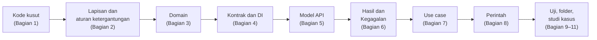

| Bagian | Pertanyaan yang dijawab |
| :--- | :--- |
| 1–2 | Apa salahnya menumpuk semua kode di satu widget, dan bagaimana *Clean Architecture* membaginya? |
| 3 | Di mana aturan bisnis seperti "maksimal 2 peminjaman" ditulis, dan bagaimana mengujinya? |
| 4–5 | Bagaimana menukar sumber data (palsu ⇄ server) tanpa menyentuh tampilan, dan di mana JSON diterjemahkan? |
| 6 | Bagaimana kegagalan dari internet sampai ke layar tanpa membuat tampilan ikut mengenal urusan HTTP? |
| 7–8 | Di mana logika yang memakai beberapa *repository* ditulis, dan bagaimana setiap tombol tahu statusnya sendiri? |
| 9–12 | Bagaimana menguji setiap lapisan, menata folder, merangkai semuanya, dan kapan semua ini justru berlebihan? |

**Kode contoh hari ini:**

| No. | Berkas | Isi | Internet |
| :---: | :--- | :--- | :---: |
| 01 | [`contoh_01_kode_kusut.dart`](kode/contoh_01_kode_kusut.dart) | Semua pekerjaan ditumpuk di satu widget (**jangan ditiru**) | ✔ |
| 02 | [`contoh_02_domain_dart_murni.dart`](kode/contoh_02_domain_dart_murni.dart) | Entitas, objek nilai, dan aturan bisnis dalam Dart murni | — |
| 03 | [`contoh_03_kontrak_dan_dependency_injection.dart`](kode/contoh_03_kontrak_dan_dependency_injection.dart) | Satu kontrak, dua implementasi, sumber data bisa ditukar | ✔ |
| 04 | [`contoh_04_model_api_dan_pemetaan.dart`](kode/contoh_04_model_api_dan_pemetaan.dart) | Model API ⇄ entitas, termasuk server versi 2 | — |
| 05 | [`contoh_05_hasil_dan_kegagalan.dart`](kode/contoh_05_hasil_dan_kegagalan.dart) | `Hasil<T>` dan `Kegagalan`, lima skenario server palsu | — |
| 06 | [`contoh_06_use_case_dan_data_palsu.dart`](kode/contoh_06_use_case_dan_data_palsu.dart) | *Use case* `AjukanPeminjaman` dan pengujiannya | — |
| 07 | [`contoh_07_perintah_command.dart`](kode/contoh_07_perintah_command.dart) | Perintah (*Command*): tombol yang tidak mengirim dua kali | — |
| 08 | [`contoh_08_studi_kasus_pinjam_ruang.dart`](kode/contoh_08_studi_kasus_pinjam_ruang.dart) | Studi kasus lengkap "Pinjam Ruang Kampus" | ✔ |

---

## 1. Mengapa Aplikasi Perlu Arsitektur?

### 1.1 Aplikasi yang terus tumbuh

Aplikasi jarang berhenti di versi pertama. Hari ini ia hanya menampilkan daftar ruang. Bulan depan ada formulir peminjaman, lalu aturan "maksimal dua peminjaman", lalu data dari server, lalu penyimpanan di perangkat agar tetap jalan tanpa internet. Jika setiap fitur baru langsung ditempel di tempat yang paling dekat (biasanya di dalam widget), kodenya tumbuh seperti kabel di bawah meja: awalnya hanya dua kabel, lama-lama tidak ada yang berani mencabut satu pun karena tidak tahu kabel mana tersambung ke mana.

**Arsitektur** adalah kesepakatan tentang tiga hal:

| Pertanyaan | Contoh di aplikasi peminjaman ruang |
| :--- | :--- |
| **Di mana** kode ini diletakkan? | Aturan "maksimal dua peminjaman" ditulis di mana: di tombol, di ViewModel, atau di tempat lain? |
| **Siapa boleh mengenal siapa?** | Bolehkah halaman daftar ruang tahu alamat server dan nama kolom JSON-nya? |
| **Bagaimana menguji** bagian ini? | Bisakah aturan peminjaman diuji tanpa membuka aplikasi dan menekan tombol? |

Sejak Pertemuan 9 Anda sudah memakai satu bentuk arsitektur: **MVVM** dengan *repository*. Hari ini kita merapikannya lebih jauh dengan gagasan dari ***Clean Architecture***.

### 1.2 Membedah kode kusut (Contoh 01)

[Contoh 01](kode/contoh_01_kode_kusut.dart) adalah aplikasi kecil "Pinjam Ruang" yang **berjalan dengan baik**. Masalahnya ada di dalam: seluruh pekerjaan ditumpuk di satu `State`.

```dart
Future<void> _ambilRuang() async {
  try {
    // MASALAH 1: alamat server dan urusan HTTP ditulis di widget.
    final http.Response respons = await http.get(
      Uri.parse(
        'https://raw.githubusercontent.com/antonprafanto/mobile2026/main/'
        'pertemuan_12_clean_architecture/data/ruang_kampus.json',
      ),
    );
    // MASALAH 2: JSON dibaca dengan "as" di sini.
    final Map<String, dynamic> json =
        jsonDecode(respons.body) as Map<String, dynamic>;
    // ...
  } catch (e) {
    // MASALAH 6: pesan teknis langsung diperlihatkan ke pengguna.
    _galat = 'Error: $e';
  }
}

// MASALAH 3: aturan bisnis ditulis di dalam penanganan tombol.
void _pinjam(Map<String, dynamic> ruang) {
  // MASALAH 4: jam diambil langsung dari DateTime.now().
  final DateTime besok = DateTime.now().add(const Duration(days: 1));
  final String pesan;
  if (besok.weekday > DateTime.friday) {
    pesan = 'Ditolak: ruang hanya bisa dipinjam Senin sampai Jumat.';
  } else if (_pinjamanSaya.length >= 2) {
    pesan = 'Ditolak: paling banyak 2 peminjaman.';
  } else {
    // ...
  }
}
```

Coba jalankan, lalu tekan **Pinjam** pada salah satu ruang. Gambar kiri diambil pada hari **Jumat**: "besok" jatuh pada hari Sabtu, sehingga peminjaman ditolak. Hari Senin, tombol yang sama menghasilkan "Berhasil". Gambar kanan memperlihatkan apa yang terjadi saat berkas JSON di server belum ada (server menjawab `404: Not Found`): kode mencoba membaca teks itu sebagai JSON, lalu pesan *exception*-nya ditampilkan apa adanya.

<p align="center">
  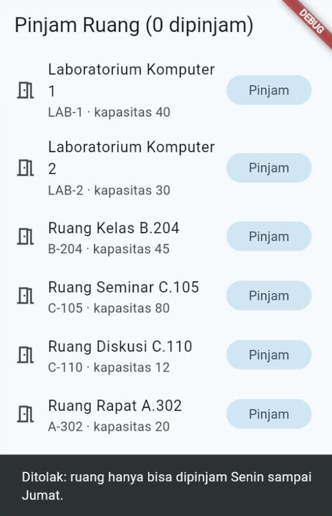
  &nbsp;
  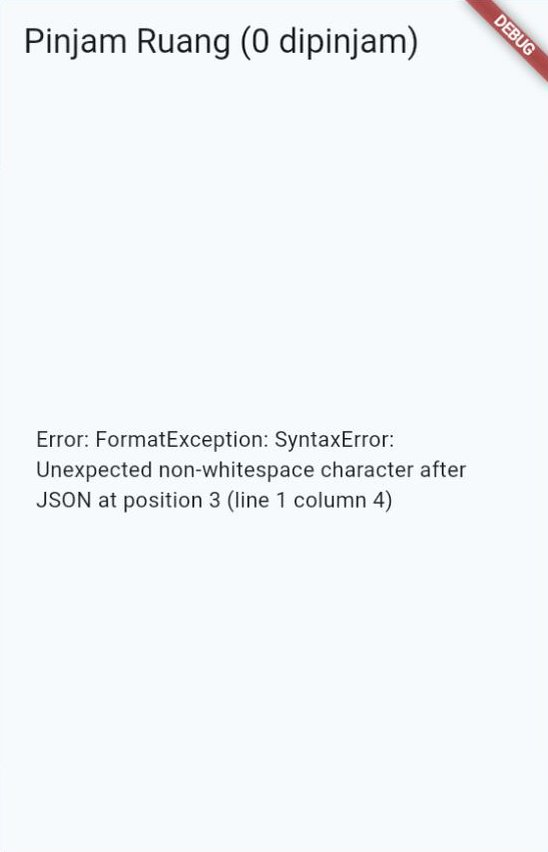
</p>

### 1.3 Enam masalah, enam jawaban

| Masalah di Contoh 01 | Akibatnya | Dirapikan di |
| :--- | :--- | :--- |
| **1.** Urusan HTTP dan alamat server ada di widget | Server pindah alamat = berkas tampilan ikut diubah | [Bagian 4](#4-kontrak-repository-dan-dependency-injection) (kontrak dan *repository*) |
| **2.** JSON dibaca dengan `as` di tengah tampilan | Server mengganti nama kolom = aplikasi gagal di tengah layar | [Bagian 5](#5-model-api-entitas-dan-pemetaan) (model API dan pemetaan) |
| **3.** Aturan bisnis di dalam penanganan tombol | Satu-satunya cara menguji aturan adalah menekan tombol | [Bagian 3](#3-lapisan-domain-entitas-dan-aturan-bisnis) dan [Bagian 7](#7-use-case-satu-tindakan-lengkap-dengan-aturannya) (domain dan *use case*) |
| **4.** Jam diambil dari `DateTime.now()` | Hasil berbeda setiap hari, jadi tidak bisa diuji dengan pasti | [Bagian 3.3](#33-waktu-sekarang-sebagai-parameter) (waktu disuntikkan) |
| **5.** Data disimpan di `State` halaman | Halaman lain tidak bisa memakainya, dan semuanya hilang saat halaman ditutup | [Bagian 4](#4-kontrak-repository-dan-dependency-injection) dan [Bagian 11](#11-studi-kasus-pinjam-ruang-kampus) (*repository* sebagai sumber kebenaran) |
| **6.** Pesan teknis ditampilkan ke pengguna | Pengguna membaca `FormatException: SyntaxError...` | [Bagian 6](#6-hasil-dan-kegagalan-galat-yang-menyeberangi-lapisan) (`Hasil` dan `Kegagalan`) |

Panduan arsitektur resmi Flutter menyebut beberapa sifat yang ingin dicapai. Tiga yang paling terasa untuk pemula:

| Sifat | Artinya | Ujinya |
| :--- | :--- | :--- |
| **Mudah dipahami** | Setiap bagian punya **satu** tugas (*separation of concerns*) | Teman satu tim bisa menebak di berkas mana aturan peminjaman ditulis |
| **Mudah diubah** | Mengganti satu bagian tidak merembet ke bagian lain | Server diganti, tetapi halaman tidak disentuh sama sekali |
| **Mudah diuji** | Setiap bagian bisa diperiksa sendiri-sendiri | Aturan "Sabtu ditolak" bisa diuji pada hari Senin |

---

## 2. *Clean Architecture* dalam Satu Gambar

### 2.1 Analogi rumah makan

Bayangkan sebuah rumah makan yang ramai.

| Di rumah makan | Tugasnya | Di aplikasi | Lapisan |
| :--- | :--- | :--- | :--- |
| **Pelayan** | Mencatat pesanan, mengantar makanan, memberi tahu jika menu habis | View dan ViewModel | **UI** |
| **Juru masak dan buku resep** | Memasak sesuai resep dan aturan dapur ("porsi pedas paling tinggi level 5") | Entitas, aturan bisnis, *use case* | **Domain** |
| **Gudang dan pemasok** | Menyediakan bahan, dari pasar mana pun | Layanan, model API, *repository* | **Data** |
| **Daftar belanja baku** | Daftar bahan yang dibutuhkan dapur, tanpa menyebut pasarnya | Kontrak (`abstract class`) | Domain (dipenuhi oleh lapisan data) |

Pelayan tidak masuk gudang. Juru masak tidak menelepon pemasok; ia cukup menulis daftar belanja. Jika pemasok sayur diganti, **resepnya tidak berubah**. Inilah inti *Clean Architecture*: bagian yang paling penting (resep atau aturan bisnis) dilindungi dari bagian yang paling sering berganti (pemasok, server, database, bahkan tampilan).

### 2.2 Lingkaran-lingkaran dan aturan ketergantungan

Pada 2012, Robert C. Martin ("Uncle Bob") menggambarkan *Clean Architecture* sebagai lingkaran-lingkaran. Semakin ke dalam, semakin penting dan semakin jarang berubah.

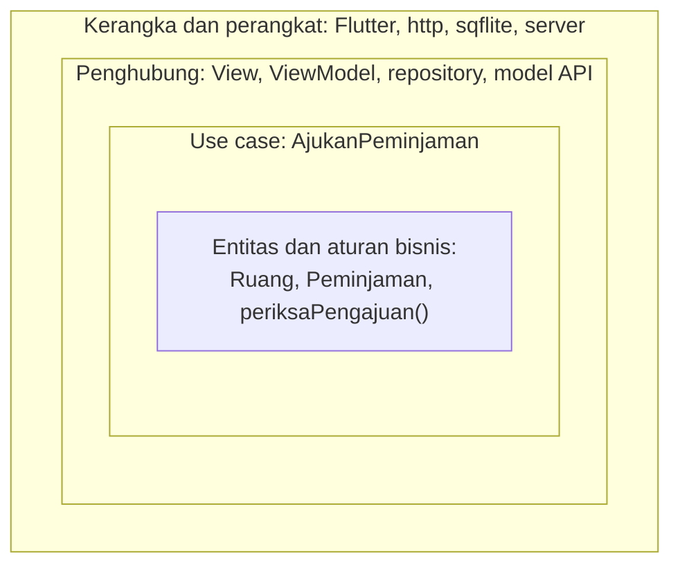

Lingkaran-lingkaran itu diikat oleh satu aturan, yaitu **aturan ketergantungan** (*Dependency Rule*):

> "Source code dependencies can only point inwards." — Robert C. Martin, *The Clean Architecture*

Artinya: kode di lingkaran dalam **tidak boleh menyebut** apa pun dari lingkaran luar. Berkas berisi `Ruang` dan `periksaPengajuan()` tidak boleh mengimpor `flutter`, `http`, `sqflite`, `provider`, atau *class* ViewModel. Sebaliknya, lingkaran luar boleh mengenal lingkaran dalam: ViewModel boleh memakai `Ruang`.

Mengapa arahnya ke dalam? Karena yang di luar paling sering berganti. Flutter merilis versi baru, server pindah, database diganti. Jika aturan bisnis bergantung pada hal-hal itu, setiap pergantian ikut merusak aturan bisnis.

### 2.3 Versi Flutter: tiga lapisan

Panduan arsitektur resmi Flutter merumuskan gagasan yang sama dalam tiga lapisan. Lapisan domain disebut **opsional**: dipakai jika aplikasinya membutuhkan.

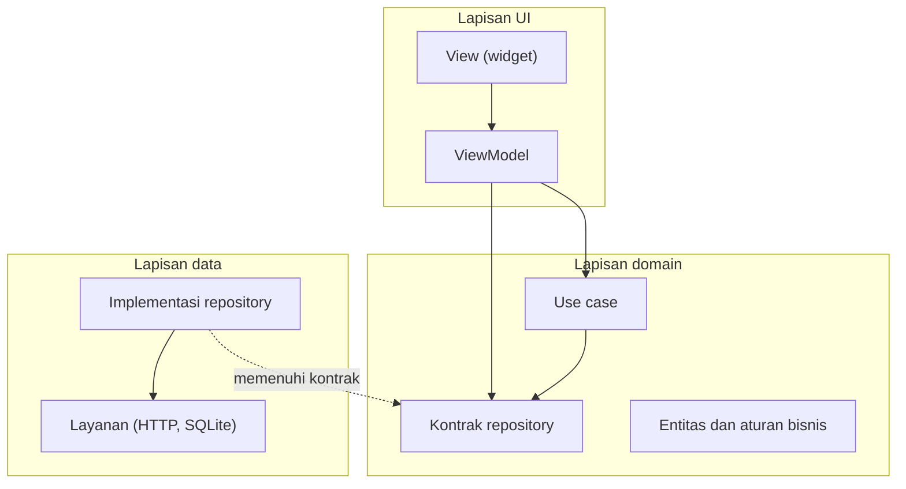

| Lapisan | Isinya | Contoh di "Pinjam Ruang Kampus" | Boleh mengimpor |
| :--- | :--- | :--- | :--- |
| **UI** | View (widget) dan ViewModel | `HalamanJadwalRuang`, `JadwalRuangViewModel` | Domain, Flutter, `provider` |
| **Domain** | Entitas, aturan bisnis, kontrak *repository*, *use case*, `Hasil` | `Ruang`, `periksaPengajuan()`, `RepositoriRuang`, `AjukanPeminjaman` | Hanya Dart dan domain itu sendiri |
| **Data** | Layanan, model API, implementasi *repository* | `LayananApiKampus`, `RuangApiModel`, `RepositoriRuangServer` | Domain, `http`, `sqflite`, `shared_preferences` |

Perhatikan arah panah pada gambar: UI menunjuk ke domain, dan data **juga** menunjuk ke domain. Tidak ada panah dari domain ke luar.

### 2.4 Membalik arah ketergantungan

Di Contoh 01, tampilan bergantung langsung pada `http`. Di Pertemuan 9–11 kita sudah memakai kontrak, tetapi kontrak itu disimpan di folder `data/`. Hari ini kontrak dipindahkan ke **domain**, dan arah panahnya pun berbalik:

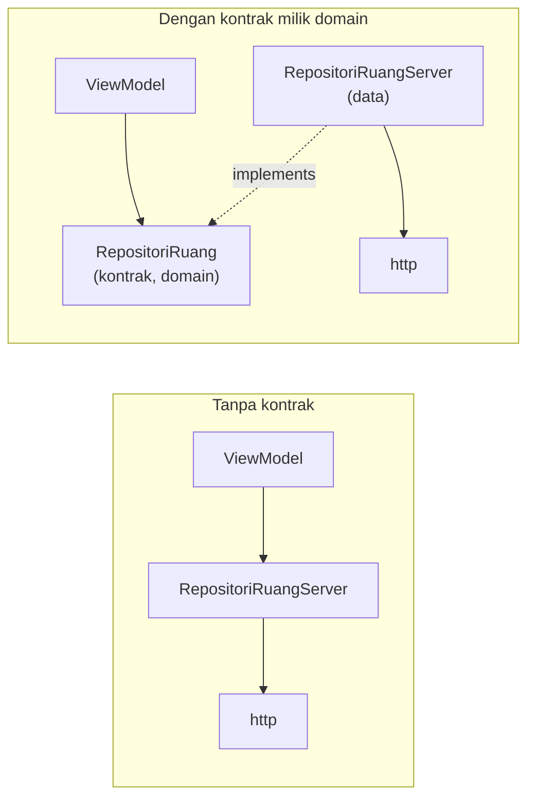

Gagasan ini disebut ***Dependency Inversion Principle*** (huruf **D** dalam prinsip SOLID): bagian penting tidak bergantung pada bagian teknis; keduanya bergantung pada **kontrak**. Bayangkan stop kontak di dinding rumah. Bentuknya ditentukan standar, bukan oleh merek setrika. Setrika merek apa pun bisa dipakai selama stekernya cocok. Rumah (domain) menentukan bentuk stop kontak (kontrak), dan peralatan (lapisan data) menyesuaikan diri.

### 2.5 Pedoman, bukan hukum

Panduan resmi Flutter berulang kali menegaskan bahwa rekomendasi arsitekturnya adalah **pedoman**, bukan aturan mati. Aplikasi kecil tidak perlu semua lapisan. Modul ini sengaja memperlihatkan versi **lengkap** agar Anda mengenal setiap bagiannya. [Bagian 12](#12-kapan-cukup-kapan-berlebihan) membahas kapan sebuah bagian layak dipakai, dan kapan justru membuat aplikasi kecil menjadi rumit.

---

## 3. Lapisan Domain: Entitas dan Aturan Bisnis

Lapisan domain adalah "buku resep" aplikasi. [Contoh 02](kode/contoh_02_domain_dart_murni.dart) menulis inti aplikasi peminjaman ruang **tanpa** Flutter, tanpa internet, dan tanpa database. Karena hanya memakai Dart, berkas ini bisa dijalankan sebagai program konsol.

### 3.1 Entitas dan objek nilai

**Entitas** (*entity*) adalah data yang penting bagi aplikasi, dengan nama milik kita sendiri. Setiap entitas punya jati diri: `Ruang` dikenali dari **kodenya**.

```dart
class Ruang {
  const Ruang({required this.kode, required this.nama, required this.kapasitas});

  final String kode;
  final String nama;
  final int kapasitas;
}
```

**Objek nilai** (*value object*) adalah data yang dikenali dari **isinya**. Dua rentang waktu yang jam mulai dan selesainya sama adalah rentang yang sama, walaupun dibuat terpisah.

```dart
class RentangWaktu {
  const RentangWaktu({required this.mulai, required this.selesai});

  final DateTime mulai;
  final DateTime selesai;

  Duration get durasi => selesai.difference(mulai);

  // Objek tidak diubah; yang dibuat adalah objek BARU.
  RentangWaktu geser(Duration selisih) {
    return RentangWaktu(
      mulai: mulai.add(selisih),
      selesai: selesai.add(selisih),
    );
  }

  bool bertumpukDengan(RentangWaktu lain) {
    return mulai.isBefore(lain.selesai) && lain.mulai.isBefore(selesai);
  }

  @override
  bool operator ==(Object other) {
    return other is RentangWaktu &&
        other.mulai == mulai &&
        other.selesai == selesai;
  }

  @override
  int get hashCode => Object.hash(mulai, selesai);
}
```

| Bagian | Penjelasan |
| :--- | :--- |
| Semua *field* `final` | Objeknya ***immutable*** (tidak bisa diubah setelah dibuat). Untuk "mengubah", buat objek baru, seperti `geser()`. Data yang tidak bisa diubah diam-diam jauh lebih mudah dilacak |
| `bertumpukDengan` | Dua rentang bertumpuk jika yang satu mulai **sebelum** yang lain selesai. 09.00–11.00 dan 11.00–13.00 **tidak** bertumpuk, karena bersambung |
| `operator ==` | Tanpa ini, Dart membandingkan **alamat memori**: dua objek terpisah selalu dianggap berbeda walaupun isinya sama |
| `hashCode` | Wajib ditulis bersama `==`, agar objek bekerja benar di `Set` dan sebagai kunci `Map`. `Object.hash` menggabungkan nilai-nilai *field* |

### 3.2 Aturan bisnis sebagai fungsi biasa

Aturan bisnis adalah kebijakan **kampus**, bukan urusan tampilan: jam buka, lama peminjaman, kapasitas. Di Contoh 02, semuanya dikumpulkan dalam satu fungsi yang mengembalikan **alasan penolakan**, atau `null` jika pengajuan wajar:

```dart
const int jamBuka = 7; // 07.00
const int jamTutup = 21; // 21.00
const Duration durasiMinimal = Duration(minutes: 30);
const Duration durasiMaksimal = Duration(hours: 3);

bool hariKerja(DateTime tanggal) => tanggal.weekday <= DateTime.friday;

// Mengembalikan alasan penolakan, atau null jika pengajuan wajar.
String? periksaPengajuan(
  PengajuanPeminjaman pengajuan, {
  required Ruang ruang,
  required DateTime sekarang,
}) {
  final RentangWaktu waktu = pengajuan.waktu;
  if (pengajuan.keperluan.trim().isEmpty) {
    return 'Keperluan wajib diisi.';
  }
  if (pengajuan.jumlahPeserta < 1) {
    return 'Jumlah peserta minimal 1 orang.';
  }
  if (pengajuan.jumlahPeserta > ruang.kapasitas) {
    return 'Peserta (${pengajuan.jumlahPeserta}) melebihi kapasitas '
        '${ruang.nama} (${ruang.kapasitas} orang).';
  }
  if (!waktu.selesai.isAfter(waktu.mulai)) {
    return 'Jam selesai harus setelah jam mulai.';
  }
  if (waktu.durasi < durasiMinimal || waktu.durasi > durasiMaksimal) {
    return 'Lama peminjaman harus 30 menit sampai 3 jam.';
  }
  if (!hariKerja(waktu.mulai)) {
    return 'Ruang hanya bisa dipinjam Senin sampai Jumat.';
  }
  // ... pemeriksaan jam buka (07.00) dan jam tutup (21.00) ...
  if (!waktu.mulai.isAfter(sekarang)) {
    return 'Waktu mulai sudah lewat. Pilih jam yang akan datang.';
  }
  return null;
}
```

| Aturan | Diperiksa dengan |
| :--- | :--- |
| Keperluan tidak boleh kosong | `keperluan.trim().isEmpty` (spasi saja dianggap kosong) |
| Peserta 1 orang sampai kapasitas ruang | `jumlahPeserta < 1` dan `> ruang.kapasitas` |
| Lama 30 menit sampai 3 jam | `waktu.durasi` dibandingkan dengan dua konstanta |
| Hanya Senin–Jumat, pukul 07.00–21.00 | `hariKerja()`, lalu jam mulai dan jam selesai |
| Tidak boleh di masa lalu | `waktu.mulai.isAfter(sekarang)` |

Angka-angka kebijakan (`jamBuka`, `durasiMaksimal`) ditulis sebagai **konstanta bernama**, bukan angka lepas di tengah kode. Jika kampus mengubah jam tutup menjadi 22.00, cukup satu baris yang diganti.

### 3.3 Waktu sekarang sebagai parameter

Perhatikan parameter `required DateTime sekarang`. Fungsi ini **tidak** memanggil `DateTime.now()` sendiri. Siapa pun yang memanggilnya wajib menyebutkan "sekarang itu kapan". Hasilnya:

- Di aplikasi, "sekarang" diisi jam sungguhan.
- Saat pengujian, "sekarang" diisi jam tetap, misalnya **Jumat, 16 Oktober 2026 pukul 10.00**. Hasil pemeriksaan selalu sama, dijalankan hari apa pun.

Inilah jawaban untuk MASALAH 4 di Contoh 01. Teknik ini adalah *dependency injection* dalam bentuk paling sederhana: sesuatu yang dibutuhkan (jam) **diberikan dari luar**, bukan diambil sendiri.

### 3.4 Menjalankan Contoh 02

Tempel [Contoh 02](kode/contoh_02_domain_dart_murni.dart) di DartPad lalu klik **Run**, atau jalankan `dart run contoh_02_domain_dart_murni.dart` di terminal. Hasilnya:

```text
=== 1. Entitas dan objek nilai ===
Senin pagi: 09.00-11.00, lama 120 menit
Digeser 2 jam: 11.00-13.00 (yang lama tetap 09.00-11.00)
Bertumpuk dengan 10.00-12.00? true
Bertumpuk dengan 11.00-13.00? false
Sama dengan rentang 09.00-11.00 yang lain? true

=== 2. Aturan bisnis ===
"Diskusi kelompok" 13.00-14.30 -> LOLOS
"Rapat angkatan" 13.00-14.00 -> Peserta (30) melebihi kapasitas Ruang Diskusi C.110 (12 orang).
"Belajar bersama" 09.00-10.00 -> Ruang hanya bisa dipinjam Senin sampai Jumat.
"Latihan presentasi" 20.00-22.00 -> Ruang hanya bisa dipinjam pukul 07.00 sampai 21.00.
"   " 09.00-10.00 -> Keperluan wajib diisi.

=== 3. Jam disuntikkan ===
Diperiksa 16/10 pukul 10.00 -> LOLOS
Diperiksa 19/10 pukul 14.00 -> Waktu mulai sudah lewat. Pilih jam yang akan datang.
```

Bagian 3 memeriksa pengajuan yang **sama** ("Diskusi kelompok", Senin 19 Oktober pukul 13.00) pada dua "waktu sekarang" berbeda. Diperiksa Jumat pagi, pengajuan lolos. Diperiksa Senin pukul 14.00, jamnya sudah lewat. Tidak perlu menunggu hari Senin untuk membuktikannya.

### 3.5 Ciri kode domain yang sehat

| Ciri | Cara memeriksanya |
| :--- | :--- |
| Tidak mengimpor `package:flutter`, `http`, `sqflite`, `shared_preferences`, atau `provider` | Lihat baris `import` di setiap berkas folder `domain/` |
| Bisa dijalankan dengan `dart run`, tanpa Flutter | Contoh 02 adalah buktinya |
| Memakai nama milik aplikasi (`kapasitas`), bukan nama dari server (`capacity`) | Nama kolom JSON hanya muncul di lapisan data ([Bagian 5](#5-model-api-entitas-dan-pemetaan)) |
| *Field* `final`; perubahan menghasilkan objek baru | Tidak ada *setter* atau *field* tanpa `final` |
| Tidak memanggil `DateTime.now()`, `Random()`, atau internet secara langsung | Semua yang berubah-ubah diterima sebagai parameter |

> [!TIP]
> Bagaimana jika entitas perlu ikon atau warna, misalnya ikon untuk setiap fasilitas? Jangan simpan `IconData` di entitas, karena itu milik Flutter. Simpan `enum Fasilitas` di domain, lalu tentukan ikonnya di lapisan UI, misalnya dengan fungsi `IconData ikonFasilitas(Fasilitas f)` di folder `ui/core/`.

---

## 4. Kontrak *Repository* dan *Dependency Injection*

### 4.1 Kontrak: janji tanpa cara

Di Pertemuan 9 Anda sudah membuat kontrak *repository* dengan `abstract class`. Kontrak hanya menyebut **apa** yang tersedia, bukan **dari mana** datanya:

```dart
// KONTRAK: hanya menyebut APA yang tersedia, bukan dari mana datangnya.
abstract class RepositoriRuang {
  Future<List<Ruang>> semuaRuang();
}
```

Yang baru hari ini adalah **letaknya**. Kontrak menyebut entitas `Ruang` dan dipakai oleh ViewModel maupun *use case*, jadi ia milik lapisan domain: `lib/domain/repositories/repositori_ruang.dart`. Lapisan data cukup "berjanji memenuhinya" lewat `implements`.

### 4.2 Satu kontrak, dua implementasi

[Contoh 03](kode/contoh_03_kontrak_dan_dependency_injection.dart) memiliki dua implementasi untuk kontrak yang sama.

```dart
// Data palsu: tiga ruang, dengan jeda setengah detik agar terasa seperti
// mengambil data dari jauh.
class RepositoriRuangMemori implements RepositoriRuang {
  static const List<Ruang> _data = [
    Ruang(kode: 'LAB-1', nama: 'Lab Komputer 1', gedung: 'B', kapasitas: 40),
    Ruang(kode: 'B-204', nama: 'Kelas B.204', gedung: 'B', kapasitas: 45),
    Ruang(kode: 'C-110', nama: 'Diskusi C.110', gedung: 'C', kapasitas: 12),
  ];

  @override
  Future<List<Ruang>> semuaRuang() async {
    await Future<void>.delayed(const Duration(milliseconds: 500));
    return _data;
  }
}

class RepositoriRuangServer implements RepositoriRuang {
  // Kebutuhan khusus implementasi ini (klien HTTP dan penghitung)
  // ikut disuntikkan dari luar. ViewModel tidak perlu tahu.
  RepositoriRuangServer({required this._klien, this.saatMeminta});

  final http.Client _klien;
  final void Function()? saatMeminta;
  List<Ruang>? _salinan;

  @override
  Future<List<Ruang>> semuaRuang() async {
    final List<Ruang>? salinan = _salinan;
    if (salinan != null) return salinan; // tanpa internet
    final http.Response respons = await _klien
        .get(alamat)
        .timeout(const Duration(seconds: 10));
    saatMeminta?.call();
    // ... memeriksa kode status dan membaca JSON menjadi List<Ruang> ...
    return _salinan = daftar;
  }
}
```

`RepositoriRuangServer` menyimpan **salinan** di memori setelah permintaan pertama. Panggilan berikutnya langsung mengembalikan salinan itu tanpa menghubungi internet. ViewModel tidak tahu-menahu soal salinan ini, dan memang tidak perlu tahu.

### 4.3 *Dependency injection*: bahan diantar, bukan dicari

ViewModel membutuhkan *repository*. Ada tiga cara ia bisa mendapatkannya:

| Cara | Contoh kode di ViewModel | Akibatnya |
| :--- | :--- | :--- |
| **Membuat sendiri** | `final _repo = RepositoriRuangServer(...);` | ViewModel terikat pada server; tidak bisa diuji tanpa internet ❌ |
| **Mengambil dari variabel global** | `final _repo = repositoriGlobal;` | Semua bagian aplikasi berbagi satu objek tersembunyi; sulit diganti saat pengujian ❌ |
| **Menerima dari luar** | `DaftarRuangViewModel({required this._repositori})` | ViewModel hanya mengenal kontrak; implementasi bisa ditukar ✅ |

Cara ketiga disebut ***dependency injection*** (DI): kebutuhan sebuah objek **disuntikkan** dari luar, biasanya lewat *constructor*. Juru masak tidak berangkat ke pasar; bahan diantar ke dapurnya.

```dart
class DaftarRuangViewModel extends ChangeNotifier {
  // Satu-satunya yang dikenal ViewModel: KONTRAK RepositoriRuang.
  DaftarRuangViewModel({required this._repositori});

  final RepositoriRuang _repositori;
  // ...
}
```

Parameter `required this._repositori` (bernama, berawalan garis bawah) mengisi *field* privat `_repositori`. Dari luar, parameternya ditulis **tanpa** garis bawah: `DaftarRuangViewModel(repositori: ...)`. Karena *field*-nya privat, View tidak bisa memanggil *repository* secara langsung lewat ViewModel.

### 4.4 Akar komposisi (*composition root*)

Jika tidak ada yang membuat implementasinya sendiri, lalu siapa yang membuat? Jawabannya: **satu tempat saja**, yang disebut **akar komposisi** (*composition root*). Di aplikasi biasa, tempat itu adalah `main()` dengan `MultiProvider`. Contoh 03 memakai sebuah widget agar sumbernya bisa ditukar saat aplikasi berjalan:

```dart
class _AkarKomposisiState extends State<AkarKomposisi> {
  final http.Client _klien = http.Client();
  // Bukan final: berubah setiap kali tombol "Data palsu"/"Server" diketuk.
  SumberData _sumber = SumberData.memori;
  int _permintaan = 0;

  // Setiap implementasi dibuat SEKALI lalu dipakai ulang, sehingga
  // salinan data milik versi server tidak hilang saat sumber ditukar.
  late final RepositoriRuang _memori = RepositoriRuangMemori();
  late final RepositoriRuang _server = RepositoriRuangServer(
    klien: _klien,
    saatMeminta: () => setState(() => _permintaan++),
  );

  RepositoriRuang get _repositori => switch (_sumber) {
    SumberData.memori => _memori,
    SumberData.server => _server,
  };

  // ... di dalam build():
  //   Provider<RepositoriRuang>.value(
  //     key: ValueKey(_sumber),
  //     value: _repositori,
  //     child: ChangeNotifierProvider(
  //       create: (BuildContext context) => DaftarRuangViewModel(
  //         repositori: context.read<RepositoriRuang>(),
  //       )..muat(),
  //       child: const TampilanDaftarRuang(),
  //     ),
  //   ),
}
```

| Bagian | Penjelasan |
| :--- | :--- |
| `Provider<RepositoriRuang>` | Jenis yang dititipkan ditulis sebagai **kontrak**, bukan implementasinya. `context.read<RepositoriRuang>()` hanya menemukan *provider* yang jenisnya persis `RepositoriRuang` |
| `Provider.value` | Dipakai untuk objek yang **sudah ada** (dibuat oleh `late final` di atas). Untuk objek yang dibuat di tempat, pakai `Provider(create: ...)` |
| `key: ValueKey(_sumber)` | Saat sumber berganti, *key*-nya berubah, sehingga Flutter membuang *provider* lama beserta ViewModel-nya dan membuat yang baru dengan *repository* yang lain |
| `late final` | *Field* baru dibuat saat pertama kali dipakai, dan boleh memakai *field* lain (`_klien`) serta `setState` |

### 4.5 Mencoba menukar sumber data

Jalankan Contoh 03. Mula-mula **Data palsu** terpilih: tiga ruang tampil setelah setengah detik, tanpa internet. Ketuk **Server**: tujuh ruang dari berkas JSON tampil, dan angka "Permintaan ke server" menjadi 1. Ketuk **Data palsu**, lalu **Server** lagi: daftarnya langsung tampil dan angkanya **tetap 1**, karena diambil dari salinan.

<p align="center">
  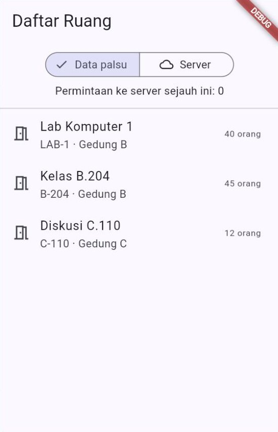
  &nbsp;
  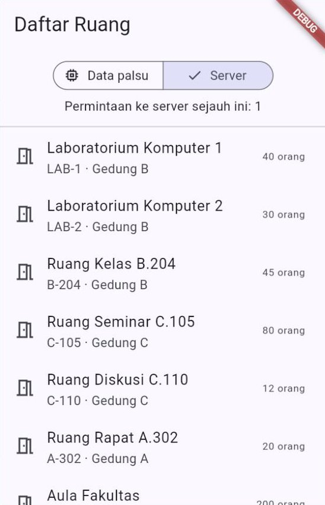
</p>

Yang patut diperhatikan: `DaftarRuangViewModel` dan `TampilanDaftarRuang` **tidak berubah sedikit pun** saat sumber ditukar. Hanya akar komposisi yang tahu bahwa ada dua sumber.

### 4.6 Memilih implementasi menurut lingkungan

Di aplikasi sungguhan, sumber data tidak ditukar dengan tombol, melainkan menurut **lingkungan** (*environment*):

| Lingkungan | Dipakai saat | Sumber data |
| :--- | :--- | :--- |
| **Pengembangan** (*development*) | Membuat tampilan baru, server belum siap, sedang tidak ada internet | Data palsu di memori |
| **Produksi** (*production*) | Aplikasi dipakai pengguna sungguhan | Server dan database sungguhan |

Studi kasus ([Bagian 11](#11-studi-kasus-pinjam-ruang-kampus)) merangkai semua *provider* dalam satu fungsi di `lib/config/dependensi.dart`:

```dart
enum Lingkungan { pengembangan, produksi }

List<SingleChildWidget> buatPenyedia(Lingkungan lingkungan) {
  return [
    Provider<Pengguna>.value(value: penggunaAktif),
    ...switch (lingkungan) {
      Lingkungan.pengembangan => [
        Provider<RepositoriRuang>(
          create: (BuildContext context) => RepositoriRuangMemori(),
        ),
      ],
      Lingkungan.produksi => [
        Provider<LayananApiKampus>(
          create: (BuildContext context) => LayananApiKampus(),
          dispose: (BuildContext context, LayananApiKampus layanan) =>
              layanan.tutup(),
        ),
        Provider<RepositoriRuang>(
          create: (BuildContext context) =>
              RepositoriRuangServer(layanan: context.read<LayananApiKampus>()),
        ),
      ],
    },
    // ... RepositoriPeminjaman dan use case AjukanPeminjaman ...
  ];
}
```

`...switch (...)` menyisipkan (*spread*) isi daftar yang dipilih ke dalam daftar utama. `SingleChildWidget` adalah jenis setiap *provider*; ia diimpor dari `package:provider/single_child_widget.dart`. Di proyek dengan banyak berkas, setiap lingkungan bisa punya **titik masuk** sendiri ([Bagian 10.3](#103-dua-titik-masuk-maindart-dan-main_pengembangandart)).

---

## 5. Model API, Entitas, dan Pemetaan

### 5.1 Dua bahasa yang berbeda

Server dan aplikasi sering "berbicara dalam bahasa yang berbeda". Berikut satu baris dari [`data/ruang_kampus.json`](data/ruang_kampus.json):

```json
{
  "room_code": "AULA",
  "room_name": "Aula Fakultas",
  "building": "A",
  "floor": 1,
  "capacity": 200,
  "facilities": ["projector", "air_conditioner", "sound_system", "stage"],
  "is_active": true
}
```

| Server | Aplikasi |
| :--- | :--- |
| Nama kolom berbahasa Inggris dengan garis bawah (`room_code`) | Nama milik aplikasi (`kode`) |
| Kode fasilitas berupa teks (`"air_conditioner"`) | `enum Fasilitas` dengan label yang ramah ("AC") |
| Kolom teknis `is_active` | Ruang yang tidak aktif cukup **tidak ditampilkan** |
| Fasilitas yang aplikasi belum kenal (`"stage"`) | Dilewati, tidak membuat aplikasi gagal |

Lapisan data bertugas sebagai **penerjemah**. [Contoh 04](kode/contoh_04_model_api_dan_pemetaan.dart) memperlihatkan penerjemahan itu dalam dua langkah.

### 5.2 Langkah 1: JSON menjadi model API

**Model API** (sering juga disebut *DTO*, *data transfer object*) adalah *class* yang bentuknya **mengikuti server**. Ia tinggal di lapisan data (`lib/data/models/`), bersama `fromJson`-nya:

```dart
class RuangApiModel {
  // ... constructor dan field: roomCode, roomName, building, floor,
  //     capacity, facilities, isActive ...

  factory RuangApiModel.fromJson(Object? json) {
    return switch (json) {
      {
        'room_code': final String roomCode,
        'room_name': final String roomName,
        'building': final String building,
        'floor': final int floor,
        'capacity': final int capacity,
        'facilities': final List<Object?> facilities,
        'is_active': final bool isActive,
      } =>
        RuangApiModel(
          roomCode: roomCode,
          roomName: roomName,
          building: building,
          floor: floor,
          capacity: capacity,
          facilities: facilities.whereType<String>().toList(),
          isActive: isActive,
        ),
      _ => throw const FormatException('Data ruang tidak sesuai'),
    };
  }
}
```

Pola *map* ini sudah Anda kenal dari [Pertemuan 10](../pertemuan_10_async_dan_rest_api/README.md): cabang pertama dipilih hanya jika **semua** kunci ada dan tipe nilainya cocok. Jika `capacity` berisi teks `"empat puluh"`, cabang `_` yang dipilih dan `FormatException` dilempar **di lapisan data**, bukan di tengah tampilan.

### 5.3 Langkah 2: model API menjadi entitas

```dart
const Map<String, Fasilitas> petaFasilitas = {
  'projector': Fasilitas.proyektor,
  'air_conditioner': Fasilitas.pendinginRuangan,
  'computer': Fasilitas.komputer,
  'whiteboard': Fasilitas.papanTulis,
  'sound_system': Fasilitas.pengerasSuara,
};

// Di dalam class RuangApiModel:
Ruang keDomain() {
  return Ruang(
    kode: roomCode,
    nama: roomName,
    gedung: 'Gedung $building',
    lantai: floor,
    kapasitas: capacity,
    fasilitas: [for (final String f in facilities) ?petaFasilitas[f]],
  );
}
```

| Bagian | Penjelasan |
| :--- | :--- |
| `keDomain()` | Mengubah model API menjadi entitas. Nama lain yang sering dipakai: `toDomain()` atau `toEntity()` |
| `petaFasilitas[f]` | Mencari padanan kode server. Hasilnya `null` jika kode itu tidak ada di peta, misalnya `"stage"` |
| `?petaFasilitas[f]` | Elemen *null-aware* (Dart 3.8): **masukkan ke daftar hanya jika tidak `null`**. Fasilitas yang belum dikenal dilewati dengan sendirinya |
| `'Gedung $building'` | Teks yang ditampilkan disusun di sini, sekali saja, bukan berulang di setiap widget |

Ruang yang tidak aktif disaring oleh *repository* (atau, di Contoh 04, oleh kode yang memanggil `keDomain()`):

```dart
final List<Ruang> daftar = [
  for (final RuangApiModel m in modelApi)
    if (m.isActive) m.keDomain(),
];
```

### 5.4 Saat server berganti versi

Suatu hari server merilis versi 2. Nama dan bentuk kolomnya berubah total:

```json
{"code": "LAB-1", "name": "Laboratorium Komputer 1",
 "location": {"building": "B", "floor": 2}, "seats": 40,
 "amenities": ["projector", "air_conditioner", "computer"],
 "status": "active"}
```

Yang perlu dibuat hanya **satu model API baru** (`RuangApiModelV2`) beserta `keDomain()`-nya. Entitas `Ruang`, aturan bisnis, ViewModel, dan semua widget **tidak berubah**. Bagian 3 keluaran Contoh 04 membuktikannya: entitas dari versi 1 dan versi 2 sama persis.

```text
=== 3. Server versi 2 mengganti nama kolom ===
LAB-1 | Laboratorium Komputer 1 | Gedung B, lantai 2 | 40 orang | Proyektor, AC, Komputer
Entitas dari versi 1 dan versi 2 sama: true
```

### 5.5 Arah sebaliknya: dari aplikasi ke server

Saat mengirim data (misalnya pengajuan peminjaman dengan `POST`), terjemahannya berbalik: entitas menjadi JSON milik server. Fungsinya juga tinggal di lapisan data:

```dart
Map<String, Object?> pengajuanKeJson(PengajuanPeminjaman p) {
  return {
    'room_code': p.kodeRuang,
    'purpose': p.keperluan,
    'participants': p.jumlahPeserta,
    'start_time': p.mulai.toIso8601String(),
    'end_time': p.selesai.toIso8601String(),
  };
}
```

Keluaran lengkap Contoh 04:

```text
=== 1. JSON server -> model API ===
Jumlah baris di JSON: 3
Model API pertama: room_code=LAB-1, building=B, facilities=[projector, air_conditioner, computer]

=== 2. Model API -> entitas domain ===
LAB-1 | Laboratorium Komputer 1 | Gedung B, lantai 2 | 40 orang | Proyektor, AC, Komputer
AULA | Aula Fakultas | Gedung A, lantai 1 | 200 orang | Proyektor, AC, Pengeras suara
STUDIO tidak aktif, jadi tidak ikut.
Fasilitas "stage" belum dikenal aplikasi, jadi dilewati.

=== 3. Server versi 2 mengganti nama kolom ===
LAB-1 | Laboratorium Komputer 1 | Gedung B, lantai 2 | 40 orang | Proyektor, AC, Komputer
Entitas dari versi 1 dan versi 2 sama: true

=== 4. Data aplikasi -> JSON untuk dikirim ===
{"room_code":"C-105","purpose":"Seminar Proposal","participants":60,"start_time":"2026-10-19T09:00:00.000","end_time":"2026-10-19T11:00:00.000"}

=== 5. Data rusak berhenti di lapisan data ===
Kapasitas berupa teks -> FormatException: Data ruang tidak sesuai
```

### 5.6 Jadi, `fromJson` diletakkan di mana?

Di [Pertemuan 10 Bagian 9.3](../pertemuan_10_async_dan_rest_api/README.md#93-repository-json-menjadi-model) kita menemukan dua cara: `fromJson` di *class* Model, atau pengubahan JSON di *repository*. Kini kita punya cara ketiga, model API terpisah. Ketiganya benar; yang membedakan adalah **ukuran dan kebutuhan** aplikasinya.

| Situasi | Pilihan yang disarankan |
| :--- | :--- |
| Aplikasi kecil, bentuk JSON hampir sama dengan kebutuhan tampilan, satu sumber data | `fromJson` di *class* Model. Paling sederhana (Pertemuan 10, Contoh 03 dan 04) |
| Model ingin bersih dari JSON, tetapi bentuk datanya sederhana | Fungsi pengubah di *repository*, seperti `_dariJson` (Pertemuan 10) dan `_dariBaris` (Pertemuan 11) |
| Nama kolom berbeda bahasa, ada kolom teknis, kode yang perlu diterjemahkan, atau server berganti versi | **Model API terpisah** + `keDomain()`. Entitas tetap bersih |
| Satu entitas datang dari dua sumber (server dan SQLite) | Satu entitas, dan **setiap sumber** punya pemetaannya sendiri |

Dalam *Clean Architecture* yang ketat, entitas **tidak pernah** berisi `fromJson` maupun `toJson`, karena JSON adalah urusan lapisan luar. Panduan resmi Flutter memasukkan pemisahan model API dan model domain ke kelompok rekomendasi **bersyarat**: sangat berguna untuk aplikasi besar, tetapi menambah kode untuk aplikasi kecil.

---

## 6. Hasil dan Kegagalan: Galat yang Menyeberangi Lapisan

### 6.1 Masalahnya: *exception* yang "bocor"

Di Pertemuan 10, ViewModel menangkap *exception* sendiri, lalu fungsi `pesanRamah` menerjemahkan `ClientException`, `TimeoutException`, dan `FormatException` menjadi kalimat. Cara itu berjalan, tetapi menyisakan dua masalah:

1. **Lapisan UI ikut mengenal urusan HTTP.** ViewModel dan berkas pesan harus mengimpor `package:http` hanya untuk mengenali `ClientException`. Jika *repository* diganti SQLite, daftar *exception*-nya ikut berubah, dan lapisan UI pun ikut diubah.
2. **Kegagalan tidak terlihat di tanda tangan fungsi.** `Future<List<Ruang>> semuaRuang()` tidak memberi tahu bahwa fungsi ini bisa gagal. Lupa satu `try`–`catch` saja, aplikasi menampilkan layar merah.

### 6.2 `Hasil<T>`: kotak berisi nilai atau kegagalan

Di [Pertemuan 3](../pertemuan_03_dart_lanjutan/README.md) (bagian pengayaan) Anda sudah berkenalan dengan `sealed class HasilMuat` beserta `Berhasil` dan `Gagal`. Hari ini kita memakai gagasan yang sama sebagai **jenis kembalian** *repository*:

```dart
// Hasil<T>: kotak berisi nilai bertipe T (Berhasil) ATAU kegagalan
// (Gagal). Karena sealed, switch wajib menangani keduanya.
sealed class Hasil<T> {
  const Hasil();
}

final class Berhasil<T> extends Hasil<T> {
  const Berhasil(this.nilai);

  final T nilai;
}

final class Gagal<T> extends Hasil<T> {
  const Gagal(this.kegagalan);

  final Kegagalan kegagalan;
}

abstract class RepositoriRuang {
  Future<Hasil<List<Ruang>>> semuaRuang();
}
```

Kini tanda tangan fungsinya **jujur**: `Future<Hasil<List<Ruang>>>` berkata "hasilnya bisa daftar ruang, bisa juga kegagalan". Bayangkan amplop hasil pemeriksaan laboratorium: isinya bisa "hasil normal" atau "catatan masalah", dan dokter wajib membuka serta membaca isinya. Tidak ada alarm yang tiba-tiba berbunyi di ruangan lain.

Panduan resmi Flutter menamai pola ini ***Result*** (`Ok` dan `Error`). Kita memakai nama Indonesia agar sejalan dengan Pertemuan 3: `Hasil`, `Berhasil`, `Gagal`.

### 6.3 Kegagalan milik aplikasi

Isi `Gagal` bukan `Exception` mentah, melainkan **kegagalan dalam bahasa aplikasi**:

```dart
// Bahasa kegagalan milik aplikasi, bebas dari istilah HTTP.
sealed class Kegagalan {
  const Kegagalan();
}

final class TanpaKoneksi extends Kegagalan {
  const TanpaKoneksi();
}

final class WaktuHabis extends Kegagalan {
  const WaktuHabis();
}

final class ServerBermasalah extends Kegagalan {
  const ServerBermasalah(this.kodeStatus);

  final int kodeStatus;
}

final class DataRusak extends Kegagalan {
  const DataRusak();
}
```

Studi kasus menambahkan satu jenis lagi, `AturanDilanggar(alasan)`, untuk pengajuan yang ditolak aturan bisnis ([Bagian 7](#7-use-case-satu-tindakan-lengkap-dengan-aturannya)).

| *Exception* teknis (lapisan data) | Menjadi `Kegagalan` (domain) | Kalimat untuk pengguna (UI) |
| :--- | :--- | :--- |
| `http.ClientException` | `TanpaKoneksi()` | Tidak dapat terhubung. Periksa koneksi internet Anda. |
| `TimeoutException` | `WaktuHabis()` | Server terlalu lama menjawab. Coba lagi sebentar lagi. |
| `ApiException(500)` | `ServerBermasalah(500)` | Server sedang bermasalah (kode 500). Coba lagi nanti. |
| `FormatException` | `DataRusak()` | Data dari server tidak bisa dibaca. |
| — (aturan bisnis) | `AturanDilanggar(alasan)` | Isi `alasan`, misalnya "Bentrok dengan ..." |

### 6.4 *Repository*: satu-satunya penerjemah

*Exception* teknis diterjemahkan **sekali**, di *repository*. Layanan tetap boleh melempar *exception* (seperti di Pertemuan 10), tetapi tidak ada satu pun yang lolos ke luar *repository*:

```dart
// Repository: SATU-SATUNYA tempat exception diterjemahkan.
class RepositoriRuangServer implements RepositoriRuang {
  RepositoriRuangServer({required this._layanan});

  final LayananApiKampus _layanan;

  @override
  Future<Hasil<List<Ruang>>> semuaRuang() async {
    try {
      final Object? json = await _layanan.ambilDataRuang();
      final List<Ruang> daftar = switch (json) {
        {'rooms': final List<Object?> rooms} => [
          for (final Object? baris in rooms) _bacaRuang(baris),
        ],
        _ => throw const FormatException('Kolom rooms tidak ditemukan'),
      };
      return Berhasil(daftar);
    } on TimeoutException {
      return const Gagal(WaktuHabis());
    } on http.ClientException {
      return const Gagal(TanpaKoneksi());
    } on ApiException catch (galat) {
      return Gagal(ServerBermasalah(galat.kodeStatus));
    } on FormatException {
      return const Gagal(DataRusak());
    }
  }
  // ... _bacaRuang(baris): satu baris JSON -> Ruang ...
}
```

| Bagian | Penjelasan |
| :--- | :--- |
| `on TimeoutException` | Menangkap **hanya** jenis itu. Urutan `on` menentukan cabang mana yang dicoba lebih dulu |
| `on ApiException catch (galat)` | Menangkap sekaligus menamai objeknya, agar `kodeStatus`-nya bisa dibawa |
| `const Gagal(WaktuHabis())` | Nilai yang tidak membawa data boleh `const`, sehingga tidak perlu membuat objek baru setiap kali |
| Tidak ada `catch (e)` umum | Disengaja. *Exception* lain berarti ada **bug** di kode kita (misalnya salah indeks), dan *bug* sebaiknya terlihat jelas selama pengembangan, bukan disembunyikan sebagai "gagal" |

### 6.5 ViewModel dan View membaca `Hasil`

ViewModel tidak lagi membutuhkan `try`–`catch`, dan tidak mengimpor `package:http`:

```dart
Future<void> muat() async {
  _memuat = true;
  notifyListeners();
  // Tidak ada try-catch: semua kemungkinan sudah ada di dalam Hasil.
  final Hasil<List<Ruang>> hasil = await _repositori.semuaRuang();
  if (_sudahDibuang) return;
  _hasil = hasil;
  _memuat = false;
  notifyListeners();
}
```

Kalimat untuk pengguna disusun di lapisan UI, di **satu** tempat:

```dart
// Satu tempat untuk kalimat yang dibaca pengguna. switch wajib lengkap.
String pesanKegagalan(Kegagalan kegagalan) {
  return switch (kegagalan) {
    TanpaKoneksi() => 'Tidak dapat terhubung. Periksa koneksi internet Anda.',
    WaktuHabis() => 'Server terlalu lama menjawab. Coba lagi sebentar lagi.',
    ServerBermasalah(:final int kodeStatus) =>
      'Server sedang bermasalah (kode $kodeStatus). Coba lagi nanti.',
    DataRusak() => 'Data dari server tidak bisa dibaca.',
  };
}
```

Mengapa kalimatnya tidak ditulis di domain? Karena susunan kata adalah urusan **tampilan**. Jika kelak aplikasi tersedia dalam bahasa Inggris, hanya lapisan UI yang berubah. Ada satu keuntungan lagi: jika suatu hari ditambahkan jenis kegagalan baru, misalnya `TidakBerwenang`, analyzer langsung menandai `switch` ini sebagai **tidak lengkap**. Anda tidak mungkin lupa menulis pesannya.

Di View, isi `Hasil` dibuka dengan `switch` pada pola objek:

```dart
...switch (hasil) {
  Berhasil(:final List<Ruang> nilai) => [
    for (final Ruang r in nilai)
      ListTile(title: Text(r.nama), subtitle: Text(r.kode)),
  ],
  Gagal(:final Kegagalan kegagalan) => [
    Text(pesanKegagalan(kegagalan)),
    FilledButton.icon(
      onPressed: vm.muat,
      icon: const Icon(Icons.refresh),
      label: const Text('Coba lagi'),
    ),
  ],
},
```

`Berhasil(:final List<Ruang> nilai)` dibaca: "jika `hasil` adalah `Berhasil`, ambil isi *field* `nilai`-nya dan beri nama `nilai`". Tanda titik dua di depan berarti nama variabelnya sama dengan nama *field*.

### 6.6 Mencoba lima skenario

[Contoh 05](kode/contoh_05_hasil_dan_kegagalan.dart) memakai `MockClient` (Pertemuan 10) sebagai server palsu, jadi tidak butuh internet. Pilih chip skenario di atas layar dan perhatikan kartu **"Yang diterima ViewModel"**:

| Skenario | Server palsu melakukan | ViewModel menerima |
| :--- | :--- | :--- |
| Normal | Menjawab JSON tiga ruang | `Berhasil(3 ruang)` |
| Lambat 5 detik | Baru menjawab setelah 5 detik (batas waktu 3 detik) | `Gagal(WaktuHabis())` |
| Server error | Menjawab kode 500 | `Gagal(ServerBermasalah(500))` |
| Bukan JSON | Menjawab halaman HTML | `Gagal(DataRusak())` |
| Tanpa koneksi | Melempar `ClientException` | `Gagal(TanpaKoneksi())` |

<p align="center">
  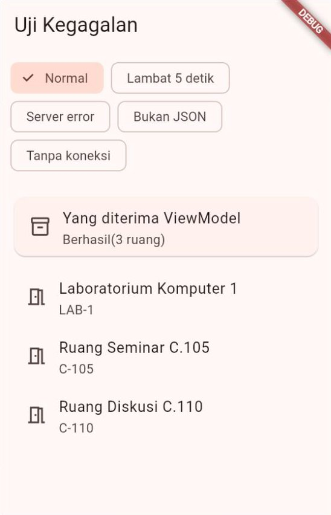
  &nbsp;
  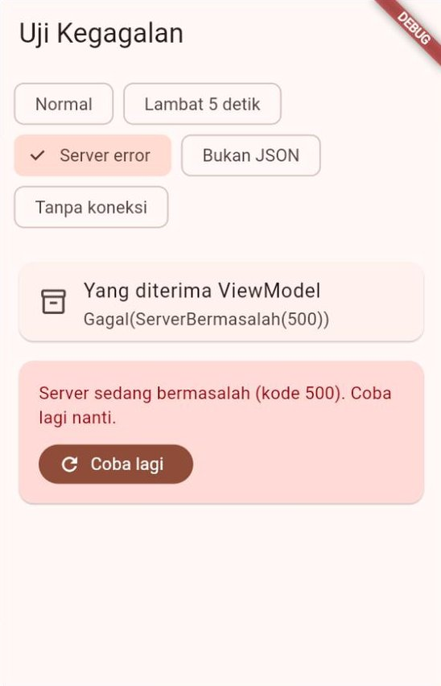
  &nbsp;
  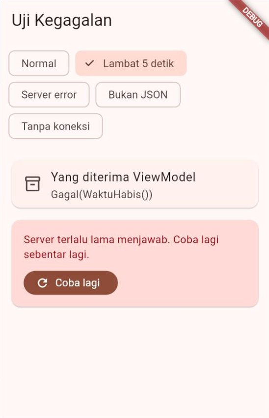
</p>

Alamat servernya, `api.kampus.example`, sengaja memakai akhiran `.example` yang memang dicadangkan untuk contoh dan tidak pernah menjadi situs sungguhan. Permintaannya tidak pernah meninggalkan aplikasi, karena dijawab oleh `MockClient`.

---

## 7. *Use Case*: Satu Tindakan, Lengkap dengan Aturannya

### 7.1 Kapan butuh *use case*?

Aturan di [Bagian 3](#3-lapisan-domain-entitas-dan-aturan-bisnis) cukup dilihat dari pengajuannya sendiri. Namun dua aturan lain membutuhkan data dari **luar** pengajuan:

- Ruang tidak boleh **bentrok** dengan peminjaman lain di ruang yang sama → butuh jadwal ruang dari `RepositoriPeminjaman`.
- Satu orang paling banyak punya **dua** peminjaman aktif → butuh daftar peminjaman orang itu.
- Dan untuk memeriksa kapasitas, butuh data ruang dari `RepositoriRuang`.

Logika seperti ini ditulis sebagai ***use case***: *class* kecil di lapisan domain yang mewakili **satu tindakan pengguna**, lengkap dengan aturannya. Panduan resmi Flutter menyebut tiga keadaan yang membuat *use case* layak dibuat:

| Keadaan | Di "Pinjam Ruang Kampus" |
| :--- | :--- |
| Logikanya **menggabungkan data dari beberapa *repository*** | Ruang (kapasitas) + peminjaman (jadwal dan kuota) ✔ |
| Logikanya **sangat rumit** | Lima langkah pemeriksaan berurutan ✔ |
| Logikanya **dipakai ulang** oleh beberapa ViewModel | Kelak tombol "ajukan cepat" di halaman lain bisa memakai *use case* yang sama |

Jika tidak satu pun terpenuhi, misalnya ViewModel hanya meneruskan `repositori.semuaRuang()`, *use case* tidak diperlukan ([Bagian 12](#12-kapan-cukup-kapan-berlebihan)).

### 7.2 `AjukanPeminjaman` langkah demi langkah

```dart
// USE CASE: satu tindakan pengguna, lengkap dengan aturannya. Ia
// menggabungkan dua repository dan jam saat ini.
class AjukanPeminjaman {
  // sekarang disuntikkan agar pengujian bisa memakai jam tetap.
  AjukanPeminjaman({
    required this._ruang,
    required this._peminjaman,
    DateTime Function()? sekarang,
  }) : _sekarang = sekarang ?? DateTime.now;

  static const int batasPeminjamanAktif = 2;

  final RepositoriRuang _ruang;
  final RepositoriPeminjaman _peminjaman;
  final DateTime Function() _sekarang;

  Future<Hasil<Peminjaman>> jalankan(
    PengajuanPeminjaman pengajuan,
    Pengguna peminjam,
  ) async {
    final DateTime sekarang = _sekarang();

    // 1. Data ruang dibutuhkan untuk memeriksa kapasitas.
    final Hasil<List<Ruang>> hasilRuang = await _ruang.semuaRuang();
    final List<Ruang> semuaRuang;
    switch (hasilRuang) {
      case Gagal():
        return Gagal(hasilRuang.kegagalan);
      case Berhasil():
        semuaRuang = hasilRuang.nilai;
    }
    final Ruang? ruang = semuaRuang
        .where((Ruang r) => r.kode == pengajuan.kodeRuang)
        .firstOrNull;
    if (ruang == null) {
      return const Gagal(AturanDilanggar('Ruang tidak ditemukan.'));
    }

    // 2. Aturan yang cukup dilihat dari pengajuannya sendiri.
    final String? masalah = periksaPengajuan(
      pengajuan,
      ruang: ruang,
      sekarang: sekarang,
    );
    if (masalah != null) {
      return Gagal(AturanDilanggar(masalah));
    }

    // 3. Tidak boleh bentrok dengan peminjaman lain di ruang yang sama.
    // 4. Satu orang paling banyak punya 2 peminjaman yang belum selesai.
    //    (bentuknya sama dengan langkah 1: switch pada Hasil, lalu periksa)

    // 5. Semua aturan terpenuhi: simpan.
    return _peminjaman.simpan(pengajuan, peminjam);
  }
}
```

| Bagian | Penjelasan |
| :--- | :--- |
| `DateTime Function()? sekarang` | Yang disuntikkan adalah **fungsi** penghasil jam, bukan satu nilai jam. Setiap kali `jalankan` dipanggil, jamnya dibaca ulang |
| `sekarang ?? DateTime.now` | Jika tidak diisi, pakai jam sungguhan. Perhatikan: `DateTime.now` **tanpa** tanda kurung adalah fungsinya, bukan hasilnya |
| `case Gagal(): return Gagal(hasilRuang.kegagalan);` | Di dalam `case Gagal()`, Dart tahu `hasilRuang` bertipe `Gagal`, sehingga `.kegagalan` boleh dipakai. Objek `Gagal` baru dibuat karena jenisnya berbeda: `Gagal<List<Ruang>>` diteruskan sebagai `Gagal<Peminjaman>` |
| `final List<Ruang> semuaRuang;` lalu diisi di `case Berhasil()` | Variabel `final` boleh diisi belakangan, asal pasti terisi tepat sekali di setiap jalur. Jalur `Gagal` sudah keluar dengan `return` |
| `.firstOrNull` | Elemen pertama yang cocok, atau `null` jika tidak ada (tidak melempar *exception* seperti `.first`) |
| Urutan langkah | Pemeriksaan yang murah (tanpa *repository*) didahulukan. `simpan` hanya dipanggil jika **semua** aturan lolos |

Langkah 3 dan 4 di berkas aslinya:

```dart
    switch (hasilRuangIni) {
      case Gagal():
        return Gagal(hasilRuangIni.kegagalan);
      case Berhasil():
        for (final Peminjaman lain in hasilRuangIni.nilai) {
          if (lain.waktu.bertumpukDengan(pengajuan.waktu)) {
            return Gagal(
              AturanDilanggar(
                'Bentrok dengan "${lain.keperluan}" '
                'pukul ${lain.waktu.teksJam}.',
              ),
            );
          }
        }
    }
    // ... langkah 4: hitung peminjaman yang selesainya setelah "sekarang";
    //     jika sudah 2, tolak dengan AturanDilanggar(...)
```

### 7.3 Mengapa tidak ditulis di ViewModel?

| Jika ditulis di ViewModel | Jika ditulis sebagai *use case* |
| :--- | :--- |
| ViewModel butuh dua *repository* + jam, dan ikut memuat semua aturan | ViewModel cukup memanggil `ajukanPeminjaman.jalankan(...)` |
| Halaman lain yang butuh aturan yang sama harus menyalin kodenya | Halaman lain cukup memakai *use case* yang sama |
| Menguji aturan berarti membuat ViewModel (yang memakai Flutter) | Diuji sebagai Dart murni dengan data palsu |

### 7.4 Menguji dengan data palsu

[Contoh 06](kode/contoh_06_use_case_dan_data_palsu.dart) menguji *use case* tanpa internet dan tanpa database. Kedua kontraknya dipenuhi oleh *class* palsu yang sangat sederhana:

```dart
class RepositoriRuangPalsu implements RepositoriRuang {
  bool putus = false; // true = pura-pura internet mati

  @override
  Future<Hasil<List<Ruang>>> semuaRuang() async {
    if (putus) return const Gagal(TanpaKoneksi());
    return const Berhasil([
      Ruang(kode: 'C-105', nama: 'Ruang Seminar C.105', kapasitas: 80),
      Ruang(kode: 'C-110', nama: 'Ruang Diskusi C.110', kapasitas: 12),
      Ruang(kode: 'LAB-1', nama: 'Laboratorium Komputer 1', kapasitas: 40),
    ]);
  }
}

class RepositoriPeminjamanPalsu implements RepositoriPeminjaman {
  RepositoriPeminjamanPalsu(this._data);

  final List<Peminjaman> _data;
  int jumlahSimpan = 0; // mata-mata (spy): berapa kali simpan dipanggil
  // ... milikRuang, milikPengguna, dan simpan bekerja pada _data ...
}
```

| Istilah | Artinya | Di Contoh 06 |
| :--- | :--- | :--- |
| **Data palsu** (*fake*) | Implementasi kontrak yang sungguh bekerja, tetapi sangat sederhana (data di memori) | `RepositoriRuangPalsu`, `RepositoriPeminjamanPalsu` |
| **Mata-mata** (*spy*) | Data palsu yang juga **mencatat** apa yang terjadi padanya | `jumlahSimpan` menghitung panggilan `simpan` |
| **Jam tetap** | Fungsi jam yang selalu menghasilkan waktu yang sama | `jumatPagi()` → Jumat, 16 Oktober 2026 pukul 10.00 |

Dengan mata-mata, kita bisa membuktikan sesuatu yang tidak terlihat di layar: pengajuan yang **ditolak** tidak pernah disimpan (`jumlahSimpan` tetap 0).

### 7.5 Hasil Contoh 06

```text
=== A. Budi mengajukan peminjaman (jam tetap: Jumat 16/10 10.00) ===
C-105 Senin 10.00-11.00 -> Ditolak: Bentrok dengan "Seminar Proposal Skripsi" pukul 09.00-11.00.
C-105 Senin 11.00-12.00 -> Berhasil: PJ-003 tersimpan
C-110 Senin 13.00-14.00, 20 orang -> Ditolak: Peserta (20) melebihi kapasitas Ruang Diskusi C.110 (12 orang).
LAB-1 Senin 08.00-09.00 -> Ditolak: Anda sudah punya 2 peminjaman aktif. Batalkan salah satu dulu.

=== B. Pengujian otomatis dengan data palsu ===
LULUS  Bentrok ditolak
LULUS  Pengajuan yang ditolak tidak disimpan
LULUS  Jam bersambung (11.00-12.00) diterima
LULUS  Disimpan tepat satu kali
LULUS  Internet mati -> Gagal(TanpaKoneksi), bukan exception
Ringkasan: 5 dari 5 uji lulus
```

Baris terakhir bagian A menarik: pengajuan LAB-1 itu sendiri wajar (jamnya bebas, kapasitas cukup), tetapi Budi sudah punya dua peminjaman aktif: satu dari data awal (PJ-002) dan satu yang baru saja berhasil (PJ-003). Aturan seperti ini hanya bisa diperiksa oleh *use case*, karena butuh data dari *repository*.

---

## 8. Perintah (*Command*): Status Milik Setiap Aksi

### 8.1 Masalah tombol yang diketuk berkali-kali

Server butuh waktu untuk menyimpan. Pengguna yang tidak sabar mengetuk tombol **Ajukan** tiga kali. Tanpa penjaga, tiga pengajuan terkirim, dan tiga peminjaman tercatat untuk satu niat. Masalah lain muncul saat satu halaman punya beberapa aksi: satu `bool memuat` untuk semuanya membuat lingkaran memuat berputar di tempat yang salah.

Panduan resmi Flutter menganjurkan pola ***Command***: setiap aksi ViewModel dibungkus objek yang menyimpan **statusnya sendiri**. Kita menamainya **Perintah**.

### 8.2 Isi *class* Perintah

```dart
abstract class Perintah<T> extends ChangeNotifier {
  bool _sedangBerjalan = false;
  Hasil<T>? _hasil;
  bool _sudahDibuang = false;

  bool get sedangBerjalan => _sedangBerjalan;

  // Hasil terakhir; null jika belum pernah dijalankan atau sudah dibaca.
  Hasil<T>? get hasil => _hasil;

  bool get gagal => _hasil is Gagal<T>;

  bool get berhasil => _hasil is Berhasil<T>;

  // Dipanggil View setelah menanggapi hasil (misalnya menampilkan
  // SnackBar), agar tanggapan itu tidak muncul berulang kali.
  void bersihkanHasil() {
    _hasil = null;
    _kabari();
  }

  Future<void> _jalankan(Future<Hasil<T>> Function() aksi) async {
    // Penjaga: selama aksi masih berjalan, ketukan berikutnya diabaikan.
    if (_sedangBerjalan) return;
    _sedangBerjalan = true;
    _hasil = null;
    _kabari();
    try {
      _hasil = await aksi();
    } finally {
      // finally: tetap dijalankan walaupun aksi melempar exception,
      // sehingga tombol tidak terkunci selamanya.
      _sedangBerjalan = false;
      _kabari();
    }
  }

  void _kabari() {
    if (!_sudahDibuang) notifyListeners();
  }

  @override
  void dispose() {
    _sudahDibuang = true;
    super.dispose();
  }
}
```

| Anggota | Gunanya |
| :--- | :--- |
| `sedangBerjalan` | `true` selama aksi berjalan. Dipakai untuk mematikan tombol dan memutar lingkaran kecil **di tombol itu saja** |
| `hasil` | `Hasil<T>` terakhir: `Berhasil`, `Gagal`, atau `null` |
| `berhasil`, `gagal` | Jalan pintas untuk memeriksa jenis hasil |
| `bersihkanHasil()` | Mengosongkan hasil setelah ditanggapi, agar `SnackBar` atau pesan tidak muncul lagi saat layar dibangun ulang |
| `if (_sedangBerjalan) return;` | **Penjaga**: ketukan kedua dan ketiga diabaikan |
| `try` … `finally` | Apa pun yang terjadi, status "sedang berjalan" pasti dikembalikan |
| `extends ChangeNotifier` | Perintah bisa didengarkan sendiri, terpisah dari ViewModel-nya |

### 8.3 `Perintah0` dan `Perintah1`

Aksi ada yang tanpa argumen (muat) dan ada yang membutuhkan satu argumen (ajukan *pengajuan*). Karena itu ada dua turunan kecil:

```dart
// Perintah tanpa argumen, misalnya "muat".
class Perintah0<T> extends Perintah<T> {
  Perintah0(this._aksi);

  final Future<Hasil<T>> Function() _aksi;

  Future<void> jalankan() => _jalankan(_aksi);
}

// Perintah dengan satu argumen A, misalnya "ajukan(keperluan)".
class Perintah1<T, A> extends Perintah<T> {
  Perintah1(this._aksi);

  final Future<Hasil<T>> Function(A) _aksi;

  Future<void> jalankan(A argumen) => _jalankan(() => _aksi(argumen));
}
```

`Perintah1<Peminjaman, PengajuanPeminjaman>` dibaca: perintah yang menerima `PengajuanPeminjaman` dan menghasilkan `Hasil<Peminjaman>`. Jika butuh dua argumen, bungkus keduanya dalam satu objek (atau *record*).

### 8.4 Memakai Perintah di ViewModel dan View

**ViewModel** membuat perintahnya di *constructor*:

```dart
class FormulirViewModel extends ChangeNotifier {
  FormulirViewModel({required this._repositori}) {
    ajukan = Perintah1<String, String>(_kirim);
  }

  final RepositoriPeminjaman _repositori;

  // late final: diisi sekali di constructor, karena _kirim butuh `this`.
  late final Perintah1<String, String> ajukan;

  Future<Hasil<String>> _kirim(String keperluan) {
    // ... menghitung permintaan, lalu memanggil repository ...
    return _repositori.ajukan(keperluan);
  }

  @override
  void dispose() {
    ajukan.dispose(); // perintah juga ChangeNotifier
    super.dispose();
  }
}
```

**View** memakai `ListenableBuilder` agar hanya tombolnya yang dibangun ulang saat status perintah berubah:

```dart
ListenableBuilder(
  listenable: vm.ajukan,
  builder: (BuildContext context, Widget? child) {
    final bool sibuk = vm.ajukan.sedangBerjalan;
    return FilledButton.icon(
      // onPressed null = tombol mati (abu-abu).
      onPressed: sibuk ? null : () => vm.ajukan.jalankan('Rapat B'),
      icon: sibuk
          ? const SizedBox.square(
              dimension: 18,
              child: CircularProgressIndicator(strokeWidth: 2),
            )
          : const Icon(Icons.send),
      label: Text(sibuk ? 'Menyimpan...' : 'Ajukan'),
    );
  },
),
```

Untuk tanggapan **sekali jalan** seperti `SnackBar`, View mendengarkan perintah dengan *listener*, menampilkan pesannya, lalu memanggil `bersihkanHasil()`:

```dart
void _saatAjukanBerubah() {
  final Hasil<String>? hasil = _vm.ajukan.hasil;
  if (hasil == null) return; // belum selesai, atau sudah ditanggapi
  _vm.ajukan.bersihkanHasil(); // tanggapi satu kali saja
  _tampilkan('B', hasil);
}
```

*Listener* dipasang di `initState` (`_vm.ajukan.addListener(_saatAjukanBerubah)`) dan **dilepas** di `dispose`. Jangan menampilkan `SnackBar` dari dalam `build()`: `build()` bisa dipanggil berkali-kali, sehingga pesannya ikut muncul berkali-kali.

### 8.5 Mencoba Contoh 07

[Contoh 07](kode/contoh_07_perintah_command.dart) punya dua kartu dengan aksi yang **sama** persis. Bedanya, kartu B dibungkus Perintah. Server palsunya butuh 2 detik untuk menyimpan. Ketuk setiap tombol tiga kali dengan cepat:

| | Kartu A (tanpa Perintah) | Kartu B (dengan Perintah) |
| :--- | :--- | :--- |
| Pengajuan terkirim | 3 | 1 |
| Tombol selama menyimpan | Tetap aktif, tanpa tanda apa pun | Abu-abu, bertuliskan "Menyimpan..." dengan lingkaran kecil |
| `SnackBar` | Tiga kali (PJ-001, PJ-002, PJ-003) | Sekali |

<p align="center">
  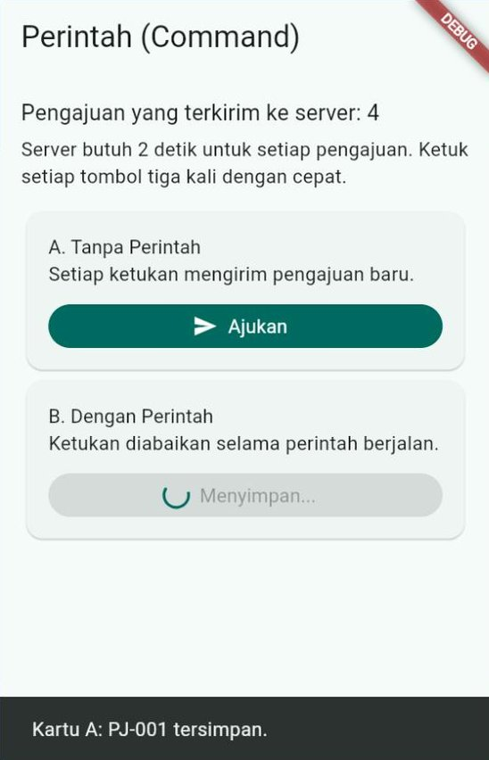
  &nbsp;
  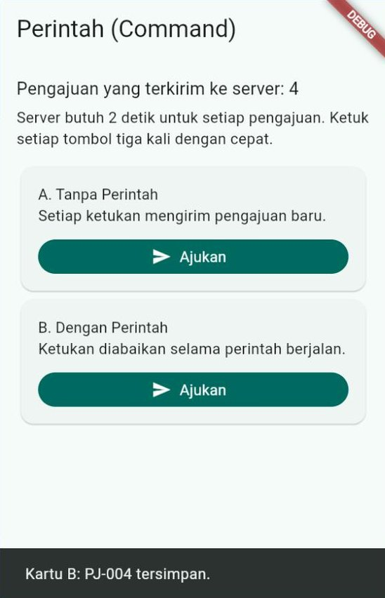
</p>

Angka 4 di gambar = tiga pengajuan dari kartu A + satu dari kartu B. Di aplikasi peminjaman sungguhan, kartu A berarti tiga ruang terpakai untuk satu rapat.

> [!NOTE]
> Tanda abu-abu pada tombol hanyalah bantuan untuk mata. Yang benar-benar mencegah pengiriman ganda adalah **penjaga** `if (_sedangBerjalan) return;`. Penjaga itu tetap bekerja walaupun ketukan kedua terjadi sebelum layar sempat digambar ulang.

---

## 9. Menguji Setiap Lapisan

### 9.1 Apa yang diuji di setiap lapisan

Keuntungan terbesar arsitektur berlapis terasa saat menguji: setiap lapisan bisa diperiksa **sendiri-sendiri**, dengan lapisan di sekitarnya diganti versi palsu.

| Yang diuji | Diganti dengan | Contoh pemeriksaan | Di modul ini |
| :--- | :--- | :--- | :--- |
| Entitas dan aturan bisnis | Tidak perlu apa pun (Dart murni) | "Sabtu ditolak", "09.00–11.00 dan 11.00–12.00 tidak bertumpuk" | Contoh 02 |
| *Use case* | *Repository* palsu + jam tetap | "Bentrok ditolak dan tidak disimpan" | Contoh 06 |
| *Repository* server | Server palsu (`MockClient`) | "Kode 500 menjadi `ServerBermasalah`", "panggilan kedua memakai salinan" | Studi kasus, `jalankanUji()` bagian 3 |
| ViewModel | *Repository* palsu | "Setelah mengajukan, jadwal dibaca ulang" | Studi kasus, `jalankanUji()` bagian 4 |
| View (widget) | ViewModel dengan data palsu | "Tombol Ajukan mati selama menyimpan" | Pertemuan 14 (*widget test*) |

### 9.2 Data palsu, bukan internet atau database asli

Pengujian yang memakai internet sungguhan **rapuh**: hasilnya berubah saat server sibuk, data diubah orang lain, atau Wi-Fi kampus sedang mati. Pengujian yang memakai database asli bisa merusak data pengguna. Karena semua lapisan hanya mengenal **kontrak**, keduanya bisa diganti dengan data palsu yang:

- **cepat**, karena semuanya di memori;
- **pasti**, karena isinya kita tentukan sendiri;
- bisa **pura-pura gagal** sesuai kebutuhan (`putus = true`, kode status 500).

### 9.3 Dari `jalankanUji()` ke folder `test/`

Agar bisa dijalankan di DartPad, contoh-contoh hari ini memeriksa dirinya sendiri dengan fungsi `periksa(...)` yang mencetak `LULUS` atau `GAGAL`. Di proyek sungguhan, pemeriksaan ditulis di folder `test/` dan dijalankan dengan `flutter test`. Pertemuan 14 membahasnya lengkap. Struktur folder yang dianjurkan panduan resmi Flutter:

```text
pinjam_ruang/
├── lib/                     ← kode aplikasi (Bagian 10)
├── test/                    ← pemeriksaan, susunan foldernya mencerminkan lib/
│   ├── domain/
│   │   ├── models/aturan_peminjaman_test.dart
│   │   └── use_cases/ajukan_peminjaman_test.dart
│   ├── data/repositories/repositori_ruang_server_test.dart
│   └── ui/jadwal_ruang/jadwal_ruang_view_model_test.dart
└── testing/
    └── fakes/               ← data palsu yang dipakai bersama oleh banyak test
        ├── repositori_ruang_palsu.dart
        └── repositori_peminjaman_palsu.dart
```

---

## 10. Menata Folder Proyek

### 10.1 Struktur lengkap

Studi kasus ditulis dalam satu berkas agar bisa dijalankan di DartPad. Setiap bagiannya diberi judul `BERKAS: lib/...` yang menunjukkan letaknya jika dipecah menjadi banyak berkas:

```text
pinjam_ruang/lib/
├── main.dart                               ← titik masuk: produksi
├── main_pengembangan.dart                  ← titik masuk: data palsu
├── config/
│   └── dependensi.dart                     ← akar komposisi: buatPenyedia()
├── domain/
│   ├── hasil.dart                          ← Hasil, Berhasil, Gagal, Kegagalan
│   ├── models/
│   │   ├── ruang.dart                      ← Ruang, Fasilitas
│   │   ├── pengguna.dart
│   │   ├── rentang_waktu.dart              ← objek nilai
│   │   ├── peminjaman.dart                 ← Peminjaman, PengajuanPeminjaman
│   │   └── aturan_peminjaman.dart          ← periksaPengajuan(), konstanta
│   ├── repositories/                       ← KONTRAK
│   │   ├── repositori_ruang.dart
│   │   └── repositori_peminjaman.dart
│   └── use_cases/
│       └── ajukan_peminjaman.dart
├── data/
│   ├── services/
│   │   └── layanan_api_kampus.dart         ← HTTP, ApiException
│   ├── models/
│   │   └── ruang_api_model.dart            ← bentuk JSON server + keDomain()
│   └── repositories/                       ← IMPLEMENTASI
│       ├── repositori_ruang_server.dart
│       ├── repositori_ruang_memori.dart
│       └── repositori_peminjaman_memori.dart
└── ui/
    ├── core/                               ← dipakai banyak fitur
    │   ├── aplikasi.dart                   ← MaterialApp, HalamanUtama
    │   ├── perintah.dart
    │   ├── pesan_kegagalan.dart
    │   ├── pesan_gagal.dart
    │   └── format_waktu.dart
    ├── daftar_ruang/
    │   ├── view_models/daftar_ruang_view_model.dart
    │   └── widgets/halaman_daftar_ruang.dart
    ├── jadwal_ruang/
    │   ├── view_models/jadwal_ruang_view_model.dart
    │   └── widgets/
    │       ├── halaman_jadwal_ruang.dart
    │       └── lembar_pengajuan.dart
    └── peminjaman_saya/
        ├── view_models/peminjaman_saya_view_model.dart
        └── widgets/halaman_peminjaman_saya.dart
```

| Folder | Isinya | Dikelompokkan menurut |
| :--- | :--- | :--- |
| `config/` | Akar komposisi: siapa memakai implementasi apa | — |
| `domain/models/` | Entitas, objek nilai, aturan bisnis | Jenis |
| `domain/repositories/` | Kontrak *repository* | Jenis |
| `domain/use_cases/` | Satu berkas per tindakan | Jenis |
| `data/services/` | Satu layanan per sumber data (server, database) | Jenis |
| `data/models/` | Model API (bentuk JSON server) | Jenis |
| `data/repositories/` | Implementasi kontrak | Jenis |
| `ui/core/` | Widget dan alat yang dipakai banyak fitur | — |
| `ui/<fitur>/` | ViewModel dan widget milik satu fitur | Fitur (halaman) |

### 10.2 Siapa boleh mengimpor siapa

Aturan ketergantungan bisa diperiksa hanya dengan membaca baris `import`:

| Berkas di folder | Boleh mengimpor | **Tidak** boleh mengimpor |
| :--- | :--- | :--- |
| `domain/` | Berkas `domain/` lain, pustaka Dart (`dart:async`, `dart:math`) | `package:flutter/...`, `provider`, `http`, `sqflite`, `shared_preferences`, apa pun dari `data/` dan `ui/` |
| `data/` | `domain/`, `http`, `sqflite`, `shared_preferences` | `ui/`, `package:flutter/material.dart` |
| `ui/` | `domain/`, Flutter, `provider` | Implementasi di `data/` (cukup kontraknya di `domain/`) |
| `config/`, `main*.dart` | Semuanya | — |

> [!TIP]
> Cara cepat memeriksa: di VS Code tekan `Ctrl` + `Shift` + `F`, ketik `package:flutter`, lalu isi kolom **files to include** dengan `lib/domain`. Jika hasilnya kosong, lapisan domain Anda bersih.

Pengecualian kecil yang lazim: lapisan data boleh mengimpor `package:flutter/foundation.dart` hanya untuk `debugPrint`. Namun jangan sampai `material.dart` masuk ke `data/` atau `domain/`.

### 10.3 Dua titik masuk: `main.dart` dan `main_pengembangan.dart`

Daripada mengganti satu baris setiap kali, proyek bisa punya dua berkas `main`:

```dart
// lib/main.dart: aplikasi sungguhan
void main() {
  runApp(
    MultiProvider(
      providers: buatPenyedia(Lingkungan.produksi),
      child: const AplikasiPinjamRuang(lingkungan: Lingkungan.produksi),
    ),
  );
}
```

```dart
// lib/main_pengembangan.dart: data palsu, pita "DATA PALSU" di pojok
void main() {
  runApp(
    MultiProvider(
      providers: buatPenyedia(Lingkungan.pengembangan),
      child: const AplikasiPinjamRuang(lingkungan: Lingkungan.pengembangan),
    ),
  );
}
```

Pilih titik masuknya dengan opsi `-t` (*target*):

```bash
flutter run -d chrome --web-port=8080                               # produksi
flutter run -d chrome --web-port=8080 -t lib/main_pengembangan.dart # data palsu
```

Studi kasus resmi Flutter (aplikasi "Compass") memakai cara yang sama dengan berkas `main_development.dart` dan `main_staging.dart`.

### 10.4 Pindah dari struktur Pertemuan 9

| Pertemuan 9–11 | Hari ini | Alasannya |
| :--- | :--- | :--- |
| Kontrak di `data/repositories/` | Kontrak di `domain/repositories/` | Aturan ketergantungan: domain tidak boleh bergantung pada data |
| *Repository* melempar *exception* | *Repository* mengembalikan `Hasil<T>` | Kegagalan terlihat di tanda tangan fungsi; UI bebas dari `http` |
| `fromJson` di Model atau di *repository* | Bisa di model API (`data/models/`) | Jika bentuk JSON berbeda jauh dari kebutuhan aplikasi |
| `MultiProvider` ditulis di `main.dart` | `buatPenyedia()` di `config/dependensi.dart` | Satu tempat untuk memilih implementasi menurut lingkungan |
| `bool memuat` di ViewModel | Perintah (`ui/core/perintah.dart`) | Setiap aksi punya status sendiri |
| — | `domain/use_cases/` (jika perlu) | Logika yang menggabungkan beberapa *repository* |

> [!NOTE]
> Studi kasus resmi Flutter menaruh kontrak *repository* di folder `data/repositories/`, bersebelahan dengan implementasinya, dan itu juga sah. Modul ini memindahkannya ke `domain/` karena mengikuti aturan ketergantungan *Clean Architecture* secara ketat. Yang terpenting adalah **konsisten** dalam satu proyek.

---

## 11. Studi Kasus: Pinjam Ruang Kampus

[Contoh 08](kode/contoh_08_studi_kasus_pinjam_ruang.dart) merangkai semua materi hari ini menjadi satu aplikasi peminjaman ruang kampus.

### 11.1 Fitur dan aturan

| Halaman | Fitur |
| :--- | :--- |
| **Ruang** | Daftar ruang aktif dari server, lengkap dengan gedung, lantai, fasilitas, dan kapasitas. Saringan kapasitas: Semua, ≥ 20, ≥ 40, ≥ 80 |
| **Jadwal ruang** | Pilihan lima hari kerja (hari ini jika hari kerja, lalu hari kerja berikutnya), jadwal yang sudah terisi, dan tombol **Ajukan peminjaman** |
| **Lembar pengajuan** | Keperluan, jumlah peserta, jam mulai (07.00–20.00), dan lama (1, 1½, 2, atau 3 jam). Penolakan tampil di kartu merah tanpa menutup lembar |
| **Peminjaman Saya** | Peminjaman milik pengguna aktif, jumlah yang masih aktif (dari batas 2), dan tombol batal |

Aturan bisnisnya: keperluan wajib diisi; peserta 1 sampai kapasitas ruang; lama 30 menit sampai 3 jam; Senin–Jumat pukul 07.00–21.00; tidak di masa lalu; tidak bentrok; paling banyak dua peminjaman aktif per orang.

### 11.2 Peta arsitektur

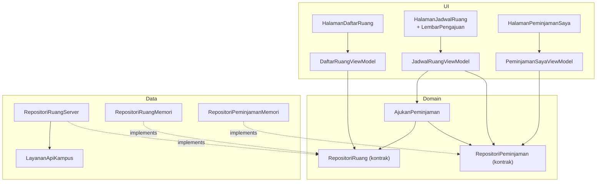

`JadwalRuangViewModel` memakai *use case* untuk **mengajukan** (karena butuh banyak aturan), tetapi membaca jadwal langsung dari `RepositoriPeminjaman` (karena hanya membaca, tanpa aturan). Mencampur keduanya seperti ini wajar.

### 11.3 Perjalanan satu ketukan "Ajukan"

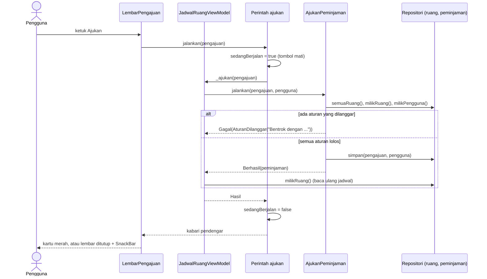

Perhatikan bahwa `LembarPengajuan` hanya **mengumpulkan isian**. Benar atau tidaknya pengajuan diputuskan domain. Setelah berhasil, ViewModel **membaca ulang** jadwal dari *repository* (sumber kebenaran), bukan menambahkan sendiri ke daftarnya, sehingga tampilan selalu sama dengan isi *repository*.

### 11.4 Dua lingkungan, satu baris

Di bagian atas Contoh 08:

```dart
// Satu-satunya baris yang perlu diubah untuk memakai data palsu:
// Lingkungan.pengembangan. Data ruang server diambil dari berkas
// data/ruang_kampus.json di repositori GitHub mata kuliah ini.
const Lingkungan lingkungan = Lingkungan.produksi;
```

Ganti menjadi `Lingkungan.pengembangan`, lalu jalankan lagi. Daftar ruang kini berasal dari `RepositoriRuangMemori` (tanpa internet), dan pita merah **DATA PALSU** tampil di pojok kanan atas agar tidak tertukar dengan data sungguhan. Tidak ada satu baris pun di domain maupun UI yang berubah.

```dart
// Di AplikasiPinjamRuang (lib/ui/core/aplikasi.dart)
builder: (BuildContext context, Widget? child) {
  if (lingkungan == Lingkungan.pengembangan) {
    return Banner(
      message: 'DATA PALSU',
      location: BannerLocation.topEnd,
      child: child!,
    );
  }
  return child!;
},
```

### 11.5 Pemeriksaan sebelum aplikasi tampil

Sebelum `runApp`, fungsi `jalankanUji()` memeriksa **23** hal dengan data palsu dan jam tetap (Rabu, 14 Oktober 2026 pukul 10.00), lalu mencetak hasilnya di konsol:

| Bagian | Yang diperiksa | Contoh |
| :--- | :--- | :--- |
| 1. Domain | Objek nilai dan aturan bisnis | `LULUS  Sabtu ditolak` |
| 2. *Use case* | Bentrok, jam bersambung, batas dua peminjaman, ruang yang tidak ada | `LULUS  Peminjaman ketiga yang masih aktif ditolak` |
| 3. *Repository* server | Pemetaan JSON, salinan memori, kode 500, bukan JSON, tanpa koneksi | `LULUS  Panggilan kedua memakai salinan memori` |
| 4. ViewModel | Pilihan tanggal, Perintah ajukan, jadwal dibaca ulang | `LULUS  Jadwal Kamis dibaca ulang setelah mengajukan` |

Jika semua baris berbunyi `LULUS`, lapisan-lapisannya bekerja benar, sebelum satu tombol pun diketuk.

### 11.6 Hasilnya

Tiga gambar pertama: daftar ruang, jadwal Ruang Seminar C.105 pada hari Senin, dan pengajuan yang ditolak karena bentrok.

<p align="center">
  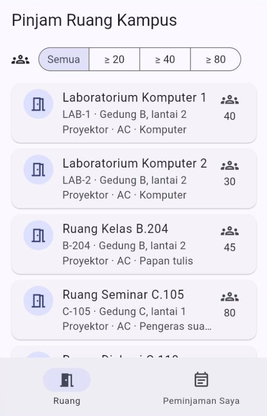
  &nbsp;
  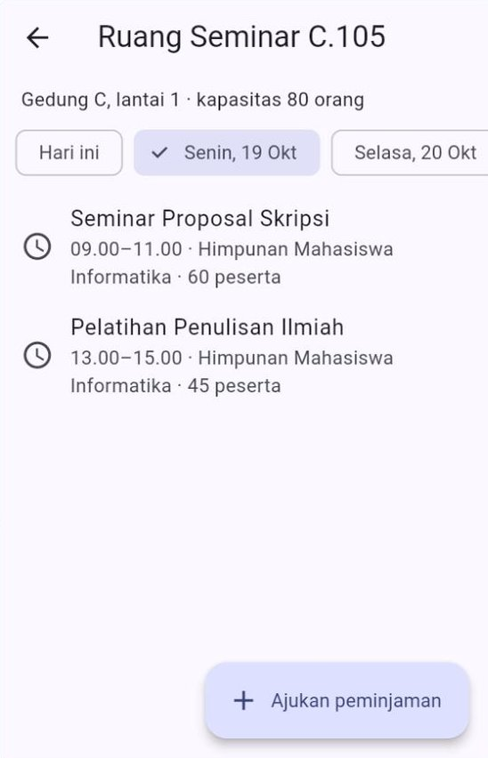
  &nbsp;
  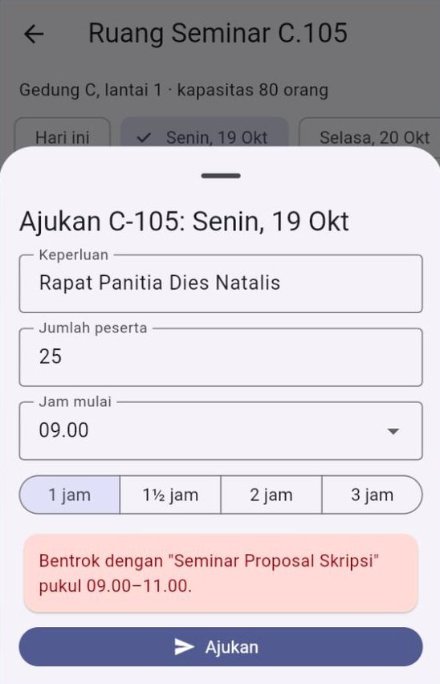
</p>

Tiga gambar berikutnya: jam diganti 11.00 dan pengajuan berhasil, halaman Peminjaman Saya, dan lingkungan pengembangan dengan saringan ≥ 40.

<p align="center">
  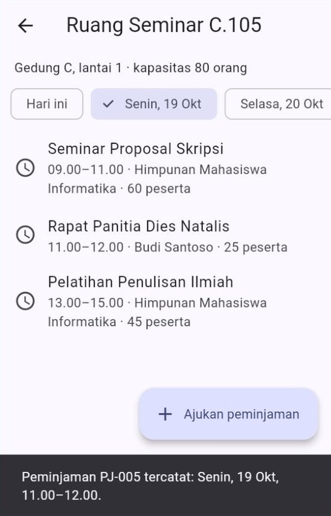
  &nbsp;
  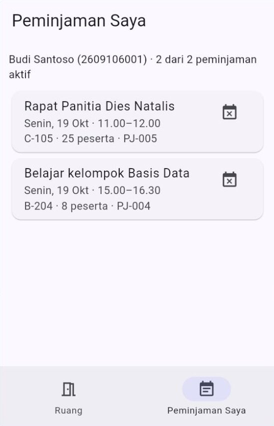
  &nbsp;
  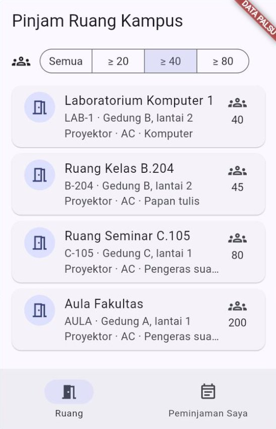
</p>

Karena Budi kini punya dua peminjaman aktif, pengajuan ketiga akan ditolak dengan pesan "Anda sudah punya 2 peminjaman aktif. Batalkan salah satu dulu." Batalkan satu di halaman **Peminjaman Saya**, lalu coba lagi.

### 11.7 Uji mandiri

Jawab dulu, lalu buka jawabannya.

> **1.** Kampus memutuskan ruang boleh dipinjam sampai pukul 22.00. Berkas mana saja yang perlu diubah?
>
> <details><summary>Lihat jawaban</summary>
>
> Hanya satu konstanta di `lib/domain/models/aturan_peminjaman.dart`: `jamTutup = 22`. Lembar pengajuan ikut menyesuaikan, karena pilihan jam mulainya dibuat dari `jamBuka` sampai `jamTutup`. Setelah itu, perbarui pemeriksaan "Pukul 20.00-22.00 ditolak" di `jalankanUji()`, karena aturannya memang sudah berubah.
> </details>

> **2.** Server ruang diganti dengan layanan baru yang kolomnya bernama `code`, `name`, dan `seats`. Lapisan mana yang berubah?
>
> <details><summary>Lihat jawaban</summary>
>
> Hanya lapisan data: model API baru (seperti `RuangApiModelV2` di Contoh 04) dan, jika alamatnya berbeda, `LayananApiKampus`. Entitas `Ruang`, *use case*, ViewModel, dan semua widget tidak berubah.
> </details>

> **3.** Seorang teman menaruh pemeriksaan "maksimal dua peminjaman aktif" di `onPressed` tombol **Ajukan**. Sebutkan dua kerugiannya.
>
> <details><summary>Lihat jawaban</summary>
>
> (1) Aturan itu hanya bisa diuji dengan menjalankan aplikasi dan menekan tombol. (2) Jika kelak ada cara lain untuk mengajukan (misalnya dari halaman lain), aturannya harus disalin, dan salinan yang terlupa menjadi celah. Tempat yang tepat adalah *use case* `AjukanPeminjaman`.
> </details>

> **4.** Mengapa `JadwalRuangViewModel` membaca ulang jadwal setelah pengajuan berhasil, alih-alih menambahkan `hasil.nilai` ke daftarnya sendiri?
>
> <details><summary>Lihat jawaban</summary>
>
> *Repository* adalah **sumber kebenaran**. Dengan membaca ulang, tampilan dijamin sama dengan isi *repository*, termasuk urutan jamnya dan perubahan lain yang mungkin terjadi di sana. Cara ini sama dengan "tulis, lalu baca ulang" di Pertemuan 11.
> </details>

---

## 12. Kapan Cukup, Kapan Berlebihan?

Arsitektur adalah alat, bukan tujuan. Setiap lapisan tambahan berarti berkas tambahan, nama tambahan, dan hal tambahan yang harus dipahami teman satu tim. Prinsip ***YAGNI*** (*You Aren't Gonna Need It*, "Anda tidak akan membutuhkannya") mengingatkan: jangan membangun sesuatu sebelum benar-benar dibutuhkan.

| Ukuran aplikasi | Yang cukup |
| :--- | :--- |
| Satu halaman, data tetap, untuk belajar atau percobaan | `StatefulWidget` dan `setState` (Pertemuan 5) |
| Beberapa halaman, satu sumber data | MVVM + *repository* (Pertemuan 9–11) |
| Data dari server **dan** perangkat, ada aturan bisnis, dikerjakan beberapa orang | Ditambah kontrak di domain, `Hasil`, akar komposisi, dan dua lingkungan |
| Aturan rumit yang memakai beberapa *repository*, dipakai ulang di beberapa halaman | Ditambah *use case* |

**Tanda-tanda berlebihan:**

| Tanda | Contohnya | Sebaiknya |
| :--- | :--- | :--- |
| *Use case* yang hanya meneruskan satu panggilan | `AmbilSemuaRuang` yang isinya hanya `return _repositori.semuaRuang();` | ViewModel langsung memakai *repository* |
| Model API yang sama persis dengan entitas | `RuangApiModel` dan `Ruang` punya *field* dan nama yang sama | `fromJson` di *repository* sudah cukup |
| Kontrak dengan satu implementasi yang tidak pernah diganti, bahkan untuk pengujian | — | Kontrak tetap berguna untuk pengujian. Jika tidak pernah diuji, pertimbangkan ulang |
| Folder kosong "untuk nanti" | `domain/use_cases/` tanpa isi | Buat folder saat berkas pertamanya dibutuhkan |

Untuk proyek akhir: **MVVM + *repository*** sudah memenuhi syarat. Tambahkan bagian dari hari ini yang benar-benar membantu, misalnya kontrak di domain, `Hasil`, dan `main_pengembangan.dart`, terutama jika tim Anda bekerja paralel: satu orang mengerjakan tampilan dengan data palsu, sementara yang lain menyambungkan server.

---

## 13. Kesalahan Umum Pemula dan Solusinya

| Gejala | Penyebab | Solusi |
| :--- | :--- | :--- |
| `ProviderNotFoundException: Could not find the correct Provider<RepositoriRuang>` | *Provider* dititipkan dengan jenis implementasinya, misalnya `Provider(create: (_) => RepositoriRuangServer(...))`, sehingga jenisnya `RepositoriRuangServer` | Tulis jenis kontraknya: `Provider<RepositoriRuang>(create: ...)` ([Bagian 4.4](#44-akar-komposisi-composition-root)) |
| Berkas di `domain/` mengimpor `package:flutter/material.dart` | Entitas menyimpan `Color`, `IconData`, atau `TextEditingController` | Simpan *enum* atau nilai sederhana di domain; ubah menjadi ikon atau warna di lapisan UI |
| `The method 'fromJson' isn't defined for the type 'Ruang'` | `fromJson` sudah dipindah ke model API, tetapi pemanggilnya belum diubah | `RuangApiModel.fromJson(json).keDomain()` |
| `The type 'Kegagalan' isn't exhaustively matched by the switch cases ...` | Ada jenis kegagalan baru yang belum punya cabang di `switch` | Tambahkan cabangnya (misalnya di `pesanKegagalan`). Galat ini justru melindungi Anda |
| Layar merah atau *exception* di konsol padahal *repository* sudah mengembalikan `Hasil` | Ada *exception* yang tidak ditangkap, atau dilempar di luar blok `try` | Pastikan semua kode yang bisa gagal berada di dalam `try`, dan setiap jenis *exception* punya `on ...` |
| Tombol tetap mengirim dua kali | `onPressed` memanggil metode privat ViewModel secara langsung, bukan lewat `perintah.jalankan(...)` | Selalu lewat Perintah; tombol membaca `sedangBerjalan` |
| `SnackBar` muncul berulang-ulang | `SnackBar` ditampilkan dari dalam `build()` berdasarkan `hasil` | Tampilkan dari *listener*, lalu panggil `bersihkanHasil()` ([Bagian 8.4](#84-memakai-perintah-di-viewmodel-dan-view)) |
| `A ... was used after being disposed` | Perintah atau ViewModel memanggil `notifyListeners()` setelah halaman ditutup | `dispose()` setiap Perintah di `dispose()` ViewModel, dan pakai penjaga `_sudahDibuang` |
| Pemeriksaan lulus hari ini, gagal besok | Aturan memakai `DateTime.now()` langsung | Suntikkan jam: parameter `sekarang` atau `DateTime Function()` ([Bagian 3.3](#33-waktu-sekarang-sebagai-parameter)) |
| Mengganti data palsu ke server harus mengubah banyak berkas | Implementasi dibuat di banyak tempat (di ViewModel, di halaman) | Satu akar komposisi: `buatPenyedia()` atau `main` |
| Banyak *use case* yang isinya hanya satu baris | Semua aksi dibuatkan *use case* | Pakai *use case* hanya untuk logika yang memenuhi syarat di [Bagian 7.1](#71-kapan-butuh-use-case) |

---

## 14. Laporan Kemajuan Proyek Akhir

Pertemuan ini adalah tahap **laporan kemajuan** proyek akhir ([Panduan Proyek Akhir, Bagian 3](../panduan/05_proyek_akhir.md#3-jadwal-dan-tahapan)). Yang dinilai adalah **fitur utama yang sudah berjalan dari ujung ke ujung**, bukan kelengkapan arsitektur.

**Daftar periksa sebelum demo:**

- [ ] Minimal tiga halaman sudah bisa dibuka dan berpindah dengan benar.
- [ ] Data dari API sudah tampil, lengkap dengan tampilan memuat dan gagal.
- [ ] Minimal satu data sudah tersimpan di perangkat.
- [ ] Struktur folder MVVM sudah dipakai; `flutter analyze` tanpa masalah.
- [ ] Setiap anggota sudah punya *commit* sendiri.

**Demo singkat (3–5 menit):**

1. Tunjukkan alur utama aplikasi dari awal sampai akhir.
2. Tunjukkan struktur folder `lib/` dan sebutkan lapisan setiap folder.
3. Tunjukkan satu aturan bisnis aplikasi Anda: di berkas mana ia ditulis, dan bagaimana memeriksanya.
4. Sebutkan rencana sampai Pertemuan 15, termasuk *unit test* yang akan dibuat.

**Menata ulang proyek secara aman.** Jika ingin menerapkan materi hari ini, lakukan bertahap. Jalankan `flutter analyze` dan aplikasinya setelah **setiap** langkah, lalu *commit*:

1. *Commit* dulu keadaan sekarang (`git commit -m "Sebelum ditata ulang"`).
2. Pindahkan kontrak *repository* ke `lib/domain/repositories/`, lalu perbaiki baris `import` yang ditandai merah.
3. Pisahkan model API **hanya** jika bentuk JSON-nya jauh berbeda dari kebutuhan aplikasi.
4. Ubah satu *repository* agar mengembalikan `Hasil<T>`, sesuaikan ViewModel-nya, lalu lanjutkan ke *repository* berikutnya.
5. Buat `lib/config/dependensi.dart` dan `lib/main_pengembangan.dart`, agar anggota tim bisa mengerjakan tampilan dengan data palsu.

Praktikum 5 [Jobsheet](JOBSHEET.md) melatih langkah-langkah ini pada proyek "Tugas Kuliahku".

---

## 15. Ringkasan

- **Arsitektur** menjawab tiga pertanyaan: di mana kode diletakkan, siapa boleh mengenal siapa, dan bagaimana menguji setiap bagian.
- ***Clean Architecture*** menyusun kode menjadi lingkaran. **Aturan ketergantungan**: ketergantungan kode hanya boleh mengarah **ke dalam**, ke bagian yang paling penting dan paling jarang berubah.
- Di Flutter: lapisan **UI** (View, ViewModel), **domain** (entitas, aturan bisnis, kontrak, *use case*, `Hasil`), dan **data** (layanan, model API, implementasi *repository*). Domain ditulis dalam **Dart murni**.
- **Kontrak** *repository* milik domain; implementasinya di lapisan data (*Dependency Inversion*). ViewModel menerima kontrak lewat *constructor* (***dependency injection***), dan implementasinya dipilih di **satu akar komposisi**, misalnya `buatPenyedia(lingkungan)`.
- **Model API** mengikuti bentuk server; **entitas** mengikuti kebutuhan aplikasi; `keDomain()` menerjemahkan di antara keduanya. Server berganti versi = cukup model API baru.
- ***Repository*** menerjemahkan *exception* teknis **sekali** menjadi **`Hasil<T>`** (`Berhasil` atau `Gagal`) berisi **`Kegagalan`** milik aplikasi. Kalimat untuk pengguna disusun di lapisan UI.
- ***Use case*** dipakai untuk logika yang menggabungkan beberapa *repository*, rumit, atau dipakai ulang. Kebutuhan yang berubah-ubah, seperti jam, **disuntikkan**.
- **Perintah** (*Command*) memberi setiap aksi status sendiri (`sedangBerjalan`, `hasil`), mencegah eksekusi ganda, dan membantu tanggapan sekali jalan (`bersihkanHasil()`).
- Setiap lapisan diuji sendiri dengan **data palsu**: domain tanpa apa pun, *use case* dengan *repository* palsu dan jam tetap, *repository* dengan `MockClient`, ViewModel dengan *repository* palsu.
- Arsitektur adalah alat: tambahkan lapisan **saat dibutuhkan** (YAGNI).

**Memilih alat yang tepat:**

| Kebutuhan | Pakai |
| :--- | :--- |
| Aturan bisnis yang bisa diuji tanpa layar | Fungsi dan entitas Dart murni di `domain/` |
| Sumber data yang bisa ditukar (palsu ⇄ server ⇄ SQLite) | Kontrak di `domain/repositories/` + implementasi di `data/repositories/` |
| Memilih implementasi menurut lingkungan | Akar komposisi (`config/dependensi.dart`) + `main_pengembangan.dart` |
| JSON yang bentuknya jauh berbeda dari kebutuhan aplikasi | Model API (`data/models/`) + `keDomain()` |
| Kegagalan yang tidak boleh lupa ditangani | `Hasil<T>` dan `sealed class Kegagalan` |
| Logika yang memakai beberapa *repository* | *Use case* (`domain/use_cases/`) |
| Tombol yang tidak boleh mengirim dua kali dan butuh status sendiri | Perintah (`ui/core/perintah.dart`) |

---

## 16. Glosarium

| Istilah | Arti |
| :--- | :--- |
| **Arsitektur aplikasi** | Kesepakatan tentang letak setiap bagian kode, hubungan antarbagian, dan cara mengujinya |
| ***Clean Architecture*** | Gaya arsitektur dari Robert C. Martin yang menyusun kode menjadi lingkaran, dengan aturan bisnis di tengah |
| **Lapisan** (*layer*) | Kelompok kode dengan satu tanggung jawab besar: UI, domain, atau data |
| **Aturan ketergantungan** (*Dependency Rule*) | Kode di lingkaran dalam tidak boleh menyebut apa pun dari lingkaran luar |
| ***Dependency Inversion*** | Bagian penting dan bagian teknis sama-sama bergantung pada kontrak, bukan satu pada yang lain |
| **Domain** | Inti aplikasi: entitas, aturan bisnis, kontrak, *use case* |
| **Entitas** (*entity*) | Data penting milik aplikasi yang punya jati diri, misalnya `Ruang` dengan kodenya |
| **Objek nilai** (*value object*) | Data yang dikenali dari isinya, misalnya `RentangWaktu`; dua objek dengan isi sama dianggap sama |
| ***Immutable*** | Tidak bisa diubah setelah dibuat; perubahan menghasilkan objek baru |
| **Aturan bisnis** | Kebijakan dunia nyata yang diterapkan aplikasi, misalnya "Senin–Jumat pukul 07.00–21.00" |
| **Kontrak** | `abstract class` yang menyebut apa yang tersedia tanpa menyebut caranya |
| ***Dependency injection*** (DI) | Memberikan kebutuhan sebuah objek dari luar, biasanya lewat *constructor* |
| **Akar komposisi** (*composition root*) | Satu-satunya tempat yang membuat implementasi dan merangkai semua objek |
| **Lingkungan** (*environment*) | Konfigurasi aplikasi untuk keadaan tertentu: pengembangan (data palsu) atau produksi (data sungguhan) |
| **Model API** (DTO) | *Class* yang bentuknya mengikuti JSON server, tinggal di lapisan data |
| **Pemetaan** (*mapping*) | Menerjemahkan data dari satu bentuk ke bentuk lain, misalnya `keDomain()` |
| **`Hasil<T>`** | Kotak berisi nilai (`Berhasil`) atau kegagalan (`Gagal`); disebut pola *Result* |
| **`Kegagalan`** | Jenis-jenis kegagalan dalam bahasa aplikasi: `TanpaKoneksi`, `WaktuHabis`, dan seterusnya |
| ***Use case*** | *Class* domain untuk satu tindakan pengguna beserta aturannya |
| **Perintah** (*Command*) | Objek yang membungkus satu aksi ViewModel beserta statusnya |
| **Data palsu** (*fake*) | Implementasi kontrak yang sederhana untuk pengembangan dan pengujian |
| **Mata-mata** (*spy*) | Data palsu yang juga mencatat bagaimana ia dipakai |
| **Sumber kebenaran** (*source of truth*) | Tempat yang isinya dianggap paling benar; tampilan mengikutinya |
| **YAGNI** | *You Aren't Gonna Need It*: jangan membangun sesuatu sebelum benar-benar dibutuhkan |

---

## 17. Referensi

1. Flutter. *Guide to app architecture*. <https://docs.flutter.dev/app-architecture/guide>
2. Flutter. *Architecture recommendations and resources*. <https://docs.flutter.dev/app-architecture/recommendations>
3. Flutter. *Common architecture concepts*. <https://docs.flutter.dev/app-architecture/concepts>
4. Flutter. *Architecture case study* (aplikasi Compass). <https://docs.flutter.dev/app-architecture/case-study>
5. Flutter. *Error handling with Result objects*. <https://docs.flutter.dev/app-architecture/design-patterns/result>
6. Flutter. *The command pattern*. <https://docs.flutter.dev/app-architecture/design-patterns/command>
7. Robert C. Martin. *The Clean Architecture* (2012). <https://blog.cleancoder.com/uncle-bob/2012/08/13/the-clean-architecture.html>
8. Dart. *Class modifiers: sealed*. <https://dart.dev/language/class-modifiers#sealed>
9. Dart. *Patterns*. <https://dart.dev/language/patterns>
10. pub.dev. *provider*. <https://pub.dev/packages/provider>
11. Martin Fowler. *Inversion of Control Containers and the Dependency Injection pattern*. <https://martinfowler.com/articles/injection.html>
12. Martin Fowler. *Test Double*. <https://martinfowler.com/bliki/TestDouble.html>
13. IETF. *RFC 2606: Reserved Top Level DNS Names* (`.example`). <https://www.rfc-editor.org/rfc/rfc2606>

---

## ➡️ Langkah Berikutnya

1. Kerjakan [🧪 Jobsheet Pertemuan 12](JOBSHEET.md) di laboratorium.
2. Kerjakan [✍️ Latihan Pertemuan 12](LATIHAN.md) untuk menguji pemahaman Anda.
3. **Proyek akhir:** siapkan demo laporan kemajuan ([Bagian 14](#14-laporan-kemajuan-proyek-akhir)) dan lihat [🚀 Panduan Proyek Akhir](../panduan/05_proyek_akhir.md).
4. Pertemuan 13 membahas **fitur perangkat dan izin akses** (kamera, galeri, lokasi). Dengan arsitektur hari ini, kamera dan GPS hanyalah sumber data baru: cukup dibungkus layanan dan *repository*, sementara ViewModel dan aturan bisnis tetap seperti biasa.

[⬆️ Kembali ke atas](#pertemuan-12--arsitektur-aplikasi-clean-architecture)
