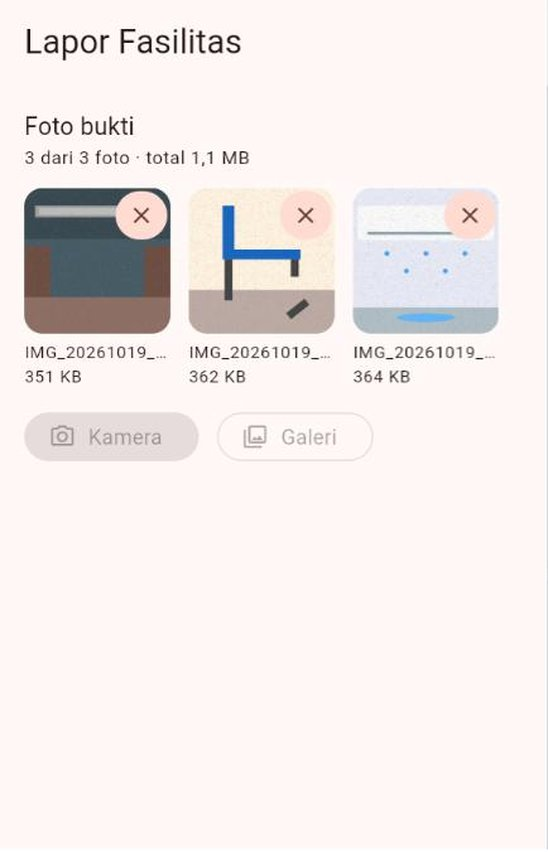
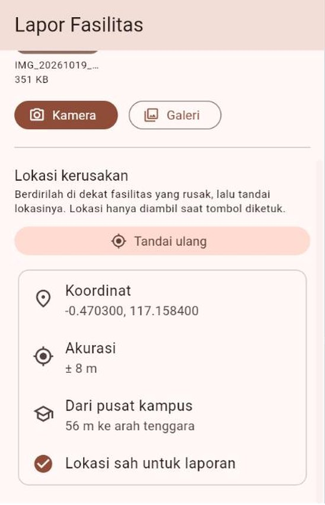
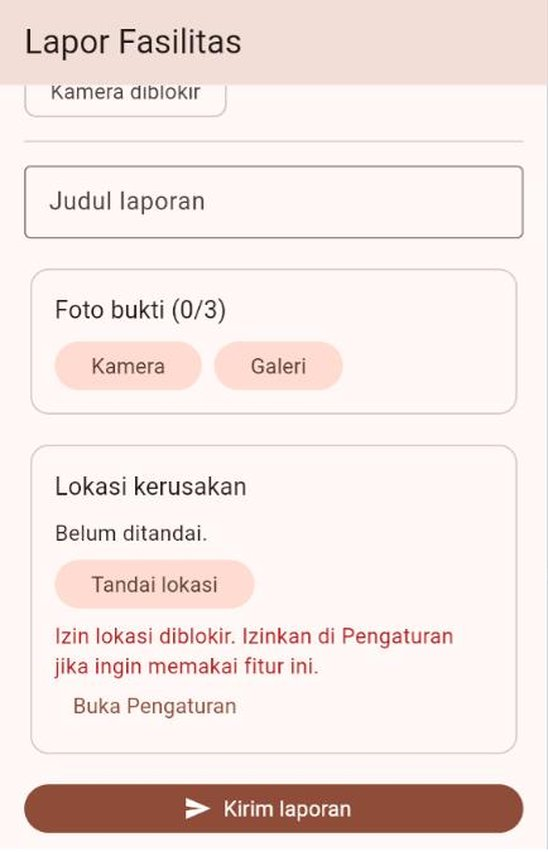
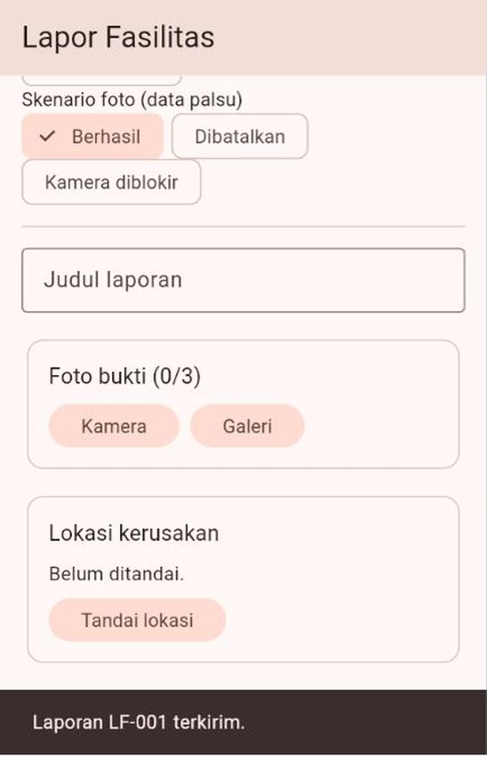
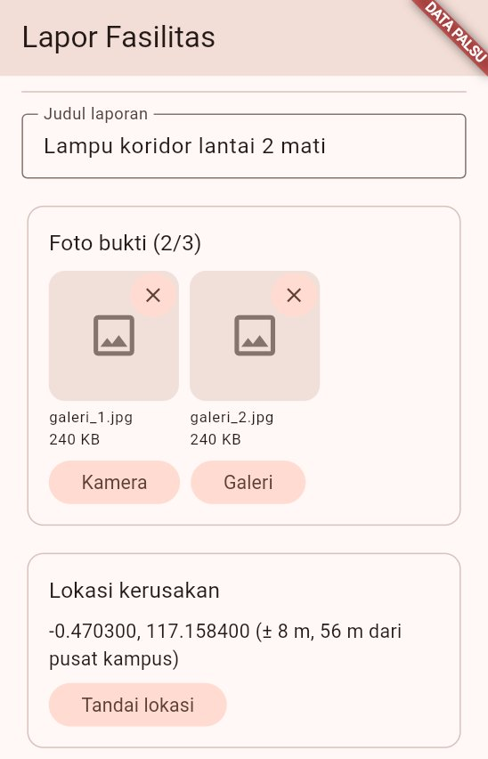
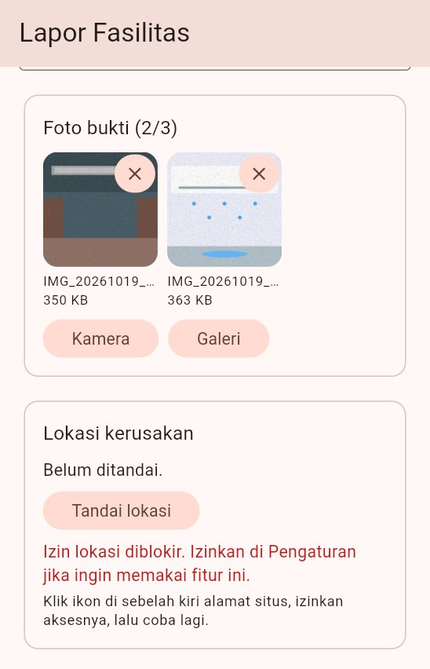

# 🧪 Jobsheet Pertemuan 13 — Fitur Perangkat & Izin Akses

[🏠 Beranda](../README.md) · [📖 Modul](README.md) · [✍️ Latihan](LATIHAN.md) · [💻 Kode Contoh](kode/)

| Informasi | Keterangan |
| :--- | :--- |
| Mata kuliah | Pemrograman Piranti Bergerak |
| Pertemuan | 13 — Fitur Perangkat & Izin Akses |
| Bentuk kegiatan | Praktikum individu |
| Estimasi waktu | 150 menit |
| Alat | Praktikum 1 dan 4: DartPad **atau** komputer. Praktikum 2, 3, dan 5: proyek Flutter baru bernama `lapor_fasilitas` di VS Code, dijalankan di **Chrome** |
| Perangkat | Laptop dengan Chrome sudah cukup. **HP atau emulator Android dianjurkan** untuk Praktikum 5, agar kamera, GPS, dan dialog izin yang asli bisa dicoba |
| Paket | `image_picker` (Praktikum 2, 3, dan 5), `geolocator` (Praktikum 3 dan 5), dan `provider` (Praktikum 4 dan 5). DartPad hanya menyediakan `provider`, jadi Praktikum 2, 3, dan 5 dikerjakan di proyek Flutter |
| Koneksi | Internet dibutuhkan untuk memasang paket. Di laptop, Chrome menentukan lokasi lewat jaringan Wi-Fi, sehingga tanpa internet lokasinya dipalsukan lewat DevTools ([Modul Bagian 11.1](README.md#111-chrome-devtools-sensors)) |
| Hasil akhir | Aplikasi "Lapor Fasilitas Kampus" yang mengambil foto bukti dari kamera atau galeri, menandai lokasi kerusakan, menolak laporan dari luar kampus, meminta izin dengan sopan, tetap bisa dipakai saat izin ditolak, dan bisa diuji di laptop dengan data palsu |

---

## 🎯 Tujuan Praktikum

Setelah menyelesaikan jobsheet ini, Anda mampu:

1. Menghitung jarak dan arah antara dua koordinat, lalu menulis aturan lokasi (akurasi, lokasi palsu, radius area) dalam **Dart murni**.
2. Mengambil satu foto dari kamera atau beberapa foto dari galeri dengan `image_picker`, mengecilkannya, menampilkannya, dan menangani keadaan **batal** serta **galat**.
3. Mengambil lokasi perangkat dengan `geolocator` melalui tiga pemeriksaan berurutan (layanan, izin, posisi), lalu memberi pesan yang tepat untuk setiap kemungkinan.
4. Menyusun **alur izin yang sopan**: izin diminta saat fiturnya dipakai, aplikasi tetap berfungsi saat izin ditolak, dan pengguna diarahkan ke Pengaturan dengan tenang saat izin diblokir.
5. Membungkus fitur perangkat dengan **kontrak**, membuat data palsu berskenario, lalu memeriksa ViewModel tanpa HP, tanpa GPS, dan tanpa dialog izin.
6. Memasang implementasi **asli** di balik kontrak yang sama, lalu memilih data palsu atau perangkat asli lewat dua titik masuk.

## 📌 Petunjuk Umum

> [!IMPORTANT]
> 1. Setiap praktikum diawali **kode terbimbing**. **Ketik sendiri** kodenya, kecuali bagian yang ditandai *boleh disalin*.
> 2. Kerjakan **🔧 Modifikasi** di setiap praktikum. Jawaban berupa penjelasan ditulis sebagai **komentar** di dalam kode.
> 3. Simpan setiap praktikum sebagai berkas terpisah berisi kode **lengkap**: `praktikum1.dart` sampai `praktikum4.dart`. Praktikum 2 dan 3 dikerjakan di `lib/main.dart` proyek `lapor_fasilitas`; setelah selesai, salin isinya menjadi `praktikum2.dart` dan `praktikum3.dart`. Praktikum 5 berupa folder `lib/` proyek yang sama.
> 4. Rapikan kode sebelum menyimpan: tombol **Format** di DartPad, atau `Shift` + `Alt` + `F` di VS Code. Pastikan tidak ada garis merah maupun kuning.
> 5. **Aturan hari ini:** (1) izin diminta saat fiturnya **dipakai**, tidak pernah saat aplikasi baru dibuka; (2) setiap kemungkinan hasil (berhasil, batal, ditolak, diblokir, layanan mati, waktu habis) punya **pesan** untuk pengguna; (3) **jangan** menambahkan izin `CAMERA` di `AndroidManifest.xml` untuk `image_picker`; (4) mulai Praktikum 4, nama paket `geolocator` dan `image_picker` **hanya** boleh muncul di implementasi asli, tidak di ViewModel maupun domain.
> 6. Banyak modifikasi berupa **eksperimen**: Anda sengaja membuat kesalahan untuk melihat akibatnya. Setelah akibatnya dicatat sebagai komentar, **kembalikan** kodenya seperti semula, kecuali diminta lain.

> [!NOTE]
> Kelima praktikum membangun **satu aplikasi** secara bertahap: aturan laporan (Praktikum 1) → foto bukti (Praktikum 2) → lokasi kerusakan (Praktikum 3) → kontrak dan data palsu (Praktikum 4) → perangkat asli di balik kontrak (Praktikum 5). Kerjakan berurutan. Bandingkan juga dengan contoh di modul: Praktikum 1 ↔ Contoh 04, Praktikum 2 ↔ Contoh 02, Praktikum 3 ↔ Contoh 03 dan 05, Praktikum 4 ↔ Contoh 07, Praktikum 5 ↔ Contoh 08.
>
> Proyek "Tugas Kuliahku" beristirahat minggu ini, karena daftar tugas tidak membutuhkan kamera maupun GPS. Proyek itu dipakai lagi di Pertemuan 14.

> [!TIP]
> **Di mana melihat isi konsol?** Hasil pemeriksaan (`LULUS`/`GAGAL`) dicetak ke konsol.
> - **DartPad:** panel **Console** di bawah panel aplikasi.
> - **VS Code:** tab **Debug Console** saat aplikasi dijalankan dengan **F5**.
> - **Terminal:** keluaran perintah `flutter run` atau `dart run`.

### Di mana mencoba fitur perangkat?

Setiap tempat punya kelebihan sendiri ([Modul Bagian 1.3](README.md#13-tiga-tempat-mencoba)):

| Fitur | Chrome di laptop | Emulator Android | HP Android |
| :--- | :--- | :--- | :--- |
| Galeri | Membuka pemilih berkas komputer | Galeri emulator | Galeri asli |
| Kamera | Biasanya **juga** membuka pemilih berkas | Kamera virtual (ruangan buatan) | Kamera asli |
| Lokasi | Lewat Wi-Fi, atau dipalsukan dengan DevTools → *Sensors* | Diatur lewat *Extended controls* | GPS asli |
| Izin diblokir | Ikon di sebelah kiri alamat situs | Dialog dan Pengaturan Android | Dialog dan Pengaturan Android |

> [!WARNING]
> Jalankan proyek di Chrome **selalu** dengan port tetap: `flutter run -d chrome --web-port=8080`. Chrome mengingat izin lokasi **per alamat**. Tanpa `--web-port`, setiap kali dijalankan aplikasi mendapat port acak (`localhost:53421`, `localhost:61877`, ...), sehingga Chrome menganggapnya situs baru dan izinnya ditanyakan lagi dari awal.

<details>
<summary>❓ Lupa cara menjalankan program?</summary>

- **DartPad:** buka <https://dartpad.dev>, hapus kode bawaannya, tempelkan kode Anda, lalu klik **Run**. Paket `provider` sudah tersedia.
- **Program Dart murni di komputer:** simpan sebagai `praktikum1.dart`, lalu jalankan `dart run praktikum1.dart` di terminal folder itu.
- **Proyek Flutter:** buka folder proyek di VS Code, ganti isi `lib/main.dart`, lalu jalankan dengan **F5** atau `flutter run -d chrome --web-port=8080`. Untuk HP atau emulator Android, cukup `flutter run` lalu pilih perangkatnya. Setelah **menambah paket** dengan `flutter pub add`, hentikan aplikasi lalu jalankan ulang; *hot reload* saja tidak cukup.

Penjelasan lengkap ada di [Panduan Menjalankan Kode](../panduan/03_menjalankan_kode_contoh.md).
</details>

---

## Praktikum 1 — Aturan Laporan Fasilitas dalam Dart Murni

**Konsep:** koordinat (lintang dan bujur), rumus jarak *haversine*, arah mata angin, aturan bisnis sebagai fungsi yang mengembalikan alasan penolakan, urutan pemeriksaan, dan jam yang disuntikkan. ([Modul Bagian 6](README.md#6-jarak-arah-dan-zona))

Bagian sarana dan prasarana kampus ingin mahasiswa bisa melaporkan fasilitas yang rusak (lampu mati, AC bocor, kursi patah) lewat aplikasi, lengkap dengan foto dan lokasinya. Agar laporan bisa dipercaya, ada beberapa aturan:

| Aturan | Nilai |
| :--- | :--- |
| Judul laporan | Minimal 5 huruf |
| Foto bukti | Minimal 1, paling banyak 3 |
| Lokasi | Bukan dari aplikasi pemalsu GPS, akurasi paling buruk **30 m**, dan paling jauh **600 m** dari pusat kampus |
| Laporan serupa | Laporan dengan kategori sama, berjarak paling jauh **25 m**, dan dibuat dalam **24 jam** terakhir dianggap **serupa**, agar petugas tidak menerima laporan ganda |

Semua aturan ini ditulis dalam **Dart murni**: tanpa Flutter, tanpa GPS, dan tanpa kamera. Programnya tidak punya tampilan; hasilnya dibaca di konsol. Mulai Praktikum 3, aturan yang sama dipakai oleh aplikasi Flutter **tanpa diubah**.

> [!NOTE]
> Koordinat pusat kampus di praktikum ini hanyalah **contoh**. Setelah semua praktikum selesai, Anda boleh menggantinya dengan koordinat kampus Anda sendiri. Caranya: buka Google Maps, klik kanan titik yang diinginkan, lalu klik angka koordinat paling atas untuk menyalinnya.

### Langkah 1 — Koordinat dan rumus jarak (ketik sendiri)

```dart
// =====================================================================
// JOBSHEET PERTEMUAN 13 - PRAKTIKUM 1
// Aturan Laporan Fasilitas Kampus dalam Dart Murni
// =====================================================================

// Ini program konsol, jadi print() boleh dipakai.
// ignore_for_file: avoid_print

import 'dart:math';

// ----------------------------- KOORDINAT -----------------------------

class Koordinat {
  const Koordinat(this.lintang, this.bujur);

  final double lintang;
  final double bujur;
}

/// Jari-jari bumi yang sama dengan Geolocator.distanceBetween.
const double jariJariBumiMeter = 6378137.0;

double _radian(double derajat) => derajat * pi / 180;

/// Jarak dua titik di permukaan bumi (rumus haversine), dalam meter.
double jarakMeter(Koordinat a, Koordinat b) {
  final double dLintang = _radian(b.lintang - a.lintang);
  final double dBujur = _radian(b.bujur - a.bujur);
  final double h =
      pow(sin(dLintang / 2), 2) +
      pow(sin(dBujur / 2), 2) *
          cos(_radian(a.lintang)) *
          cos(_radian(b.lintang));
  return jariJariBumiMeter * 2 * asin(sqrt(h));
}
```

| Bagian | Penjelasan |
| :--- | :--- |
| `// ignore_for_file: avoid_print` | Program konsol memang bertugas mencetak, jadi peringatan `avoid_print` dimatikan untuk berkas ini saja |
| `Koordinat(this.lintang, this.bujur)` | **Lintang** (*latitude*) mengukur posisi utara–selatan: negatif berarti di **selatan** khatulistiwa. **Bujur** (*longitude*) mengukur posisi barat–timur ([Modul Bagian 5.1](README.md#51-koordinat-alamat-bumi-dalam-dua-angka)) |
| `jariJariBumiMeter = 6378137.0` | Jari-jari bumi yang **sama** dengan yang dipakai `Geolocator.distanceBetween`, sehingga hasil hitungan kita dan hitungan paket selalu cocok |
| `_radian(...)` | Fungsi trigonometri di `dart:math` (`sin`, `cos`) bekerja dalam **radian**, bukan derajat. 180° = π radian. Garis bawah di depan nama berarti fungsi ini hanya dipakai di berkas ini |
| `jarakMeter(a, b)` | Rumus *haversine*: jarak dua titik **di permukaan bumi yang bulat**, bukan garis lurus di atas kertas ([Modul Bagian 6.2](README.md#62-rumus-jarak-di-permukaan-bumi)). Hasilnya dalam meter |

### Langkah 2 — Arah dan teks jarak (ketik sendiri)

Tambahkan di bawah `jarakMeter`:

```dart
/// Arah dari [a] ke [b] dalam derajat: 0 = utara, 90 = timur, dan
/// seterusnya searah jarum jam (0 sampai kurang dari 360).
double arahDerajat(Koordinat a, Koordinat b) {
  final double l1 = _radian(a.lintang);
  final double l2 = _radian(b.lintang);
  final double dBujur = _radian(b.bujur - a.bujur);
  final double y = sin(dBujur) * cos(l2);
  final double x = cos(l1) * sin(l2) - sin(l1) * cos(l2) * cos(dBujur);
  return (atan2(y, x) * 180 / pi + 360) % 360;
}

String namaArah(double derajat) {
  const List<String> nama = [
    'utara',
    'timur laut',
    'timur',
    'tenggara',
    'selatan',
    'barat daya',
    'barat',
    'barat laut',
  ];
  return nama[((derajat + 22.5) ~/ 45) % 8];
}

/// 850 m, 1,2 km, dan seterusnya.
String teksJarak(double meter) {
  if (meter < 1000) return '${meter.round()} m';
  return '${(meter / 1000).toStringAsFixed(1).replaceAll('.', ',')} km';
}
```

| Bagian | Penjelasan |
| :--- | :--- |
| `arahDerajat(a, b)` | Arah dari `a` menuju `b`, diukur dari utara searah jarum jam: 0° utara, 90° timur, 180° selatan, 270° barat ([Modul Bagian 6.3](README.md#63-arah)) |
| `atan2(y, x) * 180 / pi` | Hasil `atan2` dalam radian, antara −180° dan 180°. Ditambah 360 lalu dibagi sisa (`% 360`) agar selalu 0 sampai kurang dari 360 |
| `namaArah(derajat)` | Lingkaran dibagi menjadi 8 juring selebar 45°. Ditambah 22,5° dulu agar **utara** mencakup 337,5°–22,5°, bukan 0°–45° |
| `~/ 45` dan `% 8` | `~/` adalah pembagian bulat (7,9 menjadi 7). `% 8` membuat 360° kembali menjadi indeks 0 (utara) |
| `teksJarak(meter)` | Di bawah 1 km ditulis dalam meter (`887 m`), selebihnya dalam kilometer dengan koma desimal (`1,2 km`) |

### Langkah 3 — Laporan dan aturannya (ketik sendiri)

```dart
// ------------------------------ LAPORAN ------------------------------

enum Kategori {
  lampu('Lampu mati'),
  ac('AC rusak'),
  kursi('Kursi atau meja rusak'),
  toilet('Toilet bermasalah'),
  lainnya('Lainnya');

  const Kategori(this.label);
  final String label;
}

class Laporan {
  const Laporan({
    required this.judul,
    required this.kategori,
    required this.titik,
    required this.waktu,
  });

  final String judul;
  final Kategori kategori;
  final Koordinat titik;
  final DateTime waktu;
}

// ------------------------------- ATURAN -------------------------------

/// Koordinat CONTOH titik pusat kampus. Ganti dengan kampus Anda.
const Koordinat pusatKampus = Koordinat(-0.4700, 117.1580);
const double radiusKampusMeter = 600;
const double akurasiMaksimalMeter = 30;
const int maksimalFoto = 3;
const double radiusSerupaMeter = 25;
const Duration jendelaSerupa = Duration(hours: 24);

/// Aturan isian laporan. null berarti lolos.
String? periksaIsian({required String judul, required int jumlahFoto}) {
  if (judul.trim().length < 5) return 'Judul minimal 5 huruf.';
  if (jumlahFoto == 0) return 'Lampirkan minimal satu foto bukti.';
  if (jumlahFoto > maksimalFoto) return 'Paling banyak $maksimalFoto foto.';
  return null;
}

/// Aturan lokasi laporan. Urutannya disengaja: lokasi palsu, akurasi,
/// lalu jarak. null berarti lolos.
String? periksaLokasi({
  required Koordinat titik,
  required double akurasiMeter,
  required bool palsu,
}) {
  if (palsu) return 'Lokasi palsu terdeteksi. Matikan aplikasi pemalsu GPS.';
  if (akurasiMeter > akurasiMaksimalMeter) {
    return 'Lokasi kurang akurat (± ${akurasiMeter.round()} m). '
        'Tunggu sebentar, lalu tandai ulang.';
  }
  final double jarak = jarakMeter(titik, pusatKampus);
  if (jarak > radiusKampusMeter) {
    return 'Lokasi berada ${teksJarak(jarak)} dari pusat kampus, '
        'di luar area kampus.';
  }
  return null;
}

/// Laporan SERUPA: kategori sama, paling jauh 25 m, dan dibuat paling lama
/// 24 jam sebelum [sekarang]. null berarti belum ada yang melaporkan.
Laporan? cariLaporanSerupa({
  required Kategori kategori,
  required Koordinat titik,
  required List<Laporan> semua,
  required DateTime sekarang,
}) {
  for (final Laporan l in semua) {
    final bool masihBaru = sekarang.difference(l.waktu) <= jendelaSerupa;
    if (l.kategori == kategori &&
        masihBaru &&
        jarakMeter(l.titik, titik) <= radiusSerupaMeter) {
      return l;
    }
  }
  return null;
}
```

| Bagian | Penjelasan |
| :--- | :--- |
| `enum Kategori { ... }` | Kategori kerusakan, masing-masing dengan label yang siap ditampilkan |
| Konstanta di bawah `ATURAN` | Semua angka kebijakan diberi **nama**. Jika suatu hari radius kampus berubah, cukup satu baris yang diganti |
| `String? periksaIsian(...)` | Aturan ditulis sebagai fungsi yang mengembalikan **alasan penolakan**, atau `null` jika lolos. Pemanggil tidak perlu menebak mengapa sebuah laporan ditolak |
| Urutan di `periksaLokasi` | **Lokasi palsu** diperiksa paling awal: jika titiknya palsu, jarak dan akurasinya tidak berarti apa-apa. Lalu **akurasi**: titik yang kabur belum layak diukur jaraknya. Terakhir **jarak** ([Modul Bagian 6.4](README.md#64-aturan-zona-presensi)) |
| `cariLaporanSerupa(...)` | Mengembalikan laporan lama yang **serupa**, atau `null` jika belum ada. Tiga syarat harus terpenuhi sekaligus: kategori sama, masih baru, dan jaraknya dekat |
| `required DateTime sekarang` | Waktu "sekarang" **disuntikkan** sebagai parameter, bukan memanggil `DateTime.now()` sendiri, sehingga hasil pemeriksaan selalu sama kapan pun program dijalankan |
| `sekarang.difference(l.waktu)` | Selisih dua waktu dalam bentuk `Duration`, lalu dibandingkan dengan `jendelaSerupa` (24 jam) |

### Langkah 4 — Program pemeriksa (boleh disalin)

```dart
// ------------------------------- PROGRAM -------------------------------

void main() {
  // Jam disuntikkan: semua pemeriksaan memakai Senin, 19 Oktober 2026,
  // pukul 10.00, kapan pun program dijalankan.
  final DateTime sekarang = DateTime(2026, 10, 19, 10);

  // Koordinat CONTOH di sekitar pusat kampus.
  const Map<String, Koordinat> tempat = {
    'Gedung Kuliah A': Koordinat(-0.4703, 117.1584),
    'Perpustakaan': Koordinat(-0.4697, 117.1611),
    'Asrama mahasiswa': Koordinat(-0.4668, 117.1561),
    'Gerbang utama': Koordinat(-0.4741, 117.1552),
    'Warung seberang kampus': Koordinat(-0.4762, 117.1630),
  };
  final Koordinat gedungA = tempat['Gedung Kuliah A']!;

  print('=== 1. Jarak dan arah dari pusat kampus ===');
  for (final MapEntry<String, Koordinat> e in tempat.entries) {
    final double jarak = jarakMeter(pusatKampus, e.value);
    final double arah = arahDerajat(pusatKampus, e.value);
    print(
      '${e.key.padRight(24)}${teksJarak(jarak).padLeft(6)}  '
      '${namaArah(arah)}',
    );
  }
  print('');

  print('=== 2. Isian laporan ===');
  const String judulLengkap = 'Lampu koridor lantai 2 mati';
  final Map<String, String?> isian = {
    'Judul "AC", 1 foto': periksaIsian(judul: 'AC', jumlahFoto: 1),
    'Judul lengkap, 0 foto': periksaIsian(judul: judulLengkap, jumlahFoto: 0),
    'Judul lengkap, 4 foto': periksaIsian(judul: judulLengkap, jumlahFoto: 4),
    'Judul lengkap, 2 foto': periksaIsian(judul: judulLengkap, jumlahFoto: 2),
  };
  for (final MapEntry<String, String?> e in isian.entries) {
    print('${e.key.padRight(24)}-> ${e.value ?? 'BOLEH'}');
  }
  print('');

  print('=== 3. Lokasi laporan (radius 600 m, akurasi maks 30 m) ===');
  final Map<String, String?> lokasi = {
    'Gedung A, ± 8 m': periksaLokasi(
      titik: gedungA,
      akurasiMeter: 8,
      palsu: false,
    ),
    'Gedung A, ± 45 m': periksaLokasi(
      titik: gedungA,
      akurasiMeter: 45,
      palsu: false,
    ),
    'Gedung A, pemalsu GPS': periksaLokasi(
      titik: gedungA,
      akurasiMeter: 5,
      palsu: true,
    ),
    'Warung, ± 5 m': periksaLokasi(
      titik: tempat['Warung seberang kampus']!,
      akurasiMeter: 5,
      palsu: false,
    ),
    'Hampir 600 m ke utara': periksaLokasi(
      titik: const Koordinat(-0.464611, 117.1580),
      akurasiMeter: 6,
      palsu: false,
    ),
    'Sedikit lewat 600 m': periksaLokasi(
      titik: const Koordinat(-0.464601, 117.1580),
      akurasiMeter: 6,
      palsu: false,
    ),
  };
  for (final MapEntry<String, String?> e in lokasi.entries) {
    print('${e.key.padRight(24)}-> ${e.value ?? 'BOLEH'}');
  }
  print('');

  print('=== 4. Laporan serupa (kategori sama, 25 m, 24 jam) ===');
  final List<Laporan> semua = [
    Laporan(
      judul: 'Lampu depan A.101 mati',
      kategori: Kategori.lampu,
      titik: const Koordinat(-0.47031, 117.15842),
      waktu: sekarang.subtract(const Duration(hours: 2)),
    ),
    Laporan(
      judul: 'AC ruang baca bocor',
      kategori: Kategori.ac,
      titik: tempat['Perpustakaan']!,
      waktu: sekarang.subtract(const Duration(hours: 30)),
    ),
  ];
  void cek(String nama, Kategori kategori, Koordinat titik) {
    final Laporan? serupa = cariLaporanSerupa(
      kategori: kategori,
      titik: titik,
      semua: semua,
      sekarang: sekarang,
    );
    final String hasil = serupa == null
        ? 'laporan baru'
        : 'serupa dengan "${serupa.judul}" '
              '(${sekarang.difference(serupa.waktu).inHours} jam lalu, '
              '${teksJarak(jarakMeter(serupa.titik, titik))})';
    print('${nama.padRight(24)}-> $hasil');
  }

  cek('Lampu di Gedung A', Kategori.lampu, gedungA);
  cek('Kursi di Gedung A', Kategori.kursi, gedungA);
  cek('AC di Perpustakaan', Kategori.ac, tempat['Perpustakaan']!);
  cek(
    'Lampu 30 m dari A.101',
    Kategori.lampu,
    const Koordinat(-0.47058, 117.15842),
  );
}
```

`padRight(24)` dan `padLeft(6)` menambahkan spasi agar kolom-kolomnya lurus di konsol. Fungsi `cek` ditulis **di dalam** `main`, karena hanya dipakai di sini dan membutuhkan `semua` serta `sekarang`.

✅ **Hasil yang diharapkan** (di konsol):

```text
=== 1. Jarak dan arah dari pusat kampus ===
Gedung Kuliah A           56 m  tenggara
Perpustakaan             347 m  timur
Asrama mahasiswa         414 m  barat laut
Gerbang utama            553 m  barat daya
Warung seberang kampus   887 m  tenggara

=== 2. Isian laporan ===
Judul "AC", 1 foto      -> Judul minimal 5 huruf.
Judul lengkap, 0 foto   -> Lampirkan minimal satu foto bukti.
Judul lengkap, 4 foto   -> Paling banyak 3 foto.
Judul lengkap, 2 foto   -> BOLEH

=== 3. Lokasi laporan (radius 600 m, akurasi maks 30 m) ===
Gedung A, ± 8 m         -> BOLEH
Gedung A, ± 45 m        -> Lokasi kurang akurat (± 45 m). Tunggu sebentar, lalu tandai ulang.
Gedung A, pemalsu GPS   -> Lokasi palsu terdeteksi. Matikan aplikasi pemalsu GPS.
Warung, ± 5 m           -> Lokasi berada 887 m dari pusat kampus, di luar area kampus.
Hampir 600 m ke utara   -> BOLEH
Sedikit lewat 600 m     -> Lokasi berada 601 m dari pusat kampus, di luar area kampus.

=== 4. Laporan serupa (kategori sama, 25 m, 24 jam) ===
Lampu di Gedung A       -> serupa dengan "Lampu depan A.101 mati" (2 jam lalu, 2 m)
Kursi di Gedung A       -> laporan baru
AC di Perpustakaan      -> laporan baru
Lampu 30 m dari A.101   -> laporan baru
```

Perhatikan dua baris terakhir bagian 3. Kedua titik hanya berselisih sekitar **1 meter**, tetapi yang satu lolos dan yang lain ditolak. Batas tetaplah batas. Karena itu, aplikasi sebaiknya memberi tahu **berapa jauh** lokasinya, bukan sekadar "ditolak".

🔧 **Modifikasi:**

1. **Eksperimen — jari-jari bumi yang lain.** Ganti nilai `jariJariBumiMeter` menjadi `6371008.8` (jari-jari **rata-rata** bumi), lalu jalankan. Tuliskan sebagai komentar: (a) selisih terbesar di bagian 1; (b) pesan untuk "Sedikit lewat 600 m" sekarang. Lokasinya masih ditolak, tetapi pesannya terdengar janggal. Mengapa? (c) Mengapa aplikasi dan server kampus harus memakai rumus **dan** jari-jari yang sama? Kembalikan nilainya.
2. **Eksperimen — urutan aturan.** Di bagian 3, tambahkan kasus `'Warung, pemalsu GPS'` (titik warung, akurasi 5, `palsu: true`) dan catat hasilnya. Lalu pindahkan pemeriksaan `palsu` ke urutan **terakhir** di `periksaLokasi`, dan jalankan lagi. Pesan untuk kasus mana yang berubah? Jelaskan sebagai komentar mengapa lokasi palsu harus diperiksa paling awal. Kembalikan urutannya, tetapi biarkan kasus barunya.
3. **Batas harian.** Agar tidak ada laporan iseng beruntun, satu mahasiswa paling banyak mengirim **5 laporan per hari**. Tulis `String? periksaBatasHarian({required List<Laporan> milikSaya, required DateTime sekarang})` yang mengembalikan `'Batas 5 laporan per hari sudah tercapai. Coba lagi besok.'`. Simpan angka 5 sebagai konstanta. Tambahkan bagian 5 di `main` dengan minimal tiga kasus: 4 laporan hari ini (boleh), 5 laporan hari ini (ditolak), dan 5 laporan **kemarin** (boleh). Petunjuk: dua waktu berada di hari yang sama jika `year`, `month`, dan `day`-nya sama.
4. **Dua area kampus.** Kampus kini punya dua area: **Kampus Utama** (`pusatKampus`, radius 600 m) dan **Kampus Teknik** (pusat `-0.4850, 117.1700`, radius 400 m). Buat `class AreaKampus` (`nama`, `pusat`, `radiusMeter`) dan daftar konstanta `areaKampus`. Ubah `periksaLokasi`: lokasi lolos jika berada di dalam **salah satu** area; jika tidak, pesannya menyebut area **terdekat**, misalnya `Lokasi berada 887 m dari Kampus Utama, di luar area kampus.` Tambahkan kasus `'Lab Kampus Teknik'` (`-0.4855, 117.1705`) dan `'Di antara dua kampus'` (`-0.4790, 117.1660`), lalu tuliskan hasil keduanya sebagai komentar.
5. **Tantangan — serupa yang terdekat.** `cariLaporanSerupa` mengembalikan laporan serupa yang **pertama kali ditemukan**. Ubah agar mengembalikan yang **terdekat** jika ada beberapa. Buktikan: letakkan laporan lampu kedua yang berjarak sekitar 20 m dari Gedung A, misalnya di `-0.47012, 117.1584` dan dibuat 1 jam lalu, di urutan **pertama** daftar `semua`, lalu pastikan hasil untuk "Lampu di Gedung A" tetap laporan yang berjarak 2 m. Jawab sebagai komentar: mengapa urutan daftar tidak boleh menentukan hasil?

---

## Praktikum 2 — Foto Bukti dengan `image_picker`

**Konsep:** paket `image_picker`, `pickImage` dan `pickMultiImage`, `XFile` dan `readAsBytes()`, mengecilkan foto, `Image.memory` dengan `cacheWidth`, keadaan **batal**, `PlatformException`, penjaga ketukan ganda, dan tombol Kamera yang hanya tampil jika didukung. ([Modul Bagian 3](README.md#3-menyiapkan-proyek-paket-dan-pengaturan-platform) dan [Bagian 4](README.md#4-foto-dari-galeri-dan-kamera))

Laporan tanpa foto sulit dipercaya, dan petugas sulit menemukan kerusakannya. Praktikum ini membuat halaman pertama aplikasi "Lapor Fasilitas": pengguna memotret kerusakan dengan kamera, atau memilih **sampai tiga** foto dari galeri.

### Langkah 1 — Proyek baru dan paket `image_picker`

Buka terminal di folder tempat Anda menyimpan proyek latihan, lalu jalankan:

```bash
flutter create lapor_fasilitas
cd lapor_fasilitas
flutter pub add image_picker
code .
```

Proyek ini dipakai sampai Praktikum 5. Pengaturan platformnya ([Modul Bagian 3.5](README.md#35-ringkasan-persiapan)):

| Platform | Yang perlu ditulis |
| :--- | :--- |
| Android | **Tidak ada.** Galeri dibuka lewat *Photo Picker* milik sistem, dan kamera lewat aplikasi kamera bawaan |
| Web | Tidak ada |
| iOS (hanya jika Anda memakai Mac) | Dua kalimat alasan di `ios/Runner/Info.plist`, di dalam `<dict>` (lihat di bawah) |

```xml
<key>NSPhotoLibraryUsageDescription</key>
<string>Anda bisa melampirkan foto dari galeri sebagai bukti kerusakan fasilitas.</string>
<key>NSCameraUsageDescription</key>
<string>Aplikasi memotret fasilitas yang rusak sebagai bukti laporan Anda.</string>
```

> [!CAUTION]
> Ingat aturan hari ini: **jangan** menambahkan izin `CAMERA` di `AndroidManifest.xml`. Jika izin itu tertulis tetapi belum diberikan pengguna, Android justru menolak membuka kamera bawaan ([Modul Bagian 3.2](README.md#32-android-androidmanifestxml)).

### Langkah 2 — Kerangka aplikasi, model, dan pesan galat (ketik sendiri)

Ganti seluruh isi `lib/main.dart`:

```dart
// =====================================================================
// JOBSHEET PERTEMUAN 13 - PRAKTIKUM 2
// Lapor Fasilitas: Foto Bukti dengan image_picker
// =====================================================================

import 'package:flutter/material.dart';
import 'package:flutter/services.dart';
import 'package:image_picker/image_picker.dart';

void main() => runApp(const AplikasiLaporFasilitas());

class AplikasiLaporFasilitas extends StatelessWidget {
  const AplikasiLaporFasilitas({super.key});

  @override
  Widget build(BuildContext context) {
    return MaterialApp(
      debugShowCheckedModeBanner: false,
      title: 'Lapor Fasilitas',
      theme: ThemeData(
        colorScheme: ColorScheme.fromSeed(seedColor: Colors.deepOrange),
      ),
      darkTheme: ThemeData(
        colorScheme: ColorScheme.fromSeed(
          seedColor: Colors.deepOrange,
          brightness: Brightness.dark,
        ),
      ),
      home: const HalamanLaporan(),
    );
  }
}

// ============================== MODEL ==============================

/// Satu foto bukti yang isinya sudah dibaca.
class FotoBukti {
  const FotoBukti({required this.nama, required this.bita});

  final String nama;
  final Uint8List bita;
}

const int maksimalFoto = 3;

/// 850 B, 312 KB, 1,4 MB.
String teksUkuran(int bita) {
  if (bita < 1024) return '$bita B';
  if (bita < 1024 * 1024) return '${(bita / 1024).round()} KB';
  final String mb = (bita / (1024 * 1024)).toStringAsFixed(1);
  return '${mb.replaceAll('.', ',')} MB';
}

/// Kode galat image_picker -> kalimat untuk pengguna.
String pesanGalatFoto(PlatformException e) {
  return switch (e.code) {
    'camera_access_denied' =>
      'Akses kamera ditolak. Anda bisa mengizinkannya di Pengaturan.',
    'photo_access_denied' =>
      'Akses galeri ditolak. Anda bisa mengizinkannya di Pengaturan.',
    'no_available_camera' => 'Perangkat ini tidak memiliki kamera.',
    'already_active' ||
    'multiple_request' => 'Pemilih foto masih terbuka. Coba lagi.',
    _ => 'Foto gagal diambil (${e.code}).',
  };
}
```

| Bagian | Penjelasan |
| :--- | :--- |
| `import 'package:flutter/services.dart'` | Menyediakan `PlatformException` (galat dari *plugin*) dan `Uint8List` (deretan bita) |
| `class FotoBukti` | Foto yang **isinya sudah dibaca** (`bita`), bukan alamat berkas. Cara ini bekerja sama baiknya di web dan di HP ([Modul Bagian 4.4](README.md#44-membaca-dan-menampilkan-foto)) |
| `teksUkuran(bita)` | 1 KB = 1.024 bita dan 1 MB = 1.024 KB. Hasilnya `850 B`, `312 KB`, atau `1,4 MB` |
| `pesanGalatFoto(e)` | Mengubah `e.code` dari *plugin* menjadi kalimat untuk pengguna ([Modul Bagian 4.3](README.md#43-tiga-kemungkinan-hasil)). Kode yang tidak dikenal tetap ditampilkan, agar mudah dilaporkan |
| `'already_active' \|\| 'multiple_request'` | Dua kode untuk keadaan yang sama: pemilih foto diminta terbuka padahal masih terbuka |

### Langkah 3 — Halaman foto bukti (ketik sendiri)

Tambahkan di bawah `pesanGalatFoto`:

```dart
// ============================== HALAMAN ==============================

class HalamanLaporan extends StatefulWidget {
  const HalamanLaporan({super.key});

  @override
  State<HalamanLaporan> createState() => _HalamanLaporanState();
}

class _HalamanLaporanState extends State<HalamanLaporan> {
  final ImagePicker _pemilih = ImagePicker();
  final List<FotoBukti> _foto = [];
  bool _sibuk = false;

  int get _sisa => maksimalFoto - _foto.length;

  Future<void> _dariKamera() {
    return _ambil(() async {
      final XFile? berkas = await _pemilih.pickImage(
        source: ImageSource.camera,
        maxWidth: 1280,
        imageQuality: 75,
        requestFullMetadata: false,
      );
      return berkas == null ? <XFile>[] : [berkas];
    });
  }

  Future<void> _dariGaleri() {
    return _ambil(
      () => _pemilih.pickMultiImage(
        maxWidth: 1280,
        imageQuality: 75,
        limit: _sisa, // berlaku di Android dan iOS
        requestFullMetadata: false,
      ),
    );
  }

  /// Satu pola untuk kamera dan galeri: penjaga, try, lalu finally.
  Future<void> _ambil(Future<List<XFile>> Function() pilih) async {
    if (_sibuk || _sisa == 0) return; // cegah pemilih terbuka dua kali
    setState(() => _sibuk = true);
    try {
      final List<XFile> berkas = await pilih();
      if (berkas.isEmpty) {
        _beriTahu('Tidak ada foto yang dipilih.');
        return;
      }
      // Di web, limit tidak berlaku, jadi kelebihannya dipotong sendiri.
      final List<FotoBukti> baru = [
        for (final XFile b in berkas.take(_sisa))
          FotoBukti(nama: b.name, bita: await b.readAsBytes()),
      ];
      if (!mounted) return;
      setState(() => _foto.addAll(baru));
      if (berkas.length > baru.length) {
        _beriTahu('Hanya $maksimalFoto foto yang dipakai.');
      }
    } on PlatformException catch (e) {
      _beriTahu(pesanGalatFoto(e));
    } finally {
      if (mounted) setState(() => _sibuk = false);
    }
  }

  void _hapus(int indeks) => setState(() => _foto.removeAt(indeks));

  void _beriTahu(String pesan) {
    if (!mounted) return;
    ScaffoldMessenger.of(context)
      ..hideCurrentSnackBar()
      ..showSnackBar(SnackBar(content: Text(pesan)));
  }

  @override
  Widget build(BuildContext context) {
    final TextTheme teks = Theme.of(context).textTheme;
    final bool kameraAda = _pemilih.supportsImageSource(ImageSource.camera);
    final bool bolehTambah = !_sibuk && _sisa > 0;
    final int total = _foto.fold(0, (int n, FotoBukti f) => n + f.bita.length);

    return Scaffold(
      appBar: AppBar(title: const Text('Lapor Fasilitas')),
      body: ListView(
        padding: const EdgeInsets.all(16),
        children: [
          Text('Foto bukti', style: teks.titleMedium),
          Text(
            '${_foto.length} dari $maksimalFoto foto'
            '${_foto.isEmpty ? '' : ' · total ${teksUkuran(total)}'}',
            style: teks.bodySmall,
          ),
          const SizedBox(height: 12),
          if (_sibuk) const LinearProgressIndicator(),
          if (_foto.isEmpty)
            const Text(
              'Belum ada foto. Foto yang jelas membantu petugas menemukan '
              'kerusakan lebih cepat.',
            )
          else
            Wrap(
              spacing: 12,
              runSpacing: 12,
              children: [
                for (int i = 0; i < _foto.length; i++)
                  _KartuFoto(foto: _foto[i], onHapus: () => _hapus(i)),
              ],
            ),
          const SizedBox(height: 16),
          Wrap(
            spacing: 12,
            runSpacing: 8,
            children: [
              if (kameraAda)
                FilledButton.icon(
                  onPressed: bolehTambah ? _dariKamera : null,
                  icon: const Icon(Icons.photo_camera_outlined),
                  label: const Text('Kamera'),
                ),
              OutlinedButton.icon(
                onPressed: bolehTambah ? _dariGaleri : null,
                icon: const Icon(Icons.photo_library_outlined),
                label: const Text('Galeri'),
              ),
            ],
          ),
        ],
      ),
    );
  }
}
```

| Bagian | Penjelasan |
| :--- | :--- |
| `final ImagePicker _pemilih = ImagePicker();` | Satu pemilih untuk seluruh halaman. Konstruktornya bukan `const`, jadi tanpa `const` |
| `int get _sisa` | Jumlah foto yang masih boleh ditambahkan |
| `pickImage(source: ImageSource.camera, ...)` | Membuka kamera. Hasilnya `XFile?`: **`null`** jika pengguna menutup kamera tanpa memotret. Satu hasil itu dibungkus menjadi daftar, agar bisa diproses bersama hasil galeri |
| `maxWidth: 1280, imageQuality: 75` | Foto kamera HP (sekitar 4000 × 3000 piksel, 3–8 MB) dikecilkan menjadi lebar 1280 piksel dengan kualitas JPEG 75, biasanya menjadi ratusan KB. Masih jelas untuk petugas, dan hemat kuota ([Modul Bagian 4.2](README.md#42-memanggil-pickimage)) |
| `requestFullMetadata: false` | Tidak meminta metadata lengkap, termasuk koordinat GPS yang tersimpan **di dalam** berkas foto. Aplikasi tidak membutuhkannya |
| `pickMultiImage(limit: _sisa, ...)` | Memilih beberapa foto sekaligus. Hasilnya `List<XFile>`: daftar **kosong** jika pengguna batal. `limit` hanya dipatuhi Android dan iOS ([Modul Bagian 4.7](README.md#47-lebih-dari-satu-foto)) |
| `_ambil(Future<List<XFile>> Function() pilih)` | Satu pola untuk kamera dan galeri: penjaga, `try`, lalu `finally`. Fungsi pemilihnya dikirim sebagai parameter |
| `if (_sibuk \|\| _sisa == 0) return;` | **Penjaga ketukan ganda**: pemilih tidak boleh terbuka dua kali |
| `if (berkas.isEmpty)` | Pengguna **batal**. Ini bukan galat, cukup diberi tahu dengan tenang |
| `berkas.take(_sisa)` | Di web, `limit` tidak berlaku, sehingga pengguna bisa memilih lebih banyak. Kelebihannya dipotong sendiri |
| `await b.readAsBytes()` | Membaca isi foto menjadi `Uint8List`. Bekerja di web maupun HP |
| `if (!mounted) return;` | Selama pengguna memilih foto, halaman bisa saja sudah ditutup. Jangan memanggil `setState` pada halaman yang sudah tidak ada |
| `on PlatformException catch (e)` | Galat dari *plugin*, misalnya akses kamera ditolak di iOS, diubah menjadi kalimat oleh `pesanGalatFoto` |
| `finally { ... _sibuk = false ... }` | Dijalankan apa pun yang terjadi: berhasil, batal, maupun galat. Tanpa ini, tombol bisa mati selamanya setelah satu galat |
| `supportsImageSource(ImageSource.camera)` | Tombol **Kamera** hanya ditampilkan jika perangkatnya bisa memotret ([Modul Bagian 4.5](README.md#45-tombol-kamera-hanya-jika-didukung)) |
| `..hideCurrentSnackBar()` | Pesan lama disembunyikan dulu, agar pesan tidak mengantre |

### Langkah 4 — Kartu foto (boleh disalin)

Tambahkan di bagian paling bawah berkas:

```dart
class _KartuFoto extends StatelessWidget {
  const _KartuFoto({required this.foto, required this.onHapus});

  final FotoBukti foto;
  final VoidCallback onHapus;

  @override
  Widget build(BuildContext context) {
    return SizedBox(
      width: 96,
      child: Column(
        crossAxisAlignment: CrossAxisAlignment.start,
        children: [
          Stack(
            children: [
              ClipRRect(
                borderRadius: BorderRadius.circular(12),
                child: Image.memory(
                  foto.bita,
                  width: 96,
                  height: 96,
                  fit: BoxFit.cover,
                  cacheWidth: 288, // 3 x 96: cukup tajam, hemat memori
                ),
              ),
              Positioned(
                top: 2,
                right: 2,
                child: IconButton.filledTonal(
                  visualDensity: VisualDensity.compact,
                  iconSize: 18,
                  tooltip: 'Hapus foto',
                  onPressed: onHapus,
                  icon: const Icon(Icons.close),
                ),
              ),
            ],
          ),
          const SizedBox(height: 4),
          Text(
            foto.nama,
            maxLines: 1,
            overflow: TextOverflow.ellipsis,
            style: Theme.of(context).textTheme.labelSmall,
          ),
          Text(
            teksUkuran(foto.bita.length),
            style: Theme.of(context).textTheme.labelSmall,
          ),
        ],
      ),
    );
  }
}
```

| Bagian | Penjelasan |
| :--- | :--- |
| `Image.memory(foto.bita, ...)` | Menampilkan foto dari bita di memori |
| `cacheWidth: 288` | Foto selebar 1280 piksel **diurai** hanya selebar 288 piksel (tiga kali lebar tampilan 96), sehingga hemat memori. Tanpa ini, tiga foto besar bisa membuat HP murah kehabisan memori |
| `Stack` + `Positioned` | Tombol hapus (×) ditumpuk di pojok kanan atas gambar |
| `maxLines: 1, overflow: TextOverflow.ellipsis` | Nama berkas yang panjang dipotong dengan "…", agar tidak meluber |

### Langkah 5 — Jalankan dan coba

```bash
flutter run -d chrome --web-port=8080
```

| Coba ini | Yang seharusnya terjadi |
| :--- | :--- |
| Klik **Galeri**, pilih 2 foto | Dua gambar kecil tampil, dan keterangannya menjadi "2 dari 3 foto · total ..." |
| Klik **Galeri** lagi, pilih 2 foto | Di Chrome hanya satu yang dipakai, lalu muncul "Hanya 3 foto yang dipakai." Kedua tombol menjadi tidak aktif |
| Klik × pada salah satu foto | Foto terhapus, tombol aktif kembali |
| Klik **Galeri**, lalu tutup jendela pemilih tanpa memilih | Muncul "Tidak ada foto yang dipilih." |
| Klik **Kamera** di laptop | Biasanya membuka pemilih berkas juga. Ini perilaku normal browser di laptop |
| (Jika ada) Jalankan di HP atau emulator Android dengan `flutter run`, lalu klik **Kamera** | Aplikasi kamera terbuka. Setelah memotret dan menekan tombol centang, fotonya masuk ke daftar |

✅ **Hasil yang diharapkan** (lebar 360, setelah memilih tiga foto):

<p align="center"></p>

🔧 **Modifikasi:**

1. **Eksperimen — foto tanpa dikecilkan.** Hapus sementara `maxWidth` dan `imageQuality` dari kedua pemanggilan, lalu pilih foto yang sama seperti sebelumnya (sebaiknya foto dari kamera HP). Catat ukuran sebelum dan sesudahnya sebagai komentar. Jelaskan mengapa pengecilan penting untuk laporan yang dikirim lewat data seluler. Kembalikan seperti semula.
2. **Eksperimen — membatalkan pemilihan.** Klik **Galeri**, lalu tutup pemilih tanpa memilih apa pun, dan catat pesannya. Lalu hapus sementara blok `if (berkas.isEmpty) { ... }` dan ulangi. Apa yang dilihat pengguna sekarang? Jelaskan sebagai komentar mengapa keadaan "batal" tetap perlu ditangani, walaupun tidak ada galat. Kembalikan.
3. **Batas ukuran total 2 MB.** Petugas hanya menerima lampiran sampai 2 MB per laporan. Simpan batas itu sebagai konstanta `batasTotalBita`. Foto baru ditambahkan satu per satu selama total ukurannya tidak melewati batas; foto yang membuat total melewati batas **dilewati**, lalu tampil `SnackBar` seperti "1 foto dilewati karena total melebihi 2 MB." Coba dengan Modifikasi 1 sementara aktif, agar batasnya mudah tercapai.
4. **Pratinjau besar.** Ketukan pada gambar kecil membuka dialog berisi foto yang bisa diperbesar dengan dua jari atau *scroll* tetikus (`InteractiveViewer`), nama berkasnya, dan tombol **Tutup**. Petunjuk: `showDialog` dan `InkWell`. Jawab sebagai komentar: mengapa pratinjau besar **tidak** memakai `cacheWidth: 288`?
5. **Tantangan — foto yang sempat "hilang" (khusus Android).** Saat kamera terbuka, Android kadang menutup aplikasi kita untuk menghemat memori ([Modul Bagian 4.6](README.md#46-khusus-android-foto-yang-sempat-hilang)). Panggil `retrieveLostData()` satu kali di `initState`, hanya jika `!kIsWeb && defaultTargetPlatform == TargetPlatform.android` (keduanya dari `package:flutter/foundation.dart`). Foto yang dipulihkan dimasukkan ke daftar dengan `SnackBar` "1 foto dipulihkan.", dan `exception` yang dipulihkan ditampilkan dengan `pesanGalatFoto`. Uji dengan mengaktifkan **Jangan simpan aktivitas** (*Don't keep activities*) di Opsi Pengembang. Jawab sebagai komentar: mengapa data ini hanya bisa dibaca **sekali**?

---

## Praktikum 3 — Lokasi Kerusakan dengan `geolocator`

**Konsep:** tiga pemeriksaan berurutan (layanan → izin → posisi), lima status `LocationPermission`, `LocationSettings` dengan batas waktu, *exception* dari `geolocator`, keadaan sebagai `sealed class`, `AppLifecycleListener` untuk kembali dari Pengaturan, petunjuk khusus browser, dan aturan Praktikum 1 yang dipakai ulang. ([Modul Bagian 5](README.md#5-lokasi-perangkat) dan [Bagian 7](README.md#7-alur-izin-yang-sopan))

Foto saja belum cukup: petugas juga perlu tahu **di mana** kerusakannya. Praktikum ini melanjutkan Praktikum 2 dengan tombol **Tandai lokasi**. Lokasi hanya diambil saat tombol itu diketuk, dan langsung diperiksa dengan aturan dari Praktikum 1.

| Praktikum 2 | Praktikum 3 |
| :--- | :--- |
| Hanya foto bukti | Foto bukti **dan** lokasi kerusakan |
| Tidak ada izin yang diminta | Izin lokasi diminta saat tombol **Tandai lokasi** diketuk, bukan saat aplikasi dibuka |
| — | Setiap kemungkinan (layanan mati, ditolak, diblokir, waktu habis, tidak tersedia) punya pesan dan tombol yang tepat |
| — | Kembali dari Pengaturan, lokasi diperiksa ulang tanpa perlu mengetuk lagi |

### Langkah 1 — Paket `geolocator` dan izin lokasi

Di terminal folder proyek `lapor_fasilitas`:

```bash
flutter pub add geolocator
```

Buka `android/app/src/main/AndroidManifest.xml`, lalu tambahkan dua baris izin **di atas** tag `<application>` ([Modul Bagian 3.2](README.md#32-android-androidmanifestxml)):

```xml
<manifest xmlns:android="http://schemas.android.com/apk/res/android">
    <uses-permission android:name="android.permission.ACCESS_COARSE_LOCATION" />
    <uses-permission android:name="android.permission.ACCESS_FINE_LOCATION" />

    <application
        android:label="lapor_fasilitas"
        ...>
```

Jika Anda memakai Mac, tambahkan juga kalimat alasan di `ios/Runner/Info.plist`:

```xml
<key>NSLocationWhenInUseUsageDescription</key>
<string>Aplikasi menandai lokasi fasilitas yang rusak saat Anda mengetuk Tandai lokasi.</string>
```

> [!WARNING]
> Setelah `flutter pub add` dan mengubah `AndroidManifest.xml`, **hentikan** aplikasi lalu jalankan ulang. *Hot reload* tidak memuat *plugin* baru, sehingga muncul `MissingPluginException`. Jika baris izin di manifest terlupa, `geolocator` melempar `PermissionDefinitionsNotFoundException` saat izin diminta.

### Langkah 2 — Impor dan aturan lokasi

Ganti komentar pembuka dan baris-baris `import` di `lib/main.dart`:

```dart
// =====================================================================
// JOBSHEET PERTEMUAN 13 - PRAKTIKUM 3
// Lapor Fasilitas: Foto Bukti + Lokasi Kerusakan (geolocator)
// =====================================================================

import 'dart:async';
import 'dart:math';

import 'package:flutter/foundation.dart';
import 'package:flutter/material.dart';
import 'package:flutter/services.dart';
import 'package:geolocator/geolocator.dart';
import 'package:image_picker/image_picker.dart';
```

| Impor baru | Untuk apa |
| :--- | :--- |
| `dart:async` | `TimeoutException`, yang dilempar saat batas waktu mencari lokasi habis |
| `dart:math` | Fungsi trigonometri untuk rumus jarak dan arah |
| `package:flutter/foundation.dart` | `kIsWeb`, untuk mengetahui apakah aplikasi berjalan di browser |
| `package:geolocator/geolocator.dart` | Paket lokasi |

Lalu tambahkan aturan lokasi dari Praktikum 1 tepat di bawah `class AplikasiLaporFasilitas` (**boleh disalin** dari berkas Praktikum 1 Anda). Yang dibutuhkan hanya bagian koordinat, jarak, arah, dan `periksaLokasi`:

```dart
// ===================== ATURAN LOKASI (Praktikum 1) =====================

class Koordinat {
  const Koordinat(this.lintang, this.bujur);

  final double lintang;
  final double bujur;
}

const double jariJariBumiMeter = 6378137.0;

double _radian(double derajat) => derajat * pi / 180;

double jarakMeter(Koordinat a, Koordinat b) {
  final double dLintang = _radian(b.lintang - a.lintang);
  final double dBujur = _radian(b.bujur - a.bujur);
  final double h =
      pow(sin(dLintang / 2), 2) +
      pow(sin(dBujur / 2), 2) *
          cos(_radian(a.lintang)) *
          cos(_radian(b.lintang));
  return jariJariBumiMeter * 2 * asin(sqrt(h));
}

double arahDerajat(Koordinat a, Koordinat b) {
  final double l1 = _radian(a.lintang);
  final double l2 = _radian(b.lintang);
  final double dBujur = _radian(b.bujur - a.bujur);
  final double y = sin(dBujur) * cos(l2);
  final double x = cos(l1) * sin(l2) - sin(l1) * cos(l2) * cos(dBujur);
  return (atan2(y, x) * 180 / pi + 360) % 360;
}

String namaArah(double derajat) {
  const List<String> nama = [
    'utara',
    'timur laut',
    'timur',
    'tenggara',
    'selatan',
    'barat daya',
    'barat',
    'barat laut',
  ];
  return nama[((derajat + 22.5) ~/ 45) % 8];
}

String teksJarak(double meter) {
  if (meter < 1000) return '${meter.round()} m';
  return '${(meter / 1000).toStringAsFixed(1).replaceAll('.', ',')} km';
}

/// Koordinat CONTOH titik pusat kampus. Ganti dengan kampus Anda.
const Koordinat pusatKampus = Koordinat(-0.4700, 117.1580);
const double radiusKampusMeter = 600;
const double akurasiMaksimalMeter = 30;

String? periksaLokasi({
  required Koordinat titik,
  required double akurasiMeter,
  required bool palsu,
}) {
  if (palsu) return 'Lokasi palsu terdeteksi. Matikan aplikasi pemalsu GPS.';
  if (akurasiMeter > akurasiMaksimalMeter) {
    return 'Lokasi kurang akurat (± ${akurasiMeter.round()} m). '
        'Tunggu sebentar, lalu tandai ulang.';
  }
  final double jarak = jarakMeter(titik, pusatKampus);
  if (jarak > radiusKampusMeter) {
    return 'Lokasi berada ${teksJarak(jarak)} dari pusat kampus, '
        'di luar area kampus.';
  }
  return null;
}
```

Bagian model foto dari Praktikum 2 (`FotoBukti`, `maksimalFoto`, `teksUkuran`, dan `pesanGalatFoto`) tetap seperti semula.

### Langkah 3 — Keadaan lokasi (ketik sendiri)

Tambahkan di bawah `pesanGalatFoto`, sebelum `class HalamanLaporan`:

```dart
// ============================ KEADAAN LOKASI ============================

enum MasalahLokasi {
  layananMati,
  izinDitolak,
  izinDiblokir,
  waktuHabis,
  tidakTersedia,
}

sealed class KeadaanLokasi {
  const KeadaanLokasi();
}

class BelumDitandai extends KeadaanLokasi {
  const BelumDitandai();
}

class SedangMencari extends KeadaanLokasi {
  const SedangMencari();
}

class LokasiDitandai extends KeadaanLokasi {
  const LokasiDitandai(this.posisi);
  final Position posisi;
}

class LokasiGagal extends KeadaanLokasi {
  const LokasiGagal(this.masalah);
  final MasalahLokasi masalah;
}
```

| Bagian | Penjelasan |
| :--- | :--- |
| `enum MasalahLokasi` | Lima alasan lokasi **gagal** didapat. Setiap alasan nanti punya pesan dan tombolnya sendiri |
| `sealed class KeadaanLokasi` | Bagian lokasi selalu berada di **tepat satu** dari empat keadaan: belum ditandai, sedang mencari, sudah ditandai, atau gagal |
| `LokasiDitandai(this.posisi)` | Membawa `Position` dari `geolocator`: lintang, bujur, akurasi, waktu, dan `isMocked` |
| `LokasiGagal(this.masalah)` | Membawa alasan kegagalannya |
| Mengapa `sealed`? | `switch` pada `KeadaanLokasi` **wajib** menangani keempat keadaan. Jika suatu hari ada keadaan baru, Dart menunjukkan setiap `switch` yang belum menanganinya |

### Langkah 4 — Logika lokasi (ketik sendiri)

Di dalam `_HalamanLaporanState`, tambahkan kode berikut tepat di bawah baris `bool _sibuk = false;`. Bagian foto yang sudah ada tidak diubah.

```dart
  // ----- Lokasi (baru) -----
  KeadaanLokasi _lokasi = const BelumDitandai();
  late final AppLifecycleListener _pendengar;

  @override
  void initState() {
    super.initState();
    // Kembali dari Pengaturan: periksa ulang tanpa menunggu ketukan.
    _pendengar = AppLifecycleListener(onResume: _saatKembali);
  }

  @override
  void dispose() {
    _pendengar.dispose();
    super.dispose();
  }

  void _saatKembali() {
    final KeadaanLokasi k = _lokasi;
    if (k is LokasiGagal &&
        (k.masalah == MasalahLokasi.layananMati ||
            k.masalah == MasalahLokasi.izinDiblokir)) {
      _tandaiLokasi();
    }
  }

  Future<void> _tandaiLokasi() async {
    if (_lokasi is SedangMencari) return; // cegah ketukan ganda
    setState(() => _lokasi = const SedangMencari());
    final KeadaanLokasi hasil = await _cariPosisi();
    if (!mounted) return;
    setState(() => _lokasi = hasil);
  }

  /// Layanan -> izin -> posisi, persis seperti Contoh 03 di modul.
  Future<KeadaanLokasi> _cariPosisi() async {
    if (!await Geolocator.isLocationServiceEnabled()) {
      return const LokasiGagal(MasalahLokasi.layananMati);
    }
    LocationPermission izin = await Geolocator.checkPermission();
    if (izin == LocationPermission.denied ||
        izin == LocationPermission.unableToDetermine) {
      izin = await Geolocator.requestPermission();
    }
    final MasalahLokasi? masalahIzin = switch (izin) {
      LocationPermission.denied => MasalahLokasi.izinDitolak,
      LocationPermission.deniedForever => MasalahLokasi.izinDiblokir,
      LocationPermission.whileInUse ||
      LocationPermission.always ||
      LocationPermission.unableToDetermine => null,
    };
    if (masalahIzin != null) return LokasiGagal(masalahIzin);

    try {
      final Position posisi = await Geolocator.getCurrentPosition(
        locationSettings: const LocationSettings(
          accuracy: LocationAccuracy.high,
          timeLimit: Duration(seconds: 15),
        ),
      );
      return LokasiDitandai(posisi);
    } on TimeoutException {
      return const LokasiGagal(MasalahLokasi.waktuHabis);
    } on LocationServiceDisabledException {
      return const LokasiGagal(MasalahLokasi.layananMati);
    } on PermissionDeniedException {
      return const LokasiGagal(MasalahLokasi.izinDitolak);
    } on PositionUpdateException {
      return const LokasiGagal(MasalahLokasi.tidakTersedia);
    }
  }

  Future<void> _bukaPengaturan(MasalahLokasi masalah) async {
    if (masalah == MasalahLokasi.layananMati) {
      await Geolocator.openLocationSettings();
    } else {
      await Geolocator.openAppSettings();
    }
  }
```

| Bagian | Penjelasan |
| :--- | :--- |
| `AppLifecycleListener(onResume: _saatKembali)` | `onResume` dipanggil setiap kali aplikasi kembali ke depan, misalnya setelah pengguna membuka Pengaturan lalu kembali ([Modul Bagian 5.6](README.md#56-kembali-dari-pengaturan)). Jangan lupa `dispose()` |
| `_saatKembali()` | Memeriksa ulang **hanya** jika tadi gagal karena hal yang diubah di Pengaturan: layanan mati atau izin diblokir. Untuk izin yang diblokir, dialog izin tidak akan muncul lagi, jadi pemeriksaan ini tidak mengganggu pengguna |
| `if (_lokasi is SedangMencari) return;` | Penjaga ketukan ganda, sama seperti `_sibuk` pada foto |
| 1. `isLocationServiceEnabled()` | Apakah sakelar Lokasi di HP menyala? Jika mati, izin tidak perlu ditanyakan dulu |
| 2. `checkPermission()` lalu `requestPermission()` | Dialog izin hanya muncul jika statusnya `denied` (belum pernah ditanya, atau baru ditolak sekali) atau `unableToDetermine` (browser yang tidak bisa melaporkan statusnya). Status yang sudah diblokir tidak bisa ditanyakan lagi ([Modul Bagian 2.3](README.md#23-lima-status-izin-lokasi)) |
| `switch (izin)` | Kelima status diterjemahkan: `denied` → izin ditolak, `deniedForever` → diblokir, sisanya boleh lanjut |
| 3. `getCurrentPosition(locationSettings: ...)` | Akurasi `high` (beberapa sampai puluhan meter, cukup untuk aturan 30 m) dengan batas waktu 15 detik, agar tombol tidak berputar selamanya di dalam gedung ([Modul Bagian 5.5](README.md#55-locationsettings-seberapa-akurat)) |
| Empat `on ...` | Setiap *exception* diterjemahkan menjadi alasan yang jelas, tanpa `catch` yang menelan semuanya ([Modul Bagian 5.4](README.md#54-exception-dari-geolocator)) |
| `_bukaPengaturan(masalah)` | Layanan mati → halaman sakelar Lokasi. Izin diblokir → halaman izin aplikasi ini |

### Langkah 5 — Tampilan lokasi (boleh disalin)

Di awal `build`, tambahkan baris ini di bawah baris `final int total = ...`:

```dart
    final KeadaanLokasi lokasi = _lokasi;
```

Di `children` milik `ListView`, tambahkan bagian lokasi tepat di bawah `Wrap` yang berisi tombol Kamera dan Galeri:

```dart
          const Divider(height: 40),

          // ----- Bagian lokasi (baru) -----
          Text('Lokasi kerusakan', style: teks.titleMedium),
          Text(
            'Berdirilah di dekat fasilitas yang rusak, lalu tandai '
            'lokasinya. Lokasi hanya diambil saat tombol diketuk.',
            style: teks.bodySmall,
          ),
          const SizedBox(height: 12),
          FilledButton.tonalIcon(
            onPressed: lokasi is SedangMencari ? null : _tandaiLokasi,
            icon: const Icon(Icons.my_location),
            label: Text(
              lokasi is LokasiDitandai ? 'Tandai ulang' : 'Tandai lokasi',
            ),
          ),
          const SizedBox(height: 12),
          switch (lokasi) {
            BelumDitandai() => const SizedBox.shrink(),
            SedangMencari() => const LinearProgressIndicator(),
            LokasiDitandai(:final Position posisi) => _KartuLokasi(
              posisi: posisi,
            ),
            LokasiGagal(:final MasalahLokasi masalah) => _KartuMasalahLokasi(
              masalah: masalah,
              onCobaLagi: _tandaiLokasi,
              onBukaPengaturan: () => _bukaPengaturan(masalah),
            ),
          },
```

Terakhir, tambahkan dua *widget* ini di bagian paling bawah berkas:

```dart
class _KartuLokasi extends StatelessWidget {
  const _KartuLokasi({required this.posisi});

  final Position posisi;

  @override
  Widget build(BuildContext context) {
    final ColorScheme warna = Theme.of(context).colorScheme;
    final Koordinat titik = Koordinat(posisi.latitude, posisi.longitude);
    final double jarak = jarakMeter(pusatKampus, titik);
    final String arah = namaArah(arahDerajat(pusatKampus, titik));
    // Aturan dari Praktikum 1 dipakai apa adanya.
    final String? masalah = periksaLokasi(
      titik: titik,
      akurasiMeter: posisi.accuracy,
      palsu: posisi.isMocked,
    );

    return Card.outlined(
      child: Column(
        children: [
          ListTile(
            leading: const Icon(Icons.place_outlined),
            title: const Text('Koordinat'),
            subtitle: Text(
              '${posisi.latitude.toStringAsFixed(6)}, '
              '${posisi.longitude.toStringAsFixed(6)}',
            ),
          ),
          ListTile(
            leading: const Icon(Icons.gps_fixed),
            title: const Text('Akurasi'),
            subtitle: Text('± ${posisi.accuracy.round()} m'),
          ),
          ListTile(
            leading: const Icon(Icons.school_outlined),
            title: const Text('Dari pusat kampus'),
            subtitle: Text('${teksJarak(jarak)} ke arah $arah'),
          ),
          if (masalah == null)
            ListTile(
              leading: Icon(Icons.check_circle, color: warna.primary),
              title: const Text('Lokasi sah untuk laporan'),
            )
          else
            ListTile(
              leading: Icon(Icons.warning_amber, color: warna.error),
              title: Text(masalah, style: TextStyle(color: warna.error)),
            ),
        ],
      ),
    );
  }
}

class _KartuMasalahLokasi extends StatelessWidget {
  const _KartuMasalahLokasi({
    required this.masalah,
    required this.onCobaLagi,
    required this.onBukaPengaturan,
  });

  final MasalahLokasi masalah;
  final VoidCallback onCobaLagi;
  final VoidCallback onBukaPengaturan;

  @override
  Widget build(BuildContext context) {
    final ColorScheme warna = Theme.of(context).colorScheme;
    final (String pesan, bool lewatPengaturan) = switch (masalah) {
      MasalahLokasi.layananMati => (
        'Layanan lokasi mati. Nyalakan sakelar Lokasi, lalu kembali ke '
            'aplikasi ini.',
        true,
      ),
      MasalahLokasi.izinDitolak => (
        'Izin lokasi belum diberikan. Laporan tetap bisa disimpan setelah '
            'lokasinya ditandai.',
        false,
      ),
      MasalahLokasi.izinDiblokir => (
        'Izin lokasi diblokir, sehingga aplikasi tidak bisa memintanya '
            'lagi. Izinkan lokasi di Pengaturan jika ingin menandai lokasi.',
        true,
      ),
      MasalahLokasi.waktuHabis => (
        'Lokasi belum didapat dalam 15 detik. Coba di dekat jendela atau '
            'di luar ruangan.',
        false,
      ),
      MasalahLokasi.tidakTersedia => (
        'Lokasi tidak tersedia saat ini. Coba lagi sebentar lagi.',
        false,
      ),
    };

    return Card(
      color: warna.errorContainer,
      child: Padding(
        padding: const EdgeInsets.all(16),
        child: Column(
          crossAxisAlignment: CrossAxisAlignment.start,
          children: [
            Text(pesan, style: TextStyle(color: warna.onErrorContainer)),
            const SizedBox(height: 12),
            if (!lewatPengaturan)
              FilledButton.tonal(
                onPressed: onCobaLagi,
                child: const Text('Coba lagi'),
              )
            else if (kIsWeb)
              Text(
                'Klik ikon di sebelah kiri alamat situs, izinkan Lokasi, '
                'lalu klik Tandai lokasi.',
                style: TextStyle(color: warna.onErrorContainer),
              )
            else
              FilledButton.tonal(
                onPressed: onBukaPengaturan,
                child: const Text('Buka Pengaturan'),
              ),
          ],
        ),
      ),
    );
  }
}
```

| Bagian | Penjelasan |
| :--- | :--- |
| `final KeadaanLokasi lokasi = _lokasi;` | Disalin ke variabel lokal, agar `lokasi is SedangMencari` dan `switch` di bawahnya membaca nilai yang sama |
| `switch (lokasi) { ... }` di dalam `children` | Ekspresi `switch` menghasilkan satu *widget* untuk setiap keadaan. `LokasiDitandai(:final Position posisi)` sekaligus mengambil isinya |
| `_KartuLokasi` | Koordinat, akurasi, serta jarak dan arah dari pusat kampus. Aturan `periksaLokasi` dari Praktikum 1 dipakai **apa adanya** untuk menentukan apakah lokasinya sah |
| `posisi.isMocked` | `true` jika posisi berasal dari aplikasi pemalsu GPS (Android). Di browser selalu `false` |
| `final (String pesan, bool lewatPengaturan) = switch (masalah) { ... }` | Satu `switch` menghasilkan **dua** nilai sekaligus (*record*): kalimat pesan dan apakah perbaikannya lewat Pengaturan |
| `else if (kIsWeb)` | Di browser, aplikasi tidak bisa membuka pengaturan. Penggantinya petunjuk "Klik ikon di sebelah kiri alamat situs" ([Modul Bagian 3.4](README.md#34-web)) |

### Langkah 6 — Mencoba di Chrome

Hentikan aplikasi, lalu jalankan ulang dengan `flutter run -d chrome --web-port=8080`.

| Coba ini | Yang seharusnya terjadi |
| :--- | :--- |
| Klik **Tandai lokasi** | Chrome bertanya apakah `localhost:8080` boleh mengetahui lokasi Anda. Pilih **Izinkan saat mengunjungi situs** |
| Lihat kartunya | Lokasi laptop Anda (dari Wi-Fi) tampil. Karena koordinat kampus di praktikum ini hanya contoh, kemungkinan besar muncul peringatan "di luar area kampus", mungkin juga "kurang akurat". Itu wajar |
| Buka DevTools → *Sensors* ([Modul Bagian 11.1](README.md#111-chrome-devtools-sensors)). Di **Location**, pilih **Other…**, isi Latitude `-0.4703`, Longitude `117.1584`, dan **Accuracy** `8`. Klik **Tandai ulang** | "56 m ke arah tenggara" dan "Lokasi sah untuk laporan" |
| Ubah koordinatnya menjadi `-0.4762`, `117.1630` (warung di seberang kampus), Accuracy `5` | Peringatan "Lokasi berada 887 m dari pusat kampus, di luar area kampus." |
| Kembalikan ke Gedung A, tetapi Accuracy `45` | Peringatan "Lokasi kurang akurat (± 45 m). ..." |
| Klik ikon di sebelah kiri alamat situs, ubah izin **Lokasi** menjadi **Blokir**, lalu klik **Tandai ulang** | Kartu merah "Izin lokasi diblokir ..." dengan petunjuk "Klik ikon di sebelah kiri alamat situs ...", bukan tombol |

> [!TIP]
> Jika **Accuracy** dibiarkan kosong, Chrome memakai akurasi 150 m, sehingga lokasi buatan Anda selalu dianggap "kurang akurat".

✅ **Hasil yang diharapkan** (lebar 360, Chrome dengan lokasi buatan di Gedung A, Accuracy 8, setelah satu foto dipilih):

<p align="center"></p>

### Langkah 7 — Mencoba di Android (dianjurkan)

Jalankan `flutter run`, lalu pilih emulator atau HP Android. Di emulator, atur dulu lokasinya ke Gedung A lewat *Extended controls* → *Location* ([Modul Bagian 11.2](README.md#112-emulator-android)).

1. Klik **Tandai lokasi**. Dialog Android menawarkan lokasi **Tepat** atau **Perkiraan**, dengan pilihan *Saat aplikasi digunakan*, *Hanya kali ini*, dan *Jangan izinkan*.
2. Pilih **Jangan izinkan**. Muncul pesan izin belum diberikan dan tombol **Coba lagi**.
3. Klik **Coba lagi**, lalu tolak sekali lagi. Di Android, menolak **dua kali** berarti izinnya diblokir ([Modul Bagian 2.4](README.md#24-aturan-main-di-android)). Kini yang muncul tombol **Buka Pengaturan**.
4. Klik **Buka Pengaturan**, izinkan lokasi, lalu kembali ke aplikasi. Lokasi langsung ditandai **tanpa** mengetuk apa pun: itulah kerja `AppLifecycleListener`.
5. Matikan sakelar **Lokasi** dari panel cepat HP, lalu klik **Tandai ulang**. Muncul pesan layanan lokasi mati. Nyalakan lewat **Buka Pengaturan**, lalu kembali: lokasi kembali diperiksa sendiri.

🔧 **Modifikasi:**

1. **Eksperimen — lokasi tidak tersedia.** Di DevTools → *Sensors*, pilih **Location unavailable**, lalu klik **Tandai lokasi**. Pesan mana yang muncul, dan *exception* apa yang menyebabkannya? Tuliskan sebagai komentar (lihat [Modul Bagian 5.4](README.md#54-exception-dari-geolocator)). Kembalikan pilihannya ke **No override**.
2. **Eksperimen — waktu habis.** Ubah `timeLimit` menjadi `Duration.zero`, lalu klik **Tandai lokasi**. Catat pesannya. Pesan itu menyebut "15 detik", padahal batasnya kini nol. Perbaiki: buat konstanta `batasWaktuLokasi`, pakai di `LocationSettings` **dan** di kalimat pesan (`${batasWaktuLokasi.inSeconds} detik`). Kembalikan nilainya menjadi 15 detik, tetapi biarkan konstantanya.
3. **Eksperimen — izin diblokir di Chrome.** Blokir izin lokasi lewat ikon di sebelah kiri alamat situs, lalu klik **Tandai ulang**. Jelaskan sebagai komentar mengapa yang tampil petunjuk, bukan tombol **Buka Pengaturan**. Lalu izinkan lagi lewat ikon yang sama, tutup jendela kecilnya, dan klik di bagian kosong halaman aplikasi, **tanpa** mengklik **Tandai lokasi**. Apa yang terjadi pada kartu lokasi? Jelaskan peristiwa siklus hidup yang menyebabkannya (ingat `inactive` dan `resumed` di [Pertemuan 1, Bagian 6](../pertemuan_01_pengenalan_flutter/README.md#6-siklus-hidup-lifecycle-aplikasi)). Jika Chrome menawarkan **Muat ulang** (*Reload*), coba juga, lalu catat apa yang terjadi pada foto yang sudah dipilih.
4. **Mutu akurasi.** Tulis fungsi Dart murni `String mutuAkurasi(double meter)` yang mengembalikan `'sangat baik'` (paling buruk 10 m), `'cukup'` (paling buruk 30 m), atau `'kurang'`. Tampilkan di kartu lokasi, misalnya `± 8 m (sangat baik)`, beserta ikon berwarna yang berbeda untuk setiap mutu. Coba dengan Accuracy `8`, `25`, dan `60` di DevTools.
5. **Tantangan — ikuti lokasi.** Tambahkan `SwitchListTile` **"Ikuti lokasi saya"** di bawah tombol **Tandai lokasi**. Saat dinyalakan, kartu lokasi diperbarui terus lewat `Geolocator.getPositionStream` dengan `distanceFilter: 5`. Saat dimatikan, dan di `dispose()`, langganannya dibatalkan. Stream hanya dimulai setelah lokasi berhasil ditandai sekali (artinya izin sudah ada), dan galat di tengah jalan ditampilkan sebagai kartu masalah ([Modul Bagian 8](README.md#8-mengikuti-lokasi-terus-menerus)). Coba dengan mengubah koordinat di DevTools beberapa kali.

---

## Praktikum 4 — Kontrak Perangkat, Data Palsu, dan Pemeriksaan

**Konsep:** kontrak fitur perangkat di lapisan domain, `Hasil` dan `Kegagalan`, data palsu berskenario, mata-mata (*spy*), Perintah dari Pertemuan 12, **satu tempat** untuk pesan dan tombol perbaikan, ViewModel yang tidak mengenal paket perangkat, dan pemeriksaan otomatis tanpa HP. ([Modul Bagian 9](README.md#9-fitur-perangkat-di-balik-kontrak))

Aplikasi Praktikum 3 sudah berjalan, tetapi ada tiga masalah ([Modul Bagian 9.1](README.md#91-masalahnya-kode-yang-hanya-bisa-diuji-di-hp)). Pertama, keadaan "izin diblokir" atau "layanan mati" hanya bisa dicoba di HP, dengan mengubah pengaturan berkali-kali. Kedua, tidak ada satu pun pemeriksaan otomatis. Ketiga, `geolocator`, `image_picker`, aturan, dan tampilan bercampur di satu `State`. Praktikum ini menata ulangnya seperti Pertemuan 12, lalu menambahkan tombol **Kirim laporan**.

| Praktikum 3 | Praktikum 4 |
| :--- | :--- |
| `State` memanggil `Geolocator` dan `ImagePicker` langsung | ViewModel hanya mengenal **kontrak** `LayananLokasi` dan `PemilihFoto` |
| Keadaan gagal dicoba dengan mengubah pengaturan HP | Keadaan gagal dipilih lewat **chip skenario** data palsu, dalam hitungan detik |
| Pesan ditulis di beberapa *widget* | Semua pesan dan tombol berasal dari **satu** fungsi `tanggapanUntuk` |
| `_sibuk` dan `SedangMencari` ditulis sendiri-sendiri | Setiap aksi adalah `Perintah` dengan penjaga ketukan ganda bawaan |
| Belum ada pemeriksaan | 17 pemeriksaan otomatis berjalan sebelum aplikasi tampil |

> [!NOTE]
> Kerjakan praktikum ini di **DartPad**. Karena memakai data palsu, praktikum ini tidak membutuhkan `geolocator` maupun `image_picker`, dan DartPad sudah menyediakan `provider`. Jika ingin mengerjakannya di proyek, jalankan `flutter pub add provider` dan simpan dulu `lib/main.dart` Praktikum 3 sebagai `praktikum3.dart`.

### Langkah 1 — Akar komposisi (ketik sendiri)

```dart
// =====================================================================
// JOBSHEET PERTEMUAN 13 - PRAKTIKUM 4
// Lapor Fasilitas: Kontrak Perangkat, Data Palsu, dan Pemeriksaan
// =====================================================================

import 'dart:math';

import 'package:flutter/material.dart';
import 'package:flutter/services.dart';
import 'package:provider/provider.dart';

Future<void> main() async {
  await jalankanUji();
  runApp(
    MultiProvider(
      providers: [
        // Akar komposisi. Jenis yang dititipkan sengaja kelas PALSU, karena
        // chip skenario di layar perlu mengubah skenarionya.
        Provider<LayananLokasiPalsu>(create: (_) => LayananLokasiPalsu()),
        Provider<PemilihFotoPalsu>(create: (_) => PemilihFotoPalsu()),
        Provider<PengaturanPerangkatPalsu>(
          create: (_) => PengaturanPerangkatPalsu(),
        ),
        Provider<RepositoriLaporanMemori>(
          create: (_) => RepositoriLaporanMemori(),
        ),
        ChangeNotifierProvider(
          create: (BuildContext context) => LaporanViewModel(
            lokasi: context.read<LayananLokasiPalsu>(),
            pemilihFoto: context.read<PemilihFotoPalsu>(),
            pengaturan: context.read<PengaturanPerangkatPalsu>(),
            repositori: context.read<RepositoriLaporanMemori>(),
          ),
        ),
      ],
      child: const AplikasiLaporFasilitas(),
    ),
  );
}

class AplikasiLaporFasilitas extends StatelessWidget {
  const AplikasiLaporFasilitas({super.key});

  @override
  Widget build(BuildContext context) {
    return MaterialApp(
      debugShowCheckedModeBanner: false,
      title: 'Lapor Fasilitas',
      theme: ThemeData(
        colorScheme: ColorScheme.fromSeed(seedColor: Colors.deepOrange),
      ),
      darkTheme: ThemeData(
        colorScheme: ColorScheme.fromSeed(
          seedColor: Colors.deepOrange,
          brightness: Brightness.dark,
        ),
      ),
      home: const HalamanLaporan(),
    );
  }
}
```

| Bagian | Penjelasan |
| :--- | :--- |
| `await jalankanUji();` | Pemeriksaan (Langkah 10) dijalankan dulu, hasilnya tampil di **Console**, baru aplikasi tampil |
| `Provider<LayananLokasiPalsu>(...)` | Jenis yang dititipkan sengaja kelas **palsu**, karena chip skenario di layar perlu mengubah skenarionya. Di Praktikum 5, yang dititipkan menjadi **kontrak** |
| `LaporanViewModel(lokasi: context.read<...>(), ...)` | Parameter ViewModel bertipe **kontrak** (`LayananLokasi`, `PemilihFoto`, dan seterusnya), sehingga ViewModel tidak tahu bahwa yang ia terima adalah data palsu ([Pertemuan 12, Bagian 4.4](../pertemuan_12_clean_architecture/README.md#44-akar-komposisi-composition-root)) |

### Langkah 2 — `Hasil` dan `Kegagalan` (ketik sendiri)

```dart
// ======================== DOMAIN: HASIL & KEGAGALAN ========================

sealed class Hasil<T> {
  const Hasil();
}

final class Berhasil<T> extends Hasil<T> {
  const Berhasil(this.nilai);
  final T nilai;
}

final class Gagal<T> extends Hasil<T> {
  const Gagal(this.kegagalan);
  final Kegagalan kegagalan;
}

enum Fitur {
  lokasi('lokasi'),
  kamera('kamera'),
  galeri('galeri');

  const Fitur(this.nama);
  final String nama;
}

sealed class Kegagalan {
  const Kegagalan();
}

final class LayananLokasiMati extends Kegagalan {
  const LayananLokasiMati();
}

final class IzinDitolak extends Kegagalan {
  const IzinDitolak(this.fitur);
  final Fitur fitur;
}

final class IzinDiblokir extends Kegagalan {
  const IzinDiblokir(this.fitur);
  final Fitur fitur;
}

final class PerangkatTidakMendukung extends Kegagalan {
  const PerangkatTidakMendukung(this.fitur);
  final Fitur fitur;
}

final class Dibatalkan extends Kegagalan {
  const Dibatalkan();
}

final class WaktuHabis extends Kegagalan {
  const WaktuHabis();
}

final class AturanDilanggar extends Kegagalan {
  const AturanDilanggar(this.alasan);
  final String alasan;
}
```

| Bagian | Penjelasan |
| :--- | :--- |
| `Hasil<T>`, `Berhasil`, `Gagal` | Sama dengan Pertemuan 12: kotak berisi nilai **atau** kegagalan |
| `enum Fitur` | Fitur perangkat yang bisa bermasalah. Namanya ikut tampil di pesan, misalnya "Izin **kamera** diblokir" |
| `LayananLokasiMati`, `IzinDitolak`, `IzinDiblokir` | Tiga keadaan izin dan layanan dari Praktikum 3, kini dalam bahasa aplikasi ([Modul Bagian 9.3](README.md#93-kegagalan-baru)) |
| `PerangkatTidakMendukung(fitur)` | Misalnya perangkat tanpa kamera |
| `Dibatalkan` | Pengguna menutup kamera atau galeri. Termasuk `Kegagalan`, tetapi nanti **tidak** diberi pesan apa pun |
| `AturanDilanggar(alasan)` | Penolakan oleh aturan Praktikum 1. Alasannya dibawa apa adanya |

### Langkah 3 — Entitas dan aturan

Bagian `Koordinat`, `jarakMeter`, `teksJarak`, konstanta, `periksaIsian`, dan `periksaLokasi` **boleh disalin** dari Praktikum 1. `Posisi` dan `Laporan` **ketik sendiri**; `FotoBukti` sama dengan Praktikum 2.

```dart
// ===================== DOMAIN: ENTITAS & ATURAN (Praktikum 1) =====================

class Koordinat {
  const Koordinat(this.lintang, this.bujur);

  final double lintang;
  final double bujur;
}

double _radian(double derajat) => derajat * pi / 180;

double jarakMeter(Koordinat a, Koordinat b) {
  final double dLintang = _radian(b.lintang - a.lintang);
  final double dBujur = _radian(b.bujur - a.bujur);
  final double h =
      pow(sin(dLintang / 2), 2) +
      pow(sin(dBujur / 2), 2) *
          cos(_radian(a.lintang)) *
          cos(_radian(b.lintang));
  return 6378137.0 * 2 * asin(sqrt(h));
}

String teksJarak(double meter) {
  if (meter < 1000) return '${meter.round()} m';
  return '${(meter / 1000).toStringAsFixed(1).replaceAll('.', ',')} km';
}

class Posisi {
  const Posisi({
    required this.lintang,
    required this.bujur,
    required this.akurasiMeter,
    this.palsu = false,
  });

  final double lintang;
  final double bujur;
  final double akurasiMeter;
  final bool palsu;

  Koordinat get koordinat => Koordinat(lintang, bujur);
}

class FotoBukti {
  const FotoBukti({required this.nama, required this.bita});

  final String nama;
  final Uint8List bita;
}

class Laporan {
  const Laporan({
    required this.id,
    required this.judul,
    required this.jumlahFoto,
    required this.titik,
  });

  final String id;
  final String judul;
  final int jumlahFoto;
  final Koordinat titik;
}

const Koordinat pusatKampus = Koordinat(-0.4700, 117.1580);
const double radiusKampusMeter = 600;
const double akurasiMaksimalMeter = 30;
const int maksimalFoto = 3;

String? periksaIsian({required String judul, required int jumlahFoto}) {
  if (judul.trim().length < 5) return 'Judul minimal 5 huruf.';
  if (jumlahFoto == 0) return 'Lampirkan minimal satu foto bukti.';
  if (jumlahFoto > maksimalFoto) return 'Paling banyak $maksimalFoto foto.';
  return null;
}

String? periksaLokasi({
  required Koordinat titik,
  required double akurasiMeter,
  required bool palsu,
}) {
  if (palsu) return 'Lokasi palsu terdeteksi. Matikan aplikasi pemalsu GPS.';
  if (akurasiMeter > akurasiMaksimalMeter) {
    return 'Lokasi kurang akurat (± ${akurasiMeter.round()} m). '
        'Tunggu sebentar, lalu tandai ulang.';
  }
  final double jarak = jarakMeter(titik, pusatKampus);
  if (jarak > radiusKampusMeter) {
    return 'Lokasi berada ${teksJarak(jarak)} dari pusat kampus, '
        'di luar area kampus.';
  }
  return null;
}
```

| Bagian | Penjelasan |
| :--- | :--- |
| `class Posisi` | Posisi milik aplikasi: lintang, bujur, akurasi, dan apakah palsu. Inilah pengganti `Position` milik `geolocator`, sehingga lapisan domain tidak bergantung pada paket mana pun |
| `Koordinat get koordinat` | Jembatan ke aturan Praktikum 1, yang bekerja dengan `Koordinat` |
| `class Laporan` | Laporan yang sudah tersimpan, lengkap dengan nomornya (`LF-001`, dan seterusnya) |

### Langkah 4 — Kontrak fitur perangkat (ketik sendiri)

```dart
// ============================ DOMAIN: KONTRAK ============================

abstract interface class LayananLokasi {
  /// Memeriksa layanan dan izin, lalu mengambil posisi sekarang.
  Future<Hasil<Posisi>> posisiSekarang();
}

abstract interface class PemilihFoto {
  bool get kameraTersedia;

  /// Kamera: satu foto. Galeri: paling banyak [sisa] foto.
  Future<Hasil<List<FotoBukti>>> ambil({
    required bool dariKamera,
    required int sisa,
  });
}

abstract interface class PengaturanPerangkat {
  Future<void> bukaPengaturanAplikasi();

  Future<void> bukaPengaturanLokasi();
}

abstract interface class RepositoriLaporan {
  Future<Hasil<Laporan>> simpan({
    required String judul,
    required int jumlahFoto,
    required Posisi posisi,
  });
}
```

| Kontrak | Penjelasan |
| :--- | :--- |
| `LayananLokasi.posisiSekarang()` | **Satu** perintah yang mengurus layanan, izin, **dan** posisi. Hasilnya `Posisi`, atau kegagalan seperti `IzinDiblokir(Fitur.lokasi)` ([Modul Bagian 9.2](README.md#92-kontrak-di-domain)) |
| `PemilihFoto.ambil(dariKamera: ..., sisa: ...)` | Kamera menghasilkan satu foto, galeri paling banyak `sisa` foto. Batal menjadi `Gagal(Dibatalkan())` |
| `PemilihFoto.kameraTersedia` | Pengganti `supportsImageSource` |
| `PengaturanPerangkat` | Membuka pengaturan izin aplikasi atau pengaturan lokasi |
| `RepositoriLaporan.simpan(...)` | Menyimpan laporan. Di proyek sungguhan, implementasinya mengirim ke server kampus |

Perhatikan: tidak ada kata `geolocator`, `ImagePicker`, atau `Position` di sini. Kontrak berbicara dalam bahasa aplikasi.

### Langkah 5 — Data palsu berskenario (ketik sendiri)

```dart
// =============================== DATA PALSU ===============================

enum SkenarioLokasi {
  diGedungA('Di Gedung A'),
  diLuarKampus('Di luar kampus'),
  kurangAkurat('Akurasi buruk'),
  izinDiblokir('Izin diblokir'),
  layananMati('Layanan mati');

  const SkenarioLokasi(this.label);
  final String label;
}

class LayananLokasiPalsu implements LayananLokasi {
  SkenarioLokasi skenario = SkenarioLokasi.diGedungA;
  int dipanggil = 0;

  @override
  Future<Hasil<Posisi>> posisiSekarang() async {
    dipanggil++;
    await Future<void>.delayed(const Duration(milliseconds: 300));
    return switch (skenario) {
      SkenarioLokasi.diGedungA => const Berhasil(
        Posisi(lintang: -0.4703, bujur: 117.1584, akurasiMeter: 8),
      ),
      SkenarioLokasi.diLuarKampus => const Berhasil(
        Posisi(lintang: -0.4762, bujur: 117.1630, akurasiMeter: 5),
      ),
      SkenarioLokasi.kurangAkurat => const Berhasil(
        Posisi(lintang: -0.4703, bujur: 117.1584, akurasiMeter: 45),
      ),
      SkenarioLokasi.izinDiblokir => const Gagal(IzinDiblokir(Fitur.lokasi)),
      SkenarioLokasi.layananMati => const Gagal(LayananLokasiMati()),
    };
  }
}

enum SkenarioFoto {
  berhasil('Berhasil'),
  dibatalkan('Dibatalkan'),
  kameraDiblokir('Kamera diblokir');

  const SkenarioFoto(this.label);
  final String label;
}

class PemilihFotoPalsu implements PemilihFoto {
  SkenarioFoto skenario = SkenarioFoto.berhasil;
  int dipanggil = 0;

  @override
  bool get kameraTersedia => true;

  @override
  Future<Hasil<List<FotoBukti>>> ambil({
    required bool dariKamera,
    required int sisa,
  }) async {
    dipanggil++;
    await Future<void>.delayed(const Duration(milliseconds: 300));
    // Kamera menghasilkan 1 foto, galeri menghasilkan 2 foto (dibatasi sisa).
    final int jumlah = min(dariKamera ? 1 : 2, sisa);
    return switch (skenario) {
      SkenarioFoto.dibatalkan => const Gagal(Dibatalkan()),
      SkenarioFoto.kameraDiblokir when dariKamera => const Gagal(
        IzinDiblokir(Fitur.kamera),
      ),
      _ => Berhasil([
        for (int i = 1; i <= jumlah; i++)
          FotoBukti(
            nama: dariKamera ? 'IMG_kamera_$dipanggil.jpg' : 'galeri_$i.jpg',
            bita: Uint8List(240 * 1024), // anggap saja foto 240 KB
          ),
      ]),
    };
  }
}

class PengaturanPerangkatPalsu implements PengaturanPerangkat {
  final List<String> dibuka = [];

  @override
  Future<void> bukaPengaturanAplikasi() async => dibuka.add('aplikasi');

  @override
  Future<void> bukaPengaturanLokasi() async => dibuka.add('lokasi');
}

class RepositoriLaporanMemori implements RepositoriLaporan {
  final List<Laporan> semua = [];

  @override
  Future<Hasil<Laporan>> simpan({
    required String judul,
    required int jumlahFoto,
    required Posisi posisi,
  }) async {
    await Future<void>.delayed(const Duration(milliseconds: 300));
    final Laporan baru = Laporan(
      id: 'LF-${(semua.length + 1).toString().padLeft(3, '0')}',
      judul: judul,
      jumlahFoto: jumlahFoto,
      titik: posisi.koordinat,
    );
    semua.add(baru);
    return Berhasil(baru);
  }
}
```

| Bagian | Penjelasan |
| :--- | :--- |
| `enum SkenarioLokasi` dan `SkenarioFoto` | Daftar keadaan yang bisa dicoba. Labelnya ditampilkan sebagai chip ([Modul Bagian 9.5](README.md#95-data-palsu-berskenario)) |
| `skenario = SkenarioLokasi.diGedungA` | Skenario aktif. Bisa diganti kapan saja, oleh chip di layar maupun oleh pemeriksaan |
| `int dipanggil` | **Mata-mata** (*spy*): mencatat berapa kali layanan dipanggil. Dipakai untuk membuktikan penjaga ketukan ganda |
| `Future.delayed(300 ms)` | Pura-pura menunggu GPS atau kamera, agar lingkaran memuat sempat terlihat |
| `SkenarioFoto.kameraDiblokir when dariKamera` | Penjaga `when` di `switch`: kamera diblokir **hanya** berpengaruh pada kamera; galeri tetap berhasil |
| `min(dariKamera ? 1 : 2, sisa)` | Kamera menghasilkan 1 foto, galeri 2 foto, tetapi tidak pernah melebihi sisa slot |
| `Uint8List(240 * 1024)` | "Foto" 240 KB yang isinya nol semua. Bukan gambar sungguhan, tetapi ukurannya cukup untuk menguji |
| `PengaturanPerangkatPalsu.dibuka` | Mata-mata: mencatat pengaturan mana yang diminta dibuka |
| `RepositoriLaporanMemori` | Menyimpan laporan di memori dan memberi nomor `LF-001`, `LF-002`, dan seterusnya |

### Langkah 6 — Perintah (boleh disalin)

Sama persis dengan Pertemuan 12 ([Pertemuan 12, Bagian 8](../pertemuan_12_clean_architecture/README.md#8-perintah-command-status-milik-setiap-aksi)):

```dart
// ================== UI: PERINTAH (Pertemuan 12, boleh disalin) ==================

abstract class Perintah<T> extends ChangeNotifier {
  bool _sedangBerjalan = false;
  Hasil<T>? _hasil;
  bool _sudahDibuang = false;

  bool get sedangBerjalan => _sedangBerjalan;
  Hasil<T>? get hasil => _hasil;

  void bersihkanHasil() {
    _hasil = null;
    _kabari();
  }

  Future<void> _jalankan(Future<Hasil<T>> Function() aksi) async {
    if (_sedangBerjalan) return; // penjaga ketukan ganda
    _sedangBerjalan = true;
    _hasil = null;
    _kabari();
    try {
      _hasil = await aksi();
    } finally {
      _sedangBerjalan = false;
      _kabari();
    }
  }

  void _kabari() {
    if (!_sudahDibuang) notifyListeners();
  }

  @override
  void dispose() {
    _sudahDibuang = true;
    super.dispose();
  }
}

class Perintah0<T> extends Perintah<T> {
  Perintah0(this._aksi);
  final Future<Hasil<T>> Function() _aksi;
  Future<void> jalankan() => _jalankan(_aksi);
}

class Perintah1<T, A> extends Perintah<T> {
  Perintah1(this._aksi);
  final Future<Hasil<T>> Function(A) _aksi;
  Future<void> jalankan(A argumen) => _jalankan(() => _aksi(argumen));
}
```

### Langkah 7 — Satu tempat untuk pesan dan tombol (ketik sendiri)

```dart
// ======================= UI: PESAN UNTUK PENGGUNA =======================

enum AksiPerbaikan { tidakAda, cobaLagi, bukaPengaturan, nyalakanLokasi }

class Tanggapan {
  const Tanggapan(this.pesan, this.aksi);
  final String pesan;
  final AksiPerbaikan aksi;
}

/// SATU-SATUNYA tempat yang mengubah Kegagalan menjadi kalimat dan tombol.
Tanggapan? tanggapanUntuk(Kegagalan kegagalan) {
  return switch (kegagalan) {
    Dibatalkan() => null,
    AturanDilanggar(:final String alasan) => Tanggapan(
      alasan,
      AksiPerbaikan.tidakAda,
    ),
    LayananLokasiMati() => const Tanggapan(
      'Layanan lokasi mati. Nyalakan, lalu tandai ulang.',
      AksiPerbaikan.nyalakanLokasi,
    ),
    IzinDitolak(:final Fitur fitur) => Tanggapan(
      'Izin ${fitur.nama} belum diberikan.',
      AksiPerbaikan.cobaLagi,
    ),
    IzinDiblokir(:final Fitur fitur) => Tanggapan(
      'Izin ${fitur.nama} diblokir. Izinkan di Pengaturan jika ingin '
      'memakai fitur ini.',
      AksiPerbaikan.bukaPengaturan,
    ),
    PerangkatTidakMendukung(:final Fitur fitur) => Tanggapan(
      'Perangkat ini tidak memiliki ${fitur.nama}.',
      AksiPerbaikan.tidakAda,
    ),
    WaktuHabis() => const Tanggapan(
      'Lokasi belum didapat. Coba di dekat jendela.',
      AksiPerbaikan.cobaLagi,
    ),
  };
}
```

| Bagian | Penjelasan |
| :--- | :--- |
| `enum AksiPerbaikan` | Tombol yang menyertai pesan: tidak ada, **Coba lagi**, **Buka Pengaturan**, atau **Nyalakan lokasi** |
| `Tanggapan? tanggapanUntuk(Kegagalan)` | **Satu-satunya** tempat yang mengubah kegagalan menjadi kalimat dan tombol ([Modul Bagian 9.6](README.md#96-satu-tempat-untuk-pesan-dan-tombol)). Ingin mengganti kalimat? Cukup di sini |
| `Dibatalkan() => null` | Pengguna sendiri yang membatalkan, jadi tidak perlu ditegur |
| `IzinDiblokir` → `bukaPengaturan` | Dialog izin tidak akan muncul lagi, jadi tombol **Coba lagi** tidak berguna. Satu-satunya jalan adalah Pengaturan |
| `switch` tanpa `default` | Karena `Kegagalan` adalah `sealed`, Dart menolak berkas ini jika ada kegagalan yang terlupa |

### Langkah 8 — ViewModel (ketik sendiri)

```dart
// ============================== UI: VIEWMODEL ==============================

class LaporanViewModel extends ChangeNotifier {
  LaporanViewModel({
    required this._lokasi,
    required this._pemilihFoto,
    required this._pengaturan,
    required this._repositori,
  }) {
    ambilFoto = Perintah1<List<FotoBukti>, bool>(_ambilFoto);
    tandaiLokasi = Perintah0<Posisi>(_tandaiLokasi);
    kirim = Perintah0<Laporan>(_kirim);
  }

  final LayananLokasi _lokasi;
  final PemilihFoto _pemilihFoto;
  final PengaturanPerangkat _pengaturan;
  final RepositoriLaporan _repositori;

  late final Perintah1<List<FotoBukti>, bool> ambilFoto;
  late final Perintah0<Posisi> tandaiLokasi;
  late final Perintah0<Laporan> kirim;

  String _judul = '';
  final List<FotoBukti> _foto = [];
  Posisi? _posisi;

  List<FotoBukti> get foto => List.unmodifiable(_foto);
  Posisi? get posisi => _posisi;
  bool get kameraTersedia => _pemilihFoto.kameraTersedia;
  int get sisaFoto => maksimalFoto - _foto.length;

  void ubahJudul(String judul) => _judul = judul;

  void hapusFoto(int indeks) {
    _foto.removeAt(indeks);
    notifyListeners();
  }

  Future<Hasil<List<FotoBukti>>> _ambilFoto(bool dariKamera) async {
    final Hasil<List<FotoBukti>> hasil = await _pemilihFoto.ambil(
      dariKamera: dariKamera,
      sisa: sisaFoto,
    );
    if (hasil case Berhasil(:final List<FotoBukti> nilai)) {
      _foto.addAll(nilai.take(sisaFoto));
      notifyListeners();
    }
    return hasil;
  }

  Future<Hasil<Posisi>> _tandaiLokasi() async {
    final Hasil<Posisi> hasil = await _lokasi.posisiSekarang();
    if (hasil case Berhasil(:final Posisi nilai)) {
      _posisi = nilai;
      notifyListeners();
    }
    return hasil;
  }

  /// Aturan diperiksa berurutan. Repository hanya dipanggil jika semua
  /// aturan terpenuhi.
  Future<Hasil<Laporan>> _kirim() async {
    final String? alasanIsian = periksaIsian(
      judul: _judul,
      jumlahFoto: _foto.length,
    );
    if (alasanIsian != null) return Gagal(AturanDilanggar(alasanIsian));
    final Posisi? p = _posisi;
    if (p == null) {
      return const Gagal(
        AturanDilanggar('Tandai lokasi kerusakan terlebih dahulu.'),
      );
    }
    final String? alasanLokasi = periksaLokasi(
      titik: p.koordinat,
      akurasiMeter: p.akurasiMeter,
      palsu: p.palsu,
    );
    if (alasanLokasi != null) return Gagal(AturanDilanggar(alasanLokasi));

    final Hasil<Laporan> hasil = await _repositori.simpan(
      judul: _judul.trim(),
      jumlahFoto: _foto.length,
      posisi: p,
    );
    if (hasil is Berhasil<Laporan>) {
      // Laporan terkirim: kosongkan isian untuk laporan berikutnya.
      _judul = '';
      _foto.clear();
      _posisi = null;
      notifyListeners();
    }
    return hasil;
  }

  Future<void> perbaiki(AksiPerbaikan aksi, VoidCallback cobaLagi) async {
    switch (aksi) {
      case AksiPerbaikan.cobaLagi:
        cobaLagi();
      case AksiPerbaikan.bukaPengaturan:
        await _pengaturan.bukaPengaturanAplikasi();
      case AksiPerbaikan.nyalakanLokasi:
        await _pengaturan.bukaPengaturanLokasi();
      case AksiPerbaikan.tidakAda:
        break;
    }
  }

  @override
  void dispose() {
    ambilFoto.dispose();
    tandaiLokasi.dispose();
    kirim.dispose();
    super.dispose();
  }
}
```

| Bagian | Penjelasan |
| :--- | :--- |
| `required this._lokasi` dan teman-temannya | Semua kebutuhan disuntikkan lewat *constructor* sebagai **kontrak**. Tidak ada satu pun `Geolocator` atau `ImagePicker` di sini |
| `Perintah1<List<FotoBukti>, bool> ambilFoto` | Perintah dengan satu argumen: `true` untuk kamera, `false` untuk galeri |
| `List.unmodifiable(_foto)` | View boleh membaca daftar foto, tetapi tidak bisa mengubahnya dari luar ViewModel |
| `_foto.addAll(nilai.take(sisaFoto))` | Batas 3 foto dijaga lagi di sini, walaupun data palsu atau `image_picker` sudah membatasinya |
| `_kirim()` | Aturan diperiksa berurutan: isian → lokasi sudah ditandai → aturan lokasi. *Repository* hanya dipanggil jika semuanya lolos |
| `if (hasil is Berhasil<Laporan>)` | Setelah terkirim, isian dikosongkan untuk laporan berikutnya |
| `perbaiki(aksi, cobaLagi)` | Menjalankan tombol perbaikan. `cobaLagi` dikirim oleh bagian tampilan, karena setiap bagian punya aksi ulangnya sendiri |

### Langkah 9 — View (boleh disalin)

```dart
// ============================ UI: VIEW (boleh disalin) ============================

class HalamanLaporan extends StatefulWidget {
  const HalamanLaporan({super.key});

  @override
  State<HalamanLaporan> createState() => _HalamanLaporanState();
}

class _HalamanLaporanState extends State<HalamanLaporan> {
  final TextEditingController _judul = TextEditingController();
  late final LaporanViewModel _vm;

  @override
  void initState() {
    super.initState();
    _vm = context.read<LaporanViewModel>();
    _vm.kirim.addListener(_saatKirimBerubah);
  }

  @override
  void dispose() {
    _vm.kirim.removeListener(_saatKirimBerubah);
    _judul.dispose();
    super.dispose();
  }

  /// Berhasil: beri tahu SEKALI, lalu kosongkan kolom judul.
  void _saatKirimBerubah() {
    final Hasil<Laporan>? hasil = _vm.kirim.hasil;
    if (hasil is! Berhasil<Laporan>) return;
    _vm.kirim.bersihkanHasil();
    _judul.clear();
    ScaffoldMessenger.of(context).showSnackBar(
      SnackBar(content: Text('Laporan ${hasil.nilai.id} terkirim.')),
    );
  }

  @override
  Widget build(BuildContext context) {
    final LaporanViewModel vm = context.watch<LaporanViewModel>();
    final LayananLokasiPalsu lokasiPalsu = context.watch<LayananLokasiPalsu>();
    final PemilihFotoPalsu fotoPalsu = context.watch<PemilihFotoPalsu>();
    final TextTheme teks = Theme.of(context).textTheme;

    return Scaffold(
      appBar: AppBar(title: const Text('Lapor Fasilitas')),
      body: ListView(
        padding: const EdgeInsets.all(16),
        children: [
          Text('Skenario lokasi (data palsu)', style: teks.labelLarge),
          _PilihanSkenario<SkenarioLokasi>(
            nilai: SkenarioLokasi.values,
            terpilih: lokasiPalsu.skenario,
            label: (SkenarioLokasi s) => s.label,
            onPilih: (SkenarioLokasi s) => lokasiPalsu.skenario = s,
          ),
          Text('Skenario foto (data palsu)', style: teks.labelLarge),
          _PilihanSkenario<SkenarioFoto>(
            nilai: SkenarioFoto.values,
            terpilih: fotoPalsu.skenario,
            label: (SkenarioFoto s) => s.label,
            onPilih: (SkenarioFoto s) => fotoPalsu.skenario = s,
          ),
          const Divider(height: 32),
          TextField(
            controller: _judul,
            onChanged: vm.ubahJudul,
            decoration: const InputDecoration(
              labelText: 'Judul laporan',
              hintText: 'Misalnya: Lampu koridor lantai 2 mati',
              border: OutlineInputBorder(),
            ),
          ),
          const SizedBox(height: 16),
          ListenableBuilder(
            listenable: vm.ambilFoto,
            builder: (BuildContext context, _) => _BagianFoto(vm: vm),
          ),
          const SizedBox(height: 12),
          ListenableBuilder(
            listenable: vm.tandaiLokasi,
            builder: (BuildContext context, _) => _BagianLokasi(vm: vm),
          ),
          const SizedBox(height: 16),
          ListenableBuilder(
            listenable: vm.kirim,
            builder: (BuildContext context, _) => _BagianKirim(vm: vm),
          ),
        ],
      ),
    );
  }
}

class _PilihanSkenario<S> extends StatefulWidget {
  const _PilihanSkenario({
    required this.nilai,
    required this.terpilih,
    required this.label,
    required this.onPilih,
  });

  final List<S> nilai;
  final S terpilih;
  final String Function(S) label;
  final ValueChanged<S> onPilih;

  @override
  State<_PilihanSkenario<S>> createState() => _PilihanSkenarioState<S>();
}

class _PilihanSkenarioState<S> extends State<_PilihanSkenario<S>> {
  late S _terpilih = widget.terpilih;

  @override
  Widget build(BuildContext context) {
    return Wrap(
      spacing: 6,
      children: [
        for (final S s in widget.nilai)
          ChoiceChip(
            label: Text(widget.label(s)),
            selected: s == _terpilih,
            onSelected: (_) {
              setState(() => _terpilih = s);
              widget.onPilih(s);
            },
          ),
      ],
    );
  }
}

class _BagianFoto extends StatelessWidget {
  const _BagianFoto({required this.vm});

  final LaporanViewModel vm;

  @override
  Widget build(BuildContext context) {
    final Perintah1<List<FotoBukti>, bool> perintah = vm.ambilFoto;
    final bool boleh = !perintah.sedangBerjalan && vm.sisaFoto > 0;
    return Card.outlined(
      child: Padding(
        padding: const EdgeInsets.all(16),
        child: Column(
          crossAxisAlignment: CrossAxisAlignment.start,
          children: [
            Text(
              'Foto bukti (${vm.foto.length}/$maksimalFoto)',
              style: Theme.of(context).textTheme.titleMedium,
            ),
            const SizedBox(height: 8),
            for (int i = 0; i < vm.foto.length; i++)
              ListTile(
                contentPadding: EdgeInsets.zero,
                leading: const Icon(Icons.image_outlined),
                title: Text(vm.foto[i].nama),
                subtitle: Text('${vm.foto[i].bita.length ~/ 1024} KB'),
                trailing: IconButton(
                  tooltip: 'Hapus foto',
                  onPressed: () => vm.hapusFoto(i),
                  icon: const Icon(Icons.close),
                ),
              ),
            if (perintah.sedangBerjalan) const LinearProgressIndicator(),
            Wrap(
              spacing: 8,
              children: [
                if (vm.kameraTersedia)
                  FilledButton.tonal(
                    onPressed: boleh ? () => perintah.jalankan(true) : null,
                    child: const Text('Kamera'),
                  ),
                FilledButton.tonal(
                  onPressed: boleh ? () => perintah.jalankan(false) : null,
                  child: const Text('Galeri'),
                ),
              ],
            ),
            _PesanKegagalan(
              hasil: perintah.hasil,
              vm: vm,
              cobaLagi: () => perintah.jalankan(true),
            ),
          ],
        ),
      ),
    );
  }
}

class _BagianLokasi extends StatelessWidget {
  const _BagianLokasi({required this.vm});

  final LaporanViewModel vm;

  @override
  Widget build(BuildContext context) {
    final Posisi? posisi = vm.posisi;
    final Perintah0<Posisi> perintah = vm.tandaiLokasi;
    final String teksPosisi;
    if (posisi == null) {
      teksPosisi = 'Belum ditandai.';
    } else {
      final double jarak = jarakMeter(pusatKampus, posisi.koordinat);
      teksPosisi =
          '${posisi.lintang.toStringAsFixed(6)}, '
          '${posisi.bujur.toStringAsFixed(6)} '
          '(± ${posisi.akurasiMeter.round()} m, '
          '${teksJarak(jarak)} dari pusat kampus)';
    }
    return Card.outlined(
      child: Padding(
        padding: const EdgeInsets.all(16),
        child: Column(
          crossAxisAlignment: CrossAxisAlignment.start,
          children: [
            Text(
              'Lokasi kerusakan',
              style: Theme.of(context).textTheme.titleMedium,
            ),
            const SizedBox(height: 8),
            Text(teksPosisi),
            if (perintah.sedangBerjalan) const LinearProgressIndicator(),
            const SizedBox(height: 8),
            FilledButton.tonal(
              onPressed: perintah.sedangBerjalan ? null : perintah.jalankan,
              child: const Text('Tandai lokasi'),
            ),
            _PesanKegagalan(
              hasil: perintah.hasil,
              vm: vm,
              cobaLagi: perintah.jalankan,
            ),
          ],
        ),
      ),
    );
  }
}

class _BagianKirim extends StatelessWidget {
  const _BagianKirim({required this.vm});

  final LaporanViewModel vm;

  @override
  Widget build(BuildContext context) {
    final Perintah0<Laporan> perintah = vm.kirim;
    return Column(
      crossAxisAlignment: CrossAxisAlignment.stretch,
      children: [
        FilledButton.icon(
          onPressed: perintah.sedangBerjalan ? null : perintah.jalankan,
          icon: const Icon(Icons.send),
          label: Text(
            perintah.sedangBerjalan ? 'Mengirim...' : 'Kirim laporan',
          ),
        ),
        _PesanKegagalan(hasil: perintah.hasil, vm: vm, cobaLagi: () {}),
      ],
    );
  }
}

class _PesanKegagalan extends StatelessWidget {
  const _PesanKegagalan({
    required this.hasil,
    required this.vm,
    required this.cobaLagi,
  });

  final Hasil<Object>? hasil;
  final LaporanViewModel vm;
  final VoidCallback cobaLagi;

  @override
  Widget build(BuildContext context) {
    final Hasil<Object>? h = hasil;
    if (h is! Gagal<Object>) return const SizedBox.shrink();
    final Tanggapan? t = tanggapanUntuk(h.kegagalan);
    if (t == null) return const SizedBox.shrink();
    final ColorScheme warna = Theme.of(context).colorScheme;
    final String? tombol = switch (t.aksi) {
      AksiPerbaikan.tidakAda => null,
      AksiPerbaikan.cobaLagi => 'Coba lagi',
      AksiPerbaikan.bukaPengaturan => 'Buka Pengaturan',
      AksiPerbaikan.nyalakanLokasi => 'Nyalakan lokasi',
    };
    return Padding(
      padding: const EdgeInsets.only(top: 8),
      child: Column(
        crossAxisAlignment: CrossAxisAlignment.start,
        children: [
          Text(t.pesan, style: TextStyle(color: warna.error)),
          if (tombol != null)
            TextButton(
              onPressed: () => vm.perbaiki(t.aksi, cobaLagi),
              child: Text(tombol),
            ),
        ],
      ),
    );
  }
}
```

| Bagian | Penjelasan |
| :--- | :--- |
| `_vm.kirim.addListener(_saatKirimBerubah)` | `SnackBar` "Laporan LF-001 terkirim." ditampilkan **sekali** lewat *listener*, lalu `bersihkanHasil()`, sama seperti Pertemuan 12 |
| `_PilihanSkenario<S>` | Chip generik: satu *widget* untuk skenario lokasi maupun foto |
| `ListenableBuilder(listenable: vm.ambilFoto, ...)` | Setiap bagian hanya digambar ulang saat **perintahnya** berubah |
| `_PesanKegagalan` | Membaca `Hasil`, lalu meminta kalimat dan tombol dari `tanggapanUntuk`. Tidak ada pesan yang ditulis langsung di sini |

### Langkah 10 — Pemeriksaan (ketik sendiri)

```dart
// ================== PEMERIKSAAN (ketik sendiri) ==================

int _lulus = 0;
int _jumlah = 0;

void periksa(String nama, Object? didapat, Object? diharapkan) {
  _jumlah++;
  if (didapat == diharapkan) {
    _lulus++;
    debugPrint('LULUS  $nama');
  } else {
    debugPrint('GAGAL  $nama: diharapkan $diharapkan, hasilnya $didapat');
  }
}

/// Pesan dari hasil sebuah Perintah, atau null jika tidak ada pesan.
String? pesanDari(Hasil<Object>? hasil) {
  return hasil is Gagal<Object> ? tanggapanUntuk(hasil.kegagalan)?.pesan : null;
}

AksiPerbaikan? aksiDari(Hasil<Object>? hasil) {
  return hasil is Gagal<Object> ? tanggapanUntuk(hasil.kegagalan)?.aksi : null;
}

Future<void> jalankanUji() async {
  debugPrint('=== Pemeriksaan Lapor Fasilitas ===');
  final LayananLokasiPalsu lokasi = LayananLokasiPalsu();
  final PemilihFotoPalsu foto = PemilihFotoPalsu();
  final PengaturanPerangkatPalsu pengaturan = PengaturanPerangkatPalsu();
  RepositoriLaporanMemori repo = RepositoriLaporanMemori();
  LaporanViewModel buatVm() => LaporanViewModel(
    lokasi: lokasi,
    pemilihFoto: foto,
    pengaturan: pengaturan,
    repositori: repo,
  );

  // ---- 1. Lokasi ----
  LaporanViewModel vm = buatVm();
  await vm.tandaiLokasi.jalankan();
  periksa('Di Gedung A -> posisi tersimpan', vm.posisi?.akurasiMeter, 8.0);
  lokasi.skenario = SkenarioLokasi.layananMati;
  vm = buatVm();
  await vm.tandaiLokasi.jalankan();
  periksa(
    'Layanan mati -> tombol nyalakanLokasi',
    aksiDari(vm.tandaiLokasi.hasil),
    AksiPerbaikan.nyalakanLokasi,
  );
  lokasi.skenario = SkenarioLokasi.izinDiblokir;
  await vm.tandaiLokasi.jalankan();
  periksa(
    'Izin diblokir -> tombol bukaPengaturan',
    aksiDari(vm.tandaiLokasi.hasil),
    AksiPerbaikan.bukaPengaturan,
  );
  periksa('Izin diblokir -> posisi tetap kosong', vm.posisi, null);
  await vm.perbaiki(AksiPerbaikan.bukaPengaturan, () {});
  periksa(
    'Buka Pengaturan -> pengaturan aplikasi',
    pengaturan.dibuka.last,
    'aplikasi',
  );

  // ---- 2. Foto ----
  foto.skenario = SkenarioFoto.dibatalkan;
  vm = buatVm();
  await vm.ambilFoto.jalankan(true);
  periksa(
    'Foto dibatalkan -> tanpa pesan',
    pesanDari(vm.ambilFoto.hasil),
    null,
  );
  foto.skenario = SkenarioFoto.kameraDiblokir;
  await vm.ambilFoto.jalankan(true);
  periksa(
    'Kamera diblokir -> tombol bukaPengaturan',
    aksiDari(vm.ambilFoto.hasil),
    AksiPerbaikan.bukaPengaturan,
  );
  foto.skenario = SkenarioFoto.berhasil;
  await vm.ambilFoto.jalankan(false);
  await vm.ambilFoto.jalankan(false);
  periksa('Galeri dua kali -> tetap paling banyak 3 foto', vm.foto.length, 3);

  // ---- 3. Kirim: aturan diperiksa berurutan ----
  vm = buatVm();
  await vm.kirim.jalankan();
  periksa(
    'Tanpa judul -> ditolak',
    pesanDari(vm.kirim.hasil),
    'Judul minimal 5 huruf.',
  );
  vm.ubahJudul('Lampu koridor lantai 2 mati');
  await vm.kirim.jalankan();
  periksa(
    'Tanpa foto -> ditolak',
    pesanDari(vm.kirim.hasil),
    'Lampirkan minimal satu foto bukti.',
  );
  await vm.ambilFoto.jalankan(true);
  await vm.kirim.jalankan();
  periksa(
    'Tanpa lokasi -> ditolak',
    pesanDari(vm.kirim.hasil),
    'Tandai lokasi kerusakan terlebih dahulu.',
  );
  lokasi.skenario = SkenarioLokasi.diLuarKampus;
  await vm.tandaiLokasi.jalankan();
  await vm.kirim.jalankan();
  periksa(
    'Di luar kampus -> ditolak',
    pesanDari(vm.kirim.hasil),
    'Lokasi berada 887 m dari pusat kampus, di luar area kampus.',
  );
  periksa('Ditolak -> tidak ada yang tersimpan', repo.semua.length, 0);

  // ---- 4. Kirim berhasil ----
  lokasi.skenario = SkenarioLokasi.diGedungA;
  await vm.tandaiLokasi.jalankan();
  await vm.kirim.jalankan();
  final Hasil<Laporan>? terkirim = vm.kirim.hasil;
  periksa(
    'Lengkap -> tersimpan sebagai LF-001',
    terkirim is Berhasil<Laporan> ? terkirim.nilai.id : null,
    'LF-001',
  );
  periksa('Setelah terkirim -> foto dikosongkan', vm.foto.length, 0);

  // ---- 5. Penjaga ketukan ganda ----
  repo = RepositoriLaporanMemori();
  vm = buatVm();
  vm.ubahJudul('AC ruang baca bocor');
  await vm.ambilFoto.jalankan(true);
  await vm.tandaiLokasi.jalankan();
  await Future.wait([vm.kirim.jalankan(), vm.kirim.jalankan()]);
  periksa('Dua ketukan Kirim -> satu laporan', repo.semua.length, 1);
  lokasi.dipanggil = 0;
  await Future.wait([vm.tandaiLokasi.jalankan(), vm.tandaiLokasi.jalankan()]);
  periksa(
    'Dua ketukan Tandai -> layanan dipanggil sekali',
    lokasi.dipanggil,
    1,
  );

  debugPrint('Ringkasan: $_lulus dari $_jumlah uji lulus');
}
```

| Bagian | Penjelasan |
| :--- | :--- |
| `buatVm()` | Membuat ViewModel baru dengan data palsu yang **sama**, sehingga skenario bisa diatur dari luar |
| `pesanDari` dan `aksiDari` | Memeriksa **apa yang dilihat pengguna** (kalimat dan tombol), bukan sekadar jenis kegagalannya |
| `lokasi.skenario = SkenarioLokasi.layananMati` | Keadaan yang di Praktikum 3 butuh HP, kini cukup satu baris |
| `Future.wait([vm.kirim.jalankan(), vm.kirim.jalankan()])` | Dua ketukan **bersamaan**. Penjaga Perintah memastikan hanya satu laporan tersimpan |
| `lokasi.dipanggil` | Mata-mata membuktikan layanan lokasi hanya dipanggil sekali |

✅ **Hasil yang diharapkan** (di Console, sebelum aplikasi tampil):

```text
=== Pemeriksaan Lapor Fasilitas ===
LULUS  Di Gedung A -> posisi tersimpan
LULUS  Layanan mati -> tombol nyalakanLokasi
LULUS  Izin diblokir -> tombol bukaPengaturan
LULUS  Izin diblokir -> posisi tetap kosong
LULUS  Buka Pengaturan -> pengaturan aplikasi
LULUS  Foto dibatalkan -> tanpa pesan
LULUS  Kamera diblokir -> tombol bukaPengaturan
LULUS  Galeri dua kali -> tetap paling banyak 3 foto
LULUS  Tanpa judul -> ditolak
LULUS  Tanpa foto -> ditolak
LULUS  Tanpa lokasi -> ditolak
LULUS  Di luar kampus -> ditolak
LULUS  Ditolak -> tidak ada yang tersimpan
LULUS  Lengkap -> tersimpan sebagai LF-001
LULUS  Setelah terkirim -> foto dikosongkan
LULUS  Dua ketukan Kirim -> satu laporan
LULUS  Dua ketukan Tandai -> layanan dipanggil sekali
Ringkasan: 17 dari 17 uji lulus
```

Lalu coba aplikasinya: pilih chip **Izin diblokir**, klik **Tandai lokasi**, lalu **Buka Pengaturan**. Pilih chip **Dibatalkan** pada foto, lalu klik **Galeri**: tidak ada pesan sama sekali. Terakhir, isi judul, ambil foto, pilih **Di Gedung A**, tandai lokasi, lalu **Kirim laporan**.

<p align="center">
  
  &nbsp;
  
</p>

🔧 **Modifikasi:**

1. **Eksperimen — tanpa penjaga.** Jadikan komentar baris `if (_sedangBerjalan) return;` di `Perintah`, lalu jalankan. Pemeriksaan mana yang `GAGAL`, dan berapa nilai yang didapat? Jelaskan sebagai komentar apa akibatnya bagi petugas sarana dan prasarana jika tombol **Kirim** diketuk dua kali dengan cepat. Kembalikan.
2. **Eksperimen — tombol yang salah.** Di `tanggapanUntuk`, ubah aksi `IzinDiblokir` menjadi `AksiPerbaikan.cobaLagi`, lalu jalankan. Pemeriksaan mana yang `GAGAL`? Coba juga di aplikasi dengan chip **Izin diblokir**. Jelaskan sebagai komentar mengapa tombol **Coba lagi** membuat pengguna frustrasi pada izin yang diblokir. Kembalikan.
3. **Skenario waktu habis.** Tambahkan `SkenarioLokasi.waktuHabis('Waktu habis')` yang mengembalikan `Gagal(WaktuHabis())`. Tambahkan satu pemeriksaan bahwa tombolnya **Coba lagi**. Jawab sebagai komentar: mengapa chip barunya langsung muncul di layar tanpa mengubah satu baris pun di View?
4. **Laporan kembar.** Petugas tidak mau menerima dua laporan dengan judul sama (abaikan besar-kecil huruf dan spasi di ujung) yang lokasinya berjarak paling jauh 25 m. Tambahkan `Future<Hasil<List<Laporan>>> semua()` ke kontrak `RepositoriLaporan`, lalu periksa di `_kirim()` sebelum menyimpan, dengan pesan seperti `Laporan serupa sudah ada (LF-001).` Tambahkan dua pemeriksaan: laporan kembar ditolak, dan judul yang sama di gedung lain diterima.
5. **Tantangan — perangkat tanpa kamera.** Tambahkan *field* `bool kameraAda = true` di `PemilihFotoPalsu` (pakai untuk `kameraTersedia`) dan chip **Tanpa kamera** di layar. Saat chip itu dipilih, tombol **Kamera** menghilang. Petunjuk: `_BagianFoto` hanya digambar ulang saat `vm.ambilFoto` berubah; cari cara yang rapi agar ia ikut digambar ulang. Tambahkan satu pemeriksaan untuk `vm.kameraTersedia`. Jawab sebagai komentar: mengapa menyembunyikan tombol lebih baik daripada menampilkan pesan "Perangkat ini tidak memiliki kamera" setelah tombolnya diketuk?

---

## Praktikum 5 — Lapor Fasilitas Siap Dipakai: Perangkat Asli di Balik Kontrak

**Konsep:** implementasi asli sebagai **penerjemah** (*exception* dan kode galat menjadi `Kegagalan`), kontrak yang jujur tentang perbedaan web, akar komposisi dengan dua lingkungan, dua titik masuk, pita "DATA PALSU", `AppLifecycleListener` yang memanggil ViewModel, dan menguji di Chrome serta di HP. ([Modul Bagian 9.4](README.md#94-implementasi-asli-penerjemah), [Bagian 10.4](README.md#104-dua-lingkungan-dan-jam-palsu), dan [Bagian 10.6](README.md#106-kembali-dari-pengaturan-pesan-lama-dibersihkan))

Di Praktikum 4, aplikasi hanya mengenal data palsu. Kini aplikasi dipasang di proyek `lapor_fasilitas` dan disambungkan ke GPS dan kamera **asli**, tanpa mengubah ViewModel sedikit pun. Hasilnya satu aplikasi dengan dua titik masuk:

| Titik masuk | Lokasi dan foto | Untuk apa |
| :--- | :--- | :--- |
| `lib/main.dart` | **Asli**: `geolocator` dan `image_picker` | Dipakai sungguhan, di Chrome maupun di HP |
| `lib/main_pengembangan.dart` | **Palsu** berskenario, dengan pita "DATA PALSU" | Mengembangkan dan mendemokan semua keadaan dalam hitungan detik, plus pemeriksaan otomatis |

### Langkah 1 — Simpan, lalu pindahkan Praktikum 4 ke proyek

1. Pastikan berkas `praktikum2.dart` dan `praktikum3.dart` sudah tersimpan. Jika proyek Anda memakai Git, simpan juga keadaannya:

   ```bash
   git add .
   git commit -m "Lapor Fasilitas: foto dan lokasi (Praktikum 3)"
   ```

2. Pasang paket yang belum ada: `flutter pub add provider`. Paket `geolocator` dan `image_picker`, beserta izin di `AndroidManifest.xml`, sudah terpasang sejak Praktikum 2 dan 3.
3. Ganti seluruh isi `lib/main.dart` dengan kode Praktikum 4 Anda (**termasuk** hasil modifikasinya, jika tidak mengganggu), lalu jalankan dengan `flutter run -d chrome --web-port=8080`. Aplikasinya harus tampil persis seperti di DartPad. Mulai langkah berikutnya, semua perubahan ditulis di berkas ini.

> [!TIP]
> Supaya letak setiap bagian jelas, judul bagian boleh diganti dengan judul **BERKAS** yang menunjukkan foldernya jika aplikasi dipecah seperti Pertemuan 12, misalnya `// ===== BERKAS: lib/domain/hasil.dart =====`. Judul-judul ini terlihat di potongan kode di bawah. Isinya tetap satu berkas `lib/main.dart`.

### Langkah 2 — Satu kegagalan baru dan kontrak yang lebih jujur (ketik sendiri)

Perangkat asli bisa gagal dengan cara yang tidak punya nama khusus, misalnya foto yang rusak. Tambahkan kegagalan ini di bawah `WaktuHabis`:

```dart
/// [BARU] Galat perangkat yang tidak punya nama khusus. [kode] disimpan
/// untuk ditanyakan ke pengembang.
final class GangguanPerangkat extends Kegagalan {
  const GangguanPerangkat(this.kode);
  final String kode;
}
```

Simpan, lalu perhatikan editor: `tanggapanUntuk` kini bergaris merah, karena `switch`-nya belum menangani `GangguanPerangkat`. Inilah gunanya `sealed class`: Dart **menunjukkan** tempat yang harus diperbarui. Tambahkan kasusnya di bawah `WaktuHabis()`:

```dart
    GangguanPerangkat(:final String kode) => Tanggapan(
      'Terjadi gangguan pada perangkat ($kode). Coba lagi.',
      AksiPerbaikan.cobaLagi,
    ),
```

Lalu ubah kontrak `PengaturanPerangkat`. Di browser, aplikasi **tidak bisa** membuka pengaturan, dan kontrak sebaiknya jujur tentang itu:

```dart
abstract interface class PengaturanPerangkat {
  /// [BARU] false di browser: izin situs diatur lewat browser, bukan oleh
  /// aplikasi.
  bool get bisaDibuka;

  Future<void> bukaPengaturanAplikasi();

  Future<void> bukaPengaturanLokasi();
}
```

Kini `PengaturanPerangkatPalsu` bergaris merah, karena belum memenuhi kontrak barunya. Lengkapi:

```dart
class PengaturanPerangkatPalsu implements PengaturanPerangkat {
  final List<String> dibuka = [];

  @override
  bool get bisaDibuka => true;

  @override
  Future<void> bukaPengaturanAplikasi() async => dibuka.add('aplikasi');

  @override
  Future<void> bukaPengaturanLokasi() async => dibuka.add('lokasi');
}
```

### Langkah 3 — Implementasi asli lokasi (ketik sendiri)

Tambahkan di bawah kontrak `RepositoriLaporan`. Bandingkan dengan `_cariPosisi` di Praktikum 3: langkahnya sama persis, hanya hasilnya kini `Hasil` dan `Kegagalan`.

```dart
// ====== BERKAS: lib/data/services/layanan_lokasi_geolocator.dart ======
// Implementasi ASLI. Inilah satu-satunya bagian yang mengenal paket
// geolocator, sekaligus PENERJEMAH exception-nya menjadi Kegagalan.
// Urutannya sama dengan _cariPosisi di Praktikum 3.

class LayananLokasiGeolocator implements LayananLokasi {
  const LayananLokasiGeolocator();

  @override
  Future<Hasil<Posisi>> posisiSekarang() async {
    // 1. Layanan lokasi perangkat menyala?
    if (!await Geolocator.isLocationServiceEnabled()) {
      return const Gagal(LayananLokasiMati());
    }
    // 2. Izin: periksa, minta jika belum pernah, lalu terjemahkan.
    LocationPermission izin = await Geolocator.checkPermission();
    if (izin == LocationPermission.denied ||
        izin == LocationPermission.unableToDetermine) {
      izin = await Geolocator.requestPermission();
    }
    final Kegagalan? masalahIzin = switch (izin) {
      LocationPermission.denied => const IzinDitolak(Fitur.lokasi),
      LocationPermission.deniedForever => const IzinDiblokir(Fitur.lokasi),
      LocationPermission.whileInUse ||
      LocationPermission.always ||
      LocationPermission.unableToDetermine => null,
    };
    if (masalahIzin != null) return Gagal(masalahIzin);

    // 3. Ambil posisi. Setiap exception diterjemahkan, tanpa catch-all.
    try {
      final Position p = await Geolocator.getCurrentPosition(
        locationSettings: const LocationSettings(
          accuracy: LocationAccuracy.high,
          timeLimit: Duration(seconds: 15),
        ),
      );
      return Berhasil(
        Posisi(
          lintang: p.latitude,
          bujur: p.longitude,
          akurasiMeter: p.accuracy,
          palsu: p.isMocked,
        ),
      );
    } on TimeoutException {
      return const Gagal(WaktuHabis());
    } on LocationServiceDisabledException {
      return const Gagal(LayananLokasiMati());
    } on PermissionDeniedException {
      return const Gagal(IzinDitolak(Fitur.lokasi));
    } on PositionUpdateException {
      return const Gagal(GangguanPerangkat('position_update'));
    }
  }
}
```

| Bagian | Penjelasan |
| :--- | :--- |
| `implements LayananLokasi` | Memenuhi kontrak yang sama dengan `LayananLokasiPalsu`. ViewModel tidak bisa membedakan keduanya |
| `const Gagal(LayananLokasiMati())` | Pengganti `MasalahLokasi.layananMati` dari Praktikum 3. Yang dikembalikan kini bahasa domain |
| `const IzinDitolak(Fitur.lokasi)` | `Fitur.lokasi` ikut dibawa, sehingga pesannya bisa menyebut "izin **lokasi**" |
| `Berhasil(Posisi(...))` | `Position` milik paket diubah menjadi `Posisi` milik aplikasi. Mulai titik ini, tidak ada bagian lain yang mengenal `Position` |
| `palsu: p.isMocked` | Pemalsu GPS terdeteksi di sini, lalu ditolak oleh aturan Praktikum 1 |
| Empat `on ...` tanpa `catch` umum | Setiap *exception* yang dikenal diterjemahkan. *Exception* lain, misalnya izin lupa ditulis di manifest, sengaja **tidak** ditelan, agar kesalahan pemrograman ketahuan saat pengembangan ([Modul Bagian 9.4](README.md#94-implementasi-asli-penerjemah)) |

### Langkah 4 — Implementasi asli foto (ketik sendiri)

```dart
// ====== BERKAS: lib/data/services/pemilih_foto_image_picker.dart ======
// Implementasi ASLI untuk foto. Kamera: satu foto. Galeri: beberapa
// foto sekaligus, paling banyak [sisa].

class PemilihFotoImagePicker implements PemilihFoto {
  PemilihFotoImagePicker({ImagePicker? pemilih})
    : _pemilih = pemilih ?? ImagePicker();

  final ImagePicker _pemilih;

  @override
  bool get kameraTersedia => _pemilih.supportsImageSource(ImageSource.camera);

  @override
  Future<Hasil<List<FotoBukti>>> ambil({
    required bool dariKamera,
    required int sisa,
  }) async {
    try {
      final List<XFile> berkas;
      if (dariKamera) {
        final XFile? foto = await _pemilih.pickImage(
          source: ImageSource.camera,
          maxWidth: 1280,
          imageQuality: 75,
          requestFullMetadata: false,
        );
        berkas = foto == null ? [] : [foto];
      } else {
        berkas = await _pemilih.pickMultiImage(
          maxWidth: 1280,
          imageQuality: 75,
          limit: sisa, // hanya dipatuhi Android dan iOS
          requestFullMetadata: false,
        );
      }
      // Pengguna menutup kamera atau galeri tanpa memilih apa pun.
      if (berkas.isEmpty) return const Gagal(Dibatalkan());

      final List<FotoBukti> hasil = [];
      for (final XFile b in berkas.take(sisa)) {
        hasil.add(FotoBukti(nama: b.name, bita: await b.readAsBytes()));
      }
      return Berhasil(hasil);
    } on PlatformException catch (e) {
      return Gagal(switch (e.code) {
        'camera_access_denied' => const IzinDiblokir(Fitur.kamera),
        'photo_access_denied' => const IzinDiblokir(Fitur.galeri),
        'no_available_camera' => const PerangkatTidakMendukung(Fitur.kamera),
        _ => GangguanPerangkat(e.code),
      });
    }
  }
}
```

| Bagian | Penjelasan |
| :--- | :--- |
| `PemilihFotoImagePicker({ImagePicker? pemilih})` | `ImagePicker` boleh disuntikkan dari luar. Jika tidak, dibuat sendiri. Bentuk ini berguna saat pengujian di Pertemuan 14 |
| `berkas = foto == null ? [] : [foto];` | Hasil kamera (satu foto atau `null`) diseragamkan menjadi daftar, seperti Praktikum 2 |
| `if (berkas.isEmpty) return const Gagal(Dibatalkan());` | Batal dari kamera maupun galeri menjadi **satu** kegagalan yang sama, yang tidak diberi pesan |
| `berkas.take(sisa)` | Di web, `limit` tidak berlaku, sehingga kelebihannya dipotong di sini |
| `switch (e.code)` | Kode galat `image_picker` diterjemahkan: akses kamera atau galeri ditolak → `IzinDiblokir`, tidak ada kamera → `PerangkatTidakMendukung`, lainnya → `GangguanPerangkat` dengan kodenya |

### Langkah 5 — Implementasi asli pengaturan (ketik sendiri)

```dart
// ===== BERKAS: lib/data/services/pengaturan_perangkat_geolocator.dart =====

class PengaturanPerangkatGeolocator implements PengaturanPerangkat {
  const PengaturanPerangkatGeolocator();

  @override
  bool get bisaDibuka => !kIsWeb;

  @override
  Future<void> bukaPengaturanAplikasi() async {
    if (bisaDibuka) await Geolocator.openAppSettings();
  }

  @override
  Future<void> bukaPengaturanLokasi() async {
    if (bisaDibuka) await Geolocator.openLocationSettings();
  }
}
```

`kIsWeb` bernilai `true` saat aplikasi berjalan di browser. Di sana, `openAppSettings()` dan `openLocationSettings()` tidak tersedia ([Modul Bagian 3.4](README.md#34-web)), jadi keduanya dilewati.

### Langkah 6 — Akar komposisi dan dua titik masuk (ketik sendiri)

Ganti bagian paling atas `lib/main.dart`, mulai dari komentar pembuka sampai akhir `class AplikasiLaporFasilitas`, dengan kode berikut:

```dart
// =====================================================================
// JOBSHEET PERTEMUAN 13 - PRAKTIKUM 5
// Lapor Fasilitas Siap Dipakai: Perangkat Asli di Balik Kontrak
// =====================================================================
// Seluruh isi berkas ini menjadi lib/main.dart. Judul "BERKAS: ..."
// menunjukkan letak setiap bagian jika aplikasi ini dipecah menjadi
// banyak berkas seperti Pertemuan 12.
// =====================================================================

import 'dart:async';
import 'dart:math';

import 'package:flutter/foundation.dart';
import 'package:flutter/material.dart';
import 'package:flutter/services.dart';
import 'package:geolocator/geolocator.dart';
import 'package:image_picker/image_picker.dart';
import 'package:provider/provider.dart';
import 'package:provider/single_child_widget.dart';

// ======================= BERKAS: lib/main.dart =======================
// Titik masuk PRODUKSI: GPS, kamera, dan galeri ASLI.
//   flutter run -d chrome --web-port=8080
// Titik masuk PENGEMBANGAN ada di lib/main_pengembangan.dart.

Future<void> main() => jalankanAplikasi(Lingkungan.produksi);

/// Dipakai oleh kedua titik masuk.
Future<void> jalankanAplikasi(Lingkungan lingkungan) async {
  final bool dataPalsu = lingkungan == Lingkungan.pengembangan;
  // Pemeriksaan memakai data palsu, jadi cukup dijalankan saat
  // pengembangan.
  if (dataPalsu) await jalankanUji();
  runApp(
    MultiProvider(
      providers: buatPenyedia(lingkungan),
      child: AplikasiLaporFasilitas(dataPalsu: dataPalsu),
    ),
  );
}

// ================== BERKAS: lib/config/dependensi.dart ==================
// AKAR KOMPOSISI: satu-satunya tempat yang tahu implementasi mana yang
// dipakai. Lapisan lain hanya mengenal kontraknya.

enum Lingkungan { pengembangan, produksi }

List<SingleChildWidget> buatPenyedia(Lingkungan lingkungan) {
  return [
    ...switch (lingkungan) {
      // Data palsu berskenario: tanpa GPS, kamera, dan dialog izin.
      Lingkungan.pengembangan => [
        Provider<LayananLokasi>(
          create: (BuildContext context) => LayananLokasiPalsu(),
        ),
        Provider<PemilihFoto>(
          create: (BuildContext context) => PemilihFotoPalsu(),
        ),
        Provider<PengaturanPerangkat>(
          create: (BuildContext context) => PengaturanPerangkatPalsu(),
        ),
      ],
      // Perangkat asli lewat paket geolocator dan image_picker.
      Lingkungan.produksi => [
        Provider<LayananLokasi>(
          create: (BuildContext context) => const LayananLokasiGeolocator(),
        ),
        Provider<PemilihFoto>(
          create: (BuildContext context) => PemilihFotoImagePicker(),
        ),
        Provider<PengaturanPerangkat>(
          create: (BuildContext context) =>
              const PengaturanPerangkatGeolocator(),
        ),
      ],
    },
    // Di kedua lingkungan, laporan disimpan di memori. Di proyek
    // sungguhan, baris ini diganti repository server kampus.
    Provider<RepositoriLaporan>(
      create: (BuildContext context) => RepositoriLaporanMemori(),
    ),
    // Sama untuk kedua lingkungan: ViewModel hanya mengenal kontrak.
    ChangeNotifierProvider<LaporanViewModel>(
      create: (BuildContext context) => LaporanViewModel(
        lokasi: context.read<LayananLokasi>(),
        pemilihFoto: context.read<PemilihFoto>(),
        pengaturan: context.read<PengaturanPerangkat>(),
        repositori: context.read<RepositoriLaporan>(),
      ),
    ),
  ];
}

// ================== BERKAS: lib/ui/core/aplikasi.dart ==================

class AplikasiLaporFasilitas extends StatelessWidget {
  const AplikasiLaporFasilitas({super.key, this.dataPalsu = false});

  // true = tampilkan pita "DATA PALSU", agar tidak tertukar dengan
  // aplikasi yang memakai GPS dan kamera asli.
  final bool dataPalsu;

  @override
  Widget build(BuildContext context) {
    return MaterialApp(
      debugShowCheckedModeBanner: false,
      title: 'Lapor Fasilitas',
      theme: ThemeData(
        colorScheme: ColorScheme.fromSeed(seedColor: Colors.deepOrange),
      ),
      darkTheme: ThemeData(
        colorScheme: ColorScheme.fromSeed(
          seedColor: Colors.deepOrange,
          brightness: Brightness.dark,
        ),
      ),
      builder: (BuildContext context, Widget? child) {
        if (dataPalsu) {
          return Banner(
            message: 'DATA PALSU',
            location: BannerLocation.topEnd,
            child: child!,
          );
        }
        return child!;
      },
      home: const HalamanLaporan(),
    );
  }
}
```

| Bagian | Penjelasan |
| :--- | :--- |
| Impor `geolocator` dan `image_picker` | Hanya dipakai oleh tiga implementasi asli (Langkah 3–5) |
| `Future<void> main() => jalankanAplikasi(Lingkungan.produksi);` | Titik masuk **produksi**: perangkat asli |
| `jalankanAplikasi(lingkungan)` | Dipakai bersama oleh kedua titik masuk. Pemeriksaan otomatis hanya dijalankan saat pengembangan, karena memakai data palsu |
| `buatPenyedia(lingkungan)` | **Akar komposisi**: satu-satunya tempat yang memilih implementasi ([Pertemuan 12, Bagian 4.6](../pertemuan_12_clean_architecture/README.md#46-memilih-implementasi-menurut-lingkungan)) |
| `Provider<LayananLokasi>(...)` | Kini yang dititipkan adalah **kontrak**, bukan kelas palsu seperti di Praktikum 4 |
| `RepositoriLaporanMemori` | Di kedua lingkungan, laporan masih disimpan di memori. Di proyek sungguhan, baris ini yang diganti dengan *repository* server |
| `AplikasiLaporFasilitas(dataPalsu: ...)` | Pita "DATA PALSU" di pojok kanan atas, agar data palsu tidak tertukar dengan data sungguhan saat demo |

Buat berkas baru `lib/main_pengembangan.dart`:

```dart
// ================ BERKAS: lib/main_pengembangan.dart ================
// Titik masuk PENGEMBANGAN: lokasi dan foto PALSU berskenario, tanpa GPS,
// tanpa kamera, dan tanpa dialog izin. Jalankan dengan:
//   flutter run -d chrome --web-port=8080 -t lib/main_pengembangan.dart

import 'package:lapor_fasilitas/main.dart' show Lingkungan, jalankanAplikasi;

Future<void> main() => jalankanAplikasi(Lingkungan.pengembangan);
```

`show Lingkungan, jalankanAplikasi` berarti hanya dua nama itu yang diambil dari `main.dart`. Fungsi `main` milik `main.dart` tidak ikut, sehingga tidak bertabrakan dengan `main` di berkas ini.

### Langkah 7 — ViewModel (ketik sendiri)

Ada tiga tambahan kecil. Pertama, dua baris baru: `bool _dariKameraTerakhir = true;` di bawah `Posisi? _posisi;`, dan *getter* `pengaturanBisaDibuka`:

```dart
  String _judul = '';
  final List<FotoBukti> _foto = [];
  Posisi? _posisi;
  bool _dariKameraTerakhir = true;

  List<FotoBukti> get foto => List.unmodifiable(_foto);
  Posisi? get posisi => _posisi;
  bool get kameraTersedia => _pemilihFoto.kameraTersedia;
  bool get pengaturanBisaDibuka => _pengaturan.bisaDibuka;
  int get sisaFoto => maksimalFoto - _foto.length;
```

Kedua, tombol **Coba lagi** pada foto kini memakai **sumber yang sama** dengan percobaan terakhir. Di Praktikum 4, tombol itu selalu membuka kamera, padahal bisa saja yang gagal adalah galeri. Tambahkan `ulangiAmbilFoto`, dan catat sumbernya di baris pertama `_ambilFoto`:

```dart
  /// [BARU] Tombol "Coba lagi" memakai sumber foto yang sama dengan
  /// percobaan terakhir (kamera atau galeri).
  Future<void> ulangiAmbilFoto() => ambilFoto.jalankan(_dariKameraTerakhir);

  Future<Hasil<List<FotoBukti>>> _ambilFoto(bool dariKamera) async {
    _dariKameraTerakhir = dariKamera;
```

Ketiga, tambahkan di atas `perbaiki`:

```dart
  /// [BARU] Dipanggil saat pengguna kembali ke aplikasi, misalnya dari
  /// Pengaturan.
  Future<void> kembaliKeAplikasi() async {
    // Foto: pesan "diblokir" cukup dihapus. Kamera dan galeri TIDAK boleh
    // terbuka sendiri tanpa ketukan pengguna.
    final Hasil<List<FotoBukti>>? foto = ambilFoto.hasil;
    if (foto is Gagal<List<FotoBukti>> && foto.kegagalan is IzinDiblokir) {
      ambilFoto.bersihkanHasil();
    }
    // Lokasi: periksa ulang tanpa menunggu ketukan, seperti Praktikum 3.
    // Dialog izin tidak muncul lagi untuk izin yang diblokir.
    final Hasil<Posisi>? lokasi = tandaiLokasi.hasil;
    if (lokasi is Gagal<Posisi> &&
        (lokasi.kegagalan is IzinDiblokir ||
            lokasi.kegagalan is LayananLokasiMati)) {
      await tandaiLokasi.jalankan();
    }
  }
```

| Bagian | Penjelasan |
| :--- | :--- |
| `pengaturanBisaDibuka` | View perlu tahu apakah tombol Pengaturan boleh ditampilkan, tanpa menyebut `kIsWeb` sendiri |
| `kembaliKeAplikasi()` | Logika "kembali dari Pengaturan" pindah dari `State` (Praktikum 3) ke ViewModel, sehingga **bisa diperiksa** tanpa HP |
| Foto: `bersihkanHasil()` | Pesan "izin kamera diblokir" mungkin sudah tidak benar, jadi dihapus. Kamera **tidak** dibuka sendiri: membuka kamera tanpa ketukan pengguna terasa mengejutkan |
| Lokasi: `tandaiLokasi.jalankan()` | Diperiksa ulang tanpa ketukan, seperti Praktikum 3. Jika izinnya masih diblokir, hasilnya tetap sama tanpa dialog apa pun |

### Langkah 8 — View (sebagian ketik sendiri, sebagian boleh disalin)

Di `_HalamanLaporanState`, tambahkan pendengar siklus hidup (**ketik sendiri**):

```dart
class _HalamanLaporanState extends State<HalamanLaporan> {
  final TextEditingController _judul = TextEditingController();
  late final LaporanViewModel _vm;
  late final AppLifecycleListener _pendengar;

  @override
  void initState() {
    super.initState();
    _vm = context.read<LaporanViewModel>();
    _vm.kirim.addListener(_saatKirimBerubah);
    // [BARU] Kembali dari Pengaturan: ViewModel memeriksa ulang lokasi
    // dan menghapus pesan foto yang sudah usang.
    _pendengar = AppLifecycleListener(onResume: _vm.kembaliKeAplikasi);
  }

  @override
  void dispose() {
    _pendengar.dispose();
    _vm.kirim.removeListener(_saatKirimBerubah);
    _judul.dispose();
    super.dispose();
  }
```

Di awal `build`, yang dititipkan kini **kontrak**. Chip skenario hanya ditampilkan jika implementasinya palsu (**ketik sendiri**):

```dart
  @override
  Widget build(BuildContext context) {
    final LaporanViewModel vm = context.watch<LaporanViewModel>();
    // [BARU] Yang dititipkan kini KONTRAK. Chip skenario hanya muncul jika
    // implementasinya palsu (lingkungan pengembangan).
    final LayananLokasi lokasi = context.watch<LayananLokasi>();
    final PemilihFoto pemilihFoto = context.watch<PemilihFoto>();
    final TextTheme teks = Theme.of(context).textTheme;

    return Scaffold(
      appBar: AppBar(title: const Text('Lapor Fasilitas')),
      body: ListView(
        padding: const EdgeInsets.all(16),
        children: [
          if (lokasi is LayananLokasiPalsu &&
              pemilihFoto is PemilihFotoPalsu) ...[
            Text('Skenario lokasi (data palsu)', style: teks.labelLarge),
            _PilihanSkenario<SkenarioLokasi>(
              nilai: SkenarioLokasi.values,
              terpilih: lokasi.skenario,
              label: (SkenarioLokasi s) => s.label,
              onPilih: (SkenarioLokasi s) => lokasi.skenario = s,
            ),
            Text('Skenario foto (data palsu)', style: teks.labelLarge),
            _PilihanSkenario<SkenarioFoto>(
              nilai: SkenarioFoto.values,
              terpilih: pemilihFoto.skenario,
              label: (SkenarioFoto s) => s.label,
              onPilih: (SkenarioFoto s) => pemilihFoto.skenario = s,
            ),
            const Divider(height: 32),
          ],
```

`lokasi is LayananLokasiPalsu` memeriksa jenis aslinya. Di dalam blok `if`, Dart tahu bahwa `lokasi` pasti `LayananLokasiPalsu`, sehingga `lokasi.skenario` boleh dipakai (*type promotion*). Di lingkungan produksi, blok ini tidak pernah tampil.

Ganti `_BagianFoto` agar foto asli tampil sebagai gambar kecil, dan **Coba lagi** memakai `ulangiAmbilFoto` (**boleh disalin**), lalu tambahkan `_KartuFoto` di bawahnya:

```dart
class _BagianFoto extends StatelessWidget {
  const _BagianFoto({required this.vm});

  final LaporanViewModel vm;

  @override
  Widget build(BuildContext context) {
    final Perintah1<List<FotoBukti>, bool> perintah = vm.ambilFoto;
    final bool boleh = !perintah.sedangBerjalan && vm.sisaFoto > 0;
    return Card.outlined(
      child: Padding(
        padding: const EdgeInsets.all(16),
        child: Column(
          crossAxisAlignment: CrossAxisAlignment.start,
          children: [
            Text(
              'Foto bukti (${vm.foto.length}/$maksimalFoto)',
              style: Theme.of(context).textTheme.titleMedium,
            ),
            const SizedBox(height: 8),
            // [BARU] Foto asli kini ditampilkan sebagai gambar kecil.
            Wrap(
              spacing: 8,
              runSpacing: 8,
              children: [
                for (int i = 0; i < vm.foto.length; i++)
                  _KartuFoto(foto: vm.foto[i], onHapus: () => vm.hapusFoto(i)),
              ],
            ),
            if (perintah.sedangBerjalan) const LinearProgressIndicator(),
            const SizedBox(height: 8),
            Wrap(
              spacing: 8,
              children: [
                if (vm.kameraTersedia)
                  FilledButton.tonal(
                    onPressed: boleh ? () => perintah.jalankan(true) : null,
                    child: const Text('Kamera'),
                  ),
                FilledButton.tonal(
                  onPressed: boleh ? () => perintah.jalankan(false) : null,
                  child: const Text('Galeri'),
                ),
              ],
            ),
            _PesanKegagalan(
              hasil: perintah.hasil,
              vm: vm,
              cobaLagi: vm.ulangiAmbilFoto,
            ),
          ],
        ),
      ),
    );
  }
}

/// [BARU] Gambar kecil 96 x 96 seperti Praktikum 2 (boleh disalin).
class _KartuFoto extends StatelessWidget {
  const _KartuFoto({required this.foto, required this.onHapus});

  final FotoBukti foto;
  final VoidCallback onHapus;

  @override
  Widget build(BuildContext context) {
    final ColorScheme warna = Theme.of(context).colorScheme;
    final TextStyle? kecil = Theme.of(context).textTheme.labelSmall;
    return SizedBox(
      width: 96,
      child: Column(
        crossAxisAlignment: CrossAxisAlignment.start,
        children: [
          Stack(
            children: [
              ClipRRect(
                borderRadius: BorderRadius.circular(12),
                child: Image.memory(
                  foto.bita,
                  width: 96,
                  height: 96,
                  fit: BoxFit.cover,
                  cacheWidth: 288, // 3 x 96: cukup tajam, hemat memori
                  // Foto palsu (lingkungan pengembangan) bukan gambar
                  // sungguhan, jadi yang tampil ikon pengganti.
                  errorBuilder:
                      (BuildContext context, Object galat, StackTrace? jejak) =>
                          ColoredBox(
                            color: warna.surfaceContainerHighest,
                            child: SizedBox.square(
                              dimension: 96,
                              child: Icon(
                                Icons.image_outlined,
                                size: 40,
                                color: warna.outline,
                              ),
                            ),
                          ),
                ),
              ),
              Positioned(
                top: 2,
                right: 2,
                child: IconButton.filledTonal(
                  visualDensity: VisualDensity.compact,
                  iconSize: 18,
                  tooltip: 'Hapus foto',
                  onPressed: onHapus,
                  icon: const Icon(Icons.close),
                ),
              ),
            ],
          ),
          const SizedBox(height: 4),
          Text(
            foto.nama,
            maxLines: 1,
            overflow: TextOverflow.ellipsis,
            style: kecil,
          ),
          Text('${foto.bita.length ~/ 1024} KB', style: kecil),
        ],
      ),
    );
  }
}
```

`errorBuilder` dipanggil jika bitanya bukan gambar yang bisa diurai, seperti "foto" palsu berisi nol dari Praktikum 4. Daripada memunculkan galat, tampil ikon pengganti.

Terakhir, ganti `_PesanKegagalan` agar di browser tampil petunjuk, bukan tombol yang tidak berfungsi (**boleh disalin**):

```dart
class _PesanKegagalan extends StatelessWidget {
  const _PesanKegagalan({
    required this.hasil,
    required this.vm,
    required this.cobaLagi,
  });

  final Hasil<Object>? hasil;
  final LaporanViewModel vm;
  final VoidCallback cobaLagi;

  @override
  Widget build(BuildContext context) {
    final Hasil<Object>? h = hasil;
    if (h is! Gagal<Object>) return const SizedBox.shrink();
    final Tanggapan? t = tanggapanUntuk(h.kegagalan);
    if (t == null) return const SizedBox.shrink();
    final ColorScheme warna = Theme.of(context).colorScheme;
    final String? tombol = switch (t.aksi) {
      AksiPerbaikan.tidakAda => null,
      AksiPerbaikan.cobaLagi => 'Coba lagi',
      AksiPerbaikan.bukaPengaturan => 'Buka Pengaturan',
      AksiPerbaikan.nyalakanLokasi => 'Nyalakan lokasi',
    };
    // [BARU] Di browser, aplikasi tidak bisa membuka pengaturan. Pengguna
    // sendiri yang mengizinkan lewat browser.
    final bool lewatPengaturan =
        t.aksi == AksiPerbaikan.bukaPengaturan ||
        t.aksi == AksiPerbaikan.nyalakanLokasi;
    return Padding(
      padding: const EdgeInsets.only(top: 8),
      child: Column(
        crossAxisAlignment: CrossAxisAlignment.start,
        children: [
          Text(t.pesan, style: TextStyle(color: warna.error)),
          if (lewatPengaturan && !vm.pengaturanBisaDibuka)
            Padding(
              padding: const EdgeInsets.only(top: 4),
              child: Text(
                'Klik ikon di sebelah kiri alamat situs, izinkan aksesnya, '
                'lalu coba lagi.',
                style: Theme.of(context).textTheme.bodySmall,
              ),
            )
          else if (tombol != null)
            TextButton(
              onPressed: () => vm.perbaiki(t.aksi, cobaLagi),
              child: Text(tombol),
            ),
        ],
      ),
    );
  }
}
```

### Langkah 9 — Pemeriksaan tambahan (ketik sendiri)

Ganti komentar pembuka bagian pemeriksaan dengan `// ===== PEMERIKSAAN (di proyek: folder test/, Pertemuan 14) =====`, lalu tambahkan di akhir `jalankanUji()`, tepat sebelum baris `Ringkasan`:

```dart
  // ---- 6. [BARU] Kembali dari Pengaturan dan Coba lagi ----
  vm = buatVm();
  lokasi.skenario = SkenarioLokasi.izinDiblokir;
  await vm.tandaiLokasi.jalankan();
  lokasi.skenario = SkenarioLokasi.diGedungA; // izin diberikan di Pengaturan
  await vm.kembaliKeAplikasi();
  periksa(
    'Kembali -> lokasi langsung diperiksa ulang',
    vm.posisi?.akurasiMeter,
    8.0,
  );
  foto.skenario = SkenarioFoto.kameraDiblokir;
  await vm.ambilFoto.jalankan(true);
  foto.dipanggil = 0;
  await vm.kembaliKeAplikasi();
  periksa('Kembali -> pesan izin kamera hilang', vm.ambilFoto.hasil, null);
  periksa('Kembali -> kamera tidak terbuka sendiri', foto.dipanggil, 0);
  await vm.kirim.jalankan();
  await vm.kembaliKeAplikasi();
  periksa(
    'Kembali -> alasan penolakan tetap ada',
    pesanDari(vm.kirim.hasil),
    'Judul minimal 5 huruf.',
  );
  foto.skenario = SkenarioFoto.berhasil;
  await vm.ambilFoto.jalankan(false);
  await vm.ulangiAmbilFoto();
  periksa(
    'Coba lagi foto -> tetap dari galeri',
    vm.foto.last.nama.startsWith('galeri_'),
    true,
  );
  periksa(
    'Gangguan perangkat -> tombol Coba lagi',
    tanggapanUntuk(const GangguanPerangkat('invalid_image'))?.aksi,
    AksiPerbaikan.cobaLagi,
  );
```

### Langkah 10 — Periksa, lalu jalankan kedua titik masuk

```bash
dart format .
flutter analyze
```

`flutter analyze` harus diakhiri `No issues found!`. Lalu periksa aturan hari ini dengan pencarian VS Code (`Ctrl` + `F` di `lib/main.dart`): kata `Geolocator.` (dengan titik) dan `.pick` hanya boleh ditemukan di dalam tiga implementasi asli (Langkah 3–5), tidak di ViewModel maupun View.

Jalankan titik masuk **pengembangan**:

```bash
flutter run -d chrome --web-port=8080 -t lib/main_pengembangan.dart
```

✅ **Hasil yang diharapkan** (di konsol): 23 pemeriksaan, termasuk 6 yang baru.

```text
=== Pemeriksaan Lapor Fasilitas ===
LULUS  Di Gedung A -> posisi tersimpan
LULUS  Layanan mati -> tombol nyalakanLokasi
LULUS  Izin diblokir -> tombol bukaPengaturan
LULUS  Izin diblokir -> posisi tetap kosong
LULUS  Buka Pengaturan -> pengaturan aplikasi
LULUS  Foto dibatalkan -> tanpa pesan
LULUS  Kamera diblokir -> tombol bukaPengaturan
LULUS  Galeri dua kali -> tetap paling banyak 3 foto
LULUS  Tanpa judul -> ditolak
LULUS  Tanpa foto -> ditolak
LULUS  Tanpa lokasi -> ditolak
LULUS  Di luar kampus -> ditolak
LULUS  Ditolak -> tidak ada yang tersimpan
LULUS  Lengkap -> tersimpan sebagai LF-001
LULUS  Setelah terkirim -> foto dikosongkan
LULUS  Dua ketukan Kirim -> satu laporan
LULUS  Dua ketukan Tandai -> layanan dipanggil sekali
LULUS  Kembali -> lokasi langsung diperiksa ulang
LULUS  Kembali -> pesan izin kamera hilang
LULUS  Kembali -> kamera tidak terbuka sendiri
LULUS  Kembali -> alasan penolakan tetap ada
LULUS  Coba lagi foto -> tetap dari galeri
LULUS  Gangguan perangkat -> tombol Coba lagi
Ringkasan: 23 dari 23 uji lulus
```

Lalu jalankan titik masuk **produksi** (tanpa `-t`) dan coba keadaan-keadaan berikut:

| Coba ini | Di Chrome | Di HP atau emulator Android |
| :--- | :--- | :--- |
| Klik **Galeri**, pilih 2 foto | Dua gambar kecil foto asli | Sama |
| Klik **Tandai lokasi** (izinkan) | Lokasi dari Wi-Fi, atau dari DevTools → *Sensors* dengan **Accuracy** kecil | Lokasi dari GPS |
| Blokir izin lokasi, lalu **Tandai lokasi** | Pesan diblokir dengan petunjuk "Klik ikon di sebelah kiri alamat situs ..." | Pesan diblokir dengan tombol **Buka Pengaturan**. Setelah diizinkan dan kembali, lokasi langsung ditandai |
| Matikan layanan lokasi, lalu **Tandai lokasi** | Tidak bisa dicoba: di browser, layanan lokasi dianggap selalu menyala | Pesan layanan mati dengan tombol **Nyalakan lokasi** |
| Lengkapi judul, foto, dan lokasi di Gedung A, lalu **Kirim laporan** | "Laporan LF-001 terkirim." | Sama, jika lokasi emulator diatur ke Gedung A |

✅ **Hasil yang diharapkan** (lebar 360):

<p align="center">
  
  &nbsp;
  
</p>

🔧 **Modifikasi:**

1. **Eksperimen — siapa yang mengenal paket?** Cari kata `Geolocator`, `ImagePicker`, `Position`, dan `XFile` di `lib/main.dart`. Di bagian mana saja kata-kata itu muncul? Tuliskan sebagai komentar, lalu jelaskan bagian mana saja yang harus diubah jika kampus suatu hari mengganti `geolocator` dengan paket lokasi lain.
2. **Eksperimen — lingkungan tertukar.** Di `main_pengembangan.dart`, ganti sementara `Lingkungan.pengembangan` menjadi `Lingkungan.produksi`, lalu jalankan dengan `-t lib/main_pengembangan.dart`. Sebutkan tiga perbedaan yang terlihat. Jelaskan sebagai komentar mengapa pita "DATA PALSU" penting saat aplikasi didemokan di depan petugas kampus. Kembalikan.
3. **Lihat di peta.** Di kartu lokasi, tambahkan tombol **Lihat di peta** yang membuka Google Maps pada titik yang ditandai, memakai `url_launcher` ([Modul Bagian 13](README.md#13-paket-lain-dan-kapan-memakainya)). Tulis alamatnya sebagai fungsi Dart murni `Uri tautanPeta(Koordinat k)`, lalu tambahkan satu pemeriksaan yang membandingkan hasilnya dengan teks alamat yang diharapkan. Jika `launchUrl` mengembalikan `false`, tampilkan `SnackBar` "Tidak ada aplikasi untuk membuka peta."
4. **Skenario pemalsu GPS.** Tambahkan `SkenarioLokasi.pemalsuGps('Pemalsu GPS')` yang mengembalikan posisi di Gedung A dengan `palsu: true`. Tambahkan satu pemeriksaan bahwa laporan dengan lokasi itu ditolak dengan pesan dari Praktikum 1. Jawab sebagai komentar: mengapa keadaan ini paling mudah diuji dengan data palsu, bukan di browser?
5. **Tantangan — menelusuri satu keadaan dari ujung ke ujung.** Di HP atau emulator Android, matikan layanan lokasi, ketuk **Tandai lokasi**, ketuk **Nyalakan lokasi**, nyalakan sakelarnya, lalu kembali ke aplikasi. Ambil *screenshot* setiap tahap. Tuliskan sebagai komentar **urutan** bagian kode yang bekerja, mulai dari `LayananLokasiGeolocator` sampai lokasi tampil kembali di layar, dan sebutkan lapisannya (domain, data, atau UI). Jika tidak punya perangkat Android, telusuri urutannya dengan skenario **Layanan mati** di lingkungan pengembangan.

---

## 🏆 Tugas Mandiri — Parkir Motorku: Jangan Lupa di Mana Motor Diparkir

Area parkir kampus luas dan bertingkat. Setiap hari ada saja mahasiswa yang berkeliling lima belas menit mencari motornya sendiri. Buat **satu aplikasi utuh** bernama `p13_nim_namapanggilan.dart` (huruf kecil semua, misalnya `p13_2609106001_rina.dart`) dengan ketentuan berikut:

1. **Judul dan struktur.** Judul aplikasi **"Parkir Motorku"**, tema dari warna benih pilihan Anda sendiri, lengkap dengan `theme` dan `darkTheme`. Seperti [Contoh 08](kode/contoh_08_studi_kasus_presensi.dart), setiap bagian diberi judul `// ===== BERKAS: lib/... =====`. Lingkungan dipilih dengan **satu** konstanta di bagian atas berkas, misalnya `const Lingkungan lingkungan = Lingkungan.pengembangan;`.
2. **Menandai tempat parkir.** Halaman utama berisi kolom **catatan** opsional (paling banyak 60 huruf, misalnya "Lantai 2, dekat tiang B3"), **satu foto penanda** opsional dari kamera atau galeri, dan tombol **Tandai tempat parkir** yang mengambil lokasi sekarang. Foto dikecilkan dengan `maxWidth: 640` dan `imageQuality: 60`; foto yang hasilnya masih lebih dari **200 KB** ditolak dengan pesan yang jelas. Waktu parkir ikut dicatat.
3. **Aturan dalam Dart murni**, dengan waktu "sekarang" sebagai parameter:
   - lokasi ditolak jika berasal dari pemalsu GPS, atau akurasinya lebih buruk dari **50 m**;
   - jarak dan arah dari posisi sekarang ke motor ditulis seperti `Motor Anda 120 m ke arah barat laut.`; jika jaraknya paling jauh **15 m**, tulis `Motor Anda ada di sekitar sini.`;
   - lama parkir ditulis seperti `Diparkir 2 jam 15 menit lalu`, dan jika lebih dari **12 jam** tampil peringatan `Motor sudah diparkir lebih dari 12 jam.`
4. **Penyimpanan.** Data parkir (lintang, bujur, akurasi, waktu, catatan, dan foto dalam bentuk teks *base64*) disimpan sebagai **satu teks JSON** dengan `SharedPreferencesAsync` ([Pertemuan 11, Bagian 4.1](../pertemuan_11_penyimpanan_lokal/README.md#41-objek-kecil-sebagai-teks-json)), sehingga tetap ada setelah aplikasi ditutup. Data yang rusak dibuang tanpa membuat aplikasi *crash*.
5. **Mencari motor.** Jika ada data parkir, halaman utama menampilkan foto, catatan, dan lama parkir, ditambah tiga tombol:
   - **Perbarui jarak**: mengambil posisi sekarang, lalu menampilkan jarak dan arah ke motor;
   - **Petunjuk jalan kaki**: membuka Google Maps dengan rute jalan kaki ke motor, memakai `url_launcher` dan alamat `https://www.google.com/maps/dir/?api=1&destination=LINTANG,BUJUR&travelmode=walking` ([Modul Bagian 13](README.md#13-paket-lain-dan-kapan-memakainya));
   - **Selesai parkir**: menghapus data parkir setelah dikonfirmasi lewat `AlertDialog`.
6. **Kontrak dan implementasi.** `Hasil<T>` dengan `Berhasil` dan `Gagal`, serta `Kegagalan` yang `sealed`. Minimal lima kontrak, masing-masing dengan implementasi asli dan implementasi palsu:
   - `LayananLokasi` (`geolocator`); versi palsunya minimal punya skenario **di area parkir**, **dekat motor**, **akurasi buruk**, **izin diblokir**, dan **layanan mati**;
   - `PemilihFoto` (`image_picker`);
   - `PengaturanPerangkat` (membuka pengaturan, `bisaDibuka` bernilai `false` di browser);
   - `RepositoriParkir` (`SharedPreferencesAsync` dan versi memori): simpan, ambil, dan hapus;
   - `PembukaPeta` (`url_launcher`); versi palsunya **mata-mata** yang mencatat alamat terakhir yang diminta.
7. **ViewModel dan Perintah.** Setiap aksi (tandai, perbarui jarak, ambil foto, selesai parkir) adalah `Perintah`, sehingga ketukan ganda tidak membuat dua dialog izin atau dua penyimpanan. Semua pesan dan tombol perbaikan berasal dari **satu** fungsi `tanggapanUntuk`. Saat pengguna kembali dari Pengaturan, ViewModel memeriksa ulang lokasi seperti Praktikum 5.
8. **Izin yang sopan.** Izin lokasi diminta saat tombol diketuk, dengan keterangan singkat di bawah tombol, misalnya "Lokasi hanya diambil saat tombol ini diketuk." Jika izin ditolak, data parkir yang sudah tersimpan **tetap** bisa dilihat. Jika diblokir, tampil tombol Pengaturan (HP) atau petunjuk ikon situs (browser). Tidak ada izin yang diminta saat aplikasi baru dibuka.
9. **Dua lingkungan.** Lingkungan **pengembangan** memakai semua implementasi palsu, jam palsu, dan pita "DATA PALSU", serta menampilkan cara mengganti skenario lokasi (chip atau menu). Lingkungan **produksi** memakai perangkat asli dan `SharedPreferencesAsync`.
10. **Pemeriksaan.** Fungsi `jalankanUji()` dijalankan sebelum `runApp` di lingkungan pengembangan dan berisi minimal **12** pemeriksaan: aturan (minimal 5, termasuk batas 15 m dan 12 jam), ViewModel dengan data palsu dan mata-mata (minimal 5, termasuk izin diblokir, tandai lalu muat ulang, selesai parkir, dan alamat peta yang diminta), JSON pulang-pergi (simpan lalu baca menghasilkan data yang sama, minimal 1), serta penjaga Perintah (minimal 1).
11. **Kerapian.** Kode diformat, memakai `const` di tempat yang memungkinkan, tanpa tanda peringatan di editor, dan lolos uji di lebar **360** dalam mode **terang dan gelap** tanpa garis kuning-hitam. Di komentar paling atas berkas, tuliskan baris-baris izin yang perlu ditambahkan ke `AndroidManifest.xml` dan `Info.plist`, beserta kalimat alasannya.

Contoh rancangan (susunan dan isinya boleh dikreasikan):

```text
┌─────────────────────────────────────┐    ┌─────────────────────────────────────┐
│ Parkir Motorku                      │    │ Parkir Motorku                      │
├─────────────────────────────────────┤    ├─────────────────────────────────────┤
│ Belum ada motor yang ditandai.      │    │ [ foto penanda tempat parkir ]      │
│                                     │    │ Lantai 2, dekat tiang B3            │
│ Catatan (opsional)                  │    │ Diparkir 2 jam 15 menit lalu        │
│ [ Lantai 2, dekat tiang B3       ]  │    │                                     │
│                                     │    │ Motor Anda 120 m ke arah barat laut.│
│ Foto penanda (opsional)             │    │ (posisi Anda ± 8 m, pukul 10.42)    │
│ [ Kamera ]  [ Galeri ]              │    │                                     │
│                                     │    │ [      Perbarui jarak      ]        │
│ [   Tandai tempat parkir   ]        │    │ [   Petunjuk jalan kaki    ]        │
│ Lokasi hanya diambil saat tombol    │    │ [     Selesai parkir       ]        │
│ ini diketuk.                        │    │                                     │
└─────────────────────────────────────┘    └─────────────────────────────────────┘
```

> [!TIP]
> - Kerjakan **bertahap**, dan jalankan pemeriksaan di setiap tahap: aturan Dart murni → data palsu dan ViewModel → implementasi asli → tampilan.
> - Rumus jarak, arah, dan nama arah boleh disalin dari Praktikum 1.
> - Foto diubah menjadi teks dengan `base64Encode(bita)` dan dikembalikan dengan `base64Decode(teks)`, keduanya dari `dart:convert`. Satu foto kecil (paling besar 200 KB) masih wajar disimpan di `shared_preferences`. Untuk banyak foto, simpan sebagai berkas atau di database ([Pertemuan 11, Bagian 4.4](../pertemuan_11_penyimpanan_lokal/README.md#44-batas-kemampuan-shared_preferences)).
> - Alamat peta paling aman disusun dengan `Uri.https('www.google.com', '/maps/dir/', {...})`, seperti `petunjukArah` di [Modul Bagian 13](README.md#13-paket-lain-dan-kapan-memakainya).
> - Acuan pola: [Praktikum 1](#praktikum-1--aturan-laporan-fasilitas-dalam-dart-murni) (aturan), [Praktikum 4](#praktikum-4--kontrak-perangkat-data-palsu-dan-pemeriksaan) (kontrak, data palsu, dan pemeriksaan), dan [Praktikum 5](#praktikum-5--lapor-fasilitas-siap-dipakai-perangkat-asli-di-balik-kontrak) (implementasi asli dan dua lingkungan).

---

## 📤 Pengumpulan

Kumpulkan melalui tempat yang ditentukan dosen:

1. Berkas `praktikum1.dart` sampai `praktikum4.dart` yang **sudah berisi modifikasi**, termasuk jawaban berupa komentar.
2. Folder `lib/` Praktikum 5 (berisi `main.dart` dan `main_pengembangan.dart`, sudah dengan modifikasi) yang dikompres menjadi `praktikum5_lib.zip`.
3. Berkas tugas mandiri `p13_nim_namapanggilan.dart`.
4. *Screenshot* tugas mandiri: (a) halaman utama di lingkungan pengembangan dengan pita "DATA PALSU"; (b) pesan izin lokasi diblokir beserta tombol atau petunjuknya; (c) hasil **Perbarui jarak**; (d) Google Maps yang terbuka dari tombol **Petunjuk jalan kaki** (lingkungan produksi); (e) data parkir yang tetap ada setelah aplikasi ditutup lalu dibuka lagi (lingkungan produksi); (f) salah satu halaman dalam mode **gelap**; (g) konsol berisi hasil pemeriksaan.

## 📊 Kriteria Penilaian

| Aspek | Indikator | Skor maks. |
| :--- | :--- | :---: |
| Praktikum 1–5 | Semua modifikasi dikerjakan dan berjalan benar (masing-masing 8 poin) | 40 |
| Tugas mandiri: aturan | Ketentuan 3 | 15 |
| Tugas mandiri: fitur perangkat dan izin | Ketentuan 2, 5, dan 8 | 20 |
| Tugas mandiri: arsitektur dan penyimpanan | Ketentuan 1, 4, 6, 7, dan 9 | 15 |
| Pemeriksaan dan kerapian | Ketentuan 10 dan 11 | 10 |
| **Total** | | **100** |

## 💭 Refleksi

1. Ingat satu aplikasi di HP Anda yang meminta izin dengan cara yang **menyebalkan**, misalnya meminta semua izin begitu dibuka atau terus memaksa sampai diizinkan. Jelaskan apa yang salah menurut [Modul Bagian 7](README.md#7-alur-izin-yang-sopan), dan bagaimana Anda akan memperbaikinya.
2. Bandingkan Praktikum 3 (semua di dalam `State`) dengan Praktikum 5 (di balik kontrak). Mana yang lebih cepat ditulis? Mana yang lebih mudah diuji dan diubah? Untuk aplikasi seperti apa cara Praktikum 3 sudah cukup?
3. Untuk proyek akhir Anda: fitur perangkat apa yang **benar-benar** dibutuhkan, data pribadi apa yang ikut terkumpul, dan bagaimana Anda menjelaskannya kepada pengguna ([Modul Bagian 12](README.md#12-privasi-dan-aturan-toko-aplikasi))?

---

[⬅️ Kembali ke Modul](README.md) · [✍️ Lanjut ke Latihan](LATIHAN.md) · [🏠 Beranda](../README.md)
