# Pertemuan 13 — Fitur Perangkat & Izin Akses

> 📖 **Modul bacaan** · ⏱️ ± 110 menit · 🎯 Untuk pemula
>
> **Bekal yang dibutuhkan:** sudah mengikuti [Pertemuan 3](../pertemuan_03_dart_lanjutan/README.md) (`Future`, `async`/`await`, `Stream`), [Pertemuan 5](../pertemuan_05_interaksi_dan_state/README.md) (`StatefulWidget`, `initState`, `dispose`), [Pertemuan 9](../pertemuan_09_state_dan_mvvm/README.md) (MVVM dan `provider`), dan [Pertemuan 12](../pertemuan_12_clean_architecture/README.md) (kontrak, `Hasil` dan `Kegagalan`, data palsu, Perintah).
> **Hasil akhir hari ini:** aplikasi "Presensi Praktikum" yang mengambil foto selfie dan lokasi perangkat, meminta izin dengan sopan, tetap bisa dipakai saat izin ditolak, dan bisa dikembangkan serta diuji di laptop tanpa GPS dan tanpa kamera.

[🏠 Beranda](../README.md) · [📋 Silabus](../SILABUS.md) · [🧪 Jobsheet](JOBSHEET.md) · [✍️ Latihan](LATIHAN.md) · [💻 Kode Contoh](kode/) · [📊 Unduh Slide](https://raw.githubusercontent.com/antonprafanto/mobile2026/main/pertemuan_13_fitur_perangkat_dan_izin/slide/PERTEMUAN_13_Fitur_Perangkat_dan_Izin.pptx)

> [!NOTE]
> **Tidak punya HP Android? Tetap bisa mengikuti.** Contoh 01, 04, 05, dan 07 berjalan di **DartPad** (tanpa paket tambahan selain `provider`). Contoh 02, 03, 06, dan 08 memakai paket `image_picker` dan `geolocator` yang tidak tersedia di DartPad, jadi dijalankan di proyek Flutter. Semuanya bisa dicoba di **Google Chrome** (`flutter run -d chrome`): kamera dan galeri membuka pemilih berkas, sedangkan lokasi bisa diatur sendiri lewat Chrome DevTools ([Bagian 11](#11-menguji-tanpa-keluar-ruangan)). HP Android tetap memberi pengalaman paling lengkap.

---

## Daftar Isi

1. [Aplikasi yang Menyentuh Dunia Nyata](#1-aplikasi-yang-menyentuh-dunia-nyata)
2. [Izin Akses: Percakapan Tiga Pihak](#2-izin-akses-percakapan-tiga-pihak)
3. [Menyiapkan Proyek: Paket dan Pengaturan Platform](#3-menyiapkan-proyek-paket-dan-pengaturan-platform)
4. [Foto dari Galeri dan Kamera](#4-foto-dari-galeri-dan-kamera)
5. [Lokasi Perangkat](#5-lokasi-perangkat)
6. [Jarak, Arah, dan Zona](#6-jarak-arah-dan-zona)
7. [Alur Izin yang Sopan](#7-alur-izin-yang-sopan)
8. [Mengikuti Lokasi Terus-Menerus](#8-mengikuti-lokasi-terus-menerus)
9. [Fitur Perangkat di Balik Kontrak](#9-fitur-perangkat-di-balik-kontrak)
10. [Studi Kasus: Presensi Praktikum](#10-studi-kasus-presensi-praktikum)
11. [Menguji Tanpa Keluar Ruangan](#11-menguji-tanpa-keluar-ruangan)
12. [Privasi dan Aturan Toko Aplikasi](#12-privasi-dan-aturan-toko-aplikasi)
13. [Paket Lain dan Kapan Memakainya](#13-paket-lain-dan-kapan-memakainya)
14. [Kesalahan Umum Pemula](#14-kesalahan-umum-pemula-dan-solusinya)
15. [Fitur Perangkat untuk Proyek Akhir](#15-fitur-perangkat-untuk-proyek-akhir)
16. [Ringkasan](#16-ringkasan) · [Glosarium](#17-glosarium) · [Referensi](#18-referensi)

---

## 🎯 Tujuan Pembelajaran

Setelah mempelajari modul ini, Anda mampu:

1. Menjelaskan mengapa aplikasi membutuhkan **izin akses** (*permission*), siapa yang menyimpan keputusan izin, dan apa arti setiap **status izin**: belum diberikan, ditolak permanen, diizinkan saat dipakai, dan seterusnya.
2. Menyiapkan proyek Flutter untuk fitur perangkat: menambah paket dan menulis **pengaturan platform** di `AndroidManifest.xml` dan `Info.plist`.
3. Mengambil foto dari **galeri** dan **kamera** dengan `image_picker`, termasuk menangani pembatalan, galat, dan perangkat tanpa kamera.
4. Mengambil **lokasi perangkat** dengan `geolocator` melalui tiga pemeriksaan berurutan: layanan lokasi, izin, lalu posisi.
5. Menghitung **jarak** dan **arah** antara dua koordinat, lalu menulis aturan "berada di dalam area" yang memperhitungkan **akurasi GPS** dan lokasi palsu.
6. Merancang **alur izin yang sopan**: meminta saat fitur dipakai, menjelaskan manfaatnya, tetap berfungsi saat izin ditolak, dan menawarkan Pengaturan tanpa memaksa.
7. Mengikuti lokasi secara terus-menerus dengan `Stream`, lalu **menghentikannya** dengan benar agar baterai tidak terkuras.
8. Membungkus fitur perangkat di balik **kontrak** (Pertemuan 12), sehingga tampilan dan aturan bisnis bisa dikembangkan serta diuji dengan **data palsu**, tanpa HP.
9. Menerapkan prinsip **privasi**: hanya mengambil data yang dibutuhkan, saat dibutuhkan, dan menjelaskan pemakaiannya kepada pengguna.

## 🗺️ Peta Materi Hari Ini

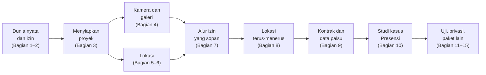

| Bagian | Pertanyaan yang dijawab |
| :--- | :--- |
| 1–2 | Mengapa aplikasi harus minta izin, siapa yang memutuskan, dan apa saja kemungkinan jawabannya? |
| 3 | Apa yang perlu disiapkan di proyek agar kamera dan lokasi bisa dipakai di Android, iOS, dan web? |
| 4–6 | Bagaimana mengambil foto dan lokasi, lalu mengolah koordinat menjadi jarak, arah, dan keputusan "di dalam area"? |
| 7–8 | Bagaimana meminta izin tanpa membuat pengguna kesal, dan bagaimana mengikuti lokasi tanpa menguras baterai? |
| 9–10 | Bagaimana fitur perangkat masuk ke arsitektur Pertemuan 12, sehingga aplikasinya bisa diuji tanpa HP? |
| 11–15 | Bagaimana menguji tanpa keluar ruangan, menjaga privasi pengguna, memilih paket lain, dan menghindari kesalahan umum? |

**Kode contoh hari ini:**

| No. | Berkas | Isi | Jalan di |
| :---: | :--- | :--- | :--- |
| 01 | [`contoh_01_status_izin_dart_murni.dart`](kode/contoh_01_status_izin_dart_murni.dart) | Status izin dan "sistem operasi tiruan" dalam Dart murni | DartPad |
| 02 | [`contoh_02_galeri_dan_kamera.dart`](kode/contoh_02_galeri_dan_kamera.dart) | "Foto Profil": galeri dan kamera dengan `image_picker` | Proyek Flutter |
| 03 | [`contoh_03_lokasi_sekarang.dart`](kode/contoh_03_lokasi_sekarang.dart) | "Di Mana Saya?": layanan, izin, lalu posisi dengan `geolocator` | Proyek Flutter |
| 04 | [`contoh_04_jarak_dan_zona_dart_murni.dart`](kode/contoh_04_jarak_dan_zona_dart_murni.dart) | Jarak, arah, dan aturan zona presensi dalam Dart murni | DartPad |
| 05 | [`contoh_05_alur_izin_yang_sopan.dart`](kode/contoh_05_alur_izin_yang_sopan.dart) | "Ruang Belajar": simulasi alur izin yang sopan | DartPad |
| 06 | [`contoh_06_lokasi_terus_menerus.dart`](kode/contoh_06_lokasi_terus_menerus.dart) | "Jalan Pagi": mengikuti lokasi dengan `Stream` | Proyek Flutter |
| 07 | [`contoh_07_kontrak_perangkat_dan_data_palsu.dart`](kode/contoh_07_kontrak_perangkat_dan_data_palsu.dart) | "Catatan Lapangan": kontrak perangkat, data palsu, dan pengujian | DartPad |
| 08 | [`contoh_08_studi_kasus_presensi.dart`](kode/contoh_08_studi_kasus_presensi.dart) | Studi kasus lengkap "Presensi Praktikum" | Proyek Flutter |

---

## 1. Aplikasi yang Menyentuh Dunia Nyata

### 1.1 Dari layar ke dunia nyata

Sampai Pertemuan 12, aplikasi kita mengolah data yang diketik pengguna, diambil dari internet, atau disimpan di perangkat. Banyak aplikasi sehari-hari melangkah lebih jauh: mereka memakai bagian **fisik** HP.

| Aplikasi | Fitur perangkat | Untuk apa |
| :--- | :--- | :--- |
| Ojek dan pesan-antar | Lokasi (GPS) | Menjemput di titik yang tepat dan menghitung ongkos dari jarak |
| Presensi kampus atau kantor | Kamera + lokasi | Memastikan orangnya benar dan berada di tempat yang benar |
| Laporan fasilitas rusak | Kamera + lokasi | Foto bukti beserta titik kerusakannya |
| Dompet digital | Kamera | Memindai kode QR untuk membayar |
| Media sosial | Galeri | Mengunggah foto yang sudah ada di HP |
| Peta dan olahraga | Lokasi terus-menerus | Menunjukkan posisi dan mencatat jarak selama bergerak |

Masih ada fitur lain, misalnya mikrofon, sensor gerak, Bluetooth, NFC, notifikasi, dan sidik jari. Hari ini kita fokus pada dua yang paling sering dipakai: **kamera/galeri** dan **lokasi**. Polanya, yaitu *periksa izin → ambil data → tangani kegagalan*, berlaku juga untuk fitur lainnya.

### 1.2 *Plugin*: jembatan ke perangkat

Kode Dart tidak bisa langsung menyalakan kamera. Setiap sistem operasi punya bahasa dan aturannya sendiri: Android memakai Kotlin atau Java, iOS memakai Swift, dan browser memakai JavaScript. Flutter menjembataninya dengan ***plugin***, yaitu paket yang berisi dua bagian: kode Dart yang kita panggil, dan kode asli untuk setiap platform yang benar-benar bekerja.

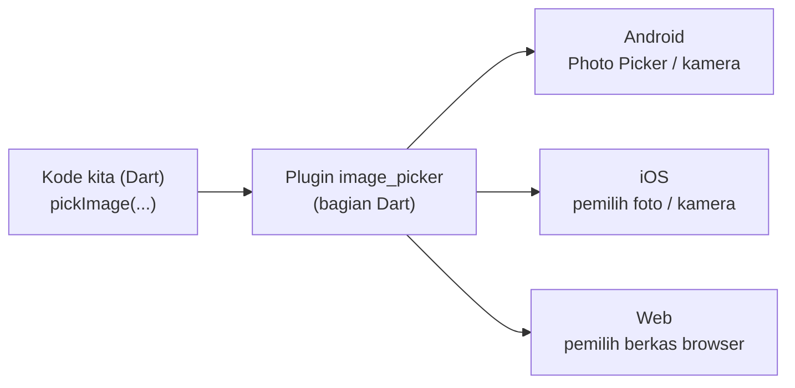

Bayangkan penerjemah di sebuah konferensi internasional. Kita cukup berbicara dalam satu bahasa (Dart), lalu penerjemah meneruskannya ke bahasa setiap negara. Kita tidak perlu menguasai Kotlin, Swift, dan JavaScript sekaligus.

Dua *plugin* yang kita pakai hari ini:

| Paket | Versi | Pembuat | Kegunaan |
| :--- | :---: | :--- | :--- |
| [`image_picker`](https://pub.dev/packages/image_picker) | 1.2.4 | Tim Flutter | Memilih foto atau video dari galeri, atau memotret dengan aplikasi kamera bawaan |
| [`geolocator`](https://pub.dev/packages/geolocator) | 14.1.1 | Baseflow | Memeriksa layanan dan izin lokasi, mengambil posisi, mengikuti perubahan posisi, dan menghitung jarak |

Versi di atas adalah versi terbaru per 16 Oktober 2026. Perintah `flutter pub add` selalu memasang versi terbaru yang cocok dengan proyek Anda.

> [!IMPORTANT]
> DartPad hanya menyediakan sekumpulan paket tertentu, dan `image_picker` serta `geolocator` **tidak** termasuk di dalamnya. Karena itu Contoh 02, 03, 06, dan 08 dijalankan di proyek Flutter di laptop Anda. Sebaliknya, Contoh 05 dan 07 sengaja dibuat **tanpa** kedua paket itu (memakai simulasi dan data palsu), sehingga alurnya bisa dicoba langsung di DartPad.

### 1.3 Tiga tempat mencoba

| Tempat | Kamera dan galeri | Lokasi | Cocok untuk |
| :--- | :--- | :--- | :--- |
| **Chrome** (`flutter run -d chrome`) | Membuka pemilih berkas komputer. Di laptop, tombol kamera biasanya juga membuka pemilih berkas | Lokasi dari browser, dan bisa diatur sendiri lewat DevTools → *Sensors* | Laptop dengan RAM 8 GB; latihan alur dan tampilan |
| **Emulator Android** | Kamera virtual milik emulator | Diatur lewat *Extended controls* → *Location* | Mencoba dialog izin Android tanpa HP |
| **HP Android** (kabel USB) | Kamera dan galeri sungguhan | GPS sungguhan | Pengalaman paling lengkap |

Cara mengatur lokasi di Chrome dan emulator dibahas di [Bagian 11](#11-menguji-tanpa-keluar-ruangan).

---

## 2. Izin Akses: Percakapan Tiga Pihak

### 2.1 Mengapa harus minta izin?

Foto di galeri dan lokasi adalah **data pribadi**. Dari riwayat lokasi seseorang, orang lain bisa menebak alamat rumahnya, tempat kuliahnya, dan jam berapa ia biasa berangkat. Karena itu sistem operasi modern tidak membiarkan aplikasi mengambilnya diam-diam. Aplikasi harus **minta izin**, dan keputusannya ada di tangan pengguna.

Bayangkan sebuah kantor dengan satpam di pintu masuk. Seorang tamu (**aplikasi**) ingin masuk ke ruang arsip (**kamera** atau **lokasi**). Satpam (**sistem operasi**) tidak memutuskan sendiri: ia bertanya kepada pemilik ruangan (**pengguna**), lalu mencatat jawabannya di buku tamu. Tamu tidak boleh menulis di buku tamu itu. Ia hanya boleh bertanya, "Saya sudah diizinkan atau belum?"

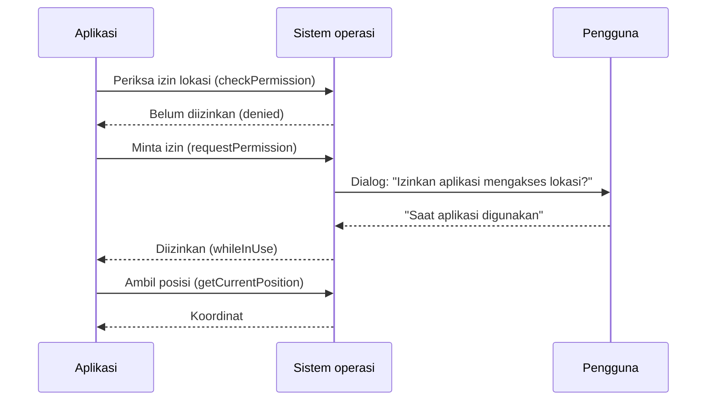

Tiga hal penting dari gambar di atas:

1. **Catatan izin disimpan oleh sistem operasi**, bukan oleh aplikasi. Aplikasi tidak bisa mengubahnya sendiri.
2. **Memeriksa** izin tidak pernah memunculkan dialog. **Meminta** izin memunculkan dialog, tetapi hanya jika izin itu masih boleh diminta.
3. Pengguna bisa **mencabut** izin kapan saja lewat Pengaturan, bahkan setelah memberikannya. Jadi aplikasi harus memeriksa izin **setiap kali** akan memakai fiturnya, bukan sekali saja saat pertama kali dibuka.

### 2.2 Izin biasa dan izin yang ditanyakan

Android membedakan dua jenis izin:

| Jenis | Contoh | Cara memperolehnya |
| :--- | :--- | :--- |
| Izin saat pemasangan (*install-time*) | `INTERNET` | Cukup ditulis di `AndroidManifest.xml`; diberikan otomatis saat aplikasi dipasang |
| Izin saat dipakai (*runtime*) | Lokasi, kamera, mikrofon, kontak | Ditulis di `AndroidManifest.xml` **dan** ditanyakan kepada pengguna lewat dialog saat aplikasi berjalan |

Di **iOS**, semua data yang sensitif (lokasi, kamera, galeri, mikrofon) selalu ditanyakan, dan aplikasi wajib menuliskan **alasan pemakaiannya** di `Info.plist`. Alasan itu ikut tampil di dialog izin. Di **web**, yang bertanya adalah browser, dan hanya untuk situs dengan alamat aman (HTTPS atau `localhost`).

### 2.3 Lima status izin lokasi

Paket `geolocator` melaporkan izin lokasi dengan `enum LocationPermission`. [Contoh 01](kode/contoh_01_status_izin_dart_murni.dart) menirunya dengan nama Indonesia:

```dart
/// Status izin lokasi. Padanannya di paket geolocator ditulis di kanan.
enum StatusIzin {
  /// Belum pernah diminta, ATAU baru ditolak. Masih BOLEH diminta lagi.
  ditolak('denied'),

  /// Ditolak permanen: dialog izin tidak akan muncul lagi.
  ditolakPermanen('deniedForever'),

  /// Diizinkan selama aplikasi sedang dipakai.
  saatDipakai('whileInUse'),

  /// Diizinkan, termasuk saat aplikasi berjalan di latar belakang.
  selalu('always'),

  /// Tidak bisa diketahui (hanya terjadi di browser lama).
  tidakDiketahui('unableToDetermine');

  const StatusIzin(this.namaDiGeolocator);
  final String namaDiGeolocator;
}
```

| `LocationPermission` | Artinya | Boleh diminta lagi? |
| :--- | :--- | :---: |
| `denied` | Belum pernah diminta, **atau** baru saja ditolak | ✔ |
| `deniedForever` | Ditolak permanen. Dialog tidak akan muncul lagi | ✘ (hanya lewat Pengaturan) |
| `whileInUse` | Diizinkan selama aplikasi sedang dipakai | — |
| `always` | Diizinkan, termasuk saat aplikasi berjalan di latar belakang | — |
| `unableToDetermine` | Status tidak bisa diketahui. Hanya terjadi di browser yang belum mendukung pemeriksaan izin | ✔ |

Perhatikan bahwa `denied` mencakup **dua** keadaan: belum pernah ditanya, dan sudah ditolak sekali. Keduanya sama-sama boleh diminta lagi.

### 2.4 Aturan main di Android

Android punya beberapa aturan yang perlu diketahui sejak awal:

| Aturan | Akibatnya bagi aplikasi |
| :--- | :--- |
| **Penolakan kedua dianggap permanen.** Sejak Android 11, jika pengguna menolak izin yang sama lebih dari sekali, Android menganggapnya "jangan tanya lagi" | `requestPermission()` langsung menjawab `deniedForever` tanpa menampilkan dialog. Satu-satunya jalan adalah Pengaturan |
| **"Hanya kali ini".** Untuk lokasi, kamera, dan mikrofon, pengguna boleh memberi izin sementara | Setelah aplikasi ditutup, izinnya dicabut otomatis. Saat dibuka lagi, statusnya kembali `denied` |
| **Lokasi perkiraan atau tepat.** Sejak Android 12, pengguna boleh memberi lokasi **perkiraan** saja | Lokasi perkiraan hanya akurat sampai area sekitar 3 km persegi; lokasi **tepat** biasanya akurat sampai sekitar 50 m, kadang beberapa meter. Aplikasi harus tetap berfungsi dengan lokasi perkiraan, minimal dengan pesan yang jelas |
| **Reset otomatis.** Izin milik aplikasi yang lama tidak dibuka bisa dicabut otomatis oleh Android | Izin yang kemarin ada, hari ini bisa hilang |
| **Pengguna bisa mengubah izin kapan saja** di Pengaturan → Aplikasi → *nama aplikasi* → Izin | Izin bisa berubah saat aplikasi sedang di latar belakang |

Kesimpulannya: **jangan pernah menganggap izin sudah pasti ada.** Periksa setiap kali.

### 2.5 Dari keadaan ke tindakan

Sebelum memakai lokasi, aplikasi menghadapi **dua** pertanyaan: apakah sakelar Lokasi di HP menyala (**layanan lokasi**), dan apakah aplikasi diizinkan (**izin**). Contoh 01 menjawabnya dengan satu fungsi:

```dart
/// Urutan pemeriksaannya penting: layanan dulu, baru izin.
Tindakan tindakanUntuk({required bool layananAktif, required StatusIzin izin}) {
  if (!layananAktif) return Tindakan.nyalakanLayanan;
  // switch ekspresi WAJIB menangani semua nilai enum. Jika kelak ada
  // status baru, analyzer langsung mengingatkan kita.
  return switch (izin) {
    StatusIzin.saatDipakai || StatusIzin.selalu => Tindakan.ambilLokasi,
    // Di browser lama status tidak bisa diketahui, jadi langsung minta.
    StatusIzin.ditolak || StatusIzin.tidakDiketahui => Tindakan.mintaIzin,
    StatusIzin.ditolakPermanen => Tindakan.bukaPengaturan,
  };
}
```

| Keadaan | Tindakan aplikasi |
| :--- | :--- |
| Layanan lokasi mati | Minta pengguna menyalakan layanan lokasi |
| `denied` atau `unableToDetermine` | Tampilkan dialog izin |
| `deniedForever` | Jelaskan, lalu tawarkan tombol "Buka Pengaturan" |
| `whileInUse` atau `always` | Ambil lokasi sekarang |

Mengapa layanan diperiksa lebih dulu? Izin dan layanan adalah dua sakelar yang berbeda. Izin boleh saja sudah diberikan, tetapi jika sakelar Lokasi di HP mati, posisi tetap tidak bisa diambil. Meminta izin saat layanan mati hanya membuat pengguna menjawab dialog yang tidak ada gunanya.

### 2.6 Menjalankan Contoh 01

Buka [DartPad](https://dartpad.dev), tempel isi [Contoh 01](kode/contoh_01_status_izin_dart_murni.dart), lalu klik **Run**. Contoh ini berisi `SistemOperasiTiruan`, yaitu "sistem operasi" kecil yang meniru aturan Android, sehingga kita bisa melihat percakapan izin tanpa HP. Bagian keduanya bercerita tentang Rina:

```text
=== 2. Cerita Rina ===
[1] Aplikasi baru dipasang. Periksa izin: ditolak
[2] Rina mengetuk "Gunakan lokasi saya".
    Dialog sistem muncul -> dipilih "Jangan izinkan"
    Hasil: ditolak (penolakan ke-1, masih boleh diminta)
[3] Rina mengetuk lagi.
    Dialog sistem muncul -> dipilih "Jangan izinkan"
    Hasil: ditolakPermanen (penolakan ke-2)
[4] Rina mengetuk lagi.
    Dialog TIDAK muncul -> langsung: ditolakPermanen
    Aplikasi: Jelaskan, lalu tawarkan tombol "Buka Pengaturan"
[5] Rina membuka Pengaturan dan memilih "Izinkan".
    Periksa izin: saatDipakai -> Ambil lokasi sekarang
[6] Rina mematikan sakelar Lokasi di HP.
    Izin tetap saatDipakai, tetapi: Minta pengguna menyalakan layanan lokasi
```

Perhatikan langkah [4]: setelah dua kali ditolak, **dialog tidak muncul lagi** walaupun aplikasi memintanya. Jika aplikasi tidak menangani keadaan ini, tombol "Gunakan lokasi saya" seolah-olah rusak: diketuk berkali-kali, tidak terjadi apa-apa. Itulah sebabnya keadaan `deniedForever` harus punya pesan dan tombolnya sendiri.

Bagian ketiga memperlihatkan Budi yang memilih **"Hanya kali ini"**. Keesokan harinya, statusnya kembali `ditolak`, sehingga izin harus diminta lagi.

> **Uji pemahaman**
>
> **1.** Aplikasi memanggil `checkPermission()` dan mendapat `denied`. Apakah ini pasti berarti pengguna pernah menolak?
>
> <details><summary>Lihat jawaban</summary>
>
> Tidak. `denied` juga berarti izin **belum pernah diminta**. Kedua keadaan itu sama-sama boleh diminta lagi dengan `requestPermission()`.
> </details>
>
> **2.** Mengapa aplikasi tidak boleh hanya memeriksa izin sekali saat pertama kali dibuka?
>
> <details><summary>Lihat jawaban</summary>
>
> Karena izin bisa berubah kapan saja: dicabut pengguna lewat Pengaturan, berakhir karena pengguna memilih "Hanya kali ini", atau dicabut otomatis oleh Android jika aplikasi lama tidak dibuka. Izin harus diperiksa **setiap kali** fiturnya akan dipakai.
> </details>

---

## 3. Menyiapkan Proyek: Paket dan Pengaturan Platform

Fitur perangkat membutuhkan dua persiapan: **paketnya** dipasang, lalu **pengaturan platform** ditulis agar sistem operasi tahu bahwa aplikasi kita akan memakai lokasi atau kamera.

### 3.1 Menambah paket

Di folder proyek, jalankan:

```bash
flutter pub add image_picker geolocator
```

Perintah ini menambahkan dua baris ke `pubspec.yaml` (urutannya menurut abjad):

```yaml
dependencies:
  flutter:
    sdk: flutter
  geolocator: ^14.1.1
  image_picker: ^1.2.4
```

Contoh 07 dan 08 juga memakai `provider` (`flutter pub add provider`), sama seperti Pertemuan 9–12.

> [!WARNING]
> Setelah menambah *plugin* atau mengubah pengaturan platform, **hentikan aplikasi lalu jalankan ulang** dengan `flutter run`. *Hot reload* dan *hot restart* hanya memuat ulang kode Dart, bukan kode asli Android/iOS. Jika lupa, biasanya muncul galat `MissingPluginException`.

### 3.2 Android: `AndroidManifest.xml`

Buka berkas `android/app/src/main/AndroidManifest.xml`, lalu tambahkan dua baris izin lokasi **di atas** tag `<application>`:

```xml
<manifest xmlns:android="http://schemas.android.com/apk/res/android">
    <!-- Lokasi perkiraan (area sekitar 3 km persegi). -->
    <uses-permission android:name="android.permission.ACCESS_COARSE_LOCATION" />
    <!-- Lokasi tepat (GPS). Di Android 12 ke atas wajib ditulis bersama
         ACCESS_COARSE_LOCATION, karena pengguna boleh memilih salah satunya. -->
    <uses-permission android:name="android.permission.ACCESS_FINE_LOCATION" />

    <application
        android:label="presensi_praktikum"
        ...>
```

| Baris | Kegunaan |
| :--- | :--- |
| `ACCESS_COARSE_LOCATION` | Izin lokasi **perkiraan** |
| `ACCESS_FINE_LOCATION` | Izin lokasi **tepat**. Dialog Android menampilkan pilihan "Tepat" dan "Perkiraan" jika kedua baris ada |

Untuk `image_picker`, Android **tidak** membutuhkan baris tambahan. Di Android 13 ke atas, galeri dibuka lewat **Photo Picker** milik sistem: pengguna memilih foto tertentu saja, sehingga aplikasi tidak perlu izin membaca seluruh galeri. Kamera dibuka lewat aplikasi kamera bawaan, yang juga tidak membutuhkan izin `CAMERA` dari aplikasi kita.

> [!CAUTION]
> Jangan menambahkan `<uses-permission android:name="android.permission.CAMERA" />` hanya karena memakai `image_picker`. Jika izin itu tertulis di manifest tetapi belum diberikan pengguna, Android justru **menolak** membuka aplikasi kamera bawaan. Tambahkan izin `CAMERA` hanya jika Anda membuat tampilan kamera sendiri, misalnya dengan paket `camera` ([Bagian 13](#13-paket-lain-dan-kapan-memakainya)).

Izin lokasi **latar belakang** (`ACCESS_BACKGROUND_LOCATION`) tidak kita pakai. Izin itu hanya untuk aplikasi yang benar-benar harus melacak lokasi saat tidak dibuka, dan Google Play memeriksanya dengan ketat.

### 3.3 iOS: `Info.plist`

Di iOS, setiap fitur sensitif wajib punya **kalimat alasan** (*purpose string*) di `ios/Runner/Info.plist`. Kalimat ini tampil di dialog izin. Tambahkan di dalam `<dict>`:

```xml
<key>NSPhotoLibraryUsageDescription</key>
<string>Anda bisa memilih foto dari galeri sebagai foto profil.</string>
<key>NSCameraUsageDescription</key>
<string>Aplikasi memotret foto profil dan foto presensi dengan kamera.</string>
<key>NSLocationWhenInUseUsageDescription</key>
<string>Aplikasi memeriksa jarak Anda ke laboratorium saat presensi.</string>
```

Pedoman Apple untuk kalimat alasan: satu kalimat lengkap yang **aktif** (bukan kalimat pasif), **spesifik** tentang cara dan alasan data dipakai, mudah dipahami, dan diakhiri titik. Bandingkan:

| ✘ Kurang baik | Mengapa | ✔ Lebih baik |
| :--- | :--- | :--- |
| `Lokasi dibutuhkan agar pengalaman lebih baik.` | Kalimat pasif, alasannya kabur | `Aplikasi memeriksa jarak Anda ke laboratorium saat presensi.` |
| `Izinkan akses kamera.` | Kalimat perintah tanpa alasan | `Aplikasi memotret foto profil dan foto presensi dengan kamera.` |

Jika kalimat alasan lupa ditulis, fiturnya gagal dipakai: iOS **menutup paksa** aplikasi saat kamera atau galeri dibuka, sedangkan `geolocator` melempar `PermissionDefinitionsNotFoundException` saat izin lokasi diminta. Galat yang sama muncul di Android jika izin lokasi lupa ditulis di `AndroidManifest.xml`. Merekam video bersuara juga membutuhkan `NSMicrophoneUsageDescription`. Aplikasi iOS hanya bisa di-*build* di komputer Mac, tetapi baris-baris ini sebaiknya tetap ditulis sejak awal agar proyek siap untuk iOS.

### 3.4 Web

Di web tidak ada berkas pengaturan tambahan, tetapi ada beberapa perbedaan perilaku:

| Hal | Perilaku di browser |
| :--- | :--- |
| Alamat | Lokasi dan kamera hanya tersedia di **konteks aman**: HTTPS atau `localhost`. `flutter run -d chrome` memakai `localhost`, jadi aman |
| Dialog izin | Ditampilkan browser, bukan aplikasi. Izin situs diatur lewat ikon di sebelah kiri alamat situs |
| Layanan lokasi | `isLocationServiceEnabled()` selalu `true` |
| Fungsi yang tidak ada | `openAppSettings()`, `openLocationSettings()`, `getLastKnownPosition()`, dan `getServiceStatusStream()` melempar `UnsupportedError` |
| Foto | `XFile.path` berisi alamat sementara (`blob:...`), bukan lokasi berkas. Tampilkan foto dengan `Image.memory` setelah `readAsBytes()` |
| Kamera di laptop | Biasanya membuka pemilih berkas. Di browser HP, kamera bisa terbuka langsung |

### 3.5 Ringkasan persiapan

| | Android | iOS | Web |
| :--- | :--- | :--- | :--- |
| Galeri | — | `NSPhotoLibraryUsageDescription` | — |
| Kamera | — (jangan tambah `CAMERA`) | `NSCameraUsageDescription` | — |
| Lokasi | `ACCESS_COARSE_LOCATION` + `ACCESS_FINE_LOCATION` | `NSLocationWhenInUseUsageDescription` | HTTPS atau `localhost` |
| Setelah mengubah | Hentikan, lalu `flutter run` ulang | Hentikan, lalu `flutter run` ulang | Muat ulang halaman |

---

## 4. Foto dari Galeri dan Kamera

### 4.1 Cara kerja `image_picker`

`image_picker` tidak membuat tampilan kamera sendiri. Ia **meminjam** pemilih foto dan aplikasi kamera bawaan sistem, lalu mengembalikan hasilnya kepada kita. Seperti meminta teman memotretkan: kita tidak perlu tahu cara mengatur kameranya, cukup menerima fotonya.

Keuntungannya: tampilannya sudah dikenal pengguna, dan di Android 13 ke atas pengguna hanya menyerahkan foto yang **dipilihnya**, bukan seluruh galeri. Ini baik untuk privasi, dan aplikasi kita tidak perlu meminta izin galeri.

[Contoh 02](kode/contoh_02_galeri_dan_kamera.dart) adalah aplikasi "Foto Profil" dengan dua tombol: **Galeri** dan **Kamera**.

### 4.2 Memanggil `pickImage`

```dart
class _HalamanFotoProfilState extends State<HalamanFotoProfil> {
  // Cukup satu objek untuk seluruh halaman.
  final ImagePicker _pemilih = ImagePicker();
  FotoTerpilih? _foto;
  bool _sedangMemilih = false;

  Future<void> _ambilFoto(ImageSource sumber) async {
    if (_sedangMemilih) return; // cegah pemilih terbuka dua kali
    setState(() => _sedangMemilih = true);
    try {
      final XFile? berkas = await _pemilih.pickImage(
        source: sumber,
        maxWidth: 1080, // foto 4000 piksel diperkecil menjadi 1080
        imageQuality: 80, // 0-100; berlaku untuk JPEG (dan WebP)
        // Untuk foto profil, MINTA kamera depan. Ini permintaan, bukan
        // jaminan: sebagian HP Android tetap membuka kamera belakang.
        preferredCameraDevice: CameraDevice.front,
        // Kita tidak butuh metadata lengkap (misalnya lokasi pemotretan).
        // Di iOS, ini juga menghindari permintaan izin tambahan.
        requestFullMetadata: false,
      );
      if (berkas == null) {
        _beriTahu('Tidak ada foto yang dipilih.');
        return;
      }
      await _tampilkan(berkas);
    } on PlatformException catch (e) {
      _beriTahu(pesanGalatFoto(e));
    } finally {
      if (mounted) setState(() => _sedangMemilih = false);
    }
  }
  // ...
}
```

| Bagian | Penjelasan |
| :--- | :--- |
| `ImagePicker()` | Objek pemilih. Tidak memakai `const`, dan cukup dibuat **sekali** sebagai *field* |
| `source: ImageSource.gallery` / `ImageSource.camera` | Membuka galeri atau aplikasi kamera |
| `maxWidth: 1080` | Foto kamera HP bisa berukuran 4000 piksel lebih. Untuk foto profil, 1080 piksel sudah lebih dari cukup, dan berkasnya jauh lebih kecil |
| `imageQuality: 80` | Mengurangi kualitas kompresi (0–100). Berlaku untuk JPEG, dan di Android juga beberapa format lain |
| `preferredCameraDevice: CameraDevice.front` | **Meminta** kamera depan. Tidak semua HP Android menurutinya |
| `requestFullMetadata: false` | Tidak meminta metadata lengkap seperti lokasi pemotretan. Di iOS, ini juga menghindari permintaan izin galeri tambahan |
| `_sedangMemilih` | Penjaga ketukan ganda, seperti Perintah di Pertemuan 12. Membuka pemilih dua kali sekaligus menghasilkan galat `already_active` (Android) atau `multiple_request` (iOS) |

### 4.3 Tiga kemungkinan hasil

`pickImage` bisa berakhir dengan tiga cara:

| Hasil | Artinya | Tanggapan yang baik |
| :--- | :--- | :--- |
| `XFile` | Pengguna memilih atau memotret foto | Tampilkan fotonya |
| `null` | Pengguna **membatalkan** (menutup pemilih atau menekan tombol kembali) | Bukan kesalahan. Pesan singkat, atau tidak ada pesan sama sekali |
| `PlatformException` | Ada masalah, misalnya akses kamera ditolak | Pesan yang menjelaskan masalah dan jalan keluarnya |

Galatnya diterjemahkan menjadi kalimat di **satu** fungsi:

```dart
/// Mengubah kode galat image_picker menjadi kalimat untuk pengguna.
String pesanGalatFoto(PlatformException e) {
  return switch (e.code) {
    'camera_access_denied' =>
      'Akses kamera ditolak. Anda bisa mengizinkannya di Pengaturan.',
    'photo_access_denied' =>
      'Akses galeri ditolak. Anda bisa mengizinkannya di Pengaturan.',
    'camera_access_restricted' ||
    'photo_access_restricted' => 'Akses dibatasi oleh pengaturan perangkat.',
    'no_available_camera' => 'Perangkat ini tidak memiliki kamera.',
    'already_active' ||
    'multiple_request' => 'Pemilih foto masih terbuka. Coba lagi.',
    _ => 'Foto gagal diambil (${e.code}).',
  };
}
```

| Kode | Muncul di | Artinya |
| :--- | :--- | :--- |
| `camera_access_denied` | Android, iOS | Akses kamera ditolak |
| `photo_access_denied` | iOS | Akses galeri ditolak |
| `camera_access_restricted`, `photo_access_restricted` | iOS | Dibatasi oleh pengaturan perangkat, misalnya kontrol orang tua |
| `no_available_camera` | Android | Perangkat tidak punya kamera |
| `already_active`, `multiple_request` | Android, iOS | Pemilih sebelumnya masih terbuka |

Cabang `_` menangkap kode lain yang mungkin muncul, dan kodenya ikut ditampilkan agar mudah dilaporkan.

### 4.4 Membaca dan menampilkan foto

Hasil `pickImage` adalah `XFile`, yaitu "berkas" yang bisa dibaca dengan cara yang sama di Android, iOS, dan web:

```dart
/// Membaca isi berkas, lalu mencari tahu ukuran gambarnya.
Future<void> _tampilkan(XFile berkas) async {
  final Uint8List bita = await berkas.readAsBytes();
  final ui.Image gambar = await decodeImageFromList(bita);
  final FotoTerpilih foto = FotoTerpilih(
    nama: berkas.name,
    bita: bita,
    lebar: gambar.width,
    tinggi: gambar.height,
    jenis: berkas.mimeType,
  );
  gambar.dispose(); // yang kita perlukan hanya ukurannya
  if (!mounted) return;
  setState(() => _foto = foto);
}
```

| Anggota `XFile` | Isinya |
| :--- | :--- |
| `name` | Nama berkas, misalnya `IMG_20261016_093012.jpg` |
| `path` | Lokasi berkas di HP. Di web berisi alamat sementara `blob:...` |
| `mimeType` | Jenis berkas, misalnya `image/jpeg`. **Bisa `null`** di Android |
| `length()` | Ukuran berkas dalam bita (`Future<int>`) |
| `readAsBytes()` | Seluruh isi berkas sebagai `Uint8List` (`Future`) |

Foto ditampilkan dengan `Image.memory`:

```dart
// cacheWidth: gambar diuraikan (decode) seukuran tampilan
// saja, sehingga memori tidak terbuang untuk foto besar.
Image.memory(f.bita, fit: BoxFit.cover, cacheWidth: 480),
```

Mengapa bukan `Image.file(File(berkas.path))`? Karena `File` berasal dari `dart:io`, yang **tidak tersedia di web**. `Image.memory` berjalan di semua platform.

> [!NOTE]
> Foto dari kamera disimpan sistem di folder **sementara** (*cache*) yang bisa dibersihkan kapan saja. Jika foto harus disimpan lama, salin ke folder dokumen aplikasi (paket `path_provider` dan `XFile.saveTo`) atau unggah ke server. Contoh hari ini cukup menyimpannya di memori selama aplikasi terbuka.

### 4.5 Tombol Kamera hanya jika didukung

Tidak semua perangkat bisa memotret. Di Windows, macOS, dan Linux, `image_picker` tidak bisa membuka kamera tanpa pengaturan tambahan. Karena itu tombol Kamera hanya ditampilkan jika didukung:

```dart
// Di Android, iOS, dan web: true. Di Windows/Linux/macOS: false.
final bool kameraAda = _pemilih.supportsImageSource(ImageSource.camera);
// ...
if (kameraAda)
  FilledButton.tonalIcon(
    onPressed: _sedangMemilih
        ? null
        : () => _ambilFoto(ImageSource.camera),
    icon: const Icon(Icons.photo_camera_outlined),
    label: const Text('Kamera'),
  ),
```

### 4.6 Khusus Android: foto yang sempat "hilang"

Saat aplikasi kamera terbuka, aplikasi kita berpindah ke latar belakang. Jika memori HP menipis, Android boleh **mematikan** aplikasi kita. Ketika pengguna selesai memotret, aplikasi dibuka ulang dari awal, dan foto tadi seolah-olah hilang. `image_picker` menyimpannya, dan foto itu bisa diminta **sekali** lewat `retrieveLostData()`:

```dart
@override
void initState() {
  super.initState();
  _pulihkanFotoYangHilang();
}

Future<void> _pulihkanFotoYangHilang() async {
  if (kIsWeb || defaultTargetPlatform != TargetPlatform.android) return;
  final LostDataResponse respons = await _pemilih.retrieveLostData();
  final XFile? berkas = respons.file;
  if (respons.isEmpty || berkas == null) return;
  await _tampilkan(berkas);
}
```

`retrieveLostData()` hanya ada di Android, jadi platform diperiksa dulu. Urutan `kIsWeb ||` penting: di web, `defaultTargetPlatform` bisa bernilai `android` jika halaman dibuka dari browser HP Android.

### 4.7 Lebih dari satu foto

Untuk memilih beberapa foto sekaligus, misalnya galeri kegiatan, pakai `pickMultiImage`:

```dart
final List<XFile> daftar = await _pemilih.pickMultiImage(
  maxWidth: 1080,
  imageQuality: 80,
  limit: 5, // paling banyak 5 foto (berlaku di Android dan iOS)
);
if (daftar.isEmpty) return; // dibatalkan: daftar kosong, bukan null
```

`image_picker` juga punya `pickVideo` untuk video dan `pickMedia` untuk foto atau video sekaligus.

### 4.8 Menjalankan Contoh 02

1. Buat proyek baru: `flutter create foto_profil`, lalu masuk ke foldernya.
2. Jalankan `flutter pub add image_picker`.
3. Salin isi [Contoh 02](kode/contoh_02_galeri_dan_kamera.dart) ke `lib/main.dart`.
4. Jalankan `flutter run -d chrome --web-port=8080`, atau `flutter run` jika HP Android tersambung.

<p align="center">
  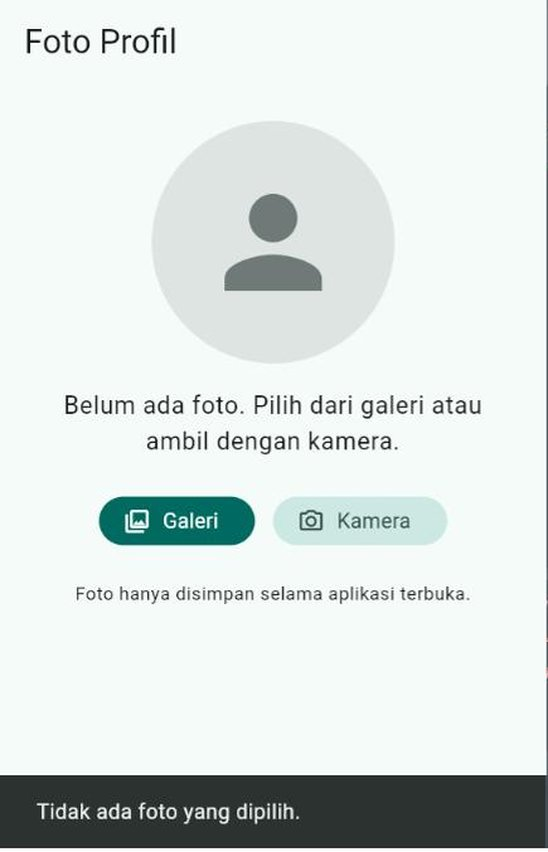
  &nbsp;
  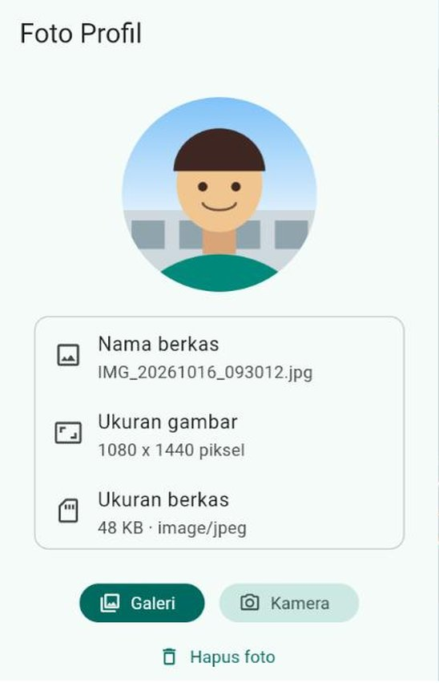
</p>

Gambar kiri: pengguna menutup pemilih tanpa memilih foto, sehingga hasilnya `null` dan muncul pesan singkat. Gambar kanan: foto dari kamera sudah diperkecil menjadi lebar **1080 piksel**, sesuai `maxWidth`.

---

## 5. Lokasi Perangkat

### 5.1 Koordinat: alamat bumi dalam dua angka

Setiap titik di permukaan bumi bisa ditulis dengan dua angka:

| Angka | Nama | Rentang | Contoh |
| :--- | :--- | :--- | :--- |
| **Lintang** | *latitude* | −90 (kutub selatan) sampai 90 (kutub utara). Negatif berarti di selatan khatulistiwa | `-0.4700` |
| **Bujur** | *longitude* | −180 sampai 180. Positif berarti di sebelah timur kota Greenwich (Inggris) | `117.1580` |

Wilayah Indonesia membentang di sekitar khatulistiwa, sehingga lintangnya kira-kira antara −11 dan 6, sedangkan bujurnya antara 95 dan 141. Koordinat di modul ini hanyalah **contoh**; ganti dengan koordinat kampus Anda. Cara mendapatkannya: buka Google Maps di laptop, klik kanan titik yang diinginkan, lalu klik angka koordinat yang muncul di baris paling atas untuk menyalinnya.

### 5.2 Akurasi: lingkaran ketidakpastian

GPS tidak pernah memberi posisi yang sempurna. Selain koordinat, `geolocator` melaporkan **akurasi** dalam meter, yaitu jari-jari lingkaran tempat posisi sebenarnya kemungkinan besar berada. Di aplikasi peta, akurasi inilah yang digambar sebagai lingkaran biru transparan di sekitar titik biru.

| Keadaan | Akurasi yang biasa didapat |
| :--- | :--- |
| Di luar ruangan, langit terbuka | Sekitar 3–10 m |
| Di dalam gedung, dekat jendela | Sekitar 10–30 m |
| Di dalam gedung, jauh dari jendela | Bisa puluhan sampai ratusan meter |
| Pengguna hanya memberi izin lokasi **perkiraan** | Area sekitar 3 km persegi |

Angka di atas hanya gambaran; hasil nyata bergantung pada HP, cuaca, dan bangunan. Pelajaran pentingnya: aplikasi yang mengambil keputusan dari lokasi, seperti presensi, **harus ikut memeriksa akurasi** ([Bagian 6.4](#64-aturan-zona-presensi)).

### 5.3 Tiga pemeriksaan berurutan

[Contoh 03](kode/contoh_03_lokasi_sekarang.dart) adalah aplikasi "Di Mana Saya?" yang menghitung jarak ke kampus. Inti pekerjaannya ada di satu fungsi dengan tiga langkah:

```dart
/// Layanan -> izin -> posisi. Urutannya penting.
Future<KeadaanLokasi> _ambilLokasi() async {
  // 1. Sakelar Lokasi di perangkat. (Di web selalu true.)
  if (!await Geolocator.isLocationServiceEnabled()) {
    return const LokasiGagal(MasalahLokasi.layananMati);
  }

  // 2. Izin. checkPermission() tidak pernah menampilkan dialog;
  //    requestPermission() menampilkannya jika masih boleh.
  LocationPermission izin = await Geolocator.checkPermission();
  if (izin == LocationPermission.denied ||
      izin == LocationPermission.unableToDetermine) {
    izin = await Geolocator.requestPermission();
  }
  final MasalahLokasi? masalahIzin = switch (izin) {
    LocationPermission.denied => MasalahLokasi.izinDitolak,
    LocationPermission.deniedForever => MasalahLokasi.izinDiblokir,
    LocationPermission.whileInUse ||
    LocationPermission.always ||
    LocationPermission.unableToDetermine => null,
  };
  if (masalahIzin != null) return LokasiGagal(masalahIzin);

  // 3. Posisi. GPS bisa lama di dalam gedung, jadi diberi batas waktu.
  try {
    final Position posisi = await Geolocator.getCurrentPosition(
      locationSettings: const LocationSettings(
        accuracy: LocationAccuracy.high,
        timeLimit: Duration(seconds: 15),
      ),
    );
    return LokasiDitemukan(posisi);
  } on TimeoutException {
    return const LokasiGagal(MasalahLokasi.waktuHabis);
  } on LocationServiceDisabledException {
    return const LokasiGagal(MasalahLokasi.layananMati);
  } on PermissionDeniedException {
    return const LokasiGagal(MasalahLokasi.izinDitolak);
  } on PositionUpdateException {
    return const LokasiGagal(MasalahLokasi.lainnya);
  }
}
```

| Langkah | Penjelasan |
| :--- | :--- |
| `isLocationServiceEnabled()` | Apakah sakelar Lokasi di HP menyala? Jika mati, tidak ada gunanya meminta izin |
| `checkPermission()` | Melihat status izin **tanpa** dialog |
| `requestPermission()` | Dipanggil **hanya** jika status masih `denied` (atau `unableToDetermine`). Jika sudah `deniedForever`, memanggilnya tidak akan memunculkan dialog |
| `switch (izin)` | Kelima nilai `LocationPermission` wajib ditangani. Analyzer akan protes jika satu terlewat |
| `getCurrentPosition(...)` | Menyalakan GPS dan menunggu satu posisi baru |
| `timeLimit: Duration(seconds: 15)` | Jika 15 detik belum dapat posisi, dilempar `TimeoutException`. Tanpa batas waktu, pengguna bisa menunggu tanpa akhir di dalam gedung |
| `on ...` | Setiap *exception* diterjemahkan menjadi masalah yang punya pesan sendiri |

`TimeoutException` berasal dari `dart:async`, karena itu Contoh 03 mengimpor `dart:async`.

**Empat keadaan layar.** Hasil fungsi di atas adalah `KeadaanLokasi`, sebuah `sealed class` dengan empat anggota: `BelumDiminta`, `SedangMencari`, `LokasiDitemukan(posisi)`, dan `LokasiGagal(masalah)`. Di `build`, `switch` atas keadaan ini menentukan apa yang tampil, persis seperti `Hasil` di Pertemuan 12.

### 5.4 *Exception* dari `geolocator`

| *Exception* | Kapan muncul |
| :--- | :--- |
| `TimeoutException` | Posisi belum didapat sampai `timeLimit` habis |
| `LocationServiceDisabledException` | Layanan lokasi dimatikan, termasuk saat posisi sedang dicari |
| `PermissionDeniedException` | Izin tidak ada saat posisi diminta, misalnya baru dicabut pengguna |
| `PositionUpdateException` | Posisi gagal didapat karena sebab lain |
| `PermissionRequestInProgressException` | `requestPermission()` dipanggil lagi sebelum dialog sebelumnya dijawab |
| `PermissionDefinitionsNotFoundException` | Izin lokasi lupa ditulis di `AndroidManifest.xml` atau `Info.plist` ([Bagian 3](#3-menyiapkan-proyek-paket-dan-pengaturan-platform)) |

Dua yang terakhir menandakan **kesalahan kode** kita, bukan keadaan pengguna, jadi sengaja tidak ditangkap: lebih baik terlihat jelas saat pengembangan.

### 5.5 `LocationSettings`: seberapa akurat?

```dart
const LocationSettings(
  accuracy: LocationAccuracy.high, // tingkat akurasi yang diminta
  distanceFilter: 0, // dipakai oleh Stream (Bagian 8)
  timeLimit: Duration(seconds: 15), // batas waktu menunggu posisi
)
```

| `LocationAccuracy` | Gambaran |
| :--- | :--- |
| `lowest`, `low` | Hemat baterai, akurasi ratusan meter sampai kilometer |
| `medium` | Akurasi puluhan sampai ratusan meter |
| `high` | Akurasi beberapa meter sampai puluhan meter. **Cukup untuk presensi** |
| `best`, `bestForNavigation` | Paling akurat, paling boros baterai. Untuk navigasi |
| `reduced` | Sengaja dikaburkan (iOS 14+), mirip lokasi perkiraan |

Semakin tinggi akurasi, semakin boros baterai dan semakin lama menunggu. Pilih yang **cukup**, bukan yang tertinggi. Versi lama `geolocator` memakai parameter `desiredAccuracy:` dan `timeLimit:` langsung di `getCurrentPosition`; keduanya sudah **usang** (*deprecated*), jadi pakai `locationSettings:` seperti di atas. Untuk pengaturan khusus satu platform, tersedia turunan `AndroidSettings`, `AppleSettings`, dan `WebSettings`.

> [!TIP]
> `Geolocator.getLastKnownPosition()` mengembalikan posisi **terakhir** yang tersimpan di HP secara instan, tanpa menyalakan GPS. Hasilnya bisa sudah lama atau `null`, dan tidak tersedia di web. Cocok untuk tampilan awal yang cepat, **tidak** cocok untuk presensi yang butuh posisi saat ini.

### 5.6 Kembali dari Pengaturan

Saat izin diblokir, aplikasi menawarkan tombol **Buka Pengaturan**. Pengaturan adalah aplikasi **lain**, jadi aplikasi kita berpindah ke latar belakang. Ketika pengguna kembali, sebaiknya aplikasi langsung memeriksa ulang, tanpa menyuruh pengguna mengetuk tombol lagi. Caranya dengan `AppLifecycleListener`:

```dart
class _HalamanLokasiState extends State<HalamanLokasi> {
  KeadaanLokasi _keadaan = const BelumDiminta();
  late final AppLifecycleListener _pendengar;

  @override
  void initState() {
    super.initState();
    // Dipanggil setiap kali aplikasi kembali aktif, misalnya setelah
    // pengguna membuka Pengaturan lalu kembali ke aplikasi ini.
    _pendengar = AppLifecycleListener(onResume: _saatKembali);
  }

  @override
  void dispose() {
    _pendengar.dispose();
    super.dispose();
  }

  void _saatKembali() {
    final KeadaanLokasi k = _keadaan;
    // Hanya periksa ulang jika tadi gagal karena hal yang diubah di
    // Pengaturan. Dialog izin TIDAK akan muncul lagi untuk izin yang
    // diblokir, jadi pemeriksaan ini tidak mengganggu pengguna.
    if (k is LokasiGagal &&
        (k.masalah == MasalahLokasi.layananMati ||
            k.masalah == MasalahLokasi.izinDiblokir)) {
      _cariLokasi();
    }
  }
  // ...
}
```

`AppLifecycleListener` sudah Anda kenal di [Pertemuan 1, Bagian 6](../pertemuan_01_pengenalan_flutter/README.md#6-siklus-hidup-lifecycle-aplikasi). Kali ini yang dipakai adalah `onResume`, yang dipanggil setiap kali aplikasi kembali ke depan. Jangan lupa `dispose()`, seperti `TextEditingController` di Pertemuan 5.

Tombol Pengaturan memakai dua fungsi berbeda:

```dart
Future<void> _bukaPengaturan(MasalahLokasi masalah) async {
  if (masalah == MasalahLokasi.layananMati) {
    await Geolocator.openLocationSettings(); // halaman sakelar Lokasi
  } else {
    await Geolocator.openAppSettings(); // halaman izin aplikasi ini
  }
}
```

Di web, kedua fungsi ini tidak tersedia. Karena itu, untuk izin yang diblokir di browser, Contoh 03 menampilkan petunjuk "Klik ikon di sebelah kiri alamat situs" sebagai ganti tombol, dengan memeriksa `kIsWeb`.

Namun `onResume` tetap bekerja di web. Saat pengguna mengklik ikon di sebelah kiri alamat situs, halaman kehilangan fokus (`inactive`). Saat ia mengklik halaman lagi, halaman kembali `resumed`, sehingga `_saatKembali` ikut terpanggil. Akibatnya, setelah izin diizinkan lewat ikon itu, lokasi juga diperiksa ulang sendiri. Pemeriksaan ini aman walaupun pengguna hanya berpindah jendela, karena `_saatKembali` hanya bekerja jika tadi gagal karena layanan mati atau izin diblokir.

### 5.7 Menampilkan hasilnya

Kartu hasil menampilkan koordinat, akurasi, dan jarak ke kampus:

```dart
final double jarak = Geolocator.distanceBetween(
  lintangKampus,
  bujurKampus,
  posisi.latitude,
  posisi.longitude,
);
// Arah DARI posisi kita KE kampus.
final double arah = Geolocator.bearingBetween(
  posisi.latitude,
  posisi.longitude,
  lintangKampus,
  bujurKampus,
);
```

Jika `posisi.isMocked` bernilai `true`, kartu menambahkan peringatan bahwa lokasi berasal dari aplikasi pemalsu GPS ([Bagian 6.4](#64-aturan-zona-presensi)).

### 5.8 Menjalankan Contoh 03

1. Buat proyek baru (`flutter create di_mana_saya`), lalu jalankan `flutter pub add geolocator`.
2. Tambahkan izin lokasi ke `AndroidManifest.xml` (dan `Info.plist` untuk iOS) seperti di [Bagian 3](#3-menyiapkan-proyek-paket-dan-pengaturan-platform).
3. Salin isi [Contoh 03](kode/contoh_03_lokasi_sekarang.dart) ke `lib/main.dart`, lalu jalankan.
4. Ketuk **Gunakan lokasi saya**, lalu coba ketiga jawaban dialog izin. Untuk mengulang dari awal, cabut izinnya ([Bagian 11.4](#114-mengulang-dari-awal-mencabut-izin)).

<p align="center">
  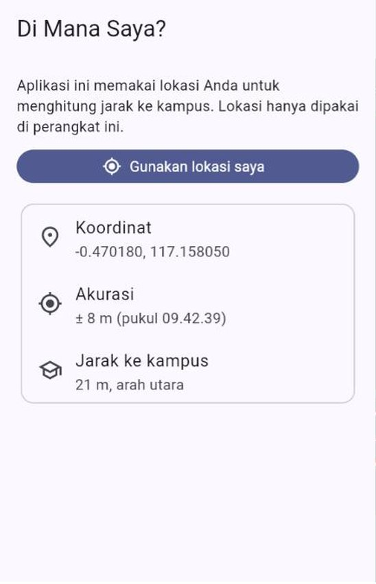
  &nbsp;
  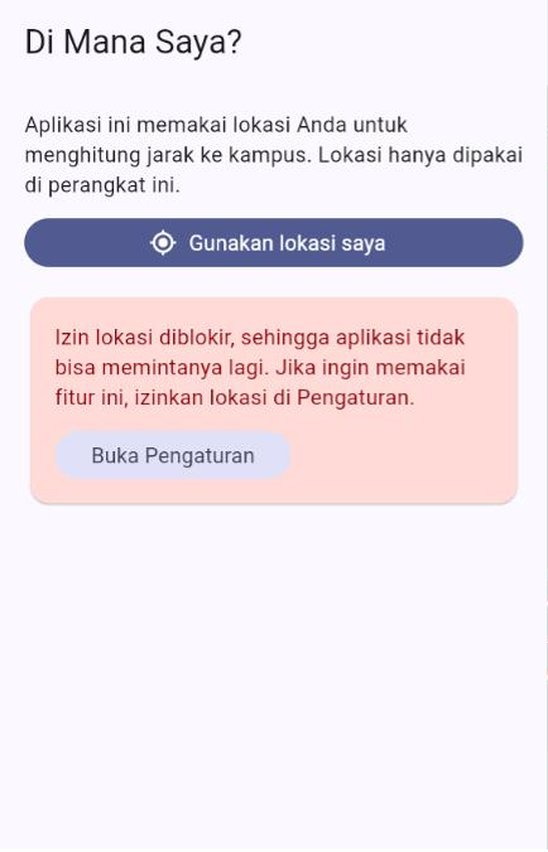
  &nbsp;
  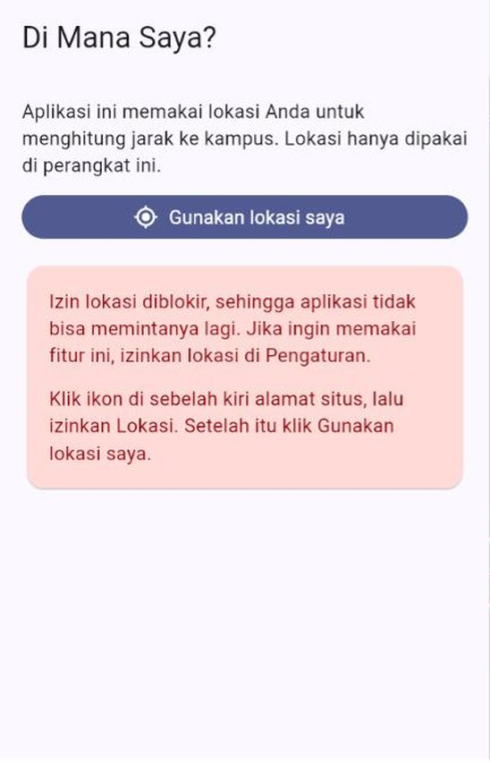
</p>

Dari kiri ke kanan: lokasi berhasil didapat; izin diblokir di HP (ada tombol **Buka Pengaturan**); dan izin diblokir di browser (petunjuk mengganti tombol, karena browser mengatur izinnya sendiri).

---

## 6. Jarak, Arah, dan Zona

### 6.1 Satu derajat itu sejauh apa?

Setelah mendapat koordinat, aplikasi biasanya punya pertanyaan lanjutan: seberapa jauh dari kampus, dan apakah sudah berada di dalam area presensi? [Contoh 04](kode/contoh_04_jarak_dan_zona_dart_murni.dart) menjawabnya dengan Dart murni. Jalankan di DartPad; bagian pertamanya menunjukkan ukuran satu derajat:

```text
=== 1. Satu derajat itu sejauh apa? ===
1 derajat lintang               111,3 km
1 derajat bujur (khatulistiwa)  111,3 km
1 derajat bujur (lintang 60)    55,7 km
0,0001 derajat lintang          11 m
0,00001 derajat lintang         1 m
```

Artinya, koordinat dengan **4 angka di belakang koma** hanya teliti sampai sekitar 11 m, sedangkan 6 angka sudah teliti sampai sekitar 10 cm. Karena itu Contoh 03 menampilkan koordinat dengan `toStringAsFixed(6)`. Perhatikan juga baris ketiga: semakin jauh dari khatulistiwa, jarak satu derajat bujur semakin pendek, karena garis-garis bujur bertemu di kutub.

### 6.2 Rumus jarak di permukaan bumi

Bumi tidak datar, jadi jarak dua titik tidak bisa dihitung dengan rumus Pythagoras biasa. Rumus yang umum dipakai adalah **haversine**, yang menghitung panjang busur di permukaan bola:

```dart
const double jariJariBumiMeter = 6378137.0;

double _keRadian(double derajat) => derajat * pi / 180;

/// Jarak "garis lurus di permukaan bumi" antara dua titik, dalam meter.
double jarakMeter(Koordinat a, Koordinat b) {
  final double dLintang = _keRadian(b.lintang - a.lintang);
  final double dBujur = _keRadian(b.bujur - a.bujur);
  final double h =
      pow(sin(dLintang / 2), 2) +
      pow(sin(dBujur / 2), 2) *
          cos(_keRadian(a.lintang)) *
          cos(_keRadian(b.lintang));
  return jariJariBumiMeter * 2 * asin(sqrt(h));
}
```

Anda tidak perlu menghafal rumus ini. Yang penting dipahami:

1. Sudut dalam derajat diubah dulu ke **radian**, karena `sin` dan `cos` di `dart:math` bekerja dengan radian.
2. Jari-jari bumi `6378137.0` m sama dengan yang dipakai `Geolocator.distanceBetween`, sehingga hasilnya sama.
3. Hasilnya jarak **garis lurus**, bukan jarak tempuh lewat jalan. Untuk rute jalan, dibutuhkan layanan peta.

Di aplikasi biasa, cukup panggil `Geolocator.distanceBetween`. Contoh 04 dan studi kasus menulis rumusnya sendiri karena alasan dari Pertemuan 12: aturan bisnis di lapisan **domain** ditulis dalam Dart murni, tanpa mengimpor paket perangkat, agar bisa diuji di mana saja.

### 6.3 Arah

Arah (*bearing*) diukur dalam derajat searah jarum jam dari utara: 0 = utara, 90 = timur, 180 = selatan, 270 = barat. `Geolocator.bearingBetween` mengembalikan −180 sampai 180, jadi diubah dulu ke 0–360, lalu dibagi menjadi delapan arah mata angin yang masing-masing selebar 45 derajat:

```dart
String namaArah(double derajat) {
  const List<String> nama = [
    'utara',
    'timur laut',
    'timur',
    'tenggara',
    'selatan',
    'barat daya',
    'barat',
    'barat laut',
  ];
  // Satu arah mencakup 45 derajat, berpusat pada sudutnya (utara: -22,5
  // sampai 22,5 derajat).
  return nama[((derajat + 22.5) ~/ 45) % 8];
}
```

Bagian kedua keluaran Contoh 04:

```text
=== 2. Jarak dan arah dari lab ===
Depan pintu lab    25 m  arah 153 derajat (tenggara)
Kantin            176 m  arah 125 derajat (tenggara)
Gerbang kampus    553 m  arah 214 derajat (barat daya)
Rumah kos        2,1 km  arah 216 derajat (barat daya)
```

### 6.4 Aturan zona presensi

Presensi diterima jika mahasiswa berada dalam radius tertentu dari laboratorium. Kedengarannya cukup dengan "jarak ≤ 100 m". Namun ada dua jebakan:

1. **Akurasi buruk.** Jika akurasinya ± 120 m, lingkaran ketidakpastiannya mencakup bagian dalam **dan** luar area. Aplikasi tidak bisa memutuskan dengan jujur.
2. **Lokasi palsu.** Ada aplikasi yang bisa "memalsukan" GPS. Di Android, `geolocator` melaporkannya lewat `Position.isMocked`.

```dart
/// Aturan presensi. Urutan pemeriksaan disengaja:
/// 1. lokasi palsu (aplikasi pemalsu GPS) langsung ditolak;
/// 2. GPS dengan akurasi buruk (lingkaran ketidakpastiannya lebar)
///    belum bisa dipercaya, apa pun jaraknya;
/// 3. baru jaraknya dibandingkan dengan radius.
HasilZona periksaZona({
  required Koordinat posisi,
  required double akurasiMeter,
  required bool palsu,
  required Koordinat pusat,
  double radiusMeter = 100,
  double akurasiMaksimal = 50,
}) {
  if (palsu) return HasilZona.lokasiPalsu;
  if (akurasiMeter > akurasiMaksimal) return HasilZona.kurangAkurat;
  if (jarakMeter(posisi, pusat) > radiusMeter) return HasilZona.diLuar;
  return HasilZona.diDalam;
}
```

```text
=== 3. Aturan zona presensi (radius 100 m, akurasi maks 50 m) ===
Di depan pintu, akurasi 8 m   25 m -> boleh presensi
Di kantin, akurasi 12 m       176 m -> di luar area
Di dalam lab, akurasi 120 m   0 m -> lokasi kurang akurat
Di dalam lab, pemalsu GPS     0 m -> lokasi palsu terdeteksi
Hampir 100 m dari lab         100 m -> boleh presensi
Sedikit lewat 100 m           101 m -> di luar area
```

Perhatikan baris ketiga: posisinya **tepat** di dalam lab, tetapi tetap ditolak karena akurasinya buruk. Lebih baik meminta pengguna pindah ke dekat jendela daripada menerima posisi yang tidak bisa dipercaya. Dua baris terakhir menguji **batas**: 100 m masih boleh, 101 m tidak. Menguji nilai di sekitar batas adalah kebiasaan baik yang akan kita lanjutkan di Pertemuan 14.

> [!IMPORTANT]
> Pemeriksaan di aplikasi **tidak pernah** benar-benar aman, karena aplikasi berjalan di perangkat milik pengguna dan bisa diakali. Deteksi `isMocked` pun tidak sempurna. Untuk keperluan resmi, server sebaiknya ikut memeriksa, misalnya mencocokkan waktu, jaringan Wi-Fi kampus, atau foto. Aturan di aplikasi tetap berguna untuk memberi umpan balik cepat kepada pengguna yang jujur.

> **Uji pemahaman**
>
> **3.** Posisi pengguna 30 m dari lab dengan akurasi ± 80 m. Menurut `periksaZona`, apa hasilnya, dan mengapa?
>
> <details><summary>Lihat jawaban</summary>
>
> `kurangAkurat`. Pemeriksaan akurasi dilakukan **sebelum** jarak. Dengan akurasi ± 80 m, posisi sebenarnya bisa saja 110 m dari lab, jadi jarak 30 m belum bisa dipercaya.
> </details>

---

## 7. Alur Izin yang Sopan

Dialog izin hanya punya satu kesempatan yang baik. Jika pengguna kaget atau tidak mengerti gunanya, ia akan menolak, dan setelah dua kali ditolak, dialognya tidak akan muncul lagi. Karena itu cara **meminta** sama pentingnya dengan kode untuk mengambil lokasinya.

### 7.1 Minta saat fiturnya dipakai

Bandingkan dua aplikasi berikut:

| ✘ Aplikasi A | ✔ Aplikasi B |
| :--- | :--- |
| Begitu dibuka pertama kali, langsung muncul tiga dialog berturut-turut: lokasi, kamera, notifikasi | Aplikasi langsung bisa dipakai. Dialog lokasi baru muncul ketika pengguna mengetuk **"Urutkan dari yang terdekat"** |
| Pengguna belum tahu untuk apa izinnya, jadi menolak semuanya | Pengguna paham hubungannya: ia minta diurutkan menurut jarak, jadi aplikasi butuh lokasi |

Pedoman Android dan Apple sama-sama menyarankan cara Aplikasi B: **minta izin dalam konteks**, tepat saat pengguna memakai fitur yang membutuhkannya.

### 7.2 Jelaskan dulu di layar sendiri

[Contoh 05](kode/contoh_05_alur_izin_yang_sopan.dart) adalah aplikasi "Ruang Belajar" yang bisa mengurutkan tempat belajar dari yang terdekat. Agar bisa dicoba di DartPad, dialog izin dan halaman Pengaturan di contoh ini adalah **simulasi** yang meniru perilaku Android. Yang dipelajari adalah alurnya.

Sebelum dialog sistem muncul, aplikasi menampilkan **kartu penjelasan** di layarnya sendiri:

```dart
case StatusIzin.ditolak when !pernahMinta && !nantiSaja:
  // Penjelasan SEBELUM dialog sistem, di layar kita sendiri.
  return Card(
    // ...
    children: [
      Text('Cari ruang belajar terdekat?', /* ... */),
      const Text(
        'Izinkan akses lokasi agar ruang terdekat tampil paling '
        'atas. Lokasi hanya dipakai di perangkat ini dan tidak '
        'dikirim ke mana pun.',
      ),
      // ...
      FilledButton.icon(
        onPressed: onGunakanLokasi,
        icon: const Icon(Icons.my_location),
        label: const Text('Gunakan lokasi saya'),
      ),
      TextButton(
        onPressed: onNantiSaja,
        child: const Text('Nanti saja'),
      ),
    ],
  );
```

Kartu yang baik menjawab tiga pertanyaan pengguna: **apa** manfaatnya ("ruang terdekat tampil paling atas"), **ke mana** datanya pergi ("hanya dipakai di perangkat ini"), dan **bagaimana jika tidak mau** ("Nanti saja"). Perhatikan juga `case ... when ...`: pola `switch` dengan syarat tambahan, sehingga status `ditolak` bisa punya tampilan berbeda sebelum dan sesudah izin pernah diminta.

> [!NOTE]
> Pedoman Apple untuk iOS lebih ketat: layar penjelasan sebelum dialog sistem hanya boleh memiliki **satu** tombol yang langsung memunculkan dialog sistem, dengan judul seperti "Lanjutkan" (bukan "Izinkan"), dan **tanpa** tombol batal atau tutup. Pengguna tetap bisa menolak di dialog sistem itu sendiri. Pedoman Android membolehkan pilihan untuk tidak melanjutkan, seperti "Nanti saja" di contoh ini. Jika aplikasi Anda dirilis di kedua platform, ikuti pedoman masing-masing.

### 7.3 Ditolak? Aplikasi tetap jalan

Jika izin ditolak, aplikasi **tidak boleh macet** atau menolak dipakai. Ruang Belajar tetap menampilkan daftar, hanya urutannya menurut abjad:

```dart
final bool urutJarak = status == StatusIzin.saatDipakai;
// ...
daftar.sort(
  (a, b) =>
      urutJarak ? a.$2.compareTo(b.$2) : a.$1.nama.compareTo(b.$1.nama),
);
```

Prinsip ini disebut **degradasi anggun** (*graceful degradation*): fitur yang butuh izin dikurangi, tetapi fitur lainnya tetap berfungsi, dan pesannya menyebut dengan jelas apa yang tidak tersedia. Pesannya juga tidak menyalahkan pengguna, karena menolak izin adalah hak pengguna.

### 7.4 Diblokir? Tawarkan Pengaturan dengan tenang

Setelah dua kali ditolak, dialog tidak akan muncul lagi. Satu-satunya jalan adalah Pengaturan. Aplikasi cukup **menawarkan**, tidak memaksa:

```dart
case StatusIzin.ditolakPermanen:
  return Card(
    // ...
    children: [
      const Text(
        'Akses lokasi diblokir. Daftar tetap bisa dipakai '
        '(urut abjad). Jika ingin mengurutkan dari yang '
        'terdekat, izinkan lokasi di Pengaturan.',
      ),
      // ...
      OutlinedButton.icon(
        onPressed: onBukaPengaturan,
        icon: const Icon(Icons.settings_outlined),
        label: const Text('Buka Pengaturan'),
      ),
    ],
  );
```

Yang **tidak** sopan: menampilkan dialog "Izinkan lokasi!" setiap kali aplikasi dibuka, atau menutup aplikasi karena izin ditolak.

### 7.5 Mencoba Contoh 05

Tempel [Contoh 05](kode/contoh_05_alur_izin_yang_sopan.dart) di DartPad, lalu ikuti urutan berikut:

1. Perhatikan kartu penjelasan di atas daftar. Ketuk **Gunakan lokasi saya**, dan "dialog sistem" (simulasi) muncul.
2. Pilih **Jangan izinkan**. Daftar tetap tampil menurut abjad, dengan tombol **Coba lagi**.
3. Ketuk **Coba lagi**, lalu pilih **Jangan izinkan** sekali lagi. Kini izin diblokir, dan kartu menawarkan **Buka Pengaturan**.
4. Ketuk **Buka Pengaturan**, pilih **Izinkan hanya saat aplikasi digunakan**, lalu kembali. Daftar langsung diurutkan dari yang terdekat.

<p align="center">
  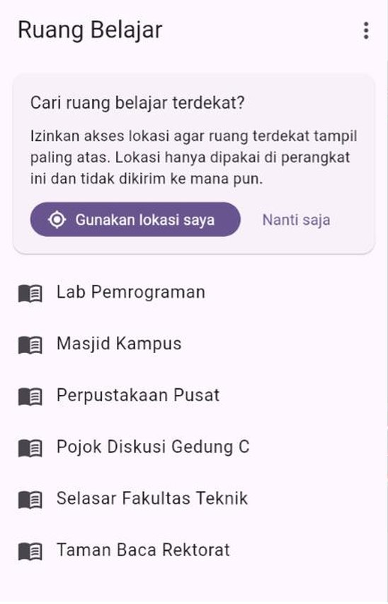
  &nbsp;
  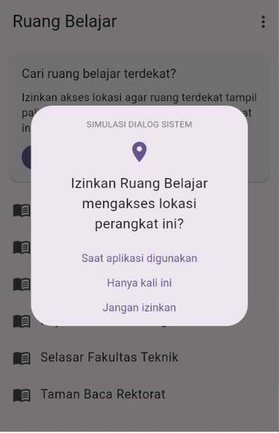
  &nbsp;
  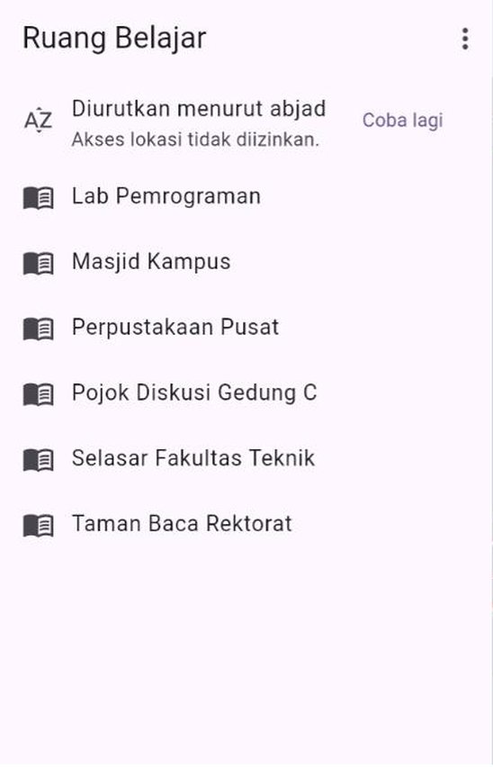
</p>

<p align="center">
  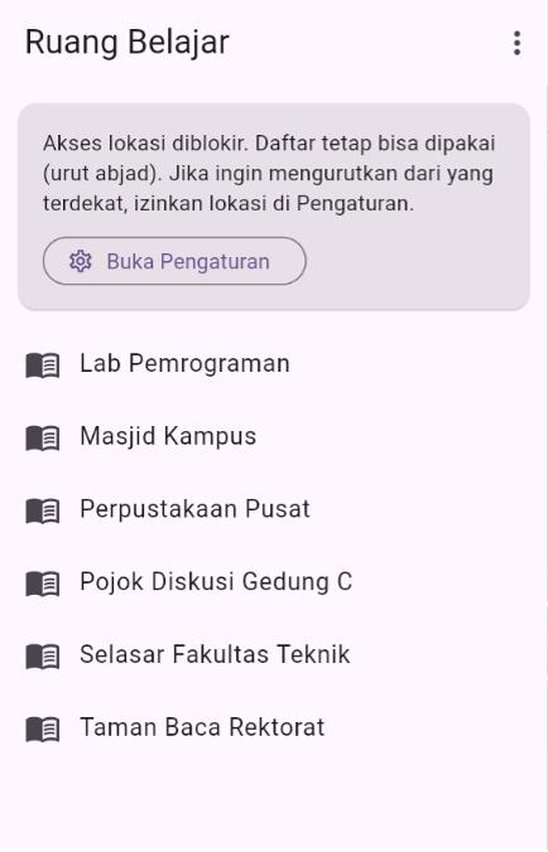
  &nbsp;
  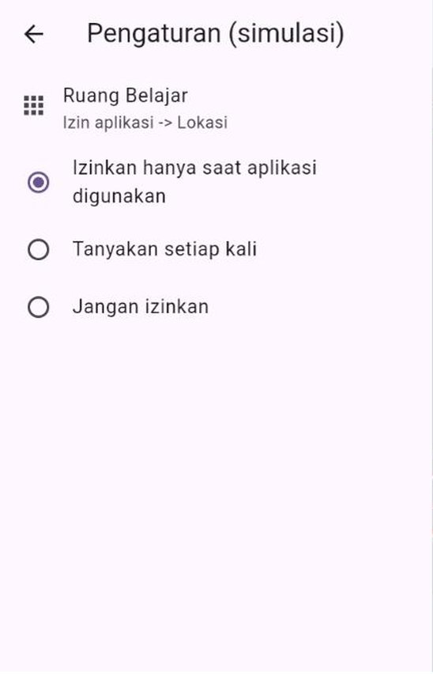
  &nbsp;
  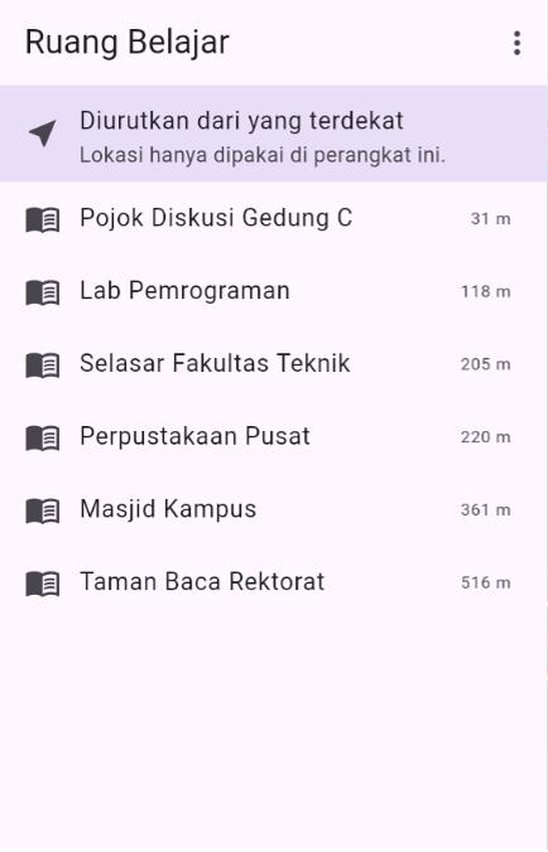
</p>

Menu titik tiga di kanan atas punya dua simulasi lagi. **Tutup lalu buka lagi** memperlihatkan efek "Hanya kali ini": izinnya hilang setelah aplikasi ditutup. **Pasang ulang aplikasi** menghapus semua catatan izin, seperti aplikasi yang baru dipasang.

### 7.6 Daftar periksa izin yang sopan

| ✔ Lakukan | ✘ Hindari |
| :--- | :--- |
| Minta izin saat pengguna memakai fitur yang membutuhkannya | Meminta semua izin saat aplikasi pertama kali dibuka |
| Jelaskan manfaatnya dengan kalimat sederhana sebelum dialog sistem | Dialog sistem tanpa konteks apa pun |
| Tetap berfungsi saat izin ditolak, dengan pesan yang jelas | Aplikasi macet, kosong, atau menutup sendiri |
| Tawarkan tombol Pengaturan saat izin diblokir | Menampilkan peringatan berulang-ulang yang memaksa |
| Periksa ulang saat pengguna kembali dari Pengaturan | Menyuruh pengguna menutup lalu membuka ulang aplikasi |
| Minta izin **paling kecil** yang cukup (misalnya "saat dipakai", bukan "selalu") | Meminta lokasi latar belakang padahal tidak perlu |

---

## 8. Mengikuti Lokasi Terus-Menerus

### 8.1 Sekali ambil atau terus mengikuti?

`getCurrentPosition` mengambil **satu** posisi, seperti memotret. Untuk aplikasi yang mengikuti perjalanan (peta, olahraga, pesan-antar), dibutuhkan posisi baru setiap kali perangkat berpindah, seperti merekam video. `geolocator` menyediakannya lewat `getPositionStream`, yang berupa `Stream<Position>` (Pertemuan 3).

| | `getCurrentPosition()` | `getPositionStream()` |
| :--- | :--- | :--- |
| Hasil | `Future<Position>`: satu posisi | `Stream<Position>`: banyak posisi, satu per satu |
| GPS menyala | Sebentar, sampai posisi didapat | **Terus**, selama masih berlangganan |
| Cocok untuk | Presensi, menandai lokasi laporan | Pencatat olahraga, navigasi |

### 8.2 Berlangganan, lalu berhenti

[Contoh 06](kode/contoh_06_lokasi_terus_menerus.dart) adalah aplikasi "Jalan Pagi" yang mencatat jarak jalan kaki:

```dart
// Dua "keran" yang harus ditutup: langganan lokasi dan pewaktu.
StreamSubscription<Position>? _langganan;
Timer? _pewaktu;

// Di _mulai(), setelah layanan dan izin siap:
// Mulai berlangganan. Selama langganan aktif, GPS menyala.
_langganan = Geolocator.getPositionStream(
  locationSettings: const LocationSettings(
    accuracy: LocationAccuracy.high,
    distanceFilter: 5, // kirim posisi baru setiap pindah >= 5 m
  ),
).listen(_titikBaru, onError: _galatLokasi);

void _berhenti() {
  _langganan?.cancel();
  _pewaktu?.cancel();
  setState(() {
    _langganan = null;
    _pewaktu = null;
  });
}

@override
void dispose() {
  // Halaman ditutup: hentikan GPS dan pewaktu.
  _langganan?.cancel();
  _pewaktu?.cancel();
  super.dispose();
}
```

Bayangkan langganan sebagai **keran air**. Selama keran terbuka, air (posisi) terus mengalir, dan meteran (baterai) terus berputar. `cancel()` menutup keran. Jika lupa, GPS tetap menyala walaupun halamannya sudah ditutup, dan baterai pengguna terkuras tanpa ia sadari.

| Bagian | Penjelasan |
| :--- | :--- |
| `.listen(_titikBaru, onError: _galatLokasi)` | `_titikBaru` dipanggil untuk setiap posisi baru; `_galatLokasi` dipanggil jika terjadi galat |
| `distanceFilter: 5` | Posisi baru hanya dikirim jika perangkat berpindah paling sedikit 5 m. Mengurangi pekerjaan aplikasi dan "getaran" titik saat diam |
| `_langganan?.cancel()` | Berhenti berlangganan, sehingga GPS boleh dimatikan sistem |
| `dispose()` | Tempat terakhir untuk menutup keran, misalnya saat pengguna menekan tombol kembali |

### 8.3 Menyaring titik yang kabur

GPS kadang mengirim posisi dengan akurasi buruk, misalnya saat melewati gedung tinggi. Jika ikut dijumlahkan, total jarak bisa "melompat" puluhan meter. Contoh 06 mengabaikan titik dengan akurasi lebih dari 25 m:

```dart
void _titikBaru(Position p) {
  if (p.accuracy > 25) {
    setState(() => _diabaikan++); // terlalu kabur, abaikan
    return;
  }
  setState(() {
    if (_titik.isNotEmpty) {
      final Position sebelum = _titik.last;
      _totalMeter += Geolocator.distanceBetween(
        sebelum.latitude,
        sebelum.longitude,
        p.latitude,
        p.longitude,
      );
    }
    _titik.add(p);
  });
}
```

### 8.4 Galat di tengah jalan

Saat pencatatan berjalan, pengguna bisa mematikan sakelar Lokasi atau mencabut izin. Galat itu datang lewat `onError`, lalu pencatatan dihentikan dengan pesan yang jelas:

```dart
void _galatLokasi(Object galat) {
  _berhenti();
  setState(() {
    _pesan = switch (galat) {
      LocationServiceDisabledException() =>
        'Layanan lokasi dimatikan, jadi pencatatan dihentikan.',
      PermissionDeniedException() =>
        'Izin lokasi dicabut, jadi pencatatan dihentikan.',
      _ => 'Lokasi terputus, jadi pencatatan dihentikan.',
    };
  });
}
```

Satu hal lagi: selama layanan dan izin diperiksa, mungkin dialog izin sedang terbuka. Agar dua ketukan cepat pada **Mulai mencatat** tidak membuat dua langganan sekaligus, Contoh 06 memakai penjaga `_menyiapkan`, dengan gagasan yang sama seperti Perintah di Pertemuan 12.

### 8.5 Mencoba Contoh 06

Jalankan di HP Android, lalu berjalanlah beberapa puluh meter. Di Chrome, ubah lokasi beberapa kali lewat DevTools → *Sensors* ([Bagian 11.1](#111-chrome-devtools-sensors)), atau pakai fitur *Routes* di emulator Android ([Bagian 11.2](#112-emulator-android)).

<p align="center">
  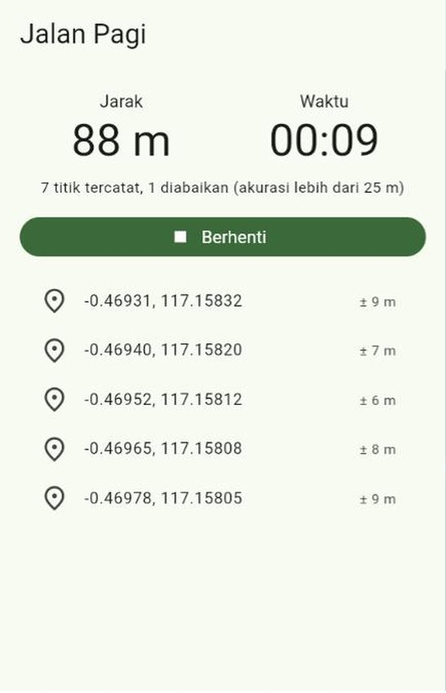
</p>

Pada gambar, satu titik diabaikan karena akurasinya ± 40 m. Tanpa penyaringan, titik itu akan menambah jarak palsu karena posisinya melenceng dari jalur.

> [!WARNING]
> Contoh 06 hanya mencatat **selama aplikasi terbuka**. Mencatat lokasi saat aplikasi di latar belakang membutuhkan izin lokasi "selalu", layanan latar depan (*foreground service*) di Android, pengaturan khusus di iOS, dan pemeriksaan ketat dari toko aplikasi. Hanya lakukan jika fitur utama aplikasi Anda benar-benar membutuhkannya.

---

## 9. Fitur Perangkat di Balik Kontrak

### 9.1 Masalahnya: kode yang hanya bisa diuji di HP

Contoh 02, 03, dan 06 memanggil `ImagePicker` dan `Geolocator` langsung dari widget. Untuk contoh kecil, itu wajar. Namun untuk aplikasi sungguhan, cara ini menimbulkan masalah yang sama seperti kode kusut di Pertemuan 12:

1. **Tidak bisa diuji tanpa perangkat.** Untuk memeriksa pesan "izin diblokir", seseorang harus menolak izin dua kali di HP sungguhan.
2. **Sulit mencoba semua keadaan.** Bagaimana mencoba "GPS kurang akurat" atau "lokasi palsu" di laboratorium?
3. **Tampilan ikut mengenal paket.** Widget harus tahu `LocationServiceDisabledException`, `PlatformException`, dan kode-kode galatnya.

Jalan keluarnya sudah Anda kenal: **kontrak** di lapisan domain, implementasi asli di lapisan data, dan **data palsu** untuk pengembangan serta pengujian. Di mata arsitektur, GPS dan kamera hanyalah **sumber data** baru, sama seperti server dan SQLite.

### 9.2 Kontrak di domain

[Contoh 07](kode/contoh_07_kontrak_perangkat_dan_data_palsu.dart), aplikasi "Catatan Lapangan", menulis tiga kontrak:

```dart
abstract interface class LayananLokasi {
  /// Memeriksa layanan dan izin, lalu mengambil posisi sekarang.
  Future<Hasil<Posisi>> posisiSekarang();
}

abstract interface class PemilihFoto {
  bool get kameraTersedia;

  Future<Hasil<FotoBukti>> ambil({required bool dariKamera});
}

abstract interface class PengaturanPerangkat {
  Future<void> bukaPengaturanAplikasi();

  Future<void> bukaPengaturanLokasi();
}
```

Perhatikan bahwa tidak ada `Position`, `XFile`, atau `LocationPermission` di sini. Domain memakai entitasnya sendiri, `Posisi` dan `FotoBukti`:

```dart
class Posisi {
  const Posisi({
    required this.lintang,
    required this.bujur,
    required this.akurasiMeter,
    required this.waktu,
    this.palsu = false,
  });

  final double lintang;
  final double bujur;
  final double akurasiMeter;
  final DateTime waktu;

  /// true jika berasal dari aplikasi pemalsu GPS.
  final bool palsu;
}
```

Kata kunci `interface` pada `abstract interface class` berarti kelas ini hanya boleh **diimplementasikan** (`implements`), bukan diwarisi (`extends`). Cocok untuk kontrak yang memang tidak membawa kode apa pun.

### 9.3 Kegagalan baru

`Kegagalan` dari Pertemuan 12 mendapat anggota baru untuk dunia perangkat:

| `Kegagalan` | Artinya | Berasal dari (implementasi asli) |
| :--- | :--- | :--- |
| `LayananLokasiMati()` | Sakelar Lokasi mati | `isLocationServiceEnabled()` bernilai `false`, atau `LocationServiceDisabledException` |
| `IzinDitolak(fitur)` | Izin belum diberikan, masih boleh diminta | `LocationPermission.denied`, `PermissionDeniedException` |
| `IzinDiblokir(fitur)` | Izin diblokir, hanya bisa lewat Pengaturan | `LocationPermission.deniedForever`, kode `camera_access_denied` |
| `PerangkatTidakMendukung(fitur)` | Perangkat tidak punya fitur itu | Kode `no_available_camera` |
| `Dibatalkan()` | Pengguna sengaja membatalkan | `pickImage` mengembalikan `null` |
| `WaktuHabis()` | Posisi tidak didapat dalam batas waktu | `TimeoutException` |

`fitur` bernilai `Fitur.lokasi`, `Fitur.kamera`, atau `Fitur.galeri`, sehingga satu jenis kegagalan bisa dipakai untuk beberapa fitur. Studi kasus menambahkan `GangguanPerangkat(kode)` untuk galat lain yang tidak kita kenali.

### 9.4 Implementasi asli: penerjemah

Implementasi asli adalah **satu-satunya** bagian yang mengenal paket perangkat, sekaligus penerjemah *exception*-nya. Isinya adalah alur Contoh 03, tetapi hasilnya `Hasil<Posisi>`. Potongan dari [Contoh 08](kode/contoh_08_studi_kasus_presensi.dart):

```dart
class LayananLokasiGeolocator implements LayananLokasi {
  const LayananLokasiGeolocator();

  @override
  Future<Hasil<Posisi>> posisiSekarang() async {
    if (!await Geolocator.isLocationServiceEnabled()) {
      return const Gagal(LayananLokasiMati());
    }
    // ... checkPermission, requestPermission, lalu switch seperti
    //     Contoh 03, menghasilkan IzinDitolak atau IzinDiblokir ...
    try {
      final Position p = await Geolocator.getCurrentPosition(
        locationSettings: const LocationSettings(
          accuracy: LocationAccuracy.high,
          timeLimit: Duration(seconds: 20),
        ),
      );
      return Berhasil(
        Posisi(
          lintang: p.latitude,
          bujur: p.longitude,
          akurasiMeter: p.accuracy,
          waktu: p.timestamp.toLocal(),
          palsu: p.isMocked,
        ),
      );
    } on TimeoutException {
      return const Gagal(WaktuHabis());
    } on LocationServiceDisabledException {
      return const Gagal(LayananLokasiMati());
    } on PermissionDeniedException {
      return const Gagal(IzinDitolak(Fitur.lokasi));
    } on PositionUpdateException {
      return const Gagal(GangguanPerangkat('position_update'));
    }
  }
}
```

Begitu juga untuk kamera:

```dart
class PemilihFotoImagePicker implements PemilihFoto {
  PemilihFotoImagePicker({ImagePicker? pemilih})
    : _pemilih = pemilih ?? ImagePicker();

  final ImagePicker _pemilih;

  @override
  bool get kameraTersedia => _pemilih.supportsImageSource(ImageSource.camera);

  @override
  Future<Hasil<FotoBukti>> ambil({required bool dariKamera}) async {
    try {
      final XFile? berkas = await _pemilih.pickImage(
        source: dariKamera ? ImageSource.camera : ImageSource.gallery,
        preferredCameraDevice: CameraDevice.front,
        maxWidth: 720,
        imageQuality: 70,
        requestFullMetadata: false,
      );
      if (berkas == null) return const Gagal(Dibatalkan());
      return Berhasil(
        FotoBukti(nama: berkas.name, bita: await berkas.readAsBytes()),
      );
    } on PlatformException catch (e) {
      return Gagal(switch (e.code) {
        'camera_access_denied' => const IzinDiblokir(Fitur.kamera),
        'photo_access_denied' => const IzinDiblokir(Fitur.galeri),
        'no_available_camera' => const PerangkatTidakMendukung(Fitur.kamera),
        _ => GangguanPerangkat(e.code),
      });
    }
  }
}
```

Mengapa `camera_access_denied` diterjemahkan menjadi `IzinDiblokir`, bukan `IzinDitolak`? Karena `image_picker` sendiri yang menampilkan dialog izin saat kamera dibuka. Jika kode ini sampai kepada kita, pengguna sudah menolak, dan jalan yang tersisa adalah Pengaturan.

### 9.5 Data palsu berskenario

Implementasi palsu tidak menyentuh perangkat sama sekali. Ia mengembalikan hasil sesuai **skenario** yang dipilih:

```dart
enum SkenarioLokasi {
  berhasil('Berhasil'),
  layananMati('Layanan mati'),
  izinDitolak('Izin ditolak'),
  izinDiblokir('Izin diblokir'),
  waktuHabis('Waktu habis');

  const SkenarioLokasi(this.label);
  final String label;
}

class LayananLokasiPalsu implements LayananLokasi {
  SkenarioLokasi skenario = SkenarioLokasi.berhasil;
  int dipanggil = 0;

  @override
  Future<Hasil<Posisi>> posisiSekarang() async {
    dipanggil++;
    await Future<void>.delayed(const Duration(milliseconds: 300));
    return switch (skenario) {
      SkenarioLokasi.berhasil => Berhasil(
        Posisi(
          lintang: -0.470180,
          bujur: 117.158050,
          akurasiMeter: 8,
          waktu: DateTime(2026, 10, 16, 9, 30),
        ),
      ),
      SkenarioLokasi.layananMati => const Gagal(LayananLokasiMati()),
      SkenarioLokasi.izinDitolak => const Gagal(IzinDitolak(Fitur.lokasi)),
      SkenarioLokasi.izinDiblokir => const Gagal(IzinDiblokir(Fitur.lokasi)),
      SkenarioLokasi.waktuHabis => const Gagal(WaktuHabis()),
    };
  }
}
```

`dipanggil` menghitung berapa kali layanan dipakai, sehingga pengujian bisa memastikan, misalnya, bahwa dua ketukan cepat hanya memanggil layanan **sekali**. Ini adalah "mata-mata" (*spy*) dari Pertemuan 12.

### 9.6 Satu tempat untuk pesan dan tombol

Setiap kegagalan perangkat butuh **pesan** dan **tombol perbaikan** yang berbeda. Keduanya disusun di satu fungsi di lapisan UI:

```dart
enum AksiPerbaikan { tidakAda, cobaLagi, bukaPengaturan, nyalakanLokasi }

class Tanggapan {
  const Tanggapan(this.pesan, this.aksi);
  final String pesan;
  final AksiPerbaikan aksi;
}

/// SATU-SATUNYA tempat yang mengubah Kegagalan menjadi kalimat.
/// null berarti tidak perlu pesan apa pun.
Tanggapan? tanggapanUntuk(Kegagalan kegagalan) {
  return switch (kegagalan) {
    Dibatalkan() => null,
    LayananLokasiMati() => const Tanggapan(
      'Layanan lokasi mati. Nyalakan, lalu coba lagi.',
      AksiPerbaikan.nyalakanLokasi,
    ),
    IzinDitolak(:final Fitur fitur) => Tanggapan(
      'Izin ${fitur.nama} belum diberikan, jadi fitur ini belum bisa '
      'dipakai.',
      AksiPerbaikan.cobaLagi,
    ),
    IzinDiblokir(:final Fitur fitur) => Tanggapan(
      'Izin ${fitur.nama} diblokir. Jika ingin memakai fitur ini, '
      'izinkan di Pengaturan.',
      AksiPerbaikan.bukaPengaturan,
    ),
    PerangkatTidakMendukung(:final Fitur fitur) => Tanggapan(
      'Perangkat ini tidak memiliki ${fitur.nama}.',
      AksiPerbaikan.tidakAda,
    ),
    WaktuHabis() => const Tanggapan(
      'Lokasi belum didapat. Coba di dekat jendela atau di luar ruangan.',
      AksiPerbaikan.cobaLagi,
    ),
  };
}
```

| Kegagalan | Tombol yang ditawarkan |
| :--- | :--- |
| `Dibatalkan` | Tidak ada pesan (pengguna sendiri yang membatalkan) |
| `LayananLokasiMati` | **Nyalakan lokasi** → `bukaPengaturanLokasi()` |
| `IzinDitolak` | **Coba lagi** → dialog izin muncul lagi |
| `IzinDiblokir` | **Buka Pengaturan** → `bukaPengaturanAplikasi()` |
| `PerangkatTidakMendukung` | Tidak ada tombol |
| `WaktuHabis` | **Coba lagi** |

ViewModel memakai Perintah dari Pertemuan 12, dan meneruskan tombol perbaikan ke kontrak `PengaturanPerangkat`:

```dart
Future<void> perbaiki(AksiPerbaikan aksi, VoidCallback cobaLagi) async {
  switch (aksi) {
    case AksiPerbaikan.cobaLagi:
      cobaLagi();
    case AksiPerbaikan.bukaPengaturan:
      await _pengaturan.bukaPengaturanAplikasi();
    case AksiPerbaikan.nyalakanLokasi:
      await _pengaturan.bukaPengaturanLokasi();
    case AksiPerbaikan.tidakAda:
      break;
  }
}
```

### 9.7 Mencoba Contoh 07

Tempel [Contoh 07](kode/contoh_07_kontrak_perangkat_dan_data_palsu.dart) di DartPad, lalu klik **Run**. Sebelum aplikasi tampil, `jalankanUji()` memeriksa semua skenario dalam hitungan detik. Hasilnya di konsol:

```text
=== Pemeriksaan Catatan Lapangan ===
LULUS  Lokasi berhasil -> posisi tersimpan
LULUS  Lokasi berhasil -> tanpa pesan
LULUS  Layanan mati -> tombol nyalakanLokasi
LULUS  Layanan mati -> posisi tetap kosong
LULUS  Izin ditolak -> tombol cobaLagi
LULUS  Izin ditolak -> posisi tetap kosong
LULUS  Izin diblokir -> tombol bukaPengaturan
LULUS  Izin diblokir -> posisi tetap kosong
LULUS  Waktu habis -> tombol cobaLagi
LULUS  Waktu habis -> posisi tetap kosong
LULUS  Buka Pengaturan -> pengaturan aplikasi
LULUS  Foto dibatalkan -> tanpa pesan
LULUS  Foto dibatalkan -> foto lama tetap
LULUS  Tanpa kamera -> kameraTersedia false
LULUS  Dua ketukan cepat -> layanan dipanggil sekali
Ringkasan: 15 dari 15 uji lulus
```

Lima belas keadaan diperiksa tanpa HP, tanpa dialog izin, dan tanpa GPS. Bandingkan dengan menguji semuanya secara manual di HP!

Di layar, pilih **chip skenario**, lalu ketuk **Kamera**, **Galeri**, atau **Tandai lokasi**:

<p align="center">
  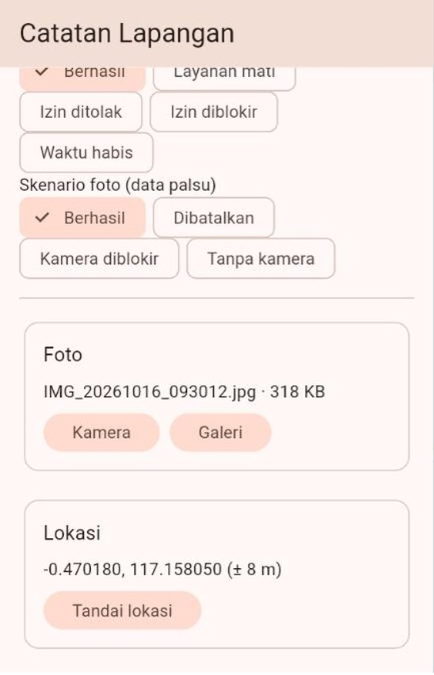
  &nbsp;
  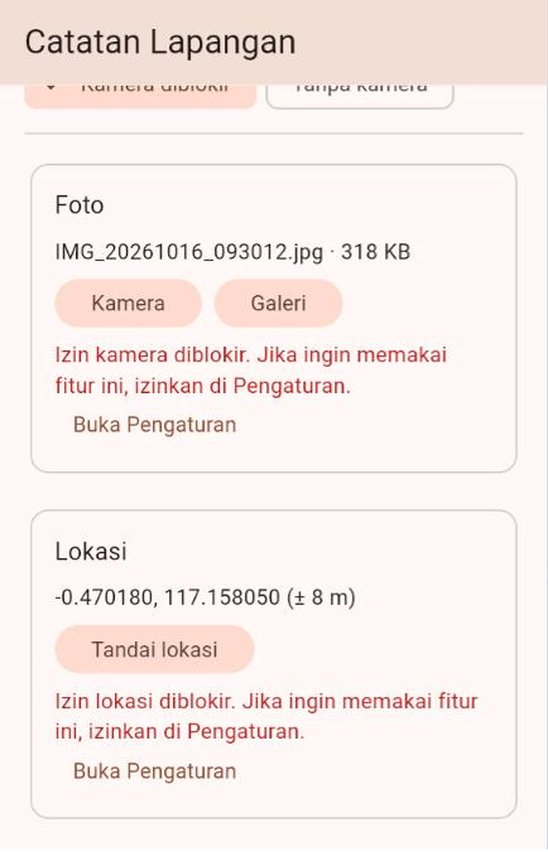
</p>

Gambar kanan memperlihatkan dua hal yang diuji di atas: setiap kegagalan mendapat tombol perbaikannya sendiri, dan foto serta lokasi yang sudah ada **tidak hilang** hanya karena percobaan berikutnya gagal.

> [!NOTE]
> Di Contoh 07, `MultiProvider` menitipkan kelas **palsu** (misalnya `Provider<LayananLokasiPalsu>`) karena chip skenario di layar perlu mengubah skenarionya. Di aplikasi sungguhan, seperti studi kasus berikut, yang dititipkan selalu **kontraknya** (`Provider<LayananLokasi>`).

---

## 10. Studi Kasus: Presensi Praktikum

[Contoh 08](kode/contoh_08_studi_kasus_presensi.dart) menggabungkan semua materi hari ini dengan arsitektur Pertemuan 12. Setiap bagiannya diberi judul `BERKAS: ...` yang menunjukkan letaknya jika aplikasi dipecah menjadi banyak berkas.

### 10.1 Fitur dan aturan

Mahasiswa melakukan presensi praktikum dengan **foto selfie** dan **lokasi**. Presensi diterima jika:

| No. | Aturan | Pesan jika dilanggar |
| :---: | :--- | :--- |
| 1 | Sesi sedang dibuka: 15 menit sebelum mulai sampai 30 menit sesudahnya | "Presensi baru dibuka pukul ..." / "Presensi sudah ditutup pukul ..." |
| 2 | Belum presensi di sesi yang sama | "Anda sudah presensi untuk sesi ini." |
| 3 | Sudah ada foto selfie dari **kamera** (bukan galeri) | "Ambil foto selfie terlebih dahulu." |
| 4 | Lokasi bukan dari aplikasi pemalsu GPS | "Lokasi palsu terdeteksi. ..." |
| 5 | Akurasi lokasi paling buruk 50 m | "Lokasi kurang akurat (± ... m). ..." |
| 6 | Jarak paling jauh 100 m dari laboratorium | "Anda berada ... m dari .... Presensi hanya bisa dalam radius 100 m." |

### 10.2 Peta arsitektur

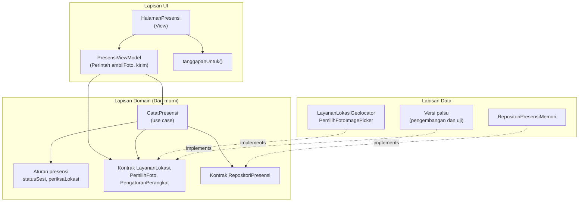

### 10.3 *Use case*: urutannya penting

`CatatPresensi` layak menjadi *use case* karena menggabungkan *repository*, layanan lokasi, jam, dan aturan bisnis dalam urutan tertentu:

```dart
Future<Hasil<Presensi>> jalankan({
  required SesiPraktikum sesi,
  required FotoBukti? foto,
}) async {
  // 1. Pemeriksaan tanpa lokasi: sesi dibuka? sudah presensi? foto ada?
  final Hasil<List<Presensi>> hasilRiwayat = await _repositori.riwayat(
    _mahasiswa.nim,
  );
  // ... jika Gagal, kembalikan kegagalannya ...
  final String? alasanAwal = periksaSebelumLokasi(
    sesi: sesi,
    foto: foto,
    sekarang: _jam.sekarang(),
    sudahPresensi: riwayat.any((Presensi p) => p.kodeSesi == sesi.kode),
  );
  if (alasanAwal != null) return Gagal(AturanDilanggar(alasanAwal));

  // 2. Lokasi diambil SAAT INI JUGA, bukan lokasi yang tersimpan.
  final Hasil<Posisi> hasilPosisi = await _lokasi.posisiSekarang();
  // ... jika Gagal, kembalikan kegagalannya ...
  final String? alasanLokasi = periksaLokasi(sesi: sesi, posisi: posisi);
  if (alasanLokasi != null) return Gagal(AturanDilanggar(alasanLokasi));

  // 3. Semua aturan terpenuhi: simpan.
  return _repositori.simpan(
    kodeSesi: sesi.kode,
    nim: _mahasiswa.nim,
    waktu: _jam.sekarang(),
    jarakMeter: jarakMeter(posisi.koordinat, sesi.titik),
    akurasiMeter: posisi.akurasiMeter,
    namaFoto: foto?.nama ?? '',
  );
}
```

Pemeriksaan yang **tidak** butuh lokasi dijalankan lebih dulu. Jika sesinya sudah ditutup, lokasi tidak perlu diminta sama sekali: tidak ada dialog izin yang percuma, dan baterai tidak terpakai sia-sia. Pengujian memastikan hal ini dengan memeriksa `lokasi.dipanggil` tidak bertambah.

### 10.4 Dua lingkungan dan jam palsu

Seperti Pertemuan 12, satu baris memilih lingkungan:

```dart
// Satu-satunya baris yang diubah untuk memakai lokasi, kamera, dan jam
// palsu: Lingkungan.pengembangan.
const Lingkungan lingkungan = Lingkungan.produksi;
```

| Kebutuhan | Pengembangan | Produksi |
| :--- | :--- | :--- |
| Lokasi | `LayananLokasiPalsu` (menu skenario di halaman presensi) | `LayananLokasiGeolocator` |
| Kamera | `PemilihFotoPalsu` | `PemilihFotoImagePicker` |
| Pengaturan | `PengaturanPerangkatPalsu` (hanya mencatat) | `PengaturanPerangkatGeolocator` |
| Jam | `Jam(jamPengembangan)`: selalu pukul **13.10** hari ini | `Jam()`: jam sungguhan |

Jam palsu penting. Tanpa itu, sesi praktikum hanya bisa dicoba pada jam-jam tertentu. Dengan jam tetap pukul 13.10, sesi Basis Data (13.00–15.30) selalu **dibuka**, kapan pun Anda belajar. Selama lingkungan pengembangan dipakai, setiap halaman diberi pita **DATA PALSU** di pojok kanan atas, agar tidak tertukar dengan versi sungguhan.

### 10.5 Hasilnya

Ubah barisnya menjadi `Lingkungan.pengembangan`, lalu jalankan. Aplikasi ini bisa dijalankan di Chrome tanpa mengubah apa pun selain baris tersebut.

<p align="center">
  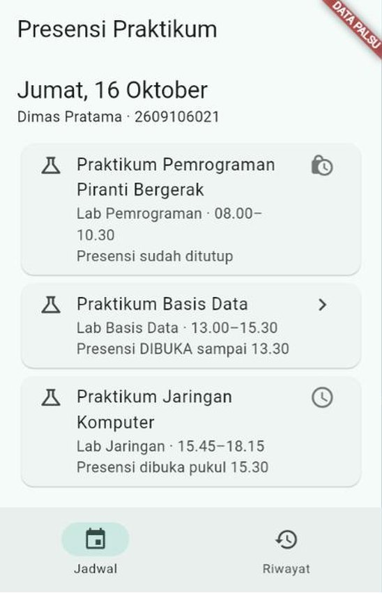
  &nbsp;
  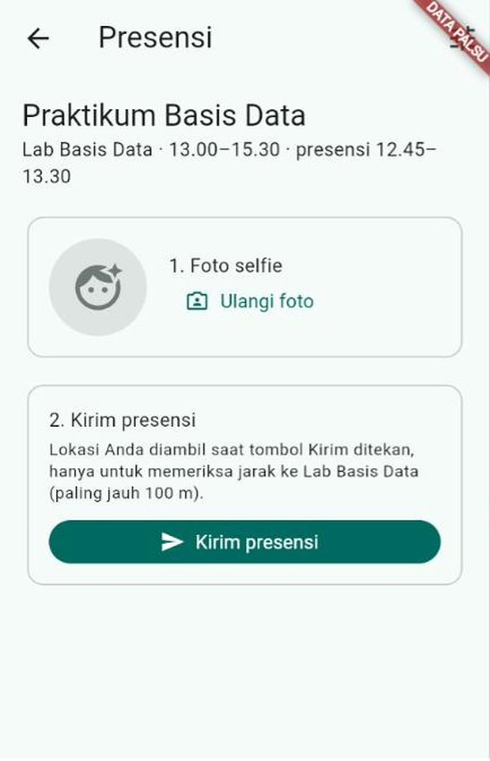
  &nbsp;
  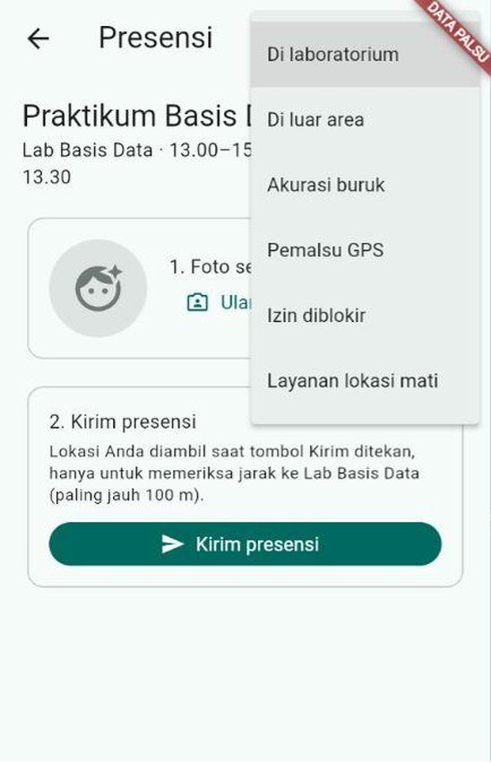
</p>

<p align="center">
  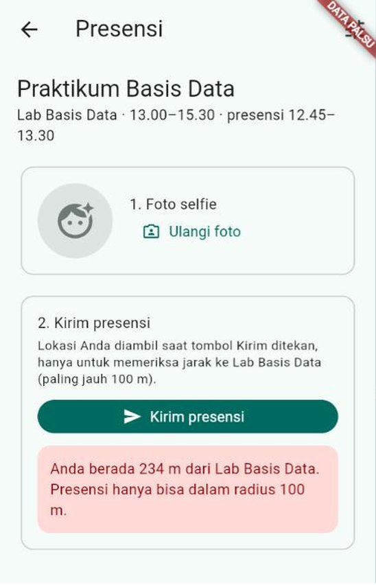
  &nbsp;
  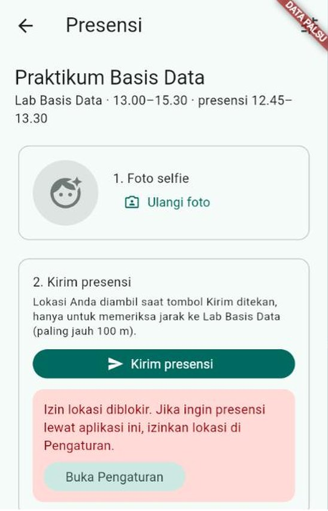
  &nbsp;
  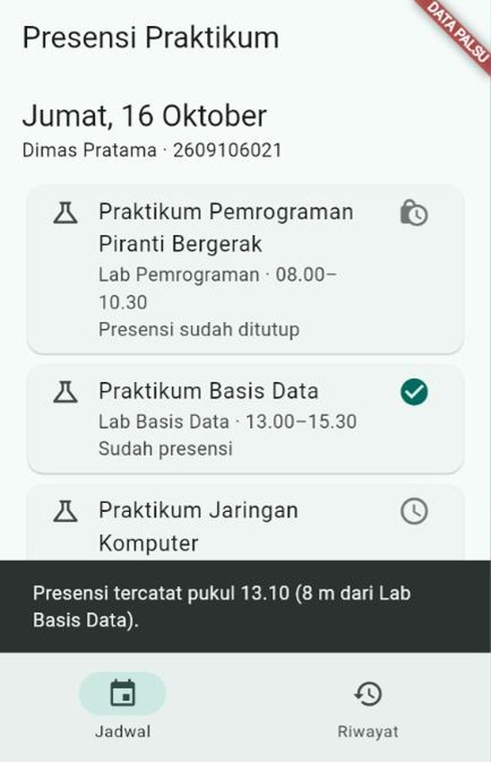
</p>

<p align="center">
  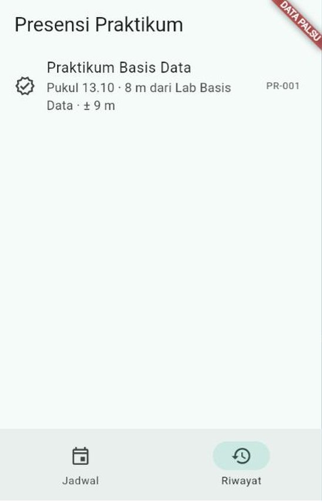
</p>

### 10.6 Kembali dari Pengaturan, pesan lama dibersihkan

Saat pengguna kembali dari Pengaturan, pesan "izin diblokir" yang masih tampil bisa membingungkan, karena mungkin izinnya sudah diberikan. `AppLifecycleListener` membersihkannya, sehingga pengguna tinggal mengetuk **Kirim** lagi:

```dart
/// Kembali dari Pengaturan: hapus pesan lama tentang izin atau layanan,
/// agar pengguna bisa langsung menekan Kirim lagi.
void _saatKembali() {
  final Hasil<Presensi>? hasil = _vm.kirim.hasil;
  if (hasil case Gagal(kegagalan: IzinDiblokir() || LayananLokasiMati())) {
    _vm.kirim.bersihkanHasil();
  }
}
```

Pola `Gagal(kegagalan: IzinDiblokir() || LayananLokasiMati())` dibaca: "jika hasilnya `Gagal` dan kegagalannya `IzinDiblokir` **atau** `LayananLokasiMati`". Di browser, kontrak `PengaturanPerangkat` melaporkan `bisaDibuka` bernilai `false`, sehingga tombol Pengaturan diganti petunjuk "Klik ikon di sebelah kiri alamat situs".

### 10.7 Pemeriksaan otomatis

Sebelum aplikasi tampil, `jalankanUji()` memeriksa domain, *use case*, dan ViewModel dengan data palsu serta jam tetap:

```text
=== Pemeriksaan Presensi Praktikum ===
LULUS  Jarak dua titik contoh = 25 m
LULUS  12.44 belum dibuka
LULUS  12.45 dibuka
LULUS  13.30 masih dibuka
LULUS  13.31 ditutup
LULUS  Tanpa foto ditolak
LULUS  Di dalam radius (8 m) diterima
LULUS  Akurasi 120 m ditolak
LULUS  234 m dari lab ditolak
LULUS  Di lab pukul 13.10 -> tercatat
LULUS  Presensi kedua -> ditolak
LULUS  Presensi kedua -> lokasi TIDAK diminta
LULUS  Pukul 14.00 -> ditutup, lokasi tidak diminta
LULUS  Izin lokasi diblokir -> gagal, tidak tersimpan
LULUS  Izin diblokir -> tombol Buka Pengaturan
LULUS  Kirim tanpa foto -> diminta foto
LULUS  Foto dibatalkan -> foto tetap kosong
LULUS  Dua ketukan cepat -> satu presensi
Ringkasan: 18 dari 18 uji lulus
```

Perhatikan pengujian **batas waktu**: 12.44 belum dibuka, 12.45 dibuka, 13.30 masih dibuka, 13.31 sudah ditutup. Di Pertemuan 14, pemeriksaan seperti ini dipindahkan ke folder `test/` dan dijalankan dengan `flutter test`.

### 10.8 Mencoba versi produksi

Dengan `Lingkungan.produksi`, aplikasi memakai kamera, GPS, dan jam sungguhan:

1. Siapkan proyek seperti [Bagian 3](#3-menyiapkan-proyek-paket-dan-pengaturan-platform): `flutter pub add geolocator image_picker provider`, izin di `AndroidManifest.xml`, dan kalimat alasan di `Info.plist`.
2. Agar presensi bisa berhasil, harus ada sesi yang **sedang dibuka** dan Anda harus berada **di dekat** laboratoriumnya. Ubah jam dan koordinat sesi di `RepositoriPresensiMemori` agar sesuai dengan waktu dan tempat Anda, **atau** di Chrome palsukan lokasinya ke koordinat laboratorium lewat DevTools → *Sensors*, dengan **Accuracy** kecil, misalnya `10` ([Bagian 11.1](#111-chrome-devtools-sensors)).

> **Uji mandiri**
>
> **4.** Mengapa `CatatPresensi` memeriksa "sudah presensi" dan "foto ada" **sebelum** mengambil lokasi?
>
> <details><summary>Lihat jawaban</summary>
>
> Agar lokasi (dan dialog izinnya) tidak diminta percuma. Jika presensi pasti ditolak karena aturan lain, tidak ada gunanya menyalakan GPS, menunggu sampai 20 detik, atau mengganggu pengguna dengan dialog izin.
> </details>
>
> **5.** Riwayat presensi menyimpan `jarakMeter` dan `akurasiMeter`, tetapi tidak menyimpan lintang dan bujurnya. Apa keuntungannya?
>
> <details><summary>Lihat jawaban</summary>
>
> Lebih menjaga privasi. Yang dibutuhkan untuk membuktikan presensi hanyalah "berapa jauh dari laboratorium" dan "seberapa akurat", bukan titik persis tempat mahasiswa berdiri. Menyimpan data seperlunya adalah salah satu prinsip pelindungan data pribadi ([Bagian 12](#12-privasi-dan-aturan-toko-aplikasi)).
> </details>
>
> **6.** Di lingkungan pengembangan, pukul berapa pun Anda membuka aplikasi, sesi Basis Data selalu dibuka. Mengapa?
>
> <details><summary>Lihat jawaban</summary>
>
> Karena akar komposisi menyuntikkan `Jam(jamPengembangan)`, jam palsu yang selalu menunjukkan pukul 13.10 hari ini. Semua aturan memakai jam yang disuntikkan, bukan `DateTime.now()` langsung.
> </details>

---

## 11. Menguji Tanpa Keluar Ruangan

Menguji fitur lokasi tidak harus berjalan keliling kampus. Ada empat cara, dari yang paling ringan:

### 11.1 Chrome DevTools: *Sensors*

Saat aplikasi berjalan di Chrome (`flutter run -d chrome`):

1. Tekan **F12** (atau **Ctrl+Shift+I**, di Mac **Cmd+Option+I**) untuk membuka DevTools.
2. Tekan **Ctrl+Shift+P** (Mac: **Cmd+Shift+P**), ketik `sensors`, lalu pilih **Show Sensors**.
3. Di bagian **Location**, pilih salah satu kota yang tersedia, atau pilih **Other…** (di sebagian versi Chrome tertulis *Custom location*) untuk mengisi lintang (**Latitude**) dan bujur (**Longitude**) sendiri, misalnya `-0.4712` dan `117.1595`.
4. Isi juga kolom **Accuracy** (akurasi, dalam meter), misalnya `10`. Jika dibiarkan kosong, Chrome memakai akurasi **150 m**, sehingga aturan akurasi seperti di Contoh 08 (paling buruk 50 m) menolak lokasinya. Sebaliknya, isi angka besar seperti `120` untuk mencoba keadaan akurasi buruk.
5. Pilih **Location unavailable** untuk mencoba keadaan posisi gagal didapat.
6. Ketuk lagi tombol lokasi di aplikasi. Posisi baru langsung dipakai.

Untuk mencoba izin yang **diblokir**, klik ikon di sebelah kiri alamat situs, lalu ubah izin Lokasi menjadi **Blokir**. Untuk mengulang dari awal, pilih **Reset izin** di menu yang sama.

### 11.2 Emulator Android

1. Jalankan aplikasi di emulator (`flutter run`, lalu pilih emulatornya).
2. Klik tombol **⋯** (*Extended controls*) di panel samping emulator.
3. Buka **Location**. Di tab **Single points**, cari tempat atau isi koordinatnya, lalu klik **Set location**.
4. Tab **Routes** bisa memutar sebuah rute, cocok untuk menguji Contoh 06.

Lokasi bawaan emulator biasanya berada di Amerika Serikat, jadi jangan heran jika jarak ke kampus mencapai belasan ribu kilometer sebelum lokasinya diatur. Kamera emulator juga bisa dipakai: kamera belakangnya menampilkan ruangan virtual.

### 11.3 HP Android

HP sungguhan memberi pengalaman paling lengkap: dialog izin asli, GPS asli, dan kamera asli. Sambungkan HP dengan kabel USB, aktifkan *Debugging USB* ([Panduan Instalasi, Bagian 7.3](../panduan/02_instalasi_flutter_windows.md#73-menyambungkan-hp-android-lewat-kabel-usb)), lalu `flutter run`. Uji juga di dalam dan di luar gedung untuk melihat perbedaan akurasinya.

### 11.4 Mengulang dari awal: mencabut izin

Untuk mencoba lagi dialog izin yang sudah dijawab:

| Tempat | Caranya |
| :--- | :--- |
| Android | Pengaturan → Aplikasi → *nama aplikasi* → Izin → Lokasi/Kamera → ubah pilihannya. Atau hapus aplikasi lalu jalankan ulang `flutter run` |
| iOS | Pengaturan → *nama aplikasi* → Lokasi/Kamera. Atau hapus aplikasi lalu pasang ulang |
| Chrome | Ikon di sebelah kiri alamat situs → **Reset izin** |

### 11.5 Data palsu

Cara tercepat tetap data palsu seperti di [Bagian 9](#9-fitur-perangkat-di-balik-kontrak): semua keadaan bisa dicoba dalam hitungan detik, berulang-ulang, tanpa mengubah pengaturan apa pun.

| Keadaan yang ingin dicoba | Cara paling mudah |
| :--- | :--- |
| Lokasi berhasil, di dalam atau di luar area | Data palsu, atau DevTools → *Sensors* |
| Akurasi buruk | Data palsu, atau DevTools → *Sensors* dengan **Accuracy** besar |
| Pemalsu GPS | Data palsu. Di browser, `isMocked` selalu `false` |
| Izin ditolak lalu diblokir | Emulator atau HP Android, atau simulasi Contoh 05 |
| Layanan lokasi mati | Emulator atau HP: matikan sakelar Lokasi |
| Batas waktu habis | Data palsu, atau HP di ruangan tertutup |
| Kamera tidak tersedia | Data palsu, atau aplikasi desktop |

---

## 12. Privasi dan Aturan Toko Aplikasi

### 12.1 Prinsip dasar

Lokasi dan foto wajah termasuk data yang paling pribadi. Pegang lima prinsip berikut:

| Prinsip | Contoh penerapan di studi kasus |
| :--- | :--- |
| **Ambil hanya yang dibutuhkan** | Lokasi "saat dipakai", bukan "selalu"; tanpa metadata foto (`requestFullMetadata: false`) |
| **Ambil saat dibutuhkan** | Lokasi diambil saat tombol Kirim ditekan, bukan terus-menerus |
| **Jelaskan pemakaiannya** | Kalimat "Lokasi Anda diambil saat tombol Kirim ditekan, hanya untuk memeriksa jarak ke ..." |
| **Simpan seperlunya** | Yang disimpan hanya jarak dan akurasi, bukan koordinat persis |
| **Lindungi yang disimpan** | Di aplikasi sungguhan: kirim lewat HTTPS, dan hapus foto setelah tidak diperlukan |

### 12.2 Undang-Undang Pelindungan Data Pribadi

Di Indonesia berlaku **Undang-Undang Nomor 27 Tahun 2022 tentang Pelindungan Data Pribadi** (UU PDP). Beberapa hal yang relevan bagi pembuat aplikasi:

1. UU PDP membagi data pribadi menjadi data yang bersifat **umum** (misalnya nama lengkap, serta data pribadi yang dikombinasikan untuk mengidentifikasi seseorang) dan yang bersifat **spesifik** (misalnya data kesehatan dan data **biometrik**). Lokasi yang dikaitkan dengan nama dan NIM, atau foto wajah yang dipakai untuk mengenali seseorang, perlu diperlakukan dengan sangat hati-hati.
2. Pemrosesan data pribadi membutuhkan **dasar yang sah**, misalnya persetujuan yang jelas dari pemilik data, dan **tujuan** yang disampaikan kepadanya.
3. Pengendali data wajib **menjaga keamanan** data dan tidak menyimpannya lebih lama dari yang diperlukan.

Bagian ini hanyalah pengantar, bukan nasihat hukum. Untuk aplikasi resmi, misalnya presensi kampus sungguhan, libatkan pihak kampus yang berwenang dalam menentukan data apa yang boleh diambil dan berapa lama disimpan.

### 12.3 Aturan toko aplikasi

Google Play dan App Store juga punya aturan sendiri, dan aplikasi yang melanggar bisa ditolak:

| Toko | Aturan yang perlu diketahui |
| :--- | :--- |
| Google Play | Izin membaca seluruh foto dan video (`READ_MEDIA_IMAGES`, `READ_MEDIA_VIDEO`) hanya untuk aplikasi yang memang membutuhkan akses luas, misalnya aplikasi galeri. Aplikasi yang hanya sesekali memilih foto wajib memakai pemilih foto sistem. `image_picker` sudah melakukannya |
| Google Play | Formulir **Keamanan Data** (*Data safety*) wajib diisi: data apa yang dikumpulkan, untuk apa, dan apakah dibagikan |
| Google Play | Lokasi latar belakang membutuhkan pernyataan khusus dan pemeriksaan tambahan |
| Google Play | Untuk aplikasi yang menargetkan Android 17 (API level 37) dan fitur lokasinya hanya butuh akses **sesaat** selama aplikasi dipakai (misalnya *check-in* atau presensi), kebijakan Google Play mewajibkan pemakaian **tombol lokasi** (*location button*) milik sistem. Google mengumumkan kebijakan ini mulai berlaku 27 Januari 2027. Periksa kebijakan terbaru sebelum merilis aplikasi |
| App Store | Setiap izin wajib punya kalimat alasan yang jelas ([Bagian 3.3](#33-ios-infoplist)), dan halaman aplikasi wajib mencantumkan ringkasan privasi (*App Privacy*) |

Aturan seperti ini berubah dari waktu ke waktu. Di Pertemuan 15, saat menyiapkan rilis, periksa selalu halaman kebijakan resmi yang terbaru.

---

## 13. Paket Lain dan Kapan Memakainya

`image_picker` dan `geolocator` sudah cukup untuk sebagian besar kebutuhan. Untuk kebutuhan lain, ada paket-paket berikut:

| Kebutuhan | Paket | Keterangan |
| :--- | :--- | :--- |
| Tampilan kamera buatan sendiri (bingkai, tombol khusus, pratinjau langsung) | [`camera`](https://pub.dev/packages/camera) | Butuh izin `CAMERA` dan lebih banyak kode. Pakai hanya jika aplikasi kamera bawaan tidak cukup |
| Memindai kode QR atau *barcode* | [`mobile_scanner`](https://pub.dev/packages/mobile_scanner) | Misalnya presensi dengan memindai kode QR di kelas |
| Izin untuk fitur lain (mikrofon, kontak, notifikasi, dan lain-lain) | [`permission_handler`](https://pub.dev/packages/permission_handler) | Satu cara untuk memeriksa dan meminta banyak jenis izin, termasuk `openAppSettings()` |
| Membuka aplikasi peta atau navigasi | [`url_launcher`](https://pub.dev/packages/url_launcher) | Lihat contoh di bawah. Tidak butuh kunci API |
| Menampilkan peta di dalam aplikasi | [`flutter_map`](https://pub.dev/packages/flutter_map) atau [`google_maps_flutter`](https://pub.dev/packages/google_maps_flutter) | `google_maps_flutter` membutuhkan kunci API Google Maps |
| Mengubah koordinat menjadi alamat, atau sebaliknya | [`geocoding`](https://pub.dev/packages/geocoding) | Hasilnya bergantung pada layanan sistem dan koneksi internet |

**Membuka Google Maps tanpa kunci API.** Dengan `url_launcher`, aplikasi bisa membuka peta atau petunjuk arah ke suatu koordinat. Google menyediakan format alamat khusus (*Maps URLs*) untuk itu:

```dart
import 'package:url_launcher/url_launcher.dart';

/// Membuka aplikasi peta (atau browser) di titik tertentu.
Future<bool> bukaDiPeta(double lintang, double bujur) {
  final Uri alamat = Uri.https('www.google.com', '/maps/search/', {
    'api': '1',
    'query': '$lintang,$bujur',
  });
  return launchUrl(alamat, mode: LaunchMode.externalApplication);
}

/// Petunjuk arah jalan kaki ke titik tertentu.
Future<bool> petunjukArah(double lintang, double bujur) {
  final Uri alamat = Uri.https('www.google.com', '/maps/dir/', {
    'api': '1',
    'destination': '$lintang,$bujur',
    'travelmode': 'walking',
  });
  return launchUrl(alamat, mode: LaunchMode.externalApplication);
}
```

`Uri.https` menyusun alamat lengkap dan mengubah tanda koma menjadi `%2C` secara otomatis. `launchUrl` mengembalikan `false` jika tidak ada aplikasi yang bisa membukanya, jadi siapkan pesan untuk keadaan itu. Tugas mandiri di [Jobsheet](JOBSHEET.md) memakai cara ini.

---

## 14. Kesalahan Umum Pemula dan Solusinya

| Gejala | Penyebab | Solusi |
| :--- | :--- | :--- |
| `MissingPluginException(No implementation found for method ...)` | *Plugin* baru dipasang, tetapi aplikasi hanya di-*hot reload* | Hentikan aplikasi, lalu jalankan ulang `flutter run` ([Bagian 3.1](#31-menambah-paket)) |
| `PermissionDefinitionsNotFoundException` | Izin lokasi lupa ditulis di `AndroidManifest.xml` atau `Info.plist` | Tambahkan barisnya ([Bagian 3](#3-menyiapkan-proyek-paket-dan-pengaturan-platform)), lalu jalankan ulang |
| Aplikasi iOS tertutup sendiri saat kamera atau galeri dibuka | Kalimat alasan (`NSCameraUsageDescription`, `NSPhotoLibraryUsageDescription`) belum ditulis | Tambahkan ke `Info.plist` ([Bagian 3.3](#33-ios-infoplist)) |
| Tombol lokasi diketuk, tetapi tidak terjadi apa-apa | Izin `deniedForever`, sehingga dialog tidak muncul, dan keadaan ini tidak punya pesan | Tangani `deniedForever` dengan pesan dan tombol Pengaturan ([Bagian 2.6](#26-menjalankan-contoh-01)) |
| Kamera tidak mau terbuka di Android, padahal galeri bisa | Izin `CAMERA` tertulis di manifest tetapi belum diberikan | Hapus izin `CAMERA` jika hanya memakai `image_picker` ([Bagian 3.2](#32-android-androidmanifestxml)) |
| Dialog izin lokasi tidak muncul di browser | Situs sudah diblokir sebelumnya, atau dibuka lewat alamat yang tidak aman (`http://` dengan alamat IP) | Reset izin lewat ikon di sebelah kiri alamat; pakai `localhost` atau HTTPS |
| `Unsupported operation` saat menampilkan foto di web | Memakai `Image.file(File(...))`, padahal `dart:io` tidak tersedia di web | Pakai `readAsBytes()` lalu `Image.memory` ([Bagian 4.4](#44-membaca-dan-menampilkan-foto)) |
| Tombol lokasi berputar terus tanpa hasil | `getCurrentPosition` tanpa batas waktu, di dalam gedung | Beri `timeLimit` dan pesan "coba di dekat jendela" |
| Jarak yang dicatat melompat-lompat | Titik dengan akurasi buruk ikut dihitung | Abaikan titik yang akurasinya melebihi batas ([Bagian 8.3](#83-menyaring-titik-yang-kabur)) |
| Baterai cepat habis setelah memakai aplikasi | Langganan `getPositionStream` tidak dibatalkan | `cancel()` di tombol Berhenti dan di `dispose()` ([Bagian 8.2](#82-berlangganan-lalu-berhenti)) |
| `setState() called after dispose()` | Halaman ditutup saat menunggu foto atau lokasi | Periksa `if (!mounted) return;` setelah setiap `await` |
| Aplikasi lambat atau kehabisan memori setelah memilih foto | Foto 12 megapiksel ditampilkan apa adanya | `maxWidth`, `imageQuality`, dan `cacheWidth` ([Bagian 4.2](#42-memanggil-pickimage)) |
| Jarak ke kampus belasan ribu kilometer di emulator | Lokasi bawaan emulator ada di Amerika Serikat | Atur lokasinya lewat *Extended controls* ([Bagian 11.2](#112-emulator-android)) |
| Di Chrome, lokasi palsu selalu "kurang akurat (± 150 m)" | Kolom **Accuracy** di DevTools → *Sensors* dibiarkan kosong, sehingga Chrome memakai 150 m | Isi **Accuracy**, misalnya `10` ([Bagian 11.1](#111-chrome-devtools-sensors)) |
| Pengguna menolak semua izin | Semua izin diminta saat aplikasi pertama kali dibuka | Minta saat fitur dipakai, dengan penjelasan ([Bagian 7](#7-alur-izin-yang-sopan)) |

---

## 15. Fitur Perangkat untuk Proyek Akhir

Fitur perangkat adalah **nilai tambah** proyek akhir, bukan syarat wajib ([Panduan Proyek Akhir](../panduan/05_proyek_akhir.md)). Contoh penerapan sesuai tema:

| Tema proyek | Fitur perangkat yang cocok |
| :--- | :--- |
| Presensi kegiatan organisasi | Lokasi (radius tempat kegiatan) dan foto bukti |
| Katalog produk UMKM | Foto produk dari kamera atau galeri; tombol "Buka di peta" untuk lokasi toko |
| Pencatat keuangan mahasiswa | Foto struk belanja sebagai lampiran |
| Informasi jadwal kuliah | Petunjuk arah jalan kaki ke gedung kuliah |

Jika Anda menambahkannya:

- [ ] Izin diminta saat fitur dipakai, dengan penjelasan, dan aplikasi tetap berfungsi saat izin ditolak.
- [ ] Semua keadaan punya pesan: berhasil, dibatalkan, ditolak, diblokir, layanan mati, dan waktu habis.
- [ ] Fitur perangkat dibungkus kontrak, dan ada versi palsunya untuk pengembangan serta pengujian.
- [ ] `README.md` proyek menyebut izin apa saja yang dipakai dan untuk apa.
- [ ] Dicoba minimal di Chrome **dan** di emulator atau HP Android.

---

## 16. Ringkasan

- Fitur perangkat diakses lewat ***plugin***: kode Dart yang kita panggil, ditambah kode asli untuk setiap platform. Hari ini: `image_picker` (galeri dan kamera) dan `geolocator` (lokasi).
- **Izin** adalah percakapan tiga pihak: aplikasi bertanya, sistem operasi mencatat, pengguna memutuskan. **Memeriksa** izin tidak memunculkan dialog; **meminta** izin memunculkan dialog hanya jika masih boleh. Di Android, penolakan kedua berarti **diblokir** (`deniedForever`), dan jalan satu-satunya adalah Pengaturan.
- Setiap platform butuh persiapan: izin lokasi di `AndroidManifest.xml`, kalimat alasan di `Info.plist`, dan konteks aman (HTTPS atau `localhost`) di web. Setelah mengubahnya, jalankan ulang aplikasi.
- `pickImage` bisa menghasilkan `XFile`, `null` (dibatalkan), atau `PlatformException`. Kecilkan foto dengan `maxWidth` dan `imageQuality`, lalu tampilkan dengan `Image.memory` agar berjalan di semua platform.
- Lokasi diambil dengan tiga pemeriksaan berurutan: **layanan**, **izin**, lalu **posisi** dengan batas waktu. Posisi selalu datang bersama **akurasi**, yang harus ikut diperiksa sebelum mengambil keputusan.
- Jarak dua koordinat dihitung dengan rumus **haversine**; aturan zona memeriksa lokasi palsu, akurasi, lalu jarak.
- Alur izin yang sopan: minta **saat fitur dipakai**, jelaskan manfaatnya, tetap berfungsi saat ditolak, tawarkan Pengaturan saat diblokir, dan periksa ulang dengan `AppLifecycleListener(onResume: ...)`.
- `getPositionStream` mengikuti lokasi terus-menerus; langganannya **wajib dibatalkan** di tombol Berhenti dan di `dispose()`.
- Dalam arsitektur, GPS dan kamera hanyalah **sumber data**: kontrak di domain, implementasi asli sebagai penerjemah *exception* menjadi `Kegagalan`, dan **data palsu berskenario** untuk pengembangan serta pengujian tanpa HP.
- Hormati **privasi**: ambil seperlunya, saat dibutuhkan, jelaskan pemakaiannya, simpan seperlunya, dan patuhi UU PDP serta aturan toko aplikasi.

**Memilih alat yang tepat:**

| Kebutuhan | Pakai |
| :--- | :--- |
| Satu foto dari galeri atau kamera | `ImagePicker().pickImage(source: ...)` |
| Beberapa foto sekaligus | `pickMultiImage(limit: ...)` |
| Satu posisi sekarang | `Geolocator.getCurrentPosition(locationSettings: ...)` |
| Posisi terus-menerus | `Geolocator.getPositionStream(...)` + `cancel()` |
| Jarak dan arah dua titik | `Geolocator.distanceBetween` / `bearingBetween`, atau rumus haversine di domain |
| Membuka Pengaturan | `Geolocator.openAppSettings()` / `openLocationSettings()` (tidak tersedia di web) |
| Tahu kapan pengguna kembali ke aplikasi | `AppLifecycleListener(onResume: ...)` |
| Membuka Google Maps | `url_launcher` + Maps URLs |
| Menguji tanpa HP | Kontrak + data palsu berskenario; Chrome DevTools → *Sensors* |

---

## 17. Glosarium

| Istilah | Arti |
| :--- | :--- |
| ***Plugin*** | Paket Flutter yang berisi kode Dart sekaligus kode asli platform, untuk mengakses fitur perangkat |
| **Izin akses** (*permission*) | Persetujuan pengguna agar aplikasi boleh memakai fitur atau data sensitif |
| **Izin *runtime*** | Izin yang ditanyakan kepada pengguna saat aplikasi berjalan, misalnya lokasi dan kamera |
| **Diblokir** (*denied forever*) | Izin yang ditolak permanen; dialog tidak muncul lagi, hanya bisa diubah lewat Pengaturan |
| **"Hanya kali ini"** (*one-time permission*) | Izin sementara yang dicabut otomatis setelah aplikasi ditutup |
| **Layanan lokasi** | Sakelar Lokasi di perangkat; terpisah dari izin aplikasi |
| **Lokasi tepat / perkiraan** | Lokasi dengan akurasi sekitar puluhan meter, atau yang sengaja dikaburkan sampai area sekitar 3 km persegi |
| **Lintang** (*latitude*) | Posisi utara–selatan dari khatulistiwa, −90 sampai 90 derajat |
| **Bujur** (*longitude*) | Posisi timur–barat dari Greenwich, −180 sampai 180 derajat |
| **Akurasi** | Jari-jari lingkaran tempat posisi sebenarnya kemungkinan besar berada, dalam meter |
| **Haversine** | Rumus jarak dua titik di permukaan bola, seperti bumi |
| **Arah** (*bearing*) | Sudut dari utara searah jarum jam menuju titik tujuan |
| **Kalimat alasan** (*purpose string*) | Penjelasan pemakaian fitur di `Info.plist` yang tampil di dialog izin iOS |
| **`XFile`** | Berkas hasil `image_picker` yang bisa dibaca dengan cara yang sama di semua platform |
| **Degradasi anggun** (*graceful degradation*) | Aplikasi tetap berfungsi dengan fitur yang dikurangi saat sesuatu tidak tersedia |
| **Konteks aman** (*secure context*) | Halaman web yang dibuka lewat HTTPS atau `localhost`; syarat fitur seperti lokasi dan kamera |
| **Lokasi palsu** (*mock location*) | Lokasi yang dibuat aplikasi pemalsu GPS, bukan dari GPS sungguhan |
| **UU PDP** | Undang-Undang Nomor 27 Tahun 2022 tentang Pelindungan Data Pribadi |

---

## 18. Referensi

1. pub.dev. *image_picker*. <https://pub.dev/packages/image_picker>
2. pub.dev. *geolocator*. <https://pub.dev/packages/geolocator>
3. pub.dev. *image_picker_for_web* (perilaku di browser). <https://pub.dev/packages/image_picker_for_web>
4. pub.dev. *url_launcher*. <https://pub.dev/packages/url_launcher>
5. Flutter. *AppLifecycleListener class*. <https://api.flutter.dev/flutter/widgets/AppLifecycleListener-class.html>
6. Android Developers. *Request runtime permissions*. <https://developer.android.com/training/permissions/requesting>
7. Android Developers. *Request location permissions*. <https://developer.android.com/develop/sensors-and-location/location/permissions>
8. Android Developers. *Photo picker*. <https://developer.android.com/training/data-storage/shared/photo-picker>
9. Apple. *Human Interface Guidelines: Privacy*. <https://developer.apple.com/design/human-interface-guidelines/privacy>
10. MDN Web Docs. *Geolocation API*. <https://developer.mozilla.org/en-US/docs/Web/API/Geolocation_API>
11. Chrome for Developers. *Sensors: Emulate device sensors*. <https://developer.chrome.com/docs/devtools/sensors>
12. Android Developers. *Extended controls* (emulator). <https://developer.android.com/studio/run/emulator-extended-controls>
13. Google. *Maps URLs*. <https://developers.google.com/maps/documentation/urls/get-started>
14. Google Play Console Help. *Understanding Restricted Permissions with minimum scope alternatives* (izin foto dan video). <https://support.google.com/googleplay/android-developer/answer/14115180>
15. Republik Indonesia. *Undang-Undang Nomor 27 Tahun 2022 tentang Pelindungan Data Pribadi*. <https://peraturan.bpk.go.id/Details/229798/uu-no-27-tahun-2022>

---

## ➡️ Langkah Berikutnya

1. Kerjakan [🧪 Jobsheet Pertemuan 13](JOBSHEET.md) di laboratorium.
2. Kerjakan [✍️ Latihan Pertemuan 13](LATIHAN.md) untuk menguji pemahaman Anda.
3. **Proyek akhir:** pertimbangkan satu fitur perangkat sebagai nilai tambah ([Bagian 15](#15-fitur-perangkat-untuk-proyek-akhir)).
4. Pertemuan 14 membahas **pengujian dan *debugging***. Fungsi `jalankanUji()` yang selama ini Anda pakai akan dipindahkan ke folder `test/` dan dijalankan dengan `flutter test`, lalu dilengkapi *widget test* dan Flutter DevTools.

[⬆️ Kembali ke atas](#pertemuan-13--fitur-perangkat--izin-akses)
