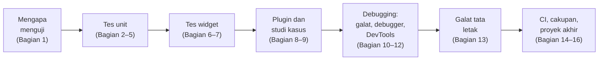
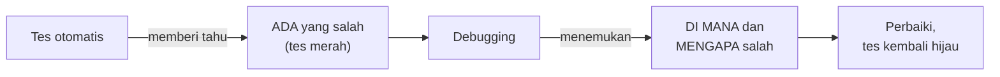
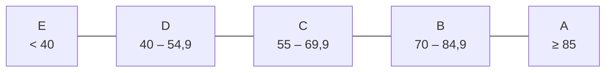
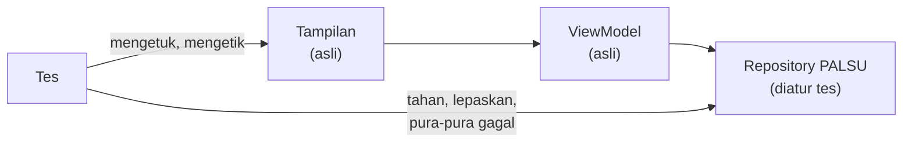

# Pertemuan 14 — Pengujian & *Debugging*

> 📖 **Modul bacaan** · ⏱️ ± 120 menit · 🎯 Untuk pemula
>
> **Bekal yang dibutuhkan:** sudah mengikuti [Pertemuan 2](../pertemuan_02_dasar_dart/README.md) (fungsi), [Pertemuan 3](../pertemuan_03_dart_lanjutan/README.md) (`Future`, `async`/`await`, `Stream`), [Pertemuan 9](../pertemuan_09_state_dan_mvvm/README.md) (MVVM, `ChangeNotifier`, `provider`), [Pertemuan 10](../pertemuan_10_async_dan_rest_api/README.md) (`http` dan `MockClient`), serta [Pertemuan 12](../pertemuan_12_clean_architecture/README.md) dan [13](../pertemuan_13_fitur_perangkat_dan_izin/README.md) (kontrak, `Hasil` dan `Kegagalan`, data palsu, Perintah).
> **Hasil akhir hari ini:** Anda mampu menulis tes unit dan tes widget, menjalankannya dengan satu perintah (di laptop maupun otomatis di GitHub), lalu menemukan penyebab bug dengan pesan galat, *debugger* VS Code, dan Flutter DevTools.

[🏠 Beranda](../README.md) · [📋 Silabus](../SILABUS.md) · [🧪 Jobsheet](JOBSHEET.md) · [✍️ Latihan](LATIHAN.md) · [💻 Kode Contoh](kode/) · [📊 Unduh Slide](https://raw.githubusercontent.com/antonprafanto/mobile2026/main/pertemuan_14_pengujian_dan_debugging/slide/PERTEMUAN_14_Pengujian_dan_Debugging.pptx)

> [!NOTE]
> **Laptop RAM 8 GB cukup untuk seluruh pertemuan ini.** Tes dijalankan dengan perintah `flutter test`, yang **tidak** membutuhkan emulator, HP, maupun Chrome. Contoh 01–04 (tes unit) bahkan bisa langsung dicoba di **DartPad**. Contoh 05–08 (tes widget dan tes yang memakai *plugin*) dijalankan dengan `flutter test` di laptop. Contoh 09–10 adalah aplikasi yang **sengaja berisi bug**: gejalanya terlihat di DartPad, tetapi *debugger* dengan *breakpoint* membutuhkan VS Code.

---

## Daftar Isi

1. [Mengapa Perlu Menguji?](#1-mengapa-perlu-menguji)
2. [Tes Unit Pertama](#2-tes-unit-pertama)
3. [Matcher, Pengecualian, `setUp`, dan `group`](#3-matcher-pengecualian-setup-dan-group)
4. [Menguji Kode Asinkron](#4-menguji-kode-asinkron)
5. [Menguji ViewModel dengan Data Palsu](#5-menguji-viewmodel-dengan-data-palsu)
6. [Tes Widget Pertama](#6-tes-widget-pertama)
7. [Tes Widget dengan ViewModel](#7-tes-widget-dengan-viewmodel)
8. [Menguji Kode yang Memakai *Plugin*](#8-menguji-kode-yang-memakai-plugin)
9. [Studi Kasus: Menguji "Pinjam Ruang Kampus"](#9-studi-kasus-menguji-pinjam-ruang-kampus)
10. [*Debugging* (1): Membaca Pesan Galat](#10-debugging-1-membaca-pesan-galat)
11. [*Debugging* (2): *Debugger* VS Code](#11-debugging-2-debugger-vs-code)
12. [*Debugging* (3): Flutter DevTools](#12-debugging-3-flutter-devtools)
13. [Galat Tata Letak yang Paling Sering](#13-galat-tata-letak-yang-paling-sering)
14. [Melangkah Lebih Jauh: Cakupan, CI, dan Jenis Tes Lain](#14-melangkah-lebih-jauh-cakupan-ci-dan-jenis-tes-lain)
15. [Kesalahan Umum Pemula](#15-kesalahan-umum-pemula-dan-solusinya)
16. [Pengujian untuk Proyek Akhir](#16-pengujian-untuk-proyek-akhir)
17. [Ringkasan](#17-ringkasan) · [Glosarium](#18-glosarium) · [Referensi](#19-referensi)

---

## 🎯 Tujuan Pembelajaran

Setelah mempelajari modul ini, Anda mampu:

1. Menjelaskan mengapa aplikasi perlu **diuji secara otomatis**, dan membedakan **tes unit**, **tes widget**, serta **tes integrasi** beserta untung-ruginya.
2. Menulis tes unit dengan `test()` dan `expect()` mengikuti pola **siapkan → lakukan → periksa**, lalu menjalankannya di DartPad, terminal (`flutter test`), dan VS Code.
3. Memakai ***matcher***, menguji ***exception***, merapikan tes dengan `setUp`, `tearDown`, dan `group`, serta memilih **nilai batas** yang tepat untuk diuji.
4. Menguji kode **asinkron** (`Future` dan `Stream`) dan kode yang menghubungi server, dengan server palsu `MockClient`.
5. Menguji **ViewModel** dengan **data palsu** yang bisa pura-pura gagal, menghitung panggilan, dan **ditahan** untuk memeriksa keadaan "sedang memuat".
6. Menulis **tes widget**: membangun layar dengan `pumpWidget`, mencari widget dengan ***finder***, mengetik dan mengetuk, lalu memeriksa hasilnya, termasuk di layar sempit, huruf besar, mode gelap, dan pedoman aksesibilitas.
7. Menguji kode yang memakai ***plugin*** tanpa HP, dengan membungkus *plugin* di balik kontrak atau memalsukannya.
8. **Membaca pesan galat** dan ***stack trace***, lalu memakai ***debugger*** VS Code (*breakpoint*, *breakpoint* bersyarat, *logpoint*, *step*) dan **Flutter DevTools** untuk menemukan penyebab bug.
9. Memperbaiki **galat tata letak** yang paling sering muncul: *overflow*, `ListView` di dalam `Column`, dan `TextField` di dalam `Row`.
10. Menjalankan tes **otomatis setiap kali *push*** ke GitHub (CI) dan membaca **cakupan kode** (*coverage*).

## 🗺️ Peta Materi Hari Ini



| Bagian | Pertanyaan yang dijawab |
| :--- | :--- |
| 1 | Mengapa kode yang "sudah jalan" tetap perlu diuji, dan tes apa saja yang ada? |
| 2–5 | Bagaimana menulis dan menjalankan tes untuk fungsi, kelas, kode asinkron, dan ViewModel? |
| 6–7 | Bagaimana menguji tampilan seperti pengguna memakainya: mengetik, mengetuk, lalu melihat layar? |
| 8–9 | Bagaimana menguji kode yang memakai kamera atau GPS, dan bagaimana menguji satu aplikasi utuh lapis demi lapis? |
| 10–13 | Saat aplikasi bermasalah, bagaimana menemukan penyebabnya dengan cepat, bukan menebak-nebak? |
| 14–16 | Bagaimana tes berjalan otomatis di GitHub, seberapa banyak kode yang sudah teruji, dan apa yang perlu disiapkan untuk proyek akhir? |

**Kode contoh hari ini:**

| No. | Berkas | Isi | Jalan di |
| :---: | :--- | :--- | :--- |
| 01 | [`contoh_01_tes_unit_pertama_test.dart`](kode/contoh_01_tes_unit_pertama_test.dart) | Menguji fungsi nilai akhir Pertemuan 2, dan menemukan bug yang tersembunyi selama ini | DartPad atau `flutter test` |
| 02 | [`contoh_02_matcher_setup_dan_group_test.dart`](kode/contoh_02_matcher_setup_dan_group_test.dart) | "Keranjang Kantin": *matcher*, *exception*, `setUp`, `group`, tabel kasus | DartPad atau `flutter test` |
| 03 | [`contoh_03_menguji_kode_asinkron_test.dart`](kode/contoh_03_menguji_kode_asinkron_test.dart) | "Bus Kampus": `Future`, `Stream`, dan server palsu `MockClient` | DartPad atau `flutter test` |
| 04 | [`contoh_04_menguji_viewmodel_test.dart`](kode/contoh_04_menguji_viewmodel_test.dart) | "Antrean Konsultasi Dosen": ViewModel dengan *repository* palsu | DartPad atau `flutter test` |
| 05 | [`contoh_05_widget_test_pertama_test.dart`](kode/contoh_05_widget_test_pertama_test.dart) | "Cek Nilai Akhir": tes widget pertama | `flutter test` |
| 06 | [`contoh_06_widget_test_dengan_viewmodel_test.dart`](kode/contoh_06_widget_test_dengan_viewmodel_test.dart) | Tampilan "Antrean Konsultasi" di semua keadaannya, layar sempit, mode gelap, aksesibilitas | `flutter test` |
| 07 | [`contoh_07_menguji_kode_plugin_test.dart`](kode/contoh_07_menguji_kode_plugin_test.dart) | Menguji "Presensi Praktikum" (Pertemuan 13) tanpa kamera dan GPS | `flutter test` |
| 08 | [`contoh_08_studi_kasus_menguji_pinjam_ruang_test.dart`](kode/contoh_08_studi_kasus_menguji_pinjam_ruang_test.dart) | Studi kasus: menguji "Pinjam Ruang Kampus" (Pertemuan 12) lapis demi lapis | `flutter test` |
| 09 | [`contoh_09_mencari_bug_dengan_debugger.dart`](kode/contoh_09_mencari_bug_dengan_debugger.dart) | "Kasir Kantin" yang sengaja berisi tiga bug, untuk latihan *debugger* | DartPad (gejala) dan VS Code (*debugger*) |
| 10 | [`contoh_10_memperbaiki_tata_letak.dart`](kode/contoh_10_memperbaiki_tata_letak.dart) | "Info Kegiatan Kampus": tiga galat tata letak dan perbaikannya | DartPad atau proyek Flutter |

> [!TIP]
> Nama berkas tes **wajib** berakhiran `_test.dart`. Itulah tanda bagi `flutter test` bahwa berkas itu berisi tes. Contoh 09 dan 10 bukan berkas tes, jadi namanya tidak berakhiran `_test`.

---

## 1. Mengapa Perlu Menguji?

### 1.1 Bug yang bersembunyi selama dua belas minggu

Di [Pertemuan 2](../pertemuan_02_dasar_dart/kode/contoh_13_studi_kasus_rekap_nilai.dart) kita menulis fungsi nilai akhir seperti ini, lalu memakainya untuk merekap nilai satu kelas:

```dart
// Nilai akhir = 30% tugas + 30% UTS + 40% UAS
double hitungNilaiAkhir({
  required int tugas,
  required int uts,
  required int uas,
}) {
  return tugas * 0.3 + uts * 0.3 + uas * 0.4;
}
```

Programnya berjalan, hasilnya untuk Andi, Budi, Citra, dan Dewi benar, dan kita pun melanjutkan ke pertemuan berikutnya. Dua belas minggu kemudian, saat menulis tes untuk fungsi itu, ternyata ada mahasiswa yang dirugikan:

| Tugas | UTS | UAS | Hitungan manual | Hasil komputer | Tampil di layar | Huruf |
| :---: | :---: | :---: | :---: | :---: | :---: | :---: |
| 60 | 82 | 31 | 18 + 24,6 + 12,4 = **55** | `54.99999999999999` | `55.0` | **D** (seharusnya **C**) |
| 15 | 97 | 16 | 4,5 + 29,1 + 6,4 = **40** | `39.99999999999999` | `40.0` | **E** (seharusnya **D**) |

Perhatikan kolom "Tampil di layar": `toStringAsFixed(1)` membulatkan angkanya, sehingga layar menulis **55.0** tetapi hurufnya **D**. Mahasiswa yang protes akan dianggap salah lihat. Kami menghitung semua kemungkinan nilai bulat 0–100 untuk tugas, UTS, dan UAS: dari **1.030.301** kombinasi, **214** mendapat huruf yang salah.

Bug ini lolos karena kita hanya mencoba **empat** data, dan kebetulan keempatnya aman. Penyebab dan perbaikannya dibahas di [Bagian 2.6](#26-mengapa-5499999999999999).

> [!IMPORTANT]
> Pelajaran pertama hari ini: **"programnya jalan" tidak sama dengan "programnya benar"**. Program yang jalan hanya membuktikan bahwa data yang kita coba memberi hasil yang benar.

### 1.2 Menguji dengan tangan vs menguji otomatis

Selama ini kita menguji dengan **tangan**: menjalankan aplikasi, mengetik, mengetuk, lalu melihat apakah hasilnya masuk akal. Cara itu tetap perlu, tetapi punya tiga kelemahan:

- **Lambat.** Mencoba 20 kemungkinan isian setiap kali mengubah kode menghabiskan waktu.
- **Mudah lupa.** Setelah mengubah fitur B, siapa yang ingat untuk mencoba ulang fitur A?
- **Tidak bisa diulang persis sama.** Hari ini Anda mengetik 60, besok 61.

**Tes otomatis** adalah kode kecil yang memeriksa kode lain. Sekali ditulis, ratusan pemeriksaan bisa diulang dalam hitungan detik, setiap kali kode berubah. Bayangkan daftar periksa pilot sebelum terbang: pilot yang sudah ribuan jam terbang pun tetap memeriksa setiap butir, karena satu butir yang terlewat bisa berakibat fatal.

Tes yang memastikan fitur lama **tetap** benar setelah kode diubah disebut **tes regresi** (*regression test*). Inilah manfaat terbesar tes otomatis: berani mengubah kode tanpa takut merusak yang sudah jalan.

### 1.3 Tiga jenis tes

Panduan resmi Flutter membagi tes menjadi tiga jenis:

| Jenis | Yang diuji | Perumpamaan | Kecepatan | Keyakinan |
| :--- | :--- | :--- | :---: | :---: |
| **Tes unit** (*unit test*) | Satu fungsi, *method*, atau kelas. Tanpa layar, tanpa internet | Memeriksa satu busi motor di meja bengkel | Sangat cepat | Rendah |
| **Tes widget** (*widget test*) | Satu widget atau satu layar, di lingkungan uji tanpa perangkat | Menyalakan mesin motor di bangku uji | Cepat | Lebih tinggi |
| **Tes integrasi** (*integration test*) | Aplikasi utuh, di HP, emulator, atau desktop sungguhan | *Test ride* di jalan raya | Lambat | Paling tinggi |

Tes unit paling murah dan cepat, tetapi hanya membuktikan satu bagian kecil. Tes integrasi paling meyakinkan, tetapi lambat dan lebih repot dirawat. Karena itu, panduan resmi menyarankan: **banyak tes unit dan tes widget, ditambah tes integrasi secukupnya** untuk alur terpenting. Hari ini kita fokus pada tes unit dan tes widget. Tes integrasi diperkenalkan singkat di [Bagian 14.3](#143-tes-integrasi).

### 1.4 Janji dari pertemuan-pertemuan sebelumnya

Beberapa pertemuan terakhir sudah menyiapkan kode agar **bisa diuji**. Hari ini janji-janji itu kita tepati:

| Pertemuan | Yang sudah disiapkan | Dipakai hari ini di |
| :--- | :--- | :--- |
| 9 | ViewModel tanpa widget, diperiksa dengan pola "siapkan, lakukan, periksa" | Bagian 5 |
| 10 | Server palsu `MockClient` dari `package:http/testing.dart` | Bagian 4 |
| 11 | *Repository* memori dan SQLite di memori | Bagian 5 dan Jobsheet |
| 12 | Kontrak, data palsu, jam tetap, dan fungsi `jalankanUji()` yang mencetak `LULUS`/`GAGAL` | Bagian 9 |
| 13 | Fitur perangkat di balik kontrak; `PemilihFotoImagePicker({ImagePicker? pemilih})` | Bagian 8 |

Satu perbedaan penting: `jalankanUji()` buatan sendiri hanya mencetak teks. `flutter test` adalah ***test runner*** resmi: ia menemukan semua berkas tes, menjalankannya terpisah satu sama lain, melaporkan yang gagal beserta alasannya, dan bisa dijalankan otomatis oleh GitHub.

### 1.5 Pengujian vs *debugging*

Dua kegiatan ini sering disebut bersamaan, tetapi berbeda tugas:



**Tes** menjawab "apakah ada yang salah?". ***Debugging*** menjawab "di baris mana, dan mengapa?". Alat-alat *debugging* dibahas di Bagian 10–13.

---

## 2. Tes Unit Pertama

### 2.1 Folder `test/` dan paket `flutter_test`

Setiap proyek dari `flutter create` sudah siap untuk diuji. Lihat `pubspec.yaml`:

```yaml
dev_dependencies:
  flutter_test:
    sdk: flutter
```

`dev_dependencies` berisi paket yang hanya dipakai **selama pengembangan**, tidak ikut masuk ke aplikasi yang dirilis. `flutter_test` berisi semua yang kita butuhkan hari ini: `test`, `expect`, `group`, `setUp`, `testWidgets`, dan kawan-kawan.

Tes diletakkan di folder `test/`, dan susunan foldernya **mencerminkan** folder `lib/`:

```text
kasir_kantin/
├── lib/
│   ├── nilai.dart              ← kode yang diuji
│   └── main.dart
└── test/
    └── nilai_test.dart         ← tesnya: nama sama + akhiran _test
```

> [!NOTE]
> Proyek baru sudah berisi `test/widget_test.dart` yang menguji aplikasi penghitung bawaan. Setelah `main.dart` Anda ganti, tes itu pasti gagal. Hapus saja berkas itu, atau ganti isinya dengan tes milik Anda.

Berkas contoh di repositori ini diletakkan di folder `kode/`, bukan `test/`, agar mudah ditemukan bersama modulnya. Judul `// ===== BERKAS: ... =====` di dalamnya menunjukkan **di mana** setiap bagian berada pada proyek sungguhan. Misalnya Contoh 01 berisi dua bagian: `lib/nilai.dart` (kode yang diuji) dan `test/nilai_test.dart` (tesnya).

### 2.2 Anatomi sebuah tes

Inilah tes paling sederhana dari [Contoh 01](kode/contoh_01_tes_unit_pertama_test.dart):

```dart
import 'package:flutter_test/flutter_test.dart';

void main() {
  test('nilai 90 mendapat huruf A', () {
    // 1. SIAPKAN data masukan.
    const double nilai = 90;

    // 2. LAKUKAN hal yang diuji.
    final String huruf = nilaiHuruf(nilai);

    // 3. PERIKSA hasilnya.
    expect(huruf, 'A');
  });
}
```

| Bagian | Arti |
| :--- | :--- |
| `test('kalimat', () { ... })` | Satu tes. Kalimatnya menjelaskan **perilaku yang diharapkan**, karena kalimat itulah yang tampil saat tes gagal |
| Siapkan → lakukan → periksa | Pola yang sama dengan Pertemuan 9. Dalam bahasa Inggris dikenal sebagai *Arrange → Act → Assert* |
| `expect(aktual, harapan)` | Membandingkan hasil **sebenarnya** dengan hasil yang **diharapkan**. Jika berbeda, tes gagal dan berhenti di baris itu |

Urutan argumen `expect` penting: hasil sebenarnya di **kiri**, harapan di **kanan**. Jika tertukar, pesan gagalnya ikut tertukar dan membingungkan.

> [!TIP]
> Tulis nama tes sebagai kalimat yang bisa dibaca orang lain: `'tepat 55 mendapat C, 54,9 mendapat D'` jauh lebih jelas daripada `'tes 3'`. Saat tes gagal, kalimat ini langsung menjelaskan **aturan mana** yang dilanggar.

### 2.3 Tiga cara menjalankan tes

**A. DartPad** (tanpa memasang apa pun). Buka [dartpad.dev](https://dartpad.dev), tempel seluruh isi Contoh 01, lalu klik **Run**. Hasilnya tampil di panel **Console**:

```text
00:00 +0: nilai 90 mendapat huruf A
00:00 +1: nilai akhir memakai bobot 30%, 30%, dan 40%
00:00 +2: tepat 85 mendapat A, 84,9 mendapat B
...
00:00 +8: Andi (85, 78, 90) tetap 84,9 dan mendapat B
00:00 +9: All tests passed!
```

**B. Terminal.** Dari folder utama proyek:

```bash
flutter test                                  # semua tes di folder test/
flutter test test/nilai_test.dart             # satu berkas saja
flutter test --plain-name "tepat 55"          # hanya tes yang namanya memuat "tepat 55"
```

Untuk berkas contoh di repositori ini, sebutkan jalurnya dari folder utama repositori:

```bash
flutter test pertemuan_14_pengujian_dan_debugging/kode/contoh_01_tes_unit_pertama_test.dart
flutter test pertemuan_14_pengujian_dan_debugging/kode/      # semua contoh tes Pertemuan 14
```

Di terminal, baris kemajuannya ditulis ulang di tempat yang sama, sehingga yang tersisa hanya baris terakhir:

```text
00:02 +9: All tests passed!
```

**C. VS Code.** Buka berkas tes. Di atas setiap `test(`, `group(`, dan `void main()` muncul tulisan kecil **Run | Debug**. Klik **Run** untuk menjalankan satu tes, atau buka panel **Testing** (ikon tabung reaksi di bilah kiri) untuk melihat dan menjalankan semua tes. Tes yang lulus diberi centang hijau, yang gagal diberi tanda silang merah.

> [!NOTE]
> VS Code hanya mengenali berkas tes di folder `test/`. Untuk berkas contoh di folder `kode/` repositori ini, **Run | Debug** baru muncul setelah setelan **Dart: Allow Tests Outside Test Folder** (`dart.allowTestsOutsideTestFolder`) dinyalakan. Di proyek Anda sendiri, cukup letakkan tes di folder `test/`.

Cara membaca baris laporannya:

| Bagian | Arti |
| :--- | :--- |
| `00:02` | Waktu sejak tes mulai dijalankan (menit:detik) |
| `+9` | Jumlah tes yang **lulus** |
| `-2` | Jumlah tes yang **gagal** (hanya muncul jika ada) |
| `~1` | Jumlah tes yang **dilewati** (`skip: true`) |
| `All tests passed!` / `Some tests failed.` | Kesimpulan akhir |

### 2.4 Membaca tes yang gagal

Untuk melihat wujud tes yang gagal, kembalikan fungsi `hitungNilaiAkhir` ke versi Pertemuan 2 (hapus pembulatannya), lalu jalankan lagi. DartPad menampilkan:

```text
00:00 +6: nilai 60, 82, 31 tepat 55, jadi hurufnya C
00:00 +6: nilai 60, 82, 31 tepat 55, jadi hurufnya C [E]
  Expected: <55>
    Actual: <54.99999999999999>
  (baris-baris lokasi galat)
00:00 +6 -1: nilai 15, 97, 16 tepat 40, jadi hurufnya D
00:00 +6 -1: nilai 15, 97, 16 tepat 40, jadi hurufnya D [E]
  Expected: <40>
    Actual: <39.99999999999999>
  (baris-baris lokasi galat)
00:00 +6 -2: Andi (85, 78, 90) tetap 84,9 dan mendapat B
00:00 +7 -2: Some tests failed.
```

| Yang terlihat | Artinya |
| :--- | :--- |
| `[E]` di akhir nama tes | Tes ini gagal (*error*) |
| `Expected: <55>` | Yang kita harapkan |
| `Actual: <54.99999999999999>` | Yang sebenarnya dihasilkan kode |
| Baris-baris lokasi galat | ***Stack trace***: jejak pemanggilan sampai ke baris `expect` yang gagal. Di terminal, salah satu barisnya menunjuk berkas dan nomor baris tes Anda, misalnya `test/nilai_test.dart 79:5` |
| `+7 -2` | 7 lulus, 2 gagal |

Tes yang gagal **bukan** bencana. Justru itulah tugasnya: berteriak **sebelum** pengguna yang menemukan masalahnya.

### 2.5 Merah dulu, baru hijau

Setelah menemukan bug, jangan langsung memperbaikinya. Urutan yang dianjurkan:

1. **Tulis tes yang membuktikan bug itu ada**, lalu jalankan. Tes harus **merah** (gagal). Jika ternyata hijau, tesnya belum menangkap bug tersebut.
2. **Perbaiki kodenya.**
3. **Jalankan lagi.** Tes menjadi **hijau**, begitu pula semua tes lama.

Langkah pertama sering dilewatkan pemula, padahal penting: tes yang belum pernah terlihat merah belum terbukti bisa menangkap apa pun. Tes ini juga menjadi **tes regresi**: jika suatu hari ada yang tanpa sengaja menghapus pembulatan, tes langsung merah lagi.

### 2.6 Mengapa `54.99999999999999`?

Komputer menyimpan bilangan desimal (`double`) dalam **biner** (basis 2). Sebagian besar pecahan desimal **tidak bisa** ditulis tepat dalam biner, sama seperti 1/3 tidak bisa ditulis tepat dalam desimal: 0,3333… selalu berhenti di suatu digit dan sedikit meleset.

`0,3` dan `0,4` termasuk pecahan yang tidak bisa disimpan tepat. Selisihnya sangat kecil, sekitar 0,000000000000007, tetapi cukup untuk membuat `55` menjadi `54.99999999999999`, dan `54.99999999999999 >= 55` bernilai `false`.

Tiga cara mengatasinya:

| Cara | Contoh | Kapan dipakai |
| :--- | :--- | :--- |
| **Bulatkan** hasilnya ke jumlah angka di belakang koma yang wajar | `(akhir * 100).round() / 100` | Nilai yang ditampilkan dan dibandingkan dengan batas, seperti nilai akhir. Dipakai di Contoh 01 |
| **Hitung dengan bilangan bulat** | Nilai × 10: `(3 * tugas + 3 * uts + 4 * uas)` dibandingkan dengan `550` | Uang (simpan rupiah sebagai `int`), poin, stok |
| **Bandingkan dengan toleransi** di dalam tes | `expect(hasil, closeTo(6666.67, 0.01))` | Hasil yang memang desimal, misalnya rata-rata ([Bagian 3.5](#35-bilangan-desimal-closeto)) |

Setelah dibulatkan, ke-214 kombinasi yang tadinya salah menjadi benar semua. Satu tes yang ditulis di nilai yang tepat menyelamatkan ratusan mahasiswa.

> [!WARNING]
> Untuk **uang**, jangan memakai `double`. Simpan rupiah sebagai `int` (seperti Keranjang Kantin di Contoh 02). `0.1 + 0.2` di Dart menghasilkan `0.30000000000000004`.

### 2.7 Nilai batas: di sinilah bug bersembunyi

Mengapa bug di atas tidak tertangkap oleh data Andi, Budi, Citra, dan Dewi? Karena nilai mereka **jauh** dari garis pemisah huruf. Bug semacam ini hanya muncul **tepat di garis**.

**Pengujian nilai batas** (*boundary value testing*) memilih data di sekitar garis pemisah: **tepat di garis**, dan **satu langkah di bawahnya**. Dengan nilai bulat, nilai akhir selalu kelipatan 0,1, jadi satu langkah di bawah 85 adalah 84,9:



```dart
test('tepat 85 mendapat A, 84,9 mendapat B', () {
  expect(nilaiHuruf(85), 'A');
  expect(nilaiHuruf(84.9), 'B');
});
```

Kesalahan yang paling sering di dekat batas adalah tertukarnya `>` dan `>=`. Menguji nilai yang jauh dari batas (misalnya 90 dan 60) tidak akan pernah menangkapnya. Kita akan menemui pola ini lagi: batas diskon Rp50.000 (Bagian 3), jam buka presensi 12.45 (Bagian 8), dan lama peminjaman 30 menit (Bagian 9).

> [!TIP]
> Untuk setiap aturan berbentuk "minimal", "maksimal", "mulai", atau "paling lambat", tulis dua tes: **tepat di batas** dan **satu langkah di luar batas**.

---

## 3. Matcher, Pengecualian, `setUp`, dan `group`

[Contoh 02](kode/contoh_02_matcher_setup_dan_group_test.dart) menguji "Keranjang Kantin": menu bisa ditambah dan dikurangi, belanja mulai Rp50.000 mendapat diskon 10%, dan satu menu paling banyak 10 porsi.

### 3.1 *Matcher*: cara memeriksa yang lebih kaya

Argumen kedua `expect` sebenarnya adalah ***matcher***, yaitu "aturan pencocokan". Menulis nilai biasa seperti `'A'` sama dengan menulis `equals('A')`. Ada banyak *matcher* lain yang membuat tes lebih jelas:

| *Matcher* | Lulus jika | Contoh |
| :--- | :--- | :--- |
| `equals(x)` atau nilai langsung | Sama dengan `x`. Untuk `List` dan `Map`, isinya dibandingkan satu per satu | `expect(keranjang.total, 45000)` |
| `isTrue`, `isFalse` | Bernilai `true` / `false` | `expect(keranjang.kosong, isTrue)` |
| `isNull`, `isNotNull` | `null` / bukan `null` | `expect(vm.pesanKirim, isNull)` |
| `isEmpty`, `isNotEmpty` | Kosong / tidak kosong (teks, `List`, `Map`) | `expect(keranjang.rincian, isEmpty)` |
| `hasLength(n)` | Panjangnya `n` | `expect(keranjang.rincian, hasLength(1))` |
| `contains(x)` | Memuat `x` (teks atau anggota `List`) | `expect(rincian, contains('3 x Nasi goreng = Rp36.000'))` |
| `startsWith(s)` | Teks diawali `s` | `expect(alasan, startsWith('Lokasi palsu'))` |
| `greaterThan(n)`, `lessThan(n)` | Lebih besar / lebih kecil dari `n` | `expect(jarak, lessThan(100))` |
| `closeTo(n, toleransi)` | Selisihnya dengan `n` tidak lebih dari toleransi | `expect(rataRata, closeTo(6666.67, 0.01))` |
| `isA<T>()` | Bertipe `T` | `expect(hasil, isA<Berhasil<List<JadwalBus>>>())` |

Dibandingkan `expect(keranjang.rincian.length == 1, true)`, bentuk `expect(keranjang.rincian, hasLength(1))` memberi pesan gagal yang jauh lebih jelas:

```text
  Expected: an object with length of <1>
    Actual: ['3 x Nasi goreng = Rp36.000', '1 x Es teh = Rp4.000']
     Which: has length of <2>
```

`isA<T>()` bisa dilanjutkan dengan `.having(...)` untuk memeriksa isinya sekaligus:

```dart
expect(
  kegagalan,
  isA<ServerBermasalah>().having(
    (ServerBermasalah k) => k.kodeStatus, // ambil bagian yang diperiksa
    'kodeStatus', // namanya, untuk pesan gagal
    500, // harapannya
  ),
);
```

### 3.2 Menguji *exception*

Keranjang **menolak** pesanan yang tidak wajar dengan melempar *exception*:

```dart
void tambah(Menu menu, {int jumlah = 1}) {
  if (jumlah < 1) {
    throw ArgumentError.value(jumlah, 'jumlah', 'minimal 1');
  }
  final int baru = porsiDari(menu) + jumlah;
  if (baru > maksimalPorsi) {
    throw StateError(
      'Paling banyak $maksimalPorsi porsi ${menu.nama} sekali pesan.',
    );
  }
  // ...
}
```

Penolakan juga perilaku yang harus diuji. Caranya:

```dart
test('jumlah 0 ditolak dengan ArgumentError', () {
  expect(() => keranjang.tambah(esTeh, jumlah: 0), throwsArgumentError);
  // Pesanan yang ditolak tidak boleh mengubah isi keranjang.
  expect(keranjang.kosong, isTrue);
});
```

Perhatikan `() =>` di depannya. Kode yang **diharapkan melempar** *exception* harus dibungkus fungsi, agar `expect` sendiri yang menjalankan dan menangkapnya. Tanpa pembungkus, *exception* dilempar **sebelum** `expect` sempat bekerja, dan tesnya gagal.

| *Matcher* | Lulus jika kode melempar |
| :--- | :--- |
| `throwsArgumentError` | `ArgumentError`: isi argumennya salah |
| `throwsStateError` | `StateError`: argumennya wajar, tetapi keadaan objek menolak |
| `throwsFormatException` | `FormatException`: teks tidak sesuai format |
| `throwsA(matcher)` | Apa pun yang cocok dengan *matcher*, misalnya `throwsA(isA<StateError>().having(...))` |

Untuk memeriksa **pesannya** juga:

```dart
expect(
  () => keranjang.tambah(esTeh),
  throwsA(
    isA<StateError>().having(
      (StateError e) => e.message,
      'message',
      contains('Paling banyak 10 porsi Es teh'),
    ),
  ),
);
```

### 3.3 `setUp` dan `tearDown`: setiap tes mulai dari nol

Hampir semua tes keranjang membutuhkan keranjang kosong. Daripada menulis `final keranjang = Keranjang();` di setiap tes, gunakan `setUp`:

```dart
late Keranjang keranjang; // diisi di setUp, sebelum dipakai

setUp(() {
  keranjang = Keranjang(); // dijalankan SEBELUM SETIAP tes
});
```

| Fungsi | Dijalankan |
| :--- | :--- |
| `setUp(() { ... })` | Sebelum **setiap** tes di tingkat yang sama dan di dalamnya |
| `tearDown(() { ... })` | Sesudah **setiap** tes, walaupun tesnya gagal. Cocok untuk membereskan, misalnya `vm.dispose()` |
| `setUpAll` / `tearDownAll` | Sekali saja, sebelum / sesudah semua tes di kelompoknya. Untuk persiapan yang mahal |

Mengapa tidak satu keranjang untuk semua tes? Karena tes harus **mandiri**. Jika tes kedua bergantung pada isi keranjang dari tes pertama, tes kedua akan gagal saat dijalankan sendirian, atau saat urutannya berubah. Untuk membuktikan tes Anda mandiri, jalankan dengan urutan acak:

```bash
flutter test --test-randomize-ordering-seed random
```

### 3.4 `group`: mengelompokkan tes

```dart
group('Keranjang', () {
  setUp(() { keranjang = Keranjang(); });

  test('keranjang baru masih kosong', () { ... });

  group('diskon 10% mulai Rp50.000', () {
    test('Rp49.000 belum mendapat diskon', () { ... });
    test('tepat Rp50.000 mendapat diskon Rp5.000', () { ... });
  });
});
```

Nama kelompok ikut tertulis di depan nama setiap tesnya, sehingga laporannya mudah dibaca:

```text
00:00 +13: Keranjang diskon 10% mulai Rp50.000 tepat Rp50.000 mendapat diskon Rp5.000
```

`group` boleh bersarang. `setUp` di kelompok luar dijalankan lebih dulu, baru `setUp` di kelompok dalam.

### 3.5 Bilangan desimal: `closeTo`

Rata-rata harga per porsi untuk 1 nasi goreng (Rp12.000) dan 2 es teh (Rp4.000) adalah 20.000 / 3 = 6666,666…. Seperti di Bagian 2.6, bilangan desimal jangan dibandingkan **sama persis**:

```dart
expect(keranjang.rataRataPerPorsi, closeTo(6666.67, 0.01));
```

Artinya: "lulus jika selisihnya dengan 6666,67 tidak lebih dari 0,01".

### 3.6 Tabel kasus: banyak data, satu pola

Fungsi `rupiah()` perlu dicoba dengan banyak angka. Daripada menulis tujuh tes yang hampir sama, susun **tabel kasus**:

```dart
group('rupiah()', () {
  const Map<int, String> kasus = {
    0: 'Rp0',
    500: 'Rp500',
    1000: 'Rp1.000',
    12500: 'Rp12.500',
    150000: 'Rp150.000',
    1000000: 'Rp1.000.000',
    -2500: '-Rp2.500',
  };
  kasus.forEach((int angka, String harapan) {
    test('$angka menjadi $harapan', () {
      expect(rupiah(angka), harapan);
    });
  });
});
```

Setiap baris tabel menjadi satu tes bernama sendiri, misalnya `rupiah() 1000 menjadi Rp1.000`. Menambah kasus cukup dengan menambah satu baris. Pilih baris-barisnya dengan sengaja: nol, angka tanpa titik (500), batas munculnya titik (1000), titik ganda (1.000.000), dan bilangan negatif.

### 3.7 Menjalankan Contoh 02

Tempel [Contoh 02](kode/contoh_02_matcher_setup_dan_group_test.dart) ke DartPad, lalu klik **Run**:

```text
00:00 +0: rupiah() 0 menjadi Rp0
00:00 +1: rupiah() 500 menjadi Rp500
...
00:00 +7: Keranjang keranjang baru masih kosong
...
00:00 +13: Keranjang diskon 10% mulai Rp50.000 tepat Rp50.000 mendapat diskon Rp5.000
...
00:00 +17: All tests passed!
```

> [!TIP]
> Coba rusak kodenya dengan sengaja: ubah `subtotal >= batasDiskon` menjadi `subtotal > batasDiskon`. Tes mana yang menjadi merah? Inilah gunanya menguji tepat di batas.

---

## 4. Menguji Kode Asinkron

[Contoh 03](kode/contoh_03_menguji_kode_asinkron_test.dart) menguji "Bus Kampus": jadwal bus diambil dari server, lalu posisi bus diikuti lewat `Stream`.

### 4.1 Tes `async`: jangan lupa `await`

Kode yang mengembalikan `Future` diuji dengan fungsi tes bertanda `async`, dan setiap `Future` di dalamnya **ditunggu** dengan `await`:

```dart
test('JSON yang benar menjadi daftar jadwal', () async {
  final Hasil<List<JadwalBus>> hasil = await repositori.jadwalHariIni();

  expect(hasil, isA<Berhasil<List<JadwalBus>>>());
});
```

> [!WARNING]
> Tanpa `await`, tes bisa **selesai sebelum hasilnya datang**. Tes seperti itu tampak lulus padahal tidak memeriksa apa-apa, atau galatnya muncul di tes lain yang tidak bersalah. Aturan sederhana: jika memanggil sesuatu yang mengembalikan `Future`, tulis `await` di depannya.

### 4.2 Server palsu dengan `MockClient`

Tes tidak boleh bergantung pada internet: hasilnya akan berubah saat server sibuk atau Wi-Fi mati. Di Pertemuan 10 kita mengenal `MockClient`, server palsu yang jawabannya kita tentukan sendiri. Syaratnya, layanan menerima klien HTTP **dari luar** (disuntikkan lewat *constructor*):

```dart
class LayananBus {
  // Aplikasi memberi http.Client(), tes memberi MockClient.
  LayananBus({required this._klien});
  final http.Client _klien;
  // ...
}
```

Dalam tes:

```dart
final RepositoriBus repositori = RepositoriBus(
  layanan: LayananBus(
    klien: MockClient(
      (http.Request permintaan) async => http.Response(jsonContoh, 200),
    ),
  ),
);
```

Dengan `MockClient`, **setiap** kemungkinan kegagalan bisa diuji dalam sekejap, tanpa menunggu server benar-benar rusak:

| Server palsu menjawab | *Repository* harus menghasilkan |
| :--- | :--- |
| `http.Response(jsonContoh, 200)` | `Berhasil` berisi 2 jadwal |
| `http.Response('Galat server', 500)` | `Gagal(ServerBermasalah(500))` |
| `throw http.ClientException('Terputus')` | `Gagal(TanpaKoneksi())` |
| `throw TimeoutException('Terlalu lama')` | `Gagal(WaktuHabis())` |
| `http.Response('<html>Perbaikan</html>', 200)` | `Gagal(DataRusak())` |
| `http.Response('{"data": []}', 200)` | `Gagal(DataRusak())` |

Karena polanya berulang, Contoh 03 membuat fungsi pembantu:

```dart
/// Server palsu yang menjawab dengan [jawab], lalu kegagalan yang
/// dihasilkan repository (null jika berhasil).
Future<Kegagalan?> kegagalanDari(MockClientHandler jawab) async {
  final RepositoriBus repositori = RepositoriBus(
    layanan: LayananBus(klien: MockClient(jawab)),
  );
  final Hasil<List<JadwalBus>> hasil = await repositori.jadwalHariIni();
  return switch (hasil) {
    Berhasil() => null,
    Gagal(:final Kegagalan kegagalan) => kegagalan,
  };
}

test('koneksi putus menjadi TanpaKoneksi', () async {
  final Kegagalan? kegagalan = await kegagalanDari(
    (http.Request _) async => throw http.ClientException('Terputus'),
  );
  expect(kegagalan, isA<TanpaKoneksi>());
});
```

Server palsu juga bisa **mencatat** permintaan yang diterimanya, untuk memastikan alamat dan metodenya benar:

```dart
final List<http.Request> tercatat = [];
// ... MockClient((http.Request permintaan) async {
//       tercatat.add(permintaan);
//       return http.Response(jsonContoh, 200);
//     })
expect(tercatat.single.method, 'GET');
expect(tercatat.single.url.path, '/bus/jadwal');
```

### 4.3 `Future` yang diharapkan gagal: `expectLater`

Jika yang diuji adalah `Future` yang **seharusnya gagal**, periksa dengan `expectLater`, lalu tunggu dengan `await`:

```dart
await expectLater(
  layanan.ambilJadwal(), // Future, TANPA await di depannya
  throwsA(
    isA<ApiException>().having(
      (ApiException e) => e.kodeStatus,
      'kodeStatus',
      404,
    ),
  ),
);

await expectLater(
  layanan.ambilJadwal(),
  completion(equals({'jadwal': []})), // Future yang berhasil dengan nilai tertentu
);
```

Perbedaannya dengan `expect`: `expectLater` mengembalikan `Future` yang selesai setelah pemeriksaannya selesai. Karena itu ia **harus** di-`await`.

### 4.4 Menguji `Stream`

`statusKedatangan()` mengubah aliran "sisa halte" menjadi kalimat untuk penumpang, lalu berhenti setelah bus tiba. Aliran palsu dibuat dengan `Stream.fromIterable`, lalu diperiksa urutan isinya:

```dart
test('menghitung mundur sampai bus tiba', () async {
  await expectLater(
    statusKedatangan(Stream<int>.fromIterable([3, 2, 1, 0])),
    emitsInOrder([
      'Bus 3 halte lagi',
      'Bus 2 halte lagi',
      'Bus 1 halte lagi. Bersiaplah!',
      'Bus tiba. Silakan naik!',
      emitsDone, // lalu aliran selesai
    ]),
  );
});
```

| *Matcher* `Stream` | Lulus jika aliran |
| :--- | :--- |
| `emits(x)` | Mengeluarkan `x` berikutnya |
| `emitsInOrder([...])` | Mengeluarkan semua isi daftar, berurutan |
| `emitsDone` | Selesai (tidak ada data lagi) |
| `emitsError(matcher)` | Mengeluarkan galat yang cocok, misalnya `emitsError(isArgumentError)` |
| `neverEmits(x)` | Tidak pernah mengeluarkan `x` sampai selesai |

### 4.5 Menjalankan Contoh 03

Contoh 03 berjalan di DartPad (paket `http` tersedia di sana) dan selesai dalam sekejap, tanpa internet sama sekali:

```text
00:00 +0: RepositoriBus JSON yang benar menjadi daftar jadwal
...
00:00 +7: LayananBus kode 404 dilempar sebagai ApiException
...
00:00 +12: All tests passed!
```

---

## 5. Menguji ViewModel dengan Data Palsu

[Contoh 04](kode/contoh_04_menguji_viewmodel_test.dart) menguji "Antrean Konsultasi Dosen": mahasiswa melihat daftar antrean, lalu mengambil nomor. ViewModel-nya mengikuti pola Pertemuan 9 dan 12: memuat dari *repository*, menyimpan status (`memuat`, `berhasil`, `gagal`), menolak isian yang tidak wajar, dan menjaga agar ketukan ganda tidak mengirim dua kali.

### 5.1 Mengapa ViewModel mudah diuji

ViewModel tidak berisi widget. Ia hanya kelas Dart biasa yang menerima *repository* lewat *constructor*. Karena itu ia bisa diuji **tanpa layar**: buat ViewModel dengan *repository* palsu, panggil *method*-nya, lalu periksa isinya. Inilah alasan Pertemuan 9 memisahkan logika dari tampilan.

### 5.2 Data palsu (*fake*) dan tiruan (*mock*)

Ada dua cara mengganti *repository* asli dalam tes:

| | **Data palsu** (*fake*) | **Tiruan** (*mock*) |
| :--- | :--- | :--- |
| Wujud | Kelas sungguhan yang memenuhi kontrak, tetapi sederhana: data di memori | Objek yang dibuat paket seperti `mocktail` atau `mockito`; setiap jawabannya diatur di dalam tes |
| Contoh | `RepositoriAntreanPalsu`, `RepositoriPeminjamanMemori` (Pertemuan 12) | `when(() => repo.semua()).thenAnswer(...)` |
| Kelebihan | Mudah dibaca, dipakai bersama banyak tes, bisa juga dipakai saat mengembangkan aplikasi | Cepat dibuat untuk satu kasus khusus, bisa memeriksa panggilan dengan rinci |
| Kekurangan | Harus ditulis sendiri | Tes ikut terikat pada cara kode memanggil *repository* |

Panduan arsitektur resmi Flutter memakai **data palsu** untuk *repository*, dan kita mengikutinya. *Mock* dikenalkan singkat di [Bagian 14.4](#144-mocktail-dan-mockito).

### 5.3 Data palsu dengan "remote control"

`RepositoriAntreanPalsu` di Contoh 04 punya beberapa tombol yang bisa diatur tes:

```dart
class RepositoriAntreanPalsu implements RepositoriAntrean {
  RepositoriAntreanPalsu({List<Antrean> isi = const []}) : _isi = [...isi];

  final List<Antrean> _isi; // isi "server", disalin agar aman diubah

  // 1. Pura-pura gagal.
  Kegagalan? gagalSaatMemuat;
  Kegagalan? gagalSaatMengambil;

  // 2. Mata-mata (spy): berapa kali "server" dihubungi.
  int jumlahMemuat = 0;
  int jumlahMengambil = 0;

  // 3. Tahan: setiap panggilan MENUNGGU sampai lepaskan() dipanggil.
  bool tahan = false;
  final List<Completer<void>> _menunggu = [];

  void lepaskan() {
    for (final Completer<void> c in _menunggu) {
      c.complete();
    }
    _menunggu.clear();
  }

  Future<void> _mungkinDitahan() async {
    if (!tahan) return;
    final Completer<void> penahan = Completer<void>();
    _menunggu.add(penahan);
    await penahan.future; // berhenti di sini sampai complete() dipanggil
  }

  @override
  Future<Hasil<List<Antrean>>> semua() async {
    jumlahMemuat++;
    await _mungkinDitahan();
    final Kegagalan? kegagalan = gagalSaatMemuat;
    if (kegagalan != null) return Gagal(kegagalan);
    return Berhasil(List.of(_isi));
  }
  // ambilNomor() serupa.
}
```

`Completer` adalah "`Future` yang selesainya kita kendalikan sendiri". Selama `complete()` belum dipanggil, siapa pun yang menunggu `penahan.future` ikut berhenti. Dengan cara ini, keadaan **di tengah jalan** bisa diperiksa:

```dart
test('saat repository ditahan, status masih memuat', () async {
  repositori.tahan = true;

  final Future<void> proses = vm.muat(); // sengaja BELUM di-await
  expect(vm.status, StatusMuat.memuat);

  repositori.lepaskan(); // "server" menjawab
  await proses;
  expect(vm.status, StatusMuat.berhasil);
});
```

### 5.4 Memeriksa kabar ke pendengar

ViewModel memberi kabar ke tampilan lewat `notifyListeners()`. Tes bisa ikut mendengarkan dan mencatat setiap kabar:

```dart
test('pendengar diberi kabar saat mulai dan saat selesai memuat', () async {
  final List<StatusMuat> tercatat = [];
  vm.addListener(() => tercatat.add(vm.status));

  await vm.muat();

  expect(tercatat, [StatusMuat.memuat, StatusMuat.berhasil]);
});
```

Jika suatu hari ada yang lupa memanggil `notifyListeners()`, layar tidak berubah. Tes ini menangkap kesalahan itu **tanpa** menjalankan aplikasi.

### 5.5 Aturan, ketukan ganda, dan `dispose`

Tiga perilaku penting lain yang diuji di Contoh 04:

```dart
test('nama kosong ditolak SEBELUM menghubungi server', () async {
  final bool berhasil = await vm.ambilNomor(
    nama: '   ',
    keperluan: 'Konsultasi judul skripsi',
  );

  expect(berhasil, isFalse);
  expect(vm.pesanKirim, 'Nama wajib diisi.');
  expect(repositori.jumlahMengambil, 0); // mata-mata membuktikan server tidak dihubungi
});

test('ketukan ganda hanya mengirim SATU kali', () async {
  repositori.tahan = true;

  final Future<bool> pertama = vm.ambilNomor(
    nama: 'Sari',
    keperluan: 'Konsultasi judul skripsi',
  );
  expect(vm.mengirim, isTrue); // tombol di layar seharusnya mati

  final bool kedua = await vm.ambilNomor(
    nama: 'Sari',
    keperluan: 'Konsultasi judul skripsi',
  );
  expect(kedua, isFalse); // ditolak penjaga

  repositori
    ..tahan = false
    ..lepaskan();
  expect(await pertama, isTrue);
  expect(repositori.jumlahMengambil, 1);
});
```

Tes terakhir memeriksa ViewModel yang **dibuang** (halaman ditutup) sebelum data datang. Tanpa penjaga `_sudahDibuang`, ViewModel memanggil `notifyListeners()` setelah `dispose()`, dan Flutter melempar galat *"A AntreanViewModel was used after being disposed."*.

> [!TIP]
> Perhatikan `tearDown(() { vm.dispose(); })` di Contoh 04. Tes yang rapi membereskan apa yang ia buat, sama seperti `dispose()` di `State`.

### 5.6 Menjalankan Contoh 04

Contoh 04 berjalan di DartPad:

```text
00:00 +0: memuat mula-mula berstatus memuat dengan daftar kosong
...
00:00 +8: mengambil nomor ketukan ganda hanya mengirim SATU kali
...
00:00 +12: All tests passed!
```

---

## 6. Tes Widget Pertama

### 6.1 Apa itu tes widget?

Tes unit memeriksa fungsi dan kelas. **Tes widget** memeriksa **tampilan**, dengan cara yang mirip pengguna memakainya: membangun layar, mengetik, mengetuk, lalu melihat apa yang muncul. Bedanya, semua itu terjadi di **lingkungan uji** di dalam memori komputer: tidak ada HP, emulator, atau jendela yang terbuka, sehingga tes widget tetap berjalan cepat.

[Contoh 05](kode/contoh_05_widget_test_pertama_test.dart) menguji aplikasi kecil "Cek Nilai Akhir": tiga isian (Tugas, UTS, UAS), tombol **Hitung**, dan kartu hasil yang menampilkan nilai akhir, huruf, serta "Lulus" atau "Mengulang". Fungsi perhitungannya sama dengan Contoh 01.

### 6.2 `testWidgets` dan `WidgetTester`

```dart
testWidgets('tampilan awal: tiga isian dan belum ada hasil', (
  WidgetTester tester,
) async {
  // pumpWidget: bangun dan gambar aplikasinya satu kali.
  await tester.pumpWidget(const AplikasiCekNilai());

  expect(find.text('Cek Nilai Akhir'), findsOneWidget);
  expect(find.byType(TextFormField), findsNWidgets(3));
  expect(find.text('Hitung'), findsOneWidget);
  expect(find.byKey(const Key('kartu_hasil')), findsNothing);
});
```

| Bagian | Arti |
| :--- | :--- |
| `testWidgets('kalimat', (WidgetTester tester) async { ... })` | Satu tes widget. Fungsinya selalu `async` |
| `tester` | "Robot penguji": bisa membangun layar, mengetik, mengetuk, dan menggambar ulang |
| `tester.pumpWidget(widget)` | Membangun widget lalu menggambarnya **satu kali**. Biasanya `MaterialApp` atau widget aplikasi yang sudah berisi `MaterialApp` |
| `find.…` | ***Finder***: cara mencari widget di layar |
| `findsOneWidget`, `findsNothing`, … | *Matcher* khusus *finder*: berapa banyak widget yang harus ditemukan |

> [!IMPORTANT]
> Widget yang diuji harus berada di dalam `MaterialApp` (atau aplikasi yang membuatnya), karena `TextField`, `Scaffold`, tema, dan arah teks membutuhkannya. Untuk menguji satu widget kecil, bungkus seperti ini: `await tester.pumpWidget(const MaterialApp(home: Scaffold(body: KartuHasil(...))));`.

### 6.3 *Finder*: mencari widget di layar

| *Finder* | Mencari | Contoh |
| :--- | :--- | :--- |
| `find.text('…')` | Widget `Text` (atau isian) bertulisan **persis** sama | `find.text('Hitung')` |
| `find.textContaining('…')` | Tulisan yang **memuat** potongan teks | `find.textContaining('tercatat')` |
| `find.byKey(Key('…'))` | Widget yang diberi `key` tersebut | `find.byKey(const Key('isian_tugas'))` |
| `find.byType(T)` | Semua widget bertipe `T` | `find.byType(TextFormField)` |
| `find.byIcon(ikon)` | Widget `Icon` dengan ikon tersebut | `find.byIcon(Icons.add)` |
| `find.byTooltip('…')` | Tombol ikon dengan *tooltip* tersebut | `find.byTooltip('Kosongkan')` |
| `find.widgetWithText(T, '…')` | Widget bertipe `T` yang memuat tulisan tersebut | `find.widgetWithText(TextFormField, 'UAS (40%)')` |
| `find.descendant(of: a, matching: b)` | `b` yang berada **di dalam** `a` | Lingkaran memuat di dalam tombol tertentu |
| `find.ancestor(of: a, matching: b)` | `b` yang **membungkus** `a` | Tombol yang membungkus tulisan "Ajukan" |

| *Matcher* | Lulus jika ditemukan |
| :--- | :--- |
| `findsOneWidget` | Tepat satu |
| `findsNothing` | Tidak ada |
| `findsNWidgets(n)` | Tepat `n` |
| `findsWidgets` | Satu atau lebih |

**`Key`** adalah "papan nama" untuk widget. Di Contoh 05, setiap isian diberi nama agar tes bisa menemukannya tanpa bergantung pada tulisan yang mungkin berubah:

```dart
// Ketiga isian dibuat oleh fungsi pembantu _isian(...).
_isian(const Key('isian_tugas'), 'Tugas (30%)', _tugas),

Widget _isian(Key kunci, String label, TextEditingController kontrol) {
  return TextFormField(
    key: kunci, // papan nama yang dicari tes
    controller: kontrol,
    decoration: InputDecoration(labelText: label),
    // ...
  );
}
```

> [!TIP]
> Pilih *finder* yang mencerminkan cara pengguna melihat layar: tulisan (`find.text`), *tooltip*, atau label. Gunakan `Key` untuk widget yang tidak punya tulisan unik, misalnya beberapa isian yang mirip atau kartu hasil.

### 6.4 Aksi: mengetik, mengetuk, menggulir

| Aksi | Arti |
| :--- | :--- |
| `await tester.tap(finder)` | Mengetuk tengah widget |
| `await tester.enterText(finder, '60')` | Mengetik ke isian (isian lamanya diganti) |
| `await tester.drag(finder, const Offset(0, -300))` | Menyeret, misalnya menggulir daftar ke atas |
| `await tester.scrollUntilVisible(finder, 100)` | Menggulir sedikit demi sedikit sampai widget yang dicari muncul |
| `await tester.pageBack()` | Menekan tombol kembali di `AppBar` |

Satu hal yang sering membingungkan pemula: **aksi tidak langsung mengubah layar**. Di aplikasi sungguhan, Flutter menggambar ulang layar sendiri sekitar 60 kali per detik. Di lingkungan uji, **tes yang memutuskan kapan layar digambar ulang**, dengan `pump`:

```dart
await tester.tap(find.text('Hitung'));
// tap() hanya mengetuk. Layar baru berubah setelah pump().
await tester.pump();

expect(find.text('Wajib diisi'), findsNWidgets(3));
```

### 6.5 `pump`, `pump(durasi)`, dan `pumpAndSettle`

Bayangkan film animasi yang dibuat gambar demi gambar. Di lingkungan uji, **jam** dan **gambar** sama-sama dikendalikan tes:

| Perintah | Jam palsu | Yang terjadi |
| :--- | :--- | :--- |
| `pump()` | **Tidak** maju | Menggambar **satu** gambar berikutnya. Perubahan dari `setState` dan `notifyListeners` muncul |
| `pump(const Duration(milliseconds: 500))` | Maju 500 ms | *Timer* yang jatuh tempo dijalankan, lalu satu gambar digambar |
| `pumpAndSettle()` | Maju 100 ms berulang kali | Terus menggambar sampai **tidak ada lagi** yang perlu digambar: animasi halaman, lembar bawah (*bottom sheet*), dan riak tombol selesai |

Aturan praktisnya:

- Setelah `tap` atau `enterText` biasa: **`pump()`**.
- Setelah membuka halaman, dialog, atau lembar bawah (ada animasi): **`pumpAndSettle()`**.
- Jika ada **lingkaran memuat** (`CircularProgressIndicator`) yang terus berputar: **jangan** `pumpAndSettle()`. Animasinya tidak pernah selesai, sehingga setelah 10 menit (menurut jam palsu) tesnya gagal dengan pesan `pumpAndSettle timed out`. Pakai `pump()`, atau buat datanya selesai lebih dulu ([Bagian 7.2](#72-semua-keadaan-layar)).

Karena jamnya palsu, menunggu "2 detik" di tes tidak benar-benar memakan 2 detik. `pump(const Duration(seconds: 2))` selesai seketika.

### 6.6 Mengapa tes widget tidak dijalankan di DartPad?

DartPad menjalankan kode sebagai **halaman web** di browser. Tes unit (`test`) tidak membutuhkan apa-apa selain Dart, sehingga berjalan baik di sana. Tes widget (`testWidgets`) membutuhkan **lingkungan uji khusus** yang disiapkan `flutter test`: jam palsu, layar palsu, dan pesan-pesan sistem yang ditiru. Di browser, pesan-pesan sistem milik halaman web ikut tercampur, sehingga tes widget bisa gagal walaupun kodenya benar.

Karena itu, jalankan tes widget dengan **`flutter test`** di laptop. Perintah itu tidak membuka emulator maupun Chrome, jadi tetap ringan untuk laptop RAM 8 GB.

> [!TIP]
> Ingin **melihat** aplikasi yang diuji? Di DartPad, ganti nama `main()` milik tes menjadi `mainTes()`, lalu tambahkan `void main() => runApp(const AplikasiCekNilai());`. Petunjuk serupa ada di kepala setiap berkas tes widget.

### 6.7 Layar uji: 800 × 600 dengan huruf kotak

Dua hal tentang layar di lingkungan uji:

1. **Ukurannya 800 × 600** piksel logis, kecuali diubah ([Bagian 7.5](#75-layar-sempit-dan-huruf-besar)).
2. **Hurufnya kotak.** Agar hasil tes sama di Windows, macOS, dan Linux, setiap huruf digambar sebagai kotak selebar ukuran hurufnya. Teks "Hitung" berukuran 14 menjadi enam kotak 14 × 14.

Akibatnya, lebar teks di tes **tidak sama** dengan di HP. Tes widget memeriksa **apa yang tampil dan bagaimana perilakunya**, bukan ketepatan piksel. Untuk membandingkan tampilan sampai ke piksel, ada *golden test* ([Bagian 14.5](#145-golden-test)).

### 6.8 Menjalankan Contoh 05

Dari folder utama repositori:

```bash
flutter test pertemuan_14_pengujian_dan_debugging/kode/contoh_05_widget_test_pertama_test.dart
```

```text
00:03 +6: All tests passed!
```

Contoh 05 juga memperlihatkan dua kebiasaan baik:

- **Fungsi pembantu** untuk langkah yang berulang, misalnya `isiNilai(tester, tugas: '60', uts: '82', uas: '31')`.
- Tes `'60, 82, 31 menghasilkan 55.0 dengan huruf C'` memastikan perbaikan bug Bagian 2 juga terlihat benar **di layar**.

---

## 7. Tes Widget dengan ViewModel

[Contoh 06](kode/contoh_06_widget_test_dengan_viewmodel_test.dart) menguji **tampilan** "Antrean Konsultasi Dosen" dari Contoh 04. Tampilan ini mendengarkan ViewModel, dan ViewModel memakai *repository*. Di tes, hanya *repository* yang diganti versi palsu. Tampilan dan ViewModel-nya tetap yang **asli**.

### 7.1 Memasang aplikasi asli dengan data palsu

Di Pertemuan 9 dan 12, *repository* disediakan lewat `provider` di akar aplikasi. Tes memanfaatkan pintu yang sama:

```dart
/// Memasang aplikasi ASLI, tetapi dengan repository palsu.
Future<void> pasangAplikasi(
  WidgetTester tester,
  RepositoriAntreanPalsu repositori,
) async {
  await tester.pumpWidget(
    Provider<RepositoriAntrean>.value(
      value: repositori,
      child: const AplikasiAntrean(),
    ),
  );
}
```



### 7.2 Semua keadaan layar

Setiap layar yang memuat data punya beberapa keadaan, dan **semuanya** harus diuji, bukan hanya keadaan "berhasil":

| Keadaan | Cara membuatnya di tes | Yang diperiksa |
| :--- | :--- | :--- |
| Memuat | `repositori.tahan = true` | Lingkaran memuat tampil, daftar belum ada |
| Berhasil | `repositori.lepaskan()` lalu `pumpAndSettle()` | Daftar tampil, lingkaran hilang |
| Gagal | `repositori.gagalSaatMemuat = const TanpaKoneksi()` | Pesan ramah dan tombol **Coba lagi** |
| Kosong | `RepositoriAntreanPalsu()` tanpa isi | Ajakan "Jadilah yang pertama!" |

```dart
testWidgets('lingkaran memuat tampil, lalu berganti daftar antrean', (
  WidgetTester tester,
) async {
  repositori.tahan = true; // "server" belum menjawab

  await pasangAplikasi(tester, repositori);

  expect(find.byType(CircularProgressIndicator), findsOneWidget);
  expect(find.text('Rina'), findsNothing);
  // Jangan pumpAndSettle() di sini: lingkaran memuat terus berputar.

  repositori.lepaskan();
  await tester.pumpAndSettle();

  expect(find.byType(CircularProgressIndicator), findsNothing);
  expect(find.text('Rina'), findsOneWidget);
});
```

Tes "gagal" juga memeriksa bahwa tombol **Coba lagi** benar-benar bekerja:

```dart
repositori.gagalSaatMemuat = null; // koneksi kembali
await tester.tap(find.text('Coba lagi'));
await tester.pumpAndSettle();

expect(find.text('Rina'), findsOneWidget);
expect(repositori.jumlahMemuat, 2); // dimuat dua kali
```

### 7.3 Tombol mati selama mengirim

Janji Pertemuan 12: tombol kirim harus **mati** selama permintaan berjalan, agar ketukan ganda tidak mengirim dua kali. Begini cara membuktikannya:

```dart
repositori.tahan = true;
await tester.tap(find.text('Kirim'));
await tester.pump(); // satu gambar: keadaan "sedang mengirim"

final Finder tombol = find.byKey(const Key('tombol_kirim'));
expect(tester.widget<ButtonStyleButton>(tombol).enabled, isFalse);
expect(find.text('Mengirim...'), findsOneWidget);

// Ketukan kedua pada tombol yang mati tidak berbuat apa-apa.
await tester.tap(tombol, warnIfMissed: false);
await tester.pump();
expect(repositori.jumlahMengambil, 1);
```

| Bagian | Arti |
| :--- | :--- |
| `tester.widget<T>(finder)` | Mengambil **objek widget** yang ditemukan, agar propertinya bisa diperiksa |
| `ButtonStyleButton` | Induk dari `FilledButton`, `ElevatedButton`, `OutlinedButton`, dan `TextButton` |
| `.enabled` | `false` jika `onPressed` bernilai `null`, yaitu tombol mati |
| `warnIfMissed: false` | Tombol yang mati tidak menerima ketukan. Tanpa ini, `tap` mencetak peringatan |

> [!NOTE]
> `FilledButton.icon(...)` sebenarnya membuat kelas **turunan** dari `FilledButton`. Karena itu `find.byType(FilledButton)` tidak menemukannya. Cari dengan `Key`, dengan tulisannya, atau dengan predikat `find.byWidgetPredicate((Widget w) => w is ButtonStyleButton)` seperti di Contoh 08.

### 7.4 Lembar bawah dan *SnackBar*

Formulir ambil nomor muncul di **lembar bawah** (`showModalBottomSheet`). Karena lembar itu muncul dengan animasi, tes membukanya dengan `pumpAndSettle()`:

```dart
Future<void> bukaFormulir(WidgetTester tester) async {
  await tester.tap(find.text('Ambil nomor'));
  await tester.pumpAndSettle(); // tunggu animasi lembar selesai
}
```

Setelah nomor didapat, lembar tertutup dan *SnackBar* muncul. Keduanya diperiksa seperti widget biasa:

```dart
expect(find.text('Nomor antrean Anda: 3'), findsOneWidget); // SnackBar
expect(find.byType(LembarAmbilNomor), findsNothing); // lembar sudah tertutup
```

### 7.5 Layar sempit dan huruf besar

Pertemuan 7 mengingatkan bahwa pengguna memakai HP berlayar sempit dan sering memperbesar huruf. Tes bisa mengatur keduanya:

```dart
testWidgets('layar sempit 320 piksel dengan huruf 200% tidak meluap', (
  WidgetTester tester,
) async {
  // Ukuran layar dan ukuran huruf diatur, lalu dikembalikan seusai tes.
  tester.view.physicalSize = const Size(320, 640);
  tester.view.devicePixelRatio = 1.0;
  tester.platformDispatcher.textScaleFactorTestValue = 2.0;
  addTearDown(tester.view.reset);
  addTearDown(tester.platformDispatcher.clearTextScaleFactorTestValue);

  await pasangAplikasi(tester, repositori);
  await tester.pumpAndSettle();
  // ...
});
```

| Baris | Arti |
| :--- | :--- |
| `physicalSize` dan `devicePixelRatio` | Ukuran layar dalam piksel fisik dan kepadatannya. 320 × 640 dengan kepadatan 1,0 berarti layar 320 × 640 piksel logis |
| `textScaleFactorTestValue = 2.0` | Seolah-olah pengguna memperbesar huruf menjadi 200% di Pengaturan |
| `addTearDown(...)` | Mengembalikan pengaturan seusai tes, agar tes berikutnya kembali ke layar 800 × 600 |

Yang menarik: tes ini hampir tidak berisi `expect` khusus. Jika ada widget yang **meluap** (*overflow*, pita kuning-hitam), Flutter melaporkan galat dan tesnya **otomatis gagal**. Jadi tes ini menjaga tampilan tetap aman di layar kecil.

### 7.6 Mode gelap

```dart
/// Kecerahan tema (terang atau gelap) yang dipakai widget [sasaran].
Brightness kecerahanTema(WidgetTester tester, Finder sasaran) {
  final BuildContext konteks = tester.element(sasaran);
  return Theme.of(konteks).brightness;
}

// Di dalam testWidgets('mode gelap memakai tema gelap', ...):
tester.platformDispatcher.platformBrightnessTestValue = Brightness.dark;
addTearDown(tester.platformDispatcher.clearPlatformBrightnessTestValue);

await pasangAplikasi(tester, repositori);
await tester.pumpAndSettle();

expect(kecerahanTema(tester, find.text('Rina')), Brightness.dark);
```

| Baris | Arti |
| :--- | :--- |
| `platformBrightnessTestValue = Brightness.dark` | Seolah-olah HP disetel ke mode gelap. `addTearDown(...)` mengembalikannya seusai tes |
| `tester.element(sasaran)` | Mengambil `BuildContext` widget yang ditemukan *finder* |
| `Theme.of(konteks).brightness` | Tema yang **sedang dipakai** di titik itu: `Brightness.light` (terang) atau `Brightness.dark` (gelap) |

> **Jebakan yang kami temui saat menulis tes ini.** Versi pertama Contoh 06 menulis `final BuildContext konteks = tester.element(find.text('Rina'));` langsung di dalam tes, **sesudah** `await`. Tesnya hijau, tetapi robot CI repositori ini merah: `Don't use 'BuildContext's across async gaps.` Itulah aturan *linter* `use_build_context_synchronously` dari [Pertemuan 5, Bagian 10.2](../pertemuan_05_interaksi_dan_state/README.md#102-periksa-mounted-setelah-await): `context` yang dipakai sesudah `await` bisa milik halaman yang sudah ditutup. Aturan itu tidak bisa membedakan halaman sungguhan dari tes, jadi tetap memprotes, walaupun di tes ini aman karena `konteks` baru diambil setelah layar selesai digambar. Temuannya hanya berderajat *info* (garis biru di VS Code), tetapi `flutter analyze` di CI ([Bagian 14.2](#142-tes-otomatis-di-github-ci)) menganggap info pun sebagai kegagalan. Jalan keluarnya: pindahkan pemakaian `BuildContext` ke fungsi bantu **tanpa** `async`, seperti `kecerahanTema` di atas. Fungsi itu tidak punya `await`, jadi tidak ada yang diprotes. Di halaman sungguhan (bukan tes), tetap gunakan `if (!mounted) return;` setelah `await`.

### 7.7 Pedoman aksesibilitas

Flutter menyediakan pemeriksaan aksesibilitas siap pakai:

```dart
testWidgets('memenuhi pedoman aksesibilitas', (WidgetTester tester) async {
  final SemanticsHandle pegangan = tester.ensureSemantics();

  await pasangAplikasi(tester, repositori);
  await tester.pumpAndSettle();

  await expectLater(tester, meetsGuideline(androidTapTargetGuideline));
  await expectLater(tester, meetsGuideline(labeledTapTargetGuideline));
  await expectLater(tester, meetsGuideline(textContrastGuideline));
  pegangan.dispose();
});
```

| Pedoman | Memeriksa |
| :--- | :--- |
| `androidTapTargetGuideline` | Setiap target sentuh minimal 48 × 48 piksel (Android) |
| `iOSTapTargetGuideline` | Minimal 44 × 44 piksel (iOS) |
| `labeledTapTargetGuideline` | Setiap target sentuh punya label untuk pembaca layar, misalnya *tooltip* pada `IconButton` |
| `textContrastGuideline` | Kontras warna teks dan latarnya cukup untuk dibaca |

`ensureSemantics()` menyalakan pohon *semantics* (informasi yang dibaca pembaca layar seperti TalkBack). Pemeriksaannya membutuhkan pohon itu.

### 7.8 Menjalankan Contoh 06

```bash
flutter test pertemuan_14_pengujian_dan_debugging/kode/contoh_06_widget_test_dengan_viewmodel_test.dart
```

```text
00:04 +8: All tests passed!
```

> [!TIP]
> Coba rusak tampilannya dengan sengaja, misalnya hapus `tooltip:` pada salah satu `IconButton`, atau buat sebuah `Text` panjang tanpa `Expanded`. Jalankan ulang tesnya dan baca pesan gagalnya.

---

## 8. Menguji Kode yang Memakai *Plugin*

### 8.1 Masalahnya: tidak ada HP di lingkungan uji

Di Pertemuan 13, kamera dan GPS diakses lewat *plugin* `image_picker` dan `geolocator`. *Plugin* terdiri atas kode Dart dan **kode asli** untuk Android, iOS, dan web. Saat tes dijalankan dengan `flutter test`, yang ada hanya Dart: kode Android dan iOS-nya tidak ikut berjalan. Akibatnya, memanggil *plugin* langsung dari tes menghasilkan galat seperti:

```text
MissingPluginException(No implementation found for method pickImage on channel ...)
```

Artinya: "tidak ada yang menjawab di seberang". Ini bukan bug aplikasi. Tes memang tidak boleh bergantung pada kamera sungguhan.

### 8.2 Empat cara, dari yang paling dianjurkan

Panduan resmi Flutter (*Plugins in Flutter tests*) menyarankan urutan berikut:

| Urutan | Cara | Di modul ini |
| :---: | :--- | :--- |
| 1 | **Bungkus *plugin* dengan kontrak milik sendiri**, lalu pakai versi palsu kontrak itu di tes | Kontrak `PemilihFoto` dan `LayananLokasi` dari Pertemuan 13, beserta data palsunya |
| 2 | **Palsukan API publik *plugin*** jika *plugin* dipakai lewat objek, misalnya `ImagePicker()` | `ImagePickerPalsu` di Contoh 07 |
| 3 | Palsukan *platform interface* *plugin* (untuk *plugin* bertipe *federated*) | Tidak dibahas |
| 4 | Palsukan *platform channel* (`TestDefaultBinaryMessenger`) | Tidak dibahas, pilihan terakhir |

Cara 1 sudah kita lakukan sejak Pertemuan 13: *use case* dan ViewModel hanya mengenal kontrak, sehingga diuji dengan data palsu tanpa menyentuh *plugin*. Lalu bagaimana menguji **implementasi asli** `PemilihFotoImagePicker`, yang memang memanggil *plugin*? Di sinilah cara 2 dipakai.

### 8.3 Pintu suntikan: *constructor* yang menerima `ImagePicker`

Di Pertemuan 13, *constructor*-nya sengaja ditulis seperti ini:

```dart
class PemilihFotoImagePicker implements PemilihFoto {
  // ImagePicker boleh disuntikkan dari luar. Jika tidak, dibuat sendiri.
  PemilihFotoImagePicker({ImagePicker? pemilih})
    : _pemilih = pemilih ?? ImagePicker();
  // ...
}
```

Aplikasi memanggil `PemilihFotoImagePicker()` tanpa argumen, sehingga memakai `ImagePicker` asli. Tes menyuntikkan `ImagePicker` **palsu**. Kode implementasinya sama sekali tidak diubah.

### 8.4 `Fake`: meniru seperlunya

Kelas `ImagePicker` punya banyak *method*. `PemilihFotoImagePicker` hanya memakai dua: `pickImage` dan `supportsImageSource`. Kelas `Fake` dari `flutter_test` membuat kita cukup menulis yang dipakai saja:

```dart
class ImagePickerPalsu extends Fake implements ImagePicker {
  // Jawaban yang diatur tes.
  XFile? hasil; // null = pengguna menekan "batal"
  PlatformException? galat;
  bool kameraAda = true;

  // Mata-mata: argumen panggilan terakhir.
  ImageSource? sumber;
  CameraDevice? kameraDipilih;
  double? lebarMaksimal;
  int? kualitas;

  @override
  bool supportsImageSource(ImageSource source) {
    return source == ImageSource.gallery || kameraAda;
  }

  @override
  Future<XFile?> pickImage({
    required ImageSource source,
    double? maxWidth,
    double? maxHeight,
    int? imageQuality,
    CameraDevice preferredCameraDevice = CameraDevice.rear,
    bool requestFullMetadata = true,
  }) async {
    sumber = source;
    kameraDipilih = preferredCameraDevice;
    lebarMaksimal = maxWidth;
    kualitas = imageQuality;
    final PlatformException? galatDiatur = galat;
    if (galatDiatur != null) throw galatDiatur;
    return hasil;
  }
}
```

| Bagian | Arti |
| :--- | :--- |
| `implements ImagePicker` | Bisa dipakai di mana pun `ImagePicker` dibutuhkan |
| `extends Fake` | *Method* yang **tidak** ditulis otomatis melempar `UnimplementedError`. Jika kode diam-diam memanggil *method* lain, tesnya langsung gagal dan memberi tahu kita |
| `hasil`, `galat`, `kameraAda` | "Remote control": tes menentukan jawaban *plugin* |
| `sumber`, `kameraDipilih`, … | Mata-mata: tes memeriksa **argumen** yang dikirim ke *plugin* |

### 8.5 Yang diuji: argumen dan terjemahan galat

Pertama, apakah *plugin* dipanggil dengan argumen yang benar?

```dart
test('kamera: kamera depan, lebar 720 px, kualitas 70', () async {
  pemilih.hasil = fotoPalsu();

  final Hasil<FotoBukti> hasil = await pemilihFoto.ambil(dariKamera: true);

  expect(hasil, isA<Berhasil<FotoBukti>>());
  expect(pemilih.sumber, ImageSource.camera);
  expect(pemilih.kameraDipilih, CameraDevice.front);
  expect(pemilih.lebarMaksimal, 720);
  expect(pemilih.kualitas, 70);
});
```

Kedua, apakah setiap `PlatformException` diterjemahkan menjadi `Kegagalan` yang tepat? Lagi-lagi dengan **tabel kasus**:

| `PlatformException(code: ...)` | Harus menjadi |
| :--- | :--- |
| `camera_access_denied` | `IzinDiblokir(Fitur.kamera)` |
| `photo_access_denied` | `IzinDiblokir(Fitur.galeri)` |
| `no_available_camera` | `PerangkatTidakMendukung(Fitur.kamera)` |
| `already_active` | `GangguanPerangkat('already_active')` |
| (pengguna membatalkan, `pickImage` mengembalikan `null`) | `Dibatalkan()` |

Kegagalan-kegagalan ini **sulit sekali** dicoba dengan tangan: menolak izin kamera, mencari HP tanpa kamera, atau membuka kamera dua kali sekaligus. Dengan data palsu, semuanya diuji dalam hitungan milidetik.

### 8.6 Aturan presensi di nilai batas

Aturan presensi Pertemuan 13 juga diuji tepat di batasnya:

| Aturan | Di dalam batas | Di luar batas |
| :--- | :--- | :--- |
| Presensi dibuka 15 menit sebelum sesi 13.00 | 12.45 dibuka | 12.44 belum dibuka |
| Presensi ditutup 30 menit setelah sesi dimulai | 13.30 masih dibuka | 13.31 sudah ditutup |
| Jarak maksimal 100 m dari lab | 99 m boleh | 101 m ditolak |
| Akurasi GPS maksimal 50 m | 50 m boleh | 51 m ditolak |

Mengapa jaraknya 99 m, bukan tepat 100 m? Titik yang dibuat "tepat 100 m di utara lab" dihitung rumus haversine sebagai **100,00000000000001** m. Pembulatan bilangan desimal lagi, seperti di Bagian 2.6! Untuk batas yang dihitung dengan bilangan desimal, uji nilai yang **jelas** di dalam dan **jelas** di luar.

### 8.7 *Use case* dengan data palsu dan jam tetap

`CatatPresensi` diuji dengan data palsu Pertemuan 13, ditambah **jam tetap** agar hasilnya tidak bergantung pada kapan tes dijalankan:

```dart
// Jam tetap: Senin, 19 Oktober 2026 pukul 13.10.
final Jam jam = Jam(() => DateTime(2026, 10, 19, 13, 10));

test('tanpa foto: ditolak dan GPS TIDAK dinyalakan', () async {
  final Hasil<Presensi> hasil = await catat.jalankan(sesi: sesiLab, foto: null);

  expect(hasil, gagalDengan(isA<AturanDilanggar>()));
  expect(lokasi.dipanggil, 0); // mata-mata: GPS tidak pernah diminta
});
```

Tes kedua membuktikan **urutan** pemeriksaan di *use case*: foto diperiksa dulu, sehingga GPS (yang boros baterai) tidak dinyalakan percuma.

> [!TIP]
> Tes yang memakai `DateTime.now()` hasilnya bisa berbeda tergantung hari dan jam dijalankannya. Inilah alasan Pertemuan 12 dan 13 menyuntikkan **jam** ke *use case*. Di tes, jamnya dibuat tetap.

### 8.8 Menjalankan Contoh 07

Contoh 07 memakai `image_picker` dan **mengimpor** studi kasus Pertemuan 13, persis seperti folder `test/` mengimpor folder `lib/`:

```dart
import '../../pertemuan_13_fitur_perangkat_dan_izin/kode/contoh_08_studi_kasus_presensi.dart';
```

Karena itu Contoh 07 dijalankan dari folder utama repositori:

```bash
flutter test pertemuan_14_pengujian_dan_debugging/kode/contoh_07_menguji_kode_plugin_test.dart
```

```text
00:07 +18: All tests passed!
```

Delapan belas tes, nol kamera, nol GPS, dan **tidak ada satu baris pun** kode Pertemuan 13 yang diubah.

---

## 9. Studi Kasus: Menguji "Pinjam Ruang Kampus"

### 9.1 Dari `jalankanUji()` ke `flutter test`

Di Pertemuan 12, studi kasus "Pinjam Ruang Kampus" memeriksa dirinya sendiri dengan `jalankanUji()` yang mencetak `LULUS` atau `GAGAL`. [Contoh 08](kode/contoh_08_studi_kasus_menguji_pinjam_ruang_test.dart) memindahkan semua pemeriksaan itu ke `flutter test`, lalu melengkapinya dengan tes widget yang dijanjikan:

| Lapisan | Pertemuan 12 (`jalankanUji`) | Contoh 08 (`flutter test`) |
| :--- | :--- | :--- |
| Entitas dan aturan | "Sabtu ditolak", rentang waktu bertumpuk | `group('RentangWaktu')` dan `group('aturan peminjaman')`: 13 tes, sebagian besar di nilai batas |
| *Use case* | "Bentrok ditolak dan tidak disimpan" | `group('AjukanPeminjaman')`: 5 tes |
| *Repository* server | "Kode 500 menjadi `ServerBermasalah`" | `group('RepositoriRuangServer')`: 6 tes dengan `MockClient` |
| ViewModel | "Setelah mengajukan, jadwal dibaca ulang" | `group('JadwalRuangViewModel')`: 4 tes |
| View | **Janji:** "Tombol Ajukan mati selama menyimpan" | `group('HalamanDaftarRuang')` dan `group('HalamanJadwalRuang')`: 5 tes widget |
| Seluruh aplikasi | — | Satu tes alur lengkap |

Sama seperti Contoh 07, **kode aplikasinya tidak diubah sama sekali**. Contoh 08 mengimpor berkas studi kasus Pertemuan 12.

### 9.2 Susunan folder tes

Di proyek sungguhan, Contoh 08 terpecah menjadi beberapa berkas. Judul `// ===== BERKAS: ... =====` di dalamnya menunjukkan letak masing-masing:

```text
pinjam_ruang/
├── lib/ ...                                     ← kode aplikasi (Pertemuan 12)
├── test/                                        ← susunannya mencerminkan lib/
│   ├── domain/
│   │   ├── models/rentang_waktu_test.dart
│   │   ├── models/aturan_peminjaman_test.dart
│   │   └── use_cases/ajukan_peminjaman_test.dart
│   ├── data/repositories/repositori_ruang_server_test.dart
│   ├── ui/
│   │   ├── daftar_ruang/halaman_daftar_ruang_test.dart
│   │   ├── jadwal_ruang/jadwal_ruang_view_model_test.dart
│   │   ├── jadwal_ruang/halaman_jadwal_ruang_test.dart
│   │   └── alur_pinjam_ruang_test.dart
└── testing/                                     ← dipakai bersama oleh banyak tes
    ├── data_uji.dart                            ← jam tetap, pengguna, ruang contoh
    └── fakes/repositori_uji.dart                ← data palsu khusus tes
```

`testing/` berada di luar `test/` karena isinya bukan tes, melainkan **bahan** yang dipakai banyak tes. Susunan ini mengikuti aplikasi contoh resmi Flutter.

### 9.3 *Matcher* buatan sendiri agar tes mudah dibaca

Banyak tes memeriksa "hasilnya `Gagal` karena aturan dilanggar, dengan alasan tertentu". Daripada menulis `isA<...>().having(...)` bertingkat berulang kali, Contoh 08 membuat dua fungsi *matcher*:

```dart
/// Matcher: Hasil yang Gagal dengan kegagalan tertentu.
Matcher gagalDengan(Matcher kegagalan) => isA<Gagal<Object?>>().having(
  (Gagal<Object?> g) => g.kegagalan,
  'kegagalan',
  kegagalan,
);

/// Matcher: ditolak aturan dengan alasan tertentu.
Matcher ditolak(Object? alasan) => gagalDengan(
  isA<AturanDilanggar>().having(
    (AturanDilanggar k) => k.alasan,
    'alasan',
    alasan,
  ),
);
```

Hasilnya, tes terbaca seperti kalimat:

```dart
expect(hasil, ditolak('Ruang tidak ditemukan.'));
expect(hasil, gagalDengan(isA<TanpaKoneksi>()));
```

### 9.4 Lapisan demi lapisan

**Aturan, di nilai batas.** Semua aturan peminjaman diuji tepat di batas dan selangkah di luarnya: lama 29 menit ditolak dan 30 menit lolos, 3 jam lolos dan 3 jam 1 menit ditolak, mulai 07.00 lolos dan 06.30 ditolak, 12 peserta (kapasitas) lolos dan 13 ditolak, Jumat lolos dan Sabtu ditolak. Jam "sekarang" dibuat tetap: Rabu, 14 Oktober 2026 pukul 10.00.

***Use case*, dengan data palsu.** `AjukanPeminjaman` diuji dengan `RepositoriPeminjamanMemori` dari Pertemuan 12 dan `RepositoriRuangUji`, data palsu kecil yang bisa pura-pura gagal:

```dart
test('kegagalan repository ruang diteruskan apa adanya', () async {
  final AjukanPeminjaman tanpaInternet = AjukanPeminjaman(
    ruang: RepositoriRuangUji()..gagal = const TanpaKoneksi(),
    peminjaman: peminjaman,
    sekarang: jamTetap,
  );

  final Hasil<Peminjaman> hasil = await tanpaInternet.jalankan(
    pengajuan('C-110', rentang(kamis(9), 60)),
    budi,
  );

  expect(hasil, gagalDengan(isA<TanpaKoneksi>()));
  expect(await jumlahDiRuang('C-110'), 0); // tidak ada yang tersimpan
});
```

***Repository* server, dengan "server" yang diatur dari dalam tes.** Jawaban server disimpan di variabel, sehingga setiap tes cukup mengubah satu variabel:

```dart
setUp(() {
  permintaan = [];
  jawaban = jsonServerPalsu;
  kodeStatus = 200;
  galat = null;
  repositori = RepositoriRuangServer(
    layanan: LayananApiKampus(
      klien: MockClient((http.Request p) async {
        permintaan.add(p);
        final Exception? lempar = galat;
        if (lempar != null) throw lempar;
        return http.Response(jawaban, kodeStatus);
      }),
    ),
  );
});

test('kode 500 menjadi ServerBermasalah(500)', () async {
  kodeStatus = 500;
  // ...
});
```

**ViewModel, tanpa layar.** `JadwalRuangViewModel` langsung memuat jadwal di *constructor*-nya. Tes menunggu muatan itu selesai dengan `pumpEventQueue()`, yang memberi kesempatan semua `Future` yang sedang antre untuk selesai:

```dart
setUp(() async {
  repositori = RepositoriPeminjamanDitahan();
  vm = JadwalRuangViewModel(/* ... */ sekarang: jamTetap);
  await pumpEventQueue();
});
```

### 9.5 Menepati janji: tombol Ajukan mati selama menyimpan

Data palsu `RepositoriPeminjamanDitahan` mewarisi `RepositoriPeminjamanMemori` dari Pertemuan 12, lalu menambahkan "rem" pada `simpan()`:

```dart
class RepositoriPeminjamanDitahan extends RepositoriPeminjamanMemori {
  RepositoriPeminjamanDitahan({super.sekarang});

  Completer<void>? penahan;
  int jumlahSimpan = 0;

  @override
  Future<Hasil<Peminjaman>> simpan(
    PengajuanPeminjaman pengajuan,
    Pengguna peminjam,
  ) async {
    jumlahSimpan++;
    final Completer<void>? tahan = penahan;
    if (tahan != null) await tahan.future; // berhenti sampai dilepas
    return super.simpan(pengajuan, peminjam);
  }
}
```

Tes widget-nya:

```dart
testWidgets('tombol Ajukan MATI selama menyimpan', (WidgetTester tester) async {
  await pasang(tester);
  await isiFormulir(tester, peserta: '8');
  repositori.penahan = Completer<void>();

  await tester.tap(tombol('Ajukan'));
  await tester.pump(); // satu gambar: keadaan "sedang menyimpan"

  expect(aktif(tester, tombol('Ajukan')), isFalse);
  expect(
    find.descendant(
      of: tombol('Ajukan'),
      matching: find.byType(CircularProgressIndicator),
    ),
    findsOneWidget,
  );

  // Ketukan kedua pada tombol yang mati diabaikan.
  await tester.tap(tombol('Ajukan'), warnIfMissed: false);
  await tester.pump();
  expect(repositori.jumlahSimpan, 1);

  repositori.penahan!.complete(); // "server" selesai menyimpan
  await tester.pumpAndSettle();

  expect(find.textContaining('Peminjaman PJ-001 tercatat'), findsOneWidget);
});
```

`tombol('Ajukan')` dan `aktif(...)` adalah dua fungsi pembantu kecil di Contoh 08. Yang pertama mencari tombol yang **membungkus** tulisan "Ajukan" (`find.ancestor`), yang kedua membaca `.enabled` tombol itu ([Bagian 7.3](#73-tombol-mati-selama-mengirim)).

> [!WARNING]
> **Jebakan yang kami temui saat menulis tes ini.** Versi pertama memakai `RepositoriRuangMemori(jeda: Duration.zero)`, dan tesnya gagal: `jumlahSimpan` masih 0. Penyebabnya, *repository* itu tetap menunggu `Future.delayed(jeda)` walaupun jedanya nol. `Future.delayed` memakai *timer*, dan *timer* baru berjalan jika **jam palsu dimajukan**. `pump()` tanpa durasi tidak memajukan jam, sehingga *use case* masih tertahan dan `simpan()` belum terpanggil. Dua jalan keluar: pakai data palsu **tanpa** jeda (`RepositoriRuangUji`, pilihan Contoh 08), atau ganti dengan `await tester.pump(Duration.zero)`.

### 9.6 Satu tes untuk seluruh alur

Tes terakhir memakai akar komposisi yang **sama** dengan aplikasi (lingkungan pengembangan Pertemuan 12), lalu berperan sebagai pengguna dari awal sampai akhir:

```dart
await tester.pumpWidget(
  MultiProvider(
    providers: buatPenyedia(Lingkungan.pengembangan),
    child: const AplikasiPinjamRuang(lingkungan: Lingkungan.pengembangan),
  ),
);
await tester.pumpAndSettle();

// 1. Ruang Diskusi C.110 berada di bawah: gulir dulu, baru ketuk.
await tester.scrollUntilVisible(find.text('Ruang Diskusi C.110'), 100);
await tester.pumpAndSettle();
await tester.tap(find.text('Ruang Diskusi C.110'));
await tester.pumpAndSettle();

// 2. Pilih hari kerja BERIKUTNYA, 3. isi formulir, ajukan, ...
// 4. Kembali, buka tab Peminjaman Saya, periksa isinya.
expect(find.textContaining('2 dari 2 peminjaman aktif'), findsOneWidget);
```

Perhatikan `pumpAndSettle()` setelah `scrollUntilVisible`. Tanpa baris itu, tesnya gagal dengan peringatan *"derived an Offset ... that would not hit test on the specified widget"*: guliran terakhir belum digambar, sehingga ketukan mendarat di posisi lama, yang ternyata tertutup bilah navigasi bawah.

### 9.7 Menjalankan Contoh 08

```bash
flutter test pertemuan_14_pengujian_dan_debugging/kode/contoh_08_studi_kasus_menguji_pinjam_ruang_test.dart
```

```text
00:13 +34: All tests passed!
```

Tiga puluh empat tes, dari aturan terkecil sampai alur lengkap, selesai dalam belasan detik. Setiap kali kode Pinjam Ruang diubah, cukup jalankan perintah ini untuk tahu apakah ada yang rusak.

> [!TIP]
> Hanya ingin menjalankan satu kelompok? Gunakan `--plain-name`, misalnya `flutter test --plain-name "aturan peminjaman" ...`.

---

## 10. *Debugging* (1): Membaca Pesan Galat

### 10.1 Tiga wajah bug

Tes memberi tahu **ada** yang salah. Sekarang kita belajar mencari **di mana** dan **mengapa**. [Contoh 09](kode/contoh_09_mencari_bug_dengan_debugger.dart) adalah aplikasi "Kasir Kantin" yang **sengaja** berisi tiga bug, satu untuk setiap wajah bug yang paling sering ditemui:

| Gejala | Wajah bug | Petunjuk yang tersedia | Alat yang paling membantu |
| :---: | :--- | :--- | :--- |
| 1 | **Layar merah**: ketuk tombol + pada menu mana pun | Pesan galat dan *stack trace* | Membaca pesan galat (bagian ini), lalu *debugger* |
| 2 | **Angka salah tanpa galat**: pesan tepat Rp50.000 (misalnya 2 Nasi Goreng), diskonnya Rp0 | Tidak ada pesan apa pun | *Breakpoint* bersyarat dan Debug Console ([Bagian 11.4](#114-gejala-2-breakpoint-bersyarat)) |
| 3 | **Layar tidak berubah**: ketik uang yang dibayar, kembalian tetap "-" sampai tombol lain diketuk | Tidak ada pesan apa pun | *Logpoint* dan *breakpoint* di `build` ([Bagian 11.5](#115-gejala-3-logpoint)) |

Bug kedua dan ketiga paling berbahaya: aplikasinya tampak baik-baik saja, padahal hasilnya salah.

### 10.2 Menyiapkan Contoh 09

Untuk mengikuti Bagian 10 dan 11, buat proyek baru lalu jalankan dengan *debugger*:

```bash
flutter create kasir_kantin
```

1. Buka folder `kasir_kantin` di VS Code (**File → Open Folder**).
2. Ganti seluruh isi `lib/main.dart` dengan isi Contoh 09, lalu simpan.
3. Hapus `test/widget_test.dart` (berkas itu menguji aplikasi bawaan).
4. Pilih perangkat di pojok kanan bawah VS Code: **Chrome** atau emulator Android.
5. Tekan **F5** (**Run → Start Debugging**).

> [!TIP]
> Tanpa VS Code? Tempel Contoh 09 di DartPad untuk **melihat gejalanya**. Pesan galat juga tampil di panel **Console** DartPad. Yang tidak ada di DartPad hanyalah *breakpoint*.

### 10.3 Layar merah

Ketuk tombol **+** di samping Nasi Goreng. Seluruh layar berubah merah dengan tulisan kuning. Ini adalah **`ErrorWidget`**: Flutter menggantikan widget yang gagal dibangun dengan kotak merah berisi pesan galatnya. Layar merah hanya muncul saat pengembangan (*debug mode*). Di aplikasi yang sudah dirilis, kotak itu berwarna abu-abu polos, sehingga pengguna hanya melihat layar kosong tanpa penjelasan.

Jangan panik dan jangan langsung menebak. Pesan lengkapnya ada di **Debug Console** VS Code (atau panel Console DartPad), kurang lebih seperti ini:

```text
════════ Exception caught by widgets library ═══════════════════════════════════
The following IndexError was thrown building HalamanKasir(dirty, state: _HalamanKasirState#a41e2):
RangeError (index): Index out of range: index should be less than 1: 1

The relevant error-causing widget was:
    HalamanKasir HalamanKasir:file:///D:/kasir_kantin/lib/main.dart:103:19

When the exception was thrown, this was the stack:
#0      List.[] (dart:core-patch/growable_array.dart)
#1      _HalamanKasirState._barisRincian (package:kasir_kantin/main.dart:164:42)
#2      _HalamanKasirState.build (package:kasir_kantin/main.dart:207:16)
#3      StatefulElement.build (package:flutter/src/widgets/framework.dart)
#4      ComponentElement.performRebuild (package:flutter/src/widgets/framework.dart)
...
════════════════════════════════════════════════════════════════════════════════
```

Nomor baris dan kode `#a41e2` di komputer Anda bisa sedikit berbeda.

### 10.4 Anatomi pesan galat

Baca pesan galat dari atas ke bawah, dengan empat pertanyaan:

| Bagian | Pertanyaan yang dijawab | Di pesan ini |
| :--- | :--- | :--- |
| Judul `Exception caught by ...` | Bagian Flutter mana yang menangkap galatnya? | *widgets library*: galat terjadi saat **membangun** widget |
| `The following ... was thrown building ...` | Apa jenis galatnya, dan saat membangun widget apa? | `IndexError`, saat membangun `HalamanKasir` |
| Baris berikutnya | Apa isi galatnya? | `Index out of range: index should be less than 1: 1`, yaitu meminta isi nomor 1 dari daftar yang isinya hanya satu |
| `When the exception was thrown, this was the stack` | Jalan mana yang ditempuh program sampai galat terjadi? | Lihat Bagian 10.5 |

### 10.5 Membaca *stack trace*

***Stack trace*** adalah daftar fungsi yang sedang berjalan saat galat terjadi, dari yang **paling dalam** (#0) sampai yang paling luar. Bayangkan tumpukan piring: piring paling atas (#0) adalah fungsi terakhir yang dipanggil.

```text
#0  List.[]                          ← milik Dart (operator [] pada List)
#1  _HalamanKasirState._barisRincian ← KODE KITA, baris 164   ◀ mulai dari sini
#2  _HalamanKasirState.build         ← kode kita, baris 207 (yang memanggil #1)
#3  StatefulElement.build            ← milik Flutter
...
```

Aturan praktisnya: **cari baris pertama yang menunjuk berkas Anda sendiri** (`package:kasir_kantin/...`). Baris-baris milik `dart:` dan `package:flutter/` hampir tidak pernah menjadi penyebabnya. Di VS Code, alamat `main.dart:164:42` bisa diklik untuk langsung membuka baris 164 kolom 42:

```dart
for (int i = 0; i <= _pesanan.length; i++) {
  final BarisPesanan baris = _pesanan[i]; // ← baris 164
```

Sekarang pesannya masuk akal. Isi `List` dinomori mulai **0**, sehingga daftar berisi 1 pesanan hanya punya nomor 0. Perulangan `i <= _pesanan.length` berjalan sampai `i = 1`, satu langkah terlalu jauh. Kesalahan "lebih satu" ini sangat umum, sampai punya nama sendiri: ***off-by-one error***.

Perbaikannya ada dua pilihan:

```dart
// Pilihan 1: < bukan <=
for (int i = 0; i < _pesanan.length; i++) {
  final BarisPesanan baris = _pesanan[i];
  // ...
}

// Pilihan 2 (dianjurkan): biarkan Dart yang menghitung nomornya.
// indexed menghasilkan pasangan (nomor, isi) untuk setiap anggota.
for (final (int i, BarisPesanan baris) in _pesanan.indexed) {
  // ...
}
```

Pilihan 2 tidak memakai `[i]` sama sekali, sehingga *off-by-one* tidak mungkin terjadi. Simpan berkasnya (**Ctrl+S**). VS Code melakukan ***hot reload***, dan layar merah langsung hilang tanpa memulai ulang aplikasi.

### 10.6 Galat pertama, bukan galat terakhir

Satu kesalahan sering memicu **galat lanjutan**. Di Debug Console, galat lanjutan biasanya ditulis singkat:

```text
Another exception was thrown: RenderBox was not laid out: RenderViewport#4c2a1 NEEDS-PAINT
Another exception was thrown: RenderBox was not laid out: RenderRepaintBoundary#7d3c0 NEEDS-PAINT
```

Pemula sering membaca galat **terakhir** di layar, padahal galat lanjutan hanyalah **akibat**. Gulir ke atas dan baca galat **pertama** yang dicetak lengkap dengan garis `════`. Contohnya ada di [Bagian 13.3](#133-kasus-2-listview-di-dalam-column).

### 10.7 Mencatat ke konsol: `print`, `debugPrint`, dan `developer.log`

Kadang kita ingin tahu "apakah baris ini dijalankan, dan berapa nilai variabelnya saat itu?". Cara paling sederhana adalah mencatatnya ke konsol:

| Cara | Kelebihan | Catatan |
| :--- | :--- | :--- |
| `print('subtotal: $subtotal')` | Paling sederhana | Di kode aplikasi Flutter, *linter* memberi peringatan `avoid_print`. Cocok untuk percobaan sesaat, lalu dihapus |
| `debugPrint('subtotal: $subtotal')` | Tidak memotong pesan panjang di Android | Dari `package:flutter/foundation.dart`. Tetap tercetak di aplikasi rilis, kecuali dibungkus `if (kDebugMode)` |
| `developer.log('pesan', name: 'kasir')` | Diberi nama kategori, dan bisa disaring di tab **Logging** DevTools | Dari `dart:developer`. Contoh 09 memakainya di `_tambah()` |

```dart
import 'dart:developer' as developer;

developer.log(
  'Tambah ${menu.nama}. Baris pesanan: ${_pesanan.length}',
  name: 'kasir',
);
```

Saat aplikasi dijalankan dengan F5, catatan ini muncul di Debug Console VS Code dan di tab **Logging** DevTools, bersama nama kategorinya. Di DartPad, catatan `developer.log` **tidak** tampil di panel Console.

> [!TIP]
> Mencatat ke konsol berguna, tetapi mengubah kode dan harus diingat untuk dihapus. Bagian berikutnya memperkenalkan *logpoint*: catatan yang sama, tanpa mengubah satu baris kode pun.

---

## 11. *Debugging* (2): *Debugger* VS Code

### 11.1 Apa itu *debugger*?

***Debugger*** adalah alat untuk **menghentikan** aplikasi di baris tertentu, lalu **melihat isi semua variabel** pada saat itu, dan menjalankan kode **baris demi baris**. Bayangkan menonton video pertandingan dengan tombol *pause* dan putar-lambat: kita bisa berhenti tepat sebelum gol, lalu memeriksa posisi setiap pemain.

Saat aplikasi dijalankan dengan **F5**, *debugger* sudah aktif. Bilah status VS Code berubah warna, dan muncul **bilah alat *debug*** di bagian atas:

| Tombol | Pintasan | Arti |
| :--- | :---: | :--- |
| *Continue* ▶ | F5 | Lanjutkan sampai *breakpoint* berikutnya |
| *Step Over* ⤼ | F10 | Jalankan baris ini, lalu berhenti di baris **berikutnya** (tanpa masuk ke fungsi yang dipanggil) |
| *Step Into* ⤓ | F11 | **Masuk** ke dalam fungsi yang dipanggil di baris ini |
| *Step Out* ⤒ | Shift+F11 | Selesaikan fungsi ini, lalu berhenti di tempat pemanggilnya |
| *Hot Reload* ⚡ | Ctrl+S (simpan berkas) | Terapkan perubahan kode tanpa mengulang aplikasi; isi layar dipertahankan |
| *Hot Restart* ↻ | Ctrl+Shift+F5 | Mulai ulang aplikasi dari awal; isi layar hilang |
| *Stop* ■ | Shift+F5 | Hentikan aplikasi |

Di panel **Run and Debug** (ikon segitiga dengan serangga di bilah kiri) ada beberapa bagian:

| Panel | Isinya |
| :--- | :--- |
| ***Variables*** | Semua variabel di fungsi yang sedang berhenti, termasuk isi objek `this` |
| ***Watch*** | Ekspresi pilihan Anda yang selalu dihitung ulang, misalnya `_pesanan.length` |
| ***Call Stack*** | *Stack trace* versi hidup: klik sebuah baris untuk melihat variabel di fungsi pemanggilnya |
| ***Breakpoints*** | Daftar semua *breakpoint*, plus kotak centang **Uncaught Exceptions** dan **All Exceptions** |

### 11.2 *Breakpoint* pertama

Klik di **kiri nomor baris** (di area kosong sebelum angka) pada baris 178 di `build`:

```dart
final int subtotal = _subtotal; // ← baris 178
```

Muncul titik merah: itulah ***breakpoint***. Ketuk tombol + di aplikasi. Aplikasi **membeku**, VS Code menyorot baris 178 dengan warna kuning, dan panel *Variables* menampilkan isi `this`, termasuk `_pesanan`. Arahkan kursor ke nama variabel mana pun di editor untuk melihat nilainya.

Tekan **F10** beberapa kali dan perhatikan baris kuning berpindah satu per satu. Tekan **F5** untuk melanjutkan. Klik titik merahnya lagi untuk menghapus *breakpoint*.

> [!NOTE]
> Selama aplikasi berhenti di *breakpoint*, aplikasinya memang tidak bisa diketuk. Itu normal. Tekan F5 (*Continue*) untuk melanjutkan.

### 11.3 Gejala 1: *debugger* berhenti sendiri di galat

Jika Anda belum memperbaiki Gejala 1 di Bagian 10.5, coba lagi dengan *debugger*. Di panel *Breakpoints*, pastikan **Uncaught Exceptions** tercentang (biasanya sudah). Ketuk tombol +.

Kali ini aplikasi tidak langsung merah: VS Code **berhenti sendiri** di baris yang melempar galat, `final BarisPesanan baris = _pesanan[i];`, dengan kotak keterangan berisi `RangeError (index): Index out of range: index should be less than 1: 1`. Lihat panel *Variables*: `i` bernilai **1**, sedangkan `_pesanan` hanya berisi **1** anggota. Penyebabnya terlihat tanpa menebak.

> [!TIP]
> Jika yang tersorot justru berkas milik Dart atau Flutter, lihat panel *Call Stack* dan klik baris teratas yang berasal dari berkas Anda (`main.dart`).

### 11.4 Gejala 2: *breakpoint* bersyarat

Perbaiki Gejala 1 dulu. Sekarang pesan 2 Nasi Goreng: subtotal Rp50.000, tetapi diskonnya **Rp0**. Tidak ada pesan galat apa pun. Kecurigaan pertama jatuh pada fungsi `hitungDiskon`.

Masalahnya, `hitungDiskon` dipanggil **setiap kali** layar dibangun ulang. *Breakpoint* biasa akan berhenti terus-menerus, termasuk saat subtotal masih Rp25.000 yang tidak menarik. Gunakan ***breakpoint* bersyarat**:

1. Klik kanan di kiri baris 65 (`if (subtotal > batasDiskon) {`), pilih **Add Conditional Breakpoint...**
2. Pilih **Expression**, lalu ketik `subtotal == 50000` dan tekan Enter.
3. Di aplikasi, ketuk **+** pada Nasi Goreng dua kali.

Aplikasi baru berhenti saat subtotal **tepat** Rp50.000. Sekarang selidiki:

- Arahkan kursor ke `subtotal`: nilainya `50000`. Ke `batasDiskon`: `50000`.
- Tekan **F10** (*Step Over*). Baris kuning **melompati** `return subtotal ~/ 10;` dan berhenti di `return 0;`. Jadi syarat `if`-nya bernilai `false`.
- Buka **Debug Console**, ketik `subtotal > batasDiskon` lalu Enter. Hasilnya `false`. Ketik `subtotal >= batasDiskon`. Hasilnya `true`.

Ketemu: aturannya "diskon mulai Rp50.000", tetapi kodenya memakai `>`, yang berarti "lebih dari Rp50.000". Perbaiki menjadi `>=`, simpan, dan cek lagi di aplikasi.

Masih ingat [Bagian 2.5](#25-merah-dulu-baru-hijau)? Bug yang sudah ditemukan sebaiknya dikunci dengan **tes regresi**, di nilai batas:

```dart
test('diskon mulai tepat Rp50.000', () {
  expect(hitungDiskon(50000), 5000); // tepat di batas
  expect(hitungDiskon(49999), 0); // selangkah di bawah batas
});
```

Jalankan tes ini **sebelum** memperbaiki kodenya, dan pastikan merah dulu.

### 11.5 Gejala 3: *logpoint*

Ketik `100000` di isian **Uang dibayar**. Kembaliannya tetap "-". Lalu ketuk + pada Es Teh: kembaliannya **tiba-tiba** berubah. Pertanyaannya: apakah kode di `onChanged` dijalankan saat kita mengetik?

Daripada menambah `print`, pasang ***logpoint***, yaitu *breakpoint* yang **tidak menghentikan** aplikasi, hanya mencetak pesan:

1. Klik kanan di kiri baris 222 (`_dibayar = int.tryParse(isian) ?? 0;`), pilih **Add Logpoint...**
2. Ketik `onChanged terpanggil, isian = {isian}` lalu Enter. Teks di dalam `{ }` dihitung sebagai ekspresi.
3. Ketik beberapa angka di isian **Uang dibayar**.

Debug Console mencetak satu baris setiap kali Anda mengetik, misalnya `onChanged terpanggil, isian = 10000`. Jadi `onChanged` **berjalan**, dan `_dibayar` **sudah** berisi angka yang benar.

Sekarang pasang *breakpoint* biasa di baris pertama `build` (baris 178), lalu ketik lagi. *Breakpoint* itu **tidak** pernah berhenti saat mengetik, tetapi langsung berhenti saat tombol + diketuk. Artinya: data sudah berubah, tetapi **`build` tidak dijalankan ulang**. Ingat Pertemuan 5: layar hanya digambar ulang jika perubahan dibungkus `setState`. Perbaikannya:

```dart
onChanged: (String isian) {
  setState(() {
    _dibayar = int.tryParse(isian) ?? 0;
  });
},
```

Ketuk + baru "memperbaiki" layar karena `_tambah` memanggil `setState`, yang ikut membangun ulang seluruh halaman beserta kembaliannya. Bug semacam ini sering membuat pemula bingung karena muncul-hilang.

### 11.6 *Debugger* untuk tes

*Debugger* juga bisa dipakai saat tes gagal dan alasannya belum jelas. Pasang *breakpoint* di dalam tes atau di kode yang diuji, lalu klik **Debug** (bukan **Run**) di atas `test(` atau `testWidgets(`. Tes berhenti di *breakpoint*, dan semua panel di atas bisa dipakai seperti biasa.

### 11.7 Kebiasaan detektif

Alat secanggih apa pun tidak membantu tanpa cara berpikir yang runtut:

1. **Ulangi bug-nya dengan pasti.** Catat langkah persisnya: "pesan 2 Nasi Goreng, diskon Rp0".
2. **Baca galat pertama** dan *stack trace*-nya, jika ada.
3. **Buat dugaan**: "mungkin syarat diskonnya salah".
4. **Buktikan dugaan** dengan *breakpoint*, *logpoint*, atau Debug Console. Jangan langsung mengubah kode berdasarkan tebakan.
5. **Perbaiki sekecil mungkin**, lalu **kunci dengan tes regresi**.

> [!TIP]
> Buntu? Coba **jelaskan kodenya baris demi baris** kepada teman, atau kepada boneka bebek di meja. Sering kali bug-nya ketemu di tengah penjelasan. Teknik ini dikenal sebagai *rubber duck debugging*.

---

## 12. *Debugging* (3): Flutter DevTools

### 12.1 Membuka DevTools

**Flutter DevTools** adalah sekumpulan alat pemeriksa aplikasi Flutter yang sedang berjalan. DevTools ikut terpasang bersama Flutter SDK. Dua cara membukanya:

- **Dari VS Code:** jalankan aplikasi dengan F5, tekan **Ctrl+Shift+P**, ketik `DevTools`, lalu pilih perintah pembuka DevTools (misalnya **Dart: Open DevTools**) dan halaman yang diinginkan. DevTools bisa terbuka di dalam VS Code atau di browser.
- **Dari terminal:** `flutter run` mencetak alamat DevTools, misalnya `The Flutter DevTools debugger and profiler on Chrome is available at: http://127.0.0.1:9100?uri=...`. Buka alamat itu di Chrome.

### 12.2 Flutter Inspector

**Inspector** menampilkan **pohon widget** aplikasi yang sedang berjalan, dan berfungsi untuk semua platform, termasuk web.

| Alat di Inspector | Kegunaan |
| :--- | :--- |
| **Pohon widget** | Melihat susunan widget yang benar-benar dibangun. Klik sebuah widget untuk melihat propertinya: ukuran, *padding*, warna, dan lain-lain |
| ***Select Widget Mode*** | Nyalakan, lalu ketuk sesuatu di aplikasi: widget itu langsung terpilih di pohon. Cara tercepat mencari "kotak ini sebenarnya widget apa?" |
| ***Flex explorer*** | Muncul saat yang dipilih adalah `Row` atau `Column`. Menggambarkan sumbu utama, sumbu silang, ukuran setiap anak, dan bagian yang meluap. Nilai `mainAxisAlignment` atau `flex` bisa dicoba langsung tanpa mengubah kode |
| ***Show Guidelines*** | Menggambar garis batas setiap kotak, *padding*, dan perataan di aplikasi |
| ***Slow Animations*** | Memperlambat semua animasi 5 kali, untuk memeriksa transisi |
| ***Highlight Oversized Images*** | Menandai gambar yang jauh lebih besar daripada ukuran tampilnya (pemborosan memori) |

Inspector paling berguna untuk galat tata letak di Bagian 13: pilih `Row` yang meluap, lalu lihat di *Flex explorer* anak mana yang terlalu lebar.

### 12.3 Alat lain di DevTools

| Tab | Untuk apa | Catatan |
| :--- | :--- | :--- |
| ***Performance*** | Mencari bagian yang membuat aplikasi tersendat (*jank*) | Ukur dengan *profile mode* (`flutter run --profile`), bukan *debug mode*. Untuk aplikasi web, pakai tab Performance di Chrome DevTools |
| ***CPU Profiler*** | Melihat fungsi mana yang paling menyita waktu | |
| ***Memory*** | Mencari kebocoran memori | |
| ***Network*** | Melihat permintaan HTTP yang dikirim aplikasi | Untuk aplikasi web, pakai tab Network di Chrome DevTools (F12) |
| ***Logging*** | Membaca `developer.log`, `debugPrint`, dan catatan Flutter | Bisa disaring berdasarkan nama kategori |

> [!NOTE]
> Saat aplikasi dijalankan dari VS Code, tab *Debugger* di DevTools disembunyikan, karena VS Code sudah punya *debugger* sendiri (Bagian 11).

---

## 13. Galat Tata Letak yang Paling Sering

### 13.1 Aturan emas tata letak Flutter

Hampir semua galat tata letak berasal dari satu aturan. Dokumentasi resmi merangkumnya dalam tiga kalimat:

> **Batasan mengalir ke bawah. Ukuran mengalir ke atas. Induk menentukan posisi.**
> (*Constraints go down. Sizes go up. Parent sets position.*)

Bayangkan orang tua dan anak memilih kamar:

1. **Orang tua memberi batasan**: "lebarmu boleh 0 sampai 360, tinggimu boleh 0 sampai 640" (*constraints*).
2. **Anak memilih ukurannya sendiri**, tetapi harus di dalam batasan itu (*size*).
3. **Orang tua menentukan letak** anak di dalam ruangannya (*position*).

Masalah muncul saat batasannya **tidak terbatas**. `Row` memberi anak-anaknya lebar **tidak terbatas** ("silakan selebar yang kamu mau"), dan `Column` memberi tinggi tidak terbatas. Kebanyakan widget tidak keberatan, tetapi ada yang:

- **terlalu lebar** untuk ruang yang tersedia (teks panjang) → **meluap**;
- **ingin seluas ruang yang tersedia** (`ListView`, `TextField`), padahal ruangnya tak terbatas → **galat**.

Obatnya hampir selalu sama: **`Expanded`**, yang berkata kepada `Row` atau `Column`, "beri anak ini **sisa** ruang, bukan ruang tak terbatas".

[Contoh 10](kode/contoh_10_memperbaiki_tata_letak.dart) berisi tiga kasus. Setiap kasus dibuka di halamannya sendiri, dan sakelar **Perbaiki** di `AppBar` menukar versi bermasalah dengan versi yang benar. Isi halamannya dibatasi selebar ponsel (360 piksel), agar galatnya juga muncul di jendela Chrome yang lebar.

### 13.2 Kasus 1: teks panjang di dalam `Row`

```dart
// SALAH
Row(
  children: [
    Icon(Icons.event),
    SizedBox(width: 12),
    Text(judul), // judul sangat panjang
    SizedBox(width: 12),
    Text('08.00'),
  ],
)
```

**Gejala:** pita **kuning-hitam** bergaris miring di tepi kanan kartu, dan teks terpotong. Debug Console:

```text
════════ Exception caught by rendering library ═════════════════════════════════
The following assertion was thrown during layout:
A RenderFlex overflowed by 306 pixels on the right.

The relevant error-causing widget was:
    Row Row:file:///D:/info_kegiatan/lib/main.dart:164:24

The overflowing RenderFlex has an orientation of Axis.horizontal.
The edge of the RenderFlex that is overflowing has been marked in the rendering
with a yellow and black striped pattern. This is usually caused by the contents
being too big for the RenderFlex.
Consider applying a flex factor (e.g. using an Expanded widget) to force the
children of the RenderFlex to fit within the available space instead of being
sized to their natural size.
...
  constraints: BoxConstraints(0.0<=w<=296.0, 0.0<=h<=440.0)
  size: Size(296.0, 24.0)
...
════════════════════════════════════════════════════════════════════════════════
```

Pesan ini sangat membantu. `RenderFlex` adalah nama "mesin" di balik `Row` dan `Column`. Lebar yang tersedia hanya 296 piksel (`w<=296.0`), sedangkan isinya kelebihan 306 piksel. Bahkan sarannya ditulis: *"consider applying a flex factor (e.g. using an Expanded widget)"*. Angka-angkanya bisa sedikit berbeda di layar Anda.

```dart
// BENAR: Expanded memberi Text SISA lebar Row, sehingga judul turun baris.
Row(
  children: [
    Icon(Icons.event),
    SizedBox(width: 12),
    Expanded(child: Text(judul)),
    SizedBox(width: 12),
    Text('08.00'),
  ],
)
```

Jika teksnya harus tetap satu baris, tambahkan `maxLines: 1` dan `overflow: TextOverflow.ellipsis` pada `Text`, sehingga ujungnya diganti "…".

### 13.3 Kasus 2: `ListView` di dalam `Column`

```dart
// SALAH
Column(
  children: [
    Text('30 peserta terdaftar'),
    ListView(children: [...]), // 30 ListTile
  ],
)
```

**Gejala:** daftar peserta tidak tampil sama sekali, dan Debug Console dipenuhi galat. Yang **pertama**:

```text
════════ Exception caught by rendering library ═════════════════════════════════
The following assertion was thrown during performResize():
Vertical viewport was given unbounded height.
Viewports expand in the scrolling direction to fill their container. In this
case, a vertical viewport was given an unlimited amount of vertical space in
which to expand. This situation typically happens when a scrollable widget is
nested inside another scrollable widget.
...
════════════════════════════════════════════════════════════════════════════════
Another exception was thrown: RenderBox was not laid out: RenderViewport#...
Another exception was thrown: RenderBox was not laid out: RenderIgnorePointer#...
...
```

Dalam percobaan kami, satu kesalahan ini menghasilkan **belasan** galat. Yang perlu dibaca hanya yang pertama ([Bagian 10.6](#106-galat-pertama-bukan-galat-terakhir)). *Viewport* adalah "jendela" milik `ListView`, dan ia ingin setinggi ruang yang tersedia. `Column` memberinya tinggi tak terbatas, sehingga `ListView` tidak tahu harus setinggi apa.

```dart
// BENAR: Expanded memberi ListView SISA tinggi Column.
Column(
  children: [
    Text('30 peserta terdaftar'),
    Expanded(child: ListView(children: [...])),
  ],
)
```

Alternatif untuk daftar yang **pendek** (beberapa baris saja) adalah `ListView(shrinkWrap: true, ...)`, yang membuat `ListView` setinggi isinya. Jangan dipakai untuk daftar panjang, karena semua isinya dibangun sekaligus.

### 13.4 Kasus 3: `TextField` di dalam `Row`

```dart
// SALAH
Row(
  children: [
    TextField(decoration: InputDecoration(hintText: 'Tulis komentar')),
    SizedBox(width: 8),
    IconButton.filled(tooltip: 'Kirim komentar', onPressed: ..., icon: ...),
  ],
)
```

**Gejala:** kolom komentar dan tombol kirim tidak tampil. Galat pertamanya:

```text
The following assertion was thrown during performLayout():
An InputDecorator, which is typically created by a TextField, cannot have an
unbounded width.
This happens when the parent widget does not provide a finite width constraint.
For example, if the InputDecorator is contained by a Row, then its width must be
constrained. An Expanded widget or a SizedBox can be used to constrain the width
of the InputDecorator or the TextField that contains it.
```

`TextField` ingin selebar ruang yang tersedia, padahal `Row` memberinya lebar tak terbatas. Sekali lagi, pesannya sudah menyebut obatnya:

```dart
// BENAR
Row(
  children: [
    Expanded(
      child: TextField(decoration: InputDecoration(hintText: 'Tulis komentar')),
    ),
    SizedBox(width: 8),
    IconButton.filled(tooltip: 'Kirim komentar', onPressed: ..., icon: ...),
  ],
)
```

`SizedBox(width: 200, child: TextField(...))` juga bisa, jika lebarnya memang ingin tetap.

### 13.5 Galat lain yang sering muncul

| Pesan galat | Penyebab umum | Solusi |
| :--- | :--- | :--- |
| `A RenderFlex overflowed by ... pixels on the bottom` | Isi `Column` lebih tinggi dari layar, sering terjadi saat **papan ketik** muncul di formulir | Bungkus isi halaman dengan `SingleChildScrollView`, atau pakai `ListView` |
| `Incorrect use of ParentDataWidget` | `Expanded` atau `Flexible` dipakai di luar `Row`/`Column`/`Flex`; `Positioned` di luar `Stack` | Pindahkan `Expanded` agar menjadi anak **langsung** `Row`/`Column` |
| `RenderBox was not laid out` | Hampir selalu **akibat** galat lain | Gulir ke atas dan baca galat pertama |
| `setState() or markNeedsBuild() called during build` | `setState`, `showDialog`, atau `Navigator.push` dipanggil langsung di dalam `build` | Panggil dari *callback* tombol, atau setelah gambar selesai dengan `WidgetsBinding.instance.addPostFrameCallback` |
| `Horizontal viewport was given unbounded width` | `ListView` mendatar di dalam `Row` | `Expanded`, atau beri tinggi/lebar tetap dengan `SizedBox` |
| `BoxConstraints forces an infinite width` | Widget yang ingin selebar mungkin (misalnya `SizedBox(width: double.infinity)`) di dalam `Row` | `Expanded`, atau lebar yang pasti |

### 13.6 Menjalankan Contoh 10

Tempel Contoh 10 di DartPad (atau `lib/main.dart` proyek baru), lalu buka setiap kasus. Untuk setiap kasus:

1. Amati gejalanya di layar.
2. Baca **galat pertama** di panel Console DartPad atau Debug Console VS Code.
3. Jika memakai VS Code, buka Inspector, pilih `Row` atau `Column` yang bermasalah, dan lihat di *Flex explorer*.
4. Nyalakan sakelar **Perbaiki**, lalu bandingkan dengan kodenya.

> [!TIP]
> Ingat [Bagian 7.5](#75-layar-sempit-dan-huruf-besar): tes widget di layar sempit dengan huruf 200% menangkap galat *overflow* secara otomatis, **sebelum** pengguna melihat pita kuning-hitam.

---

## 14. Melangkah Lebih Jauh: Cakupan, CI, dan Jenis Tes Lain

### 14.1 Cakupan kode (*coverage*)

**Cakupan kode** menjawab pertanyaan: "baris kode mana saja yang **pernah dijalankan** oleh tes?". Jalankan tes dengan pilihan `--coverage`:

```bash
flutter test --coverage
```

Hasilnya berkas `coverage/lcov.info`, daftar setiap baris di `lib/` beserta berapa kali baris itu dijalankan. Cara termudah membacanya adalah di VS Code: buka panel **Testing**, lalu pilih **Run Tests with Coverage**. Baris yang dijalankan tes ditandai hijau, yang tidak pernah dijalankan ditandai merah, dan persentase cakupan setiap berkas ditampilkan.

> [!WARNING]
> Cakupan 100% **tidak** berarti bebas bug. Baris yang "dijalankan" belum tentu "diperiksa": tes tanpa `expect` pun menaikkan cakupan. Gunakan cakupan untuk menemukan bagian yang **belum** diuji, misalnya cabang kegagalan yang terlupa, bukan sebagai target angka semata.

Folder `coverage/` adalah hasil buatan alat, jadi tambahkan ke `.gitignore` agar tidak ikut di-*commit*:

```text
coverage/
```

### 14.2 Tes otomatis di GitHub (CI)

***Continuous Integration*** (CI) adalah "robot" yang menjalankan pemeriksaan **setiap kali** ada kode baru di-*push*. Jika ada tes yang merah, semua anggota tim langsung tahu, sebelum kesalahan menumpuk. GitHub menyediakannya lewat **GitHub Actions**, gratis untuk repositori publik.

Buat berkas `.github/workflows/tes.yml` di repositori proyek Anda:

```yaml
name: Tes Otomatis

on:
  push:
    branches: [main]
  pull_request:

jobs:
  tes:
    runs-on: ubuntu-latest
    steps:
      - name: Ambil isi repositori
        uses: actions/checkout@v5

      - name: Pasang Flutter
        uses: subosito/flutter-action@v2
        with:
          channel: stable
          cache: true

      - name: Unduh paket
        run: flutter pub get

      - name: Analisis kode
        run: flutter analyze

      - name: Jalankan semua tes
        run: flutter test
```

| Baris | Arti |
| :--- | :--- |
| `on: push` dan `pull_request` | Kapan robot bekerja: setiap *push* ke `main` dan setiap *pull request* |
| `runs-on: ubuntu-latest` | Robot bekerja di komputer Linux milik GitHub |
| `actions/checkout` | Mengambil kode dari repositori |
| `subosito/flutter-action` | Memasang Flutter versi *stable* |
| `flutter analyze` lalu `flutter test` | Pemeriksaan yang sama dengan yang Anda jalankan di laptop |

Setelah di-*push*, buka tab **Actions** di halaman repositori. Setiap *commit* diberi tanda ✅ (semua lulus) atau ❌ (ada yang gagal). Klik tanda itu untuk membaca laporannya, persis seperti di terminal.

> [!NOTE]
> Repositori mata kuliah ini juga punya pemeriksaan otomatis yang menjalankan `dart format`, `flutter analyze`, dan `flutter test` untuk semua contoh tes Pertemuan 14 setiap ada perubahan.

### 14.3 Tes integrasi

Tes integrasi menjalankan aplikasi **utuh** di perangkat sungguhan: HP, emulator, atau desktop. Paketnya ikut Flutter SDK. Tambahkan ke `pubspec.yaml`:

```yaml
dev_dependencies:
  flutter_test:
    sdk: flutter
  integration_test:
    sdk: flutter
```

Tesnya diletakkan di folder `integration_test/`, dan ditulis dengan `testWidgets` yang sudah Anda kenal:

```dart
import 'package:flutter_test/flutter_test.dart';
import 'package:integration_test/integration_test.dart';
import 'package:kasir_kantin/main.dart' as aplikasi;

void main() {
  IntegrationTestWidgetsFlutterBinding.ensureInitialized();

  testWidgets('pesan dua nasi goreng mendapat diskon', (
    WidgetTester tester,
  ) async {
    aplikasi.main();
    await tester.pumpAndSettle();

    await tester.tap(find.byTooltip('Tambah Nasi Goreng'));
    await tester.tap(find.byTooltip('Tambah Nasi Goreng'));
    await tester.pumpAndSettle();

    expect(find.text('Rp5.000'), findsWidgets);
  });
}
```

```bash
flutter test integration_test/app_test.dart     # pilih HP, emulator, atau desktop
```

Contoh di atas mengandaikan ketiga bug Kasir Kantin sudah diperbaiki. Bedanya dengan tes widget: aplikasinya **benar-benar dijalankan** di perangkat, dengan huruf, ukuran layar, dan *plugin* sungguhan. Hasilnya paling meyakinkan, tetapi jauh lebih lambat. Dua keterbatasan yang perlu diketahui: tes integrasi di Chrome membutuhkan `chromedriver` dan perintah `flutter drive`, dan tes integrasi tidak bisa mengetuk tampilan asli sistem operasi, seperti dialog izin. Untuk kebutuhan itu ada paket pihak ketiga seperti `patrol`.

### 14.4 `mocktail` dan `mockito`

Di Bagian 5 kita memakai data palsu yang ditulis sendiri. Cara lain adalah ***mock***, objek tiruan yang dibuat paket. Paket yang populer adalah `mocktail` (tanpa pembangkit kode) dan `mockito` (dengan pembangkit kode). Bentuknya kira-kira seperti ini:

```dart
// flutter pub add dev:mocktail
import 'package:mocktail/mocktail.dart';

class RepositoriAntreanTiruan extends Mock implements RepositoriAntrean {}

test('memuat memanggil repository satu kali', () async {
  final RepositoriAntreanTiruan repositori = RepositoriAntreanTiruan();
  when(() => repositori.semua()).thenAnswer(
    (_) async => const Berhasil(<Antrean>[]),
  );

  final AntreanViewModel vm = AntreanViewModel(repositori: repositori);
  await vm.muat();

  verify(() => repositori.semua()).called(1);
});
```

`when(...).thenAnswer(...)` mengatur jawaban, dan `verify(...).called(1)` memeriksa berapa kali sebuah *method* dipanggil. *Mock* praktis untuk kasus yang sangat khusus. Untuk *repository* yang dipakai banyak tes, data palsu biasanya lebih mudah dibaca dan dirawat. Itulah pilihan panduan arsitektur resmi Flutter, dan pilihan modul ini.

### 14.5 *Golden test*

***Golden test*** membandingkan tampilan widget dengan **gambar acuan** (*golden file*), piksel demi piksel:

```dart
await expectLater(
  find.byType(KartuHasil),
  matchesGoldenFile('goldens/kartu_hasil.png'),
);
```

```bash
flutter test --update-goldens    # membuat atau memperbarui gambar acuan
flutter test                     # membandingkan dengan gambar acuan
```

Cocok untuk menjaga tampilan yang tidak boleh berubah tanpa sengaja. Ingat bahwa di lingkungan uji hurufnya kotak ([Bagian 6.7](#67-layar-uji-800--600-dengan-huruf-kotak)), dan gambar bisa sedikit berbeda antara Windows, macOS, dan Linux. Karena itu *golden test* sebaiknya dibuat dan diperiksa di sistem operasi yang sama, misalnya di CI.

---

## 15. Kesalahan Umum Pemula dan Solusinya

| Gejala | Penyebab | Solusi |
| :--- | :--- | :--- |
| `flutter test` berkata `No tests ran` atau berkasnya dilewati | Nama berkas tidak berakhiran `_test.dart`, atau tidak berada di folder `test/` | Ganti nama menjadi `..._test.dart` dan letakkan di `test/` ([Bagian 2.1](#21-folder-test-dan-paket-flutter_test)) |
| `test/widget_test.dart` gagal setelah `main.dart` diganti | Tes bawaan masih menguji aplikasi penghitung | Hapus berkas itu atau ganti isinya |
| Tes lulus padahal kodenya jelas salah | `await` lupa ditulis, sehingga tes selesai sebelum hasilnya diperiksa | Tulis `await` di depan setiap `Future`, termasuk `expectLater` ([Bagian 4.1](#41-tes-async-jangan-lupa-await)) |
| `Expected: <55>  Actual: <54.99999999999999>` | Bilangan desimal dibandingkan sama persis | Bulatkan, hitung dengan `int`, atau `closeTo` ([Bagian 2.6](#26-mengapa-5499999999999999)) |
| `expect(kode(), throwsA(...))` gagal dengan *exception* | Kodenya dijalankan sebelum `expect` bekerja | Bungkus dengan fungsi: `expect(() => kode(), throwsA(...))` ([Bagian 3.2](#32-menguji-exception)) |
| Tes lulus jika dijalankan sendiri, gagal jika dijalankan bersama | Tes berbagi objek yang sama, sehingga saling memengaruhi | Buat objek baru di `setUp` ([Bagian 3.3](#33-setup-dan-teardown-setiap-tes-mulai-dari-nol)) |
| Hasil tes berubah tergantung hari atau jam | Kode memakai `DateTime.now()` langsung | Suntikkan jam, lalu buat tetap di tes ([Bagian 8.7](#87-use-case-dengan-data-palsu-dan-jam-tetap)) |
| Tes gagal saat internet mati | Tes menghubungi server sungguhan | Pakai `MockClient` atau data palsu ([Bagian 4.2](#42-server-palsu-dengan-mockclient)) |
| Setelah `tap`, `expect` tidak menemukan perubahan | Lupa `pump()` | `await tester.pump()` setelah setiap aksi ([Bagian 6.4](#64-aksi-mengetik-mengetuk-menggulir)) |
| `pumpAndSettle timed out` | Ada animasi yang tidak pernah berhenti, misalnya lingkaran memuat | Pakai `pump()`, atau buat datanya selesai dulu ([Bagian 6.5](#65-pump-pumpdurasi-dan-pumpandsettle)) |
| Kode setelah `Future.delayed` tidak pernah jalan di tes widget | `pump()` tanpa durasi tidak memajukan jam palsu | `pump(durasi)` atau data palsu tanpa jeda ([Bagian 9.5](#95-menepati-janji-tombol-ajukan-mati-selama-menyimpan)) |
| `MissingPluginException` di tes | Tes memanggil *plugin* yang butuh kode Android/iOS | Bungkus *plugin* di balik kontrak, atau palsukan dengan `Fake` ([Bagian 8](#8-menguji-kode-yang-memakai-plugin)) |
| Peringatan *"would not hit test on the specified widget"* | Widget di luar layar atau tertutup widget lain | `scrollUntilVisible` lalu `pumpAndSettle` ([Bagian 9.6](#96-satu-tes-untuk-seluruh-alur)) |
| Tes berikutnya ikut memakai layar 320 piksel | Ukuran layar diubah tanpa dikembalikan | `addTearDown(tester.view.reset)` ([Bagian 7.5](#75-layar-sempit-dan-huruf-besar)) |
| Bingung karena Debug Console penuh galat merah | Membaca galat terakhir, padahal itu hanya akibat | Gulir ke atas dan baca galat **pertama** ([Bagian 10.6](#106-galat-pertama-bukan-galat-terakhir)) |
| Memperbaiki bug dengan menebak, lalu muncul bug baru | Penyebabnya tidak dibuktikan dulu | Ulangi bug, buat dugaan, buktikan dengan *debugger*, lalu kunci dengan tes ([Bagian 11.7](#117-kebiasaan-detektif)) |
| Peringatan `avoid_print` dari *linter* | `print` di kode aplikasi | `debugPrint` atau `developer.log` ([Bagian 10.7](#107-mencatat-ke-konsol-print-debugprint-dan-developerlog)) |

---

## 16. Pengujian untuk Proyek Akhir

[Panduan Proyek Akhir](../panduan/05_proyek_akhir.md) mewajibkan **minimal tiga tes unit yang bermakna dan lulus, termasuk menguji nilai batas**. Komponen Pengujian bernilai 10 dari 100 poin penilaian proyek. Berikut cara memenuhinya, dan cara melampauinya.

**Wajib:**

- [ ] Minimal tiga tes unit untuk **aturan penting** aplikasi Anda, bukan hal sepele. Contoh: aturan diskon, validasi isian, perhitungan total, atau penyaringan data.
- [ ] Setiap aturan berbatas diuji **tepat di batas** dan **selangkah di luarnya**.
- [ ] `flutter test` lulus di laptop Anda.

**Dianjurkan:**

- [ ] Tes ViewModel dengan data palsu: keadaan memuat, berhasil, dan gagal.
- [ ] Satu atau dua tes widget untuk layar utama, termasuk satu tes di layar sempit dengan huruf besar.
- [ ] Workflow GitHub Actions ([Bagian 14.2](#142-tes-otomatis-di-github-ci)), sehingga setiap *commit* bertanda ✅.
- [ ] Setiap bug yang ditemukan saat demo dikunci dengan satu tes regresi.

**Contoh tes bermakna menurut tema:**

| Tema proyek | Aturan yang layak diuji |
| :--- | :--- |
| Pencatat keuangan mahasiswa | Saldo setelah pemasukan dan pengeluaran; pengeluaran melebihi saldo ditolak; batas anggaran bulanan tepat tercapai |
| Katalog produk UMKM | Harga setelah diskon; stok 0 tidak bisa dipesan; jumlah pesanan maksimal |
| Presensi kegiatan organisasi | Jam buka dan tutup presensi; presensi ganda ditolak |
| Informasi jadwal kuliah | Jadwal bentrok terdeteksi; kelas berikutnya dihitung dari jam sekarang yang disuntikkan |

---

## 17. Ringkasan

- **"Programnya jalan" bukan berarti "programnya benar".** Fungsi nilai akhir Pertemuan 2 memberi huruf yang salah untuk 214 dari 1.030.301 kombinasi nilai, karena bilangan desimal disimpan sedikit meleset. Satu tes di nilai batas menemukannya.
- Ada tiga jenis tes: **unit** (fungsi dan kelas), **widget** (layar di lingkungan uji), dan **integrasi** (aplikasi utuh di perangkat). Banyak tes unit dan widget, ditambah tes integrasi secukupnya.
- Tes ditulis di folder `test/` dengan akhiran `_test.dart`, mengikuti pola **siapkan → lakukan → periksa**, dan dijalankan dengan `flutter test`, VS Code, atau (untuk tes unit) DartPad.
- ***Matcher*** membuat pemeriksaan jelas; `throwsA` menguji *exception*; `setUp`/`tearDown` membuat setiap tes mandiri; `group` merapikan; **tabel kasus** menguji banyak data dengan satu pola; **nilai batas** adalah tempat bug bersembunyi.
- Kode asinkron diuji dengan `async`/`await`, `expectLater`, dan *matcher* `Stream`. Server diganti `MockClient`; *repository* diganti **data palsu** yang bisa gagal, menghitung panggilan, dan ditahan dengan `Completer`.
- **Tes widget** membangun layar dengan `pumpWidget`, mencari dengan ***finder***, beraksi dengan `tap`/`enterText`, lalu menggambar ulang dengan `pump`/`pumpAndSettle`. Jam dan layarnya palsu: 800 × 600 dengan huruf kotak.
- Uji **semua keadaan** layar, tombol yang mati selama mengirim, layar sempit dengan huruf besar, mode gelap, dan pedoman aksesibilitas.
- Kode ber-*plugin* diuji dengan membungkus *plugin* di balik **kontrak**, atau memalsukannya dengan **`Fake`** yang disuntikkan lewat *constructor*.
- *Debugging* dimulai dari **galat pertama** dan ***stack trace*** (cari baris pertama dari berkas Anda), dilanjutkan dengan ***debugger***: *breakpoint*, *breakpoint* bersyarat, *logpoint*, *step*, Debug Console, dan **Flutter DevTools** (Inspector).
- Galat tata letak mengikuti aturan **"batasan turun, ukuran naik, induk menentukan posisi"**. Obat tersering: **`Expanded`**.
- **Cakupan kode** menunjukkan bagian yang belum diuji, dan **CI** menjalankan semua tes otomatis setiap *push*.

**Memilih alat yang tepat:**

| Kebutuhan | Pakai |
| :--- | :--- |
| Memeriksa fungsi atau kelas | `test()` + `expect()` |
| Membandingkan bilangan desimal | `closeTo(nilai, toleransi)` |
| Memeriksa *exception* | `expect(() => ..., throwsA(...))` |
| Objek baru untuk setiap tes | `setUp` (dan `tearDown` untuk membereskan) |
| Menguji `Future` yang gagal atau `Stream` | `await expectLater(..., throwsA / emitsInOrder)` |
| Server palsu | `MockClient` |
| *Repository* palsu | Data palsu yang memenuhi kontrak |
| Memeriksa keadaan "sedang memuat" | Data palsu yang ditahan dengan `Completer` |
| Menguji layar | `testWidgets` + `pumpWidget` + *finder* |
| Layar sempit, huruf besar, mode gelap | `tester.view`, `textScaleFactorTestValue`, `platformBrightnessTestValue` |
| *Plugin* di tes | Kontrak + data palsu; `extends Fake implements ...` |
| Mencari penyebab galat | Galat pertama, *stack trace*, *debugger* |
| Angka salah tanpa galat | *Breakpoint* bersyarat + Debug Console |
| Layar tidak berubah | *Logpoint* + *breakpoint* di `build`; periksa `setState`/`notifyListeners` |
| Galat tata letak | Baca pesannya, Inspector + *Flex explorer*, `Expanded` |
| Tes otomatis setiap *push* | GitHub Actions |

---

## 18. Glosarium

| Istilah | Arti |
| :--- | :--- |
| **Tes unit** (*unit test*) | Tes untuk satu fungsi, *method*, atau kelas, tanpa layar dan tanpa internet |
| **Tes widget** (*widget test*) | Tes untuk satu widget atau layar, di lingkungan uji tanpa perangkat |
| **Tes integrasi** (*integration test*) | Tes untuk aplikasi utuh yang dijalankan di perangkat sungguhan |
| **Tes regresi** | Tes yang memastikan fitur atau perbaikan lama tetap benar setelah kode diubah |
| ***Test runner*** | Program yang menemukan, menjalankan, dan melaporkan tes, misalnya `flutter test` |
| ***Matcher*** | Aturan pencocokan di argumen kedua `expect`, misalnya `isTrue`, `hasLength(2)`, `closeTo(...)` |
| ***Finder*** | Cara mencari widget di layar uji, misalnya `find.text('Hitung')` |
| **Nilai batas** | Data tepat di garis pemisah aturan dan selangkah di luarnya |
| **Data palsu** (*fake*) | Implementasi sederhana sebuah kontrak, khusus untuk tes atau pengembangan |
| **Tiruan** (*mock*) | Objek buatan paket (`mocktail`, `mockito`) yang jawabannya diatur di dalam tes |
| **Mata-mata** (*spy*) | Penghitung atau pencatat di data palsu untuk memeriksa panggilan dan argumennya |
| **`Completer`** | `Future` yang selesainya dikendalikan sendiri, dipakai untuk "menahan" data palsu |
| ***Pump*** | Menggambar ulang layar uji. `pump(durasi)` sekaligus memajukan jam palsu |
| **Cakupan kode** (*code coverage*) | Persentase baris kode yang pernah dijalankan oleh tes |
| **CI** (*continuous integration*) | Pemeriksaan otomatis setiap kali kode baru masuk ke repositori |
| ***Golden test*** | Tes yang membandingkan tampilan dengan gambar acuan piksel demi piksel |
| ***Debugging*** | Kegiatan mencari letak dan penyebab bug, lalu memperbaikinya |
| ***Debugger*** | Alat untuk menghentikan aplikasi dan memeriksa isinya baris demi baris |
| ***Breakpoint*** | Titik di baris kode tempat aplikasi berhenti saat dijalankan dengan *debugger* |
| ***Breakpoint* bersyarat** | *Breakpoint* yang hanya berhenti jika sebuah ekspresi bernilai `true` |
| ***Logpoint*** | *Breakpoint* yang tidak berhenti, hanya mencetak pesan ke Debug Console |
| ***Step over / into / out*** | Menjalankan satu baris / masuk ke fungsi yang dipanggil / keluar ke pemanggil |
| ***Stack trace*** | Daftar fungsi yang sedang berjalan saat galat terjadi, dari yang terdalam |
| ***Off-by-one error*** | Kesalahan "lebih satu" atau "kurang satu", misalnya `<=` yang seharusnya `<` |
| ***Hot reload*** | Menerapkan perubahan kode tanpa memulai ulang aplikasi; isi layar dipertahankan |
| **Flutter DevTools** | Kumpulan alat pemeriksa aplikasi Flutter: Inspector, Performance, Memory, Network, Logging |
| ***Constraints*** | Batas ukuran minimum dan maksimum yang diberikan induk kepada anaknya |
| ***Overflow*** | Isi lebih besar daripada ruang yang tersedia, ditandai pita kuning-hitam |

---

## 19. Referensi

1. Flutter. *Testing Flutter apps*. <https://docs.flutter.dev/testing/overview>
2. Flutter. *An introduction to unit testing*. <https://docs.flutter.dev/cookbook/testing/unit/introduction>
3. Flutter. *An introduction to widget testing*. <https://docs.flutter.dev/cookbook/testing/widget/introduction>
4. Flutter. *Find widgets*. <https://docs.flutter.dev/cookbook/testing/widget/finders>
5. Flutter. *Tap, drag, and enter text*. <https://docs.flutter.dev/cookbook/testing/widget/tap-drag>
6. Flutter. *Handle scrolling*. <https://docs.flutter.dev/cookbook/testing/widget/scrolling>
7. Flutter. *Plugins in Flutter tests*. <https://docs.flutter.dev/testing/plugins-in-tests>
8. Flutter. *Testing each layer* (studi kasus arsitektur). <https://docs.flutter.dev/app-architecture/case-study/testing>
9. Flutter. *Integration testing*. <https://docs.flutter.dev/testing/integration-tests>
10. Flutter. *Debug Flutter apps*. <https://docs.flutter.dev/testing/debugging>
11. Flutter. *Debug Flutter apps from code*. <https://docs.flutter.dev/testing/code-debugging>
12. Flutter. *Common Flutter errors*. <https://docs.flutter.dev/testing/common-errors>
13. Flutter. *Understanding constraints*. <https://docs.flutter.dev/ui/layout/constraints>
14. Flutter. *Flutter and the DevTools suite*. <https://docs.flutter.dev/tools/devtools>
15. Flutter. *Use the Flutter inspector*. <https://docs.flutter.dev/tools/devtools/inspector>
16. Flutter. *Visual Studio Code*. <https://docs.flutter.dev/tools/vs-code>
17. Flutter API. *WidgetTester class*. <https://api.flutter.dev/flutter/flutter_test/WidgetTester-class.html>
18. Flutter API. *CommonFinders class*. <https://api.flutter.dev/flutter/flutter_test/CommonFinders-class.html>
19. pub.dev. *test* (dokumentasi `test`, `group`, `setUp`, dan *matcher*). <https://pub.dev/packages/test>
20. pub.dev. *mocktail*. <https://pub.dev/packages/mocktail>
21. Visual Studio Code. *Debug code with Visual Studio Code*. <https://code.visualstudio.com/docs/debugtest/debugging>
22. GitHub Docs. *GitHub Actions documentation*. <https://docs.github.com/en/actions>

---

## ➡️ Langkah Berikutnya

1. Kerjakan [🧪 Jobsheet Pertemuan 14](JOBSHEET.md) di laboratorium: menguji dan men-*debug* proyek "Kas Kelas", lalu melengkapi "Tugas Kuliahku" dengan tes dan GitHub Actions.
2. Kerjakan [✍️ Latihan Pertemuan 14](LATIHAN.md) untuk menguji pemahaman Anda.
3. **Proyek akhir:** tulis minimal tiga tes unit yang bermakna untuk aturan terpenting aplikasi Anda, lengkap dengan nilai batas ([Bagian 16](#16-pengujian-untuk-proyek-akhir)).
4. Pertemuan 15 membahas ***build*, rilis, dan finalisasi proyek**: identitas aplikasi, ikon, berkas rilis APK/AAB dan web, serta daftar periksa sebelum aplikasi sampai ke tangan pengguna. Tes yang Anda tulis hari ini menjadi pemeriksaan terakhir sebelum rilis.

[⬆️ Kembali ke atas](#pertemuan-14--pengujian--debugging)
