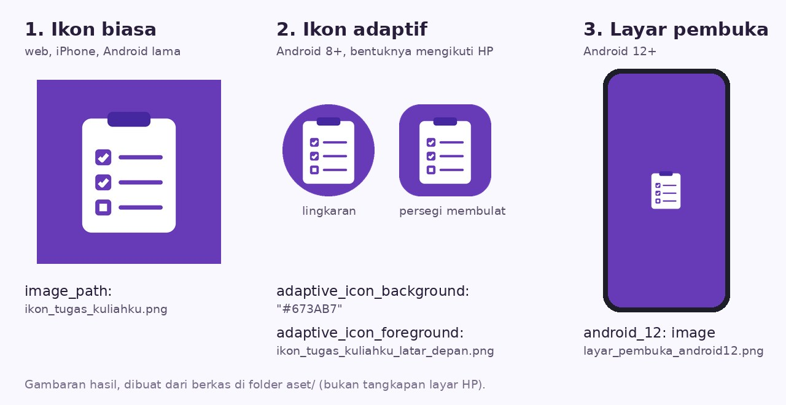
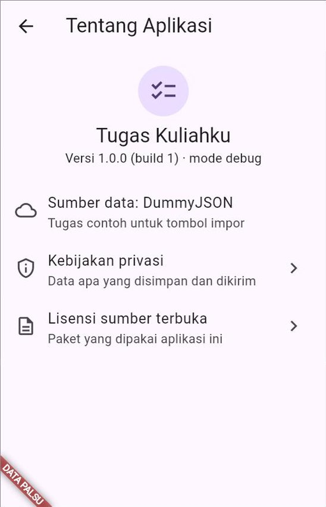
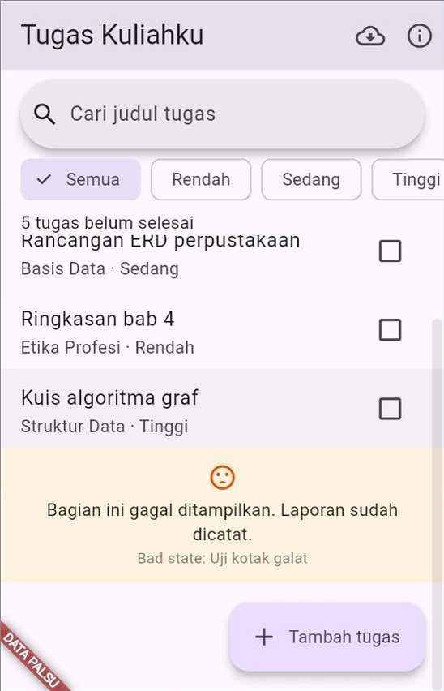

# 🧪 Jobsheet Pertemuan 15 — *Build*, Rilis & Finalisasi Proyek

[🏠 Beranda](../README.md) · [📖 Modul](README.md) · [✍️ Latihan](LATIHAN.md) · [💻 Kode Contoh](kode/) · [🧰 Templat](templat/)

| Informasi | Keterangan |
| :--- | :--- |
| Mata kuliah | Pemrograman Piranti Bergerak |
| Pertemuan | 15 — *Build*, Rilis & Finalisasi Proyek |
| Bentuk kegiatan | Praktikum individu |
| Estimasi waktu | 150 menit |
| Alat | Proyek `tugas_kuliahku` hasil Pertemuan 14 (sudah ada di GitHub, lengkap dengan `.github/workflows/tes.yml`), VS Code, Git, dan Google Chrome |
| Perangkat | Laptop sudah cukup untuk Praktikum 1, 2, 3, dan 5. Praktikum 4 membutuhkan **Android SDK** (terpasang bersama Android Studio) dan sebaiknya HP Android. Belum punya Android SDK? Baca Praktikum 4 tanpa mengerjakannya, kecuali Langkah 1, karena robot GitHub di Praktikum 5 tetap mem-*build* APK untuk Anda |
| Paket | `flutter_launcher_icons` dan `flutter_native_splash` (*dev dependency*), serta `package_info_plus` |
| Koneksi | Internet untuk memasang paket dan untuk GitHub |
| Hasil akhir | "Tugas Kuliahku" versi **1.0.0** yang punya nama, ID, ikon, dan layar pembuka sendiri; tahan terhadap galat; punya halaman Tentang dan kebijakan privasi; terbit sebagai **situs web** di GitHub Pages dan sebagai **APK** di GitHub Releases; lengkap dengan `README.md`, `CHANGELOG.md`, dan `KEBIJAKAN_PRIVASI.md` |

---

## 🎯 Tujuan Praktikum

Setelah menyelesaikan jobsheet ini, Anda mampu:

1. Menyiapkan **identitas aplikasi**: nama tampilan, *application ID*, nomor versi, ikon (termasuk ikon adaptif), dan layar pembuka.
2. Memasang **jaring pengaman galat** beserta pengganti layar merah, lalu membuat halaman **Tentang** yang menampilkan versi dari `pubspec.yaml`, kebijakan privasi, dan lisensi.
3. Mem-*build* rilis **web**, mengujinya di laptop, lalu menerbitkannya otomatis ke **GitHub Pages**.
4. Mem-*build* **APK**, memasangnya di HP, dan menandatanganinya dengan **kunci unggah** yang disimpan dengan aman.
5. Merilis versi **1.0.0** secara otomatis dengan *tag* Git dan GitHub Actions, lengkap dengan dokumen rilisnya.

## 📌 Petunjuk Umum

> [!IMPORTANT]
> 1. Semua praktikum dikerjakan di **satu proyek**: `tugas_kuliahku`. Setiap praktikum diawali dan diakhiri dengan *commit*, sehingga Anda selalu punya **titik aman** untuk kembali.
> 2. **Ketik sendiri** kode Dart di Praktikum 2, kecuali bagian yang ditandai *boleh disalin*. Berkas pengaturan (YAML, XML, Kotlin) boleh disalin, tetapi **baca tabel penjelasannya**.
> 3. Kerjakan **🔧 Modifikasi** di setiap praktikum. Jawaban, hasil pengamatan, dan ukuran berkas ditulis di berkas **`CATATAN_RILIS.md`** (dibuat di Praktikum 1), kecuali diminta lain.
> 4. Rapikan kode sebelum *commit*: `dart format .`, lalu `flutter analyze` harus diakhiri `No issues found!`, dan `flutter test` harus hijau.
> 5. **Aturan rahasia:** berkas `key.properties` dan `*.jks` **tidak pernah** di-*commit*, tidak dikirim ke grup kelas, dan tidak ditempel ke asisten AI. Kata sandinya juga tidak ditulis di `CATATAN_RILIS.md`.

> [!NOTE]
> Praktikum 1–5 mengikuti perjalanan rilis di [Modul Bagian 1.4](README.md#14-peta-perjalanan-rilis): identitas (Praktikum 1) → siap rilis dari dalam (Praktikum 2) → rilis web (Praktikum 3) → rilis Android (Praktikum 4) → rilis otomatis dan dokumen (Praktikum 5). Bandingkan juga dengan contoh di modul: Praktikum 1 ↔ Modul Bagian 4–6, Praktikum 2 ↔ Contoh 03 dan 04, Praktikum 3 ↔ Bagian 9, Praktikum 4 ↔ Bagian 10–11, Praktikum 5 ↔ Bagian 12 dan 17.

> [!TIP]
> **Proyek Anda belum ada di GitHub?** Kerjakan dulu [Jobsheet Pertemuan 14, Praktikum 5 Langkah 7](../pertemuan_14_pengujian_dan_debugging/JOBSHEET.md#langkah-7--tes-otomatis-di-github-ketik-sendiri). Praktikum 3 dan 5 hari ini membutuhkan repositori `tugas_kuliahku` di GitHub.

<details>
<summary>❓ Lupa cara menjalankan "Tugas Kuliahku"?</summary>

Buka folder proyek di VS Code, lalu jalankan salah satu perintah ini di terminal:

```bash
flutter run -d chrome --web-port=8080                                # data sungguhan
flutter run -d chrome --web-port=8080 -t lib/main_pengembangan.dart  # data palsu
```

Opsi `--web-port=8080` membuat data SQLite di Chrome tidak hilang di antara dua kali menjalankan ([Pertemuan 11](../pertemuan_11_penyimpanan_lokal/README.md)). Setelah **menambah paket** dengan `flutter pub add`, hentikan aplikasi lalu jalankan ulang; *hot reload* saja tidak cukup. Penjelasan lengkap ada di [Panduan Menjalankan Kode](../panduan/03_menjalankan_kode_contoh.md).
</details>

**Peta perubahan hari ini:**

```text
tugas_kuliahku/
├── assets/ikon/                       ← Praktikum 1 (tiga gambar)
├── CATATAN_RILIS.md                   ← Praktikum 1, diisi sampai Praktikum 5
├── pubspec.yaml                       ← Praktikum 1 dan 2
├── android/
│   ├── key.properties                 ← Praktikum 4 (TIDAK di-commit)
│   └── app/
│       ├── build.gradle.kts           ← Praktikum 1 (ID) dan 4 (tanda tangan)
│       └── src/main/AndroidManifest.xml ← Praktikum 1 (nama) dan 4 (izin internet)
├── web/index.html, web/manifest.json  ← Praktikum 1
├── lib/
│   ├── main.dart                      ← Praktikum 2
│   ├── main_pengembangan.dart         ← Praktikum 2
│   ├── config/penangkap_galat.dart    ← Praktikum 2 (BARU)
│   └── ui/
│       ├── core/kotak_galat_ramah.dart        ← Praktikum 2 (BARU)
│       ├── daftar_tugas/widgets/halaman_tugas.dart ← Praktikum 2 (tombol Tentang)
│       └── tentang/widgets/                   ← Praktikum 2 (BARU, dua berkas)
├── .github/workflows/web.yml          ← Praktikum 3 (BARU)
├── .github/workflows/rilis.yml        ← Praktikum 5 (BARU)
└── README.md, CHANGELOG.md, KEBIJAKAN_PRIVASI.md ← Praktikum 5
```

---

## Praktikum 1 — Identitas "Tugas Kuliahku"

**Konsep:** nama tampilan, *application ID*, nomor versi dan nomor *build*, ikon dan ikon adaptif, layar pembuka, *dev dependency*. ([Modul Bagian 4](README.md#4-identitas-aplikasi-1-nama-dan-id), [Bagian 5](README.md#5-identitas-aplikasi-2-nomor-versi), dan [Bagian 6](README.md#6-identitas-aplikasi-3-ikon-dan-layar-pembuka))

Pasang "Tugas Kuliahku" yang sekarang di HP, atau lihat tab Chrome saat aplikasinya berjalan: namanya `tugas_kuliahku`, ikonnya logo Flutter, dan ID-nya `com.example.tugas_kuliahku`. Aplikasi ini sudah lama "matang", tetapi belum punya **papan nama**. Itulah pekerjaan pertama hari ini.

### Langkah 1 — Titik aman dan berkas catatan

Buka proyek `tugas_kuliahku` di VS Code. Pastikan tidak ada perubahan yang belum di-*commit*:

```bash
git status
```

Jika masih ada perubahan, *commit* dulu. Lalu buat berkas `CATATAN_RILIS.md` di folder utama proyek. Berkas ini menampung jawaban modifikasi dan hasil pengamatan Anda hari ini:

```markdown
# Catatan Rilis Tugas Kuliahku (Pertemuan 15)

Nama: ...
NIM: ...

## Praktikum 1

## Praktikum 2

## Praktikum 3

## Praktikum 4

## Praktikum 5
```

### Langkah 2 — Nama tampilan (boleh disalin)

Nama tampilan tersebar di beberapa berkas ([Modul Bagian 4.2](README.md#42-nama-tampilan-ada-di-beberapa-tempat)). Ubah satu per satu:

**a.** `android/app/src/main/AndroidManifest.xml`: cari `android:label`, lalu ganti isinya.

```xml
<application
    android:label="Tugas Kuliahku"
    android:name="${applicationName}"
    android:icon="@mipmap/ic_launcher">
```

**b.** `web/index.html`: ubah tiga baris berikut.

```html
<meta name="description" content="Pencatat tugas kuliah yang tetap bisa dibaca tanpa internet.">
<meta name="apple-mobile-web-app-title" content="Tugas Kuliahku">
<title>Tugas Kuliahku</title>
```

**c.** `web/manifest.json`: ubah tiga nilai berikut. Biarkan bagian lainnya.

```json
"name": "Tugas Kuliahku",
"short_name": "Tugas Kuliahku",
"description": "Pencatat tugas kuliah yang tetap bisa dibaca tanpa internet.",
```

**d.** `pubspec.yaml`: ganti baris `description` bawaan.

```yaml
description: "Pencatat tugas kuliah yang tetap bisa dibaca tanpa internet."
```

`MaterialApp(title: 'Tugas Kuliahku')` di `lib/ui/core/aplikasi.dart` sudah benar sejak Pertemuan 9, jadi tidak perlu diubah.

### Langkah 3 — *Application ID* (boleh disalin)

Buka `android/app/build.gradle.kts`. Di dalam `defaultConfig`, ganti `applicationId` ([Modul Bagian 4.3](README.md#43-application-id-nomor-ktp-aplikasi)). Ganti `budisantoso` dengan nama Anda: huruf kecil, tanpa spasi, tanpa tanda `-`.

```kotlin
defaultConfig {
    applicationId = "com.budisantoso.tugaskuliahku"
    // ... baris lain biarkan seperti semula ...
}
```

| Bagian | Penjelasan |
| :--- | :--- |
| `applicationId` | Identitas aplikasi di HP dan di Google Play. Setelah aplikasi dirilis, ID ini **tidak boleh** diganti lagi |
| `namespace` (di atasnya) | **Jangan** diubah. Nama ini dipakai kode Kotlin di folder `android/`, bukan identitas aplikasi |

> [!WARNING]
> Bagi HP, ID baru berarti **aplikasi baru**. Jika "Tugas Kuliahku" versi lama sudah terpasang di HP Anda, hapus dulu agar tidak ada dua aplikasi kembar.

### Langkah 4 — Nomor versi

Buka `pubspec.yaml` dan periksa baris `version`:

```yaml
version: 1.0.0+1
```

Proyek dari `flutter create` sudah berisi `1.0.0+1`, dan inilah nomor yang tepat untuk **rilis pertama**: nama versi `1.0.0`, nomor *build* `1` ([Modul Bagian 5.1](README.md#51-satu-baris-dua-nomor)). Jika baris Anda berbeda, ubah menjadi `1.0.0+1`.

### Langkah 5 — Ikon aplikasi (boleh disalin)

**a.** Unduh tiga gambar dari folder [`aset/`](aset/) modul ini (buka tautannya, lalu klik tombol **Download raw file** di kanan atas pratinjau gambar):

| Berkas | Isi | Dipakai untuk |
| :--- | :--- | :--- |
| [`ikon_tugas_kuliahku.png`](aset/ikon_tugas_kuliahku.png) | Ikon lengkap 1024 × 1024, latar ungu | Ikon biasa: web, iPhone, Android lama |
| [`ikon_tugas_kuliahku_latar_depan.png`](aset/ikon_tugas_kuliahku_latar_depan.png) | Simbol putih di tengah, latar transparan | Lapisan depan ikon adaptif dan layar pembuka |
| [`layar_pembuka_android12.png`](aset/layar_pembuka_android12.png) | Simbol di dalam lingkaran 768 piksel, 1152 × 1152 | Layar pembuka Android 12+ |

Simpan ketiganya di folder baru `assets/ikon/` di dalam proyek.

**b.** Pasang dua paket alat bantu sebagai *dev dependency*. Keduanya hanya dipakai saat pengembangan dan tidak ikut ke dalam aplikasi:

```bash
flutter pub add dev:flutter_launcher_icons dev:flutter_native_splash
```

**c.** Tambahkan pengaturan berikut di **akhir** `pubspec.yaml`, tidak menjorok (sejajar dengan `flutter:`):

```yaml
flutter_launcher_icons:
  android: true
  ios: true
  remove_alpha_ios: true
  image_path: "assets/ikon/ikon_tugas_kuliahku.png"
  adaptive_icon_background: "#673AB7"
  adaptive_icon_foreground: "assets/ikon/ikon_tugas_kuliahku_latar_depan.png"
  web:
    generate: true
    image_path: "assets/ikon/ikon_tugas_kuliahku.png"
    background_color: "#673AB7"
    theme_color: "#673AB7"
```

| Kunci | Penjelasan |
| :--- | :--- |
| `android`, `ios` | Timpa ikon bawaan Android dan iPhone |
| `remove_alpha_ios` | iPhone tidak menerima ikon transparan |
| `image_path` | Ikon biasa |
| `adaptive_icon_background` | Lapisan belakang ikon adaptif: warna ungu yang sama dengan tema (`Colors.deepPurple` = `#673AB7`) |
| `adaptive_icon_foreground` | Lapisan depan ikon adaptif: simbolnya saja |
| `web` | Ikon untuk tab *browser* dan saat versi web "dipasang", beserta warna di `manifest.json` |

**d.** Buat semua ukuran ikon:

```bash
dart run flutter_launcher_icons
```

Perintah ini diakhiri pesan bahwa ikon berhasil dibuat (*Successfully generated launcher icons*). Jika muncul galat, periksa lagi letak dan nama berkas di `assets/ikon/`, serta jorok (*indentasi*) di `pubspec.yaml`.

### Langkah 6 — Layar pembuka (boleh disalin)

Tambahkan pengaturan berikut di akhir `pubspec.yaml`, di bawah pengaturan ikon:

```yaml
flutter_native_splash:
  color: "#673AB7"
  color_dark: "#311B92"
  image: assets/ikon/ikon_tugas_kuliahku_latar_depan.png
  android_12:
    color: "#673AB7"
    color_dark: "#311B92"
    image: assets/ikon/layar_pembuka_android12.png
```

Lalu buat layar pembukanya:

```bash
dart run flutter_native_splash:create
```

Lihat berkas apa saja yang berubah:

```bash
git status
```

Banyak sekali, bukan? Ada belasan ukuran ikon di `android/app/src/main/res/`, ikon iPhone di `ios/Runner/Assets.xcassets/`, ikon dan gambar layar pembuka di `web/`, serta perubahan di `web/index.html` dan `web/manifest.json`. Semua itu dibuat paket dari **tiga gambar** saja.

Gambaran hasilnya:

<p align="center"></p>

### Langkah 7 — Jalankan dan periksa

```bash
flutter run -d chrome --web-port=8080
```

| Periksa | Yang benar |
| :--- | :--- |
| Judul tab Chrome | **Tugas Kuliahku** |
| Ikon di tab Chrome | Papan klip putih di atas ungu. Jika masih logo Flutter, tekan `Ctrl` + `Shift` + `R` ([Modul Bagian 6.3](README.md#63-melihat-ikon-barunya)) |
| Sesaat setelah dibuka | Layar ungu dengan simbol papan klip, sebelum daftar tugas tampil |
| `flutter analyze` | `No issues found!` |
| `flutter test` | Semua tes hijau, seperti di akhir Pertemuan 14 |

Punya HP Android dan Android SDK? Jalankan juga di HP (`flutter run`), lalu periksa nama dan ikon di layar utama HP, ikon adaptifnya, serta layar pembukanya.

Simpan hasilnya:

```bash
git add .
git commit -m "Identitas aplikasi: nama, ID, versi, ikon, layar pembuka"
```

🔧 **Modifikasi:**

1. **Eksperimen — siapa yang memberi nama tab?** Ubah sementara `title: 'Tugas Kuliahku'` di `lib/ui/core/aplikasi.dart` menjadi `title: 'TK Uji'`, lalu hentikan dan jalankan ulang aplikasinya di Chrome. Perhatikan judul tab **saat aplikasi sedang dimuat** dan **setelah daftar tugas tampil**. Tulis di `CATATAN_RILIS.md`: dari berkas mana masing-masing judul berasal, dan mengapa nama tampilan perlu diubah di beberapa tempat ([Modul Bagian 4.2](README.md#42-nama-tampilan-ada-di-beberapa-tempat)). Kembalikan judulnya.
2. **Nomor versi berikutnya.** Tulis di `CATATAN_RILIS.md` nomor versi lengkap (`MAYOR.MINOR.PATCH+BUILD`) setelah `1.0.0+1` untuk tiga rilis berurutan berikut, beserta alasannya ([Modul Bagian 5.2–5.3](README.md#52-nama-versi-semantic-versioning)): (a) tugas yang dicentang kadang tidak tersimpan, lalu diperbaiki; (b) fitur baru: pengingat tenggat tugas; (c) format database diganti dan data versi lama tidak bisa dibaca lagi. Periksa jawaban Anda dengan [Contoh 01](kode/contoh_01_versi_dan_nomor_build_dart_murni.dart): ubah daftar perubahan di bagian 3 program itu, lalu jalankan di DartPad.
3. ***Themed icon* Android 13+.** Tambahkan `adaptive_icon_monochrome: "assets/ikon/ikon_tugas_kuliahku_latar_depan.png"` di pengaturan `flutter_launcher_icons`, lalu jalankan lagi `dart run flutter_launcher_icons`. Catat berkas apa saja yang bertambah atau berubah menurut `git status`. Jika punya HP Android 13 ke atas, aktifkan **ikon bertema** di pengaturan wallpaper HP, lalu amati ikon "Tugas Kuliahku".
4. **Eksperimen — ID yang salah** *(butuh Android SDK)*. Ubah sementara `applicationId` menjadi `"com.budi-santoso.tugas"`, lalu jalankan `flutter build apk`. Salin bagian pesan galat yang menjelaskan masalahnya ke `CATATAN_RILIS.md`, jelaskan dengan kalimat Anda sendiri, lalu kembalikan ID yang benar ([Modul Bagian 4.3](README.md#43-application-id-nomor-ktp-aplikasi)).

---

## Praktikum 2 — Tahan Galat dan Jujur tentang Dirinya

**Konsep:** galat yang diduga dan yang tidak terduga, tiga jaring pengaman (`FlutterError.onError`, `PlatformDispatcher.instance.onError`, `runZonedGuarded`), `ErrorWidget.builder`, `kDebugMode`, `package_info_plus`, halaman Tentang, kebijakan privasi di dalam aplikasi, dan halaman lisensi. ([Modul Bagian 7](README.md#7-menangani-galat-di-aplikasi-rilis) dan [Bagian 8](README.md#8-halaman-tentang-kebijakan-privasi-dan-lisensi))

Selama ini galat yang tidak terduga di "Tugas Kuliahku" hanya terlihat oleh Anda sebagai layar merah. Di *build* rilis, pengguna akan melihat kotak abu-abu tanpa keterangan, dan Anda tidak pernah tahu galat itu terjadi. Aplikasi ini juga belum bisa menjawab pertanyaan sederhana: "versi berapa?" dan "data saya diapakan?".

### Langkah 1 — Pengganti layar merah (ketik sendiri)

Buat berkas `lib/ui/core/kotak_galat_ramah.dart`:

```dart
import 'package:flutter/foundation.dart';
import 'package:flutter/material.dart';

/// Pengganti layar merah (mode debug) dan kotak abu-abu (mode rilis) untuk
/// widget yang gagal dibangun. Hanya BAGIAN yang gagal yang diganti; sisa
/// layar tetap bisa dipakai.
class KotakGalatRamah extends StatelessWidget {
  const KotakGalatRamah({super.key, required this.rincian});

  final FlutterErrorDetails rincian;

  @override
  Widget build(BuildContext context) {
    // Widget ini bisa muncul DI MANA SAJA, bahkan di luar MaterialApp.
    // Karena itu Directionality dan Material disediakan sendiri, dan
    // warnanya ditulis langsung: tema belum tentu tersedia.
    return Directionality(
      textDirection: TextDirection.ltr,
      child: Material(
        color: Colors.orange.shade50,
        child: Padding(
          padding: const EdgeInsets.all(12),
          child: Column(
            mainAxisSize: MainAxisSize.min,
            children: [
              Icon(Icons.sentiment_dissatisfied, color: Colors.orange.shade900),
              const SizedBox(height: 4),
              const Text(
                'Bagian ini gagal ditampilkan. Laporan sudah dicatat.',
                textAlign: TextAlign.center,
                style: TextStyle(color: Colors.black87),
              ),
              // Rincian teknis hanya untuk pengembang (mode debug).
              if (kDebugMode)
                Text(
                  rincian.exceptionAsString(),
                  textAlign: TextAlign.center,
                  style: const TextStyle(fontSize: 12, color: Colors.black54),
                ),
            ],
          ),
        ),
      ),
    );
  }
}
```

| Bagian | Penjelasan |
| :--- | :--- |
| `Directionality` dan `Material` | Kotak ini bisa muncul di mana saja, bahkan di luar `MaterialApp`, jadi kebutuhannya disediakan sendiri ([Modul Bagian 7.5](README.md#75-pengganti-layar-merah-yang-ramah)) |
| Warna ditulis langsung | Tema belum tentu tersedia di tempat kotak ini muncul. Inilah satu-satunya pengecualian aturan "semua warna dari tema" |
| `if (kDebugMode)` | Rincian teknis hanya untuk pengembang. Di *build* rilis, baris ini dibuang compiler |

### Langkah 2 — Pelapor galat dan tiga jaring pengaman (ketik sendiri)

Buat berkas `lib/config/penangkap_galat.dart`. Berkas ini diletakkan di `config/`, di samping akar komposisi, karena ikut mengatur cara aplikasi **dimulai**:

```dart
import 'dart:async';

import 'package:flutter/foundation.dart';
import 'package:flutter/widgets.dart';
import 'package:tugas_kuliahku/ui/core/kotak_galat_ramah.dart';

/// Satu catatan galat: dari mana asalnya, apa pesannya, dan kapan terjadi.
class CatatanGalat {
  const CatatanGalat({
    required this.sumber,
    required this.pesan,
    required this.waktu,
  });

  final String sumber;
  final String pesan;
  final DateTime waktu;
}

/// Pencatat galat untuk seluruh aplikasi.
///
/// Aplikasi sungguhan mengirim galat beserta jejaknya (stack trace) ke
/// layanan pelaporan, misalnya Firebase Crashlytics atau Sentry. Di sini
/// galat cukup disimpan di memori dan dicetak ke konsol di mode debug.
/// JANGAN ikut mencatat data pribadi pengguna.
class PelaporGalat {
  static const int batas = 20;

  final List<CatatanGalat> _catatan = [];

  /// Daftar catatan, yang terbaru di depan.
  List<CatatanGalat> get catatan => List.unmodifiable(_catatan);

  void catat(Object galat, StackTrace? jejak, {required String sumber}) {
    _catatan.insert(
      0,
      CatatanGalat(sumber: sumber, pesan: '$galat', waktu: DateTime.now()),
    );
    if (_catatan.length > batas) {
      _catatan.removeLast();
    }
    // Log hanya di mode debug: di build rilis, isi if ini dibuang compiler.
    if (kDebugMode) {
      debugPrint('[galat] $sumber: $galat');
    }
  }
}

/// Satu pelapor untuk seluruh aplikasi.
final PelaporGalat pelapor = PelaporGalat();

/// Menjalankan aplikasi dengan tiga jaring pengaman galat (Modul
/// Pertemuan 15, Bagian 7). Dipakai oleh kedua titik masuk.
void jalankanDenganPengaman(Widget Function() buatAplikasi) {
  if (kIsWeb) {
    // Di web, galat asinkron yang lolos ditangkap lewat zona.
    runZonedGuarded(
      () => _mulai(buatAplikasi),
      (Object galat, StackTrace jejak) =>
          pelapor.catat(galat, jejak, sumber: 'async (zona web)'),
    );
  } else {
    _mulai(buatAplikasi);
  }
}

void _mulai(Widget Function() buatAplikasi) {
  // Harus di dalam zona yang sama dengan runApp.
  WidgetsFlutterBinding.ensureInitialized();

  // 1. Galat saat Flutter membangun, menata, dan menggambar widget.
  FlutterError.onError = (FlutterErrorDetails rincian) {
    FlutterError.presentError(rincian); // tetap tampil lengkap di konsol
    pelapor.catat(rincian.exception, rincian.stack, sumber: 'widget');
  };

  // 2. Galat asinkron yang lolos dari semua try-catch (Android, iOS).
  PlatformDispatcher.instance.onError = (Object galat, StackTrace jejak) {
    pelapor.catat(galat, jejak, sumber: 'async (platform)');
    return true; // true = galat sudah ditangani
  };

  // 3. Pengganti layar merah (debug) dan kotak abu-abu (rilis).
  ErrorWidget.builder = (FlutterErrorDetails rincian) =>
      KotakGalatRamah(rincian: rincian);

  runApp(buatAplikasi());
}
```

| Bagian | Penjelasan |
| :--- | :--- |
| `PelaporGalat` | Mencatat galat di memori. Aplikasi sungguhan mengirimnya ke layanan pelaporan ([Modul Bagian 7.3](README.md#73-tiga-jaring-pengaman)) |
| `jalankanDenganPengaman(...)` | Menggantikan `runApp(...)` di **kedua** titik masuk. Isinya: zona untuk web, lalu `_mulai` |
| `Widget Function() buatAplikasi` | Fungsi yang membuat aplikasinya. Aplikasi dibuat **di dalam** zona, bukan sebelumnya ([Modul Bagian 7.4](README.md#74-di-web-tambahkan-runzonedguarded)) |
| `FlutterError.onError` | Jaring 1: galat saat membangun, menata, dan menggambar widget |
| `PlatformDispatcher.instance.onError` | Jaring 2: galat asinkron yang lolos, di Android dan iOS |
| `runZonedGuarded` | Jaring yang sama untuk web, karena di web galat asinkron tidak sampai ke jaring 2 |
| `ErrorWidget.builder` | Bukan penangkap, melainkan **pengganti tampilan** widget yang gagal dibangun |

### Langkah 3 — Pakai di kedua titik masuk (ketik sendiri)

Ganti seluruh isi `lib/main.dart`:

```dart
import 'package:flutter/foundation.dart' show kIsWeb;
import 'package:provider/provider.dart';
import 'package:sqflite/sqflite.dart';
import 'package:sqflite_common_ffi_web/sqflite_ffi_web.dart';
import 'package:tugas_kuliahku/config/dependensi.dart';
import 'package:tugas_kuliahku/config/penangkap_galat.dart';
import 'package:tugas_kuliahku/ui/core/aplikasi.dart';

// Titik masuk PRODUKSI: database di perangkat dan server DummyJSON,
// dijaga tiga jaring pengaman galat.
void main() {
  // Di Chrome, sqflite memakai SQLite versi web.
  if (kIsWeb) {
    databaseFactory = databaseFactoryFfiWeb;
  }
  jalankanDenganPengaman(
    () => MultiProvider(
      providers: buatPenyedia(Lingkungan.produksi),
      child: const AplikasiTugas(),
    ),
  );
}
```

Ganti seluruh isi `lib/main_pengembangan.dart`:

```dart
import 'package:provider/provider.dart';
import 'package:tugas_kuliahku/config/dependensi.dart';
import 'package:tugas_kuliahku/config/penangkap_galat.dart';
import 'package:tugas_kuliahku/ui/core/aplikasi.dart';

// Titik masuk PENGEMBANGAN: data palsu di memori, tanpa database dan
// tanpa internet. Jalankan dengan:
//   flutter run -d chrome --web-port=8080 -t lib/main_pengembangan.dart
void main() {
  jalankanDenganPengaman(
    () => MultiProvider(
      providers: buatPenyedia(Lingkungan.pengembangan),
      child: const AplikasiTugas(dataPalsu: true),
    ),
  );
}
```

Perhatikan bahwa kedua berkas tidak lagi mengimpor `package:flutter/material.dart`. `runApp` kini dipanggil di `penangkap_galat.dart`, sehingga impor itu tidak terpakai lagi, dan `flutter analyze` akan memperingatkannya jika tetap ada.

### Langkah 4 — Halaman Tentang (ketik sendiri)

Pasang paket pembaca versi ([Modul Bagian 5.4](README.md#54-menampilkan-versi-di-dalam-aplikasi-package_info_plus)):

```bash
flutter pub add package_info_plus
```

Buat berkas `lib/ui/tentang/widgets/halaman_kebijakan_privasi.dart`. Ganti `nama.anda@example.com` dengan alamat surel Anda, misalnya surel kampus:

```dart
import 'package:flutter/material.dart';

/// Ganti dengan alamat surel Anda (misalnya surel kampus).
const String surelPengembang = 'nama.anda@example.com';

/// Kebijakan privasi di DALAM aplikasi. Isinya harus sama dengan berkas
/// KEBIJAKAN_PRIVASI.md di repositori (Praktikum 5), dan harus jujur:
/// tulis apa yang benar-benar dilakukan aplikasi.
class HalamanKebijakanPrivasi extends StatelessWidget {
  const HalamanKebijakanPrivasi({super.key});

  // Pasangan (judul, isi). Record Dart 3 membuat daftar ini ringkas.
  static const List<(String, String)> _isi = [
    (
      'Data yang dikumpulkan',
      'Tidak ada. Aplikasi ini tidak meminta akun, nama, nomor HP, '
          'maupun lokasi Anda.',
    ),
    (
      'Data yang disimpan di perangkat',
      'Daftar tugas Anda (judul, mata kuliah, prioritas, dan status '
          'selesai) disimpan di perangkat ini. Pada versi web, data '
          'disimpan di browser yang Anda pakai.',
    ),
    (
      'Data yang dikirim',
      'Saat Anda menekan tombol impor, aplikasi meminta daftar tugas '
          'contoh dari dummyjson.com. Tugas Anda tidak pernah dikirim ke '
          'server mana pun.',
    ),
    (
      'Menghapus data',
      'Geser tugas ke samping untuk menghapusnya, atau hapus aplikasinya. '
          'Pada versi web, hapus data situs di pengaturan browser.',
    ),
    ('Pertanyaan', 'Hubungi $surelPengembang.'),
  ];

  @override
  Widget build(BuildContext context) {
    final TextTheme gayaTeks = Theme.of(context).textTheme;

    return Scaffold(
      appBar: AppBar(title: const Text('Kebijakan Privasi')),
      body: ListView(
        padding: const EdgeInsets.all(16),
        children: [
          for (final (String judul, String isi) in _isi) ...[
            Text(judul, style: gayaTeks.titleMedium),
            const SizedBox(height: 4),
            Text(isi),
            const SizedBox(height: 16),
          ],
        ],
      ),
    );
  }
}
```

Buat berkas `lib/ui/tentang/widgets/halaman_tentang.dart`. Ganti `Nama Anda` dengan nama Anda:

```dart
import 'package:flutter/foundation.dart';
import 'package:flutter/material.dart';
import 'package:package_info_plus/package_info_plus.dart';
import 'package:tugas_kuliahku/ui/tentang/widgets/halaman_kebijakan_privasi.dart';

/// Halaman Tentang: versi, sumber data, kebijakan privasi, dan lisensi.
class HalamanTentang extends StatefulWidget {
  const HalamanTentang({super.key});

  @override
  State<HalamanTentang> createState() => _HalamanTentangState();
}

class _HalamanTentangState extends State<HalamanTentang> {
  // Versi dibaca dari aplikasinya sendiri (berasal dari pubspec.yaml),
  // bukan ditulis ulang di kode. Future dibuat SEKALI, bukan di build.
  late final Future<PackageInfo> _info = PackageInfo.fromPlatform();

  @override
  Widget build(BuildContext context) {
    final TextTheme gayaTeks = Theme.of(context).textTheme;

    return Scaffold(
      appBar: AppBar(title: const Text('Tentang Aplikasi')),
      body: FutureBuilder<PackageInfo>(
        future: _info,
        builder: (BuildContext context, AsyncSnapshot<PackageInfo> hasil) {
          final PackageInfo? info = hasil.data;
          final String versi = info == null
              ? 'Versi ...'
              : 'Versi ${info.version} (build ${info.buildNumber})';

          return ListView(
            padding: const EdgeInsets.symmetric(vertical: 16),
            children: [
              const Center(
                child: CircleAvatar(
                  radius: 28,
                  child: Icon(Icons.checklist, size: 32),
                ),
              ),
              const SizedBox(height: 8),
              Center(child: Text('Tugas Kuliahku', style: gayaTeks.titleLarge)),
              Center(
                // Penanda "mode debug" dibuang compiler di build rilis.
                child: Text('$versi${kDebugMode ? ' · mode debug' : ''}'),
              ),
              const SizedBox(height: 16),
              const ListTile(
                leading: Icon(Icons.cloud_outlined),
                title: Text('Sumber data: DummyJSON'),
                subtitle: Text('Tugas contoh untuk tombol impor'),
              ),
              ListTile(
                leading: const Icon(Icons.privacy_tip_outlined),
                title: const Text('Kebijakan privasi'),
                subtitle: const Text('Data apa yang disimpan dan dikirim'),
                trailing: const Icon(Icons.chevron_right),
                onTap: () => Navigator.push(
                  context,
                  MaterialPageRoute<void>(
                    builder: (BuildContext context) =>
                        const HalamanKebijakanPrivasi(),
                  ),
                ),
              ),
              ListTile(
                leading: const Icon(Icons.description_outlined),
                title: const Text('Lisensi sumber terbuka'),
                subtitle: const Text('Paket yang dipakai aplikasi ini'),
                trailing: const Icon(Icons.chevron_right),
                // Lisensi semua paket dikumpulkan otomatis saat build.
                onTap: () => showLicensePage(
                  context: context,
                  applicationName: 'Tugas Kuliahku',
                  applicationVersion: info?.version,
                  applicationLegalese: '© 2026 Nama Anda',
                ),
              ),
            ],
          );
        },
      ),
    );
  }
}
```

| Bagian | Penjelasan |
| :--- | :--- |
| `PackageInfo.fromPlatform()` | Membaca versi dari aplikasinya sendiri. Di web, versinya dibaca dari berkas `version.json` hasil *build* |
| `late final Future<PackageInfo> _info` | `Future` dibuat **sekali** saat halaman dibuat, bukan setiap kali `build` dipanggil (Pertemuan 10) |
| `kDebugMode ? ' · mode debug' : ''` | Penanda *build* uji. Di *build* rilis, tulisannya hilang |
| `showLicensePage(...)` | Halaman lisensi bawaan Flutter. Daftar lisensi semua paket dikumpulkan otomatis saat *build* ([Modul Bagian 8.4](README.md#84-lisensi-sumber-terbuka-dikumpulkan-otomatis)) |
| `List<(String, String)>` | Daftar *record* Dart 3: setiap anggotanya berisi dua teks, judul dan isi |
| `for (final (String judul, String isi) in _isi) ...[ ... ]` | Membongkar setiap *record*, lalu menyisipkan empat widget untuk setiap bagian |

> [!IMPORTANT]
> Isi kebijakan privasi harus **sesuai kenyataan** aplikasi Anda ([Modul Bagian 8.3](README.md#83-kebijakan-privasi-wajib-untuk-semua-aplikasi)). Jika di Pertemuan 12 Anda mengerjakan modifikasi yang mengubah data yang disimpan atau dikirim, sesuaikan juga teksnya.

### Langkah 5 — Tombol Tentang di halaman utama (ketik sendiri)

Buka `lib/ui/daftar_tugas/widgets/halaman_tugas.dart`. Tambahkan impor berikut di antara impor lainnya:

```dart
import 'package:tugas_kuliahku/ui/tentang/widgets/halaman_tentang.dart';
```

Lalu, di dalam `AppBar`, tambahkan `IconButton` **setelah** `ListenableBuilder` tombol impor, masih di dalam `actions: [ ... ]`:

```dart
        actions: [
          // Hanya tombol ini yang dibangun ulang saat status impor berubah.
          ListenableBuilder(
            // ... biarkan seperti semula ...
          ),
          IconButton(
            onPressed: () => Navigator.push(
              context,
              MaterialPageRoute<void>(
                builder: (BuildContext context) => const HalamanTentang(),
              ),
            ),
            tooltip: 'Tentang aplikasi',
            icon: const Icon(Icons.info_outline),
          ),
        ],
```

Periksa semuanya:

```bash
dart format .
flutter analyze
flutter test
```

`flutter analyze` harus diakhiri `No issues found!`, dan semua tes Pertemuan 14 tetap hijau. Tes-tes itu mencari tombol impor lewat *tooltip*-nya, sehingga tidak terganggu oleh tombol baru.

### Langkah 6 — Jalankan, lalu uji jaring pengamannya

```bash
flutter run -d chrome --web-port=8080 -t lib/main_pengembangan.dart
```

Ketuk ikon ⓘ di `AppBar`, lalu buka **Kebijakan privasi** dan **Lisensi sumber terbuka**.

✅ **Hasil yang diharapkan** (lebar 360, `main_pengembangan.dart`):

<p align="center"></p>

Sekarang uji jaring pengamannya dengan **bug buatan**. Buka `lib/ui/daftar_tugas/widgets/baris_tugas.dart`, lalu tambahkan **sementara** tiga baris ini di awal `build`:

```dart
  @override
  Widget build(BuildContext context) {
    // SEMENTARA, untuk menguji jaring pengaman. Hapus setelah dicoba!
    if (tugas.judul == 'Uji galat') {
      throw StateError('Uji kotak galat');
    }
    final TextTheme gayaTeks = Theme.of(context).textTheme;
    // ... sisanya tetap ...
```

Simpan (*hot reload* cukup), lalu tambahkan tugas baru berjudul **Uji galat** dengan mata kuliah apa saja.

✅ **Hasil yang diharapkan:** hanya baris "Uji galat" yang berganti menjadi kotak oranye. Baris lain, kotak pencarian, dan tombol tetap bisa dipakai. Di Debug Console muncul pesan galat lengkap dan baris `[galat] widget: Bad state: Uji kotak galat` dari pelapor.

<p align="center"></p>

Hapus tugas "Uji galat" dengan menggesernya ke samping, **hapus juga tiga baris bug buatan tadi**, lalu simpan hasilnya:

```bash
git add .
git commit -m "Jaring pengaman galat dan halaman Tentang"
```

🔧 **Modifikasi:**

1. **Eksperimen — kotak oranye di mode rilis.** Pasang lagi bug buatan dari Langkah 6, lalu jalankan dengan `flutter run -d chrome --web-port=8080 -t lib/main_pengembangan.dart --release` dan tambahkan tugas "Uji galat". Tulis di `CATATAN_RILIS.md`: (a) apa bedanya kotak oranye di mode rilis dibandingkan mode *debug*; (b) apakah baris `[galat] ...` masih muncul di konsol Chrome (tekan `F12`, lalu buka tab **Console**); (c) apa yang berubah di halaman Tentang. Jelaskan ketiganya dengan konstanta `kDebugMode` ([Modul Bagian 2.2](README.md#22-mengenali-mode-dari-dalam-kode)). Hapus lagi bug buatannya.
2. **Eksperimen — galat asinkron yang lolos.** Di `HalamanTentang`, beri `ListTile` **Sumber data: DummyJSON** sebuah `onLongPress` sementara:
   ```dart
   onLongPress: () {
     // SEMENTARA: Future yang gagal dan tidak di-await siapa pun.
     Future<void>.delayed(
       const Duration(milliseconds: 100),
       () => throw StateError('Uji galat asinkron'),
     );
   },
   ```
   Karena `onLongPress` diisi, `ListTile` itu tidak bisa lagi memakai `const`; pindahkan `const` ke anak-anaknya. Jalankan di Chrome, tekan lama baris itu, lalu salin baris `[galat] ...` dari konsol ke `CATATAN_RILIS.md`. Jaring mana yang menangkapnya, dan jaring mana yang akan menangkapnya jika aplikasi dijalankan di HP Android? Kembalikan kodenya.
3. **Tes halaman Tentang.** Buat `test/ui/tentang/halaman_tentang_test.dart` yang mengisi versi palsu dengan `PackageInfo.setMockInitialValues(appName: 'Tugas Kuliahku', packageName: 'com.budisantoso.tugaskuliahku', version: '1.0.0', buildNumber: '1', buildSignature: '')`, memasang `const MaterialApp(home: HalamanTentang())`, lalu memeriksa bahwa teks yang **mengandung** `Versi 1.0.0 (build 1)` tampil (`find.textContaining`). Tambahkan tes kedua: ketuk **Kebijakan privasi**, lalu pastikan judul `Data yang dikirim` tampil. Mengapa tes pertama memakai `textContaining`, bukan `find.text`? Jawab sebagai komentar di berkas tes.
4. **Log yang aman.** Di `lib/data/repositories/repositori_tugas_luring.dart` ada dua `debugPrint` yang mencetak galat database. Bungkus keduanya dengan `if (kDebugMode) { ... }`. Konstanta `kDebugMode` berasal dari `package:flutter/foundation.dart`, yang sudah diimpor berkas itu. Jelaskan di `CATATAN_RILIS.md` mengapa `debugPrint` saja tidak cukup untuk aplikasi rilis ([Modul Bagian 2.2](README.md#22-mengenali-mode-dari-dalam-kode)).

---

## Praktikum 3 — "Tugas Kuliahku" di Web, untuk Siapa Saja

**Konsep:** `flutter build web`, isi folder `build/web/`, *web server* lokal, alamat dasar (`--base-href`), GitHub Pages, dan *workflow* penerbitan. ([Modul Bagian 9](README.md#9-rilis-web))

Hari ini teman Anda bisa membuka "Tugas Kuliahku" dari HP-nya, cukup dengan sebuah tautan, tanpa memasang apa pun.

### Langkah 1 — Pastikan berkas SQLite versi web ikut tersimpan

"Tugas Kuliahku" memakai SQLite di Chrome lewat `sqflite_common_ffi_web` (Pertemuan 11). Paket itu membutuhkan dua berkas di folder `web/`. Periksa apakah keduanya sudah tercatat di Git:

```bash
git ls-files web
```

Daftar yang muncul harus memuat `web/sqlite3.wasm` **dan** `web/sqflite_sw.js`. Jika salah satunya tidak ada, buat ulang lalu *commit*:

```bash
dart run sqflite_common_ffi_web:setup
git add web
git commit -m "Berkas SQLite untuk versi web"
```

Robot GitHub mem-*build* dari isi repositori, bukan dari laptop Anda. Berkas yang tidak di-*commit* tidak akan ada di situs ([Modul Bagian 9.5](README.md#95-hal-yang-perlu-diperhatikan-di-web)).

### Langkah 2 — *Build* web dan lihat isinya

```bash
flutter build web
```

Buka folder `build/web/` di VS Code dan cocokkan isinya dengan [Modul Bagian 9.1](README.md#91-membuat-berkas-rilis-web). Buka juga berkas `build/web/version.json`. Berkas inilah yang dibaca `package_info_plus` di halaman Tentang.

### Langkah 3 — Coba hasil *build* di laptop

Pasang *web server* kecil (sekali saja), lalu jalankan:

```bash
dart pub global activate dhttpd
dhttpd --path build/web
```

Buka `http://localhost:8080` di Chrome, lalu uji seperti pengguna: tambah tugas, centang, hapus, tutup tabnya lalu buka lagi, dan buka halaman Tentang. Daftar tugasnya mungkin berbeda dengan saat `flutter run`. Wajar: `flutter run -d chrome` membuka Chrome dengan **profil tersendiri**, sedangkan kali ini Anda memakai Chrome biasa, sehingga datanya pun terpisah.

Hentikan *server* dengan `Ctrl` + `C`.

> [!TIP]
> Muncul `'dhttpd' is not recognized` atau `command not found`? Pakai `dart pub global run dhttpd --path build/web` ([Modul Bagian 9.2](README.md#92-mencoba-hasil-build-di-laptop)).

### Langkah 4 — Aktifkan GitHub Pages (sekali saja)

1. Buka repositori `tugas_kuliahku` Anda di GitHub.
2. Klik **Settings** → **Pages**.
3. Di bagian **Build and deployment**, ubah **Source** menjadi **GitHub Actions**.

> [!NOTE]
> GitHub Pages gratis untuk repositori **publik**. Jika repositori Anda privat, ada dua pilihan: menjadikannya publik (**Settings** → **General** → bagian paling bawah, **Change visibility**), atau memakai GitHub Pro yang gratis bagi mahasiswa lewat GitHub Student Developer Pack. Diskusikan dengan dosen jika ragu.

### Langkah 5 — *Workflow* penerbitan (boleh disalin)

Buat berkas `.github/workflows/web.yml`, lalu salin seluruh isi [`templat/web.yml`](templat/web.yml) ke dalamnya. Baca komentar di bagian atasnya, lalu cocokkan dengan tabel di [Modul Bagian 9.4](README.md#94-terbit-otomatis-di-github-pages).

Kirim ke GitHub:

```bash
git add .
git commit -m "Terbitkan versi web ke GitHub Pages"
git push
```

Buka tab **Actions**. Kini ada dua *workflow* yang berjalan: **Tes Otomatis** dari Pertemuan 14 dan **Terbitkan Web**. Setelah **Terbitkan Web** bertanda ✅, buka:

```text
https://AKUN.github.io/tugas_kuliahku/
```

Ganti `AKUN` dengan nama akun GitHub Anda. Tautan yang sama juga tertera di halaman hasil *workflow* dan di **Settings** → **Pages**.

✅ **Hasil yang diharapkan:** "Tugas Kuliahku" terbuka dari alamat GitHub Pages, lengkap dengan ikon di tab, layar pembuka ungu sesaat, daftar tugas yang bisa ditambah dan disimpan, serta halaman Tentang yang menulis **Versi 1.0.0 (build 1)** tanpa tulisan "mode debug".

### Langkah 6 — Buka dari HP

Kirim tautan situs Anda ke HP, lalu buka di Chrome HP. Coba tambahkan beberapa tugas, tutup Chrome, lalu buka lagi tautannya. Tulis tautan situs Anda di `CATATAN_RILIS.md`.

🔧 **Modifikasi:**

1. **Eksperimen — mengapa `--base-href` wajib.** Tiru keadaan GitHub Pages di laptop: *build* **tanpa** `--base-href`, lalu letakkan hasilnya di sub-folder bernama sama dengan repositori:
   ```bash
   flutter build web
   ```
   Di VS Code, buat folder `coba/tugas_kuliahku/` (di luar folder `build/`), lalu salin seluruh **isi** `build/web/` ke dalamnya. Jalankan `dhttpd --path coba`, buka `http://localhost:8080/tugas_kuliahku/`, dan amati layarnya. Tekan `F12`, buka tab **Console**, lalu salin satu pesan galat yang muncul ke `CATATAN_RILIS.md`. Ulangi dengan `flutter build web --base-href "/tugas_kuliahku/"` (salin lagi isinya ke `coba/tugas_kuliahku/`). Jelaskan perbedaannya ([Modul Bagian 9.3](README.md#93-alamat-dasar---base-href)). Terakhir, **hapus folder `coba/`**, atau tambahkan `coba/` ke `.gitignore`, agar tidak ikut di-*commit*.
2. **Ukuran: *release* dan *profile*.** Catat ukuran `build/web/main.dart.js` setelah `flutter build web`, lalu setelah `flutter build web --profile`. Mana yang lebih kecil, dan mengapa ([Modul Bagian 2.4](README.md#24-di-web-tiga-mode-tiga-compiler))? Buka sekilas kedua berkas itu: mana yang nama-nama fungsinya masih bisa dibaca? Akhiri dengan `flutter build web` biasa.
3. **"Pasang" versi web.** Di Chrome HP, buka menu **⋮** pada situs Anda, lalu pilih **Tambahkan ke layar utama** atau **Instal aplikasi**. Tulis di `CATATAN_RILIS.md`: nama dan ikon apa yang tampil di layar utama HP, dan dari berkas mana keduanya berasal ([Modul Bagian 4.2](README.md#42-nama-tampilan-ada-di-beberapa-tempat)).
4. **Data per *browser*.** Tambahkan satu tugas di situs GitHub Pages Anda, lalu buka situs yang sama di jendela penyamaran (*incognito*) atau di *browser* lain. Apakah tugas tadi ada? Jelaskan di `CATATAN_RILIS.md`, lalu tuliskan satu kalimat untuk `README.md` yang mengingatkan pengguna versi web tentang hal ini ([Modul Bagian 9.5](README.md#95-hal-yang-perlu-diperhatikan-di-web)).

---

## Praktikum 4 — APK yang Bertanda Tangan

**Konsep:** izin internet di *manifest* utama, `flutter build apk`, memasang dan menguji di HP, kunci *debug* dan kunci unggah, `keytool`, `key.properties`, `signingConfigs`, `.gitignore`, `signingReport`, dan *App Bundle*. ([Modul Bagian 10](README.md#10-rilis-android-1-apk-untuk-dibagikan) dan [Bagian 11](README.md#11-rilis-android-2-tanda-tangan-digital-dan-app-bundle))

> [!IMPORTANT]
> **Langkah 1 wajib untuk semua**, termasuk yang laptopnya belum punya Android SDK, karena APK buatan robot GitHub di Praktikum 5 juga membutuhkan izin internet. Langkah 2–7 membutuhkan Android SDK. Periksa dengan `flutter doctor`: jika baris **Android toolchain** belum bercentang, kerjakan Langkah 1, baca Langkah 2–7, lalu lanjut ke Praktikum 5.

### Langkah 1 — Izin internet (boleh disalin)

Buka `android/app/src/main/AndroidManifest.xml` (yang di folder `main`, bukan `debug`). Tambahkan baris izin di dalam `<manifest>`, **sebelum** `<application>` ([Modul Bagian 10.2](README.md#102-sebelum-build-izin-internet-dan-teman-temannya)):

```xml
<manifest xmlns:android="http://schemas.android.com/apk/res/android">
    <uses-permission android:name="android.permission.INTERNET" />
    <application
        android:label="Tugas Kuliahku"
```

Tanpa baris ini, tombol impor bekerja saat `flutter run`, tetapi gagal di APK rilis. *Commit* perubahan ini:

```bash
git add .
git commit -m "Izin internet untuk build rilis Android"
```

### Langkah 2 — *Build* APK pertama

```bash
flutter build apk
```

*Build* pertama bisa memakan waktu beberapa menit, karena Gradle mengunduh banyak bahan. Hasilnya `build/app/outputs/flutter-apk/app-release.apk`. Catat ukurannya di `CATATAN_RILIS.md`.

### Langkah 3 — Pasang dan uji di HP

Sambungkan HP dengan kabel USB (*USB debugging* aktif), lalu:

```bash
flutter install
```

`flutter install` memasang APK hasil Langkah 2. Jika aplikasinya sudah ada di HP, perintah ini **menghapus versi lama beserta datanya** lebih dulu (tertulis `Uninstalling old version...`). Tidak punya kabel data? Kirim berkas APK ke HP (misalnya lewat Google Drive), lalu ketuk berkasnya ([Modul Bagian 10.4](README.md#104-memasang-apk-di-hp)).

Uji seperti pengguna ([Modul Bagian 10.5](README.md#105-menguji-build-rilis-di-hp)): impor tugas dari server, mode pesawat, tutup lalu buka lagi, putar layar, huruf besar, mode gelap, dan halaman Tentang.

### Langkah 4 — Membuat kunci unggah

Kunci dibuat **satu kali** dan disimpan di folder pengguna Anda, **di luar** folder proyek ([Modul Bagian 11.3](README.md#113-membuat-kunci-unggah)).

**Windows (PowerShell):**

```powershell
keytool -genkey -v -keystore $env:USERPROFILE\upload-keystore.jks `
        -storetype JKS -keyalg RSA -keysize 2048 -validity 10000 `
        -alias upload
```

**macOS / Linux:**

```bash
keytool -genkey -v -keystore ~/upload-keystore.jks -keyalg RSA \
        -storetype JKS -keysize 2048 -validity 10000 -alias upload
```

Isi kata sandi (dua kali), nama Anda, unit organisasi (misalnya nama program studi), organisasi (nama kampus), kota, provinsi, dan kode negara `ID`, lalu jawab `yes`. Simpan kata sandinya di pengelola kata sandi, **bukan** di proyek.

> [!TIP]
> Muncul `'keytool' is not recognized`? Jalankan `flutter doctor -v`, cari baris **Java binary at:**, lalu panggil `keytool` dari folder yang sama dengan alamat lengkapnya ([Modul Bagian 11.3](README.md#113-membuat-kunci-unggah)).

### Langkah 5 — Memberi tahu Gradle letak kuncinya (boleh disalin)

**a.** Buat berkas `android/key.properties`. Tulis kata sandi Anda sendiri, tanpa tanda `< >`. Di Windows, garis miring terbalik ditulis **dua kali**:

```properties
storePassword=<kata sandi Anda>
keyPassword=<kata sandi Anda>
keyAlias=upload
storeFile=C:\\Users\\<nama pengguna Windows>\\upload-keystore.jks
```

Di macOS atau Linux, baris terakhirnya misalnya `storeFile=/Users/<nama pengguna>/upload-keystore.jks`.

**b.** Ubah `android/app/build.gradle.kts` persis seperti [Modul Bagian 11.4](README.md#114-memberi-tahu-gradle-letak-kuncinya):

- dua baris `import` di **baris paling atas** berkas;
- kode pembaca `key.properties` **sesudah** blok `plugins { ... }` dan **sebelum** `android {`;
- blok `signingConfigs` dan `buildTypes` yang baru di dalam `android { ... }`, menggantikan `buildTypes` bawaan.

Pola "kunci rilis jika `key.properties` ada, kunci *debug* jika tidak" itu **wajib**. Tanpanya, robot GitHub di Praktikum 5 gagal mem-*build*, karena di robot tidak ada `key.properties`.

### Langkah 6 — Pastikan kunci tidak ikut ke Git

```bash
git status
git check-ignore -v android/key.properties
```

`git status` **tidak boleh** menampilkan `key.properties` maupun berkas `.jks`. Perintah kedua harus menampilkan baris yang menyebut `android/.gitignore` ([Modul Bagian 11.5](README.md#115-menjaga-kunci-dua-aturan-mutlak)). Jika `key.properties` muncul di `git status`, **berhenti**: jangan *commit*, lalu periksa isi `android/.gitignore`.

### Langkah 7 — *Build* bertanda tangan, periksa, dan pasang

```bash
flutter build apk
```

Periksa tanda tangannya dari folder `android/` (di Windows: `.\gradlew signingReport`):

```bash
cd android
./gradlew signingReport
cd ..
```

Pada laporan modul `:app` bagian `Variant: release`, baris `Store` harus menunjuk ke `upload-keystore.jks`, dan `Alias` harus `upload`.

Pasang APK baru ini di HP **lewat berkas**, di atas aplikasi dari Langkah 3, tanpa menghapusnya dulu. HP **menolak**, karena segelnya berbeda: APK lama bertanda tangan kunci *debug*, APK baru bertanda tangan kunci unggah ([Modul Bagian 11.1](README.md#111-mengapa-aplikasi-ditandatangani)). Hapus aplikasi lama, lalu pasang lagi. (`flutter install` tidak memperlihatkan penolakan ini, karena selalu menghapus versi lama lebih dulu.)

Terakhir, buat juga *App Bundle* untuk Google Play, sekadar untuk mengenalnya:

```bash
flutter build appbundle
```

Hasilnya di `build/app/outputs/bundle/release/app-release.aab`. Catat ukurannya. Simpan perubahan Gradle (tanpa kunci!):

```bash
git add .
git commit -m "Tanda tangan rilis dengan kunci unggah"
```

🔧 **Modifikasi:**

1. **Eksperimen — APK tanpa izin internet.** Beri tanda komentar sementara pada baris `uses-permission` (`<!-- ... -->`), lalu `flutter build apk` dan pasang di HP. Tekan tombol impor. Salin pesan yang tampil ke `CATATAN_RILIS.md`, lalu jelaskan mengapa pesan itu muncul padahal HP terhubung ke internet. Kembalikan izinnya, lalu *build* dan pasang lagi.
2. **APK per jenis prosesor.** Jalankan `flutter build apk --split-per-abi`. Catat ukuran ketiga APK, lalu bandingkan dengan `app-release.apk` dan `app-release.aab`. APK mana yang cocok untuk HP Anda, dan mengapa *App Bundle* membuat unduhan pengguna Google Play lebih kecil ([Modul Bagian 10.3](README.md#103-membuat-apk) dan [11.6](README.md#116-app-bundle-aab-untuk-google-play))?
3. **Apa isi aplikasi saya?** Jalankan `flutter build apk --analyze-size --target-platform=android-arm64`. Salin ringkasan ukurannya ke `CATATAN_RILIS.md`, lalu sebutkan tiga bagian terbesar ([Modul Bagian 14.1](README.md#141-ukuran-aplikasi)). Jika sempat, buka berkas JSON hasilnya di DevTools → **App Size**.
4. **Tantangan — penyamaran kode.** *Build* dengan `flutter build apk --obfuscate --split-debug-info=build/simbol`. Bandingkan ukurannya dengan APK biasa, lalu lihat isi folder `build/simbol`. Jelaskan di `CATATAN_RILIS.md`: untuk apa berkas-berkas itu, mengapa harus disimpan untuk setiap rilis, dan mengapa tidak di-*commit* ([Modul Bagian 11.7](README.md#117-menyamarkan-kode-obfuscation)).

---

## Praktikum 5 — Rilis 1.0.0, Otomatis dan Terdokumentasi

**Konsep:** `README.md` final, catatan perubahan, kebijakan privasi, *tag* Git, *workflow* rilis, GitHub Releases, dan *Secrets*. ([Modul Bagian 12](README.md#12-rilis-otomatis-dengan-github) dan [Bagian 17](README.md#17-finalisasi-proyek-akhir))

Aplikasinya sudah siap. Kini giliran **pengumumannya**: halaman depan repositori yang menjelaskan aplikasi ini, catatan perubahan, kebijakan privasi, dan halaman rilis tempat siapa pun bisa mengunduh APK-nya.

### Langkah 1 — `README.md` final

Ganti seluruh isi `README.md` proyek dengan [`templat/README_PROYEK.md`](templat/README_PROYEK.md), lalu isi setiap bagiannya untuk "Tugas Kuliahku":

| Bagian | Isi untuk "Tugas Kuliahku" |
| :--- | :--- |
| Coba Sekarang | Tautan situs GitHub Pages Anda dan `https://github.com/AKUN/tugas_kuliahku/releases/latest` |
| Tangkapan Layar | Tiga gambar di folder `docs/tangkapan_layar/`: daftar tugas, formulir, dan halaman Tentang |
| Sumber Data dan Atribusi | DummyJSON (`dummyjson.com`) untuk tugas contoh yang diimpor |
| Cara Menjalankan | Termasuk langkah SQLite di Chrome dan titik masuk `lib/main_pengembangan.dart` |
| Pengujian | Berkas-berkas tes dari Pertemuan 14 |

> [!TIP]
> Cara mudah membuat tangkapan layar selebar HP: jalankan aplikasi di Chrome, tekan `F12`, klik ikon perangkat (**Toggle device toolbar**), pilih ukuran HP, lalu buka menu **⋮** di toolbar perangkat itu dan pilih **Capture screenshot**.

### Langkah 2 — `CHANGELOG.md`

Salin [`templat/CHANGELOG.md`](templat/CHANGELOG.md) ke folder utama proyek dengan nama `CHANGELOG.md`, lalu isi bagian `[1.0.0]` dengan perubahan sungguhan "Tugas Kuliahku" sejak Pertemuan 9 ([Modul Bagian 17.3](README.md#173-catatan-perubahan-changelogmd)). Contoh beberapa barisnya:

```markdown
## [1.0.0] - 2026-12-03

Rilis pertama.

### Ditambahkan

- Daftar tugas dengan pencarian dan saringan prioritas.
- Tugas tersimpan di perangkat dan tetap bisa dibaca tanpa internet.
- Impor tugas contoh dari server DummyJSON.
- Halaman Tentang berisi versi, kebijakan privasi, dan lisensi.
- Ikon dan layar pembuka aplikasi.
```

Ganti tanggalnya dengan tanggal rilis Anda.

### Langkah 3 — `KEBIJAKAN_PRIVASI.md`

Salin [`templat/KEBIJAKAN_PRIVASI.md`](templat/KEBIJAKAN_PRIVASI.md) ke folder utama proyek, lalu isi sesuai kenyataan "Tugas Kuliahku". Isinya harus **sama** dengan halaman Kebijakan Privasi di dalam aplikasi (Praktikum 2): tidak ada akun, tugas disimpan di perangkat, dan hanya permintaan tugas contoh yang dikirim ke `dummyjson.com`. Bagian izin perangkat cukup berisi baris **Internet**, dan bagian laporan galat memilih "Aplikasi tidak mengirim laporan galat".

### Langkah 4 — *Workflow* rilis (boleh disalin)

Buat berkas `.github/workflows/rilis.yml`, lalu salin seluruh isi [`templat/rilis.yml`](templat/rilis.yml) ke dalamnya. Baca penjelasannya di [Modul Bagian 12.2](README.md#122-robot-yang-mem-build-apk-dan-membuat-halaman-rilis).

Kirim semuanya, lalu tunggu sampai **Tes Otomatis** dan **Terbitkan Web** bertanda ✅:

```bash
git add .
git commit -m "Dokumen rilis dan workflow rilis Android"
git push
```

### Langkah 5 — *Tag* `v1.0.0`

Pastikan `pubspec.yaml` berisi `version: 1.0.0+1` dan semua perubahan sudah di-*push*. Lalu buat *tag* dan kirim ([Modul Bagian 12.1](README.md#121-tag-penanda-versi-di-riwayat-git)):

```bash
git tag -a v1.0.0 -m "Rilis 1.0.0: versi pertama Tugas Kuliahku"
git push origin v1.0.0
```

Buka tab **Actions**: *workflow* **Rilis Android** berjalan. *Build* APK di robot memakan waktu beberapa menit. Setelah ✅, buka halaman **Releases** (di kolom kanan halaman repositori, atau `https://github.com/AKUN/tugas_kuliahku/releases`).

✅ **Hasil yang diharapkan:** halaman rilis **v1.0.0** berisi catatan rilis buatan GitHub dan berkas `tugas_kuliahku-v1.0.0.apk`, ditambah arsip kode sumber yang selalu dibuat GitHub.

### Langkah 6 — Pasang dari halaman rilis

Buka halaman rilis di Chrome HP, unduh APK-nya, lalu pasang. Jika di HP sudah ada "Tugas Kuliahku" dari Praktikum 4, pemasangan ditolak: APK dari robot ditandatangani kunci *debug* milik robot, bukan kunci unggah Anda ([Modul Bagian 12.2](README.md#122-robot-yang-mem-build-apk-dan-membuat-halaman-rilis)). Hapus dulu aplikasi lama.

Tulis di `CATATAN_RILIS.md`: tautan halaman rilis, ukuran APK dari robot, dan berapa menit *workflow* rilisnya berjalan.

🔧 **Modifikasi:**

1. **Rilis 1.0.1.** Buat satu perbaikan kecil yang terlihat, misalnya teks *tooltip* yang lebih jelas. Naikkan versi menjadi `1.0.1+2`, tambahkan bagian `[1.0.1]` di **atas** `[1.0.0]` pada `CHANGELOG.md`, lalu *commit*, *push*, dan buat *tag* `v1.0.1`. Bandingkan catatan rilis buatan GitHub di halaman rilis v1.0.1 dengan isi `CHANGELOG.md` Anda. Apa bedanya, dan mana yang lebih berguna bagi pengguna? Jawab di `CATATAN_RILIS.md`.
2. **Eksperimen — versi yang lupa dinaikkan.** Tanpa mengubah `pubspec.yaml`, buat *tag* `v1.0.2` pada *commit* terakhir dan kirim. Setelah rilisnya jadi, pasang APK-nya di HP (hapus dulu versi sebelumnya, karena setiap APK dari robot bertanda tangan kunci *debug* yang berbeda), lalu buka halaman Tentang. Versi berapa yang tertulis? Jelaskan mengapa versi di `pubspec.yaml` dan nama *tag* harus selalu sama, lalu tulis urutan langkah rilis yang benar ([Modul Bagian 12.1](README.md#121-tag-penanda-versi-di-riwayat-git)). Setelah itu, hapus rilis v1.0.2 lewat halaman rilisnya (**Delete**), lalu hapus *tag*-nya: `git push origin --delete v1.0.2` dan `git tag -d v1.0.2`.
3. **Lanjutan — robot menandatangani dengan kunci unggah Anda** *(butuh kunci dari Praktikum 4)*. Ikuti [Modul Bagian 12.4](README.md#124-lanjutan-robot-menandatangani-dengan-kunci-unggah-anda): buat *secret* `KUNCI_UNGGAH_BASE64` dan `KUNCI_PROPERTIES`, hapus tanda `#` pada langkah **Pasang kunci unggah** di `rilis.yml`, lalu rilis `1.0.3+4` dengan *tag* `v1.0.3`. Pasang dulu APK bertanda tangan kunci unggah dari laptop Anda (Praktikum 4 Langkah 7; hapus aplikasi lain yang sudah terpasang jika perlu), lalu pasang APK v1.0.3 dari halaman rilis **di atasnya**. Kini pembaruan diterima **tanpa** menghapus aplikasi, dan datanya tetap ada. Jelaskan mengapa di `CATATAN_RILIS.md`.
4. **Tantangan — cek pembaruan.** Terapkan pola [Modul Bagian 13](README.md#13-cek-pembaruan-untuk-aplikasi-di-luar-toko) di "Tugas Kuliahku": simpan `info_rilis.json` di repositori Anda, baca dengan *repository* yang mengembalikan `null` jika gagal, bandingkan dengan versi dari `package_info_plus`, lalu tampilkan `MaterialBanner` saat ada versi baru. Pakai `Versi` dan `putuskanPembaruan` dari [Contoh 01](kode/contoh_01_versi_dan_nomor_build_dart_murni.dart) dan [Contoh 07](kode/contoh_07_studi_kasus_cuaca_kampus_siap_rilis.dart), dan sediakan versi palsunya (`TanpaInfoRilis`) untuk `main_pengembangan.dart`.

---

## 🏆 Tugas Mandiri — Rilis 1.0.0 untuk Aplikasi Anda Sendiri

Rilis satu aplikasi tugas mandiri **Anda sendiri** dari Pertemuan 9–14 sebagai versi **1.0.0**. Pilihan yang dianjurkan adalah **"Pinjam Alat Lab"** dari Pertemuan 14, karena aplikasi itu sudah punya tes dan GitHub Actions. Aplikasi lain boleh, asalkan memakai minimal tiga halaman atau tiga fitur, dan sudah ada di repositori GitHub tersendiri.

Ketentuan:

1. **Identitas.** Nama tampilan rapi di Android, web, dan `MaterialApp`; `applicationId` milik Anda sendiri (bukan `com.example`); `version: 1.0.0+1`; serta **ikon buatan sendiri** (PNG 1024 × 1024, dengan lapisan depan transparan untuk ikon adaptif) dan layar pembuka berwarna senada dengan tema.
2. **Siap rilis dari dalam.** Tiga jaring pengaman galat dan `KotakGalatRamah` seperti Praktikum 2; tidak ada `print`; log hanya di dalam `if (kDebugMode)`.
3. **Halaman Tentang.** Versi dari `package_info_plus`, sumber data beserta atribusinya (jika ada), kebijakan privasi yang jujur, dan lisensi sumber terbuka.
4. **Rilis web.** Terbit di GitHub Pages lewat `.github/workflows/web.yml`, dan sudah dicoba dari HP.
5. **Rilis Android.** APK di GitHub Releases lewat `.github/workflows/rilis.yml` dengan *tag* `v1.0.0`. Izin internet ditulis jika aplikasinya memakai internet. Penandatanganan dengan kunci unggah bersifat nilai tambah.
6. **Dokumen.** `README.md` dari templat (lengkap dengan tautan web, tautan unduhan APK, dan tiga tangkapan layar), `CHANGELOG.md`, dan `KEBIJAKAN_PRIVASI.md`.
7. **Kualitas.** `flutter analyze` diakhiri `No issues found!`, semua tes lulus, dan ketiga *workflow* (tes, web, rilis) bertanda ✅.
8. **Daftar periksa.** Salin daftar periksa [Modul Bagian 17.1](README.md#171-daftar-periksa-rilis) ke berkas `DAFTAR_PERIKSA_RILIS.md` di repositori, lalu centang (`[x]`) butir yang sudah terpenuhi. Butir yang belum terpenuhi beri keterangan singkat alasannya.

> [!TIP]
> - Kerjakan dengan urutan yang sama seperti Praktikum 1–5, dan *commit* setiap selesai satu tahap.
> - Butuh ikon? Gambar simbol sederhana dengan aplikasi gambar apa pun, simpan sebagai PNG 1024 × 1024, lalu buat versi lapisan depannya: simbol yang sama di atas latar **transparan**, dengan ruang kosong yang cukup di sekelilingnya ([Modul Bagian 6.1](README.md#61-ikon-yang-baik)).
> - Sebelum membuat *tag*, jalankan [Contoh 06](kode/contoh_06_pemeriksa_kesiapan_rilis_dart_murni.dart) dengan isi berkas-berkas proyek Anda ([Modul Bagian 17.1](README.md#171-daftar-periksa-rilis)).

---

## 📤 Pengumpulan

Kumpulkan melalui tempat yang ditentukan dosen:

1. Tautan repositori GitHub `tugas_kuliahku` yang memuat semua *commit* hari ini, *tag* `v1.0.0` (dan *tag* modifikasi), serta berkas `CATATAN_RILIS.md` yang sudah terisi.
2. Tautan situs GitHub Pages "Tugas Kuliahku" dan tautan halaman rilis v1.0.0.
3. Tautan repositori, situs GitHub Pages, dan halaman rilis **tugas mandiri**.
4. *Screenshot*: (a) tab **Actions** "Tugas Kuliahku" dengan ketiga *workflow* bertanda ✅; (b) halaman rilis v1.0.0; (c) "Tugas Kuliahku" versi web yang dibuka dari HP; (d) hasil `signingReport` bagian `Variant: release` (jika mengerjakan Praktikum 4); (e) halaman Tentang aplikasi tugas mandiri; (f) ikon aplikasi tugas mandiri di layar utama HP atau di tab Chrome.

> [!CAUTION]
> Sebelum mengumpulkan, buka repositori Anda di GitHub dan pastikan **tidak ada** berkas `key.properties` maupun `.jks` di dalamnya. Kunci yang terlanjur di-*push* harus dianggap bocor ([Modul Bagian 11.5](README.md#115-menjaga-kunci-dua-aturan-mutlak)).

## 📊 Kriteria Penilaian

| Aspek | Indikator | Skor maks. |
| :--- | :--- | :---: |
| Praktikum 1–5 | Semua langkah dan modifikasi dikerjakan, hasilnya tercatat di `CATATAN_RILIS.md` (masing-masing 8 poin) | 40 |
| Tugas mandiri: identitas dan siap rilis dari dalam | Ketentuan 1, 2, dan 3 | 20 |
| Tugas mandiri: rilis web dan Android | Ketentuan 4 dan 5 | 20 |
| Tugas mandiri: dokumen, kualitas, dan daftar periksa | Ketentuan 6, 7, dan 8 | 20 |
| **Total** | | **100** |

Praktikum 4 dinilai dari Langkah 1 dan modifikasinya. Mahasiswa yang laptopnya belum punya Android SDK dinilai dari Langkah 1 serta jawaban modifikasi yang dikerjakan bersama teman sekelompok di laboratorium, atau sesuai arahan dosen.

## 💭 Refleksi

1. Dari semua langkah hari ini, mana yang **paling mudah terlupa** jika Anda merilis aplikasi sendiri tanpa jobsheet? Bagaimana cara memastikan langkah itu tidak terlupa di rilis berikutnya?
2. Bayangkan seorang pengguna melapor, "Aplikasinya kadang menampilkan kotak oranye." Informasi apa yang Anda butuhkan darinya, dan bagian mana dari pekerjaan hari ini yang membantu Anda menemukan bugnya?
3. Untuk proyek akhir Anda: jalur rilis mana yang akan dipakai saat demo UAS (web, APK, atau keduanya), dan apa rencana cadangannya jika jalur itu bermasalah ([Modul Bagian 17.6](README.md#176-persiapan-demo-uas-pertemuan-16))?

---

[⬅️ Kembali ke Modul](README.md) · [✍️ Lanjut ke Latihan](LATIHAN.md) · [🏠 Beranda](../README.md)
