# Pertemuan 15 — *Build*, Rilis & Finalisasi Proyek

> 📖 **Modul bacaan** · ⏱️ ± 120 menit · 🎯 Untuk pemula
>
> **Bekal yang dibutuhkan:** sudah mengikuti [Pertemuan 10](../pertemuan_10_async_dan_rest_api/README.md) (REST API, izin internet, dan `--dart-define` untuk kunci API), [Pertemuan 12](../pertemuan_12_clean_architecture/README.md) (akar komposisi dan data palsu), [Pertemuan 13](../pertemuan_13_fitur_perangkat_dan_izin/README.md) (izin akses dan privasi), serta [Pertemuan 14](../pertemuan_14_pengujian_dan_debugging/README.md) (tes otomatis dan GitHub Actions).
> **Hasil akhir hari ini:** Anda mampu mengubah proyek yang "jalan di laptop" menjadi aplikasi yang **siap dipakai orang lain**: punya nama, ikon, dan nomor versi; tahan terhadap galat; jujur soal data dan lisensinya; tersedia sebagai **situs web** dan **APK** yang bisa diunduh; serta dirilis otomatis lewat GitHub.

[🏠 Beranda](../README.md) · [📋 Silabus](../SILABUS.md) · [🧪 Jobsheet](JOBSHEET.md) · [✍️ Latihan](LATIHAN.md) · [💻 Kode Contoh](kode/) · [🧰 Templat](templat/) · [📊 Unduh Slide](https://raw.githubusercontent.com/antonprafanto/mobile2026/main/pertemuan_15_build_rilis_dan_finalisasi/slide/PERTEMUAN_15_Build_Rilis_dan_Finalisasi.pptx)

> [!NOTE]
> **Laptop RAM 8 GB cukup untuk seluruh pertemuan ini.** Rilis **web** dibuat dengan `flutter build web`, yang hanya membutuhkan Flutter dan Chrome. Rilis **Android** (APK) membutuhkan Android SDK, yang terpasang bersama Android Studio. Belum memasang Android Studio, atau laptop terasa berat? Tidak masalah: [Bagian 12](#12-rilis-otomatis-dengan-github) menunjukkan cara meminta **robot GitHub** mem-*build* APK untuk Anda, tanpa Android Studio di laptop. Contoh 01 dan 06 adalah program Dart murni; Contoh 02–05 dan 07 berjalan di DartPad.

---

## Daftar Isi

1. [Dari "Jalan di Laptop" ke "Siap Dibagikan"](#1-dari-jalan-di-laptop-ke-siap-dibagikan)
2. [Tiga Mode *Build*: Debug, Profile, Release](#2-tiga-mode-build-debug-profile-release)
3. [Konfigurasi Tanpa Mengubah Kode: `--dart-define`](#3-konfigurasi-tanpa-mengubah-kode---dart-define)
4. [Identitas Aplikasi (1): Nama dan ID](#4-identitas-aplikasi-1-nama-dan-id)
5. [Identitas Aplikasi (2): Nomor Versi](#5-identitas-aplikasi-2-nomor-versi)
6. [Identitas Aplikasi (3): Ikon dan Layar Pembuka](#6-identitas-aplikasi-3-ikon-dan-layar-pembuka)
7. [Menangani Galat di Aplikasi Rilis](#7-menangani-galat-di-aplikasi-rilis)
8. [Halaman Tentang, Kebijakan Privasi, dan Lisensi](#8-halaman-tentang-kebijakan-privasi-dan-lisensi)
9. [Rilis Web](#9-rilis-web)
10. [Rilis Android (1): APK untuk Dibagikan](#10-rilis-android-1-apk-untuk-dibagikan)
11. [Rilis Android (2): Tanda Tangan Digital dan *App Bundle*](#11-rilis-android-2-tanda-tangan-digital-dan-app-bundle)
12. [Rilis Otomatis dengan GitHub](#12-rilis-otomatis-dengan-github)
13. [Cek Pembaruan untuk Aplikasi di Luar Toko](#13-cek-pembaruan-untuk-aplikasi-di-luar-toko)
14. [Ukuran, Kecepatan, dan Keamanan](#14-ukuran-kecepatan-dan-keamanan)
15. [Menerbitkan ke Toko Aplikasi (Gambaran)](#15-menerbitkan-ke-toko-aplikasi-gambaran)
16. [Studi Kasus: "Cuaca Kampus 1.0.0"](#16-studi-kasus-cuaca-kampus-100)
17. [Finalisasi Proyek Akhir](#17-finalisasi-proyek-akhir)
18. [Kesalahan Umum Pemula](#18-kesalahan-umum-pemula-dan-solusinya)
19. [Ringkasan](#19-ringkasan) · [Glosarium](#20-glosarium) · [Referensi](#21-referensi)

---

## 🎯 Tujuan Pembelajaran

Setelah mempelajari modul ini, Anda mampu:

1. Menjelaskan perbedaan mode ***debug***, ***profile***, dan ***release***, termasuk apa saja yang **hilang** dan **berubah** saat aplikasi di-*build* untuk dibagikan.
2. Memberi konfigurasi saat menjalankan atau mem-*build* aplikasi dengan `--dart-define`, lalu membacanya dengan aman.
3. Menyiapkan **identitas aplikasi**: nama tampilan, *application ID*, nomor versi dan nomor *build*, ikon (termasuk ikon adaptif Android), dan layar pembuka.
4. Memasang **jaring pengaman galat** dan pengganti layar merah yang ramah, serta membedakan galat yang diduga dan yang tidak.
5. Membuat halaman **Tentang** yang memuat versi, atribusi sumber data, **kebijakan privasi**, dan **lisensi** sumber terbuka.
6. Mem-*build* dan menguji rilis **web**, lalu menerbitkannya di **GitHub Pages**.
7. Mem-*build* rilis **Android** (APK dan *App Bundle*), memasangnya di HP, dan menandatanganinya dengan **kunci unggah** yang disimpan dengan aman.
8. Merilis aplikasi secara **otomatis** dengan *tag* Git dan GitHub Actions, termasuk fitur **cek pembaruan** untuk aplikasi di luar toko.
9. Memeriksa **ukuran, kecepatan, dan keamanan** aplikasi sebelum rilis, dan menjelaskan langkah menerbitkan ke **Google Play** dan **App Store**.
10. Menyelesaikan **finalisasi proyek akhir**: daftar periksa rilis, `README.md` final, catatan perubahan, dan bahan demo UAS.

## 🗺️ Peta Materi Hari Ini

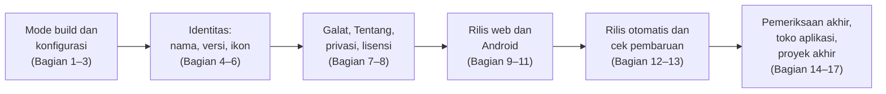

| Bagian | Pertanyaan yang dijawab |
| :--- | :--- |
| 1–3 | Apa bedanya aplikasi yang dijalankan dengan `flutter run` dan aplikasi yang dibagikan? Bagaimana memberi pengaturan tanpa mengubah kode? |
| 4–6 | Bagaimana aplikasi mendapat nama, nomor versi, dan ikonnya sendiri, alih-alih "flutter_application_1" berlogo Flutter? |
| 7–8 | Apa yang dilihat pengguna saat aplikasi mengalami galat? Apa yang wajib diberitahukan kepada pengguna tentang data dan lisensi? |
| 9–11 | Bagaimana membuat berkas rilis web dan Android, mengujinya, dan menandatanganinya? |
| 12–13 | Bagaimana rilis terjadi otomatis setiap ada versi baru, dan bagaimana pengguna tahu ada versi baru? |
| 14–17 | Apa saja yang diperiksa sebelum rilis, bagaimana menerbitkan ke toko aplikasi, dan apa yang dikumpulkan untuk proyek akhir? |

**Kode contoh hari ini:**

| No. | Berkas | Isi | Jalan di |
| :---: | :--- | :--- | :--- |
| 01 | [`contoh_01_versi_dan_nomor_build_dart_murni.dart`](kode/contoh_01_versi_dan_nomor_build_dart_murni.dart) | Mengurai, membandingkan, dan menaikkan nomor versi; aturan nomor *build* | DartPad atau `dart run` |
| 02 | [`contoh_02_mode_build_dan_konfigurasi.dart`](kode/contoh_02_mode_build_dan_konfigurasi.dart) | "Info Build": mode *build*, `assert`, log khusus *debug*, konfigurasi `--dart-define` | DartPad atau proyek Flutter |
| 03 | [`contoh_03_menangani_galat_di_rilis.dart`](kode/contoh_03_menangani_galat_di_rilis.dart) | "Uji Galat": jaring pengaman galat dan pengganti layar merah | DartPad atau proyek Flutter |
| 04 | [`contoh_04_halaman_tentang_dan_lisensi.dart`](kode/contoh_04_halaman_tentang_dan_lisensi.dart) | Halaman Tentang "Cuaca Kampus": versi, atribusi, privasi, lisensi | DartPad atau proyek Flutter |
| 05 | [`contoh_05_cek_pembaruan.dart`](kode/contoh_05_cek_pembaruan.dart) | "Jadwal Kuliah": cek pembaruan dengan lima skenario server | DartPad atau proyek Flutter |
| 06 | [`contoh_06_pemeriksa_kesiapan_rilis_dart_murni.dart`](kode/contoh_06_pemeriksa_kesiapan_rilis_dart_murni.dart) | Daftar periksa rilis yang ditulis sebagai program | DartPad atau `dart run` |
| 07 | [`contoh_07_studi_kasus_cuaca_kampus_siap_rilis.dart`](kode/contoh_07_studi_kasus_cuaca_kampus_siap_rilis.dart) | Studi kasus: "Cuaca Kampus" (Pertemuan 10) menjadi rilis 1.0.0 | DartPad atau proyek Flutter |

**Templat siap salin** (folder [`templat/`](templat/)):

| Berkas | Kegunaan | Disalin ke |
| :--- | :--- | :--- |
| [`web.yml`](templat/web.yml) | Menerbitkan versi web ke GitHub Pages setiap *push* ke `main` | `.github/workflows/web.yml` |
| [`rilis.yml`](templat/rilis.yml) | Mem-*build* APK dan membuat halaman rilis setiap *push tag* versi | `.github/workflows/rilis.yml` |
| [`README_PROYEK.md`](templat/README_PROYEK.md) | Kerangka `README.md` final proyek akhir | `README.md` |
| [`CHANGELOG.md`](templat/CHANGELOG.md) | Catatan perubahan setiap versi | `CHANGELOG.md` |
| [`KEBIJAKAN_PRIVASI.md`](templat/KEBIJAKAN_PRIVASI.md) | Kerangka kebijakan privasi | `KEBIJAKAN_PRIVASI.md` |

> [!TIP]
> Folder [`aset/`](aset/) berisi ikon contoh "Tugas Kuliahku" (1024 × 1024 piksel) yang dipakai di Jobsheet. Silakan dipakai untuk mencoba, tetapi proyek akhir Anda sebaiknya memakai ikon buatan sendiri.

---

## 1. Dari "Jalan di Laptop" ke "Siap Dibagikan"

### 1.1 Dapur sendiri vs warung

Bayangkan Anda pandai memasak nasi goreng. Selama ini Anda memasak di **dapur sendiri**: peralatan berserakan tidak masalah, garam tanpa label pun Anda tahu isinya, dan kalau rasanya kurang, cukup ditambah saat itu juga. Suatu hari Anda membuka **warung**. Tiba-tiba ada hal yang tidak penting di dapur sendiri, tetapi wajib di warung:

| Di warung | Di aplikasi | Bagian |
| :--- | :--- | :---: |
| Papan nama dan logo | Nama aplikasi, ikon, *application ID* | 4, 6 |
| Nomor edisi menu ("menu baru mulai 1 November") | Nomor versi dan nomor *build* | 5 |
| Masakan dikemas rapi, bukan dari wajan langsung | *Build* rilis: lebih kecil, lebih cepat | 2, 9–11 |
| Segel kemasan, agar pembeli yakin tidak ditukar orang | Tanda tangan digital | 11 |
| Daftar komposisi dan asal bahan | Atribusi data, lisensi, kebijakan privasi | 8 |
| Pelayan tetap sopan saat ada yang salah | Pesan galat yang ramah | 7 |
| Pengumuman "ada menu baru" | Catatan rilis dan cek pembaruan | 12, 13 |

Aplikasi Anda sudah lama "matang" sejak Pertemuan 9: mengambil data dari internet, menyimpan data di perangkat, tertata rapi, dan teruji. Hari ini kita membuka warungnya.

### 1.2 Apa yang berbeda saat aplikasi dibagikan?

Selama ini aplikasi dijalankan dengan `flutter run` atau tombol **F5** di VS Code. Cara itu menghasilkan aplikasi mode ***debug***: dirancang untuk **pembuatnya**, bukan untuk penggunanya.

| Hal | Saat `flutter run` (debug) | Saat dibagikan (rilis) |
| :--- | :--- | :--- |
| *Hot reload* | Ada | Tidak ada |
| Kecepatan | Bisa tersendat | Lancar, karena kode dikompilasi penuh |
| Ukuran berkas | Besar (membawa alat bantu pengembang) | Jauh lebih kecil |
| Pita "DEBUG" di pojok kanan atas | Tampil (jika tidak dimatikan) | Tidak pernah tampil |
| Galat saat membangun widget | Layar **merah** berisi pesan lengkap | Kotak **abu-abu** tanpa keterangan |
| `assert(...)` | Diperiksa | **Dilewati** |
| Izin internet di Android | Ada otomatis | Hanya ada jika ditulis sendiri ([Bagian 10.2](#102-sebelum-build-izin-internet-dan-teman-temannya)) |
| Tanda tangan digital | Kunci *debug* otomatis | Kunci milik Anda ([Bagian 11](#11-rilis-android-2-tanda-tangan-digital-dan-app-bundle)) |
| Nama di HP | `tugas_kuliahku` (nama paket) | Seharusnya "Tugas Kuliahku" |

Tabel ini menyimpan satu pelajaran penting: **aplikasi yang lancar saat `flutter run` belum tentu lancar saat dibagikan.** Karena itu, build rilis harus **diuji sendiri** sebelum diberikan kepada orang lain.

### 1.3 Ke mana aplikasi dirilis?

Di mata kuliah ini, ada dua jalur rilis yang **gratis** dan wajib Anda kuasai, ditambah satu jalur yang cukup diketahui gambarannya:

| Jalur | Hasil | Cara orang lain memakainya | Biaya | Dibahas di |
| :--- | :--- | :--- | :--- | :---: |
| **Web** di GitHub Pages | Situs `https://akun.github.io/nama-repo/` | Membuka tautan di *browser* HP atau laptop | Gratis | 9 |
| **APK** di GitHub Releases | Berkas `.apk` | Mengunduh lalu memasang di HP Android | Gratis | 10–12 |
| **Toko aplikasi** (Google Play, App Store) | Halaman aplikasi di toko | Memasang dari toko, diperbarui otomatis | Berbayar dan ada proses peninjauan | 15 (gambaran) |

> [!IMPORTANT]
> Untuk proyek akhir, yang diminta adalah **versi web dan/atau APK** sesuai arahan dosen ([Bagian 17](#17-finalisasi-proyek-akhir)). Menerbitkan ke Google Play **tidak wajib**, tetapi langkah-langkahnya dibahas agar Anda tahu jalannya saat kelak membuat aplikasi sungguhan.

### 1.4 Peta perjalanan rilis

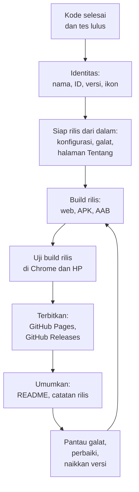

Perhatikan panah dari langkah terakhir yang kembali ke "Build rilis". Rilis **bukan** garis akhir. Setiap perbaikan menghasilkan versi baru, dan perjalanan ini diulang. Karena itu, sebagian besar langkahnya nanti dibuat **otomatis** ([Bagian 12](#12-rilis-otomatis-dengan-github)).

---

## 2. Tiga Mode *Build*: Debug, Profile, Release

### 2.1 Tiga mode, tiga tujuan

Flutter mengompilasi aplikasi dengan tiga cara yang berbeda, sesuai tahap pekerjaan Anda:

| Mode | Untuk apa | Cara menjalankan | Ciri |
| :--- | :--- | :--- | :--- |
| **Debug** | Membuat dan memperbaiki aplikasi | `flutter run` (bawaan) | *Hot reload*, *debugger*, pesan galat lengkap, `assert` diperiksa. Bisa tersendat |
| **Profile** | Mengukur kecepatan | `flutter run --profile` | Hampir secepat rilis, tetapi DevTools masih bisa membaca kinerjanya |
| **Release** | Dibagikan ke pengguna | `flutter run --release` atau `flutter build ...` | Paling cepat dan paling kecil. Tanpa *hot reload* dan tanpa alat bantu *debugging* |

Perumpamaannya seperti latihan drama. Mode *debug* adalah **latihan**: sutradara boleh menghentikan adegan kapan saja dan memberi catatan. Mode *profile* adalah **gladi bersih**: berjalan seperti pertunjukan sungguhan, tetapi masih ada orang yang mencatat waktu. Mode *release* adalah **pertunjukan**: penonton hanya melihat hasil akhirnya.

Perintahnya:

```bash
flutter run                   # debug (bawaan)
flutter run --profile         # profile, untuk mengukur kecepatan di HP sungguhan
flutter run --release         # release, untuk mencoba rasa aplikasi rilis
flutter build web             # membuat berkas rilis web (Bagian 9)
flutter build apk             # membuat berkas rilis Android (Bagian 10)
```

> [!NOTE]
> Menurut panduan resmi Flutter, emulator dan simulator hanya mendukung mode *debug*, karena kecepatannya tidak mewakili HP sungguhan. Jadi, uji mode *profile* dan *release* di **HP sungguhan** atau di **Chrome**.

### 2.2 Mengenali mode dari dalam kode

Pustaka `package:flutter/foundation.dart` menyediakan tiga konstanta:

| Konstanta | Bernilai `true` jika ... |
| :--- | :--- |
| `kDebugMode` | aplikasi berjalan dalam mode *debug* |
| `kProfileMode` | aplikasi berjalan dalam mode *profile* |
| `kReleaseMode` | aplikasi berjalan dalam mode *release* |

Ketiganya adalah **konstanta waktu kompilasi**: nilainya sudah ditetapkan saat aplikasi di-*build*. Akibatnya menarik. Pada kode berikut, compiler tahu bahwa di build rilis `kDebugMode` pasti `false`, sehingga **seluruh isi `if` dibuang** dari berkas rilis. Tidak memperlambat, dan tidak ikut terbawa ke HP pengguna:

```dart
/// Log yang HANYA ada di mode debug.
void catatDebug(String pesan) {
  if (kDebugMode) {
    debugPrint('[debug] $pesan');
  }
}
```

> [!WARNING]
> `debugPrint` **tidak** otomatis hilang di build rilis, walaupun namanya diawali "debug". Tanpa `if (kDebugMode)`, isinya tetap tertulis di log perangkat, dan orang yang menyambungkan HP ke laptop bisa membacanya. Jangan pernah mencetak data pribadi atau token, bahkan dengan `debugPrint`. Begitu juga `print`: *linter* sudah memperingatkannya dengan aturan `avoid_print`.

### 2.3 `assert` hanya diperiksa di mode *debug*

`assert(kondisi)` adalah pemeriksaan untuk **pengembang**: jika kondisinya `false`, aplikasi berhenti dengan pesan galat. Di build rilis, `assert` **tidak dijalankan sama sekali**, termasuk fungsi yang dipanggil di dalamnya.

```dart
bool _assertDijalankan = false;

bool _tandaiAssert() {
  _assertDijalankan = true;
  return true;
}

// Di dalam build():
assert(_tandaiAssert()); // di build rilis, baris ini dilewati
```

Jangan pernah menaruh kode yang **harus** jalan di dalam `assert`. Contoh 02 memakai sifat ini untuk menunjukkan mode yang sedang aktif.

### 2.4 Di web: tiga mode, tiga compiler

Untuk web, mode *build* juga menentukan cara Dart diubah menjadi JavaScript:

| Mode | Compiler | Hasil |
| :--- | :--- | :--- |
| Debug | `dartdevc` | Tidak diperkecil, mudah di-*debug* |
| Profile | `dart2js` | Dibuang bagian yang tidak terpakai (*tree shaking*), tidak diperkecil |
| Release | `dart2js` | Dibuang bagian yang tidak terpakai **dan** diperkecil (*minified*) |

Selain JavaScript, Flutter juga bisa mengompilasi ke **WebAssembly** dengan `flutter build web --wasm`. Dibahas singkat di [Bagian 9.5](#95-hal-yang-perlu-diperhatikan-di-web).

### 2.5 Coba sendiri: Contoh 02

Jalankan [Contoh 02](kode/contoh_02_mode_build_dan_konfigurasi.dart) di DartPad. DartPad selalu memakai mode *debug*, jadi layar menulis `Mode build: Debug` dan `assert(): dijalankan`:

<p align="center">
  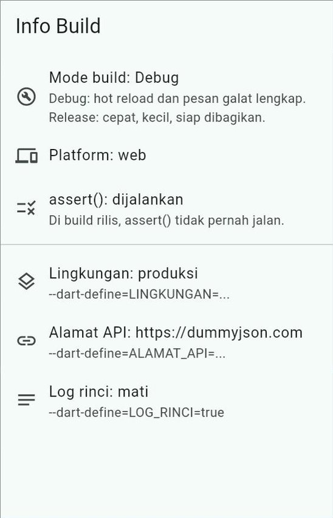
</p>

Lalu salin kodenya ke proyek latihan dan jalankan dengan `flutter run -d chrome --release`. Kini layar menulis `Mode build: Release` dan `assert(): dilewati`. Kode yang sama, hasil berbeda, karena mode *build*-nya berbeda.

---

## 3. Konfigurasi Tanpa Mengubah Kode: `--dart-define`

### 3.1 Masalah: mengubah kode setiap kali mau rilis

Di [Pertemuan 12](../pertemuan_12_clean_architecture/kode/contoh_08_studi_kasus_pinjam_ruang.dart) kita menulis:

```dart
// Satu-satunya baris yang perlu diubah untuk memakai data palsu:
// Lingkungan.pengembangan.
const Lingkungan lingkungan = Lingkungan.produksi;
```

Cara ini bekerja, tetapi berbahaya. Suatu sore Anda mengubahnya menjadi `Lingkungan.pengembangan` untuk menguji tampilan, lupa mengembalikannya, lalu mem-*build* APK untuk dosen. Hasilnya: aplikasi rilis berisi **data palsu**.

Jalan keluarnya: **nilai pengaturan diberikan saat menjalankan atau mem-*build*, bukan ditulis di kode.** Kodenya tidak pernah berubah.

### 3.2 Memberi nilai dengan `--dart-define`

```bash
flutter run -d chrome --dart-define=LINGKUNGAN=pengembangan
flutter build web --dart-define=LINGKUNGAN=produksi
```

Formatnya `--dart-define=NAMA=nilai`. Opsi ini boleh ditulis berkali-kali:

```bash
flutter run -d chrome --dart-define=LINGKUNGAN=pengembangan --dart-define=LOG_RINCI=true
```

Jika nilainya banyak, kumpulkan dalam berkas JSON, misalnya `config/pengembangan.json`:

```json
{
  "LINGKUNGAN": "pengembangan",
  "ALAMAT_API": "http://localhost:8080",
  "LOG_RINCI": "true"
}
```

lalu jalankan:

```bash
flutter run -d chrome --dart-define-from-file=config/pengembangan.json
```

### 3.3 Membaca nilainya: wajib `const`

```dart
// Kosong / nilai bawaan jika --dart-define tidak diberikan.
const String teksLingkungan = String.fromEnvironment(
  'LINGKUNGAN',
  defaultValue: 'produksi',
);
const bool logRinci = bool.fromEnvironment('LOG_RINCI'); // bawaan: false
const int batasData = int.fromEnvironment('BATAS_DATA', defaultValue: 20);
```

Kata `const` di sini **wajib**. Nilai `--dart-define` ditanamkan ke kode saat dikompilasi, dan dokumentasi Dart menyatakan `fromEnvironment` hanya **dijamin** bekerja jika dipanggil sebagai `const`. Tanpa `const`, nilainya tidak dijamin terbaca di build rilis Android/iOS, dan di web malah langsung galat. Kami membuktikannya di DartPad:

```text
Unsupported operation: String.fromEnvironment can only be used as a const constructor
```

### 3.4 Nilai bawaan yang aman dan nilai yang salah ketik

Dua kebiasaan baik dari Contoh 02:

1. **Nilai bawaan dipilih yang aman untuk rilis.** Bawaan `LINGKUNGAN` adalah `produksi`. Lupa menulis `--dart-define` saat mem-*build* rilis tetap menghasilkan aplikasi dengan data sungguhan, bukan data palsu.
2. **Nilai yang salah ketik langsung ketahuan.** `--dart-define=LINGKUNGAN=produksii` (kelebihan huruf `i`) tidak boleh diam-diam dianggap nilai bawaan:

```dart
static Konfigurasi dariLingkungan() {
  // asNameMap(): {'pengembangan': Lingkungan.pengembangan, ...}
  final Lingkungan? lingkungan = Lingkungan.values
      .asNameMap()[_teksLingkungan];
  if (lingkungan == null) {
    throw KonfigurasiSalah(
      'LINGKUNGAN "$_teksLingkungan" tidak dikenal. '
      'Pilih: ${Lingkungan.values.map((l) => l.name).join(' atau ')}.',
    );
  }
  // ... pemeriksaan alamat API: produksi wajib https
}
```

Hasilnya, aplikasi menolak berjalan dan menjelaskan sebabnya. Galat yang ketahuan saat diuji jauh lebih murah daripada galat yang ketahuan pengguna. (DartPad tidak bisa diberi `--dart-define`. Untuk mencobanya di DartPad, ubah sementara `defaultValue: 'produksi'` menjadi `'produksii'`.)

<p align="center">
  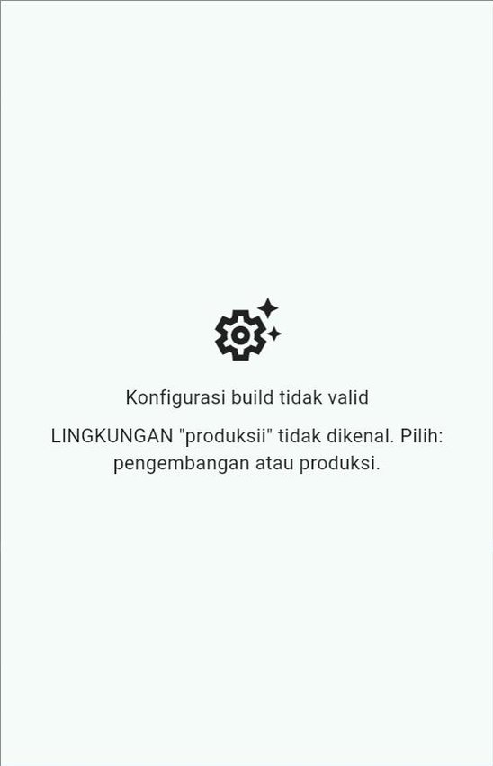
</p>

### 3.5 Pita penanda build uji

Build untuk pengembangan sebaiknya **terlihat beda**, agar tidak tertukar saat didemokan. Caranya sama dengan pita "DATA PALSU" di Pertemuan 12:

```dart
builder: (BuildContext context, Widget? child) {
  if (konfigurasi.lingkungan == Lingkungan.pengembangan) {
    // Pesan pita maksimal sekitar 10 huruf agar tidak terpotong.
    return Banner(
      message: 'BUILD UJI',
      location: BannerLocation.topEnd,
      child: child!,
    );
  }
  return child!;
},
```

### 3.6 `--dart-define` bukan tempat menyimpan rahasia

> [!CAUTION]
> Nilai `--dart-define` **ikut dibawa** di dalam aplikasi. Orang yang cukup paham bisa membongkar berkas APK atau membaca JavaScript versi web, lalu menemukannya. `--dart-define` hanya menjaga agar nilai itu **tidak masuk ke repositori Git** ([Pertemuan 10, Bagian 14.4](../pertemuan_10_async_dan_rest_api/README.md#144-kunci-api-jangan-disimpan-di-repositori)). Kunci yang benar-benar rahasia, misalnya kunci pembayaran, tidak boleh ada di aplikasi sama sekali.

### 3.7 Dua titik masuk atau `--dart-define`?

Di Pertemuan 12, lingkungan dipilih dengan dua berkas: `main.dart` dan `main_pengembangan.dart` (dijalankan dengan `-t lib/main_pengembangan.dart`). Keduanya benar:

| Cara | Kelebihan | Cocok untuk |
| :--- | :--- | :--- |
| Dua titik masuk (`-t lib/main_pengembangan.dart`) | Mudah dilihat di VS Code; tiap lingkungan bisa punya kode awal berbeda | Proyek seperti "Tugas Kuliahku" |
| `--dart-define` | Satu `main.dart`; nilai apa pun bisa diberikan, termasuk alamat server dan nomor uji | Nilai yang sering berganti, misalnya alamat API |

Proyek besar juga memakai ***flavor***: varian aplikasi dengan *application ID*, nama, dan ikon berbeda yang bisa terpasang berdampingan di satu HP, dijalankan dengan `flutter run --flavor staging`. Materi ini di luar cakupan kuliah; panduannya ada di [dokumentasi resmi](https://docs.flutter.dev/deployment/flavors).

---

## 4. Identitas Aplikasi (1): Nama dan ID

### 4.1 Dua "nama" yang berbeda

Setiap aplikasi punya dua identitas yang sering tertukar:

| | **Nama tampilan** | ***Application ID*** |
| :--- | :--- | :--- |
| Contoh | Tugas Kuliahku | `com.budisantoso.tugaskuliahku` |
| Dibaca oleh | Manusia (di bawah ikon, di toko) | Sistem operasi dan toko aplikasi |
| Boleh sama dengan aplikasi lain? | Boleh | **Tidak**: harus unik di seluruh dunia |
| Boleh diganti setelah rilis? | Boleh | **Tidak** (bagi HP dan toko, ID baru = aplikasi lain) |
| Perumpamaan | Nama panggilan | Nomor KTP |

Proyek baru dari `flutter create tugas_kuliahku` memakai nama paket `tugas_kuliahku` sebagai nama tampilan, dan `com.example.tugas_kuliahku` sebagai ID. Keduanya harus diganti sebelum rilis.

### 4.2 Nama tampilan: ada di beberapa tempat

| Tempat nama tampil | Berkas | Yang diubah |
| :--- | :--- | :--- |
| Di bawah ikon HP Android | `android/app/src/main/AndroidManifest.xml` | `android:label="Tugas Kuliahku"` |
| Di bawah ikon iPhone | `ios/Runner/Info.plist` | nilai `CFBundleDisplayName` |
| Tab *browser* saat aplikasi web sedang dimuat | `web/index.html` | isi `<title>`, juga `<meta name="description">` dan `apple-mobile-web-app-title` |
| Saat versi web "dipasang" di HP (PWA) | `web/manifest.json` | `name`, `short_name`, `description` |
| Daftar aplikasi terbuka di Android, dan tab *browser* setelah aplikasi berjalan | `lib/...` | `MaterialApp(title: 'Tugas Kuliahku')` |

Contoh perubahan di `AndroidManifest.xml`:

```xml
<application
    android:label="Tugas Kuliahku"
    android:name="${applicationName}"
    android:icon="@mipmap/ic_launcher">
```

Dan di `web/manifest.json`:

```json
{
    "name": "Tugas Kuliahku",
    "short_name": "Tugas Kuliahku",
    "description": "Pencatat tugas kuliah yang tetap bisa dibaca tanpa internet.",
    ...
}
```

### 4.3 *Application ID*: nomor KTP aplikasi

Di Android, ID aplikasi tertulis di `android/app/build.gradle.kts`. Isi bawaan dari `flutter create`:

```kotlin
android {
    namespace = "com.example.tugas_kuliahku"
    ...
    defaultConfig {
        // TODO: Specify your own unique Application ID (https://developer.android.com/studio/build/application-id.html).
        applicationId = "com.example.tugas_kuliahku"
        ...
    }
}
```

Ada dua baris yang mirip:

| Baris | Artinya | Perlu diganti? |
| :--- | :--- | :--- |
| `applicationId` | Identitas aplikasi di HP dan di Google Play | **Ya**, sebelum rilis pertama |
| `namespace` | Nama paket kode Kotlin/Java di dalam folder `android/` (misalnya tempat `MainActivity`) | Tidak wajib. Jika diganti, berkas `MainActivity.kt` harus ikut dipindah, jadi pemula cukup membiarkannya |

Aturan menulis `applicationId`:

1. Ditulis seperti alamat situs yang dibalik: `com.namaanda.namaaplikasi`.
2. Minimal **dua bagian** yang dipisah titik.
3. Setiap bagian **diawali huruf**. Hanya huruf, angka, dan garis bawah (`_`) yang boleh dipakai. Jadi NIM tidak bisa dijadikan bagian tersendiri, tetapi boleh ditempel setelah huruf, misalnya `mhs2609106001`.
4. Gunakan huruf kecil semua agar aman.
5. **Jangan** memakai `com.example`: Google Play menolaknya.

| ✅ Boleh | ❌ Tidak boleh | Alasannya |
| :--- | :--- | :--- |
| `com.budisantoso.tugaskuliahku` | `tugaskuliahku` | Hanya satu bagian |
| `id.timpelangi.cuacakampus` | `com.budi-santoso.tugas` | Ada tanda `-` |
| `com.mhs2609106001.tugaskuliahku` | `com.2609106001.tugas` | Bagian diawali angka |

> [!TIP]
> Untuk proyek **baru**, ID bisa ditentukan sejak awal: `flutter create --org com.budisantoso tugas_kuliahku` menghasilkan `com.budisantoso.tugas_kuliahku`, baik di `applicationId` maupun di `namespace`.

> [!WARNING]
> Bagi HP, `applicationId` yang berbeda adalah **aplikasi yang berbeda**. Setelah ID diganti, aplikasi lama (ber-ID `com.example...`) tetap terpasang di HP. Hapus aplikasi lama itu agar tidak bingung saat mencoba.

Di iPhone, padanannya adalah ***Bundle Identifier***, yang diatur lewat Xcode (*Runner* → *General* → *Identity*). Karena mem-*build* aplikasi iPhone membutuhkan Mac, bagian ini cukup diketahui saja ([Bagian 15.2](#152-app-store-iphone)).

---

## 5. Identitas Aplikasi (2): Nomor Versi

### 5.1 Satu baris, dua nomor

Buka `pubspec.yaml`. Ada baris:

```yaml
version: 1.0.0+1
```

Baris ini berisi **dua** nomor yang dipisah tanda `+`:

| Bagian | Nama | Dibaca oleh | Di Android | Di iPhone |
| :--- | :--- | :--- | :--- | :--- |
| `1.0.0` | **Nama versi** | Pengguna | `versionName` | `CFBundleShortVersionString` |
| `1` | **Nomor *build*** | Toko aplikasi dan sistem operasi | `versionCode` | `CFBundleVersion` |

Flutter menyalin kedua nomor itu ke pengaturan Android dan iPhone setiap kali mem-*build*. Untuk web, keduanya ditulis ke berkas `version.json` di hasil *build*. Jadi Anda **cukup mengubah satu baris** ini.

### 5.2 Nama versi: Semantic Versioning

Nama versi umumnya mengikuti aturan ***Semantic Versioning***, `MAYOR.MINOR.PATCH`:

| Bagian | Naik jika ... | Contoh perubahan | Dari 1.4.2 menjadi |
| :--- | :--- | :--- | :--- |
| **PATCH** | hanya memperbaiki bug | Tombol simpan yang macet diperbaiki | 1.4.**3** |
| **MINOR** | menambah fitur, yang lama tetap jalan | Fitur ekspor jadwal | 1.**5**.0 |
| **MAYOR** | ada perubahan besar yang tidak cocok dengan versi lama | Format data lama tidak dipakai lagi | **2**.0.0 |

Saat satu bagian naik, bagian di kanannya kembali ke `0`. Versi `0.x.y` dipakai untuk aplikasi yang **belum** dirilis resmi; rilis resmi pertama adalah `1.0.0`.

### 5.3 Nomor *build*: selalu naik

Aturan nomor *build* lebih sederhana: **setiap kali aplikasi diunggah ke toko, nomornya harus lebih besar daripada sebelumnya**, apa pun perubahannya. Nomor yang sudah pernah dipakai ditolak. Android juga menolak memasang pembaruan yang nomor *build*-nya lebih kecil daripada aplikasi yang sudah terpasang.

Nomor versi juga bisa ditimpa saat mem-*build*, tanpa mengubah `pubspec.yaml`:

```bash
flutter build apk --build-name=1.0.1 --build-number=2
```

> [!NOTE]
> Saat APK dipecah per jenis prosesor dengan `--split-per-abi` ([Bagian 10.3](#103-membuat-apk)), Flutter otomatis menambahkan `1000 × kode ABI` ke nomor *build*, agar setiap APK punya nomor yang berbeda.

### 5.4 Menampilkan versi di dalam aplikasi: `package_info_plus`

Versi perlu tampil di aplikasi, misalnya di halaman Tentang. Saat pengguna melapor "aplikasinya galat", hal pertama yang ditanyakan adalah "versi berapa?". Jangan menulis versi dua kali (di `pubspec.yaml` **dan** di kode), karena pasti suatu saat lupa diubah salah satunya. Bacalah dari aplikasinya sendiri dengan paket [`package_info_plus`](https://pub.dev/packages/package_info_plus):

```bash
flutter pub add package_info_plus
```

```dart
import 'package:flutter/material.dart';
import 'package:package_info_plus/package_info_plus.dart';

class TeksVersi extends StatefulWidget {
  const TeksVersi({super.key});

  @override
  State<TeksVersi> createState() => _TeksVersiState();
}

class _TeksVersiState extends State<TeksVersi> {
  // Future dibuat SEKALI, bukan di dalam build (Pertemuan 10).
  late final Future<PackageInfo> _info = PackageInfo.fromPlatform();

  @override
  Widget build(BuildContext context) {
    return FutureBuilder<PackageInfo>(
      future: _info,
      builder: (BuildContext context, AsyncSnapshot<PackageInfo> hasil) {
        final PackageInfo? info = hasil.data;
        if (info == null) return const Text('Versi ...');
        return Text('Versi ${info.version} (build ${info.buildNumber})');
      },
    );
  }
}
```

| Properti | Isi (untuk `version: 1.0.0+1`) |
| :--- | :--- |
| `info.appName` | Nama aplikasi |
| `info.packageName` | *Application ID*, misalnya `com.budisantoso.tugaskuliahku` |
| `info.version` | `1.0.0` |
| `info.buildNumber` | `1` |

Tiga catatan:

1. Di **web**, paket ini membaca berkas `version.json` yang dibuat oleh `flutter build web` dan `flutter run`.
2. Panggil `PackageInfo.fromPlatform()` **di dalam** widget, bukan sebelum `runApp`. Panduan paket ini mencatat bahwa memanggilnya sebelum `runApp` bisa gagal di Android.
3. Di tes widget, nilai palsunya diatur dengan `PackageInfo.setMockInitialValues(appName: ..., packageName: ..., version: '1.0.0', buildNumber: '1', buildSignature: '')`.

DartPad tidak menyediakan paket ini, jadi Contoh 04 dan 07 menulis versinya sebagai konstanta, lengkap dengan komentar yang mengingatkan hal ini.

### 5.5 Jangan membandingkan versi sebagai teks

Fitur cek pembaruan ([Bagian 13](#13-cek-pembaruan-untuk-aplikasi-di-luar-toko)) perlu membandingkan versi. Jebakannya: teks dibandingkan **huruf demi huruf**. Karena `'1'` lebih kecil daripada `'9'`, teks `"1.10.0"` dianggap lebih kecil daripada `"1.9.0"`. Bandingkan per bagian sebagai **angka**. Inilah inti [Contoh 01](kode/contoh_01_versi_dan_nomor_build_dart_murni.dart):

```dart
/// Urutan menurut NAMA VERSI: mayor dulu, lalu minor, lalu patch.
@override
int compareTo(Versi lain) {
  if (mayor != lain.mayor) return mayor.compareTo(lain.mayor);
  if (minor != lain.minor) return minor.compareTo(lain.minor);
  return patch.compareTo(lain.patch);
}
```

Hasil sebagian program:

```text
=== 2. Membandingkan versi ===
1.10.0 vs 1.9.0
  sebagai teks : 1.10.0 lebih LAMA
  sebagai Versi: 1.10.0 lebih BARU
1.4.2+17 vs 1.4.2+18 -> nama versinya sama

=== 4. Riwayat unggahan ke toko aplikasi ===
1.0.0+1  diterima
1.0.1+2  diterima
1.0.2+2  DITOLAK: nomor build 2 sudah dipakai
1.1.0+1  DITOLAK: nomor build harus lebih dari 2
1.1.0+3  diterima
```

---

## 6. Identitas Aplikasi (3): Ikon dan Layar Pembuka

### 6.1 Ikon yang baik

Ikon adalah hal pertama yang dilihat pengguna, bahkan sebelum aplikasi dibuka. Ikon bawaan Flutter membuat aplikasi Anda terlihat "belum jadi".

Ciri ikon yang baik:

1. **Sederhana**: satu bentuk utama yang tetap jelas saat kecil (ikon di HP hanya sekitar 1 cm). Hindari tulisan panjang.
2. **Persegi, 1024 × 1024 piksel, PNG**. Untuk iPhone, gambar tidak boleh transparan.
3. **Bagian penting di tengah.** Di Android 8 ke atas, ikon adalah ***ikon adaptif***: terdiri dari **lapisan belakang** (warna atau gambar) dan **lapisan depan** (simbol), lalu dipotong oleh HP menjadi lingkaran, persegi membulat, atau bentuk lain sesuai merek HP. Jadi simbol harus berada di tengah agar tidak ikut terpotong.

```text
 Ikon adaptif Android: dua lapisan, dipotong sesuai bentuk pilihan HP

  lapisan belakang     lapisan depan         hasil di HP
  ┌───────────┐        ┌───────────┐         ╭─────────╮
  │███████████│   +    │   ┌───┐   │   =    (│  ┌───┐  │)
  │███████████│        │   │ ✓ │   │         │  │ ✓ │  │
  │███████████│        │   └───┘   │        (│  └───┘  │)
  └───────────┘        └───────────┘         ╰─────────╯
   warna ungu          simbol di tengah,      bagian pinggir
                       pinggirnya kosong      boleh terpotong
```

Android 13 ke atas juga mengenal ***themed icon***: ikon satu warna yang mengikuti warna tema HP. Lapisannya berupa gambar simbol satu warna.

### 6.2 Membuat semua ukuran ikon dengan `flutter_launcher_icons`

Android, iPhone, dan web membutuhkan ikon dalam belasan ukuran. Daripada membuat satu per satu, kita memakai paket [`flutter_launcher_icons`](https://pub.dev/packages/flutter_launcher_icons). Paket ini hanya dipakai saat pengembangan, jadi dipasang sebagai ***dev dependency***:

```bash
flutter pub add dev:flutter_launcher_icons
```

Simpan gambar ikon di folder proyek, misalnya `assets/ikon/`, lalu tambahkan pengaturan berikut di **akhir** `pubspec.yaml` (tidak menjorok, sejajar dengan `flutter:`):

```yaml
flutter_launcher_icons:
  android: true                # timpa ikon Android bawaan
  ios: true                    # timpa ikon iPhone bawaan
  remove_alpha_ios: true       # iPhone tidak menerima ikon transparan
  image_path: "assets/ikon/ikon_tugas_kuliahku.png"
  # Ikon adaptif Android: lapisan belakang + lapisan depan.
  adaptive_icon_background: "#673AB7"
  adaptive_icon_foreground: "assets/ikon/ikon_tugas_kuliahku_latar_depan.png"
  web:
    generate: true
    image_path: "assets/ikon/ikon_tugas_kuliahku.png"
    background_color: "#673AB7"
    theme_color: "#673AB7"
```

Lalu jalankan:

```bash
dart run flutter_launcher_icons
```

Paket ini menulis ulang ikon di folder `android/app/src/main/res/mipmap-*`, `ios/Runner/Assets.xcassets/`, dan `web/`, serta mengubah warna di `web/manifest.json`. Lihat daftar berkas yang berubah dengan `git status`.

> [!NOTE]
> Pengaturan di atas memakai `adaptive_icon_foreground_inset` bawaan, yaitu 16: paket menambahkan ruang kosong 16% di sekeliling lapisan depan, agar simbol tidak terpotong. Ikon adaptif hanya dibuat jika **kedua** `adaptive_icon_background` dan `adaptive_icon_foreground` diisi. Untuk *themed icon* Android 13+, tambahkan `adaptive_icon_monochrome` berisi gambar simbol satu warna.

### 6.3 Melihat ikon barunya

| Di | Caranya |
| :--- | :--- |
| HP Android | **Hapus dulu** aplikasi lama dari HP, lalu jalankan lagi. Peluncur HP sering menyimpan ikon lama |
| Chrome | Hentikan aplikasi, jalankan ulang, lalu muat ulang paksa (`Ctrl` + `Shift` + `R`). Ikon tampil di tab |

### 6.4 Layar pembuka (*splash screen*)

Saat aplikasi dibuka, ada jeda sejenak sebelum Flutter siap menggambar layar pertama. Jeda itu diisi **layar pembuka**. Bawaan Flutter berupa layar putih polos. Di Android 12 ke atas, sistem operasi **selalu** menampilkan layar pembuka berisi ikon aplikasi di tengah, di atas warna latar.

Paket [`flutter_native_splash`](https://pub.dev/packages/flutter_native_splash) mengatur warna dan gambarnya untuk Android, iPhone, dan web sekaligus:

```bash
flutter pub add dev:flutter_native_splash
```

Tambahkan di akhir `pubspec.yaml`:

```yaml
flutter_native_splash:
  color: "#673AB7"             # warna latar (mode terang)
  color_dark: "#311B92"        # warna latar (mode gelap)
  image: assets/ikon/ikon_tugas_kuliahku_latar_depan.png
  android_12:
    color: "#673AB7"
    color_dark: "#311B92"
    # Android 12+: gambar 1152 x 1152 piksel, isinya di dalam
    # lingkaran tengah berdiameter 768 piksel.
    image: assets/ikon/layar_pembuka_android12.png
```

Lalu buat layar pembukanya:

```bash
dart run flutter_native_splash:create
```

Ingin kembali ke layar pembuka bawaan? Jalankan `dart run flutter_native_splash:remove`.

> [!IMPORTANT]
> Layar pembuka hanya mengisi waktu **sampai Flutter siap**. Jangan membuat "layar pembuka palsu" di Flutter yang menahan pengguna 3 detik hanya untuk menampilkan logo. Pengguna membuka aplikasi untuk memakainya, bukan untuk menonton logo.

Panduan paket ini mencatat beberapa batasan di Android 12: gambar dipotong menjadi lingkaran, layar pembuka tidak tampil jika aplikasi dibuka dari notifikasi, dan peluncur HP buatan selain Google kadang menampilkannya berbeda.

---

## 7. Menangani Galat di Aplikasi Rilis

### 7.1 Layar merah berubah menjadi kotak abu-abu

Sejak Pertemuan 4, galat saat membangun widget tampil sebagai **layar merah** berisi pesan lengkap. Itu bantuan untuk **pengembang**. Di build rilis, panduan resmi Flutter menyebutkan bahwa layar itu berubah menjadi **kotak abu-abu** tanpa keterangan apa pun. Pengguna bingung, dan Anda tidak pernah tahu galat itu terjadi.

Ada dua hal yang perlu disiapkan:

1. **Pengganti kotak abu-abu** yang sopan bagi pengguna.
2. **Pencatat galat** agar Anda tahu galat apa yang terjadi di HP pengguna.

### 7.2 Galat yang diduga dan galat yang tidak terduga

| | **Diduga** (*Exception*) | **Tidak terduga** (*Error*, bug) |
| :--- | :--- | :--- |
| Contoh | Internet putus, server menjawab 500, JSON rusak, izin ditolak | `Null check operator used on a null value`, indeks di luar batas, salah tipe |
| Penyebab | Dunia luar | Kode kita sendiri |
| Ditangani di | Tempatnya: `try`–`catch` di *repository*/ViewModel, lalu pesan ramah (Pertemuan 10–12) | Jaring pengaman di `main()`, lalu dicatat dan dikirim ke pengembang |
| Tujuan | Pengguna tahu apa yang terjadi dan bisa mencoba lagi | Pengembang tahu ada bug dan memperbaikinya di versi berikutnya |

Jaring pengaman **bukan** pengganti `try`–`catch`. Ia adalah lapisan terakhir untuk galat yang lolos.

### 7.3 Tiga jaring pengaman

```dart
void mulaiAplikasi() {
  WidgetsFlutterBinding.ensureInitialized();

  // 1. Galat di dalam build, layout, dan paint.
  FlutterError.onError = (FlutterErrorDetails rincian) {
    // Tetap tampilkan pesan lengkap di konsol saat pengembangan.
    FlutterError.presentError(rincian);
    pelapor.catat(rincian.exception, rincian.stack, sumber: 'widget');
  };

  // 2. Galat asinkron yang lolos (Android, iOS, desktop).
  PlatformDispatcher.instance.onError = (Object galat, StackTrace jejak) {
    pelapor.catat(galat, jejak, sumber: 'async (platform)');
    return true; // true = galat sudah ditangani
  };

  // 3. Pengganti kotak merah (debug) dan kotak abu-abu (rilis).
  ErrorWidget.builder = (FlutterErrorDetails rincian) =>
      KotakGalatRamah(rincian: rincian);

  runApp(const AplikasiUjiGalat());
}
```

| Jaring | Menangkap | Contoh |
| :--- | :--- | :--- |
| `FlutterError.onError` | Galat saat Flutter membangun, menata, dan menggambar widget | `nilai!` pada data yang ternyata `null` di dalam `build()` |
| `PlatformDispatcher.instance.onError` | Galat asinkron yang lolos dari semua `try`–`catch` | `Future` yang gagal dan tidak di-`await` siapa pun |
| `ErrorWidget.builder` | Bukan penangkap, melainkan **pengganti tampilan** widget yang gagal dibangun | Kotak oranye "Bagian ini gagal ditampilkan" |

`PelaporGalat` di Contoh 03 hanya menyimpan catatan di memori dan menampilkannya di layar. Aplikasi sungguhan mengirimnya ke layanan pelaporan seperti **Firebase Crashlytics** atau **Sentry**, sehingga pengembang menerima daftar galat dari HP semua pengguna, lengkap dengan *stack trace*-nya.

> [!CAUTION]
> Laporan galat dikirim ke server. **Jangan** ikutkan data pribadi pengguna (nama, nomor HP, isi catatan, token). Jika aplikasi mengirim laporan galat, hal itu juga wajib disebutkan di kebijakan privasi ([Bagian 8.3](#83-kebijakan-privasi-wajib-untuk-semua-aplikasi)).

### 7.4 Di web: tambahkan `runZonedGuarded`

Saat kami menguji di DartPad, galat asinkron yang lolos **tidak** sampai ke `PlatformDispatcher.instance.onError`; galat itu hanya muncul di konsol *browser*. Karena itu, untuk web, Contoh 03 membungkus aplikasinya dengan **zona**:

```dart
void main() {
  if (kIsWeb) {
    // Semua kode di dalam runZonedGuarded berada di satu "zona". Galat
    // asinkron yang tidak ditangkap di zona ini diteruskan ke fungsi
    // kedua, alih-alih hilang di konsol browser.
    runZonedGuarded(
      mulaiAplikasi,
      (Object galat, StackTrace jejak) =>
          pelapor.catat(galat, jejak, sumber: 'async (zona web)'),
    );
  } else {
    mulaiAplikasi();
  }
}
```

`WidgetsFlutterBinding.ensureInitialized()` dan `runApp()` harus dipanggil di **dalam** zona yang sama, karena itu keduanya ada di `mulaiAplikasi()`.

### 7.5 Pengganti layar merah yang ramah

```dart
class KotakGalatRamah extends StatelessWidget {
  const KotakGalatRamah({super.key, required this.rincian});

  final FlutterErrorDetails rincian;

  @override
  Widget build(BuildContext context) {
    // Widget ini bisa muncul DI MANA SAJA, bahkan di atas MaterialApp,
    // jadi Directionality dan Material disediakan sendiri.
    return Directionality(
      textDirection: TextDirection.ltr,
      child: Material(
        color: Colors.orange.shade50,
        child: Padding(
          padding: const EdgeInsets.all(12),
          child: Column(
            mainAxisSize: MainAxisSize.min,
            children: [
              Icon(Icons.sentiment_dissatisfied, color: Colors.orange.shade900),
              const SizedBox(height: 4),
              const Text(
                'Bagian ini gagal ditampilkan. Laporan sudah dicatat.',
                textAlign: TextAlign.center,
                style: TextStyle(color: Colors.black87),
              ),
              // Rincian teknis hanya untuk pengembang (mode debug).
              if (kDebugMode)
                Text(
                  rincian.exceptionAsString(),
                  textAlign: TextAlign.center,
                  style: const TextStyle(fontSize: 12, color: Colors.black54),
                ),
            ],
          ),
        ),
      ),
    );
  }
}
```

Perhatikan dua hal: rincian teknis hanya tampil saat `kDebugMode`, dan hanya **bagian** yang gagal yang diganti. Sisa layar tetap bisa dipakai.

### 7.6 Coba sendiri: Contoh 03

Jalankan [Contoh 03](kode/contoh_03_menangani_galat_di_rilis.dart) di DartPad, lalu:

| Aksi | Yang terjadi | Tercatat sebagai |
| :--- | :--- | :--- |
| Nyalakan sakelar **1. Tampilkan kartu yang rusak** | Kartu nilai diganti kotak oranye, sisa layar tetap normal | `widget` |
| Ketuk **Picu** | Tidak ada yang terlihat oleh pengguna | `async (zona web)` (di HP Android: `async (platform)`) |
| Ketuk **Muat** | *SnackBar* "Data gagal dibaca. Coba lagi nanti." | `ditangani` |

<p align="center">
  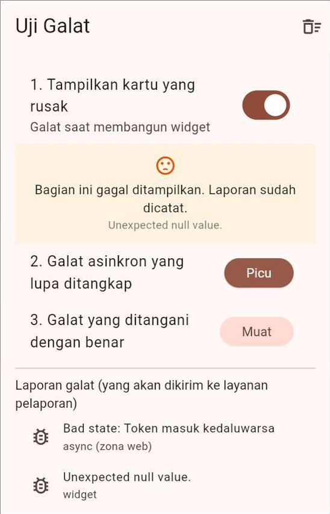
  &nbsp;
  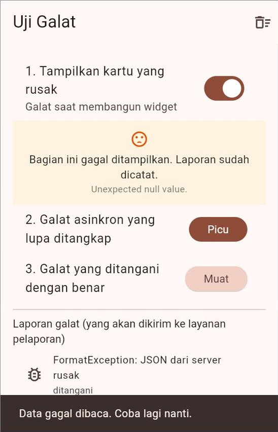
</p>

Satu hal kecil yang menarik: pesan galat tanda `!` di web berbunyi `Unexpected null value.`, sedangkan di Android dan VS Code berbunyi `Null check operator used on a null value`. Galatnya sama, hanya kata-katanya yang berbeda per platform.

---

## 8. Halaman Tentang, Kebijakan Privasi, dan Lisensi

### 8.1 Mengapa aplikasi perlu "jujur tentang dirinya"?

Aplikasi yang dipakai orang lain wajib bisa menjawab empat pertanyaan:

| Pertanyaan | Mengapa | Jawabannya di |
| :--- | :--- | :--- |
| Ini versi berapa? | Laporan bug tanpa nomor versi sulit ditindaklanjuti | Halaman Tentang ([Bagian 5.4](#54-menampilkan-versi-di-dalam-aplikasi-package_info_plus)) |
| Datanya dari mana? | Banyak penyedia data **mewajibkan** pencantuman sumber | Atribusi di dekat data dan di halaman Tentang |
| Data saya diapakan? | Hak pengguna; diwajibkan Google Play untuk semua aplikasi | Kebijakan privasi |
| Kode siapa saja yang dipakai? | Lisensi sumber terbuka mewajibkan pencantuman pemberitahuan lisensi | Halaman lisensi |

### 8.2 Atribusi sumber data

Contoh yang sudah kita kenal:

| Sumber data | Yang diwajibkan | Dipakai di |
| :--- | :--- | :--- |
| [Open-Meteo](https://open-meteo.com/en/licence) | Data berlisensi CC BY 4.0. Wajib mencantumkan tautan ke Open-Meteo **di dekat** setiap tempat data itu ditampilkan, misalnya "Weather data by Open-Meteo.com" | Pertemuan 10 dan 11 |
| [Data Terbuka BMKG](https://data.bmkg.go.id/) | Wajib mencantumkan BMKG sebagai sumber data | [Panduan Proyek Akhir](../panduan/05_proyek_akhir.md#51-beberapa-api-yang-bisa-dipakai) |

Baca selalu halaman syarat pemakaian API pilihan Anda, lalu tulis atribusinya di **dua** tempat: di dekat data (misalnya di bawah daftar), dan di halaman Tentang.

### 8.3 Kebijakan privasi: wajib untuk semua aplikasi

Kebijakan Google Play menyatakan bahwa **semua** aplikasi wajib mencantumkan tautan kebijakan privasi di Play Console, **termasuk** aplikasi yang tidak mengakses data pribadi sama sekali. Selain itu, aplikasi juga wajib menyediakan tautan atau teks kebijakan privasi **di dalam aplikasi**. Isinya minimal:

1. Siapa pengembangnya dan cara menghubunginya.
2. Data pribadi apa yang diakses, dikumpulkan, dipakai, dan dibagikan (termasuk lokasi dan foto dari Pertemuan 13).
3. Cara data itu dijaga keamanannya.
4. Berapa lama data disimpan dan bagaimana cara menghapusnya.

Kebijakan privasi juga harus ada di alamat web **publik** yang bisa dibuka siapa saja dan bukan berkas PDF, misalnya halaman di GitHub Pages ([Bagian 9.4](#94-terbit-otomatis-di-github-pages)). Folder [`templat/`](templat/KEBIJAKAN_PRIVASI.md) menyediakan kerangkanya.

> [!IMPORTANT]
> Kebijakan privasi harus **jujur dan sesuai kenyataan**. Jika aplikasi Anda meminta izin lokasi, menulis "tidak mengumpulkan data apa pun" adalah pelanggaran. Ingat juga aturan [Pertemuan 13](../pertemuan_13_fitur_perangkat_dan_izin/README.md): izin sensitif harus didahului penjelasan di dalam aplikasi.

### 8.4 Lisensi sumber terbuka: dikumpulkan otomatis

Aplikasi Anda memakai puluhan paket sumber terbuka: Flutter sendiri, `provider`, `http`, dan paket-paket yang dipakai paket itu. Sebagian besar lisensinya (misalnya BSD, MIT, Apache) mewajibkan **teks lisensinya ikut disertakan**.

Kabar baiknya, saat mem-*build*, Flutter **otomatis mengumpulkan** lisensi semua paket. Anda cukup menyediakan pintu untuk membukanya:

```dart
ListTile(
  leading: const Icon(Icons.description_outlined),
  title: const Text('Lisensi sumber terbuka'),
  onTap: () => showLicensePage(
    context: context,
    applicationName: 'Cuaca Kampus',
    applicationVersion: '1.0.0',
    applicationLegalese: '© 2026 Tim Cuaca Kampus',
  ),
),
```

Ada juga widget siap pakai `AboutListTile` dan fungsi `showAboutDialog`, yang menampilkan kotak dialog "Tentang" lengkap dengan tombol menuju halaman lisensi.

Lisensi **data** (bukan paket Dart), misalnya data Open-Meteo atau huruf dari Google Fonts, tidak terkumpul otomatis. Tambahkan sendiri di `main()`:

```dart
LicenseRegistry.addLicense(() async* {
  yield const LicenseEntryWithLineBreaks(
    ['Data cuaca Open-Meteo'],
    'Data cuaca disediakan oleh Open-Meteo.com dan dilisensikan dengan '
    'Creative Commons Attribution 4.0 International (CC BY 4.0).\n\n'
    'https://open-meteo.com/en/licence',
  );
});
```

> [!NOTE]
> Di DartPad, halaman lisensi tampil **aneh**: ada entri bernama `<!DOCTYPE html>`. DartPad tidak menyertakan berkas daftar lisensi yang biasanya dibuat saat *build*, sehingga yang terbaca adalah halaman HTML. Di proyek Flutter sungguhan, daftarnya lengkap dan rapi. Judul halamannya berbahasa Inggris ("Licenses") selama aplikasi belum diberi dukungan bahasa Indonesia lewat paket `flutter_localizations`.

### 8.5 Coba sendiri: Contoh 04

[Contoh 04](kode/contoh_04_halaman_tentang_dan_lisensi.dart) membuat halaman Tentang untuk "Cuaca Kampus": versi, sumber data, kebijakan privasi di dalam aplikasi, alamat surel pengembang yang bisa disalin, dan halaman lisensi.

<p align="center">
  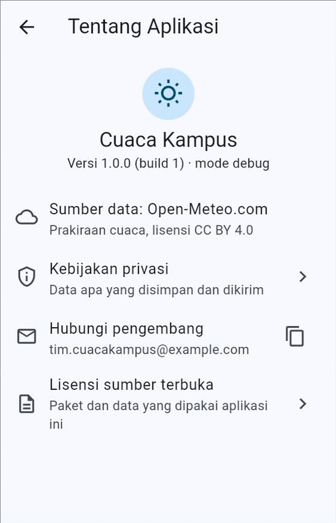
  &nbsp;
  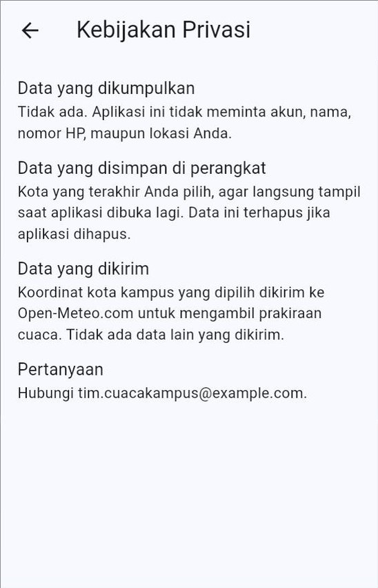
</p>

---

## 9. Rilis Web

### 9.1 Membuat berkas rilis web

Dari folder proyek:

```bash
flutter build web
```

Perintah ini mem-*build* dalam mode *release* dan menaruh hasilnya di folder `build/web/`:

```text
build/web/
├── index.html            ← halaman yang pertama dibuka browser
├── flutter_bootstrap.js  ← pemuat aplikasi Flutter
├── main.dart.js          ← seluruh kode Dart Anda, sudah jadi JavaScript
├── manifest.json         ← nama dan ikon saat "dipasang" (Bagian 4.2)
├── version.json          ← nama aplikasi dan nomor versi (Bagian 5.4)
├── favicon.png, icons/   ← ikon (Bagian 6.2)
├── assets/               ← gambar, huruf, dan berkas aset lain
└── canvaskit/            ← mesin penggambar Flutter untuk web
```

Seluruh isi folder ini **harus diunggah bersama-sama**. Tidak ada satu berkas "aplikasi.exe" yang bisa dibagikan sendirian.

> [!NOTE]
> Proyek yang dibuat tanpa dukungan web bisa ditambahi foldernya dengan `flutter create . --platforms web` dari folder proyek.

### 9.2 Mencoba hasil *build* di laptop

Mengklik dua kali `build/web/index.html` **tidak** akan berhasil: *browser* tidak mau menjalankan aplikasi web dari alamat `file://`. Hasil *build* harus dibuka lewat ***web server***. Flutter sudah membawa Dart, jadi kita bisa memasang *server* kecil bernama [`dhttpd`](https://pub.dev/packages/dhttpd) **sekali saja**:

```bash
dart pub global activate dhttpd
```

Lalu, setiap kali ingin mencoba:

```bash
dhttpd --path build/web
```

Buka `http://localhost:8080` di Chrome. Hentikan *server* dengan `Ctrl` + `C`.

> [!TIP]
> Muncul pesan `'dhttpd' is not recognized` atau `command not found`? Jalankan `dart pub global run dhttpd --path build/web`. Cara lain, jika Python terpasang: masuk ke folder `build/web`, lalu jalankan `python -m http.server 8000` dan buka `http://localhost:8000`.

Uji build rilis dengan sungguh-sungguh: muat data, simpan data, tutup tab lalu buka lagi, coba mode gelap, dan sempitkan jendela sampai selebar HP. Di sinilah bug yang tidak muncul saat `flutter run` biasanya ketahuan.

### 9.3 Alamat dasar (`--base-href`)

Situs GitHub Pages untuk sebuah repositori tidak berada di "rumah utama" `https://akun.github.io/`, melainkan di **sub-folder** bernama sama dengan repositorinya:

```text
https://budisantoso.github.io/tugas_kuliahku/
                             └─ nama repositori
```

Aplikasi Flutter perlu tahu letak sub-folder itu, agar bisa memuat `main.dart.js`, `assets/`, dan berkas lain dari tempat yang benar. Caranya:

```bash
flutter build web --base-href "/tugas_kuliahku/"
```

Nilai ini menggantikan tanda `$FLUTTER_BASE_HREF` di `web/index.html` (`<base href="$FLUTTER_BASE_HREF">`). Nilainya **wajib** diawali dan diakhiri garis miring `/`. Jika tidak, Flutter menolak dengan pesan `--base-href should start and end with /`.

Perumpamaannya seperti alamat kos: "Jalan Mawar No. 5" belum cukup jika kamar Anda ada di "Gang 3". Tanpa `--base-href`, aplikasi mencari berkasnya di jalan utama dan **layar tetap putih**.

> [!IMPORTANT]
> Hasil *build* dengan `--base-href "/tugas_kuliahku/"` **tidak** bisa dicoba dengan `dhttpd --path build/web`, karena alamatnya tidak lagi di `/tugas_kuliahku/`. Untuk mencoba di laptop, *build* tanpa `--base-href`. Untuk GitHub Pages, biarkan robot GitHub yang mem-*build* dengan `--base-href` ([Bagian 9.4](#94-terbit-otomatis-di-github-pages)).

### 9.4 Terbit otomatis di GitHub Pages

[GitHub Pages](https://docs.github.com/en/pages) adalah layanan GitHub untuk menerbitkan situs statis, **gratis untuk repositori publik**. Repositori privat membutuhkan paket GitHub Pro, yang gratis bagi mahasiswa lewat GitHub Student Developer Pack.

Kita memakai GitHub Actions (Pertemuan 14) agar setiap *push* ke `main` otomatis menerbitkan versi terbaru. Langkahnya:

1. **Sekali saja:** buka repositori di GitHub → **Settings** → **Pages** → di bagian **Build and deployment**, ubah **Source** menjadi **GitHub Actions**.
2. Salin [`templat/web.yml`](templat/web.yml) ke `.github/workflows/web.yml` di proyek Anda.
3. *Commit* dan *push*.
4. Buka tab **Actions**. Setelah tanda centang hijau muncul, situs Anda bisa dibuka di `https://<nama-akun>.github.io/<nama-repositori>/`. Tautannya juga tertera di halaman hasil *workflow* dan di **Settings** → **Pages**.

Isi pokok `web.yml`:

```yaml
on:
  push:
    branches: [main]
  workflow_dispatch: # bisa juga dijalankan manual dari tab Actions

jobs:
  build:
    runs-on: ubuntu-latest
    steps:
      # ... ambil kode, pasang Flutter, flutter pub get (sama seperti tes.yml) ...
      - name: Analisis dan tes
        run: |
          flutter analyze
          flutter test

      - name: Build web
        env:
          NAMA_REPO: ${{ github.event.repository.name }}
        run: flutter build web --base-href "/$NAMA_REPO/"

      - name: Kemas hasil build untuk GitHub Pages
        uses: actions/upload-pages-artifact@v4
        with:
          path: build/web

  terbitkan:
    needs: build
    runs-on: ubuntu-latest
    permissions:
      pages: write
      id-token: write
    environment:
      name: github-pages
      url: ${{ steps.terbit.outputs.page_url }}
    steps:
      - name: Terbitkan
        id: terbit
        uses: actions/deploy-pages@v4
```

| Bagian | Arti |
| :--- | :--- |
| `flutter analyze` dan `flutter test` | Pemeriksaan dulu. Jika ada yang gagal, situs **tidak** diperbarui, sehingga versi rusak tidak pernah sampai ke pengguna |
| `${{ github.event.repository.name }}` | Nama repositori diambil otomatis, jadi templat ini bisa dipakai di repositori mana pun |
| `upload-pages-artifact` | Mengemas folder `build/web` |
| `deploy-pages` | Menerbitkan kemasan itu ke GitHub Pages |
| `pages: write`, `id-token: write` | Izin minimum yang dibutuhkan untuk menerbitkan |
| `environment: github-pages` | "Lingkungan" penerbitan; tautan situs ditampilkan di halaman *workflow* |

### 9.5 Hal yang perlu diperhatikan di web

| Hal | Penjelasan |
| :--- | :--- |
| **CORS** | Ada API yang menolak dipanggil dari *browser*. Ingat [Pertemuan 10, Bagian 14.1](../pertemuan_10_async_dan_rest_api/README.md#141-di-web-chrome-dan-dartpad-cors). Uji versi web Anda dengan data sungguhan, bukan hanya di Android |
| **SQLite di web** (Pertemuan 11) | `sqflite_common_ffi_web` membutuhkan berkas `web/sqlite3.wasm` dan `web/sqflite_sw.js` hasil `dart run sqflite_common_ffi_web:setup`. Pastikan kedua berkas ini ikut di-*commit*, karena robot GitHub mem-*build* dari isi repositori |
| **Data tersimpan per *browser*** | Data `shared_preferences` dan SQLite versi web disimpan di *browser* masing-masing pengguna, terikat pada alamat situsnya. Data di `localhost` tidak ikut pindah ke GitHub Pages |
| **Versi lama masih tampil** | *Browser* dan GitHub Pages menyimpan salinan sementara (*cache*). Setelah situs diperbarui, muat ulang paksa dengan `Ctrl` + `Shift` + `R`, atau tunggu beberapa menit |
| **Alamat halaman** | Secara bawaan, Flutter web memakai alamat bertanda `#`, misalnya `.../#/detail`. Bentuk ini aman di GitHub Pages. Jika Anda memakai `usePathUrlStrategy()` (alamat tanpa `#`), membuka alamat halaman secara langsung di GitHub Pages bisa berujung 404 |
| **WebAssembly** | `flutter build web --wasm` mengompilasi ke WebAssembly, dengan JavaScript sebagai cadangan otomatis. Untuk kinerja penuhnya, *server* harus mengirim *header* khusus (`Cross-Origin-Embedder-Policy` dan `Cross-Origin-Opener-Policy`) yang tidak bisa diatur di GitHub Pages. Untuk proyek akhir, *build* JavaScript biasa sudah cukup |
| ***Source map*** | `flutter build web --source-maps` membuat berkas `.map` untuk membaca *stack trace*. Panduan resmi melarang berkas `.map` diterbitkan untuk umum |

> [!TIP]
> Selain GitHub Pages, ada layanan lain yang juga gratis untuk situs kecil, misalnya **Firebase Hosting** (`firebase deploy`). Pilih satu saja yang Anda pahami.

---

## 10. Rilis Android (1): APK untuk Dibagikan

### 10.1 Yang dibutuhkan

| Kebutuhan | Cara memeriksa |
| :--- | :--- |
| **Android SDK**, biasanya terpasang bersama Android Studio | `flutter doctor` menampilkan centang di baris **Android toolchain** |
| Lisensi Android SDK sudah disetujui | `flutter doctor --android-licenses`, lalu jawab `y` |
| HP Android untuk mencoba (disarankan) | Mode pengembang dan *USB debugging* aktif, lalu `flutter devices` menampilkan HP Anda |

Belum punya Android SDK? Ada dua pilihan: memasang Android Studio mengikuti [panduan instalasi](../panduan/02_instalasi_flutter_windows.md), **atau** meminta robot GitHub mem-*build* APK untuk Anda ([Bagian 12](#12-rilis-otomatis-dengan-github)). Pilihan kedua tidak membutuhkan apa pun di laptop selain Git.

### 10.2 Sebelum *build*: izin internet dan teman-temannya

Ini jebakan paling terkenal di dunia Flutter: **aplikasi lancar memuat data saat `flutter run`, tetapi APK rilisnya tidak bisa memuat apa pun.**

Penyebabnya: izin internet. Proyek Flutter punya tiga berkas `AndroidManifest.xml`:

| Berkas | Dipakai saat | Isi izin internet? |
| :--- | :--- | :--- |
| `android/app/src/debug/AndroidManifest.xml` | `flutter run` (debug) | **Ya**, karena alat Flutter membutuhkannya untuk *hot reload* dan *debugger* |
| `android/app/src/profile/AndroidManifest.xml` | mode *profile* | Ya |
| `android/app/src/main/AndroidManifest.xml` | **semua mode, termasuk rilis** | **Tidak**, sampai Anda menambahkannya |

Jadi, selama pengembangan izin itu "dipinjami" oleh berkas *debug*. Di build rilis, pinjaman itu hilang. Tambahkan baris berikut di `android/app/src/main/AndroidManifest.xml`, di dalam `<manifest>` dan **sebelum** `<application>` ([Pertemuan 10, Bagian 14.2](../pertemuan_10_async_dan_rest_api/README.md#142-di-android-izin-internet)):

```xml
<manifest xmlns:android="http://schemas.android.com/apk/res/android">
    <uses-permission android:name="android.permission.INTERNET" />
    <application
        android:label="Tugas Kuliahku"
        ...
```

Sekalian periksa daftar ini sebelum mem-*build* ([Contoh 06](kode/contoh_06_pemeriksa_kesiapan_rilis_dart_murni.dart) memeriksanya secara otomatis):

| Periksa | Bagian |
| :--- | :---: |
| Izin internet (jika memakai `http`) dan izin lain yang benar-benar dipakai (kamera, lokasi) | 10.2 |
| `android:label` berisi nama yang rapi | 4.2 |
| `applicationId` bukan `com.example...` | 4.3 |
| `version:` di `pubspec.yaml` sudah dinaikkan | 5 |
| Ikon dan layar pembuka sudah diganti | 6 |
| Semua tes lulus dan `flutter analyze` bersih | Pertemuan 14 |

### 10.3 Membuat APK

```bash
flutter build apk
```

Hasilnya satu berkas `build/app/outputs/flutter-apk/app-release.apk`. Berkas ini berisi kode untuk **semua** jenis prosesor HP (ARM 32-bit, ARM 64-bit, dan x86-64), sehingga bisa dipasang di hampir semua HP Android, tetapi ukurannya paling besar.

Agar lebih kecil, buat satu APK untuk setiap jenis prosesor:

```bash
flutter build apk --split-per-abi
```

```text
build/app/outputs/flutter-apk/
├── app-armeabi-v7a-release.apk   ← HP lama (ARM 32-bit)
├── app-arm64-v8a-release.apk     ← hampir semua HP Android masa kini
└── app-x86_64-release.apk        ← emulator dan sebagian kecil perangkat
```

Bagikan `app-arm64-v8a-release.apk` untuk HP masa kini, atau `app-release.apk` jika tidak yakin.

> [!NOTE]
> Hasil *build* rilis Android selalu diperkecil oleh alat bernama **R8**, yang membuang kode Java/Kotlin yang tidak terpakai. Menurut panduan resmi, opsi lama `--no-shrink` tidak berpengaruh lagi.

### 10.4 Memasang APK di HP

| Cara | Langkah | Catatan |
| :--- | :--- | :--- |
| **Kabel USB** | Sambungkan HP, lalu `flutter install` | Paling mudah. Memakai alat `adb`. Jika aplikasinya sudah ada, versi lama dihapus dulu beserta datanya |
| **Kirim berkas** | Kirim APK lewat Google Drive, surel, atau aplikasi pesan, lalu ketuk berkasnya di HP | HP akan meminta izin "Pasang aplikasi tidak dikenal" untuk aplikasi yang membuka berkas itu |
| **GitHub Releases** | Buka halaman rilis di *browser* HP, unduh APK, lalu ketuk | [Bagian 12](#12-rilis-otomatis-dengan-github) |

Saat memasang dari berkas, Google Play Protect bisa menampilkan peringatan karena aplikasinya tidak berasal dari Play Store. Untuk aplikasi buatan sendiri, ini wajar.

Untuk **memperbarui** aplikasi yang sudah terpasang, tiga hal harus terpenuhi: `applicationId` sama, **tanda tangan digital sama**, dan nomor *build* tidak lebih kecil. Jika tanda tangannya berbeda, pemasangan gagal dengan pesan seperti "Aplikasi tidak terpasang karena paket bentrok dengan paket yang sudah ada". Penyebab tersering di kelas: APK lama di-*build* di laptop A, APK baru di laptop B. Mengapa? Jawabannya di Bagian 11.

### 10.5 Menguji build rilis di HP

Jangan berhenti di "aplikasinya terbuka". Uji seperti pengguna:

1. **Data dari internet tampil.** Jika tidak, periksa izin internet (Bagian 10.2).
2. **Matikan internet** (mode pesawat), buka aplikasi: pesan galatnya ramah dan data tersimpan tetap tampil.
3. **Simpan data, tutup aplikasi dari daftar aplikasi terbuka, buka lagi**: datanya masih ada.
4. **Putar layar** dan **perbesar ukuran huruf** di pengaturan HP: tidak ada yang meluap.
5. **Mode gelap** HP: semua teks terbaca.
6. **Halaman Tentang**: versi yang tampil sama dengan `pubspec.yaml`.

### 10.6 Kabar 2026–2027: verifikasi pengembang Android

> [!NOTE]
> Google sedang memberlakukan **verifikasi pengembang Android** (*Android developer verification*) secara bertahap. Menurut [halaman resminya](https://developer.android.com/developer-verification) (dibaca Oktober 2026):
>
> - mulai **30 September 2026**, perlindungan berlaku bagi pengguna di **Brasil, Indonesia, Singapura, dan Thailand** yang memasang aplikasi dari *toko aplikasi yang berpartisipasi*; FAQ-nya menyebutkan bahwa aplikasi yang dipasang langsung dari berkas (*sideload*) **belum** terkena aturan tenggat ini;
> - pada **2027**, verifikasi diperluas ke seluruh dunia untuk aplikasi di perangkat Android bersertifikat;
> - aplikasi yang dipasang lewat **ADB** (termasuk `flutter install`) tidak memerlukan verifikasi;
> - pelajar dan penghobi bisa memakai akun **distribusi terbatas** (*limited distribution*), gratis dan tanpa KTP, untuk membagikan aplikasi ke paling banyak **20 perangkat**.
>
> Aturan ini masih bisa berubah. Sebelum membagikan APK kepada banyak orang, baca halaman resmi tersebut.

---

## 11. Rilis Android (2): Tanda Tangan Digital dan *App Bundle*

### 11.1 Mengapa aplikasi ditandatangani?

Setiap APK **wajib** ditandatangani secara digital, ibarat **segel pabrik** pada kemasan. Saat memasang pembaruan, Android membandingkan segel APK baru dengan aplikasi yang sudah terpasang. Jika segelnya berbeda, Android menolak. Inilah yang melindungi pengguna: orang lain tidak bisa membuat APK palsu yang "memperbarui" aplikasi bank Anda.

Sejauh ini Anda belum pernah mengurus tanda tangan, karena Flutter memakai **kunci *debug*** secara otomatis. Lihat `android/app/build.gradle.kts` bawaan:

```kotlin
buildTypes {
    release {
        // TODO: Add your own signing config for the release build.
        // Signing with the debug keys for now, so `flutter run --release` works.
        signingConfig = signingConfigs.getByName("debug")
    }
}
```

Kunci *debug* dibuat otomatis di **setiap laptop**, jadi isinya berbeda di laptop A dan laptop B, juga di robot GitHub. Itulah penyebab gagal memperbarui di Bagian 10.4.

### 11.2 Tiga kunci yang perlu dikenal

| Kunci | Dibuat oleh | Dipakai untuk | Jika hilang |
| :--- | :--- | :--- | :--- |
| **Kunci *debug*** | Otomatis, di setiap laptop | Pengembangan dan APK untuk mencoba | Tidak apa-apa, dibuat lagi otomatis |
| **Kunci unggah** (*upload key*) | **Anda** | Menandatangani berkas yang diunggah ke Google Play | Bisa diganti lewat Play Console, setelah dikonfirmasi Google |
| **Kunci penandatangan aplikasi** (*app signing key*) | Disimpan Google lewat **Play App Signing** | Menandatangani aplikasi yang diterima HP pengguna | Dijaga Google |

Untuk aplikasi yang dibagikan **di luar** Google Play (misalnya lewat GitHub Releases), kunci yang Anda buat sendiri itulah yang sampai ke HP pengguna. Jika kunci itu hilang, Anda **tidak akan pernah bisa** menerbitkan pembaruan yang bisa dipasang di atas versi lama. Pengguna terpaksa menghapus aplikasi lama, termasuk datanya.

### 11.3 Membuat kunci unggah

Kunci dibuat dengan `keytool`, alat yang ikut terpasang bersama Java di Android Studio. Panduan resmi Flutter memberikan perintah berikut.

**Windows (PowerShell):**

```powershell
keytool -genkey -v -keystore $env:USERPROFILE\upload-keystore.jks `
        -storetype JKS -keyalg RSA -keysize 2048 -validity 10000 `
        -alias upload
```

**macOS / Linux:**

```bash
keytool -genkey -v -keystore ~/upload-keystore.jks -keyalg RSA \
        -storetype JKS -keysize 2048 -validity 10000 -alias upload
```

`keytool` akan menanyakan kata sandi (ketik dua kali, tidak terlihat saat diketik), lalu nama, unit organisasi, organisasi, kota, provinsi, dan kode negara (`ID`), dan diakhiri konfirmasi `yes`. Hasilnya berkas `upload-keystore.jks` di folder pengguna Anda, **di luar** folder proyek.

| Bagian perintah | Arti |
| :--- | :--- |
| `-keystore ...upload-keystore.jks` | Nama dan letak berkas kunci |
| `-alias upload` | Nama kunci di dalam berkas itu |
| `-keyalg RSA -keysize 2048` | Jenis dan kekuatan kunci |
| `-validity 10000` | Berlaku 10.000 hari (sekitar 27 tahun) |

> [!TIP]
> Muncul pesan `keytool is not recognized`? Jalankan `flutter doctor -v` dan cari baris **Java binary at:**. `keytool` ada di folder yang sama dengan `java` tersebut. Panggil dengan alamat lengkapnya, misalnya `& "C:\Program Files\Android\Android Studio\jbr\bin\keytool.exe" ...` di PowerShell.

### 11.4 Memberi tahu Gradle letak kuncinya

**Langkah 1.** Buat berkas `android/key.properties` (tanpa tanda `< >`):

```properties
storePassword=<kata sandi yang tadi dibuat>
keyPassword=<kata sandi yang tadi dibuat>
keyAlias=upload
storeFile=<letak berkas kunci>
```

Di Windows, garis miring terbalik ditulis **dua kali**, misalnya `storeFile=C:\\Users\\budi\\upload-keystore.jks`.

**Langkah 2.** Buka `android/app/build.gradle.kts`, lalu tambahkan kode yang membaca `key.properties`. Perhatikan letaknya: dua baris `import` di **baris paling atas** berkas, sedangkan sisanya **sesudah** blok `plugins { ... }` dan **sebelum** blok `android {`:

```kotlin
import java.util.Properties
import java.io.FileInputStream

plugins {
    // ... biarkan seperti semula ...
}

// Baca key.properties JIKA ada. Di laptop teman atau di robot GitHub,
// berkas ini tidak ada, dan build tetap berjalan dengan kunci debug.
val keystoreProperties = Properties()
val keystorePropertiesFile = rootProject.file("key.properties")
if (keystorePropertiesFile.exists()) {
    keystoreProperties.load(FileInputStream(keystorePropertiesFile))
}

android {
    // ... isi bawaan ...
```

Urutan ini wajib. Di berkas Gradle berbahasa Kotlin, blok `plugins` harus berada di awal berkas, dan yang boleh ditulis di atasnya hanyalah baris `import` (serta komentar). Karena itu, kode `val ...` diletakkan sesudah blok `plugins`.

**Langkah 3.** Di dalam blok `android { ... }`, ganti blok `buildTypes` bawaan dengan:

```kotlin
signingConfigs {
    create("release") {
        keyAlias = keystoreProperties.getProperty("keyAlias")
        keyPassword = keystoreProperties.getProperty("keyPassword")
        storeFile = keystoreProperties.getProperty("storeFile")?.let { file(it) }
        storePassword = keystoreProperties.getProperty("storePassword")
    }
}
buildTypes {
    release {
        // Kunci unggah jika key.properties ada, kunci debug jika tidak.
        signingConfig = if (keystorePropertiesFile.exists()) {
            signingConfigs.getByName("release")
        } else {
            signingConfigs.getByName("debug")
        }
    }
}
```

Bagian `signingConfigs` dan kode pembaca `key.properties` diambil dari panduan resmi Flutter. Yang kita tambahkan hanya pilihan `if`–`else` di `buildTypes`. Tanpa pilihan itu, setiap orang yang tidak punya `key.properties` (teman satu tim, dosen yang mencoba proyek Anda, dan robot GitHub) **gagal mem-*build*** karena berkas kuncinya tidak ditemukan.

> [!NOTE]
> Jika setelah mengubah Gradle *build*-nya berperilaku aneh, panduan resmi menyarankan `flutter clean`, lalu *build* ulang.

### 11.5 Menjaga kunci: dua aturan mutlak

1. **Jangan pernah meng-*commit* kunci.** `android/.gitignore` bawaan `flutter create` sudah berisi:

   ```text
   # Remember to never publicly share your keystore.
   # See https://flutter.dev/to/reference-keystore
   key.properties
   **/*.keystore
   **/*.jks
   ```

   Pastikan kedua berkas itu tidak muncul di `git status`. Periksa juga dengan:

   ```bash
   git check-ignore -v android/key.properties
   ```

   Jika muncul baris yang menyebut `android/.gitignore`, berkas itu aman diabaikan Git.
2. **Simpan cadangannya.** Salin `upload-keystore.jks` ke dua tempat berbeda (misalnya *flashdisk* dan penyimpanan *cloud* pribadi), dan simpan kata sandinya di pengelola kata sandi (*password manager*). Kunci yang hilang tidak bisa dibuat ulang: kunci baru adalah segel yang **berbeda**.

> [!CAUTION]
> Kunci yang terlanjur di-*push* ke GitHub harus dianggap **bocor**, walaupun *commit*-nya dihapus kemudian, karena riwayat Git dan salinan orang lain masih menyimpannya. Buat kunci baru, dan jika aplikasi sudah di Google Play, minta penggantian kunci unggah lewat Play Console.

### 11.6 *App Bundle* (`.aab`) untuk Google Play

Google Play tidak menerima APK untuk aplikasi baru, melainkan ***Android App Bundle***:

```bash
flutter build appbundle
```

Hasilnya berkas `.aab` di folder `build/app/outputs/bundle/release/`. *App Bundle* berisi semua bagian aplikasi untuk semua jenis HP. Google Play lalu meracik APK yang **pas** untuk setiap HP pengguna (jenis prosesor, kerapatan layar, bahasa), sehingga unduhan pengguna lebih kecil.

| | APK | *App Bundle* (AAB) |
| :--- | :--- | :--- |
| Bisa langsung dipasang di HP? | Ya | **Tidak**, perlu diolah dulu (oleh Google Play atau alat `bundletool`) |
| Untuk | Dibagikan langsung, GitHub Releases | Diunggah ke Google Play |
| Ukuran yang diunduh pengguna | Seluruh isi berkas | Hanya bagian yang dibutuhkan HP-nya |

Ingin memastikan *build* rilis sudah ditandatangani kunci Anda, bukan kunci *debug*? Setelah pernah menjalankan `flutter build`, jalankan dari folder `android/` (di Windows: `.\gradlew signingReport`):

```bash
./gradlew signingReport
```

Cari laporan untuk modul `:app`. Pada bagian `Variant: release`, baris `Store` harus menunjuk ke `upload-keystore.jks` dan `Alias` harus `upload`.

### 11.7 Menyamarkan kode (*obfuscation*)

```bash
flutter build apk --obfuscate --split-debug-info=build/simbol
```

| Opsi | Arti |
| :--- | :--- |
| `--obfuscate` | Nama kelas dan fungsi diganti nama acak, sehingga kode lebih sulit dibaca orang yang membongkar APK |
| `--split-debug-info=build/simbol` | Informasi *debug* dipisah ke folder `build/simbol`, sehingga APK lebih kecil |

Konsekuensinya, *stack trace* dari HP pengguna berisi nama acak. Untuk membacanya kembali, dibutuhkan berkas simbol dari *build* yang sama:

```bash
flutter symbolize -i stack_trace.txt -d build/simbol/app.android-arm64.symbols
```

Simpan folder simbol itu untuk setiap rilis (tetapi jangan di-*commit*). Panduan resmi juga mengingatkan dua hal: penyamaran **bukan** pengaman (rahasia tetap tidak boleh ditaruh di aplikasi), dan kode yang bergantung pada nama, seperti `runtimeType.toString()`, akan berubah hasilnya. Untuk web, penyamaran tidak berlaku, karena *build* rilis web sudah diperkecil.

---

## 12. Rilis Otomatis dengan GitHub

### 12.1 *Tag*: penanda versi di riwayat Git

Sebuah ***tag*** adalah **penanda** yang ditempelkan pada satu *commit*, seperti pembatas buku: "di sinilah versi 1.0.0". Nama *tag* biasanya `v` diikuti nama versi.

```bash
git tag -a v1.0.0 -m "Rilis 1.0.0: versi pertama untuk UAS"
git push origin v1.0.0
```

| Perintah | Arti |
| :--- | :--- |
| `git tag -a v1.0.0 -m "..."` | Membuat *tag* beranotasi `v1.0.0` pada *commit* terakhir, lengkap dengan pesannya |
| `git push origin v1.0.0` | Mengirim *tag* itu ke GitHub. `git push` biasa **tidak** ikut mengirim *tag* |
| `git tag` | Melihat daftar *tag* |

Urutan yang benar: naikkan `version:` di `pubspec.yaml` → *commit* → *push* → buat *tag* → *push tag*. Nama *tag* sebaiknya sama dengan nama versi di `pubspec.yaml`.

### 12.2 Robot yang mem-*build* APK dan membuat halaman rilis

Salin [`templat/rilis.yml`](templat/rilis.yml) ke `.github/workflows/rilis.yml`. Setiap kali *tag* berawalan `v` di-*push*, robot GitHub:

1. menjalankan `flutter analyze` dan `flutter test`;
2. mem-*build* APK;
3. membuat halaman **Release** bernama sama dengan *tag*, lalu menempelkan APK-nya.

```yaml
on:
  push:
    tags:
      - 'v*'

permissions:
  contents: write # dibutuhkan untuk membuat halaman rilis

jobs:
  rilis:
    runs-on: ubuntu-latest
    steps:
      # ... ambil kode, pasang Flutter, pub get, analyze, test ...
      - name: Build APK
        run: flutter build apk --release

      - name: Terbitkan rilis di GitHub
        env:
          GH_TOKEN: ${{ secrets.GITHUB_TOKEN }}
          TAG: ${{ github.ref_name }}
          NAMA_REPO: ${{ github.event.repository.name }}
        run: |
          cp build/app/outputs/flutter-apk/app-release.apk "$NAMA_REPO-$TAG.apk"
          gh release create "$TAG" "$NAMA_REPO-$TAG.apk" --title "$TAG" --generate-notes
```

| Bagian | Arti |
| :--- | :--- |
| `tags: - 'v*'` | Hanya berjalan saat *tag* versi di-*push*, bukan setiap *commit* |
| `contents: write` | Izin bagi robot untuk membuat halaman rilis |
| `secrets.GITHUB_TOKEN` | "Kartu akses" sementara yang otomatis diberikan GitHub kepada setiap *workflow*. Tidak perlu dibuat sendiri |
| `gh release create` | Perintah [GitHub CLI](https://cli.github.com/), yang sudah terpasang di robot GitHub, untuk membuat rilis |
| `--generate-notes` | Catatan rilis dibuat otomatis dari daftar perubahan sejak rilis sebelumnya |
| `env:` | Nilai dari GitHub dititipkan lewat variabel lingkungan, bukan ditempel langsung di perintah. Ini kebiasaan aman di GitHub Actions |

Hasilnya bisa dibuka di `https://github.com/<akun>/<repositori>/releases`. Tautan `.../releases/latest` selalu menuju rilis terbaru, cocok ditaruh di `README.md`.

> [!IMPORTANT]
> APK dari robot ditandatangani **kunci *debug* milik robot**, yang berbeda setiap kali robot bekerja. APK ini cocok untuk demo dan penilaian, tetapi pengguna yang ingin memperbarui harus **menghapus versi lama** dulu. Agar bisa diperbarui dengan mulus, tanda tangani dengan kunci unggah Anda (Bagian 12.4). Agar robot tidak gagal mem-*build*, `build.gradle.kts` Anda harus memakai pola "kunci rilis jika ada, kunci *debug* jika tidak" dari [Bagian 11.4](#114-memberi-tahu-gradle-letak-kuncinya).

### 12.3 Tanpa robot: membuat rilis lewat halaman web

Jika belum memakai `rilis.yml`, rilis bisa dibuat dengan tangan:

1. *Build* APK di laptop (Bagian 10.3).
2. Di halaman repositori GitHub, klik **Releases** → **Draft a new release**.
3. Di **Choose a tag**, ketik `v1.0.0`, lalu pilih **Create new tag**.
4. Isi judul dan catatan rilis (salin dari `CHANGELOG.md`, [Bagian 17.3](#173-catatan-perubahan-changelogmd)).
5. Seret berkas APK ke kotak **Attach binaries**, lalu klik **Publish release**.

### 12.4 (Lanjutan) Robot menandatangani dengan kunci unggah Anda

Kunci tidak boleh masuk repositori, tetapi robot membutuhkannya. Jalan keluarnya adalah ***Secrets***: tempat menyimpan nilai rahasia di pengaturan repositori, yang bisa dibaca *workflow* tetapi tidak bisa dilihat siapa pun, termasuk Anda sendiri setelah disimpan.

1. Ubah berkas kunci menjadi teks *base64*:
   - **Windows (PowerShell):** `[Convert]::ToBase64String([IO.File]::ReadAllBytes("$env:USERPROFILE\upload-keystore.jks")) | Set-Clipboard`
   - **macOS:** `base64 -i ~/upload-keystore.jks | pbcopy`
   - **Linux:** `base64 -w 0 ~/upload-keystore.jks`
2. Di GitHub: **Settings** → **Secrets and variables** → **Actions** → **New repository secret**. Buat dua *secret*:
   - `KUNCI_UNGGAH_BASE64`: tempelkan teks *base64* tadi;
   - `KUNCI_PROPERTIES`: isi `key.properties`, tetapi baris terakhirnya `storeFile=upload-keystore.jks`.
3. Di `rilis.yml`, hapus tanda `#` pada langkah **Pasang kunci unggah**. Langkah itu menulis kembali kedua berkas di robot, tepat sebelum *build*:

```yaml
- name: Pasang kunci unggah
  env:
    KUNCI_UNGGAH_BASE64: ${{ secrets.KUNCI_UNGGAH_BASE64 }}
    KUNCI_PROPERTIES: ${{ secrets.KUNCI_PROPERTIES }}
  run: |
    echo "$KUNCI_UNGGAH_BASE64" | base64 --decode > android/app/upload-keystore.jks
    echo "$KUNCI_PROPERTIES" > android/key.properties
```

Mengapa `storeFile=upload-keystore.jks` tanpa folder? Karena `file(...)` di `android/app/build.gradle.kts` mencari berkas relatif terhadap folder `android/app/`, tempat langkah di atas menaruh kuncinya.

> [!WARNING]
> Panduan resmi Flutter tentang *continuous delivery* menyarankan rahasia hanya disimpan di variabel terenkripsi seperti ini, **tidak pernah** dicetak ke log, dan berhati-hati menerima *pull request* dari orang lain. GitHub sengaja tidak memberikan *secrets* kepada *workflow* yang dipicu *pull request* dari *fork*.

---

## 13. Cek Pembaruan untuk Aplikasi di Luar Toko

### 13.1 Masalahnya

Aplikasi dari Google Play diperbarui otomatis. Aplikasi yang dipasang dari berkas APK **tidak**: pengguna terus memakai versi lama, walaupun versi baru sudah lama terbit. Lebih gawat lagi jika versi lama sudah tidak cocok dengan server, misalnya karena format datanya berubah.

### 13.2 Polanya: berkas kecil berisi versi terbaru

1. Simpan berkas kecil `info_rilis.json` di tempat yang bisa dibuka siapa saja, misalnya repositori GitHub Anda:

   ```json
   {
     "versi_terbaru": "1.1.0",
     "versi_minimum": "1.0.0",
     "catatan": "Contoh info rilis untuk latihan Pertemuan 15.",
     "tautan": "https://github.com/antonprafanto/mobile2026/tree/main/pertemuan_15_build_rilis_dan_finalisasi"
   }
   ```

   Berkas di atas sungguhan ada di repositori ini: [`data/info_rilis_cuaca_kampus.json`](data/info_rilis_cuaca_kampus.json), dan dibaca oleh Contoh 07.
2. Saat dibuka, aplikasi mengambil berkas itu dan membandingkannya dengan versinya sendiri, memakai aturan [Contoh 01](kode/contoh_01_versi_dan_nomor_build_dart_murni.dart):

   ```dart
   Keputusan putuskanPembaruan({
     required Versi terpasang,
     required Versi terbaru,
     required Versi minimum,
   }) {
     if (terpasang.lebihLamaDari(minimum)) return Keputusan.wajib;
     if (terpasang.lebihLamaDari(terbaru)) return Keputusan.disarankan;
     return Keputusan.terbaru;
   }
   ```

3. Tampilan mengikuti keputusannya:

| Keputusan | Tampilan | Contoh (server: terbaru 1.3.0, minimum 1.2.0) |
| :--- | :--- | :--- |
| `terbaru` | Tidak ada apa-apa | Terpasang 1.3.0 |
| `disarankan` | `MaterialBanner` di atas layar dengan tombol **Nanti** dan **Perbarui** | Terpasang 1.2.4 |
| `wajib` | Dialog yang **tidak bisa ditutup**: `barrierDismissible: false` dan `PopScope(canPop: false)` | Terpasang 1.1.9 |

### 13.3 Aturan emas: jangan menghalangi pengguna

Jika server mati, internet putus, atau JSON-nya rusak, **aplikasi tetap harus bisa dipakai seperti biasa**. Cek pembaruan hanyalah fitur tambahan. Itulah sebabnya `ambil()` di Contoh 05 mengembalikan `null` alih-alih melempar galat:

```dart
/// null = gagal memeriksa. Sengaja TIDAK melempar galat: cek pembaruan
/// hanyalah fitur tambahan dan tidak boleh membuat aplikasi macet.
Future<InfoRilis?> ambil() async {
  try {
    final http.Response respons = await _klien
        .get(alamat)
        .timeout(const Duration(seconds: 5));
    if (respons.statusCode != 200) {
      throw http.ClientException('kode status ${respons.statusCode}');
    }
    return InfoRilis.dariJson(jsonDecode(respons.body));
  } on Exception catch (galat) {
    if (kDebugMode) debugPrint('Cek pembaruan gagal: $galat');
    return null;
  }
}
```

Perhatikan juga batas waktu 5 detik: pengguna tidak boleh menunggu lama hanya karena server info rilis lambat.

### 13.4 Coba sendiri: Contoh 05

[Contoh 05](kode/contoh_05_cek_pembaruan.dart) memalsukan server dengan `MockClient` (Pertemuan 10). Pilih skenarionya lewat ikon *server* di pojok kanan atas:

| Skenario | Hasil |
| :--- | :--- |
| Server: belum ada versi baru | Keputusan `terbaru`, tidak ada apa-apa |
| Server: ada versi 1.3.0 | *Banner* "Versi 1.3.0 tersedia" |
| Server: versi minimum naik ke 1.3.0 | Dialog wajib "Perbarui aplikasi" |
| Server mati (kode 503) | "Gagal memeriksa. Aplikasi tetap bisa dipakai." |
| Server mengirim JSON rusak | Sama: aplikasi tetap bisa dipakai |

<p align="center">
  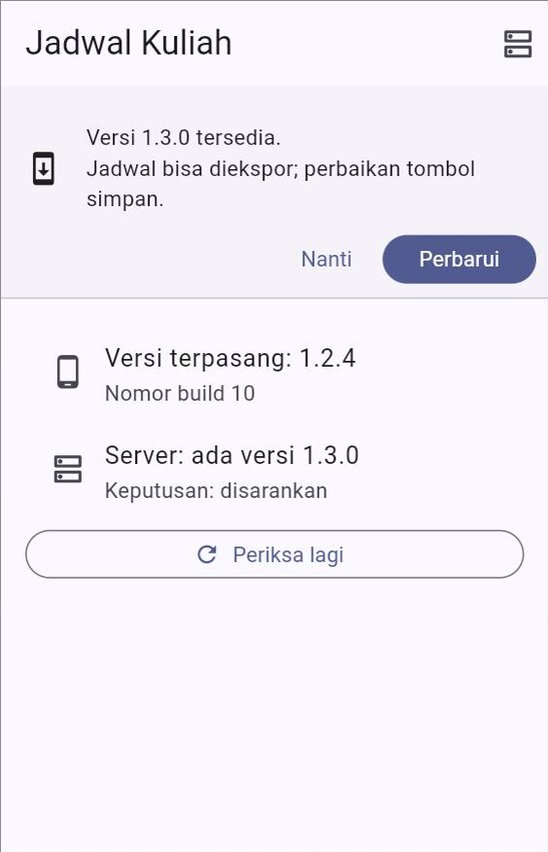
  &nbsp;
  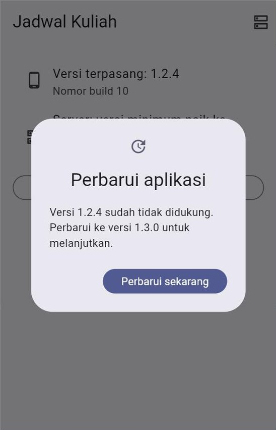
</p>

> [!TIP]
> Cara lain tanpa membuat berkas sendiri: GitHub menyediakan alamat `https://api.github.com/repos/<akun>/<repositori>/releases/latest` yang mengembalikan JSON berisi `tag_name` (misalnya `v1.1.0`) dan `html_url` rilis terbaru. Ingat, alamat ini dibatasi jumlah permintaannya untuk pengguna tanpa akun, jadi periksa sekali saja saat aplikasi dibuka. Untuk aplikasi di Google Play, ada fitur pembaruan resmi bernama *in-app updates*.

---

## 14. Ukuran, Kecepatan, dan Keamanan

### 14.1 Ukuran aplikasi

Jangan menilai ukuran aplikasi dari hasil `flutter run`. Panduan resmi Flutter menyebutkan bahwa *build debug* berukuran besar karena membawa alat *hot reload* dan *debugging*. Ukur dari *build* rilis, dan untuk melihat **apa** yang membuatnya besar:

```bash
flutter build apk --analyze-size --target-platform=android-arm64
```

Perintah ini mencetak ringkasan ukuran per bagian dan menulis berkas `*-code-size-analysis_*.json`. Berkas itu bisa dibuka di **DevTools** → **App Size** untuk melihat ukuran setiap paket.

Cara memperkecil:

| Cara | Keterangan |
| :--- | :--- |
| `--split-per-abi` atau *App Bundle* | Pengguna hanya mengunduh kode untuk jenis prosesor HP-nya |
| `--split-debug-info` | Memisahkan informasi *debug* (Bagian 11.7) |
| Kompres gambar | Gambar PNG/JPG berukuran besar adalah penyebab tersering. Perkecil sebelum dimasukkan ke `assets/` |
| Hapus aset dan paket yang tidak dipakai | Periksa folder `assets/` dan bagian `dependencies` di `pubspec.yaml` |

### 14.2 Kecepatan

Mode *debug* memang bisa tersendat, jadi jangan menyimpulkan "aplikasi saya lambat" darinya. Ukur dengan `flutter run --profile` di **HP sungguhan**, lalu buka **DevTools** → **Performance**. Penyebab umum aplikasi tersendat:

| Penyebab | Perbaikan |
| :--- | :--- |
| Daftar panjang dibuat dengan `ListView(children: [...])` | `ListView.builder` (Pertemuan 6) |
| Pekerjaan berat di dalam `build()` (mengurutkan ribuan data, mengurai JSON) | Pindahkan ke ViewModel, lakukan sekali saja |
| Gambar dari internet berukuran jauh lebih besar daripada tampilannya | Minta ukuran kecil dari server, atau atur `cacheWidth` pada `Image.network` |
| Widget yang tidak pernah berubah ikut dibuat ulang setiap kali layar diperbarui | Tambahkan `const` di depannya, agar Flutter bisa memakai ulang widget yang sama |

### 14.3 Keamanan

| Lakukan | Hindari |
| :--- | :--- |
| Hanya memakai `https://` | `http://` tanpa enkripsi (Android memblokirnya secara bawaan sejak Android 9) |
| Meminta izin seperlunya | Izin lokasi atau kamera yang tidak dipakai, terutama sisa percobaan |
| Rahasia disimpan di *server* | Kunci API rahasia di dalam aplikasi, walaupun lewat `--dart-define` atau disamarkan |
| Data sensitif di `flutter_secure_storage` | Token masuk di `shared_preferences` |
| Memeriksa paket yang usang dengan `flutter pub outdated` | Paket lama yang tidak pernah diperbarui |
| Mengabaikan `key.properties` dan `*.jks` di Git | Kunci unggah ikut ter-*commit* |

---

## 15. Menerbitkan ke Toko Aplikasi (Gambaran)

Bagian ini **tidak wajib dipraktikkan** di mata kuliah ini. Tujuannya agar Anda tahu jalannya, karena syarat dan biayanya berbeda jauh dari GitHub. Angka dan aturan di bawah ini dibaca dari halaman resmi pada Oktober 2026 dan bisa berubah.

### 15.1 Google Play

| Hal | Keterangan |
| :--- | :--- |
| Akun pengembang | Biaya pendaftaran **US$25**, sekali bayar |
| Berkas yang diunggah | ***App Bundle*** (`.aab`), ditandatangani kunci unggah ([Bagian 11](#11-rilis-android-2-tanda-tangan-digital-dan-app-bundle)) |
| Uji tertutup untuk akun pribadi baru | Akun pribadi yang dibuat setelah 13 November 2023 wajib menjalankan **uji tertutup** dengan minimal **12 penguji** yang ikut **14 hari berturut-turut**, sebelum boleh rilis ke publik |
| Target versi Android | Sejak 31 Agustus 2026, aplikasi baru dan pembaruan wajib menargetkan **Android 16 (API 36)** atau lebih baru. Flutter mengaturnya lewat `targetSdk = flutter.targetSdkVersion` di `build.gradle.kts` |
| Kebijakan privasi | Wajib untuk **semua** aplikasi ([Bagian 8.3](#83-kebijakan-privasi-wajib-untuk-semua-aplikasi)) |
| Formulir *Data safety* | Menjelaskan data apa yang dikumpulkan dan dibagikan aplikasi |
| Halaman toko | Nama aplikasi maks. **30** karakter, deskripsi singkat maks. **80**, deskripsi lengkap maks. **4.000**, ditambah ikon, grafik fitur, dan tangkapan layar |
| Peninjauan | Setiap rilis ditinjau Google sebelum tampil di toko |

Urutan kerjanya di Play Console: buat aplikasi → lengkapi bagian *App content* (kebijakan privasi, *Data safety*, rating konten, target usia) → isi halaman toko → unggah `.aab` ke jalur **pengujian internal** → uji tertutup → rilis **produksi**.

Dengan **Play App Signing**, kunci penandatangan aplikasi disimpan Google. Anda cukup menjaga kunci unggah, dan kunci unggah yang hilang masih bisa diganti.

### 15.2 App Store (iPhone)

| Hal | Keterangan |
| :--- | :--- |
| Perangkat | **Mac** dengan Xcode. Aplikasi iPhone tidak bisa di-*build* di Windows |
| Akun | **Apple Developer Program**, **US$99 per tahun** |
| Identitas | *Bundle ID* didaftarkan di akun pengembang, lalu dibuat catatan aplikasinya di App Store Connect |
| *Build* | `flutter build ipa`, hasilnya di `build/ios/ipa/` |
| Unggah | Aplikasi Transporter, Xcode, atau perintah `xcrun altool` |
| Uji coba | **TestFlight**: membagikan versi uji kepada penguji |
| Peninjauan | Ditinjau Apple sesuai *App Review Guidelines* |

### 15.3 Membandingkan jalur rilis

| | GitHub Pages (web) | GitHub Releases (APK) | Google Play | App Store |
| :--- | :--- | :--- | :--- | :--- |
| Biaya | Gratis | Gratis | US$25 sekali | US$99 per tahun |
| Perangkat pengguna | Semua yang punya *browser* | Android | Android | iPhone, iPad |
| Pembaruan untuk pengguna | Otomatis saat situs dibuka | Manual ([Bagian 13](#13-cek-pembaruan-untuk-aplikasi-di-luar-toko)) | Otomatis | Otomatis |
| Peninjauan | Tidak ada | Tidak ada | Ada | Ada |
| Fitur perangkat (kamera, lokasi) | Terbatas, lewat izin *browser* | Penuh | Penuh | Penuh |
| Cocok untuk | Demo, proyek akhir, portofolio | Demo dan penilaian di HP | Aplikasi untuk umum | Aplikasi untuk umum |

---

## 16. Studi Kasus: "Cuaca Kampus 1.0.0"

### 16.1 Dari Pertemuan 10 ke rilis 1.0.0

[Contoh 07](kode/contoh_07_studi_kasus_cuaca_kampus_siap_rilis.dart) mengambil aplikasi "Cuaca Kampus" dari [Pertemuan 10](../pertemuan_10_async_dan_rest_api/kode/contoh_11_studi_kasus_cuaca_kampus.dart), lalu menyiapkannya untuk rilis. **Fiturnya tidak bertambah satu pun.** Yang berubah:

| Pertemuan 10 | Rilis 1.0.0 | Bagian |
| :--- | :--- | :---: |
| `jalankanUji()` dijalankan setiap aplikasi dibuka | Dihapus; tes tinggal di folder `test/` (Pertemuan 14) | — |
| Selalu memakai Open-Meteo | `LINGKUNGAN=produksi` memakai Open-Meteo; `LINGKUNGAN=pengembangan` memakai `RepositoriCuacaPalsu` tanpa internet, dengan pita "BUILD UJI" | 3 |
| `debugPrint('GET $alamat')` | `catatDebug(...)`: hilang dari *build* rilis | 2.2 |
| Galat apa pun hanya ditampilkan sebagai pesan | *Exception* → pesan ramah; *Error* (bug) → pesan ramah **dan** dilaporkan | 7.2 |
| Tidak ada jaring pengaman | `FlutterError.onError`, `PlatformDispatcher.instance.onError`, zona di web, `ErrorWidget.builder` | 7 |
| Atribusi di bawah daftar | Atribusi di bawah daftar **dan** di halaman Tentang, plus lisensi data di halaman lisensi | 8 |
| Tidak ada halaman Tentang | Versi, sumber data, ringkasan privasi, lisensi | 8 |
| Tidak tahu ada versi baru | Cek pembaruan dari [`data/info_rilis_cuaca_kampus.json`](data/info_rilis_cuaca_kampus.json) | 13 |

Pilihan implementasi tetap dirakit di **satu** tempat, `buatPenyedia(konfigurasi)`, persis seperti akar komposisi Pertemuan 12:

```dart
List<SingleChildWidget> buatPenyedia(Konfigurasi konfigurasi) {
  return [
    Provider<Konfigurasi>.value(value: konfigurasi),
    ...switch (konfigurasi.lingkungan) {
      Lingkungan.produksi => [
        // ... LayananOpenMeteo, RepositoriCuacaOpenMeteo ...
        Provider<SumberInfoRilis>(
          create: (BuildContext context) =>
              LayananInfoRilis(alamat: Uri.parse(alamatInfoRilis)),
          dispose: (BuildContext context, SumberInfoRilis sumber) =>
              sumber.tutup(),
        ),
      ],
      Lingkungan.pengembangan => [
        Provider<RepositoriCuaca>(
          create: (BuildContext context) => RepositoriCuacaPalsu(),
        ),
        Provider<SumberInfoRilis>(
          create: (BuildContext context) => const TanpaInfoRilis(),
        ),
      ],
    },
  ];
}
```

Di lingkungan pengembangan, cek pembaruan memakai `TanpaInfoRilis`, yang selalu menjawab `null`. Tidak ada satu `if` pun di halaman cuaca untuk membedakan lingkungan: halaman itu hanya mengenal kontrak `SumberInfoRilis`.

### 16.2 Menjalankannya

| Cara | Yang terlihat |
| :--- | :--- |
| DartPad | Data cuaca sungguhan, lalu *banner* "Versi 1.1.0 tersedia" (karena berkas info rilis menyebut 1.1.0, sedangkan aplikasinya 1.0.0) |
| `flutter run -d chrome --dart-define=LINGKUNGAN=pengembangan` | Data palsu yang selalu sama, pita "BUILD UJI", tanpa *banner* |
| `flutter run -d chrome --release` | Sama seperti DartPad, tetapi mode rilis: log `[debug]` tidak muncul lagi di konsol |

<p align="center">
  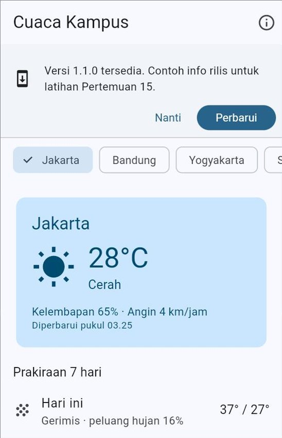
  &nbsp;
  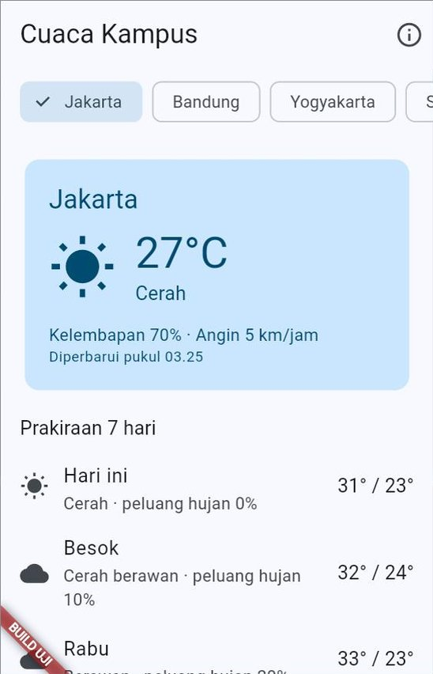
</p>

### 16.3 Coba sendiri

1. Ubah `versiAplikasi` menjadi `Versi.urai('0.9.0+1')`. Apa yang tampil saat aplikasi dibuka, dan mengapa dialognya tidak bisa ditutup?
2. Ubah `versiAplikasi` menjadi `Versi.urai('1.1.0+2')`. Mengapa *banner* tidak muncul lagi?
3. Ubah `defaultValue` `LINGKUNGAN` menjadi `'pengembangan'`, lalu jalankan di DartPad. Bagian mana saja yang berubah, dan berkas mana yang tidak diubah sama sekali?
4. Ubah `defaultValue` `LINGKUNGAN` menjadi `'pengembangn'` (salah ketik). Apa yang terjadi, dan mengapa itu lebih baik daripada aplikasi yang diam-diam jalan?

---

## 17. Finalisasi Proyek Akhir

Pertemuan 15 adalah tahap **finalisasi** proyek akhir ([Panduan Proyek Akhir](../panduan/05_proyek_akhir.md#3-jadwal-dan-tahapan)): aplikasi lengkap, tes lulus, dan berkas rilis siap. Bagian ini adalah daftar kerjanya.

### 17.1 Daftar periksa rilis

**Fungsi dan kualitas**

- [ ] Semua fitur wajib berjalan; status memuat, kosong, dan gagal ditangani dengan pesan ramah.
- [ ] Diuji di lebar 360 dan ≥ 840, mode terang dan gelap, huruf diperbesar.
- [ ] `flutter analyze` → `No issues found!`; `dart format .` tidak mengubah apa pun.
- [ ] Minimal tiga tes unit bermakna lulus dengan `flutter test` (Pertemuan 14).
- [ ] Tidak ada `print()` dan tidak ada log berisi data pribadi.

**Identitas**

- [ ] Nama tampilan rapi di Android (`android:label`), web (`<title>`, `manifest.json`), dan `MaterialApp(title: ...)`.
- [ ] `applicationId` bukan `com.example...`.
- [ ] `version: 1.0.0+1` (atau versi yang sesuai) di `pubspec.yaml`.
- [ ] Ikon dan layar pembuka sudah diganti.

**Rilis dari dalam**

- [ ] Jaring pengaman galat dan pengganti layar merah terpasang.
- [ ] Halaman Tentang: versi, sumber data beserta atribusinya, kebijakan privasi, lisensi.
- [ ] Izin internet ada di `AndroidManifest.xml` utama; tidak ada izin yang tidak dipakai.
- [ ] Tidak ada kunci API, kata sandi, `key.properties`, atau `*.jks` di repositori.

**Berkas rilis** (minimal satu, sesuai [Panduan Proyek Akhir](../panduan/05_proyek_akhir.md#12-daftar-periksa-setiap-tahap); keduanya lebih baik)

- [ ] Versi web terbit di GitHub Pages dan sudah dicoba dari HP, **dan/atau**
- [ ] APK tersedia di GitHub Releases (*tag* `v1.0.0`) dan sudah dipasang di HP sungguhan.
- [ ] *Build* rilis sudah diuji: data internet, mode pesawat, tutup lalu buka lagi.

**Dokumen**

- [ ] `README.md` final (Bagian 17.2), `CHANGELOG.md` (17.3), `KEBIJAKAN_PRIVASI.md` (17.4).

> [!TIP]
> Ingin bantuan memeriksa? Salin isi `pubspec.yaml`, `AndroidManifest.xml`, `build.gradle.kts`, dan `android/.gitignore` proyek Anda ke dalam [Contoh 06](kode/contoh_06_pemeriksa_kesiapan_rilis_dart_murni.dart), lalu jalankan.

### 17.2 `README.md` final

`README.md` adalah halaman depan proyek Anda: yang pertama dibaca dosen, teman, dan kelak perekrut. Gunakan kerangka [`templat/README_PROYEK.md`](templat/README_PROYEK.md), yang berisi:

| Bagian | Isinya |
| :--- | :--- |
| Judul dan deskripsi | Nama aplikasi dan 2–3 kalimat masalah yang diselesaikannya |
| Coba sekarang | Tautan **versi web** (GitHub Pages) dan **unduh APK** (`.../releases/latest`) |
| Tangkapan layar | 3–5 gambar dari folder `docs/tangkapan_layar/` |
| Fitur | Daftar fitur yang sudah berjalan |
| Tim | Nama, NIM, peran |
| Sumber data dan atribusi | API yang dipakai beserta atribusi wajibnya |
| Cara menjalankan | `flutter pub get`, `flutter run -d chrome`, dan langkah khusus (misalnya SQLite di web) |
| Pengujian | `flutter test` dan apa saja yang diuji |
| Arsitektur | Struktur folder `lib/` singkat |
| Privasi dan lisensi | Tautan ke `KEBIJAKAN_PRIVASI.md` dan lisensi kode (jika ada) |

### 17.3 Catatan perubahan (`CHANGELOG.md`)

`CHANGELOG.md` mencatat apa yang berubah di setiap versi, untuk **manusia** (bukan daftar *commit*). Format yang umum dipakai:

```markdown
# Catatan Perubahan

## [1.0.1] - 2026-12-10

### Diperbaiki

- Tombol simpan tidak lagi macet saat judul tugas kosong.

## [1.0.0] - 2026-12-03

### Ditambahkan

- Daftar tugas dari server DummyJSON, tersimpan di perangkat.
- Halaman Tentang beserta kebijakan privasi.
```

Kelompokkan perubahan menjadi **Ditambahkan**, **Diubah**, **Diperbaiki**, dan **Dihapus**. Versi terbaru ditulis paling atas. Isi bagian ini bisa langsung disalin ke catatan rilis GitHub (Bagian 12.3). Kerangkanya ada di [`templat/CHANGELOG.md`](templat/CHANGELOG.md).

### 17.4 `KEBIJAKAN_PRIVASI.md`

Tulis kebijakan privasi dengan kerangka [`templat/KEBIJAKAN_PRIVASI.md`](templat/KEBIJAKAN_PRIVASI.md), sesuaikan dengan **kenyataan** aplikasi Anda, lalu:

1. simpan di repositori (berkas Markdown di GitHub bisa dibuka siapa saja jika repositorinya publik);
2. tautkan dari `README.md` dan dari halaman Tentang di aplikasi.

### 17.5 Lisensi kode (opsional)

Tanpa berkas lisensi, kode Anda secara hukum "semua hak dilindungi", walaupun repositorinya publik. Jika tim ingin kodenya boleh dipakai ulang, tambahkan berkas `LICENSE`, misalnya lisensi **MIT**. GitHub menyediakan pilihannya saat membuat berkas bernama `LICENSE` lewat web (tombol **Choose a license template**). Diskusikan dulu dengan dosen dan seluruh anggota tim.

### 17.6 Persiapan demo UAS (Pertemuan 16)

| Siapkan | Mengapa |
| :--- | :--- |
| APK sudah **terpasang** di HP yang akan dipakai demo | Memasang saat demo membuang waktu dan bisa gagal |
| Tautan versi web sudah dicoba dari HP dan laptop lain | Jaringan dan *browser* di ruang ujian bisa berbeda |
| **Video demo cadangan** 1–3 menit | Jika jaringan atau perangkat bermasalah ([Panduan Proyek Akhir](../panduan/05_proyek_akhir.md#9-penilaian)) |
| Data contoh yang rapi | Data uji bernama "asdf" atau "tes123" mengganggu kesan |
| Uji mode pesawat | Penguji sering bertanya, "Kalau internetnya mati bagaimana?" |
| Cadangan data palsu (`LINGKUNGAN=pengembangan` atau *repository* palsu) | Jika API sedang bermasalah tepat saat demo |
| Alur demo **5–7 menit** sudah dilatih | Waktu demo terbatas; alur yang dilatih tidak tersendat |
| Setiap anggota tahu bagian kodenya | Bagian kode yang tidak bisa dijelaskan tidak dinilai |

### 17.7 Yang dikumpulkan

Ikuti arahan dosen. Umumnya:

1. Tautan repositori dengan *tag* `v1.0.0`.
2. Tautan halaman rilis (APK) dan/atau tautan versi web.
3. `README.md`, `CHANGELOG.md`, dan `KEBIJAKAN_PRIVASI.md` yang lengkap.

---

## 18. Kesalahan Umum Pemula dan Solusinya

| Gejala | Penyebab | Solusi |
| :--- | :--- | :--- |
| APK rilis tidak bisa memuat data internet, padahal saat `flutter run` lancar | Izin internet hanya ada di `AndroidManifest.xml` versi *debug* | Tambahkan `<uses-permission android:name="android.permission.INTERNET" />` di `android/app/src/main/AndroidManifest.xml` ([Bagian 10.2](#102-sebelum-build-izin-internet-dan-teman-temannya)) |
| Situs di GitHub Pages hanya putih, konsol *browser* berisi galat 404 | `--base-href` tidak diisi atau tidak sama dengan nama repositori | `flutter build web --base-href "/nama-repositori/"`, diawali dan diakhiri `/`. Lebih mudah lagi: pakai `templat/web.yml` ([Bagian 9.3](#93-alamat-dasar---base-href)) |
| `build/web/index.html` diklik dua kali, tetapi layarnya kosong | *Browser* tidak menjalankan aplikasi web dari alamat `file://` | `dhttpd --path build/web`, lalu buka `http://localhost:8080` ([Bagian 9.2](#92-mencoba-hasil-build-di-laptop)) |
| *Workflow* `web.yml` gagal di langkah **Terbitkan** | GitHub Pages belum diatur ke **Source: GitHub Actions**, atau repositorinya privat tanpa GitHub Pro | **Settings** → **Pages** → **Source**: **GitHub Actions**, lalu jalankan ulang *workflow* ([Bagian 9.4](#94-terbit-otomatis-di-github-pages)) |
| Situs sudah diperbarui, tetapi yang tampil masih versi lama | Salinan sementara (*cache*) di *browser* | Tunggu centang hijau di tab **Actions**, lalu muat ulang paksa: `Ctrl` + `Shift` + `R` ([Bagian 9.5](#95-hal-yang-perlu-diperhatikan-di-web)) |
| Fitur SQLite jalan di laptop, tetapi gagal di GitHub Pages | `web/sqlite3.wasm` dan `web/sqflite_sw.js` tidak ikut di-*commit* | *Commit* kedua berkas itu ([Bagian 9.5](#95-hal-yang-perlu-diperhatikan-di-web)) |
| Memperbarui aplikasi gagal: "Aplikasi tidak terpasang karena paket bentrok ..." | Tanda tangan APK baru berbeda, misalnya di-*build* di laptop lain atau oleh robot dengan kunci *debug* | Hapus versi lama dulu. Untuk seterusnya, tanda tangani semua rilis dengan kunci unggah yang sama ([Bagian 11.1](#111-mengapa-aplikasi-ditandatangani)) |
| `flutter build apk` gagal di laptop teman atau di robot GitHub; pesannya menyebut *keystore* atau *signing config* | `build.gradle.kts` selalu memakai kunci rilis, padahal `key.properties` tidak ada di sana | Pola "kunci rilis jika ada, kunci *debug* jika tidak" ([Bagian 11.4](#114-memberi-tahu-gradle-letak-kuncinya)) |
| `'keytool' is not recognized ...` | `keytool` tidak terdaftar di PATH | Panggil dengan alamat lengkap dari `flutter doctor -v` ([Bagian 11.3](#113-membuat-kunci-unggah)) |
| `key.properties` atau berkas `.jks` muncul di `git status` | Kunci disimpan di folder yang tidak diabaikan Git, atau `.gitignore` berubah | Simpan kunci di luar proyek; periksa dengan `git check-ignore -v` ([Bagian 11.5](#115-menjaga-kunci-dua-aturan-mutlak)) |
| Berkas `.aab` tidak bisa dipasang di HP | *App Bundle* bukan APK | Bagikan APK; `.aab` hanya untuk diunggah ke Google Play ([Bagian 11.6](#116-app-bundle-aab-untuk-google-play)) |
| Ikon di HP masih logo Flutter setelah `dart run flutter_launcher_icons` | Peluncur HP masih menyimpan ikon lama | Hapus aplikasi dari HP, lalu pasang lagi ([Bagian 6.3](#63-melihat-ikon-barunya)) |
| Nama di bawah ikon masih `tugas_kuliahku` | `android:label` belum diubah | Ubah di `android/app/src/main/AndroidManifest.xml` ([Bagian 4.2](#42-nama-tampilan-ada-di-beberapa-tempat)) |
| Ada dua aplikasi kembar di HP | `applicationId` diganti. Bagi HP, ID baru berarti aplikasi baru | Hapus aplikasi lama yang ber-ID `com.example...` ([Bagian 4.3](#43-application-id-nomor-ktp-aplikasi)) |
| Pembaruan ditolak karena nomor *build* sudah dipakai atau lebih kecil | Angka setelah `+` di `pubspec.yaml` lupa dinaikkan | Naikkan nomor *build* di setiap rilis ([Bagian 5.3](#53-nomor-build-selalu-naik)) |
| Versi di halaman Tentang berbeda dengan `pubspec.yaml` | Versi ditulis dua kali, salah satunya lupa diubah | Baca versi dengan `package_info_plus` ([Bagian 5.4](#54-menampilkan-versi-di-dalam-aplikasi-package_info_plus)) |
| Cek pembaruan menganggap 1.10.0 lebih lama daripada 1.9.0 | Versi dibandingkan sebagai teks | Bandingkan per bagian sebagai angka ([Bagian 5.5](#55-jangan-membandingkan-versi-sebagai-teks)) |
| `Unsupported operation: String.fromEnvironment can only be used as a const constructor` | `fromEnvironment` dipanggil tanpa `const` | Tambahkan `const` ([Bagian 3.3](#33-membaca-nilainya-wajib-const)) |
| Nilai `--dart-define` tidak terbaca, selalu nilai bawaan | Namanya berbeda (huruf besar dan kecil dibedakan), atau opsinya lupa ditulis saat `flutter build` | Samakan namanya persis, dan tulis opsi itu di `flutter run` **maupun** `flutter build` ([Bagian 3.2](#32-memberi-nilai-dengan---dart-define)) |
| APK untuk dosen ternyata berisi data palsu | Lingkungan diganti di kode, lalu lupa dikembalikan | `--dart-define` dengan nilai bawaan `produksi` ([Bagian 3.4](#34-nilai-bawaan-yang-aman-dan-nilai-yang-salah-ketik)) |
| Pengguna melihat kotak abu-abu kosong | Ada galat saat membangun widget di *build* rilis | Pasang `ErrorWidget.builder` dan jaring pengaman, lalu perbaiki bugnya dari laporan galat ([Bagian 7.5](#75-pengganti-layar-merah-yang-ramah)) |
| Galat asinkron di web tidak pernah tercatat | Di web, galat itu tidak sampai ke `PlatformDispatcher.instance.onError` | Bungkus dengan `runZonedGuarded` ([Bagian 7.4](#74-di-web-tambahkan-runzonedguarded)) |
| Data pribadi atau token terbaca di log HP | `print` atau `debugPrint` tanpa `if (kDebugMode)` | Pakai fungsi seperti `catatDebug` ([Bagian 2.2](#22-mengenali-mode-dari-dalam-kode)) |
| *Tag* sudah dibuat, tetapi `rilis.yml` tidak berjalan | *Tag* belum di-*push*, atau namanya tidak diawali `v` | `git push origin v1.0.0` ([Bagian 12.1](#121-tag-penanda-versi-di-riwayat-git)) |
| `rilis.yml` gagal membuat rilis dengan pesan `Resource not accessible by integration` | Izin `contents: write` terhapus dari *workflow* | Kembalikan `permissions: contents: write` ([Bagian 12.2](#122-robot-yang-mem-build-apk-dan-membuat-halaman-rilis)) |
| Aplikasi macet lama saat dibuka tanpa internet | Cek pembaruan menunggu tanpa batas waktu, atau galatnya dilempar | Batas waktu 5 detik, dan kembalikan `null` jika gagal ([Bagian 13.3](#133-aturan-emas-jangan-menghalangi-pengguna)) |
| "Aplikasi saya lambat" | Diukur dalam mode *debug* | Ukur dengan `flutter run --profile` di HP sungguhan ([Bagian 14.2](#142-kecepatan)) |

---

## 19. Ringkasan

- **Rilis bukan sekadar "menjalankan".** Mode *debug* dibuat untuk pembuat aplikasi, mode *release* untuk penggunanya: lebih kecil dan lebih cepat, tetapi tanpa *hot reload*, `assert` dilewati, layar merah menjadi kotak abu-abu, dan izin internet Android harus ditulis sendiri. Karena itu, **uji *build* rilis sendiri** sebelum dibagikan.
- `kDebugMode` dan `kReleaseMode` adalah **konstanta waktu kompilasi**: isi `if (kDebugMode)` dibuang dari *build* rilis. `debugPrint` tidak hilang dengan sendirinya.
- Pengaturan per *build* diberikan dengan **`--dart-define`** dan dibaca dengan `const String.fromEnvironment(...)`. Pilih nilai bawaan yang aman (produksi), tolak nilai yang salah ketik, dan jangan menyimpan rahasia di sana.
- **Identitas aplikasi:** nama tampilan (di beberapa berkas), `applicationId` yang unik dan permanen, serta `version: MAYOR.MINOR.PATCH+BUILD`. Nama versi mengikuti *Semantic Versioning*; nomor *build* selalu naik. Versi dibandingkan sebagai **angka** dan ditampilkan dengan `package_info_plus`.
- Ikon semua ukuran, termasuk ikon adaptif, dibuat dengan `flutter_launcher_icons`; layar pembuka dengan `flutter_native_splash`. Keduanya *dev dependency*.
- **Galat yang diduga** (*Exception*) ditangani di tempatnya dengan pesan ramah. **Galat yang tidak terduga** (*Error*, bug) ditangkap jaring pengaman (`FlutterError.onError`, `PlatformDispatcher.instance.onError`, dan `runZonedGuarded` di web), dilaporkan tanpa data pribadi, dan tampilannya diganti lewat `ErrorWidget.builder`.
- Aplikasi **jujur tentang dirinya**: halaman Tentang memuat versi, **atribusi** sumber data, **kebijakan privasi** (wajib untuk semua aplikasi di Google Play), dan **lisensi** (`showLicensePage`, ditambah `LicenseRegistry.addLicense` untuk lisensi data).
- **Web:** `flutter build web` menghasilkan folder `build/web/`, yang diuji dengan `dhttpd` dan diterbitkan ke **GitHub Pages** dengan `--base-href "/nama-repositori/"` lewat `templat/web.yml`.
- **Android:** `flutter build apk` untuk dibagikan, `flutter build appbundle` untuk Google Play. Setiap APK ditandatangani. Kunci *debug* berbeda di setiap laptop, jadi rilis sungguhan memakai **kunci unggah** buatan `keytool` yang dibaca lewat `key.properties`. Kunci itu **tidak pernah** di-*commit* dan **selalu** dicadangkan.
- **Rilis otomatis:** *push tag* `v1.0.0`, lalu `templat/rilis.yml` menguji, mem-*build* APK, dan membuat halaman **GitHub Releases**. Kunci unggah untuk robot disimpan di ***Secrets***.
- **Cek pembaruan** untuk aplikasi di luar toko memakai berkas `info_rilis.json` kecil dan tiga keputusan (terbaru, disarankan, wajib), dengan aturan emas: **tidak pernah menghalangi pengguna**.
- Sebelum rilis, periksa **ukuran** (`--analyze-size`), **kecepatan** (mode *profile* di HP), dan **keamanan** (HTTPS, izin seperlunya, rahasia di *server*).
- **Toko aplikasi:** Google Play (US$25, *App Bundle*, uji tertutup 12 penguji selama 14 hari untuk akun pribadi baru, target API 36) dan App Store (Mac, US$99 per tahun, TestFlight).
- **Finalisasi proyek akhir:** daftar periksa rilis, `README.md` final, `CHANGELOG.md`, `KEBIJAKAN_PRIVASI.md`, *tag* `v1.0.0`, dan persiapan demo UAS.

**Memilih alat yang tepat:**

| Kebutuhan | Pakai |
| :--- | :--- |
| Mencoba rasa aplikasi rilis | `flutter run --release` di Chrome atau HP |
| Mengukur kecepatan | `flutter run --profile` di HP + DevTools **Performance** |
| Kode yang hanya jalan saat pengembangan | `if (kDebugMode) { ... }` |
| Pengaturan yang berbeda per *build* | `--dart-define` / `--dart-define-from-file` + `const String.fromEnvironment` |
| Nama tampilan | `android:label`, `web/index.html`, `web/manifest.json`, `MaterialApp(title: ...)` |
| ID aplikasi | `applicationId` di `android/app/build.gradle.kts` |
| Nomor versi | `version:` di `pubspec.yaml` (atau `--build-name` dan `--build-number`) |
| Menampilkan versi di aplikasi | `package_info_plus` |
| Ikon semua ukuran | `flutter_launcher_icons` |
| Layar pembuka | `flutter_native_splash` |
| Menangkap galat yang lolos | `FlutterError.onError`, `PlatformDispatcher.instance.onError`, `runZonedGuarded` (web) |
| Pengganti layar merah dan kotak abu-abu | `ErrorWidget.builder` |
| Halaman lisensi | `showLicensePage` atau `AboutListTile`; `LicenseRegistry.addLicense` untuk lisensi data |
| Berkas rilis web | `flutter build web` (+ `--base-href`) |
| Mencoba *build* web di laptop | `dhttpd --path build/web` |
| Situs web gratis | GitHub Pages + `templat/web.yml` |
| Berkas rilis Android untuk dibagikan | `flutter build apk` (`--split-per-abi`) |
| Berkas untuk Google Play | `flutter build appbundle` |
| Kunci tanda tangan | `keytool` + `key.properties` + `build.gradle.kts` |
| Rilis otomatis | `git tag` + `templat/rilis.yml` |
| Rahasia untuk robot GitHub | *Secrets* |
| Membaca ukuran aplikasi | `--analyze-size` + DevTools **App Size** |
| Memeriksa kesiapan rilis | Daftar periksa [Bagian 17.1](#171-daftar-periksa-rilis) dan Contoh 06 |

---

## 20. Glosarium

| Istilah | Arti |
| :--- | :--- |
| **Mode *build*** | Cara Flutter mengompilasi aplikasi: *debug* (untuk membuat), *profile* (untuk mengukur), *release* (untuk dibagikan) |
| ***Build* rilis** | Hasil kompilasi mode *release*: lebih kecil dan lebih cepat, tanpa alat bantu pengembang |
| **Konstanta waktu kompilasi** | Nilai yang sudah ditetapkan saat *build*, misalnya `kReleaseMode` dan nilai `--dart-define` |
| **`--dart-define`** | Opsi untuk memberi nilai pengaturan saat menjalankan atau mem-*build*; dibaca dengan `String.fromEnvironment` |
| **Lingkungan** (*environment*) | Kumpulan pengaturan untuk satu tujuan, misalnya pengembangan (data palsu) dan produksi (data sungguhan) |
| ***Flavor*** | Varian aplikasi dengan ID, nama, dan ikon berbeda yang dibuat dari satu kode |
| **Nama tampilan** | Nama aplikasi yang dibaca manusia, misalnya di bawah ikon |
| ***Application ID*** | Identitas unik aplikasi Android di HP dan Google Play. Padanannya di iPhone: *Bundle Identifier* |
| **Nama versi** | Nomor versi untuk pengguna, misalnya `1.2.0` |
| **Nomor *build*** | Bilangan bulat yang wajib naik di setiap unggahan, misalnya angka `5` pada `1.2.0+5` |
| ***Semantic Versioning*** | Aturan penomoran versi `MAYOR.MINOR.PATCH` |
| **Ikon adaptif** | Ikon Android 8+ yang terdiri dari lapisan belakang dan lapisan depan, lalu dipotong sesuai bentuk pilihan HP |
| ***Themed icon*** | Ikon satu warna yang mengikuti warna tema HP (Android 13+) |
| **Layar pembuka** (*splash screen*) | Layar yang tampil sejak aplikasi dibuka sampai Flutter siap menggambar |
| ***Dev dependency*** | Paket yang hanya dipakai saat pengembangan dan tidak ikut ke dalam aplikasi |
| **Jaring pengaman galat** | Penangkap galat yang lolos dari `try`–`catch`: `FlutterError.onError`, `PlatformDispatcher.instance.onError`, `runZonedGuarded` |
| **Zona** (*zone*) | Ruang eksekusi Dart. `runZonedGuarded` menangkap galat asinkron yang lolos di dalamnya |
| **Pelaporan galat** (*crash reporting*) | Pengiriman catatan galat dari HP pengguna ke pengembang, misalnya lewat Crashlytics atau Sentry |
| **Atribusi** | Pencantuman sumber data atau karya, sesuai syarat lisensinya |
| **Kebijakan privasi** | Dokumen yang menjelaskan data apa yang dikumpulkan aplikasi, untuk apa, dan bagaimana menghapusnya |
| **Lisensi sumber terbuka** | Izin memakai kode orang lain dengan syarat tertentu, misalnya menyertakan teks lisensinya |
| ***Web server*** | Program yang mengirim berkas situs ke *browser* lewat alamat `http://` |
| **Alamat dasar** (*base href*) | Sub-folder tempat aplikasi web berada, misalnya `/tugas_kuliahku/` |
| **GitHub Pages** | Layanan GitHub untuk menerbitkan situs statis |
| **APK** (*Android Package*) | Berkas pemasang aplikasi Android |
| ***App Bundle*** (AAB) | Berkas yang diunggah ke Google Play; Google Play lalu meracik APK yang pas untuk setiap HP |
| **ABI** | Jenis prosesor beserta set instruksinya, misalnya `arm64-v8a` |
| **Tanda tangan digital** | "Segel" kriptografis yang membuktikan sebuah APK berasal dari pembuat yang sama |
| ***Keystore*** (`.jks`) | Berkas berisi kunci penandatangan, dilindungi kata sandi |
| **Kunci unggah** (*upload key*) | Kunci milik pengembang untuk menandatangani berkas yang diunggah ke Google Play |
| **Play App Signing** | Layanan Google Play yang menyimpan kunci penandatangan aplikasi |
| **R8** | Alat yang membuang kode Java/Kotlin yang tidak terpakai dan memperkecil sisanya di *build* rilis Android |
| ***Obfuscation*** (penyamaran) | Penggantian nama kelas dan fungsi dengan nama acak, agar kode sulit dibaca |
| **Berkas simbol** | Berkas untuk menerjemahkan kembali *stack trace* dari *build* yang disamarkan |
| ***Tag*** | Penanda pada satu *commit*, misalnya `v1.0.0` |
| **GitHub Releases** | Halaman rilis di GitHub, tempat berkas seperti APK dilampirkan |
| ***Secrets*** | Nilai rahasia di pengaturan repositori yang bisa dibaca *workflow*, tetapi tidak bisa dilihat siapa pun |
| ***Base64*** | Cara menuliskan berkas biner sebagai teks biasa |
| ***Sideload*** | Memasang aplikasi langsung dari berkas APK, bukan dari toko aplikasi |
| **Uji tertutup** (*closed testing*) | Pengujian aplikasi oleh penguji terbatas di Google Play sebelum rilis ke publik |
| **TestFlight** | Layanan Apple untuk membagikan versi uji aplikasi iPhone |
| **Catatan perubahan** (*changelog*) | Daftar perubahan setiap versi, ditulis untuk manusia |

---

## 21. Referensi

1. Flutter. *Flutter's build modes*. <https://docs.flutter.dev/testing/build-modes>
2. Flutter. *Build and release a web app*. <https://docs.flutter.dev/deployment/web>
3. Flutter. *Build and release an Android app*. <https://docs.flutter.dev/deployment/android>
4. Flutter. *Build and release an iOS app*. <https://docs.flutter.dev/deployment/ios>
5. Flutter. *Handling errors in Flutter*. <https://docs.flutter.dev/testing/errors>
6. Flutter. *Obfuscate Dart code*. <https://docs.flutter.dev/deployment/obfuscate>
7. Flutter. *Continuous delivery with Flutter*. <https://docs.flutter.dev/deployment/cd>
8. Flutter. *Measuring your app's size*. <https://docs.flutter.dev/perf/app-size>
9. Flutter. *Set up Flutter flavors for Android*. <https://docs.flutter.dev/deployment/flavors>
10. Flutter API. *ErrorWidget class*. <https://api.flutter.dev/flutter/widgets/ErrorWidget-class.html>
11. Flutter API. *showLicensePage function*. <https://api.flutter.dev/flutter/material/showLicensePage.html>
12. pub.dev. *package_info_plus*. <https://pub.dev/packages/package_info_plus>
13. pub.dev. *flutter_launcher_icons*. <https://pub.dev/packages/flutter_launcher_icons>
14. pub.dev. *flutter_native_splash*. <https://pub.dev/packages/flutter_native_splash>
15. pub.dev. *dhttpd*. <https://pub.dev/packages/dhttpd>
16. *Semantic Versioning 2.0.0*. <https://semver.org/>
17. *Keep a Changelog*. <https://keepachangelog.com/en/1.1.0/>
18. Android Developers. *Sign your app*. <https://developer.android.com/studio/publish/app-signing>
19. Android Developers. *Android developer verification*. <https://developer.android.com/developer-verification>
20. Play Console Help. *Get started with Play Console*. <https://support.google.com/googleplay/android-developer/answer/6112435>
21. Play Console Help. *Create and set up your app*. <https://support.google.com/googleplay/android-developer/answer/9859152>
22. Play Console Help. *App testing requirements for new personal developer accounts*. <https://support.google.com/googleplay/android-developer/answer/14151465>
23. Play Console Help. *Target API level requirements for Google Play apps*. <https://support.google.com/googleplay/android-developer/answer/11926878>
24. Play Console Help. *Use Play App Signing*. <https://support.google.com/googleplay/android-developer/answer/9842756>
25. Play Console Help. *User Data* (kebijakan privasi). <https://support.google.com/googleplay/android-developer/answer/10144311>
26. Apple Developer. *Apple Developer Program*. <https://developer.apple.com/programs/>
27. GitHub Docs. *Using custom workflows with GitHub Pages*. <https://docs.github.com/en/pages/getting-started-with-github-pages/using-custom-workflows-with-github-pages>
28. GitHub Docs. *About releases*. <https://docs.github.com/en/repositories/releasing-projects-on-github/about-releases>
29. GitHub Docs. *Using secrets in GitHub Actions*. <https://docs.github.com/en/actions/how-tos/write-workflows/choose-what-workflows-do/use-secrets>
30. GitHub Docs. *Licensing a repository*. <https://docs.github.com/en/repositories/managing-your-repositorys-settings-and-features/customizing-your-repository/licensing-a-repository>
31. GitHub CLI. *gh release create*. <https://cli.github.com/manual/gh_release_create>
32. Git. *Git Basics: Tagging*. <https://git-scm.com/book/en/v2/Git-Basics-Tagging>
33. Open-Meteo. *Licence*. <https://open-meteo.com/en/licence>

---

## ➡️ Langkah Berikutnya

1. Kerjakan [🧪 Jobsheet Pertemuan 15](JOBSHEET.md) di laboratorium: merilis "Tugas Kuliahku" versi 1.0.0, mulai dari identitas aplikasi, halaman Tentang, versi web di GitHub Pages, APK bertanda tangan, sampai rilis otomatis.
2. Kerjakan [✍️ Latihan Pertemuan 15](LATIHAN.md) untuk menguji pemahaman Anda.
3. **Proyek akhir:** selesaikan daftar periksa [Bagian 17.1](#171-daftar-periksa-rilis), lalu buat *tag* `v1.0.0`.
4. **Pertemuan 16** adalah **Ujian Akhir Semester (UAS)**: presentasi dan demo proyek akhir, dilanjutkan tanya jawab. Pelajari lagi cara penilaiannya di [Panduan Proyek Akhir](../panduan/05_proyek_akhir.md#9-penilaian), dan latih alur demonya sejak sekarang ([Bagian 17.6](#176-persiapan-demo-uas-pertemuan-16)).

[⬆️ Kembali ke atas](#pertemuan-15--build-rilis--finalisasi-proyek)
