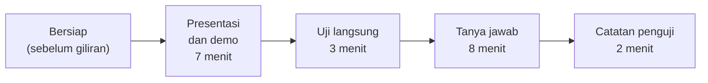
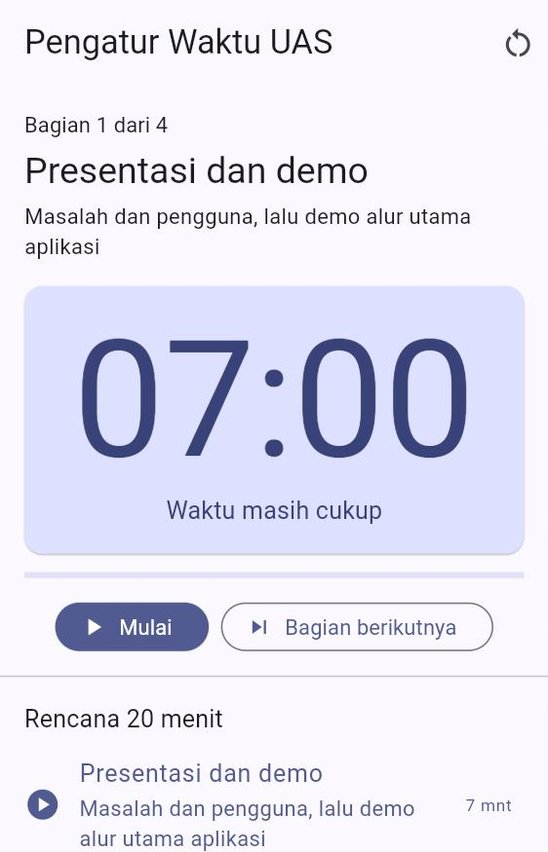
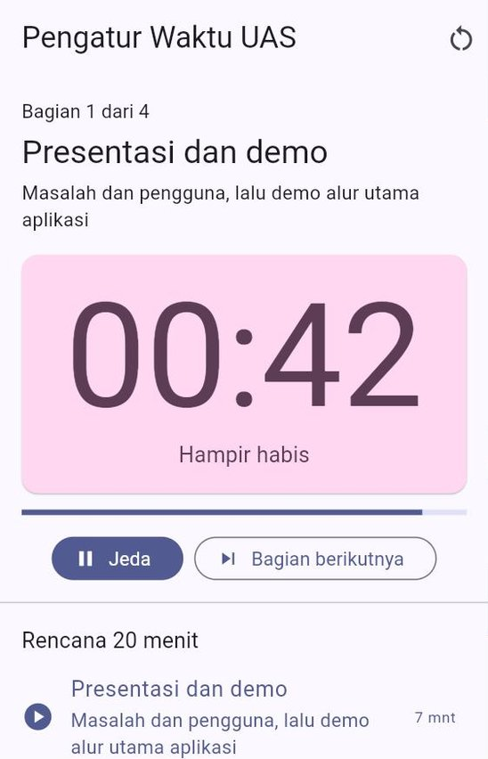
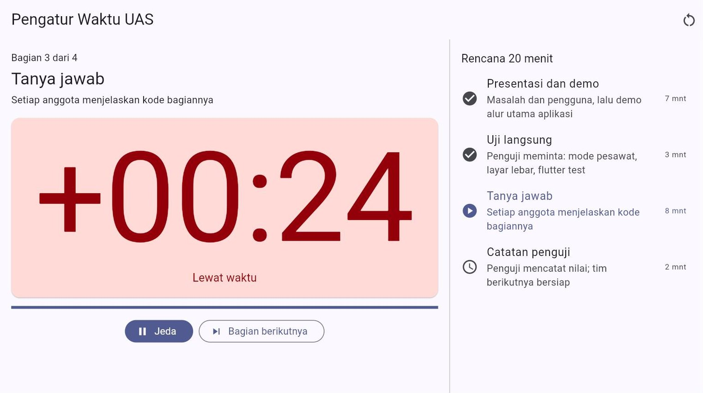
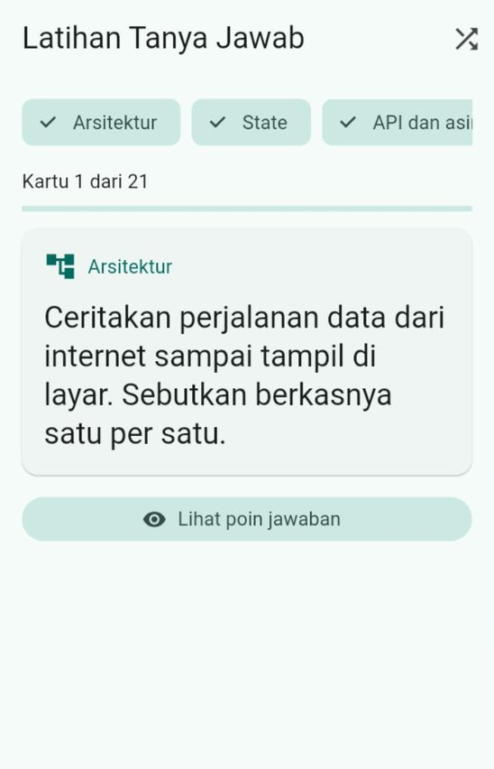
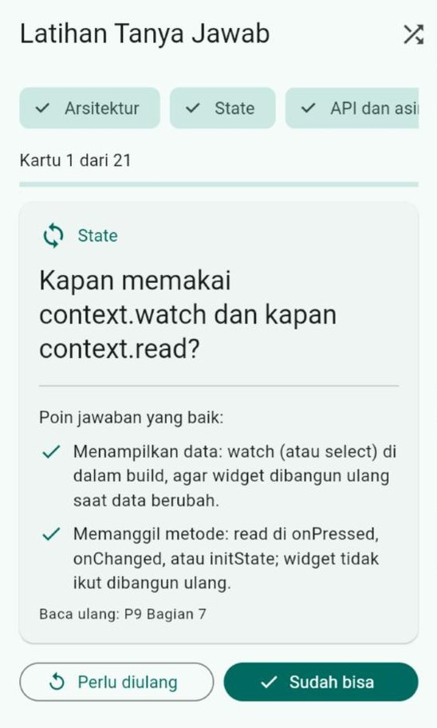
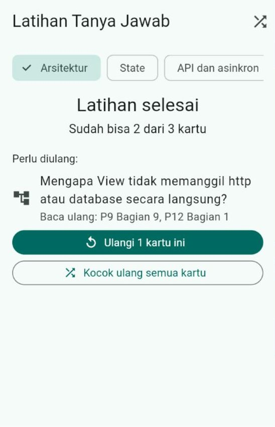

# Pertemuan 16 — Ujian Akhir Semester (UAS): Presentasi dan Demo Proyek Akhir

> 📝 **Panduan ujian** · ⏱️ ± 20 menit per tim · 🎯 Menguji seluruh capaian mata kuliah (CPMK-1 sampai CPMK-4)
>
> **Bentuk ujian:** setiap tim mempresentasikan proyek akhirnya, mendemokan aplikasi secara langsung, melayani **uji langsung** dari penguji, lalu menjawab pertanyaan tentang **kode buatannya sendiri**.
> **Cara bersiap paling ampuh:** lakukan [🎯 Gladi Resik](GLADI_RESIK.md) bersama tim lain dengan pengatur waktu, lalu kerjakan [✍️ Latihan Persiapan](LATIHAN.md).

[🏠 Beranda](../README.md) · [📋 Silabus](../SILABUS.md) · [🚀 Panduan Proyek Akhir](../panduan/05_proyek_akhir.md) · [🎯 Gladi Resik](GLADI_RESIK.md) · [✍️ Latihan Persiapan](LATIHAN.md) · [💻 Kode Contoh](kode/) · [🧰 Templat](templat/) · [📊 Unduh Slide](https://raw.githubusercontent.com/antonprafanto/mobile2026/main/pertemuan_16_uas/slide/PERTEMUAN_16_Persiapan_UAS.pptx)

> [!NOTE]
> Ketentuan teknis seperti **jadwal giliran**, **ruang**, **lama waktu per tim**, **tempat pengumpulan**, dan **tenggat** akan diumumkan dosen. Jika ada perbedaan antara halaman ini dan pengumuman dosen, **pengumuman dosen yang berlaku**.

---

## Daftar Isi

1. [Gambaran UAS](#1-gambaran-uas)
2. [Apa yang Dinilai](#2-apa-yang-dinilai)
3. [Alur Hari-H dan Pembagian Waktu](#3-alur-hari-h-dan-pembagian-waktu)
4. [Slide Presentasi: Singkat dan Bercerita](#4-slide-presentasi-singkat-dan-bercerita)
5. [Menyusun Alur Demo](#5-menyusun-alur-demo)
6. [Uji Langsung oleh Penguji](#6-uji-langsung-oleh-penguji)
7. [Tanya Jawab](#7-tanya-jawab)
8. [Rubrik Penilaian](#8-rubrik-penilaian)
9. [Nilai Setiap Anggota Tim](#9-nilai-setiap-anggota-tim)
10. [Rencana Cadangan Saat Ada Kendala](#10-rencana-cadangan-saat-ada-kendala)
11. [Tata Tertib dan Kejujuran Akademik](#11-tata-tertib-dan-kejujuran-akademik)
12. [Yang Dikumpulkan Sebelum UAS](#12-yang-dikumpulkan-sebelum-uas)
13. [Daftar Periksa H-7, H-1, dan Hari-H](#13-daftar-periksa-h-7-h-1-dan-hari-h)
14. [Rencana Persiapan Satu Minggu](#14-rencana-persiapan-satu-minggu)
15. [Tiga Alat Bantu Persiapan](#15-tiga-alat-bantu-persiapan)
16. [Pertanyaan yang Sering Diajukan](#16-pertanyaan-yang-sering-diajukan)
17. [Setelah UAS: Langkah Berikutnya](#17-setelah-uas-langkah-berikutnya)
18. [Penutup: Perjalanan Satu Semester](#18-penutup-perjalanan-satu-semester)
19. [Glosarium](#19-glosarium)
20. [Referensi](#20-referensi)

---

## 1. Gambaran UAS

| Hal | Keterangan |
| :--- | :--- |
| Bentuk | Presentasi dan **demo langsung** proyek akhir, **uji langsung** oleh penguji, lalu **tanya jawab** |
| Peserta | Per tim (atau per orang untuk proyek individu), sesuai pembagian sejak [Pertemuan 9](../pertemuan_09_state_dan_mvvm/README.md) |
| Durasi | **± 20 menit per tim**: 7 menit presentasi dan demo, 3 menit uji langsung, 8 menit tanya jawab, 2 menit catatan penguji. Proyek individu ± 15 menit |
| Yang dinilai | Aplikasi, kode, repositori, berkas rilis, presentasi, dan **pemahaman setiap anggota** ([Bagian 8](#8-rubrik-penilaian)) |
| Yang dibawa | Laptop dan pengisi dayanya, HP yang sudah terpasang APK (jika ada), kabel data, dan adaptor layar (HDMI) bila laptop Anda membutuhkannya |
| Sifat | Setiap anggota menjelaskan kode **bagiannya sendiri**. Penguji boleh bertanya kepada siapa saja tentang bagian mana saja |
| Bobot | Proyek akhir + UAS = **40%** dari nilai akhir ([Silabus Bagian 6](../SILABUS.md#6-komponen-penilaian)) |

Di [Panduan Proyek Akhir](../panduan/05_proyek_akhir.md#1-gambaran-singkat), proyek akhir diibaratkan **membangun rumah**: proposal adalah denah, laporan kemajuan adalah rangka, finalisasi adalah rumah siap huni. UAS adalah **serah terima kunci**. Anda mengajak penguji berkeliling: menunjukkan setiap ruangan (fitur), membuka panel listrik (kode), lalu menjawab pertanyaan calon penghuni dengan tenang karena Anda sendiri yang membangunnya.

> [!IMPORTANT]
> UAS **tidak** menguji materi baru. Semua yang ditanyakan sudah Anda pelajari di Pertemuan 1–15 dan sudah Anda terapkan di proyek sendiri. Yang diuji adalah **aplikasi Anda** dan **pemahaman Anda tentang aplikasi itu**.

---

## 2. Apa yang Dinilai

### 2.1 Enam syarat minimal dan berkas rilis

Aplikasi harus memenuhi enam syarat minimal ([Panduan Proyek Akhir Bagian 2](../panduan/05_proyek_akhir.md#2-syarat-minimal-aplikasi)) dan sudah dirilis ([Pertemuan 15 Bagian 17](../pertemuan_15_build_rilis_dan_finalisasi/README.md#17-finalisasi-proyek-akhir)). Saat UAS, setiap syarat **dibuktikan**, bukan sekadar diceritakan:

| No | Syarat | Cara membuktikannya saat UAS |
| :---: | :--- | :--- |
| 1 | Minimal tiga halaman dengan navigasi yang jelas | Berpindah antarhalaman sambil membawa data, lalu kembali |
| 2 | Material Design 3, nyaman di ukuran layar berbeda | Tampilan di lebar 360 dan ≥ 840, mode terang dan gelap |
| 3 | REST API **dan** data yang disimpan di perangkat | Data dari internet tampil; data tersimpan tetap ada setelah aplikasi ditutup lalu dibuka lagi |
| 4 | MVVM atau *Clean Architecture* | Struktur folder `lib/`; View, ViewModel, dan *repository* terpisah |
| 5 | Minimal tiga tes unit yang lulus | `flutter test` dijalankan di depan penguji dan semuanya hijau |
| 6 | Repositori Git rapi dan `README.md` yang jelas | Riwayat *commit* setiap anggota, *tag* versi, dan `README.md` yang bisa diikuti orang lain |
| + | Berkas rilis | APK terpasang di HP dari halaman rilis GitHub, dan/atau versi web yang bisa dibuka dari HP penguji |

### 2.2 Kisi-kisi tanya jawab

Pertanyaan selalu dikaitkan dengan **kode Anda sendiri**. Bahan yang paling sering muncul:

| Pertemuan | Yang mungkin ditanyakan atau diminta |
| :---: | :--- |
| [5](../pertemuan_05_interaksi_dan_state/README.md)–[7](../pertemuan_07_material3_dan_responsif/README.md) | `StatefulWidget` dan siklus hidupnya, formulir dan validasi, navigasi membawa data, tema dari warna benih, mode gelap, tata letak responsif |
| [9](../pertemuan_09_state_dan_mvvm/README.md) | State lokal dan state aplikasi, `ChangeNotifier`, `watch`/`read`, pembagian View–ViewModel–*repository* |
| [10](../pertemuan_10_async_dan_rest_api/README.md) | Perjalanan data dari API sampai layar, JSON menjadi model, penanganan galat jaringan, `async`/`await` |
| [11](../pertemuan_11_penyimpanan_lokal/README.md) | `shared_preferences` atau SQLite, `whereArgs`, migrasi versi database, *cache* luring |
| [12](../pertemuan_12_clean_architecture/README.md) | Lapisan dan aturan ketergantungan, kontrak dan *dependency injection*, `Hasil` dan `Kegagalan`, data palsu |
| [13](../pertemuan_13_fitur_perangkat_dan_izin/README.md) | (Jika dipakai) izin akses, alur izin ditolak, privasi |
| [14](../pertemuan_14_pengujian_dan_debugging/README.md) | Isi tes Anda, nilai batas, *repository* palsu, membaca pesan galat, GitHub Actions |
| [15](../pertemuan_15_build_rilis_dan_finalisasi/README.md) | Nomor versi, mode rilis, `--dart-define`, halaman Tentang, kunci unggah, *tag* dan rilis |

---

## 3. Alur Hari-H dan Pembagian Waktu



| Menit | Bagian | Siapa | Yang terjadi |
| :---: | :--- | :--- | :--- |
| sebelum giliran | Bersiap | Tim | Laptop tersambung ke layar, HP tersambung ke laptop, aplikasi dan terminal sudah terbuka |
| 0–7 | Presentasi dan demo | Tim | Slide singkat (paling lama ± 2 menit), lalu demo alur utama aplikasi ([Bagian 4](#4-slide-presentasi-singkat-dan-bercerita) dan [5](#5-menyusun-alur-demo)) |
| 7–10 | Uji langsung | Penguji meminta, tim memperagakan | Misalnya: matikan internet, perlebar layar, jalankan `flutter test` ([Bagian 6](#6-uji-langsung-oleh-penguji)) |
| 10–18 | Tanya jawab | Penguji bertanya, setiap anggota menjawab | Pertanyaan tentang kode bagian masing-masing, lalu pertanyaan silang ([Bagian 7](#7-tanya-jawab)) |
| 18–20 | Catatan penguji | Penguji | Penguji mengisi lembar nilai; tim melepas sambungan dan memberi tempat untuk tim berikutnya |

> [!TIP]
> Latih pembagian waktu ini dengan [Contoh 02: Pengatur Waktu Presentasi](kode/contoh_02_pengatur_waktu_presentasi.dart). Aplikasinya membagi 20 menit menjadi empat bagian yang sama dengan tabel di atas, dan berubah warna saat waktu hampir habis atau sudah lewat.

<p align="center">
  
  &nbsp;
  
</p>

---

## 4. Slide Presentasi: Singkat dan Bercerita

Bintang UAS adalah **aplikasi Anda**, bukan slide. Slide hanya pengantar agar penguji cepat paham apa yang akan didemokan. Pakailah **paling banyak enam slide** dan selesaikan dalam **± 2 menit**:

| Slide | Isi | Contoh kalimat pembuka |
| :---: | :--- | :--- |
| 1 | Nama aplikasi, logo (ikon aplikasi), nama dan NIM anggota beserta perannya | "Kami tim Resep Hemat Anak Kos: Rina di tampilan, Bima di data, Sari di ViewModel dan tes." |
| 2 | Masalah dan pengguna sasaran | "Mahasiswa kos sering bingung memasak dengan bahan seadanya..." |
| 3 | Fitur utama dan alur yang akan didemokan | "Kami akan menunjukkan: mencari resep, membuka detail, menyimpan favorit." |
| 4 | Arsitektur: gambar lapisan dan struktur folder `lib/` | "Data dari DummyJSON masuk lewat *repository*, diolah ViewModel, ditampilkan View." |
| 5 | Kualitas dan rilis: jumlah tes, tanda CI hijau, tautan web dan APK, versi | "17 tes lulus, versi 1.0.1 ada di GitHub Releases." |
| 6 | Pelajaran terpenting dan rencana berikutnya | "Kalau dilanjutkan, kami ingin menambah pengingat memasak." |

Kerangka siap pakai: [`templat/TEMPLAT_SLIDE_UAS.pptx`](templat/TEMPLAT_SLIDE_UAS.pptx) (enam slide dengan petunjuk di catatan pembicara). Boleh juga membuat sendiri di Google Slides atau Canva, lalu simpan sebagai **PDF** untuk dikumpulkan ([Bagian 12](#12-yang-dikumpulkan-sebelum-uas)).

> [!TIP]
> - Huruf minimal **24 pt**, satu gagasan per slide, dan tangkapan layar **asli** dari aplikasi Anda.
> - Jangan membacakan slide. Ceritakan dengan kalimat sendiri.
> - Tulis tautan versi web dan halaman rilis di slide 5 agar penguji bisa langsung membukanya dari HP.

---

## 5. Menyusun Alur Demo

### 5.1 Ceritakan satu "hari" pengguna

Demo yang membosankan berbunyi: "Ini halaman satu, ini halaman dua, ini tombol tiga." Demo yang mudah diingat **bercerita**: ada seseorang, ia punya masalah, dan aplikasi Anda membantunya langkah demi langkah.

> *"Ini Dimas, mahasiswa semester tiga. Pukul tujuh malam ia lapar, di kosnya hanya ada telur dan nasi. Ia membuka Resep Hemat, mengetik 'telur'..."*

### 5.2 Urutan demo yang disarankan

| Urutan | Isi | Lama |
| :---: | :--- | :---: |
| 1 | **Alur utama** dari awal sampai tujuan tercapai (jalan yang paling sering dipakai pengguna) | ± 2,5 menit |
| 2 | **Data tetap ada**: tutup aplikasi, buka lagi, data yang disimpan masih ada | ± 0,5 menit |
| 3 | **Satu keadaan sulit**: hasil pencarian kosong, internet mati, atau isian formulir salah | ± 1 menit |
| 4 | **Tampilan**: mode gelap dan layar lebar (atau HP diputar) | ± 0,5 menit |
| 5 | **Halaman Tentang**: versi, atribusi sumber data, kebijakan privasi | ± 0,5 menit |

Tulis urutan ini sebagai **naskah demo** dengan [`templat/NASKAH_DEMO.md`](templat/NASKAH_DEMO.md). Contoh naskah lengkap untuk aplikasi "Tugas Kuliahku 1.0.0" dari jobsheet ada di [Gladi Resik, Kegiatan 2](GLADI_RESIK.md#kegiatan-2--peta-demo-dan-naskah).

### 5.3 Menyiapkan perangkat demo

| Siapkan | Mengapa |
| :--- | :--- |
| Data contoh yang rapi dan realistis (bukan "asdf" atau "tes123") | Kesan pertama penguji datang dari data yang tampil |
| Mode **Jangan Ganggu** di HP dan laptop | Notifikasi pesan pribadi tidak muncul di layar proyektor |
| Kecerahan layar penuh, baterai penuh, pengisi daya siap | Layar redup sulit terlihat di proyektor |
| Waktu tunggu layar HP diperpanjang (misalnya 10 menit) | Layar tidak mati sendiri saat Anda berbicara |
| Ukuran huruf sistem kembali normal | Agar tampilan sama dengan saat Anda berlatih |
| Terminal sudah terbuka **di folder proyek** | Saat penguji meminta `flutter test`, Anda tinggal mengetik |
| Tab browser berisi repositori GitHub, halaman Actions, dan halaman rilis | Bukti CI hijau dan rilis bisa ditunjukkan dalam hitungan detik |

### 5.4 Pilih cara menampilkan aplikasi

| Cara | Cocok untuk | Catatan |
| :--- | :--- | :--- |
| **Chrome di laptop** (`flutter run -d chrome --release` atau versi web di GitHub Pages) | Laptop RAM 8 GB, semua jenis aplikasi | Perbesar tampilan dengan `Ctrl` + `+` agar terbaca dari belakang ruangan |
| **HP Android** dicerminkan ke laptop dengan `scrcpy` ([Bagian 5.5](#55-menampilkan-layar-hp-di-proyektor-dengan-scrcpy)) | Aplikasi yang memakai kamera, lokasi, atau sentuhan | Paling meyakinkan: penguji melihat aplikasi sungguhan di HP |
| HP Android dipegang di depan kamera dokumen | Ruang yang menyediakan kamera dokumen | Pastikan layar HP tidak memantulkan cahaya lampu |
| Emulator Android | Laptop RAM 16 GB | Berat; jalankan jauh sebelum giliran |

### 5.5 Menampilkan layar HP di proyektor dengan `scrcpy`

**`scrcpy`** adalah program gratis dan bersumber terbuka untuk **mencerminkan layar HP Android ke laptop** lewat kabel USB. Di HP tidak perlu memasang aplikasi apa pun dan tidak perlu *root*. Syaratnya Android 5.0 ke atas dan **Debugging USB** sudah aktif, yaitu pengaturan yang sama dengan saat Anda menjalankan `flutter run` di HP ([Panduan Instalasi Bagian 7.3](../panduan/02_instalasi_flutter_windows.md#73-menyambungkan-hp-android-lewat-kabel-usb)).

**Memasang di Windows** (pilih salah satu):

- **Lewat terminal:** `winget install --exact Genymobile.scrcpy` (sekaligus memasang ADB).
- **Manual:** unduh berkas `scrcpy-win64-v<versi>.zip` dari halaman rilis **resmi** <https://github.com/Genymobile/scrcpy/releases/latest> (jangan dari situs lain), lalu ekstrak.

**Menjalankan:**

1. Sambungkan HP dengan kabel data. Jika HP bertanya *"Izinkan debugging USB?"*, ketuk **Izinkan**.
2. Jika memasang manual, klik dua kali `open_a_terminal_here.bat` di folder `scrcpy`.
3. Ketik perintah berikut. Jendela berisi layar HP Anda akan muncul di laptop, dan jendela itulah yang tampil di proyektor:

```bash
scrcpy --stay-awake
```

`--stay-awake` menjaga HP tetap menyala selama tersambung. Masalah yang sering muncul (HP tidak terdeteksi, belum diizinkan) dan solusinya ada di [Troubleshooting bagian K](../panduan/04_troubleshooting.md#k-masalah-saat-presentasi-dan-demo-uas).

> [!TIP]
> `scrcpy` juga bisa **merekam** layar HP sambil mencerminkannya: `scrcpy --record=demo_uas.mp4`. Cara ini sangat praktis untuk membuat video demo cadangan ([Gladi Resik, Kegiatan 4](GLADI_RESIK.md#kegiatan-4--video-demo-cadangan)).

---

## 6. Uji Langsung oleh Penguji

Setelah demo, penguji meminta Anda **memperagakan** beberapa hal. Tujuannya membuktikan bahwa aplikasi benar-benar bekerja, bukan hanya di jalan yang sudah dilatih. Setiap permintaan di bawah ini mungkin muncul, jadi **latih semuanya**:

| Permintaan penguji | Yang diharapkan terlihat | Cara memperagakannya |
| :--- | :--- | :--- |
| "Matikan internetnya, lalu muat ulang." | Pesan galat yang ramah dan tombol **Coba lagi**. Jika ada *cache*, data terakhir tetap tampil | HP: nyalakan **mode pesawat**. Chrome: `F12` → tab **Network** → ubah *No throttling* menjadi **Offline** |
| "Tutup aplikasinya, lalu buka lagi." | Data yang disimpan (favorit, catatan, pengaturan) masih ada | HP: tutup dari daftar aplikasi terbaru. Chrome: tutup tab lalu buka lagi alamatnya |
| "Coba di layar lebar dan di layar sempit." | Tata letak berubah di lebar ≥ 840 (misalnya dua panel) dan tidak ada pita kuning-hitam di lebar 360 | Chrome: `F12` → `Ctrl` + `Shift` + `M`, lalu ubah lebarnya. HP: putar ke posisi mendatar |
| "Tunjukkan mode gelap." | Semua teks terbaca, tidak ada kotak putih mencolok | Tombol mode di aplikasi, atau pengaturan tema HP/laptop |
| "Perbesar ukuran hurufnya." | Teks membesar dan tetap muat | Pengaturan HP → Tampilan → Ukuran font, atau `Ctrl` + `+` di Chrome |
| "Jalankan tesnya." | `flutter test` diakhiri `All tests passed!` | Terminal di folder proyek. Jalankan sekali sebelum giliran agar tidak lama |
| "Jalankan analisisnya." | `flutter analyze` → `No issues found!` | Terminal yang sama |
| "Versi berapa ini? Dari mana datanya?" | Halaman **Tentang**: versi, atribusi sumber data, kebijakan privasi, lisensi | Ketuk tombol Tentang |
| "Saya mau memasang dari HP saya." | Halaman rilis GitHub atau versi web terbuka di HP penguji | Siapkan kode QR berisi tautannya, atau tulis tautannya di slide 5 |
| "Tunjukkan *commit* Anda." | Riwayat *commit* atas nama Anda | `git log --author="Nama Anda" --oneline`, atau **Insights** → **Contributors** di GitHub |
| (kadang) "Ubah sedikit, lalu jalankan." | Perubahan kecil berhasil dalam ± 3 menit | Lihat [Bagian 7.4](#74-ubah-kecil-langsung) |

> [!IMPORTANT]
> Ada permintaan yang membuat aplikasi Anda gagal? **Jangan panik dan jangan berbohong.** Jelaskan apa yang terjadi dan bagaimana Anda akan memperbaikinya. Menemukan dan menjelaskan kelemahan sendiri adalah tanda pemahaman, dan itu ikut dinilai.

---

## 7. Tanya Jawab

### 7.1 Cara kerjanya

1. Penguji membuka repositori Anda dan [`KONTRIBUSI_TIM.md`](templat/KONTRIBUSI_TIM.md) untuk melihat pembagian kerja.
2. Setiap anggota mendapat 2–3 pertanyaan tentang **bagiannya sendiri**, sambil menunjuk kode di layar.
3. Penguji lalu mengajukan **pertanyaan silang**: anggota A ditanya tentang bagian anggota B. Setiap anggota cukup paham garis besar bagian temannya, tidak perlu hafal detailnya.

### 7.2 Jenis pertanyaan

| Jenis | Contoh pertanyaan |
| :--- | :--- |
| Perjalanan kode | "Ceritakan apa yang terjadi sejak tombol ini diketuk sampai daftar berubah." |
| Alasan desain | "Mengapa data ini disimpan di SQLite, bukan `shared_preferences`?" |
| Bagaimana jika | "Apa yang terjadi jika server mengembalikan kode 500?" |
| Membaca kode | "Baris ini (`if (!mounted) return;`) untuk apa? Apa akibatnya jika dihapus?" |
| Pengujian | "Tes mana yang menjaga aturan ini? Apa yang terjadi jika aturannya diubah?" |
| Proses dan tim | "Masalah tersulit apa yang Anda temui, dan bagaimana menyelesaikannya?" |
| Kejujuran | "Bagian mana yang dibantu AI, dan bagaimana Anda memastikan hasilnya benar?" |

Ratusan variasi pertanyaan bisa muncul, tetapi polanya sama. Berlatihlah dengan [Contoh 03: Kartu Latihan Tanya Jawab](kode/contoh_03_kartu_latihan_tanya_jawab.dart) dan [Latihan Persiapan](LATIHAN.md).

### 7.3 Menjawab dengan baik

| Lakukan | Hindari |
| :--- | :--- |
| **Tunjuk** berkas dan barisnya di layar | Menjawab dengan istilah tanpa menunjukkan kodenya |
| Ceritakan **apa yang terjadi saat kode berjalan**, dengan bahasa sendiri | Menghafal definisi dari buku atau AI |
| Jawab pendek dulu, lalu tambah rincian jika diminta | Berbicara terus sampai waktu habis |
| Jujur jika tidak tahu, lalu sebutkan cara mencari tahu | Menebak asal-asalan atau mengalihkan ke teman |
| Boleh menjalankan atau mengubah kode untuk menjelaskan | Panik saat aplikasi berperilaku tidak terduga |

**Contoh.** Penguji bertanya, *"Apa yang terjadi kalau internet mati saat daftar tugas dimuat?"*

> ❌ **Jawaban lemah:** "Nanti error, Pak."
>
> ✅ **Jawaban kuat:** "Di `repositori_tugas_server.dart` baris 42, `http.get` dibungkus `try`. Kalau koneksinya gagal, *repository* mengembalikan `Gagal(TanpaKoneksi())`. ViewModel lalu mengubah statusnya menjadi gagal, dan halaman menampilkan 'Tidak dapat terhubung. Periksa koneksi internet Anda.' dengan tombol **Coba lagi**. Tugas yang sudah tersimpan di SQLite tetap tampil. Boleh saya peragakan dengan mode pesawat?"

Jawaban kuat tidak harus panjang. Ia **menunjuk tempatnya**, **menceritakan urutan kejadiannya**, dan **menawarkan bukti**.

### 7.4 Ubah kecil langsung

Kadang penguji meminta perubahan kecil, misalnya *"Ganti warna benih tema menjadi hijau"* atau *"Ubah batas aturan ini menjadi 5, lalu jalankan tesnya"*. Tujuannya bukan menjebak, melainkan melihat apakah Anda **tahu tempat** kode itu berada dan **paham akibat** perubahannya. Waktu yang wajar ± 3 menit. Latih kemampuan ini dengan [Latihan Persiapan bagian D](LATIHAN.md#d-ubah-kecil-langsung).

---

## 8. Rubrik Penilaian

Komponen nilai proyek akhir mengikuti [Panduan Proyek Akhir Bagian 9](../panduan/05_proyek_akhir.md#9-penilaian):

| Komponen | Bobot | Kapan dinilai | Dinilai per |
| :--- | :---: | :--- | :--- |
| Proposal | 5 | Pertemuan 9 | Tim |
| Laporan kemajuan | 10 | Pertemuan 12 | Tim |
| Fungsionalitas | 25 | UAS | Tim |
| Arsitektur dan kualitas kode | 15 | UAS | Tim |
| UI/UX | 10 | UAS | Tim |
| Pengujian | 10 | UAS | Tim |
| Repositori, rilis, dan dokumentasi | 10 | UAS | Tim |
| Presentasi dan tanya jawab | 15 | UAS | **Orang** |
| **Total** | **100** | | |

Patokan skor komponen yang dinilai saat UAS:

| Komponen | Sangat baik | Baik | Cukup | Kurang |
| :--- | :--- | :--- | :--- | :--- |
| **Fungsionalitas** (25) | 22–25: enam syarat terpenuhi; status memuat, kosong, gagal, dan luring ditangani; tanpa *crash* selama demo dan uji langsung | 17–21: semua syarat terpenuhi, ada satu *bug* kecil atau satu keadaan yang belum ditangani | 11–16: satu syarat belum lengkap, atau beberapa *bug* yang terlihat | 0–10: dua syarat atau lebih tidak terpenuhi, atau aplikasi *crash* berulang |
| **Arsitektur dan kualitas kode** (15) | 13–15: View hanya menampilkan, logika di ViewModel, data lewat *repository*; terformat dan `flutter analyze` bersih; penamaan jelas | 10–12: struktur benar, sedikit logika masih di widget | 6–9: pemisahan setengah jalan; ada peringatan *analyzer* | 0–5: semua bercampur di satu berkas atau satu *class* |
| **UI/UX** (10) | 9–10: konsisten dari tema; mode gelap terbaca; tanpa *overflow* di 360; menyesuaikan layar ≥ 840; huruf besar tetap muat | 7–8: rapi, ada sedikit warna yang ditulis langsung atau *overflow* kecil | 4–6: tampilan tidak konsisten atau sulit dibaca di salah satu mode | 0–3: banyak *overflow*, teks tidak terbaca |
| **Pengujian** (10) | 9–10: ≥ 3 tes bermakna (termasuk nilai batas dan *repository* palsu) lulus; CI hijau | 7–8: ≥ 3 tes lulus, sebagian hanya memeriksa hal sepele | 4–6: tes ada tetapi kurang dari tiga, atau ada yang gagal | 0–3: tidak ada tes yang berjalan |
| **Repositori, rilis, dan dokumentasi** (10) | 9–10: *commit* bertahap dari setiap anggota; *tag* versi; APK dan/atau web bisa dipakai; `README.md`, `CHANGELOG.md`, `KEBIJAKAN_PRIVASI.md` lengkap; tanpa kunci atau kata sandi | 7–8: lengkap, ada satu kekurangan kecil | 4–6: berkas rilis atau dokumen penting belum ada | 0–3: riwayat *commit* hanya satu-dua kali di akhir, atau ada kunci rahasia di repositori |
| **Presentasi dan tanya jawab** (15, per orang) | 13–15: demo lancar sesuai waktu; menjawab dengan menunjuk kode dan menjelaskan urutan kejadiannya | 10–12: menjawab benar dengan sedikit bantuan atau kurang rinci | 6–9: sebagian jawaban kurang tepat; demo tersendat | 0–5: tidak bisa menjelaskan bagiannya sendiri |

> [!NOTE]
> Sebuah fitur yang dikerjakan dengan cara lain dari modul tetap dinilai penuh selama benar dan Anda bisa menjelaskannya. Yang dinilai adalah **fungsi dan pemahaman**, bukan kesamaan dengan contoh.

---

## 9. Nilai Setiap Anggota Tim

Dalam satu tim, nilai setiap anggota **bisa berbeda**. Rumusnya:

```text
nilai proyek akhir = nilai tim × faktor individu + nilai presentasi dan tanya jawab
                     (maks 85)   (0 sampai 1,0)     (maks 15, per orang)
```

**Nilai tim** adalah jumlah tujuh komponen pertama di [Bagian 8](#8-rubrik-penilaian) (paling tinggi 85). **Faktor individu** menunjukkan seberapa jauh seseorang **memahami** dan **ikut membangun** aplikasi timnya:

| Faktor | Artinya | Buktinya |
| :---: | :--- | :--- |
| **1,0** | Menjelaskan bagiannya dengan benar; kontribusinya jelas | Jawaban tanya jawab, riwayat *commit*, `KONTRIBUSI_TIM.md` |
| **0,8** | Sebagian penjelasan kurang tepat, atau kontribusinya kecil | |
| **0,5** | Banyak bagian sendiri yang tidak bisa dijelaskan | |
| **0** | Sama sekali tidak bisa menjelaskan, atau tidak berkontribusi | |

Contoh perhitungan dari [Contoh 01](kode/contoh_01_hitung_nilai_proyek_akhir_dart_murni.dart), untuk tim dengan nilai tim 73:

```text
Rina  (73 x 1,0) + 14 = 87,0
Bima  (73 x 1,0) + 12 = 85,0
Sari  (73 x 0,8) +  9 = 67,4
```

Perhatikan: Sari kehilangan hampir 20 poin, padahal nilai timnya sama. Inilah sebabnya [Panduan Proyek Akhir](../panduan/05_proyek_akhir.md#10-memakai-ai-dengan-jujur) berpesan: **setiap anggota harus bisa menjelaskan setiap baris kode di bagiannya.**

> [!NOTE]
> Proyek individu memakai rumus yang sama; faktor individunya ditentukan dari tanya jawab. Dosen dapat menyesuaikan bobot dan nilai faktor, dan akan mengumumkannya sebelum UAS.

---

## 10. Rencana Cadangan Saat Ada Kendala

Kendala teknis di hari-H **bukan** alasan nilai turun, asalkan Anda punya cadangan dan tetap bisa menunjukkan aplikasinya.

| Kendala | Rencana cadangan |
| :--- | :--- |
| Internet ruang ujian mati atau lambat | Tunjukkan *cache* luring; nyalakan *hotspot* dari HP lain; atau jalankan versi data palsu (`main_pengembangan.dart` atau `--dart-define=LINGKUNGAN=pengembangan`) |
| API yang dipakai sedang bermasalah | Data palsu seperti di atas, lalu jelaskan bahwa hanya satu baris di akar komposisi yang perlu diganti |
| HP tidak terbaca di laptop | Periksa kabel (bukan kabel khusus pengisi daya) dan izin debugging USB; jika tetap gagal, demo dengan versi web di Chrome |
| Proyektor tidak menampilkan layar laptop | Tekan `Windows` + `P`, pilih **Duplikat**; jika tetap gagal, demo langsung di laptop menghadap penguji |
| Aplikasi *crash* saat demo | Tetap tenang, jelaskan apa yang terjadi, tunjukkan pesan galatnya, lalu lanjutkan dari awal alur |
| Laptop mati atau rusak | Putar **video demo cadangan** dari HP atau laptop teman, lalu lanjutkan tanya jawab dengan repositori di GitHub |
| Seorang anggota berhalangan karena sakit atau keperluan resmi | Kabari dosen **sebelum** UAS dengan bukti; anggota itu dijadwalkan ulang sesuai kebijakan dosen |

---

## 11. Tata Tertib dan Kejujuran Akademik

| ✅ Boleh | ❌ Tidak boleh |
| :--- | :--- |
| Memakai asisten AI **selama pengembangan** sebagai tutor, lalu mencatatnya jika diminta dosen ([Panduan Proyek Akhir Bagian 10](../panduan/05_proyek_akhir.md#10-memakai-ai-dengan-jujur)) | Memakai AI atau bantuan orang lain **saat tanya jawab** |
| Memakai potongan kode dari internet atau modul yang Anda pahami, dengan menyebut sumbernya | Menyalin proyek utuh milik orang lain atau tim lain |
| Membawa catatan kecil berisi urutan demo | Membacakan jawaban dari catatan saat tanya jawab |
| Mengakui fitur yang belum selesai | Memalsukan data, tangkapan layar, atau hasil tes |
| Menyebut kontribusi setiap anggota dengan jujur di `KONTRIBUSI_TIM.md` | Menulis nama teman yang tidak ikut bekerja, atau sebaliknya |

> [!WARNING]
> Bagian kode yang **sama sekali tidak bisa Anda jelaskan** dianggap bukan hasil kerja Anda dan tidak dinilai. Kemiripan mencolok antartim diperiksa lebih lanjut dan ditangani sesuai peraturan akademik kampus.

---

## 12. Yang Dikumpulkan Sebelum UAS

Kumpulkan **paling lambat dua hari sebelum UAS** (atau sesuai pengumuman dosen) di tempat yang ditentukan:

| No | Yang dikumpulkan | Keterangan |
| :---: | :--- | :--- |
| 1 | Tautan repositori GitHub | Dengan *tag* versi rilis (`v1.0.0` atau lebih baru) |
| 2 | Tautan halaman rilis (APK) dan/atau versi web | Sudah dicoba dibuka dari HP lain |
| 3 | Slide presentasi dalam bentuk **PDF** | Nama berkas: `uas_<nama-tim>.pdf`, huruf kecil, tanpa spasi |
| 4 | Tautan video demo cadangan (1–3 menit) | Disimpan di Google Drive atau YouTube (tidak publik); pastikan bisa diputar orang lain |
| 5 | `KONTRIBUSI_TIM.md` di repositori | Dari [templat](templat/KONTRIBUSI_TIM.md): pembagian peran, berkas yang dikerjakan, dan catatan pemakaian AI |

> [!CAUTION]
> Setelah tenggat, **jangan mengubah riwayat Git** (misalnya `git push --force`). Perbaikan kecil tetap boleh sebagai rilis baru (`1.0.1`) lengkap dengan catatan di `CHANGELOG.md`. Penguji menilai versi yang dikumpulkan dan dapat menanyakan perubahan sesudahnya.

---

## 13. Daftar Periksa H-7, H-1, dan Hari-H

**H-7 (seminggu sebelum)**

- [ ] Semua fitur wajib sudah selesai; yang belum sempat dicatat sebagai "rencana berikutnya".
- [ ] `flutter analyze` → `No issues found!` dan `flutter test` → `All tests passed!`.
- [ ] Rilis dengan *tag* sudah dibuat; APK dan/atau versi web sudah dicoba di HP sungguhan.
- [ ] `README.md`, `CHANGELOG.md`, `KEBIJAKAN_PRIVASI.md`, dan `KONTRIBUSI_TIM.md` lengkap.
- [ ] Naskah demo ditulis; slide dibuat.

**H-1 (sehari sebelum)**

- [ ] Gladi lengkap dengan [pengatur waktu](kode/contoh_02_pengatur_waktu_presentasi.dart): presentasi dan demo ≤ 7 menit.
- [ ] Setiap anggota sudah berlatih menjawab 10 kartu tanya jawab ([Contoh 03](kode/contoh_03_kartu_latihan_tanya_jawab.dart)).
- [ ] Video demo cadangan sudah diunggah dan tautannya dicoba dari perangkat lain.
- [ ] APK versi terakhir **terpasang** di HP demo; data contoh rapi.
- [ ] Semua yang di [Bagian 12](#12-yang-dikumpulkan-sebelum-uas) sudah dikumpulkan.

**Hari-H**

- [ ] Datang paling lambat 30 menit sebelum giliran; laptop dan HP terisi penuh.
- [ ] Mode **Jangan Ganggu** aktif; aplikasi lain yang tidak perlu ditutup.
- [ ] Terminal terbuka di folder proyek; `flutter test` sudah dijalankan sekali.
- [ ] Tab browser: repositori, Actions, halaman rilis, versi web.
- [ ] `scrcpy` atau cara menampilkan HP sudah dicoba di ruang ujian (jika diizinkan).

---

## 14. Rencana Persiapan Satu Minggu

| Hari | Kegiatan | Bahan |
| :---: | :--- | :--- |
| 1 | Audit repositori: analisis, tes, *tag*, rilis, dokumen; catat yang kurang | [Gladi Resik Kegiatan 1](GLADI_RESIK.md#kegiatan-1--audit-repositori) |
| 2 | Perbaiki kekurangan dari hari 1; jika ada perubahan, rilis `1.0.1` | [Pertemuan 15 Bagian 12](../pertemuan_15_build_rilis_dan_finalisasi/README.md#12-rilis-otomatis-dengan-github) |
| 3 | Tulis naskah demo, buat slide, isi `KONTRIBUSI_TIM.md` | [Templat](templat/) |
| 4 | Gladi berpasangan dengan tim lain: saling menguji memakai rubrik | [Gladi Resik Kegiatan 6](GLADI_RESIK.md#kegiatan-6--gladi-berpasangan) |
| 5 | Latihan tanya jawab: kartu latihan dan Latihan Persiapan bagian B–D | [Contoh 03](kode/contoh_03_kartu_latihan_tanya_jawab.dart), [Latihan](LATIHAN.md) |
| 6 | Rekam video cadangan; siapkan perangkat demo; kumpulkan semua berkas | [Gladi Resik Kegiatan 3–4](GLADI_RESIK.md#kegiatan-3--siapkan-perangkat-dan-layar) |
| 7 | Gladi terakhir sekali saja, lalu **istirahat** | [Bagian 13](#13-daftar-periksa-h-7-h-1-dan-hari-h) |

---

## 15. Tiga Alat Bantu Persiapan

Ketiga kode contoh pertemuan ini adalah **alat** untuk bersiap, sekaligus pengulangan pola yang sudah Anda kuasai.

### 15.1 Contoh 01 — Menghitung nilai proyek akhir

[Contoh 01](kode/contoh_01_hitung_nilai_proyek_akhir_dart_murni.dart) adalah program Dart murni yang menghitung nilai tim, nilai setiap anggota, pengaruh faktor individu, dan sumbangan proyek akhir pada nilai akhir mata kuliah. Bobot setiap komponen disimpan di satu `enum`, dan skor yang tidak masuk akal ditolak:

```text
=== 5. Skor yang ditolak ===
DITOLAK: skor Fungsionalitas 30 di luar rentang 0-25
DITOLAK: komponen Pengujian belum dinilai
DITOLAK: Presentasi dan tanya jawab dinilai per orang, bukan per tim
DITOLAK: skor presentasi Dodi 16 di luar rentang 0-15
```

Nilai dihitung dengan **bilangan bulat** dalam satuan persepuluhan (674 berarti 67,4), sehingga tidak muncul angka seperti `58.400000000000006` ([Pertemuan 14, Bagian 1](../pertemuan_14_pengujian_dan_debugging/README.md#1-mengapa-perlu-menguji)).

### 15.2 Contoh 02 — Pengatur waktu presentasi

[Contoh 02](kode/contoh_02_pengatur_waktu_presentasi.dart) membagi waktu satu tim menjadi empat bagian. Tiga hal penting di dalamnya:

| Bagian kode | Mengapa begitu |
| :--- | :--- |
| `PengaturWaktuViewModel({required this._rencana, DateTime Function()? jam, ...})` | **Jam disuntikkan.** Di aplikasi memakai `DateTime.now`; di tes memakai jam palsu, sehingga "tujuh menit" bisa diuji dalam sekejap |
| `Duration get terpakai => _terpakaiSebelumJeda + _jam().difference(mulai)` | Sisa waktu **dihitung dari selisih jam**, bukan dari jumlah detak `Timer`. Walaupun layar sempat tertunda, angkanya tetap tepat |
| `Timer.periodic(...)` di `State`, dibatalkan di `dispose()` | `Timer` hanya "mengetuk" ViewModel agar layar digambar ulang; logikanya tetap di ViewModel |

Mulai lebar 840, daftar bagian pindah ke samping, cocok ditampilkan di laptop atau proyektor:

<p align="center">
  
</p>

### 15.3 Contoh 03 — Kartu latihan tanya jawab

[Contoh 03](kode/contoh_03_kartu_latihan_tanya_jawab.dart) berisi 21 kartu pertanyaan dari tujuh kategori. Cara memakainya berpasangan: satu orang membacakan pertanyaan, yang lain menjawab sambil **menunjuk kodenya sendiri**, lalu poin jawaban dibuka untuk dicocokkan. Kartu yang ditandai **Perlu diulang** dikumpulkan di akhir beserta bagian modul yang perlu dibaca ulang.

<p align="center">
  
  &nbsp;
  
  &nbsp;
  
</p>

Pengacaknya juga **disuntikkan** (`Random? acak`), sehingga urutan kartu bisa dibuat tetap saat diuji. Pola yang sama dengan jam palsu di Contoh 02.

---

## 16. Pertanyaan yang Sering Diajukan

<details>
<summary><b>Bagaimana jika ada fitur yang belum selesai?</b></summary>

Katakan dengan jujur, tunjukkan sejauh mana sudah dibuat, dan jelaskan rencananya. Fitur wajib yang tidak ada tetap mengurangi nilai fungsionalitas, tetapi kejujuran dan penjelasan yang baik menjaga nilai presentasi Anda. Jangan mendemokan fitur setengah jadi yang bisa membuat aplikasi *crash*.
</details>

<details>
<summary><b>Bolehkah memperbaiki aplikasi setelah tag v1.0.0?</b></summary>

Boleh, sebagai rilis baru: naikkan versi (misalnya `1.0.1+2`), catat di `CHANGELOG.md`, buat *tag* `v1.0.1`, lalu kirim. Itulah cara kerja rilis yang benar ([Pertemuan 15 Bagian 5](../pertemuan_15_build_rilis_dan_finalisasi/README.md#5-identitas-aplikasi-2-nomor-versi)). Yang tidak boleh adalah mengubah riwayat Git yang sudah dikumpulkan.
</details>

<details>
<summary><b>Kami hanya punya versi web, tanpa APK. Apakah boleh?</b></summary>

Boleh. Berkas rilis minimal **satu**: versi web di GitHub Pages **atau** APK di GitHub Releases. Keduanya lebih baik ([Pertemuan 15 Bagian 17.1](../pertemuan_15_build_rilis_dan_finalisasi/README.md#171-daftar-periksa-rilis)).
</details>

<details>
<summary><b>Bolehkah demo di emulator?</b></summary>

Boleh, jika laptop Anda kuat. Namun emulator berat dan lambat dibuka. Chrome atau HP sungguhan biasanya lebih aman ([Bagian 5.4](#54-pilih-cara-menampilkan-aplikasi)).
</details>

<details>
<summary><b>Apakah slide wajib?</b></summary>

Ikuti pengumuman dosen. Jika diminta, cukup enam slide atau kurang. Yang paling menentukan nilai adalah demo dan tanya jawab.
</details>

<details>
<summary><b>Saya ditanya tentang bagian teman. Harus hafal semuanya?</b></summary>

Tidak. Anda cukup paham **garis besarnya**: apa tugas bagian itu, bagaimana datanya mengalir ke bagian Anda, dan di folder mana ia berada. Pertanyaan rinci akan diajukan kepada pembuatnya.
</details>

<details>
<summary><b>Bagaimana jika aplikasi crash tepat saat demo?</b></summary>

Tarik napas. Baca pesan galatnya, jelaskan dugaan penyebabnya ([Pertemuan 14 Bagian 10](../pertemuan_14_pengujian_dan_debugging/README.md#10-debugging-1-membaca-pesan-galat)), lalu ulangi dari awal alur atau putar video cadangan. Penguji menilai cara Anda menghadapi masalah, bukan hanya aplikasi yang mulus.
</details>

<details>
<summary><b>Bolehkah presentasi dalam bahasa Inggris?</b></summary>

Ikuti pengumuman dosen. Yang terpenting adalah penjelasan yang jelas dan bisa dipahami penguji. Istilah teknis boleh tetap dalam bahasa aslinya.
</details>

---

## 17. Setelah UAS: Langkah Berikutnya

Proyek akhir Anda adalah **portofolio pertama** sebagai pengembang aplikasi. Jangan biarkan ia terlupakan:

1. **Rapikan halaman depan repositori.** Tambahkan tangkapan layar atau GIF singkat, tautan versi web, dan tautan unduh APK di `README.md`.
2. **Sematkan repositori di profil GitHub** (*Customize your pins*), agar menjadi hal pertama yang dilihat orang lain.
3. **Catat ide lanjutan sebagai *Issues*** di GitHub. Daftar itu menunjukkan bahwa Anda berpikir tentang pengembangan selanjutnya.
4. **Ingin menerbitkannya di Google Play?** Pelajari lagi syarat dan jalurnya di [Pertemuan 15 Bagian 15](../pertemuan_15_build_rilis_dan_finalisasi/README.md#15-menerbitkan-ke-toko-aplikasi-gambaran).
5. **Terus belajar dari sumber resmi:** dokumentasi Flutter (<https://docs.flutter.dev>), panduan arsitektur (<https://docs.flutter.dev/app-architecture>), dan katalog paket (<https://pub.dev>).

---

## 18. Penutup: Perjalanan Satu Semester

Coba lihat kembali jalan yang sudah Anda tempuh:

| Pertemuan | Sekarang Anda bisa ... |
| :---: | :--- |
| 1–2 | memasang Flutter, menjalankan aplikasi pertama, dan menulis program Dart yang rapi |
| 3 | memakai *class*, *enum*, penanganan galat, dan kode asinkron |
| 4–5 | menyusun tampilan dari widget dan membuatnya bereaksi terhadap sentuhan pengguna |
| 6–7 | membuat daftar, navigasi antarhalaman, tema Material 3, mode gelap, dan tata letak responsif |
| 8 | membangun aplikasi multi-halaman dalam waktu terbatas (UTS) |
| 9 | memisahkan tampilan dan logika dengan pola MVVM |
| 10–11 | mengambil data dari internet dan menyimpannya di perangkat, termasuk saat luring |
| 12 | menata aplikasi menjadi lapisan yang bisa diganti dan diuji |
| 13 | memakai kamera, galeri, dan lokasi dengan alur izin yang sopan |
| 14 | membuktikan kode bekerja dengan tes otomatis, lalu memburu *bug* dengan *debugger* |
| 15 | merilis aplikasi ke web dan Android, lengkap dengan versi, ikon, dan halaman Tentang |
| **16** | **mempertanggungjawabkan aplikasi buatan sendiri di depan orang lain** |

Enam belas minggu lalu, sebagian dari Anda belum pernah menulis satu baris kode aplikasi. Hari ini Anda membawa aplikasi yang **bisa dipasang orang lain**, punya **tes**, punya **riwayat pengerjaan**, dan bisa Anda **jelaskan baris demi baris**. Itu pencapaian yang nyata. Selamat menempuh UAS, dan selamat berkarya! 🎉

---

## 19. Glosarium

| Istilah | Arti |
| :--- | :--- |
| **Alur utama** | Urutan langkah yang paling sering dilakukan pengguna untuk mencapai tujuannya di aplikasi |
| **Demo** | Peragaan langsung aplikasi yang sedang berjalan, bukan sekadar gambar |
| **Faktor individu** | Pengali 0–1,0 terhadap nilai tim, berdasarkan pemahaman dan kontribusi setiap anggota |
| **Gladi resik** | Latihan lengkap yang dibuat semirip mungkin dengan hari-H, termasuk batas waktunya |
| **Naskah demo** | Catatan urutan demo: apa yang ditunjukkan, apa yang diucapkan, dan berapa lama |
| **Pertanyaan silang** | Pertanyaan kepada seorang anggota tentang bagian yang dikerjakan anggota lain |
| **`scrcpy`** | Program gratis untuk mencerminkan dan merekam layar HP Android di laptop lewat USB |
| **Uji langsung** | Permintaan penguji untuk memperagakan perilaku aplikasi, misalnya saat internet mati |
| **Video demo cadangan** | Rekaman demo 1–3 menit yang diputar jika perangkat atau jaringan bermasalah |

---

## 20. Referensi

1. Panduan Proyek Akhir mata kuliah ini: [panduan/05_proyek_akhir.md](../panduan/05_proyek_akhir.md).
2. Pertemuan 15, Bagian 17: [Finalisasi Proyek Akhir](../pertemuan_15_build_rilis_dan_finalisasi/README.md#17-finalisasi-proyek-akhir).
3. Genymobile. *scrcpy: Display and control your Android device*. <https://github.com/Genymobile/scrcpy>
4. Genymobile. *scrcpy on Windows*. <https://github.com/Genymobile/scrcpy/blob/master/doc/windows.md>
5. Genymobile. *scrcpy: Recording*. <https://github.com/Genymobile/scrcpy/blob/master/doc/recording.md>
6. Microsoft Support. *Use Snipping Tool to capture screenshots*. <https://support.microsoft.com/en-us/windows/use-snipping-tool-to-capture-screenshots-00246869-1843-655f-f220-97299b865f6b>
7. Google. *Take a screenshot or record your screen on your Android device*. <https://support.google.com/android/answer/9075928>
8. Flutter. *Flutter documentation*. <https://docs.flutter.dev>

---

## ➡️ Langkah Berikutnya

1. Lakukan [🎯 Gladi Resik](GLADI_RESIK.md) bersama tim lain: audit repositori, naskah demo, video cadangan, dan latihan berpasangan.
2. Kerjakan [✍️ Latihan Persiapan](LATIHAN.md), terutama bagian B (jelaskan kode) dan D (ubah kecil langsung).
3. Kumpulkan semua berkas di [Bagian 12](#12-yang-dikumpulkan-sebelum-uas) sebelum tenggat.

[⬆️ Kembali ke atas](#pertemuan-16--ujian-akhir-semester-uas-presentasi-dan-demo-proyek-akhir)
